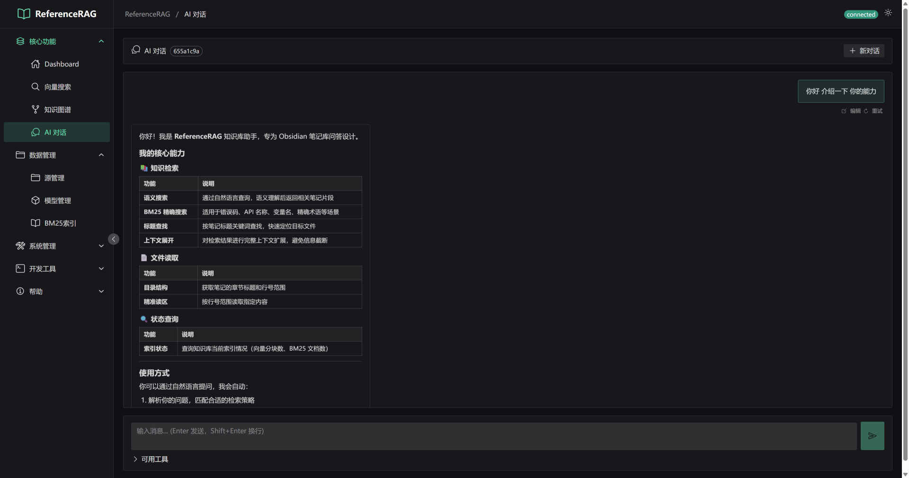

# ReferenceRAG

面向本地知识库的 RAG 系统，把本地文件夹、笔记库、文档接入统一的检索增强流程，为 AI 应用提供外挂知识库能力。

当前仓库包含后端服务、桌面端、前端仪表盘、存储层、核心检索逻辑、测试工程和部署脚本。

---

## 产品定位

| 角色 | 用途 |
|------|------|
| 用户 | 快速检索个人笔记库、文档库 |
| Agent | 通过 Skill / MCP / API 获取知识库内容 |
| 应用 | 集成检索能力，增强 AI 回答质量 |

---

## 核心特性

### AI 对话查询

内置聊天式查询界面，直接向知识库提问：



- 自然语言输入，无需掌握搜索语法
- 自动调用检索工具，从知识库获取答案
- 支持多轮对话，追问、细化、切换话题
- 注明来源笔记，答案可追溯
- 自动扩展模糊查询，提升召回率

适用场景：
- "笔记里有没有关于 Docker 配置的内容？"
- "帮我找一下 Git 分支管理的最佳实践"
- "上次记录的那个问题排查步骤是什么？"

### 自动索引与自适应分块
- 监听本地文件夹（md + txt），文件变更实时同步，无需手动触发
- **自适应 Markdown 分块**：超长段落自动切分、连续短元素智能合并、低信息量噪声分块自动过滤（`NoiseChunkDetector`）
- **单文件原子重分块**：重分块与增量更新采用原子替换，彻底杜绝残留孤儿向量与双倍重复数据
- 知识图谱（文档/标签/标题/外链节点）随索引自动构建与单事务更新

### 多路召回优化与全链路门禁
嵌入式模型 + BM25 + 重排模型 + 知识图谱组合，提升召回准确率：

| 路径 | 优势 | 适用场景 |
|------|------|----------|
| 嵌入式模型 | 语义理解 | "怎么配置 Docker 网络" |
| BM25 | 关键词精确匹配（jieba.NET 分词） | "IndexOutOfRangeException" |
| 重排模型 | 精排序 Top-N（ONNX / GGUF Causal Logit） | 混合检索后的二次精排 |
| 知识图谱 | 文档关联扩展 | 探索笔记间的引用关系 |

- **灵活过滤**：支持按知识源名称或文件夹路径过滤，让 AI 只检索指定知识范围。
- **停用源全链路隔离门禁**：停用知识源后，在向量检索、BM25、混合检索及图谱扩展中实时拦截过滤，无需删除索引即可随时启停知识源。
- **全链路耗时追踪**：提供检索阶段细粒度耗时拆解（向量召回、BM25、图谱扩展、重排精排）。

### 双引擎模型推理与显存生命周期管理
- **ONNX Runtime + LLamaSharp (GGUF) 双后端引擎**：同时支持 ONNX 模型与 GGUF 量化模型（如 `Qwen3-Embedding`、`Qwen3-Reranker`、`BGE-M3` 的 `Q4_K_M / Q8_0 / FP16` 等多量化变体）原生推理与批处理加速。
- **硬件加速自适应策略**：支持 Native CUDA、Portable CUDA、DirectML 与 CPU 自动探测回退，并根据当前可用显存自动计算 GGUF 模型的最佳 GPU 卸载层数（`GpuOffloadCalculator`）。
- **按需懒加载与显存自动回收（`ModelLifecycleStateMachine`）**：模型支持空闲滑动过期自动卸载；桌面端最小化到系统托盘后自动缩短驻留时间释放 GPU 显存，并提供实时 GPU 显存与算力遥测监控。
- **多源模型下载中心**：内置 HuggingFace 官方源与国内镜像源（`hf-mirror`）自动回退、模型格式自检转换及可取消的下载状态机。

### 12 维嵌入 & 重排评测基准
- 内置覆盖 **极性反转/硬对立、否定与排除语义、数值与时间精度、多跳拼图、长尾罕见标识、跨语言语义对齐、指令遵循** 等 12 个维度的标准评测套件（评测元数据与输入正文脱敏隔离，零标签污染）。
- 支持预设套件横向对比看板与单维详情卡片**一键双向联动定位**，并提供紧凑折叠视图快速巡检各模型得分、等级与 P95 延迟。

### 多种接入方式

| 方式 | 适用场景 | 说明 |
|------|----------|------|
| **AI 对话** | 聊天式查询 | Web/桌面端内置，直接提问 |
| **桌面端** | 日常使用 | InfiniFrame + WebView2，进程内 IPC，原生 Win32 高分屏托盘 |
| **Web 仪表盘** | 浏览器访问 | Vue 3 + Naive UI |
| **MCP 工具** | CherryStudio、Claude Code | MCP 协议调用 |
| **Skill** | Claude Code | 内置检索技能 |
| **REST API** | 脚本、集成 | 标准 HTTP 接口 |

---

## 目录结构

```
ReferenceRAG/
├── Infrastructure/              # 数据、双引擎模型推理、硬件加速、文件监控及基础能力
├── Business/ReferenceRAG.Business/ # 检索、索引、聊天业务及共享 wwwroot
├── Host/
│   ├── ReferenceRAG.ApiHost/     # 双端共享 API、MCP、认证及传输适配
│   ├── ReferenceRAG.WebHost/     # HTTP / SignalR / 静态页面
│   └── ReferenceRAG.DesktopHost/ # InfiniFrame / IPC / PerMonitorV2 原生 Win32 托盘
├── tests/                        # 单元测试、集成测试、架构门禁与性能测试
├── support/                      # 配套资料与本机运行文件
│   ├── tools/                    # 诊断工具、服务管理与构建脚本
│   ├── config/examples/          # 可提交的配置模板
│   ├── config/local/             # 本机配置（不提交）
│   ├── deploy/docker/            # 容器构建与 Compose
│   ├── docs/                     # 架构、运维、迁移文档及图片
│   ├── skill/                    # Agent 接入技能
│   ├── artifacts/                # 发布包、日志、测试与旧文件归档（不提交）
│   ├── data/                     # 本机数据（不提交）
│   └── models/                   # 本机模型（不提交）
├── build-desktop.bat             # 一键构建发布桌面端快捷入口
├── smoke-test.bat                # 一键端到端核心冒烟测试入口
└── ReferenceRAG.slnx             # 统一解决方案入口
```

---

## 快速开始

目录和配置约定见 [support 说明](support/README.md)。本机配置位于 `support/config/local/`，桌面端脚本（`build-desktop.bat`）默认发布输出位于 `Host/ReferenceRAG.DesktopHost/bin/Release/net10.0-windows/publish/`（Web 服务脚本发布输出位于 `support/artifacts/publish/web/`）。

### 1. 桌面端（推荐）

1. 从 [GitHub Releases](https://github.com/csvkse/ReferenceRAG/releases/latest) 下载 `ReferenceRAG-win-x64.zip`
2. 解压运行 `ReferenceRAG.DesktopHost.exe`
3. 自动打开桌面窗口，通过 IPC 访问进程内业务
4. 进入 **Chat** 页面，直接向知识库提问

**特性：**
- 启动后自动拉起服务并打开界面
- 关闭窗口最小化到托盘，**左键单击托盘图标立即唤醒窗口**，右键弹出 Per-Monitor V2 高分屏原生系统菜单
- 支持单实例保护、开机自启动、最小化静默启动，自动自愈开始菜单快捷方式与任务栏高清图标缓存
- 最小化到托盘后自动缩短模型显存驻留时长，空闲时自动卸载模型释放显存
- 默认无需监听端口；需要外部 API/MCP 时，在设置页开启「启用 HTTP 服务」

**系统要求：** WebView2 Runtime

### 2. 本地开发与构建

**前提：** .NET 10 SDK；桌面端需要 Windows 和 WebView2。Node.js 仅用于前端语法与逻辑单测检查，无需 npm 安装或打包。

```bash
dotnet run --project Host/ReferenceRAG.WebHost
# 或运行桌面端
dotnet run --project Host/ReferenceRAG.DesktopHost
```

也可以直接使用仓库根目录快捷脚本：

```bat
:: 一键编译发布 Windows x64 桌面端（默认输出至 Host/ReferenceRAG.DesktopHost/bin/Release/net10.0-windows/publish）
build-desktop.bat

:: 运行端到端核心冒烟测试
smoke-test.bat
```

### 3. Windows 服务管理

```bat
cd support/tools/scripts
menu.bat
```

功能：构建、安装/卸载服务、启动/停止、查看状态、控制台运行、打开浏览器、查看日志。

---

## Web 仪表盘

Vue 3 + Naive UI 的浏览器原生 ES Modules 界面，共享源码位于 `Business/ReferenceRAG.Business/wwwroot`。直接维护 JS 模块与运行时模板，Web 发布复制静态文件，桌面发布嵌入相同资源；不再使用 Vite/SFC 编译。内置全局页面状态保活（`keep-alive`，切换页面不清空输入与评测结果）与后台异步任务中心（`JobCenter`）。

| 页面 | 功能 |
|------|------|
| **Chat** | AI 对话查询，多轮聊天式检索与引用溯源 |
| Dashboard | 索引统计、模型运行状态与显存遥测、系统概览 |
| Search | 语义搜索、混合搜索、结果预览与耗时链路拆解 |
| Graph | 知识图谱可视化与独立重建 |
| Sources | 知识源文件夹管理、启停隔离、按源补全向量与重分块 |
| Models | ONNX / GGUF 多变体模型管理、镜像下载、切换与显存卸载 |
| Settings | 服务、检索、分块、硬件加速与模型驻留策略配置 |
| BM25 Index | BM25 索引管理与状态巡检 |
| Performance | 12 维嵌入 & 重排基准评测、横向对比看板与详情联动分析 |

---

## 核心能力

### 检索
- 向量检索
- BM25 全文检索（jieba.NET 分词）
- 混合检索（分数级加权融合）
- 可选重排（ONNX Cross-Encoder / GGUF Causal Logit）
- 同义词扩展与停用源全链路过滤

### 索引
- 自动后台索引与启动时增量同步
- 文件变更实时监控
- 自适应 Markdown 分块与低信息密度噪声过滤
- 单文件原子重分块（无孤儿向量残留）
- 知识图谱单事务更新

### 模型管理与推理
- Embedding / Reranker 双引擎推理（ONNX Runtime + LLamaSharp GGUF）
- 多量化变体管理（FP16 / Q8_0 / Q4_K_M 等）与 HuggingFace / 国内镜像源下载
- Native CUDA / Portable CUDA / DirectML / CPU 自动策略选择与 GGUF 显存层数自动分配
- 空闲滑动过期卸载、托盘极速回收显存与实时 GPU 遥测
- OpenAI 兼容 API 模式

### 服务能力
- REST API
- MCP 工具集
- Swagger 文档
- SignalR 实时通知与全局异步任务状态流
- Windows Service 适配

---

## 配置要点

| 配置项 | 说明 |
|--------|------|
| `ReferenceRAG:Service:port` | 服务端口，默认 7897 |
| `ReferenceRAG:Service:apiKey` | API 密钥，留空关闭鉴权 |
| `ReferenceRAG:Service:enableHttpService` | 是否监听 HTTP（仅桌面端；默认 false，用进程内 IPC） |
| `ReferenceRAG:Service:allowNetworkAccess` | 是否允许局域网访问（默认仅 localhost） |
| `ReferenceRAG:Service:enableCors` | 是否启用 CORS（默认 true） |
| `ReferenceRAG:Service:enableSwagger` | 是否启用 Swagger（默认 true） |
| `ReferenceRAG:Service:logLevel` | 日志级别（默认 Information，排障可设 Debug） |
| `ReferenceRAG:dataPath` | 数据目录 |
| `ReferenceRAG:modelsRootPath` | 模型文件目录 |
| `ReferenceRAG:sources` | 知识源配置列表 |

端口与监听地址在启动时读取，修改后需重启；其余项在设置页保存后生效。

配置文件：
- `support/config/local/appsettings.json`
- 桌面端发布目录下的 `appsettings.json`

开发时现有 `support/config/local/appsettings*.json` 会复制到宿主输出目录。设置 `REFERENCERAG_CONTENT_ROOT` 可指定独立配置根目录；相对数据路径以该目录为基准。不要让新旧程序同时写入同一数据目录。新宿主之间通过目录锁限制单写入者。

发布与验证记录见 [迁移交付说明](support/docs/migration/infinitool-migration-status.md)。两端均使用普通 .NET 发布，关闭 AOT 和裁剪。

---

## 环境要求与 GPU 加速

### 支持的运行环境

| 组件 | 版本 | 说明 |
|------|------|------|
| .NET SDK | 10.0.100 及以上 | 见 `global.json`，`rollForward: latestFeature` |
| 目标框架 | `net10.0` / `net10.0-windows` | 两端均为常规发布，关闭 AOT 与裁剪 |
| **ONNX Runtime (GPU)** | **1.24.4（已锁定）** | **要求 CUDA 12.x，不可升到 1.27+** |
| **LLamaSharp (GGUF)** | **内置 CUDA 12 / CPU 后端** | 支持 GGUF 嵌入与重排模型按显存自动分配 GPU 层数 |
| CUDA | **12.x**（官方基准 12.8） | 本地 ONNX / GGUF CUDA 加速需要 |
| cuDNN | **9.x** | cuDNN 8.x 与 9.x 二进制不兼容（仅 ONNX CUDA 需要） |
| 操作系统 | Windows x64 | 桌面端另需 WebView2 Runtime |

不满足 GPU 条件时自动回退 DirectML 或 CPU 运行，功能不受影响，仅速度较慢。

### ⚠️ ONNX Runtime 版本不可随意升级

`Microsoft.ML.OnnxRuntime.Gpu` 已锁定 **1.24.4**，请勿升级到 1.27 及以上：

| ORT 版本 | GPU 包编译所用 CUDA | 实际依赖的库 |
|----------|--------------------|--------------|
| 1.21.x – 1.26.x | CUDA 12.8 | `cublasLt64_12.dll` |
| **1.27 及以上** | **CUDA 13.0** | `cublasLt64_13.dll` |

自 1.27 起官方 GPU 包默认改用 CUDA 13 编译。在常见的 CUDA 12 环境上升级后，会出现：

```
Error loading "onnxruntime_providers_cuda.dll" which depends on
"cublasLt64_13.dll" which is missing.
```

程序会**静默回退 CPU**（不报错、不中断），表现为推理变慢，容易误判为配置问题。升级前请先确认目标环境的 CUDA 版本，或同步安装 CUDA 13 运行时。

### 如何确认 GPU 已生效

查看日志（`Logs/app_年月日.log`）中 `[EmbeddingService]` / `[OnnxRerankService]` / `[LlamaEmbeddingAdapter]` / `[LlamaRerankAdapter]` 的记录：

```
<时间> [INF] [EmbeddingService] 使用 CUDA GPU: 0 (动态batch已启用)
<时间> [INF] [OnnxRerankService] 使用 CUDA GPU: 0 (确定性模式)
```

若出现 `CUDA 不可用，回退到 CPU`，说明 CUDA 未能加载，其后的异常堆栈会给出具体原因（库缺失、版本不匹配等）。**回退 CPU 不会中断服务，只会显著变慢**，因此务必确认这一行。

也可用设置页的「模型健康诊断」、模型页的「运行时遥测状态」，或日志中的 `[ModelProbe]` 行交叉验证模型是否正常工作。

### 配置 CUDA 库路径

CUDA/cuDNN 的 DLL 不在系统 PATH 时，用 `ReferenceRAG:embedding:cudaLibraryPath` 指定目录（多个路径用 `;` 分隔）。程序会在加载模型前追加到 PATH：

```json
{
  "ReferenceRAG": {
    "embedding": {
      "useCuda": true,
      "cudaDeviceId": 0,
      "cudaLibraryPath": "D:/CUDA/bin;D:/cudnn/bin"
    }
  }
}
```

该字段仅负责让运行时找到 DLL，**不改变所需的 CUDA 主版本**——路径指向 CUDA 12 的库时，ORT 1.24.4 可正常加载；指向 CUDA 13 的库无法满足 ORT 1.24.4 以外的版本需求。

---

## 支持的模型

- **本地 ONNX Embedding：** `bge-small-zh-v1.5`、`bge-base-zh-v1.5`、`bge-large-zh-v1.5`、`bge-m3` 等
- **本地 GGUF Embedding（LLamaSharp）：** `Qwen3-Embedding` 系列、`bge-m3-gguf`（支持 `Q4_K_M`、`Q8_0`、`FP16` 等多变体）
- **本地 ONNX Rerank：** `bge-reranker-base`、`bge-reranker-large`、`bge-reranker-v2-m3` 等
- **本地 GGUF Rerank（LLamaSharp）：** `Qwen3-Reranker` 系列（支持 Causal Logit Yes/No 概率重排架构）及标准 GGUF Reranker
- **OpenAI 兼容 API：** Ollama、vLLM、Xinference、LM Studio、TEI 等

---

## 数据存储

- `vectors.db`：向量、BM25、图谱数据
- `query_stats.db`：查询统计与历史评测快照
- 模型文件目录
- 索引日志和运行日志

迁移环境时需携带实际配置指向的数据和模型目录；仓库内统一存放于 `support/data/`、`support/models/`，外部绝对路径保持原配置。

---

## API 与使用文档

- **Swagger：** `http://localhost:7897/swagger`
- **Skill 文档：** [skill/ReferenceRAG/SKILL.md](support/skill/ReferenceRAG/SKILL.md)
- **桌面端构建脚本指南：** [docs/cmd/build-desktop-batch-guide.md](docs/cmd/build-desktop-batch-guide.md)
- **使用预览：** [PREVIEW.md](support/docs/PREVIEW.md)

---

## 版本与改动历史

当前稳定版本为 [v1.0.14](https://github.com/csvkse/ReferenceRAG/releases/tag/v1.0.14)。版本级改动和升级提示见 [CHANGELOG.md](CHANGELOG.md)。

### 近期重点演进摘要

#### 桌面端高分屏与托盘体验（v1.0.14）
- **feat:** 升级多分辨率（`16`～`256` 共 7 帧 32bpp）主题色 `R` 应用与托盘图标
- **feat:** 接入 `PerMonitorV2` DPI 清单、窗口动态 DPI 图标注入与原生 Win32 托盘菜单，彻底解决高分屏图标与右键菜单模糊问题
- **feat:** 托盘图标支持左键单击直接唤醒窗口，并升级开始菜单快捷方式版本化图标自愈机制

#### 多维评测基准、检索门禁与前端交互（v1.0.13）
- **feat:** 扩展嵌入与重排预设评测集至 12 个维度，并对评测标签与输入正文进行脱敏隔离（零标签污染）
- **feat:** 预设套件横向对比看板与重排测试结果详情支持双向一键联动定位及最简数据紧凑折叠
- **feat:** 实现停用知识源在向量、BM25、混合检索与图谱扩展中的全链路门禁过滤
- **feat:** 前端引入路由级 `keep-alive` 页面状态保活，切换页面不丢失搜索与评测现场

#### 双引擎模型架构、自适应分块与显存治理（v1.0.8 – v1.0.12）
- **feat:** 引入 LLamaSharp GGUF 嵌入与重排后端（含 `Qwen3-Reranker` Causal Logit 架构），形成 ONNX + GGUF 双推理引擎
- **feat:** 新增硬件加速自适应策略、GGUF 显存层数自动计算、模型滑动过期自动卸载、托盘极速显存回收及实时 GPU 遥测
- **feat:** 重构多源模型下载协调器与状态机，支持 HuggingFace / 国内镜像源与多量化变体管理
- **feat:** 实现自适应 Markdown 分块、入库噪声分块过滤及单文件原子重分块（根治双倍残留向量）
- **feat:** 新增全局异步任务中心（`JobCenter`）与检索全链路耗时拆解追踪

