# 自适应分段与存储空间优化落地实施方案

> **文件标识**：`docs/adaptive-chunking-and-storage-optimization-implementation-plan.md`  
> **任务目标**：根据可行性调研，全面落地自适应分段模式（Adaptive Chunking），实现分块数量大幅精简、彻底消除物理硬截断、抑制注意力稀释并直降 50%~75% 存储空间占用。  
> **设计模式**：适配器模式（`IModelProfileAdapter`）+ 策略模式（`IAdaptiveChunkingStrategy`）+ 状态机模式（`ChunkingExecutionStateMachine`）。

---

## 1. 总体设计与实施目标

1. **核心痛点闭环**：
   - 解决固定 512 分块导致的“长文本大模型算力浪费、短章节低密度向量冗余、富元数据尾部硬截断、盲目 20% 重叠占用空间”等系列问题。
2. **空间优化量化指标**：
   - 长上下文模型（如 BGE-M3 8K）挂载时：分块数量 $N$ 骤降 **60% ~ 75%**，整体向量数据库体积直降 **50% ~ 70%**；
   - 512 模型挂载时：通过微短块智能聚合与结构性 0% 重叠，分块数减少 **15% ~ 25%**，消除 **10% ~ 15%** 冗余重复文本；
   - 硬截断发生率：从现有 12%~28% 降至 **0%**。
3. **架构演进原则**：
   - 保持 100% 优雅向后兼容：默认提供 `Mode = "Fixed"` 与 `Mode = "Adaptive"` 双模态平滑切换；
   - 遵循三元设计体系：适配器抽象模型画像、策略工厂调度 4 大风格、状态机追踪执行遥测。

---

## 2. 核心架构与类库分工

```mermaid
classDiagram
    class IModelProfileAdapter {
        <<interface>>
        +CanHandle(modelName, mode) bool
        +GetProfile(config) ModelEmbeddingProfile
    }
    class DefaultModelProfileAdapter {
        +GetProfile(config) ModelEmbeddingProfile
    }
    IModelProfileAdapter <|-- DefaultModelProfileAdapter

    class IAdaptiveChunkingStrategy {
        <<interface>>
        +StrategyType AdaptiveStrategyType
        +Execute(content, file, profile, options) List~ChunkRecord~
    }
    class BalancedAdaptiveStrategy {
        +Execute() 黄金比例(350-450 tok), 兼顾召回与语境
    }
    class PrecisionDenseAdaptiveStrategy {
        +Execute() 紧凑窗口(200-300 tok), 高密度事实问答
    }
    class DeepNarrativeAdaptiveStrategy {
        +Execute() 宽松窗口(75%-85%), 小说长文长程理解, 空间省70%
    }
    class CodeStructureFirstAdaptiveStrategy {
        +Execute() 语法树优先, 代码/表格 0% 重叠, 结构不腰斩
    }
    IAdaptiveChunkingStrategy <|-- BalancedAdaptiveStrategy
    IAdaptiveChunkingStrategy <|-- PrecisionDenseAdaptiveStrategy
    IAdaptiveChunkingStrategy <|-- DeepNarrativeAdaptiveStrategy
    IAdaptiveChunkingStrategy <|-- CodeStructureFirstAdaptiveStrategy

    class AdaptiveStrategyFactory {
        +GetStrategy(type) IAdaptiveChunkingStrategy
    }

    class ChunkingExecutionStateMachine {
        +CurrentPhase ChunkingPhase
        +TransitionTo(phase, details)
        +GetTelemetry() ChunkingTelemetry
    }
```

---

## 3. 分步落地实施步骤

### 步骤 1：配置模型与核心模型画像适配器
- 在 `ReferenceRAG.Infrastructure/Models/ObsidianRagConfig.cs` 的 `ChunkingConfig` 中加入自适应字段：
  - `Mode`: `"Fixed"` | `"Adaptive"`
  - `AdaptiveLevel`: `"Level1"` | `"Level2"` | `"Level3"`
  - `AdaptiveStrategyType`: `"Balanced"` | `"PrecisionDense"` | `"DeepNarrative"` | `"CodeFirst"`
  - `TargetWindowUtilizationPercent`: 默认 70
  - `AdaptiveOverlapPercent`: 默认 10
- 在 `ReferenceRAG.Infrastructure/Models/Enums.cs` 的 `ChunkingOptions` 同步扩展上述属性与 `ModelEmbeddingProfile`；
- 在 `ReferenceRAG.Business/Features/Chunking/Adapters/` 下创建：
  - `IModelProfileAdapter.cs`
  - `DefaultModelProfileAdapter.cs`（针对 BGE、Jina、OpenAI、通用模型计算物理上限与黄金区间）。

### 步骤 2：自适应策略矩阵与策略工厂
- 在 `ReferenceRAG.Business/Features/Chunking/Strategies/` 下创建：
  - `IAdaptiveChunkingStrategy.cs`
  - `BalancedAdaptiveStrategy.cs`
  - `PrecisionDenseAdaptiveStrategy.cs`
  - `DeepNarrativeAdaptiveStrategy.cs`
  - `CodeStructureFirstAdaptiveStrategy.cs`
  - `AdaptiveStrategyFactory.cs`

### 步骤 3：状态机与 MarkdownChunker / FileIndexPipeline 集成
- 在 `ReferenceRAG.Business/Features/Chunking/StateMachine/` 下创建：
  - `ChunkingExecutionStateMachine.cs`
- 在 `MarkdownChunker.cs` 中接入自适应逻辑：
  - 若 `options.Mode == "Adaptive"`，通过适配器与策略工厂计算动态切分窗口，执行结构化保护与动态重叠；
  - 若为原有 `"Fixed"`，维持既有逻辑不变；
- 在 `FileIndexPipeline.cs` 中：
  - 自动向 `ChunkingOptions` 注入当前生效模型的 `ModelProfile`；
  - 状态机全程跟踪并输出诊断日志。
- 在 `ChunkingExtensions.cs` 中完成依赖注入。

### 步骤 4：前端界面配置与实时画像测算看板
- 在 `Settings.js` 的【分段设置】Tab 增加：
  - 单选切换：`固定分段 (Fixed)` / `自适应分段 (Adaptive - 推荐)`；
  - 自适应等级下拉框（Level 1 模型感知 / Level 2 结构句法 / Level 3 深度语义）；
  - 自适应风格单选组（通用平衡 / 高精度紧凑 / 深度长文叙事 / 代码与结构优先）；
  - 黄金利用率与动态重叠率调节滑块；
  - **实时模型画像测算看板**（Live Model Sweet-Spot Preview）：直观展示目标分块 Token、防硬截断安全指标、预计存储瘦身百分比。

### 步骤 5：自动化测试、基准压测与冒烟验证
- 编写 `AdaptiveChunkingTests.cs`：
  - 验证 512 模型与 8192 模型下的切分 Token 计算精准性；
  - 验证长文本下自适应分块相比固定分块数量锐减 60%+ 的空间瘦身效果；
  - 验证代码块、Markdown 表格零断裂保护；
- 运行 `node check.mjs` 校验前端 AST；
- 运行 `dotnet test` 与 `smoke-test.bat` 确保 100% 通过且零回归。
