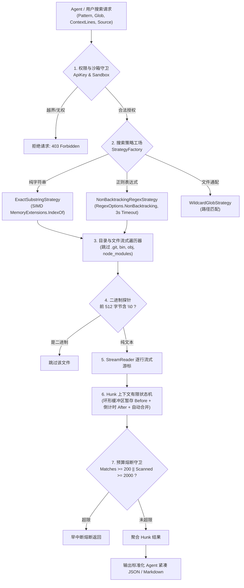
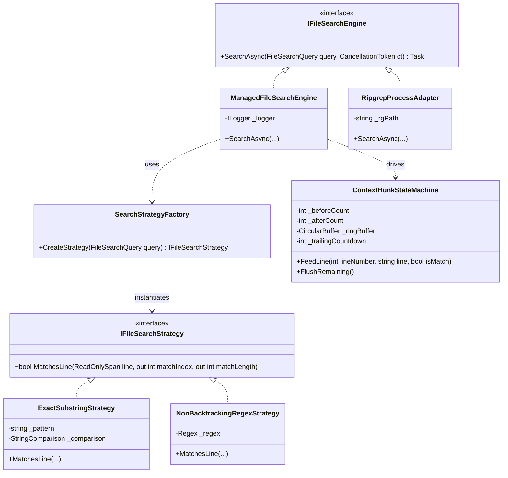

# Agent 级文件高效关键字与正则搜索引擎架构与设计方案

## 1. 背景与痛点：为什么 Agent 与知识库系统迫切需要专用文件搜索工具？

ReferenceRAG 现有的核心检索架构基于 **混合检索（BM25 倒排索引 + 密集向量嵌入 + Rerank 交叉重排）**。这种架构在处理自然语言语义问答、概念发散理解时表现优异，但在面对 **AI 编程 Agent（如 Cursor、Claude Code、Antigravity、Devin 等）** 或高级工程人员的日常代码/知识库探索时，存在显著的技术盲区与结构性缺陷：

1. **精准标识符与代码符号的低召回与幻觉：**
   - 向量检索将文本切片投影到高维语义空间，对于高信息熵的精确符号（如 `ApiKeyPermissionMatrix`、`_cachedByHash`、GUID、HTTP 状态码、配置键、端口号、正则表达式语法等）缺乏敏感度。
   - BM25 分词器（如 Jieba）对编程代码中的下划线、驼峰命名、命名空间层级往往切分过度或识别不全，导致精确搜索词检索失败。
2. **文本分块（Chunking）破坏源码与笔记的物理连续性：**
   - RAG 将大文件切分为 200~800 Token 的片段，切断了代码上下文与行号对应关系，Agent 无法获知匹配项在原始文件中的绝对行号（Line Number），更无法获知精确的上下文包围区。
3. **索引时效性滞后（Index Staleness）：**
   - 向量与 BM25 索引构建是异步防抖计算过程（通常需要数秒到数分钟）。当用户或 Agent 在源管理中刚刚新增、编辑或复制了一个文件时，索引尚未构建，向量搜索完全无法召回该文件。
4. **Agent 工具链生态标准缺失：**
   - 业界主流 Agent（如 Claude Code 的 `grep`/`glob` 工具、VS Code 的 `search.rgPath`、Antigravity 的文件搜索）均将“即时物理文件正则/文本搜索”作为其首要认知探针。
   - 缺少该工具时，Agent 只能通过全量遍历目录和频繁调用 `read_file`，导致 Context Window（上下文窗口）瞬间被巨量冗余文本撑爆，产生极高的延迟与 Token 成本。

因此，构建一个 **零索引延迟、亚毫秒级启动、支持正则表达式与字串双轨、行号精确、带上下文 Hunk 折叠合并、受数据源权限沙箱保护的 Agent 级文件搜索引擎**，是 ReferenceRAG 基础设施不可或缺的关键进化。

---

## 2. 业界主流方案调研与对比

| 方案 | 核心技术实现 | 优势 | 劣势 / 局限性 |
| :--- | :--- | :--- | :--- |
| **BurntSushi/ripgrep (`rg`)**<br>*(终端内容检索标杆，VS Code / Cursor / Claude Code 底层)* | 采用 Rust 开发；Teddy 算法 + Aho-Corasick SIMD 向量化加速；DFA/NFA 正则引擎；NUL 字节嗅探跳过二进制；多线程无锁目录遍历；自动识别 `.gitignore`。 | 速度极其恐怖（业界第一）；内存占用极低；无死锁/ReDoS 风险；输出格式完备（支持 JSON 流）。 | 属于外部 C/Rust 原生二进制可执行程序。在跨平台跨架构分发（Linux x64/ARM64, Windows x64/ARM64, Docker Alpine/Ubuntu）时需引入二进制打包与子进程管理。 |
| **sharkdp/fd (`fd-find`)**<br>*(终端文件名通配检索标杆)* | 采用 Rust 开发；基于 `ignore` crate 多线程并行树遍历，自动忽略隐藏文件与 `.gitignore`；支持 Glob 与 Regex 路径模式。比原生 `find` 快 5-10 倍。 | 极速文件名定位；零文件内容读取开销；色彩与终端格式友好。 | 仅负责路径与文件名发现，不负责行内容扫描；同样为外部编译二进制。 |
| **Anthropic Claude Code (`grep` / `glob`)** | 围绕 LLM Agent 终端交互调用的标准化工具集：<br>1. `glob`：快速按路径通配扩展文件列表（类似 `fd`）；<br>2. `grep`：`pattern`, `path`, `include`, `case_sensitive`, `context_lines`（类似 `rg -C`），结果按文件聚合，自动合并临近 Hunk，TopK 熔断。 | 专为大模型认知优化：只返回匹配行及必要上下文，杜绝单次调用爆 Token；参数直观，无冗余心智负担。 | 强依赖底层宿主机环境命令，对 Windows PowerShell 与 Linux Shell 兼容性有边界差异。 |
| **Lucene / Tantivy / SQLite FTS5 (倒排索引)** | 预先对文件建立倒排索引与词典树。 | 查询特定单分词速度极快（微秒级）。 | 无法即时反映实时磁盘变更；不支持任意正则（或正则开销极大）；索引膨胀率通常达原文件大小的 30%~100%；维护成本高。 |
| **.NET 10 原生高性能流水线 (本项目方案)** | `RegexOptions.NonBacktracking` 线性时间保证；`SearchValues<char>` 与 `MemoryExtensions.IndexOf` SIMD 硬件加速；`StreamReader` 行级游标早中断；状态机环形缓冲区上下文合并。 | **100% 托管代码，零原生二进制依赖**；全平台天然自适配（Windows/Linux/Docker）；直接无缝复用数据源沙箱与 API Key ABAC 矩阵；性能逼近 ripgrep 且无进程启动开销。 | 纯托管多线程 IO 受底层操作系统文件系统缓存与 .NET JIT 优化程度影响。 |

---

## 3. 核心可行性、逻辑陷阱与性能风险头脑风暴 (Pitfalls & Guardrails)

在实现文件关键字与正则搜索时，若仅进行简单的“遍历目录 + `File.ReadAllText` + `Regex.Matches`”，系统在真实高并发或恶劣文件场景下必然崩溃。必须针对以下 6 大风险设立严格的防护机制：



### 3.1 风险 1：灾难性回溯 (ReDoS) 与恶意正则
- **缺陷表现**：若 Agent 或外部输入恶意/病态正则表达式（如 `^(a+)+$` 或 `(x+x+)+y`），在传统 NFA 正则引擎中，当扫描到不匹配的长行时，计算复杂度呈指数级 $O(2^n)$ 暴增，将直接导致单个 CPU 核心 100% 卡死数小时，拖垮整个 Web 宿主进程。
- **治理策略**：
  1. **强行启用 `RegexOptions.NonBacktracking`**：.NET 7+ 引入的基于 DFA/Thompson NFA 的非回溯引擎，从数学原理上保证了在输入文本长度上的 **严格线性时间复杂度 $O(N)$**，彻底消除回溯机制带来的 ReDoS 风险。
  2. **强制硬性匹配超时 (MatchTimeout)**：为 Regex 对象配置 `TimeSpan.FromSeconds(3)` 的硬性断路器，即使遇到极端长行也能准时熔断。

### 3.2 风险 2：大文件全量加载导致的 LOH 膨胀与 Gen2 GC 停顿
- **缺陷表现**：如果在遍历文件时直接调用 `File.ReadAllText()` 或 `File.ReadAllLines()`，当知识库包含 50MB 的日志文件、JSON 导出包或大型数据表时，会在大对象堆（LOH, Large Object Heap）上分配巨型字符串数组，瞬间触发频繁的 Gen2 全量垃圾回收，造成应用全局停顿（Stop-The-World）。
- **治理策略**：
  1. **单文件最大扫描上限**：对大于 10MB 的单个文件直接判定为非代码/非常规文本，跳过文本扫描。
  2. **基于 `StreamReader` 的轻量流式迭代**：分配固定 8KB 缓冲区，每次仅读取单行（`ReadLineAsync`），单行最大字符截断为 2048 字符，零整文件内存缓冲。

### 3.3 风险 3：二进制文件脏数据污染与乱码爆框
- **缺陷表现**：知识库源中不可避免地存在 `.png`、`.pdf`、`.zip`、`.db`、`.exe` 等二进制文件。如果强行按 UTF-8 读取并执行正则，既浪费 CPU 又会导致返回给 Agent 的结果中充满不可打印的乱码（如 `\u0000\ufffd`），严重破坏 Agent 的推理上下文。
- **治理策略**：
  - **Git / Ripgrep 经典探针嗅探法**：在打开文件时，先通过底层 `FileStream` 异步读取前 512 字节到栈内存 `stackalloc byte[512]` 中；扫描这 512 字节，只要发现任何一个 `0x00`（NUL 空字符），立即判定为二进制文件并关闭流，耗时小于 5 微秒。

### 3.4 风险 4：目录遍历风暴与无效黑洞
- **缺陷表现**：很多用户直接将整个项目源码目录挂载为知识库，其中包含 `.git`（包含数万个 loose objects）、`node_modules`、`bin/Debug`、`obj`、`.codegraph`、`.vs` 等。如果无差别遍历，搜索将耗费数分钟且返回大量冗余结果。
- **治理策略**：
  - 建立系统级默认排除目录黑名单：
    `{ ".git", ".svn", ".hg", "node_modules", "bin", "obj", "dist", "build", "target", ".vs", ".vscode", ".codegraph", ".idea" }`。
  - 在目录枚举时采用浅层剪枝：一旦目录名匹配黑名单，直接跳过该目录整棵子树，不进入其内部遍历。

### 3.5 逻辑严密性 1：上下文行重叠冲突与优雅 Hunk 合并
- **缺陷表现**：当 Agent 设定 `contextLines: 2` 时：
  - 假设第 10 行匹配，上下文为 8, 9, `[10]`, 11, 12；
  - 紧接着第 12 行也匹配，上下文为 10, 11, `[12]`, 13, 14。
  - 如果机械输出两个匹配块，第 10, 11, 12 行将被重复打印两次，浪费 Token 且造成阅读混淆。
- **治理策略**：
  - 引入基于 **有限状态机（FSM）** 的 `ContextHunkStateMachine`。
  - 维护一个容量为 $B$（前置上下文行数）的 **环形缓冲区（RingBuffer）**；
  - 遇到匹配行时，将环形缓冲区内容作为前置行一次性排空，并将后续行倒计数器置为 $A$（后置上下文行数）；
  - 若在倒计数期间再次遇到新匹配行，自动将后置倒计数器重置刷新为 $A$，将两次匹配无缝融合成一个单一大代码块（`Hunk: Lines 8-14`）。

### 3.6 逻辑严密性 2：数据源隔离 (ABAC) 与安全沙箱下推
- **缺陷表现**：跨数据源全局搜索时，未授权 API Key 可能借由 `*` 通配检索越权获知受保密数据源中的代码与笔记内容。
- **治理策略**：
  - 在执行搜索前，必须先调用 `ApiKeyPermissionMatrix.GetEffectiveAllowedSources(currentKey)`，将查询限定在授权数据源名单内；
  - 绝对禁止 Agent 传入带 `../` 的跨目录路径，所有路径严格经由 `FileBrowserPath.IsWithin` 验核。

### 3.7 逻辑严密性 3：全局搜索预算短路（Search Budgets）
- **默认熔断边界**：
  - `MaxMatches`：默认 100 条匹配，单次最大 500 条。一旦命中累计数达到该阈值，立即短路早中断，设置 `truncated: true` 并返回；
  - `MaxFilesScanned`：默认单次最大扫描 2,000 个文件，防止超大磁盘 IO 饥饿；
  - `Timeout`：默认最大执行时间 10 秒。

---

## 4. 设计模式在搜索引擎中的深度运用

为了保证系统的可维护性、高扩展性与极高单元测试友好度，我们采用以下经典设计模式进行架构解耦：



### 4.1 策略模式 (Strategy Pattern) —— 匹配引擎动态分流
根据搜索参数特征，动态切换最优匹配策略，避免让所有字符串都承受正则编译与执行开销：
- **`ExactSubstringStrategy` (字串极速策略)**：
  - 当 `IsRegex == false` 时启用；
  - 采用 .NET 10 的 `line.IndexOf(_pattern.AsSpan(), _comparison)`；
  - 底层由 JIT 自动生成 SIMD 向量化汇编指令（AVX2/AVX-512/ARM Neon），比正则表达式快 **10 到 50 倍**，且对括号、星号、引号等符号无需转义。
- **`NonBacktrackingRegexStrategy` (安全正则策略)**：
  - 当 `IsRegex == true` 时启用；
  - 封装带 `RegexOptions.NonBacktracking | RegexOptions.CultureInvariant` 的引擎，保证 $O(N)$ 复杂度和 3 秒超强断路保护。
- **`SearchStrategyFactory` (策略工场)**：
  - 统一构造与缓存校验，若传入的正则表达式语法非法，在遍历文件之前立即可读抛错，避免在扫描中途报错崩溃。

### 4.2 适配器模式 (Adapter Pattern) —— 托管引擎与宿主原生进程透明切换
定义统一的高阶接口 `IFileSearchEngine`，向上对 Controller 和 MCP Tools 提供一致的强类型查询体验，向下提供两套可插拔实现：
- **`ManagedFileSearchEngine` (纯托管自研引擎 - 默认启用)**：
  - 100% 纯 C# 代码，零外部二进制文件依赖，保证在 Windows 开发机、精简 Linux Docker 镜像（如 Alpine/Debian-slim）中开箱即用；
  - 使用 `Channel<T>` 配合 `Parallel.ForEachAsync` 实现生产-消费并发模型。
- **`RipgrepProcessAdapter` (系统级原生加速适配器 - 插件化扩展)**：
  - 启动时自动嗅探当前环境 `PATH` 或配置目录是否存在 `rg` / `rg.exe` 可执行文件；
  - 若存在且配置启用，直接通过适配器拉起 `rg --json --max-count ...` 进程，解析输出流并适配为统一的 `FileSearchResult` 领域对象，获取无与伦比的底层 C/Rust 原生极限吞吐；
  - 若不存在则透明回退至 `ManagedFileSearchEngine`，上层调用方完全无感知。

### 4.3 状态机模式 (State Machine Pattern) —— 环形缓冲 Hunk 合并器
为了实现精确的上下文代码块提取并杜绝重叠行重复打印，设计 `ContextHunkStateMachine`：
- **核心状态**：
  1. `Buffering`（缓冲前置行）：当前未发生匹配，将行内容与行号推入定长环形队列 `_ringBuffer`（容量为 $B$）；
  2. `Matched`（命中当前行）：当前行匹配，触发排空 `_ringBuffer` 生成前置上下文行，输出高亮匹配行，并将后置倒计数器 `_afterCountdown` 设置为 $A$；
  3. `EmittingTrailing`（吐出后置行）：后续各行直接作为后置上下文加入当前代码块，`_afterCountdown` 递减。若在此状态下再次命中新匹配行，直接将 `_afterCountdown` 重新重置为 $A$，**实现无缝合并（Continuous Hunk）**；
  4. `Idle`（静默推进）：后置倒计数归零，闭合当前 Hunk 块并进入下一个潜在块的监测。

---

## 5. 系统现有基础设施与资产复用盘点

本项目已有丰富的底层建设，可直接复用，杜绝重复造轮子：

1. **路径沙箱与规范化**：
   - 复用 [`FileBrowserPath.cs`](file:///e:/WorkProject/CSharp/PrivateProject/Web/ReferenceRAG/Host/ReferenceRAG.ApiHost/Services/FileBrowserPath.cs) 的 `Normalize(path)` 与 `IsWithin(child, parent)`，确保搜索请求始终在指定源或系统白名单根目录下。
2. **多数据源配置驱动**：
   - 复用 [`ConfigManager.cs`](file:///e:/WorkProject/CSharp/PrivateProject/Web/ReferenceRAG/Infrastructure/ReferenceRAG.Infrastructure/Features/Storage/Services/ConfigManager.cs)，通过 `_configManager.Load().Sources` 获取已启用的源物理路径、名称与隔离属性。
3. **细粒度权限管控与 ABAC 授权**：
   - 复用 [`ApiKeyPermissionMatrix.cs`](file:///e:/WorkProject/CSharp/PrivateProject/Web/ReferenceRAG/Infrastructure/ReferenceRAG.Infrastructure/Features/Security/ApiKeyPermissionMatrix.cs) 的 `GetEffectiveAllowedSources(currentKey)`，自动收窄受限 API Key 能够扫描的数据源。
4. **模型上下文协议 (MCP) 工具总线**：
   - 复用 [`KnowledgeFileTools.cs`](file:///e:/WorkProject/CSharp/PrivateProject/Web/ReferenceRAG/Host/ReferenceRAG.ApiHost/McpTools/KnowledgeFileTools.cs) 与 `RagWebHostExtensions.cs`，直接注入新工具 `SearchFileContent` 与 `FindFilesByPattern`，Agent 无需任何额外配置即可感知。
5. **.NET 10 高性能基础库**：
   - `System.Text.RegularExpressions.RegexOptions.NonBacktracking`
   - `System.Buffers.SearchValues<char>`
   - `System.IO.EnumerationOptions`
   - `System.Threading.Channels`

---

## 6. 核心接口与数据模型设计

### 6.1 领域模型契约

```csharp
namespace ReferenceRAG.Core.Models;

/// <summary>
/// 文件搜索查询参数请求
/// </summary>
public sealed class FileSearchQuery
{
    public string Pattern { get; set; } = string.Empty;
    public bool IsRegex { get; set; } = false;
    public bool CaseSensitive { get; set; } = false;
    
    /// <summary>
    /// 限定搜索的数据源名称列表（空则根据权限搜索所有可用源）
    /// </summary>
    public List<string>? Sources { get; set; }
    
    /// <summary>
    /// 相对子目录或目标路径
    /// </summary>
    public string? SubPath { get; set; }
    
    /// <summary>
    /// 文件名包含通配符（如 "*.md", "*.cs"）
    /// </summary>
    public string? FilePattern { get; set; }
    
    /// <summary>
    /// 前后文行数（0 ~ 5，默认 1）
    /// </summary>
    public int ContextLines { get; set; } = 1;
    
    /// <summary>
    /// 最大匹配命中条数（默认 100，上限 500）
    /// </summary>
    public int MaxMatches { get; set; } = 100;
}

/// <summary>
/// 匹配行详细信息
/// </summary>
public sealed record SearchMatchLine(
    int LineNumber,
    string Text,
    bool IsMatch,
    int MatchIndex = -1,
    int MatchLength = 0
);

/// <summary>
/// 连续上下文 Hunk 块
/// </summary>
public sealed record SearchHunk(
    int StartLine,
    int EndLine,
    List<SearchMatchLine> Lines
);

/// <summary>
/// 单个文件中的命中集合
/// </summary>
public sealed record FileSearchMatchGroup(
    string SourceName,
    string RelativePath,
    string FullPath,
    int MatchCount,
    List<SearchHunk> Hunks
);

/// <summary>
/// 搜索最终聚合结果
/// </summary>
public sealed record FileSearchResult(
    bool Success,
    string QueryPattern,
    bool IsRegex,
    int TotalMatches,
    int MatchedFilesCount,
    int TotalFilesScanned,
    long ElapsedMilliseconds,
    bool Truncated,
    List<FileSearchMatchGroup> Files,
    string? Error = null
);
```

### 6.2 核心服务接口

```csharp
namespace ReferenceRAG.Core.Interfaces;

public interface IFileSearchEngine
{
    /// <summary>
    /// 执行全源或指定源的高效文本/正则扫描
    /// </summary>
    Task<FileSearchResult> SearchAsync(FileSearchQuery query, CancellationToken ct = default);
    
    /// <summary>
    /// 仅按文件名通配模式快速查找定位文件
    /// </summary>
    Task<List<string>> FindFilesAsync(string? sourceName, string globPattern, int maxResults = 100, CancellationToken ct = default);
}
```

---

## 7. MCP 工具与 Web API 联动设计

### 7.1 MCP 工具暴露规范 (针对 AI Agent 认知优化)

在 [`KnowledgeFileTools.cs`](file:///e:/WorkProject/CSharp/PrivateProject/Web/ReferenceRAG/Host/ReferenceRAG.ApiHost/McpTools/KnowledgeFileTools.cs) 中新增两个标准化工具：

1. **`SearchFileContent` (类似 ripgrep / grep)**:
   - **工具描述**：“在知识库/工程文件中执行高性能关键字或正则表达式内容检索。支持指定数据源、文件名过滤、前后上下文行输出。专为寻找特定函数、配置项、错误码、TODO 标签及精准符号设计。”
   - **入参**：
     - `pattern` (string, 必填): 搜索文本或正则规则；
     - `isRegex` (bool, 可选, 默认 false): 是否作为正则表达式解析；
     - `sourceName` (string, 可选): 指定数据源，空则搜索所有允许的源；
     - `filePattern` (string, 可选): 如 `"*.md"` 或 `"*.cs"`；
     - `contextLines` (int, 可选, 默认 1): 匹配行前后的上下文行数；
     - `maxMatches` (int, 可选, 默认 50): 最大返回命中条数。
2. **`FindFilesByPattern` (类似 find / glob)**:
   - **工具描述**：“根据通配符模式（如 `*config*.json`、`**/*.md`）在知识库中快速定位文件路径，不读取文件内容。”

### 7.2 Web 客户端交互联动 (源管理抽屉)
- 在 `FileSystemController.cs` 增加 `POST /api/filesystem/search` 端点；
- 在前端 [`SourceFileManagerDrawer.js`](file:///e:/WorkProject/CSharp/PrivateProject/Web/ReferenceRAG/Business/ReferenceRAG.Business/wwwroot/app/components/SourceFileManagerDrawer.js) 顶部工具栏增加 **搜索输入框**、**[Aa] 大小写切换**、**[.*] 正则切换** 以及匹配数量指示器；
- 搜索结果以树状卡片呈现：点击某条匹配行直接跳转并在内置预览器中滚动并高亮该行。

---

## 8. 实施计划与交付路线图

1. **Phase 1: 基础设施与核心引擎开发**
   - 在 `Infrastructure/ReferenceRAG.Infrastructure` 中实现 `FileSearchQuery`、`FileSearchResult` 领域模型；
   - 编写 `ContextHunkStateMachine`（带环形缓冲区与连续重叠合并）；
   - 编写 `ExactSubstringStrategy` 与 `NonBacktrackingRegexStrategy`；
   - 编写 `ManagedFileSearchEngine`（含 512 字节二进制嗅探、黑名单浅层剪枝、流式并发检索与预算早中断）。
2. **Phase 2: 控制器端点与 MCP 工具注入**
   - 在 `FileSystemController.cs` 中增加 `search` 端点，支持前端调用；
   - 在 `KnowledgeFileTools.cs` 中注入 `SearchFileContent` 与 `FindFilesByPattern` MCP 工具，挂接 API Key 权限过滤；
   - 注册 DI 服务。
3. **Phase 3: 自动化单元测试矩阵**
   - 编写 `FileSearchEngineTests.cs`：
     - 测试字串精确查找与大小写敏感性；
     - 测试复杂正则表达式与非回溯线性保证；
     - 测试二进制文件跳过有效性；
     - 测试上下文行 Hunk 重叠合并准确性；
     - 测试预算超限早中断截断（`Truncated`）。
4. **Phase 4: 前端抽屉集成与联调**
   - 在 `wwwroot/app/api/index.js` 添加 `fileSystemApi.search`；
   - 在 `SourceFileManagerDrawer.js` 中增加搜索交互面板。
