# Agent 思考卡片多重堆叠与回答过早截断问题调研、架构优化与落地执行

## 1. 问题现象与根本原因深度调研 (Root Cause Analysis)

在 ReferenceRAG 的日常使用与测试中（特别是接入 Qwen3.5、DeepSeek 等具备原生思维链/推理能力的大模型时），用户观察到两个极为明显的异常现象：
1. **现象一**：在 AI 对话（Agent 模式）中，一条助理回答的顶部会堆叠出现大量相同的 `💭 思考过程 (点击展开)` 卡片（在简单提问中出现 2 个，在涉及多次搜索的复杂提问中甚至重叠出现 6 个）；
2. **现象二**：模型输出的回答经常在尚未完成时突然中断（例如截断在“独自探寻第五天下的万千”、“💡 角色成长特点\n独立人格”等句子半当中，缺少标点或下文），而右上角显示上下文占用仅为 `6,597 / 16k (40.3%)`，远未达到显存或上下文上限。

---

### 1.1 问题一的根本原因剖析：为什么会出现很多思考卡片？

经过对后端调度链路与前端渲染管线的全流程断点追踪，其本质由 **四个链条节点叠加** 导致：

```
[用户提问]
   │
   ▼
[Round 1 决策] ──> 模型生成 <think>思考步骤1</think><tool_call>SearchKnowledge</tool_call>
   │               └── MafChatService 将 <think>步骤1</think> SSE 推送给前端追加
   ▼
[工具执行] ────> 执行知识库检索，返回文档片段
   │
   ▼
[Round 2 决策] ──> 模型生成 <think>思考步骤2</think><tool_call>SearchKnowledge</tool_call>
   │               └── MafChatService 将 <think>步骤2</think> SSE 推送给前端追加
   ▼
  ... (重复 N 轮工具调用与自省)
   │
   ▼
[Round N 最终] ──> 模型生成 <think>总结思考</think>最终回答正文
   │               └── MafChatService 将 <think>总结</think>及正文追加到前端
   ▼
[前端 Content] ──> 累积成 <think>1</think><think>2</think><think>3</think>...<think>N</think>最终正文
   │
   ▼
[safe-markdown] ─> 对每个 <think> 标签分别生成一个 <details> 折叠卡片 ──> 💥 界面出现 N 个堆叠卡片！
   │
   ▼
[下一轮会话] ────> 历史消息未清理 <think> 标签，全部送入模型 Prompt ──> 💥 In-Context 少样本强化！
```

1. **Agent 多轮工具调用生命周期（Multi-round Tool Calling Loop）**：
   - 具备内置思维链的大模型（如 Qwen3.5、DeepSeek-R1）在每次行动前都会生成 `<think>...</think>`。
   - 当 Agent 决定调用工具时（Round 1），它先思考再调用；工具执行完毕后，控制权重新交回模型进行下一轮推理（Round 2），模型又会基于工具返回结果重新开启一段思考 `<think>...</think>`。一个 Agent 会话若执行了 2~5 次工具调用，就会自然产生 2~6 个独立的 `<think>` 块。
2. **SSE 流式传输的无感知单纯拼接（Naive Stream Concatenation）**：
   - 在 [`MafChatService.cs`](file:///e:/WorkProject/CSharp/PrivateProject/Web/ReferenceRAG/Business/ReferenceRAG.Business/Features/Chat/Services/MafChatService.cs) 中，SSE 管道仅简单地把每一轮生成的所有字符作为 `text` delta 实时推给前端。
   - 前端接收并累加至 `msg.content`，结果使得该消息文本在正文前包含了多个闭合的 `<think>...</think>` 标签序列。
3. **前端渲染器的按标签独立实例化（Per-tag Card Transformation）**：
   - 在 [`safe-markdown.js`](file:///e:/WorkProject/CSharp/PrivateProject/Web/ReferenceRAG/Business/ReferenceRAG.Business/wwwroot/shared/safe-markdown.js) 中，遍历 DOM 树检测到标签为 `THINK` 或 `THOUGHT` 时，无条件为每一个标签替换生成一个独立卡片：
     `<details class="chat-thought-container"><summary>💭 思考过程 (点击展开)</summary>...</details>`。
   - 从而导致多个一模一样的卡片并排垂直堆叠，破坏了阅读排版。
4. **历史对话思维链污染与少样本偏置（In-Context CoT Contamination）**：
   - 更严重的是：上一轮会话生成的包含多个 `<think>` 标签的整个文本被存入了 `session.Messages`；
   - 在下一轮构建 ChatML Prompt（[`ChatToolCallingHelper.FormatSingleMessage`](file:///e:/WorkProject/CSharp/PrivateProject/Web/ReferenceRAG/Business/ReferenceRAG.Business/Features/Chat/Services/ChatToolCallingHelper.cs)）时，历史中的 `<think>` 没有被剥离。
   - 这种历史上下文给小模型形成了极其强烈的“少样本模仿暗示（Few-Shot Format Drift）”，诱导模型在后续对话中频繁输出无意义、碎片化的 `<think>` 标签。

---

### 1.2 问题二的根本原因剖析：为什么输出会在未完成时截断？

1. **硬编码的超低 MaxTokens 预算枷锁**：
   - 审查 [`LocalLlamaChatClient.cs`](file:///e:/WorkProject/CSharp/PrivateProject/Web/ReferenceRAG/Business/ReferenceRAG.Business/Features/Chat/Services/LocalLlamaChatClient.cs) 第 249 行：
     ```csharp
     var maxOutputTokens = Math.Clamp(options?.MaxOutputTokens ?? 1024, 128, 2048);
     ```
   - 而上层 [`MafChatService.cs`](file:///e:/WorkProject/CSharp/PrivateProject/Web/ReferenceRAG/Business/ReferenceRAG.Business/Features/Chat/Services/MafChatService.cs) 在构造 `ChatOptions` 时从未传递 `MaxOutputTokens`（传值为 `null`）；
   - 导致所有本地 GGUF / ONNX 推理被死死限制在 `MaxTokens = 1024`，即使配置更高也被强行 `Math.Clamp` 截断在 2048！
2. **思维链模型（Thinking Models）的“Token 双重挤压”**：
   - 传统模型 1024 Tokens 全部用于正文输出；
   - 但现代具备思考能力的小模型（Qwen3.5、DeepSeek-R1）在输出正文之前，**`<think>...</think>` 会预先消耗 300~800 个 Token**！
   - 在 1024 总预算下，留给正文生成的空间仅剩 200~400 Tokens（相当于仅 200~300 个汉字）；
   - 此时面对长篇介绍、角色分析或代码生成，推理引擎到达 1024 上限强制停止，直接导致句子半截中断（如图 1 的“独自探寻第五天下的万千”，图 3 的“独立人格”）。
3. **上下文窗口资源倒挂浪费（Context Budget Mismatch）**：
   - 用户当前加载的模型上下文窗口（Context Size）为 16k（`16,384` Tokens）；
   - 截断发生时已使用仅 `6,597` Tokens（40.3%），显存与 KV 槽位还有近 **10,000 Tokens 的富余空间**！
   - 系统并未基于 ContextSize 动态扩容输出预算，形成了“显存空闲，输出却被死锁截断”的资源倒挂。
4. **缺失截断感知与自动/手动接续能力（No Continuation Heuristic）**：
   - 底层命中 `MaxTokens` 停止生成时，属于 `finish_reason == "length"` 异常中断，但系统没有向前端传递中断标志，前端界面也没有提供类似于主流商业产品的“⏩ 继续生成 (Continue)”快捷接续机制。

---

## 2. 业界主流方案对比与调研 (Industry Benchmark)

针对“思维链聚合”、“历史上下文脱敏”与“输出截断管理”，我们对比并调研了业界主流前沿开源与商业系统：

| 维度 | Dify / FastGPT | OpenWebUI (Ollama) | Claude / ChatGPT 商业版 | 本项目优化方案 (ReferenceRAG) |
| :--- | :--- | :--- | :--- | :--- |
| **多轮 Agent 思考展示** | 将中间步骤聚合为折叠过程时间线面板 | 仅在消息顶端展示单一 Thought 折叠框，内部拼接各轮思考 | 流式推理区分 reasoning_content 与 content，前端渲染统一思考抽屉 | **前端思考聚合器（Thought Fusion）：自动聚合消息中所有 `<think>` 为单一容器，按轮次结构化展示，杜绝卡片堆叠** |
| **历史消息中的思维链** | 发送给模型前过滤清除所有中间思维链 | 自动剥离 `<think>` 标签，仅保留正文进入历史会话 | 官方明确规范：多轮上下文严禁携带历史 CoT | **后端历史脱敏过滤（StripThoughtBlocks）：保存完整渲染记录的同时，入 Prompt 前百分之百剥离历史 `<think>`，根治格式漂移** |
| **输出 Token 预算规划** | 固定可配置 4096 / 8192 | 动态继承自模型配置参数 `num_predict` | 默认 4096~8192，满额时返回 `length` 标记 | **动态弹性预算策略（Dynamic Budget）：结合 ContextSize 动态分配（16k 适配 4096+），取消 2048 硬限制** |
| **截断识别与接续** | 提示可能被截断 | 检测非标点终止，提供“Continue”按钮 | 显式返回 `finish_reason: length`，UI 提供“继续” | **端到端截断检测与“⏩ 继续生成”一键接续按钮** |

---

## 3. 设计模式与技术架构设计

```mermaid
flowchart TD
    subgraph Frontend["前端渲染层 (Vue3 + safe-markdown.js)"]
        StreamIn["接收 SSE 实时文本流"] --> DomParse["marked.parse 解析 DOM"]
        DomParse --> Fusion["思考聚合器 (Thought Fusion)"]
        Fusion --> SingleCard["统一呈现单一优雅折叠卡片<br/>(内部按阶段结构化归类)"]
        SingleCard --> TruncDetect["截断启发式探测器"]
        TruncDetect --> ContinueBtn["展示 '⏩ 继续生成' 快捷按钮"]
    end

    subgraph Backend["后端调度层 (MafChatService & Clients)"]
        UserReq["用户新一轮提问"] --> HistoryFilter["过滤器模式: StripThoughtBlocks"]
        HistoryFilter --> CleanPrompt["纯净 ChatML 提示词<br/>(无历史 CoT 污染)"]
        CleanPrompt --> BudgetStrategy["策略模式: Dynamic Adaptive Token Budget"]
        BudgetStrategy --> MaxTokens["分配 4096+ 充裕输出预算<br/>(避免 1024 锁死截断)"]
        MaxTokens --> Execution["LlamaSharp / OGA 原生推理解码"]
    end
```



### 3.1 模式一：思考聚合器模式（Thought Fusion Decorator Pattern）
- 在前端 [`safe-markdown.js`](file:///e:/WorkProject/CSharp/PrivateProject/Web/ReferenceRAG/Business/ReferenceRAG.Business/wwwroot/shared/safe-markdown.js) 中，当且仅当存在一个或多个 `<think>` / `<thought>` 标签时：
  1. 收集所有思考块的文本，去除纯空白块；
  2. 仅在第一个思考标签的位置创建**唯一的 `<details class="chat-thought-container">`**；
  3. 若仅有 1 轮思考，按标准 `💭 思考过程 (点击展开)` 呈现；
  4. 若包含多轮思考（Agent 多次搜索推理），面板标题自动升级为 `💭 思考过程 (共 N 轮 Agent 推理，点击展开)`，并在内部通过 `.chat-thought-step` 结构化清晰展示每一轮的阶段思考；
  5. 将其余的冗余 `<think>` 节点彻底移出 DOM，从视觉根源消灭“卡片瀑布”。

### 3.2 模式二：过滤器模式（In-Context Thought Filter Pattern）
- 在 [`ChatToolCallingHelper.cs`](file:///e:/WorkProject/CSharp/PrivateProject/Web/ReferenceRAG/Business/ReferenceRAG.Business/Features/Chat/Services/ChatToolCallingHelper.cs) 中定义 `StripThoughtBlocks(string text)`；
- 在组装历史消息进 Prompt 时（`FormatSingleMessage` for `ChatRole.Assistant`），先剥离徽章，再彻底剥离 `<think>...</think>` 和 `<thought>...</thought>` 内容；
- **核心保障**：
  - 用户界面依然保留完整的思考过程供查看和回顾；
  - 但传给大模型的上下文是 100% 纯净的标准 Assistant 回复，杜绝思维链的格式漂移与自激循环。

### 3.3 模式三：动态弹性 Token 预算策略（Dynamic Adaptive Token Budget Strategy）
- 彻底废除 `LocalLlamaChatClient` 和 `LocalOnnxChatClient` 中 `1024` 默认值与 `Math.Clamp(..., 2048)` 的狭隘硬编码；
- 重构算法：
  ```csharp
  // 基础请求预算默认扩展至 4096（支持长文生成与深度 CoT）
  int requestedMax = options?.MaxOutputTokens ?? 4096;
  // 结合当前模型的上下文总容量 (_contextSize)，保留系统安全缓冲，计算最大安全输出预算
  int safeMaxBudget = Math.Max(512, (int)_contextSize - 512);
  int maxOutputTokens = Math.Clamp(requestedMax, 256, Math.Min(8192, safeMaxBudget));
  ```
- 在 `BuildChatMlPrompt` 中，最大输入提示词预算与最大输出预算联动，保证在 16k 上下文下，输出可以稳定占用高达 4096 Tokens，彻底解决正文生成到一半被生硬腰斩的问题。

### 3.4 模式四：截断自愈与接续启发式（Continuation & Truncation Heuristic）
- 前端 `Chat.js` 引入 `isTruncatedMessage(content)` 启发式探测：
  - 内容长度充足（> 300 字符）；
  - 结尾非正常语句终止符（非 `。！？\n」）”` 或 markdown 闭合语法）；
- 自动在操作栏浮现 `⏩ 继续生成` 按钮，一键发送无缝接续提示词，让未完结的故事或技术分析继续畅通无阻地生成。

---

## 4. 实施清单与质量门禁设计

1. **后端过滤与动态预算落地**：
   - `ChatToolCallingHelper.StripThoughtBlocks`：实现历史 CoT 标签安全剥离；
   - `ChatToolCallingHelper.BuildChatMlPrompt`：放宽 `maxOutputTokens` 计算上限至 8192；
   - `LocalLlamaChatClient.cs`：重构 `InferenceParams.MaxTokens` 动态预算分配算法，默认支持 4096；
   - `LocalOnnxChatClient.cs`：同步升级原生 OGA 与兜底引擎的 Token 输出限额；
   - `MafChatService.cs`：在 `ChatOptions` 中显式指定 4096 输出预算。
2. **前端聚合与截断优化落地**：
   - `safe-markdown.js`：重构思考标签解析器，实现多段 `<think>` 的单一容器聚合与分轮展示；
   - `pages.css`：新增 `.chat-thought-step`、`.chat-thought-step-header` 样式；
   - `Chat.js`：增加截断检测逻辑与 `⏩ 继续生成` 交互。
3. **单元测试与防回归门禁**：
   - 验证 `StripThoughtBlocks` 对单段、多段、未闭合 `<think>` 标签的完全剥离能力；
   - 验证 `BuildChatMlPrompt` 在 16k 上下文下的正确预算留存；
   - 确保 `scripts/verify-gate.ps1` 静态 AST 检查、前端单测、后端核心回归测试 100% 绿灯通过。
