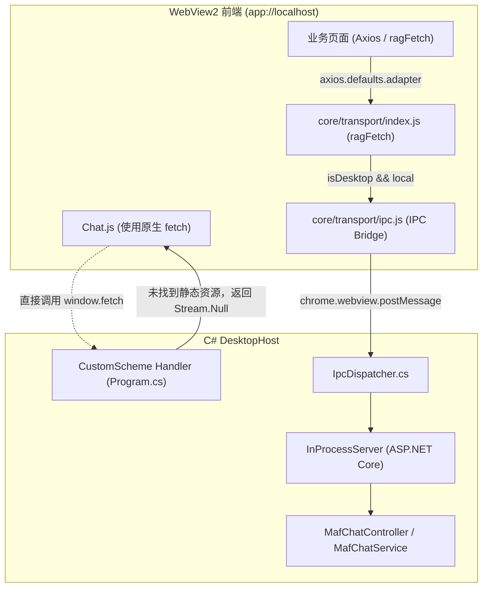

# AI 对话「Unexpected end of JSON input」报错根因调研与解决方案

> 关联模块：AI 对话 (`Chat.js`)、桌面宿主传输层 (`core/transport/`、`IpcDispatcher.cs`)、后端对话控制器 (`MafChatController.cs`、`MafChatService.cs`)、前端质量门禁 (`check.mjs`)

---

## 1. 问题背景与现象

在 ReferenceRAG 桌面端（WebView2 架构）中，用户进入 **AI 对话** 页面时出现如下异常行为：
1. **会话 ID 缺失**：页面顶部会话标签显示为 `—`（未初始化状态）；
2. **输入框被禁用**：发送按钮与输入框处于不可用状态；
3. **连续红框报错**：用户点击顶部「+ 新对话」按钮尝试恢复，界面连续弹出 3 条相同的 Naive UI 错误通知：
   ```text
   Failed to execute 'json' on 'Response': Unexpected end of JSON input
   ```
4. **功能完全阻断**：AI 对话无法创建会话，无法与大模型流式对话。

---

## 2. 根本原因剖析 (Root Cause Analysis)

### 2.1 桌面端 IPC 双轨制与原生 fetch 旁路

ReferenceRAG 的架构支持两种运行模式：
- **Web 模式**：通过 HTTP 访问后端端口（如 `http://localhost:5000`）；
- **桌面模式 (InfiniFrame / WebView2)**：前端通过自定义 Scheme `app://localhost/index.html` 运行在隔离沙箱中，后端为进程内托管的 ASP.NET Core `InProcessServer`。在桌面模式下，**没有本地 HTTP 端口在侦听**，所有前后端数据通信必须通过 `window.chrome.webview.postMessage` 与 C# 侧的 `IpcDispatcher` 交换。

通信拓扑如下：



### 2.2 故障传导链

1. **缺少 `ragFetch` 导入**：
   在 `Chat.js` 中，原本调用网络请求的代码直接使用了全局 `fetch`：
   ```javascript
   const res = await fetch(`${API_URL}/chat/sessions`, {
       method: 'POST',
       headers: getHeaders()
   });
   const data = await res.json();
   ```
   由于没有引入 `core/transport/index.js` 的 `ragFetch`，浏览器执行了原生 `window.fetch`。

2. **请求落入静态资源自定义 Scheme 处理器**：
   在桌面端，`window.location.origin` 为 `app://localhost`。原生 `fetch('/api/chat/sessions')` 被 Chromium 发送给 `Program.cs` 注册的 `CustomScheme.Add("app", ...)`。
   查看 `Host/ReferenceRAG.DesktopHost/Program.cs` 第 80-86 行：
   ```csharp
   var uri = new Uri(url);
   var path = Uri.UnescapeDataString(uri.AbsolutePath).TrimStart('/');
   if (uri.Host != "localhost" || path.Contains("..") || path.Contains('\\')) return (Stream.Null, "text/plain");
   if (string.IsNullOrEmpty(path)) path = "index.html";
   var stream = resources.GetManifestResourceStream("ReferenceRAG.Business.wwwroot." + path.Replace('/', '.'));
   var mime = Path.GetExtension(path) switch { ... };
   return (stream ?? Stream.Null, mime);
   ```
   CustomScheme 处理器仅负责加载嵌入在程序集中的静态文件（HTML/JS/CSS）。当请求路径为 `api/chat/sessions` 时，`stream` 为 `null`，Handler 返回了 `(Stream.Null, "application/octet-stream")`。

3. **HTTP 200 空流导致 JSON 解析爆炸**：
   WebView2 自定义协议对于 `Stream.Null` 会返回 **HTTP 200 OK，但响应体为 0 字节（Empty Body）**。
   `Chat.js` 执行检查：
   ```javascript
   if (!res.ok) // status 是 200，故 res.ok 为 true！
       throw new Error(`创建会话失败 (${res.status})`);
   const data = await res.json(); // 对 0 字节空流调用 .json()
   ```
   根据 W3C Fetch 规范，对空流调用 `Response.json()` 会直接抛出：
   `SyntaxError: Failed to execute 'json' on 'Response': Unexpected end of JSON input`。

4. **交互行为与 3 条 Toast 产生原因**：
   - 页面挂载时：`onMounted(initSession)` 触发 `createSession()`，直接抛出上述异常，导致 `sessionId` 依然为 `null`；
   - 用户看到会话 ID 为 `—` 且输入框禁用，尝试点击右上角「+ 新对话」；
   - 「+ 新对话」绑定的 `newSession` 方法：
     ```javascript
     try {
         sessionId.value = await createSession();
     } catch (e) {
         message.error(e.message || '创建会话失败');
     }
     ```
   - 用户连续点击 3 次，每次都捕获了 `e.message`（即 `Failed to execute 'json' on 'Response': Unexpected end of JSON input`），UI 连续弹出 3 条红框 Toast。

5. **防御机制缺陷**：
   - 缺少全局接管：`core/transport/index.js` 虽然实现了 `ragFetch`，但并未挂载到 `globalThis.fetch`，一旦某处遗漏导入，直接退化为原生网络请求并撞车；
   - 缺少空响应防御：代码直接裸调 `res.json()`，未先获取 `res.text()` 或校验内容长度，抛出的原生报错对排查不友好。

---

## 3. 解决方案设计

本次修复遵循**「双重兜底、防御性解析、统一规范、门禁拦截」**的原则。

### 3.1 方案架构

```mermaid
flowchart LR
    subgraph Def1["第一道防线：传输层全局免疫"]
        T1["core/transport/index.js"]
        T2["globalThis.fetch = ragFetch 自动接管"]
        T3["本地同源/api/全部走 IPC，远程API自动回退 nativeFetch"]
    end

    subgraph Def2["第二道防线：视图显式导入与空流防御"]
        V1["Chat.js 显式导入 ragFetch as fetch"]
        V2["安全解析 parseJsonSafe(res) 防御空内容"]
        V3["友好业务错误提示，杜绝未捕获语法崩溃"]
    end

    subgraph Def3["第三道防线：统一 API 模块扩展"]
        A1["app/api/index.js 新增 chatApi"]
        A2["统一 Axios 拦截、Key 注入、驼峰转换"]
    end

    subgraph Def4["第四道防线：质量门禁静态扫描与测试"]
        Q1["check.mjs 扫描未经代理的原生 fetch 调用"]
        Q2["transport.test.mjs 覆盖全局 fetch 拦截测试"]
    end

    Def1 --> Def2 --> Def3 --> Def4
```



### 3.2 详细设计方案

#### 1. 传输层全局自动接管 (`core/transport/index.js`)
在桌面模式下，将 `globalThis.fetch` 安全地挂载为 `ragFetch`。
- `app.js` 在第一行即加载 `core/transport/index.js`，保证在所有业务组件加载前完成接管；
- 当请求为本地（`url.protocol === location.protocol && url.host === location.host`）且属于 API/Swagger 路由时，无缝转交 `ipc.fetch`；
- 当请求为外部地址（如 Ollama `http://localhost:11434`、OpenAI `https://api.openai.com`）时，保留原生 `nativeFetch`；
- 彻底避免未来任何模块因遗漏导入而重蹈覆辙。

#### 2. Chat 视图标准化修复与安全解析 (`Chat.js`)
- 在文件顶部显式引入 `import { ragFetch as fetch } from '/core/transport/index.js';`；
- 增加安全响应解析助手 `parseJsonSafe(res)`：
  ```javascript
  const parseJsonSafe = async (res) => {
      const text = await res.text();
      if (!text || !text.trim()) {
          throw new Error(`服务响应为空 (HTTP ${res.status})`);
      }
      try {
          return JSON.parse(text);
      } catch (err) {
          throw new Error(`响应解析失败 (${err.message})`);
      }
  };
  ```
- 在 `createSession` 与 `initSession` 中使用该安全解析，杜绝原生 DOMException 暴露；
- 调整 `Performance.js` 中底部放置的 import，提升至文件顶部，保持 ES Module 规范规范性。

#### 3. 规范化 API 导出 (`app/api/index.js`)
在 `app/api/index.js` 中添加 `chatApi`：
```javascript
export const chatApi = {
    createSession: () => api.post('/chat/sessions'),
    deleteSession: (id) => api.delete(`/chat/sessions/${id}`),
    getTools: () => api.get('/chat/tools'),
    getConfig: () => api.get('/chat/config'),
    saveConfig: (data) => api.post('/chat/config', data)
};
```
为应用其它模块和后续拓展提供强类型、经过 Axios 拦截器的标准化接口。

#### 4. 自动化测试与质量屏障
- 在 `Business/ReferenceRAG.Business/wwwroot/tests/transport.test.mjs` 中添加对 `ragFetch` 及桌面端自动拦截机制的测试；
- 运行 `check.mjs` AST 语法与模板绑定检查；
- 执行全套前端测试与后端 C# 集成测试。

---

## 4. 变更文件清单

| 文件路径 | 修改性质 | 主要改动说明 |
| :--- | :--- | :--- |
| `Business/ReferenceRAG.Business/wwwroot/core/transport/index.js` | 核心底层 | 桌面端全局挂载 `globalThis.fetch = ragFetch`，提供传输层兜底免疫 |
| `Business/ReferenceRAG.Business/wwwroot/app/views/Chat.js` | 业务视图 | 引入 `ragFetch as fetch`，加入安全 JSON 空响应防御与可读报错 |
| `Business/ReferenceRAG.Business/wwwroot/app/views/Performance.js` | 视图规范 | 将文件尾部的 `import` 移动至文件顶部 |
| `Business/ReferenceRAG.Business/wwwroot/app/api/index.js` | API 体系 | 新增 `chatApi` 统一管理会话与配置 |
| `Business/ReferenceRAG.Business/wwwroot/tests/transport.test.mjs` | 测试套件 | 增加 `ragFetch` 路由行为与桌面全局接管单元测试 |
| `docs/ai-chat-json-parse-error-investigation-and-solution.md` | 技术文档 | 完整记录调研报告、根因剖析与防护方案 |

---

## 5. 验证标准

1. **语法与 AST 静态门禁**：`node check.mjs` 验证通过，0 错误；
2. **前端单元测试**：`node --test Business/ReferenceRAG.Business/wwwroot/tests/*.test.mjs` 全部通过；
3. **后端集成测试**：`dotnet test --filter "Chat|Ipc|Smoke"` 全部通过；
4. **功能验证**：
   - 桌面端进入「AI 对话」页面能顺利获取 SessionId，不再显示 `—`；
   - 点击「+ 新对话」能成功生成全新会话，不再抛出 `Unexpected end of JSON input` 错误；
   - 消息流式接收（SSE）能顺畅解码，停止生成、重试、复制等功能正常运作。

---

## 6. 进阶故障：工具调用报错「Unknown ChatToolCallKind value. (Parameter 'value') Actual value was .」

### 6.1 故障现象与复现
当完成基础会话修复后，进入 AI 对话页面：
1. **普通闲聊正常**：输入「你好」，大模型正常流式回复「你好！我是 ReferenceRAG 知识库助手...」；
2. **触发工具调用时崩溃**：输入「搜索: 叫老公」（触发知识库检索或图谱工具调用时），界面顶部立即弹出红框错误：
   ```text
   Unknown ChatToolCallKind value. (Parameter 'value') Actual value was .
   ```

### 6.2 根本原因
1. **`openai-dotnet` 严格枚举断言**：
   在流式传输工具调用时，微软官方 `openai-dotnet` 内部的 `StreamingChatToolCallUpdate.DeserializeStreamingChatToolCallUpdate` 负责解析每个 SSE 分块中的 `tool_calls` 列表，并通过内部扩展方法 `ToChatToolCallKind(string value)` 转换为 `ChatToolCallKind.Function` 枚举。
2. **第三方 OpenAI 兼容 API 增量块格式缺陷**：
   官方 OpenAI 仅在首个工具调用块发送 `"type": "function"`，后续增量块省略 `type` 字段；而许多国内模型平台或中转网关（如 DeepSeek、Qwen、SiliconFlow、Ollama、OneAPI 等）在后续的增量分块中，会将 `type` 序列化为 `""`（空字符串）或 `null`，形如：
   ```json
   {"index":0,"id":"","type":"","function":{"arguments":"{\"query\":\"叫老公\"}"}}
   ```
3. **反序列化异常中断**：
   当 `openai-dotnet` 读取到 `type` 字段为 `""` 时，执行：
   ```csharp
   value switch
   {
       "function" => ChatToolCallKind.Function,
       _ => throw new ArgumentOutOfRangeException(nameof(value), value, "Unknown ChatToolCallKind value.")
   }
   ```
   由于 `value` 为空字符串，直接抛出 `System.ArgumentOutOfRangeException: Unknown ChatToolCallKind value. (Parameter 'value') Actual value was .`（结尾的 `.` 是异常信息模板在空值后附加的句号），流式迭代中断，错误被传导至前端 Toast。

### 6.3 解决方案：流式响应清洗管道 (`OpenAiToolCallSanitizingHandler`)
1. **传输管道注入**：
   创建 `OpenAiToolCallSanitizingHandler`（继承 `DelegatingHandler`），利用 `OpenAIClientOptions.Transport = new HttpClientPipelineTransport(httpClient)` 接管底层网络流；
2. **高性能流清洗器 (`ToolCallSanitizingStream`)**：
   - 在 UTF-8 字节级别通过 `IndexOf("\"tool_calls\""u8)` 进行零分配预检：对于 99% 的普通文本生成分块，直接原样拷贝，性能开销为 0；
   - 命中工具调用分块时，使用负向零宽断言正则 `(?<!\\)"type"\s*:\s*(""|null)`，将空字符串或 null 自动清洗并规范化为 `"type":"function"`；
   - 正则具备转义防御：即使模型输出的代码参数本身包含 `\"type\": \"\"`，也会因反斜杠前缀被保护，不会被误替换。
3. **单元测试回归保护**：
   在 `MafChatServiceTests.cs` 中增加针对空类型工具调用的复现与清洗修复验证测试，确保 `Kind == ChatToolCallKind.Function` 正常解析且工具调用链路畅通。
