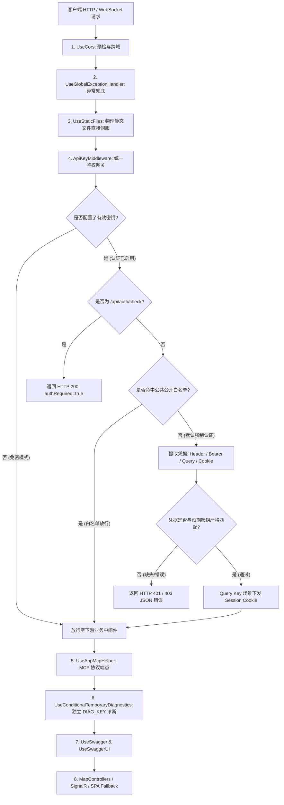
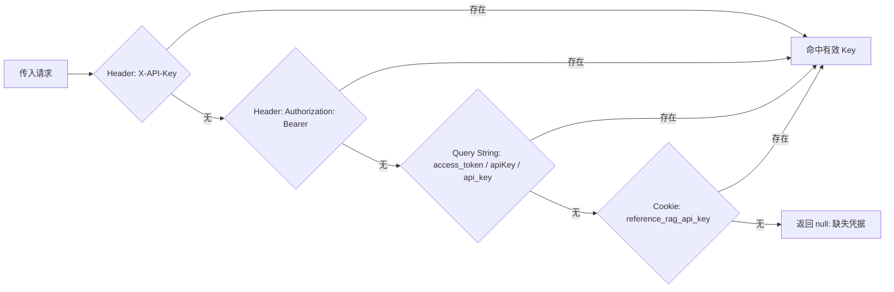

# 接口安全强化与白名单默认认证架构设计方案

> **文档状态**：已完成技术评审并落地执行  
> **编写日期**：2026-10-22  
> **关联模块**：ReferenceRAG.ApiHost (ApiKeyMiddleware, SettingsController) / ReferenceRAG.WebHost / ReferenceRAG.DesktopHost / Web 前端 (index-events.js)

---

## 一、 背景与改动目标

### 1. 现有问题剖析
在先前的实现中，系统的接口安全验证存在以下关键隐患：
1. **黑名单前缀拦截逻辑（非默认拒绝）**：
   中间件仅针对 `path.StartsWithSegments("/api")`、`path.StartsWithSegments("/v1")` 以及 `path.StartsWithSegments("/indexHub")` 进行拦截，其他任何未显式匹配的端点均被无条件放行。
2. **SignalR 实时监控盲区（路径脱节）**：
   中间件保护规则写死为 `/indexHub`，但服务端实际映射地址为 `/hubs/index`，导致外部未授权客户端可绕过认证直接接入 WebSocket/SSE，窃听私有笔记的文件名变更、索引构建进度等关键事件。
3. **MCP (Model Context Protocol) 中间件时序与密钥不同步**：
   `UseAppMcpHelper()` 注册在 `UseApiKeyAuthentication()` 之前，且 MCP 仅在启动时读取了一次 `IConfiguration` 原生键，未能与系统的 `IAuthenticationKeyResolver`（配置文件优先 > 环境变量）仲裁联动，导致环境变量设置的 Key 无法保护 MCP 工具。
4. **Swagger / OpenAPI 文档未授权暴露**：
   在开启外网访问（`AllowNetworkAccess = true`）且开启 Swagger 时，任何人员均可无鉴权查阅全量敏感 API 结构与参数。
5. **系统敏感配置明文回传**：
   `GET /api/settings` 在回传配置对象时，商业大模型 API Key（`Chat.OpenAiApi.ApiKey`）、系统诊断密钥（`DiagKey`）等未作脱敏，存在凭据泄露风险。

### 2. 核心架构升级目标
1. **从“前缀白名单拦截”切换为“默认强制认证，显式公开白名单放行（Default-Deny with Whitelist）”**：
   当服务端存在有效密钥时，**除明确声明在公共白名单内的公开接口与前端资源外，所有接口默认必须认证**。
2. **免密模式无缝向下兼容**：
   当未在配置文件或环境变量中配置任何 API Key 时，认证开关保持关闭（`Enabled = false`），进入免密模式，本地开发者和零配置用户无感使用。
3. **消除 SignalR、MCP、Swagger 鉴权盲区**：
   将 `/hubs/index`、`/api/mcp`、`/swagger` 全部纳入统一的 `ApiKeyMiddleware` 保护管辖。
4. **增强凭据提取机制（支持浏览器访问与 WebSocket 握手）**：
   除原有的 `X-API-Key` 与 `Authorization: Bearer <key>` 以外，扩展支持 Query String（`access_token`、`apiKey`、`api_key`）以及 Cookie（`reference_rag_api_key`），使浏览器能够带参访问 Swagger UI 并通过 Session Cookie 无缝加载子资源，同时支持 SignalR WebSocket 标准握手传参。
5. **配置下发脱敏与安全保存**：
   `SettingsController.Get` 对敏感密钥统一执行掩码处理；`Save` 自动识别掩码标记（`****`），避免用户在未改动密码时意外将脱敏掩码回写覆盖真实密钥。
6. **架构范围界定**：
   当前阶段保持单 API Key 模式，暂不进行复杂的 Admin/Query 角色分权。

---

## 二、 架构模型与处理流水线

---

## 三、 白名单（Public Whitelist）规则矩阵

在认证启用的前提下，**仅允许以下资源命中白名单免密通行**，其余任何端点一律进入默认鉴权：

| 白名单类别 | 匹配规则 / 路径 | 放行理由 | 安全防线保障 |
|---|---|---|---|
| **匿名特性标记端点** | 控制器类或 Action 方法显式声明 `[AllowAnonymous]`，或挂载 `IAllowAnonymous` 元数据 | 满足开发者显式开放特定业务接口的需求，遵循 ASP.NET Core 原生规范。 | 仅对显式添加了特性的端点生效，未加特性者依然遵循默认拒绝。 |
| **鉴权状态探测** | `GET /api/auth/check` | 前端加载时必须探知当前服务端是否启用了 API Key，以决定是否弹出输入密钥弹窗。 | 仅返回 `{ authRequired: true }`，绝不透露密钥明文或系统敏感数据。 |
| **CORS 预检请求** | `HTTP OPTIONS *` | 浏览器的 CORS 跨域预检机制强制不携带自定义 Header，若拦截 401 会导致前端跨域彻底崩溃。 | 由 CORS 策略本身限制跨域来源。 |
| **前端 SPA 页面路由** | `HTTP GET` 请求下列静态视图路径： `/`、`/index.html`、`/login`、`/dashboard`、`/search`、`/sources`、`/settings`、`/performance`、`/api-help`、`/models`、`/system`、`/bm25-index`、`/guide`、`/graph`、`/chat`、`/logs` | 用户在浏览器中直接打开前端页面时，必须先加载 HTML 框架和 Vue 视图，才能交互输入 Key。 | 仅输出前端静态 `index.html`。页面内的所有后续数据请求均指向 `/api/...`，必须携带有效 Key。 |
| **前端静态资源与脚本** | 以 `/app/`、`/core/`、`/shared/`、`/styles/`、`/vendor/`、`/assets/` 开头，或根路径下 `app.js`、`favicon.ico`、`favicon.svg` | 前端渲染必须加载的 JS 逻辑、CSS 样式、字体与图标资源。 | 静态资源中无机密业务数据；所有数据通过 API 异步拉取。 |
| **独立诊断系统通道** | 以前缀 `/__diag`（或配置的 `DiagRoutePrefix`）开头 | TemporaryDiagnostics 拥有完全独立的物理鉴权中间件与独立的 `DIAG_KEY`。 | 保持业务密钥与系统诊断密钥的物理隔离，避免双重拦截冲突。 |

> [!IMPORTANT]
> **绝对不属于白名单的受保护端点示例**：
> - 所有 REST API：`/api/ai/*`、`/api/chat/*`、`/api/settings/*`、`/api/sources/*`、`/api/system/*`、`/api/filesystem/*` 等；
> - 所有 OpenAI 兼容协议：`/v1/chat/completions`、`/v1/embeddings`、`/v1/models`、`/v1/rerank`；
> - SignalR Hub 实时推送：`/hubs/index`；
> - MCP 工具端点：`/api/mcp`；
> - Swagger 页面及元数据：`/swagger`、`/swagger/v1/swagger.json`；
> - 后续系统无论新增任何未在白名单显式注册的端点，**默认全部强制拦截要求认证**。

---

## 四、 凭据解析（ExtractApiKey）多源支持设计

为同时满足程序 API、命令行 cURL、第三方插件、SignalR WebSocket 握手及 Swagger UI 浏览器访问，凭据解析器按以下顺序检索密钥：

### 浏览器访问 Swagger UI 的 Cookie 桥接机制
当在浏览器直接输入 `http://localhost:5000/swagger?apiKey=mysecretkey` 访问时：
1. `ApiKeyMiddleware` 从 Query 中提取并校验 `apiKey` 成功；
2. 识别为浏览器 GET 请求，自动向响应附加 `Set-Cookie: reference_rag_api_key=mysecretkey; Path=/; HttpOnly; SameSite=Lax`；
3. Swagger UI 页面加载完成后，浏览器向 `/swagger/v1/swagger.json` 发起的异步 JSON 拉取请求会自动附带该 Cookie，从而平滑通过鉴权，免除浏览器弹窗配置困扰。

---

## 五、 敏感配置脱敏（Desensitization）规范

在 [`SettingsController`](file:///e:/WorkProject/CSharp/PrivateProject/Web/ReferenceRAG/Host/ReferenceRAG.ApiHost/Controllers/SettingsController.cs) 中对涉及机密的字段执行双向保护：

1. **下发脱敏（`GET /api/settings`）**：
   - `Chat.OpenAiApi.ApiKey`：通过 `MaskKey` 输出（如 `sk****9a`），并确保 `ApiKeyConfigured = true`；
   - `Service.ApiKey` 与 `Service.DiagKey`：输出掩码值；
   - `Embedding.ApiKey` 与 `Rerank.ApiKey`：输出掩码值；
2. **防覆盖保护（`POST /api/settings`）**：
   - 若客户端提交的 Key 包含 `****`（证明前端未改动该密码输入框），自动保留当前磁盘配置中的原真实密钥；
   - 若提交非空且不含掩码的新字符串，更新为新密钥；
   - 若用户在界面点击“清除”（显式提交空字符串 `""`），才执行清空密钥操作。

---

## 六、 实施与回归验证规划

1. **代码修改清单**：
   - `ApiKeyMiddleware.cs`：实现白名单放行与全量默认认证、四源凭据提取、Cookie 自动维持；
   - `RagWebHostExtensions.cs`：MCP 密钥解析接入 `IAuthenticationKeyResolver` 协调器；
   - `WebHost/Program.cs` & `DesktopHost/Program.cs`：中间件装配顺序重构；
   - `SettingsController.cs`：敏感字段掩码脱敏与安全保存；
   - `index-events.js`：SignalR 客户端补充 `accessTokenFactory`；
2. **单元测试与质量门禁**：
   - 编写 `ApiKeyMiddlewareWhitelistTests` 覆盖全部白名单与默认拦截场景；
   - 回归运行 `AuthenticationKeyResolverTests` 与 `TransportTests` 确保既有进程内管道行为完全正常。
