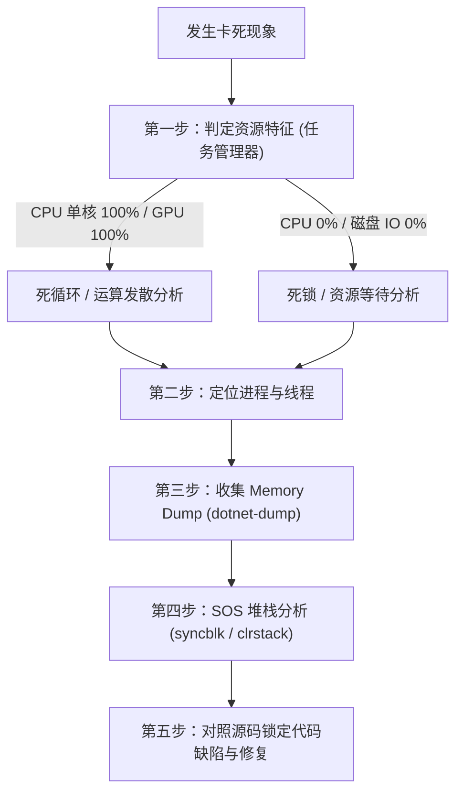

# ReferenceRAG 程序卡死与挂起排查方案与防治指南

## 1. 概述与卡死形态分类

在本地 AI 桌面应用（.NET 10 + Photino + ONNX Runtime CUDA + LlamaSharp + SQLite）的混合运行时环境中，“程序卡死”（Hang / Freeze / Deadlock）通常表现为界面未响应、请求无限 Pending、后台任务停滞或进程无法退出。

根据系统表现与 CPU/GPU 负载特征，可将卡死分为以下五种经典形态：

| 卡死形态 | 典型现象 | CPU / GPU 特征 | 常见诱因 |
| :--- | :--- | :--- | :--- |
| **形态一：UI 线程阻塞** | 窗口标题栏显示“未响应”，鼠标转圈，界面无点击反馈 | CPU 单核 100% 或 0% | Photino STA 消息循环被长耗时 CPU/IO 占用；同步调用 `.Result` / `.Wait()` 引发双向死锁 |
| **形态二：请求无限挂起 (Pending)** | 前端 Loading 一直转，网络面板请求无响应，后台无报错 | CPU / GPU 接近 0% | `SemaphoreSlim` 异常分支漏调用 `Release()`；`ModelLease` 租约泄漏；HTTP 请求无超时 |
| **形态三：推理引擎死循环 / 伪死锁** | 搜索或重排时突然无响应，风扇狂转或显存占满 | CPU 单核 100% 或 GPU 100% | Token 序列未产生终止符；NaN 导致数值计算无限递归；原生 `llama.cpp` 脏上下文死循环 |
| **形态四：后台任务 / 管道饥饿** | 文件导入（Ingestion）、重分块（Rechunk）停在某一百分比 | CPU 接近 0%，磁盘 IO 为 0 | Channel 缓冲满导致生产者挂起；SQLite 事务未提交引发锁等待超时；跨线程死锁 |
| **形态五：退出残留僵尸进程** | 关闭窗口后界面消失，但任务管理器中进程仍常驻，占用显存和端口 | CPU 0%，内存/显存固定 | `IHostedService.StopAsync` 阻塞；未托管原生句柄析构卡死；非后台前台线程未终止 |

---

## 2. 快速排障五步法（标准定位路径）

当遇到程序卡死时，请遵循以下由表及里的标准流程定位根因：



### 步骤一：观测操作系统级指标
1. 打开任务管理器（`Taskmgr`）或 `Process Explorer`：
   - 找到 `ReferenceRAG.DesktopHost.exe`。
   - 查看 **CPU**：若正好占用一个核心满载（如 16 核占用 6.25%），说明存在**死循环**；若为 0%，说明存在**死锁或事件阻塞**。
   - 查看 **GPU 显存 / 专有 GPU 内存**：显存是否暴涨至临界点（OOM 边缘挂起）或 CUDA Engine 占用是否持续 100%。
2. 打开终端执行 `nvidia-smi`：
   ```bash
   nvidia-smi
   ```
   检查进程显存分配情况，确认 CUDA 上下文是否存活。

### 步骤二：检查应用最新运行时日志
查看 `logs/app_YYYYMMDD.log`（或控制台输出）最后留下的日志条目：
```bash
# 查看最后 40 行日志
Get-Content logs/app_20261019.log -Tail 40
```
- **关键标记**：
  - 日志若停在 `[SearchService] 开始重排: 候选数=30...`：重排引擎推理挂起或发生底层冲突。
  - 日志若停在 `[IngestionTaskService] 正在处理分块...`：解析/向量化管道死锁。
  - 日志若停在 `[ModelsController] 开始切换模型...`：模型销毁/重新初始化锁竞争。

### 步骤三：非侵入式抓取进程转储（Memory Dump）
使用 .NET 官方诊断工具 `dotnet-dump`，在不终止进程的情况下直接生成完整内存快照：

```bash
# 1. 查找 ReferenceRAG 进程 PID
dotnet-dump ps

# 2. 抓取完整内存转储 (包含堆栈与线程信息)
dotnet-dump collect -p <PID> --type Full -o app_hang.dmp
```

---

## 3. 深入诊断工具链与标准命令集

针对获取的 `.dmp` 文件，使用 `dotnet-dump analyze` 或 WinDbg 进行底层排查：

### 3.1 启动诊断分析会话
```bash
dotnet-dump analyze app_hang.dmp
```

### 3.2 诊断核心命令组合

#### ① 检查死锁与互斥同步块（关键）
```text
> syncblk
```
- **解读**：
  - 输出所有被线程持有的同步块（SyncBlock）。
  - 若某个 Monitor 或 Lock 的 `OwningThread` 显示存在，且多个 `WaitingThreads` 在排队，该 `OwningThread` 即为锁死根源。

#### ② 打印所有托管线程调用栈
```text
> clrstack -all
```
- **解读**：
  - 快速扫描所有正在等待的线程。重点关注处于 `Monitor.Wait`、`SemaphoreSlim.Wait`、`WaitOneNative` 或 `Task.Wait` 的栈帧。

#### ③ 诊断 Task 调度与未完成的异步任务
```text
> dumpasync
```
- **解读**：
  - 列出当前内存中所有挂起的 `Task` / `ValueTask` 实例及其当前状态。
  - 查找处于 `WaitingForActivation` 且持续不动的异步操作，定位是哪一个 `await` 永远没有返回。

#### ④ 定位持锁对象与内存引用链
```text
# 查看指定线程详情
> setthread <线程编号>
> clrstack -p

# 查看某个被锁对象被谁引用
> gcroot <对象十六进制地址>
```

### 3.3 原生 C++ 线程栈分析（针对 ONNX / llama.cpp）
当 `clrstack` 停在 P/Invoke 边界（如 `[InlinedCallFrame]` 或 `NativeMethods`）：
1. 在 `Process Explorer` 中右键 `ReferenceRAG.DesktopHost.exe` -> `Properties` -> `Threads`。
2. 双击卡住的线程查看 Native Stack：
   - 若卡在 `llama.dll!llama_decode`：说明 llama 原生解码陷入长耗时或死循环。
   - 若卡在 `onnxruntime.dll!OrtRun` / `nvcuda.dll`：说明 CUDA 运行时正在等待显存交换或核心执行。
   - 若卡在 `Photino.Native.dll`：说明 UI 消息循环正等待互斥量。

---

## 4. ReferenceRAG 核心业务卡死根因矩阵与代码排查清单

### 4.1 场景一：`SemaphoreSlim` / `ModelLease` 租约泄漏导致全线挂起
- **风险位置**：
  [`ModelManager.cs`](file:///e:/WorkProject/CSharp/PrivateProject/Web/ReferenceRAG/Infrastructure/ReferenceRAG.Infrastructure/Features/ModelManagement/Services/ModelManager.cs), [`LazyModelServices.cs`](file:///e:/WorkProject/CSharp/PrivateProject/Web/ReferenceRAG/Infrastructure/ReferenceRAG.Infrastructure/Features/ModelManagement/Services/LazyModelServices.cs)
- **卡死机理**：
  模型使用租约机制限制并发或防止使用中卸载：
  ```csharp
  // 错误范式：异常未进 finally，租约永久泄漏
  var lease = await _modelManager.AcquireLeaseAsync("embedding");
  var result = await model.GenerateAsync(...); // 若抛出异常
  lease.Dispose(); // 永远无法执行，ActiveLeases 永不为 0，后续切换模型/卸载永久卡死
  ```
- **排查手段**：
  - 检查 Web 界面或 API 遥测：`GET /api/performance/models/status`
  - 观察 `activeLeases` 字段：若在空闲状态下 `activeLeases > 0`，说明已发生租约泄漏。
- **防治规范**：
  强制使用 `using` 模式保证 RAII 释放：
  ```csharp
  using (var lease = await _modelManager.AcquireLeaseAsync("embedding", cancellationToken))
  {
      return await model.GenerateAsync(...);
  }
  ```

---

### 4.2 场景二：Sync-over-Async 同步混用异步导致线程池死锁
- **风险位置**：
  控制器构造函数、属性 Getter、事件处理函数。
- **卡死机理**：
  在同步方法中强行等待异步 Task：
  ```csharp
  // 危险代码！严禁使用
  var result = _rerankService.RerankBatchAsync(query, docs).Result;
  // 或
  _searchService.SearchAsync(...).GetAwaiter().GetResult();
  ```
  在单线程上下文（如 Photino 主线程）或高并发线程池耗尽（Thread Pool Starvation）场景下，当前线程被阻塞，而异步回调需要同一线程池调度，引发相互等待的典型死锁。
- **防治规范**：
  - **全链路 Async/Await**：控制器、服务层到适配器层坚决使用 `async Task`。
  - 若在历史遗留同步上下文中无法立即改写，使用 `Task.Run(...).ConfigureAwait(false).GetAwaiter().GetResult()` 隔离上下文，但仍应尽快重构为纯异步。

---

### 4.3 场景三：两阶段检索中未托管引擎的 CUDA 显存/上下文互斥竞争
- **风险位置**：
  [`SearchService.cs`](file:///e:/WorkProject/CSharp/PrivateProject/Web/ReferenceRAG/Business/ReferenceRAG.Business/Features/Search/Services/SearchService.cs), [`LlamaRerankAdapter.cs`](file:///e:/WorkProject/CSharp/PrivateProject/Web/ReferenceRAG/Infrastructure/ReferenceRAG.Infrastructure/Features/ModelManagement/Adapters/LlamaRerankAdapter.cs)
- **卡死机理**：
  1. 第一阶段检索调用 `onnxruntime_providers_cuda.dll` 对 Query 进行 Embedding，持有 GPU 计算流。
  2. 第二阶段检索立即将 30 个候选文档传给 `llama.dll`（GPU 层全量 Offload）。
  3. 当显存达到高水位（如 8GB 显卡占用超 7.2GB）或模型架构不支持导致输出 NaN 时，llama 底层未清理 context，再次调用造成原生死锁或无限重试。
- **排查手段**：
  - 检查日志中是否有 `[LlamaRerankAdapter] 检测到 GGUF 重排模型输出 NaN`。
  - 查看 `OnnxRerankAdapter` 是否被优先选用（Cross-Encoder 类模型官方最佳形态为 ONNX）。
- **防治规范**：
  - 重排环节必须实施永久熔断机制：
    ```csharp
    if (_isPermanentlyDegraded)
    {
        return GenerateFallbackDocuments(query, documents, topN);
    }
    ```
  - 对重排调用实施独立超时包装与熔断降级（见第 5 节）。

---

### 4.4 场景四：Photino 消息循环与 IPC 通信双向死锁
- **风险位置**：
  `ReferenceRAG.DesktopHost` 主窗口与前端通信链路。
- **卡死机理**：
  - Photino 桌面窗口运行在 Windows STA 线程上。
  - 如果前端通过 WebMessage 发起 IPC，主线程同步等待后端 API 结果，而后端服务内部通过事件尝试向 UI 广播消息（如进度条更新）并请求主线程介入，产生经典双向环路死锁。
- **排查手段**：
  - `dotnet-dump analyze` 检查主线程是否停在 `PhotinoWindow.SendMessage` 或 `WaitOne`。
- **防治规范**：
  - UI 通信管道完全解耦：前端通过标准异步 Fetch / Server-Sent Events（SSE）与内部 Kestrel 端口通信，杜绝在原生 UI 线程内部发起同步等待。

---

### 4.5 场景五：应用程序退出时后台常驻服务死等
- **风险位置**：
  `ReferenceRAG.DesktopHost/Program.cs`, 各 `BackgroundService` 实现。
- **卡死机理**：
  点击托盘或窗口关闭后，.NET Host 触发优雅停机（`Host.StopAsync`）。若某个后台循环未监听 `CancellationToken`，停机过程将永久卡死：
  ```csharp
  // 错误示范：未检查 stoppingToken，停机时永久挂起
  while (true)
  {
      await Task.Delay(1000); // 未传 stoppingToken！
      DoWork();
  }
  ```
- **排查手段**：
  窗口关闭后，运行 `Get-Process ReferenceRAG.DesktopHost`。若仍然存在，说明优雅停机卡死。
- **防治规范**：
  - 所有后台任务 `Task.Delay` 必须携带 `stoppingToken`。
  - 在 DesktopHost 退出处理中增加**强杀超时看门狗**（第 5.3 节）。

---

## 5. 架构级防卡死机制与加固规范

为从根源杜绝程序卡死，全系统落地以下四层防御加固机制：

### 5.1 机制一：全链路 CancellationToken 与弹性超时注入（Watchdog Pattern）
任何耗时操作（模型推理、网络请求、文件 IO、数据库事务）**必须显式要求或自动包装 CancellationToken**：

```csharp
public async Task<List<ScoredDocument>> RerankBatchSafeAsync(
    string query, 
    List<Document> candidates, 
    int topN, 
    CancellationToken cancellationToken = default)
{
    // 为重排推理设置硬性看门狗超时（默认 10 秒）
    using var cts = CancellationTokenSource.CreateLinkedTokenSource(cancellationToken);
    cts.CancelAfter(TimeSpan.FromSeconds(10));

    try
    {
        return await _rerankService.RerankBatchAsync(query, candidates, topN, cts.Token);
    }
    catch (OperationCanceledException) when (!cancellationToken.IsCancellationRequested)
    {
        _logger.LogWarning("[Rerank] 推理超时（超过 10 秒硬性看门狗），自动触发降级并切断底层原生任务");
        return GenerateFallbackDocuments(query, candidates, topN);
    }
    catch (Exception ex)
    {
        _logger.LogError(ex, "[Rerank] 推理异常，降级回退");
        return GenerateFallbackDocuments(query, candidates, topN);
    }
}
```

### 5.2 机制二：带超时的安全信号量等待（Safe Semaphore Wait）
严禁无超时的裸调用 `await _semaphore.WaitAsync()`：

```csharp
public static class SemaphoreExtensions
{
    public static async Task<bool> WaitSafeAsync(
        this SemaphoreSlim semaphore, 
        TimeSpan timeout, 
        ILogger logger, 
        string operationName, 
        CancellationToken ct = default)
    {
        bool entered = await semaphore.WaitAsync(timeout, ct);
        if (!entered)
        {
            logger.LogError("[DeadlockWarning] 操作 {Operation} 获取信号量超时 ({Timeout}s)，判定疑似死锁或过度拥塞！", 
                operationName, timeout.TotalSeconds);
        }
        return entered;
    }
}
```

### 5.3 机制三：DesktopHost 优雅退出看门狗保底
在桌面宿主进程中部署 3 秒退出强制保护，防止后台僵尸线程卡死进程退出：

```csharp
// Program.cs 或 App 退出生命周期钩子
AppDomain.CurrentDomain.ProcessExit += (s, e) =>
{
    // 启动独立前台看门狗线程
    new Thread(() =>
    {
        Thread.Sleep(3000); // 宽限 3 秒供托管服务优雅保存与清理
        // 若 3 秒后进程仍未自然终止，强制调用系统原语切断
        Environment.Exit(0);
    })
    {
        IsBackground = true,
        Name = "ProcessTerminationWatchdog"
    }.Start();
};
```

### 5.4 机制四：前端双向超时重置与取消支持
在 `wwwroot/core/transport/index.js`（`ragFetch`）中内置硬超时与 AbortController，并在界面上呈现“重置/强制中止”通道：
- 搜索请求前端超过 20 秒自动判定超时，结束 loading 状态并提示用户；
- 避免前端界面因单一挂起请求彻底失去响应。

---

## 6. 应急操作手册（针对最终用户与运维）

当用户在日常使用中报告软件卡死时，请指导用户按以下步骤排障与恢复：

### 6.1 快速终止僵尸进程与重启
在 PowerShell 中运行以下一键恢复脚本：

```powershell
# 1. 查找并强制关闭所有残留的 ReferenceRAG 进程
Get-Process -Name "ReferenceRAG*" -ErrorAction SilentlyContinue | Stop-Process -Force

# 2. 检查 5000 / 5001 端口是否释放
Get-NetTCPConnection -LocalPort 5000 -ErrorAction SilentlyContinue

# 3. 重新启动应用
Start-Process ".\ReferenceRAG.DesktopHost.exe"
```

### 6.2 一键生成排查诊断包（供开发者分析）
当卡死可稳定复现时，在卡死状态下执行以下命令生成诊断数据包并提交开发团队：

```powershell
# 1. 获取 PID
$proc = Get-Process -Name "ReferenceRAG.DesktopHost"
$pid = $proc.Id

# 2. 生成内存 Dump
dotnet-dump collect -p $pid -o "debug_hang_$pid.dmp"

# 3. 收集最新日志与系统事件
Copy-Item "logs\app_*.log" ".\hang_logs\"
Get-WinEvent -FilterHashtable @{LogName='Application'; ProviderName='.NET Runtime','Application Error'} -MaxEvents 10 | Out-File ".\hang_events.txt"

Write-Host "诊断数据包生成完毕：debug_hang_$pid.dmp, hang_logs, hang_events.txt"
```
