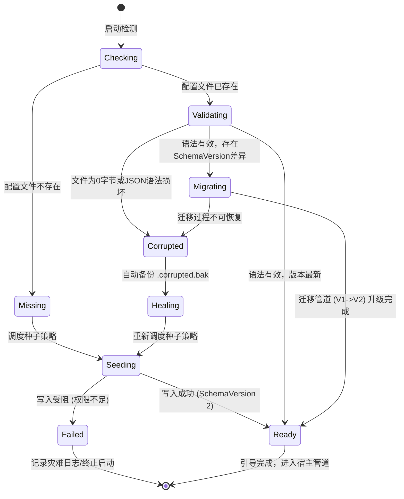

# 配置文件自愈初始化与免覆盖版本升级架构设计
*(Auto Config Bootstrap, Self-Healing, and Safe-Upgrade Architecture Design)*

## 1. 背景与核心问题剖析 (Background & Problem Statement)

### 1.1 现状与痛点
在桌面端（DesktopHost）及独立服务（WebHost）的分发体系中，用户通常采用**解压覆盖安装**（In-Place Overwrite Upgrade）或构建目录覆盖进行版本更新。
在历史实现中：
1. **发布包包含默认配置**：`.csproj` 将 `appsettings.json` 标记为 `CopyToPublishDirectory="PreserveNewest"`，导致构建输出目录和 Zip 发布包直接打包了开发/默认阶段的 `appsettings.json`。
2. **覆盖升级直接冲刷配置**：用户下载新版本并解压覆盖已有目录时，操作系统文件复制或解压动作会直接**覆盖**原有的 `appsettings.json`，导致用户已配置的私有 API Key、自定义知识库目录（`sources`）、本地数据库存储路径（`dataPath`）、硬件加速与端口偏好被瞬间清空抹除，造成极其严重的数据迷失与使用阻断。
3. **冷启动与文件缺失脆弱**：若用户或运维手动清理了 `appsettings.json`，或在纯容器/全新目录中启动，程序由于缺少配置文件，容易因缺少预置字段导致空引用异常或只能依赖各模块散乱的硬编码默认值，缺少全局自愈与初始化机制。

### 1.2 核心目标矩阵
- **发布零配置污染 (Zero Publish Pollution)**：发布产物中绝对**不包含**运行态的 `appsettings.json`，从物理文件层杜绝覆盖升级时的破坏。
- **首次启动自愈初始化 (Zero-Config First Run)**：程序启动前自动检测配置；若不存在，自动从官方伴生模板或强类型默认工厂创建标准的 `appsettings.json`。
- **老版本无感保留与平滑升级 (Seamless Migration)**：覆盖升级后用户的 `appsettings.json` 完好无损，且通过内置的 `ConfigMigrationRunner` 自动升级 SchemaVersion。
- **配置损坏自愈与容灾 (Corrupted Self-Healing)**：若配置文件遭遇断电、0 字节或 JSON 语法损坏，能够自动备份残损文件并安全重置自愈，防止进程永久崩溃。

---

## 2. 业界主流方案调研与对比 (Industry Benchmark)

针对客户端/自托管软件的配置分发与生命周期管理，调研主流业界实践如下：

| 维度 | 模式 A：Linux/Daemon 伴生模板模式 (如 Nginx / Redis / PostgreSQL) | 模式 B：现代 IDE / Client 内嵌默认模式 (如 VS Code / Obsidian / JetBrains) | 模式 C：ASP.NET Core 标准分层多环境覆盖模式 | 模式 D：**本架构选型：弹性混合模式 (Resilient Hybrid)** |
|---|---|---|---|---|
| **发布产物** | 仅发布 `foo.conf.default` 或 `foo.conf.sample`，不发布 `foo.conf` | 完全不发布任何 JSON，二进制内嵌 | 发布 `appsettings.default.json`，依赖操作系统环境/注册表覆写 | **仅发布 `appsettings.template.json`**，`appsettings.json` 显式设置 `CopyToPublishDirectory="Never"` |
| **覆盖升级** | 覆盖升级只替换 `.default` 文件，运行中的主配置文件物理隔离，永不被覆盖 | 覆盖升级只更新程序包，配置保存在独立用户目录 | 分层合并，但若用户直接覆盖程序目录仍可能被覆盖 | **覆盖解压时绝无 `appsettings.json`**，历史配置 100% 物理保留 |
| **首次启动** | 启动脚本或运维从 template 复制 | 启动时检测无配置，按需在内存构建默认状态 | 仅读取默认文件，不主动持久化主配置 | **自动检测缺失，通过种子策略自动初始化为正规 `appsettings.json`** |
| **Web/UI回写** | 不支持前端 UI 直接保存回原文件 | 仅保存修改差异项 | 极易割裂（回写容易丢失原始结构或注释） | **Single Source of Truth**：直接写回统一的 `ReferenceRAG` 节点，保持单文件纯粹性 |
| **防损自愈能力** | 低（格式损坏直接拒绝启动） | 高（配置损坏提示重置） | 低（非法 JSON 直接抛出 JsonReaderException） | **高（状态机识别语法损坏，自动备份 `.corrupted.bak` 并重建）** |

### 选型结论：弹性混合架构 (Resilient Hybrid Architecture)
ReferenceRAG 作为支持**离线本地使用、单机免配置、前端设置页直接修改回写**的 AI 系统，必须兼具：
1. **外部可读性与运维透明性**（提供包含官方注释与完整结构的 `appsettings.template.json`）。
2. **绝对发布安全**（发布包剔除 `appsettings.json`，解压覆盖 100% 零风险）。
3. **自主生命周期治理**（采用状态机控制：缺失自动种子创建、正常自动迁移升级、损坏自动备份恢复）。

---

## 3. 架构体系与设计模式优化 (Architecture & Design Patterns)

为避免将配置检测、异常重试、文件复制、模板回退写成面条式代码（Spaghetti Code），系统引入三大经典设计模式协同运作：

```
                    ┌─────────────────────────────────┐
                    │  ConfigBootstrap (入口引导程序)  │
                    └────────────────┬────────────────┘
                                     │ 触发生命周期
                                     ▼
                ┌─────────────────────────────────────────┐
                │ ConfigLifecycleStateMachine (生命周期状态机) │
                └────┬───────────────────────────────┬────┘
                     │                               │
        使用适配器操作文件系统            使用策略模式生成种子
                     ▼                               ▼
       ┌───────────────────────────┐   ┌───────────────────────────┐
       │ IConfigEnvironmentAdapter │   │    IConfigSeedStrategy    │
       │    (环境与文件存储适配器)    │   │      (配置种子生成策略)     │
       └───────────────────────────┘   └─────────────┬─────────────┘
                     │                               │
        ┌────────────┴────────────┐      ┌───────────┴───────────┐
        ▼                         ▼      ▼                       ▼
 [LocalFileAdapter]      [MockTestAdapter] [TemplateSeed]   [FactorySeed]
 (物理环境/原子写/备份)   (内存虚拟文件系统)  (模板文件复制)   (强类型对象生成)
```

### 3.1 状态机模式 (State Pattern / State Machine)
定义配置自愈引导状态机 `ConfigLifecycleStateMachine`，严格规范状态流转与动作边界：



#### 状态定义与语义：
- `Checking`：探测主配置文件 `appsettings.json` 是否物理存在。
- `Missing`：确认文件缺失，进入初始化流程。
- `Validating`：尝试轻量解析 JSON 根节点与版本，识别是否有内容截断或语法破坏。
- `Corrupted`：检测到坏文件（如突然掉电产生的全零数据、不可解析格式）。
- `Healing`：自愈状态，原子移动损坏文件至 `appsettings.corrupted.{timestamp}.bak`，防止数据丢失的同时腾出路径。
- `Seeding`：基于配置种子策略执行原子创建。
- `Migrating`：委托 `ConfigMigrationRunner` 执行数据库式版本迁移。
- `Ready`：配置文件已处于健康、最新的可用状态。

### 3.2 策略模式 (Strategy Pattern)
定义配置初始化种子策略接口 `IConfigSeedStrategy`，支持链式回退（Chain of Fallback）：

```csharp
public interface IConfigSeedStrategy
{
    string Name { get; }
    int Priority { get; }
    bool CanSeed(IConfigEnvironmentAdapter env);
    Task<string> GenerateConfigJsonAsync(IConfigEnvironmentAdapter env, CancellationToken ct = default);
}
```

1. **模板文件复制策略 (`TemplateFileSeedStrategy`, 优先级 1)**：
   - 检查伴生模板 `appsettings.template.json` 是否存在。
   - 若存在，读取模板内容，作为初始配置种子。
   - 优势：完整保留开发者预置的字段注释、默认端点与本地路径规范。
2. **强类型工厂生成策略 (`FactoryDefaultSeedStrategy`, 优先级 2)**：
   - 兜底保底策略，无任何外部文件依赖。
   - 直接调用 `ObsidianRagConfigFactory.CreateDefault()`，将强类型领域模型序列化为干净的 JSON 文本，内建标注 `schemaVersion: 2`。
   - 优势：即便外部发布模板意外被用户删除，系统仍具备 100% 的绝对自愈能力，绝不崩溃。

### 3.3 适配器模式 (Adapter Pattern)
定义 `IConfigEnvironmentAdapter`，将真实操作系统路径、文件 IO、权限探测、并发排他与原子写入进行抽象解耦：

```csharp
public interface IConfigEnvironmentAdapter
{
    string GetConfigPath();
    string GetTemplatePath();
    bool FileExists(string path);
    string ReadAllText(string path);
    void WriteAtomic(string path, string content);
    void MoveFile(string sourcePath, string destPath);
    bool IsDirectoryWritable(string directory);
}
```

- **原子写入机制 (Atomic Write)**：
  为了规避多进程启动写冲突或写入中途断电导致文件损坏，`WriteAtomic` 采用“写入临时文件 `appsettings.json.tmp.{Guid}` -> 强制 Flush -> 原子重命名 `File.Move(tmp, target, overwrite: true)`”标准机制。
- **并发互斥控制 (Process-Level Concurrency Guard)**：
  在桌面多进程或并发唤起时，通过跨进程文件锁（`FileStream` 独占模式）确保同一时刻仅有一个引导状态机执行创建与迁移。

---

## 4. 全生命周期时序与宿主对接 (Lifecycle & Host Timing)

### 4.1 宿主初始化时序痛点与解法
ASP.NET Core 的 `WebApplication.CreateBuilder(options)` 在内部初始化 `ConfigurationManager`：
```
[操作系统进程启动] 
       │
       ▼ (关键点：必须在此处执行 ConfigBootstrap.EnsureInitialized())
[ConfigBootstrap.EnsureInitialized()]
   ├─ 状态机检查 appsettings.json
   ├─ 若不存在：执行 SeedStrategy 原子创建
   ├─ 若存在：执行 Migration 升级
   └─ 此时 appsettings.json 物理就绪
       │
       ▼
[WebApplication.CreateBuilder(args)]
   └─ ConfigurationManager 自动载入已就绪的 appsettings.json！
       │
       ▼
[builder.Services.AddRagCoreServices()]
   └─ ConfigManager 从磁盘加载单一真实源并注入容器
```
若将配置自愈推迟到 `AddRagCoreServices` 或 `ConfigManager.Load()` 时执行，`WebApplication.CreateBuilder` 在执行时就已错过读取 `appsettings.json` 的时机（导致端口、日志等早于 DI 初始化的配置取不到正确值）。因此，引导程序必须作为**主程序入口最前置守卫**。

---

## 5. 构建与发布工程改造 (Build & Packaging Strategy)

### 5.1 csproj 物理剔除发布配置
修改 `Host/ReferenceRAG.DesktopHost/ReferenceRAG.DesktopHost.csproj` 与 `Host/ReferenceRAG.WebHost/ReferenceRAG.WebHost.csproj`：

```xml
<!-- 严禁将运行态 appsettings.json 复制到发布包目录 -->
<ItemGroup>
  <Content Update="appsettings.json" CopyToOutputDirectory="Never" CopyToPublishDirectory="Never" />
  <Content Update="../../support/config/local/appsettings.json" CopyToPublishDirectory="Never" />
</ItemGroup>

<!-- 发布目录仅提供只读伴生模板 appsettings.template.json -->
<ItemGroup>
  <Content Include="../../support/config/local/appsettings.json" 
           Link="appsettings.template.json" 
           CopyToOutputDirectory="PreserveNewest" 
           CopyToPublishDirectory="PreserveNewest" />
</ItemGroup>
```

### 5.2 构建脚本 (`build-desktop.bat` / `build.bat`) 极简化
由于发布目录不再包含 `appsettings.json`：
- 解压覆盖安装不会发生任何物理冲撞；
- 构建脚本无需再编写各种复杂的备份、还原、临时 `merge-appsettings.ps1` 辅助脚本；
- 架构全面原生化、自愈化。

---

## 6. 性能评估与可行性验证 (Performance & Feasibility)

1. **耗时分析**：
   - 文件存在场景：仅执行一次 `File.Exists`（< 0.1ms），状态机直接流转到 `Validating` -> `Ready`，零开销。
   - 文件缺失场景：首次启动执行一次模板读取与原子写入（约 2~4ms），远低于 .NET 运行时与 Chromium 引擎的初始化耗时（~300ms）。
2. **容错能力**：
   - 0 字节文件自动识别并备份为 `.corrupted.bak`。
   - 模板缺失自动退回到强类型 Factory。
   - 多实例并发通过文件原子锁保证单实例写入。

---

## 7. 实施落地蓝图 (Execution Blueprint)

1. **核心模型与抽象设计**：
   - 编写 `IConfigEnvironmentAdapter` 与 `LocalConfigEnvironmentAdapter`。
   - 编写 `IConfigSeedStrategy` 与其实现（`TemplateFileSeedStrategy`, `FactoryDefaultSeedStrategy`）。
   - 编写 `ConfigLifecycleStateMachine` 驱动全生命周期流转。
   - 编写统一外观门面 `ConfigBootstrap.EnsureInitialized()`。
2. **宿主集成**：
   - 在 `DesktopHost/Program.cs` 与 `WebHost/Program.cs` 的 `WebApplication.CreateBuilder` 前注入 `ConfigBootstrap.EnsureInitialized()`。
   - 在 `ConfigManager.cs` 中增加对 `ConfigBootstrap` 的联动，确保任何独立调用均受保护。
3. **发布与工程配置**：
   - 调整 `DesktopHost.csproj` 与 `WebHost.csproj`，排除发布包内的 `appsettings.json`，映射生成 `appsettings.template.json`。
4. **单测套件健全**：
   - 编写针对“文件不存在自动创建”、“损坏自动备份自愈”、“模板缺失强类型降级”、“并发原子写”的全面单元测试。
5. **构建运行全量验收**：
   - 验证 `dotnet build`、全套测试套件、构建打包产物。
