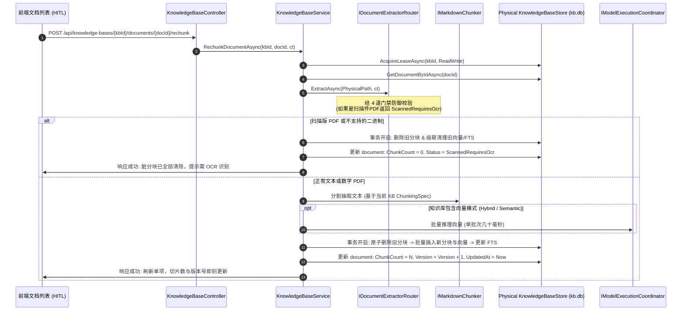
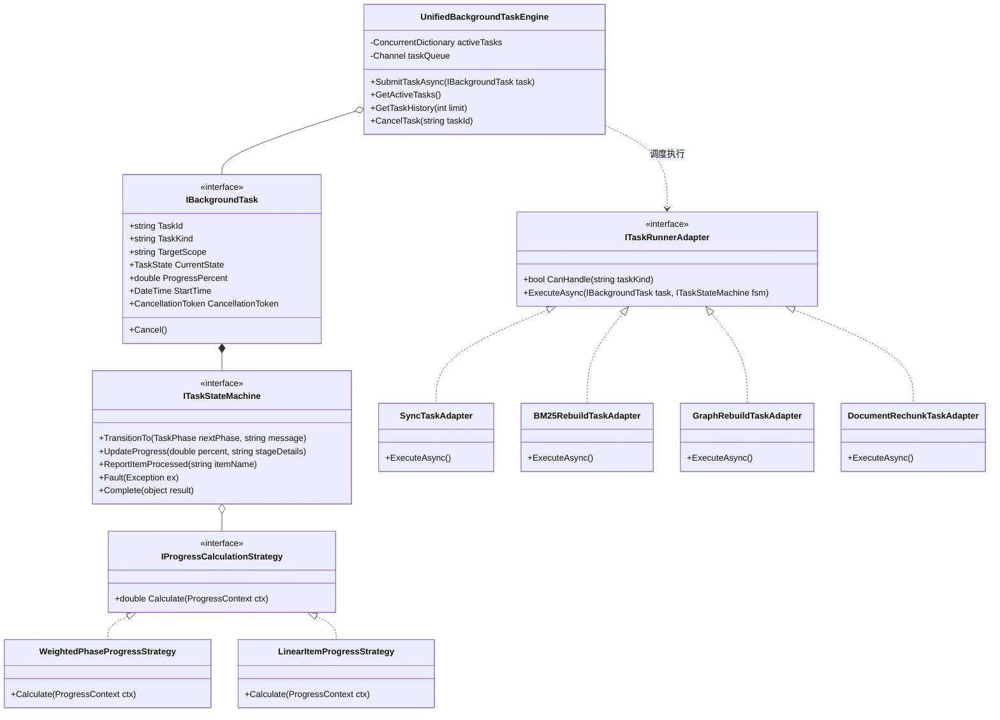

# ReferenceRAG 长时任务监控总线与单文档重新切片架构设计与可行性调研

> **版本**：v1.0.0  
> **状态**：方案调研与架构设计草案（RFC）  
> **关联模块**：`ReferenceRAG.Business`、`ReferenceRAG.ApiHost`、`ReferenceRAG.Infrastructure`、`ReferenceRAG.Business/wwwroot`  
> **文档密级**：公开技术设计方案（遵循凭据安全与零泄露规范）

---

## 1. 执行摘要与背景

在 ReferenceRAG 正式发布前的系统治理与用户反馈评估中，通过真实运维环境（生产环境知识库管理与系统监控视图，见附图）暴露出两大结构性交互与调度痛点：

1. **长时任务处于黑盒状态，监控视图维度单一**（参考系统监控页面）：
   - 系统监控中心（`/system`）目前仅展示「正在进行的向量索引任务」，对于**文档分块切片（Chunking）**、**BM25 倒排索引构建**、**知识图谱关联抽取（WikiLink Graph）**、**数据连接器全量扫描**等重型长时后台任务，完全缺乏状态机纳管、实时进度百分比及历史归档追踪。
   - 部分耗时任务（如 BM25 索引重建）在 HTTP 请求线程中同步执行导致长阻塞；知识图谱重建则使用 `_ = Task.Run(...)` 裸跑异步任务，前端发起后无法感知进度，无法取消，异常发生时仅在终端打日志，用户界面呈现“假死”。
2. **收录文档生命周期缺乏精细化治理闭环**（参考知识库治理收录文档列表）：
   - 在知识库治理弹窗（`/knowledge-bases` -> 文档列表）中，每篇已录入文档右侧仅有「查看切片」与「删除文档」两项操作。
   - 当遇到文档格式解析器升级（例如近期引入 PdfPig 与扫描件密度守卫拦截乱码）、分段策略配置变更、或文档原文内容微调时，用户**无法针对单篇文档触发「重新切片与重新索引」**。
   - 用户若想清除单篇文档因解析异常生成的脏切片（例如旧版对扫描版 PDF 误切出的数万条二进制乱码），当前唯一的途径是“全删重新录入”或“对整个连接器数万篇文档触发全量重同步”，造成严重的磁盘 I/O、算力与时间浪费。

本报告针对用户提出的 4 项核心诉求展开深入头脑风暴，系统评估其可行性、逻辑闭环与性能瓶颈，对比业界主流 RAG 架构（Dify、RAGFlow、FastGPT、LangChain 等），并基于**状态机模式（State Pattern）**、**策略模式（Strategy Pattern）**与**适配器模式（Adapter Pattern）**，给出利用系统现有基础设施（`IndexJobStateMachine`、`KnowledgeBaseJobCoordinator`、`IIndexEventPublisher`）进行最小侵入、高性能扩展的完整落地方案。

---

## 2. 核心问题头脑风暴与深度论证

### 问题 1：能否新增切片、BM25、图谱等任务状态和进度显示？

#### 可行性结论：**高度可行，且为工业级 RAG 架构的必经之路。**

#### 现状缺陷审计：
| 任务类型 | 当前触发路径 | 当前执行方式 | 状态可观测性 | 取消与超时控制 |
| :--- | :--- | :--- | :--- | :--- |
| **向量索引 (Vector Index)** | `/api/index/jobs` | `IndexService` + `IndexJobStateMachine` | **优秀**（支持 SignalR 进度与 System 视图展示） | 支持 CTS 级联取消 |
| **文档切片与同步 (Sync/Chunk)** | `/api/knowledge-bases/{id}/connectors/{cId}/sync` | `KnowledgeBaseSyncWorker` 独立后台单飞 | **较差**（仅记录于 `kb.db` 内部，未上报监控中心） | 支持 `KnowledgeBaseJobCoordinator` 取消 |
| **BM25 全文索引重建** | `/api/BM25Index/index` | `BM25IndexController` 内 `await` 同步阻塞 | **极差**（无进度，100% 同步返回，大库直接超时） | **无**（无法取消） |
| **知识图谱关系重建** | `/api/graph/rebuild` | `GraphController` 内 `Task.Run` 裸跑 | **极差**（仅控制台输出日志，前端无任何状态） | **无**（无法取消） |
| **全库模型重索引 (Reindex)** | `/api/knowledge-bases/{id}/reindex` | 事务表单飞记录 | **中等**（单库状态接口可查，但未收敛至总线） | 支持 CTS 取消 |

#### 逻辑与性能潜在缺陷：
1. **进度计算粒度差异**：
   - 向量索引依赖 `ProcessedFiles / TotalFiles` 和 `ProcessedBatches / TotalBatches` 计算平滑百分比；
   - BM25 重建为 SQLite FTS5 内部分批操作，传统计数基于切片分块（Chunks）；
   - 图谱重建包含“文件扫描”与“WikiLink 链接/标题语法树遍历”两个跨度阶段。若不统一抽象，前端组件将面临复杂的差异化逻辑。
2. **高频事件风暴（Event Storming）与 UI 渲染卡顿**：
   - 若每个切片入库、每个边插入都向 SignalR 广播一条消息，处理数万切片时浏览器主线程将被 WebSocket 消息淹没（导致 Naive UI 列表丢帧卡顿）。
   - **优化解法**：必须在服务端状态机引入**节流发布器（Throttling Event Publisher）**，按 `200ms` 或 `1%` 进度阈值聚合广播。

---

### 问题 2：能否给知识库治理中 文档 添加一个「重新切片」选项？

#### 可行性结论：**完全可行，且能以极低代价彻底解决脏切片历史残留问题。**

#### 现状缺陷审计：
在收录文档管理界面（`KnowledgeBases.js`），文档以卡片形式展示，数据源自 `IKnowledgeBaseService.GetDocumentsAsync`。
用户若发现某文档分块不理想（例如 `[新政治学概要(第2版)].王邦佐.扫描版.pdf` 早期因纯文本抽取器读取二进制产生了 11,210 个乱码分块），界面**完全没有重新切片入口**。

#### 逻辑闭环设计（单文档重新切片原子事务流）：


#### 关键收益：
1. **零全量开销**：单篇文档仅重切其本身，无需触发连接器几万个文件的轮询与比对。
2. **就地治愈历史脏数据**：对于现场遗留的 11,210 个乱码分块，用户仅需在界面点击「重新切片」，系统自动将其归零并清空 FTS 索引，彻底摆脱历史数据包袱。
3. **版本化（Version Bump）**：文档 `version` 从 `v1` 递增为 `v2`，通知前端切片微调对话框强制拉取新数据。

---

### 问题 3：是否还有其它长时任务需要添加状态和进度显示？能否添加？

#### 梳理与扩展清单：
除了切片、BM25 和图谱之外，在工业级 RAG 运行时中，以下 6 类后台任务同样具有重负载、长耗时特征，应全部纳入统一状态监控总线：

| 任务标识 (`TaskKind`) | 任务描述 | 触发源 | 耗时量级 | 核心进度指标 | 能否添加 |
| :--- | :--- | :--- | :--- | :--- | :--- |
| **`ConnectorSync`** | 数据连接器增量/全量同步 | 定时扫描 / 手动点击同步 | 10秒 ~ 10分钟 | 已扫描文件数 / 变更入库文件数 | **能** |
| **`ModelMigrationReindex`** | 知识库更换嵌入模型全库重计算 | 知识库「更换模型」 | 1分钟 ~ 30分钟 | 已生成向量切片数 / 总切片数 | **能** |
| **`KnowledgeBaseRechunk`** | 知识库应用新分段规格全库重切 | 知识库「重新分段」 | 30秒 ~ 15分钟 | 已重新切分文档数 / 总文档数 | **能** |
| **`ModelDownloadAndPrepare`** | GGUF/ONNX 大模型下载与量化 | 模型管理「下载模型」 | 1分钟 ~ 20分钟 | 已下载字节数 / 总字节数 | **能** |
| **`StorageVacuumAndCleanup`** | 物理存储碎片整理与孤儿清理 | 设置「数据维护」 | 5秒 ~ 2分钟 | 扫描完成数据页 / 回收孤儿分块数 | **能** |
| **`SourceReconciliation`** | 跨库元数据与底层源一致性对账 | 后台定时 / 手动对账 | 5秒 ~ 30秒 | 已核对知识库数 / 漂移修复项数 | **能** |

---

### 问题 4：是否还有其它功能需要添加重新生成功能？能否添加？

#### 梳理与扩展清单：
重新生成不仅限于“单文档重新切片”，按**粒度金字塔模型**，可划分为分块级、文档级与知识库级：

```
                    ┌────────────────────────┐
                    │    知识库级 (KB-Level)   │ -> 全库重切、全库重向量化、全库重建图谱/BM25
               ┌────┴────────────────────────┴────┐
               │         文档级 (Doc-Level)        │ -> 单文档重切片、单文档重抽取OCR、单文档图谱重析
          ┌────┴──────────────────────────────────┴────┐
          │               切片级 (Chunk-Level)           │ -> 单切片编辑后重向量化、单切片摘要重生成
          └────────────────────────────────────────────┘
```

| 级别 | 重新生成功能点 | 业务场景与价值 | 能否添加 |
| :--- | :--- | :--- | :--- |
| **切片级** | **单切片重计算向量 (`Re-embed Chunk`)** | 在 HITL 弹窗中微调了正文后，无需等待后台批处理，即时重算该切片向量并落库 | **能** |
| **文档级** | **单文档重新切片 (`Re-chunk Document`)** | 调整分段策略、修复抽取器 Bug、清除历史乱码分块（核心诉求） | **能** |
| **文档级** | **单文档重新提取 (`Re-extract Document`)** | 重新读取物理源文件，重新做文本清洗或后续 OCR，更新原始内容缓存 | **能** |
| **文档级** | **单文档图谱抽取 (`Re-extract Doc Graph`)** | 修改了单篇文档内的 `[[WikiLink]]` 语法，仅更新该文档的局部拓扑边 | **能** |
| **文档级** | **单文档生成摘要 (`Generate Doc Summary`)** | 调用轻量大模型为单篇文档生成 150 字全局摘要与关键词，提升粗排召回度 | **能** |
| **知识库级**| **知识库统计重校准 (`Recalculate Stats`)** | 物理并发后，强制重新扫描 `kb.db` 统计文件数、有效切片数、词频直方图 | **能** |

---

## 3. 架构设计与设计模式优化

为确保系统不因引入多项长时任务和重切功能而变得代码臃肿、线程失控或发生死锁，采用经典设计模式进行整体架构重构：



### 1. 状态机模式 (State Pattern / FSM)
- **目标**：统一长时任务的生命周期演进，杜绝未知中间态与死锁。
- **状态流转**：
  $$\text{Queued} \longrightarrow \text{Initializing} \longrightarrow \text{Processing} \longrightarrow \text{Persisting} \longrightarrow \begin{cases} \text{Completed} \\ \text{Faulted} \\ \text{Cancelled} \end{cases}$$
- **守卫条件（Guards）**：终态（`Completed`、`Faulted`、`Cancelled`）禁止向任何前驱状态回跳；取消信号仅能在活跃态（`Processing`、`Persisting`）由 CTS 中断底层 `I/O` 操作。

### 2. 适配器模式 (Adapter Pattern)
- **目标**：将原本散落在各个 Controller 中的业务逻辑（如 `BM25IndexController.IndexAllDocuments`、`GraphController.StartRebuild`、`KnowledgeBaseSyncWorker`）全部包装为标准化的 `ITaskRunnerAdapter`。
- **执行解耦**：Controller 不再直接启动后台线程，而是通过 `UnifiedBackgroundTaskEngine.SubmitTaskAsync(...)` 提交任务，实现统一限流（Concurrency Throttle）、统一异常捕获和统一日志跟踪。

### 3. 策略模式 (Strategy Pattern)
- **目标**：不同任务类型的进度特征差异极大，通过注入不同的 `IProgressCalculationStrategy` 实现平滑进度推算：
  - **切片与同步任务**：采用加权阶段策略（`WeightedPhaseProgressStrategy`），扫描 10% + 抽取分块 50% + 向量化/写入 40%。
  - **BM25 与图谱任务**：采用线性分批策略（`LinearItemProgressStrategy`），按批次（Batch）或文件数（Processed / Total）线性推进。

### 4. 观察者与广播模式 (Observer / Pub-Sub via SignalR)
- **目标**：彻底消除前端高频 HTTP 轮询对服务器 SQLite 造成的读取压力。
- **实施**：服务端依托已有的 `IndexHub`，向客户端推送统一协议载荷：
  ```json
  {
    "taskId": "task_chunk_01937f",
    "taskKind": "DocumentRechunk",
    "targetResource": "kb:Notes/doc:2d60530a",
    "phase": "Chunking",
    "progressPercent": 65,
    "currentDetail": "Processing page 4/12...",
    "elapsedMs": 340
  }
  ```

---

## 4. 业界主流技术对比与现有基础设施复用

### 1. 业界主流开源 RAG 方案对比

| 对比维度 | **Dify** | **RAGFlow** | **FastGPT** | **ReferenceRAG (本方案)** |
| :--- | :--- | :--- | :--- | :--- |
| **异步引擎架构** | Celery + Redis + WebSocket | 自研 Task Pipeline 拓扑流 | BullMQ + Redis + Node.js | **.NET Channel + FSM + SignalR**（纯进程内，零外部 Redis 依赖） |
| **单文档重新切片** | 支持（独立重试/重新分段） | 支持（Reparse & Rechunk） | 支持（单文档重建索引） | **原生支持（原子替换 kb.db 局部数据）** |
| **图谱与全文索引任务** | 异步任务队列统一监控 | 统一调度器看板 | 异步队列跟踪 | **统一纳入系统监控大盘（/system）** |
| **扫描件/乱码容错** | 依赖 OCR 标记状态 | DeepDoc 视觉解析 | 错误回退 | **4 道门禁防御 + ScannedRequiresOcr 自动归零** |

### 2. 现有基础设施复用矩阵

| 现有组件/类名 | 当前能力 | 本方案复用与改造方式 |
| :--- | :--- | :--- |
| **`IndexJobStateMachine`** | 具备状态跃迁校验与平滑算法 | **提炼为通用基类**，抽离向量专有字段，泛化为 `TaskStateMachineBase` |
| **`KnowledgeBaseJobCoordinator`** | 具备 CTS 取消源管理与单飞锁 | **升级为全局作业协调器**，支持跨知识库、跨任务类型的统一单飞与取消 |
| **`IIndexEventPublisher` & `IndexHub`** | 具备 SignalR 实时广播能力 | **扩展方法与通道**，新增 `PublishTaskProgressAsync`，兼容全类型任务广播 |
| **`IDocumentExtractorRouter`** | 统一抽取器路由与门禁 | **在单文档重切片中直接调用**，确保重切时严格执行 PdfPig 与乱码拦截 |
| **`IKnowledgeBaseStorageManager`** | 物理单库 SQLite 租赁管理 | **事务级原子替换**，保障单文档分块更新时读写互斥与检索零污染 |
| **前端 `System.js` 视图** | 具备 Naive UI 任务进度卡片 | **改造数据模型**，将单一只展示向量任务扩展为多标签/全类型任务列表 |

---

## 5. 详细落地方案与演进规划

### 阶段 1：后端通用长时任务管理引擎 (UnifiedBackgroundTaskEngine)
- **源码落点**：`Business/ReferenceRAG.Business/Features/TaskEngine/`
- **核心类与接口**：
  - `IBackgroundTask`: 统一定义 `TaskId`、`TaskKind`、`Scope`、`Progress`、`Status`、`CancellationToken`。
  - `BackgroundTaskManager` (Singleton): 集中持有并发任务字典、历史环形缓冲区（保留最近 50 条），暴露 `SubmitAsync`、`CancelAsync`、`GetActive`、`GetHistory`。
  - `TaskProgressThrottler`: 针对 SignalR 推送提供每 200ms 窗口合并与按百分比步长推流，避免消息风暴。
- **服务端 API 统一契约**：
  - `GET /api/tasks/active`: 获取全系统所有活跃任务（切片、BM25、图谱、同步等）。
  - `GET /api/tasks/history`: 获取历史完成/失败任务。
  - `POST /api/tasks/{taskId}/cancel`: 统一取消任意正在运行的长时任务。

### 阶段 2：适配切片、BM25 与图谱为标准化 Task Runner
1. **BM25 倒排索引任务适配器 (`BM25RebuildTaskAdapter`)**：
   - 彻底改造 `BM25IndexController.IndexAllDocuments`：不再在 Controller 内同步 `await`，而是提交 `BM25RebuildJob`，立即返回 `202 Accepted` + `TaskId`。
   - 分块分批重建（每 1000 chunks 提交一次并上报进度百分比），前端支持取消。
2. **知识图谱关系重建适配器 (`GraphRebuildTaskAdapter`)**：
   - 消除 `Task.Run` 裸奔，包装为 `GraphRebuildJob`。
   - 遍历连接器文件时，每抽取 10 个文档的 WikiLink 即上报一次进度与当前处理文件名，支持中途取消。
3. **数据连接器同步适配器 (`ConnectorSyncTaskAdapter`)**：
   - 将 `KnowledgeBaseSyncWorker` 的文件扫描、提取、分块入库等阶段状态与总线绑定，向监控中心实时汇报。

### 阶段 3：实现单文档重新切片核心逻辑与契约
- **服务端新增接口**：
  - `POST /api/knowledge-bases/{kbId}/documents/{docId}/rechunk`
- **业务实现 (`KnowledgeBaseService.cs`)**：
  ```csharp
  public async Task<RechunkDocumentResult> RechunkDocumentAsync(
      string knowledgeBaseId, string documentId, CancellationToken ct = default)
  {
      await using var lease = await _kbStorageManager.AcquireLeaseAsync(knowledgeBaseId, StorageAccess.ReadWrite, ct);
      var doc = await lease.Store.GetDocumentByIdAsync(documentId, ct)
          ?? throw new KeyNotFoundException($"文档不存在: {documentId}");
      
      // 1. 获取物理路径并通过路由器安全抽取纯文本
      var extractResult = await _extractorRouter.ExtractAsync(doc.Locator, ct);
      
      // 2. 开启 SQLite 事务保障原子替换
      await lease.Store.BeginTransactionAsync(ct);
      try
      {
          // 清除旧切片与相关索引
          await lease.Store.DeleteChunksByDocumentIdAsync(doc.Id, ct);
          
          if (extractResult.Status == DocumentParseStatus.ScannedRequiresOcr)
          {
              // 扫描件降级：切片归零，标注文档状态
              doc.ChunkCount = 0;
              doc.Status = "ScannedRequiresOcr";
          }
          else if (!string.IsNullOrWhiteSpace(extractResult.TextContent))
          {
              // 基于知识库绑定的分段规格重新切块
              var kb = await _catalogStore.GetKnowledgeBaseAsync(knowledgeBaseId, ct);
              var chunks = _chunker.Chunk(extractResult.TextContent, kb.ChunkingSpec);
              
              // 向量化（如有）并批量插入
              if (kb.Mode != KnowledgeBaseMode.PureLexical)
              {
                  var vectors = await _modelCoordinator.EmbedBatchAsync(chunks.Select(c => c.Text), ct);
                  await lease.Store.BatchInsertChunksAsync(doc.Id, chunks, vectors, ct);
              }
              else
              {
                  await lease.Store.BatchInsertChunksAsync(doc.Id, chunks, null, ct);
              }
              doc.ChunkCount = chunks.Count;
          }
          
          doc.Version += 1;
          doc.UpdatedAt = DateTime.UtcNow;
          await lease.Store.UpdateDocumentAsync(doc, ct);
          await lease.Store.CommitTransactionAsync(ct);
          
          return new RechunkDocumentResult(doc.Id, doc.ChunkCount, doc.Version);
      }
      catch
      {
          await lease.Store.RollbackTransactionAsync(ct);
          throw;
      }
  }
  ```

### 阶段 4：前端交互与视图落地 (UI/UX)
1. **收录文档列表增加「重新切片」操作项**（改造 `KnowledgeBases.js`）：
   - 在每篇文档的「查看切片」与「删除文档」之间新增「重新切片」按钮（`<n-button size="small" quaternary type="warning">`）。
   - 点击弹出气泡确认：“确定按当前分段规格重新切分该文档吗？原切片将被原子替换”。
   - 执行过程中显示局部 Spin，成功后切片数即时响应（例如从 `11210 个切片` 归零为 `0 个切片`，版本号变为 `v2`）。
2. **系统监控中心全面升级为全能任务看板**（改造 `System.js`）：
   - 将原「正在进行的向量索引任务」重命名为「正在进行的系统后台任务」。
   - 新增类型标签筛选器（全部 / 同步切片 / BM25全文 / 知识图谱 / 向量索引）。
   - 任务项展示：任务类型 Tag、目标知识库/资源、阶段进度条（带平滑动画）、当前操作文件名、用时与中断按钮。
   - 历史任务增加任务类别过滤与耗时统计。

---

## 6. 逻辑缺陷与性能风险防御门禁

1. **并发竞态与写写冲突防御（Concurrency Guard）**：
   - **风险**：当用户正在对文档 A 进行「重新切片」时，数据连接器后台正好触发同步也试图写入文档 A。
   - **对策**：依托 `IKnowledgeBaseStorageManager.AcquireLeaseAsync` 物理单库锁，并在 `KnowledgeBaseJobCoordinator` 中为文档注册 `doc:{docId}` 单飞标记，冲突时返回 `409 Conflict (Document is being processed)`。
2. **事务原子性与孤儿数据防御（Atomic Swap Guard）**：
   - **风险**：新分块在向量化过程中因大模型超时失败，旧切片却已被删除，导致文档分块丢失。
   - **对策**：严格执行“先在内存生成全部新分块与向量 -> 开启 SQLite 事务 -> 清旧插新 -> 提交事务”。若中途失败，事务完整回滚，旧切片原样保留。
3. **消息风暴与前端卡死防御（Throttling Guard）**：
   - **风险**：数十万字的大型技术手册重新切分出上千分块，频繁触发 SignalR 广播。
   - **对策**：服务端 `TaskProgressThrottler` 强制要求同一任务的进度推送间隔 $\ge 200\text{ms}$，且只有当进度变化超过 $1\%$ 或阶段发生改变时才执行广播。

---

## 7. 总结与建议推进步骤

通过上述架构梳理，用户提出的 4 项核心诉求具有极高的业务价值和落地可行性：
- **切片、BM25、图谱等任务状态与进度**：通过构建统一轻量任务管理总线（`UnifiedBackgroundTaskEngine`），彻底打破目前长时任务黑盒与割裂问题，让系统监控（`/system`）真正成为全局任务中枢。
- **单文档重新切片**：直击现场痛点，赋予知识库 HITL 治理真正的单篇治愈能力，使历史遗留的乱码切片能够秒级就地清除。
- **设计模式赋能**：状态机模式保证了生命周期的确定性，适配器模式实现了既有业务零侵入纳管，策略模式保障了多模态任务进度的平滑精准。

建议按照实施计划，先落地单文档重新切片与 BM25/图谱异步化改造，随后同批统一服务端后台任务引擎与前端监控看板。
