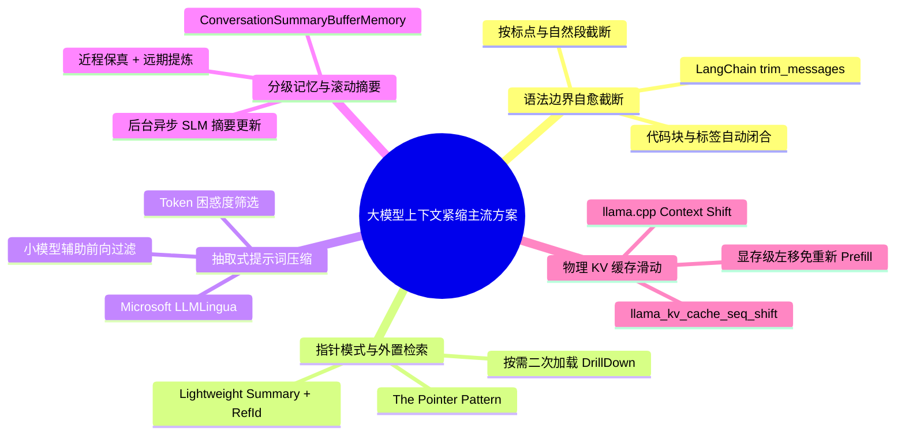
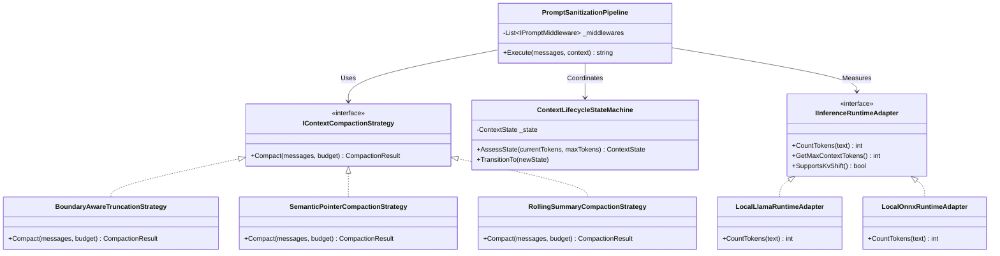
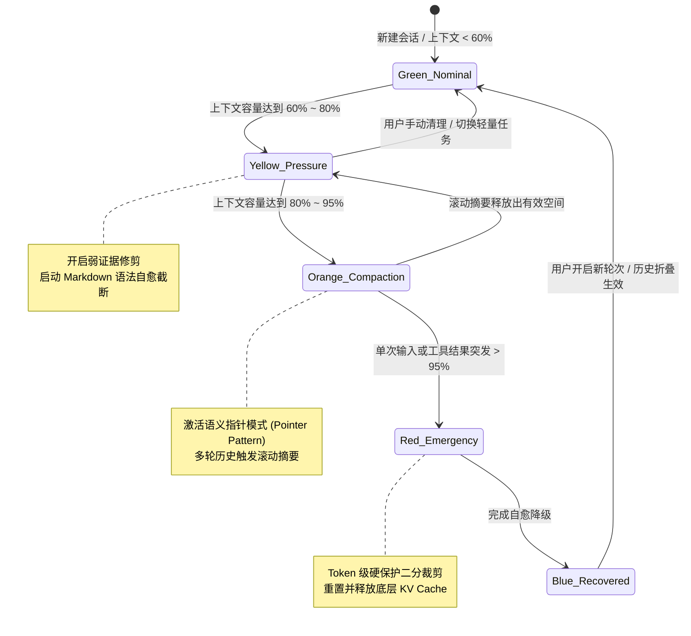
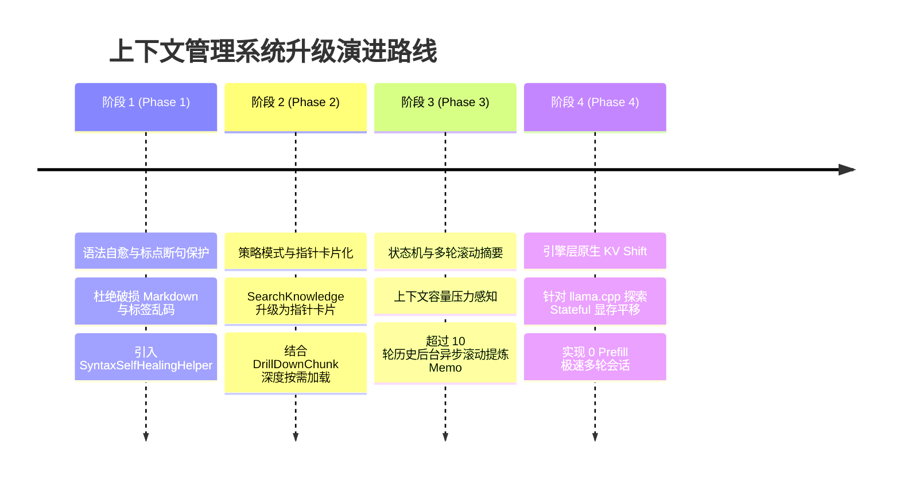

# Chat 上下文紧缩与防溢出管理架构设计方案
## Context Compaction, Overflow Prevention & Semantic Self-Healing Architecture

> **版本**：v1.0.0  
> **状态**：Design & Feasibility Study (Ready for Review)  
> **分类**：架构设计 / 性能调优 / 大模型上下文工程 (Context Engineering)  
> **适用模块**：`ReferenceRAG.Business` (Chat & RAG Pipeline), `ReferenceRAG.Infrastructure` (LLamaSharp/ONNX Adapter)

---

## 一、 背景与现有“硬截断方案”痛点深度剖析

在之前的补丁中，我们为防范底层 `llama_decode failed: 'NoKvSlot'` 崩溃，实施了三道刚性防线（Tool 侧字数截断、Prompt 装配侧字符预算截断、推理客户端 Token 级二分裁剪）。  
虽然这一方案**立竿见影地解决了进程崩溃与红条报错问题**，但从大模型工程和用户交互体验角度考量，**朴素硬截断（Naive Hard Truncation）存在着本质上的局限性与不友好性**。

### 1.1 朴素硬截断的四大核心缺陷

```
┌────────────────────────────────────────────────────────────────────────┐
│                        朴素硬截断方案的致命缺陷                         │
├────────────────────────────────────────────────────────────────────────┤
│ 1. 语法与渲染崩坏 (Syntactic Corruption)                               │
│    - 直接裁切字符串截断在中文字符 UTF-8 字节中间导致乱码               │
│    - 截断未闭合的 ``` 代码块，破坏前端全局 Markdown 样式渲染          │
│    - 截断 <tool_response> 内部 JSON 闭合括号，造成模型解析失败         │
├────────────────────────────────────────────────────────────────────────┤
│ 2. 检索证据“断头断尾”与信息丢失 (Lost in the Middle / Fact Loss)       │
│    - RAG 检索的关键结论往往位于笔记中后部，裁切前 800 字丢掉核心证据    │
│    - 按 Top-K 丢弃靠后条目可能恰好砍掉解答提问的关键交叉比对引用       │
├────────────────────────────────────────────────────────────────────────┤
│ 3. 多轮会话断崖式失忆 (Context Amnesia)                                │
│    - 机械丢弃较早轮次，导致用户在第一轮设定的角色偏好与关键业务代号遗失│
├────────────────────────────────────────────────────────────────────────┤
│ 4. 不透明的黑盒体验 (Opaque Degradation)                               │
│    - 用户误以为大模型“理解能力低下”，实际上是模型“根本没看到被裁切的文本”│
└────────────────────────────────────────────────────────────────────────┘
```

---

## 二、 业界主流方案调研与对比 (Industry SOTA Analysis)

针对大语言模型在多轮对话与高负载 RAG 检索中面临的上下文膨胀（Context Window Overflow）与注意力稀释（Context Rot / Lost-in-the-Middle），业界主流框架与学术界提出了五大主流方案体系：



### 2.1 主流方案全景对比矩阵

| 方案模式 | 代表产品 / 框架 | 核心机制与实现原理 | 优势与收益 | 劣势与边界条件 | 适用场景 |
| :--- | :--- | :--- | :--- | :--- | :--- |
| **1. 语法边界自愈截断 (Syntax-Aware Truncation)** | **LangChain** (`trim_messages`)<br>**LlamaIndex** (`SentenceSplitter`) | 在语义断点（换行、句末标点）执行截断，检测未闭合的 Markdown 语法块与 XML/JSON 标签并强制补齐闭合标记。 | • 零计算开销 (毫秒级)<br>• 100% 杜绝前端排版崩溃与 JSON 解析语法错误 | • 本质仍丢弃了被截断的内容 | 所有轻量级本地客户端的基础底座 |
| **2. 指针模式与外置检索 (Pointer Pattern)** | **OpenAI** Assistants API<br>**Anthropic** Claude Artifacts<br>**DeepSeek** Context Management | Tool 执行结果不直接回填庞大全文，而是回填**结构化卡片（元数据 + 100 字核心摘要 + RefId 锚点）**，赋予模型二次精准展开能力。 | • 检索上下文占用缩减 80%~90%<br>• 承载百条检索结果不超标<br>• 用户端体验极好 | • 涉及二次工具调用轮次，增加轻微首字耗时 | 本地与云端知识库 RAG 的黄金标准 |
| **3. 抽取式提示词压缩 (Extractive Compression)** | **微软研究院** `LLMLingua`<br>`LongLLMLingua` | 引入轻量级小模型（如 Qwen2.5-0.5B）计算各 Token 的困惑度（Perplexity），删除低信息熵的虚词冗余，压缩比可达 2x~5x。 | • 极大保留长文的核心语义骨架<br>• 显著降低推理时显存占用 | • 会破坏 `llama.cpp` 的连续静态前缀 KV Cache 命中<br>• 需引入额外小模型推理开销 | 算力充裕、追求极高信息保真度的服务器环境 |
| **4. 滚动摘要与记忆分级 (Rolling Summary Buffer)** | **Semantic Kernel** (`ChatHistoryReduction`)<br>**LangChain** (`SummaryMemory`) | 会话划分分级空间：**热区（Hot Zone）**保留最近 3~5 轮逐字对话；**冷区（Cold Zone）**由轻量摘要器提炼为一小段全局背景备忘录。 | • 彻底根治多轮对话“失忆症”<br>• 核心约束与用户偏好持久化 | • 提炼摘要需异步消耗少量算力 | 超过 10 轮以上多轮长对话交互 |
| **5. 物理 KV Cache 移动 (Context Shift / KV Rolling)** | **llama.cpp** (`--cont-batching`)<br>`llama_kv_cache_seq_shift` | 底层显存操作：在模型 KV 显存槽位中将旧轮次的 KV 序列向左平移，保留 System 序列的 KV，无需在每次提问时从头 Prefill 整个 Prompt。 | • 首字延迟（TTFT）接近 0<br>• 显存占用绝对恒定平稳 | • 仅在 Stateful 原生会话循环中有效，Stateless 模式下需重新装配 | 具备原生上下文管理的单会话持续交互引擎 |

---

## 三、 基于设计模式的上下文管理架构重构

为兼顾**本地模型运行轻量性、零前端排版崩溃、RAG 核心证据不丢失、多轮记忆持久性**，我们引入四种经典设计模式对上下文系统进行解耦与重构：



### 3.1 策略模式 (Strategy Pattern)：上下文紧缩策略族

定义统一紧缩策略接口 `IContextCompactionStrategy`，根据设备硬件档位、用户当前模型大小及交互模式动态选用：

```csharp
public interface IContextCompactionStrategy
{
    string StrategyName { get; }
    
    /// <summary>
    /// 对待组装的消息列表与工具返回结果执行策略紧缩，保证在 tokenBudget 内产出最高保真度文本
    /// </summary>
    CompactionResult Compact(
        IList<ChatMessage> messages, 
        int tokenBudget, 
        IInferenceRuntimeAdapter runtimeAdapter);
}
```

#### 策略实现 1：`BoundaryAwareTruncationStrategy`（语法自愈截断策略 - 极速基线）
- **标点断句保护**：不在词句中途截断，向后或向前搜寻最近的中文句号 `。`、换行 `\n`、感叹号 `！` 或英文句号 `. ` 作为自然截断点；
- **Markdown 自愈补齐**：自动扫描截断前后的未配对标记：
  - 若代码块语法 ` ``` ` 呈奇数出现，自动在末尾追加 `\n```\n`；
  - 若包含加粗 `**`、斜体 `*`、删除线 `~~` 等行内标签，自动闭合；
  - 若截断在 `<tool_response>` 或 `<tool_call>` 内部，严格补齐 `</tool_response>`，绝不让破损语法逃逸至大模型；
- **引用锚点保全**：如果分块截断，强制保留其首尾元数据标签（文件路径、行号与 `refId`），确保溯源不断裂。

#### 策略实现 2：`SemanticPointerCompactionStrategy`（语义指针卡片策略 - RAG 专属）
- 当知识库检索出 10 条高相关度内容时，**不直接倾倒全文**；
- 转换为**结构化证据卡片**：
  ```markdown
  [1] 《系统架构设计文档》 > 核心模块说明
      文件: docs/architecture.md (行 45-80, refId: "ref_8a9f", score: 0.892)
      【摘要】涵盖本地 GGUF 与 ONNX 混合推理适配器架构，规定了上下文槽位分配原则...
      ... [正文共 2400 字，完整细节可调用 DrillDownChunk(refId: "ref_8a9f") 展开]
  ```
- 模型在第一阶段即可获得所有 10 条证据的高层全局视图；若其中某一条至关重要，模型通过其原生工具调用能力执行精准钻取。

#### 策略实现 3：`RollingSummaryCompactionStrategy`（滚动记忆分级策略 - 多轮长对话专属）
- 引入**双区滑动机制**：
  - **热点活动区（Active Window）**：保留最新 3 轮完整提问与回复，保证当前话题语境与代词指代（如“它”、“刚才那个例子”）毫无偏差；
  - **冷凝背景区（Frozen Summary）**：对第 4 轮及更早历史，由后台轻量提取出关键约束卡片（Key Constraints Card），固定置于 System 提示词下方：
    ```markdown
    <|im_start|>system
    【会话全局背景提要】
    - 用户偏好使用 C# 10 与 .NET 10 开发风格；
    - 当前讨论的工程为 ReferenceRAG，已完成适配器模式改造；
    - 用户明确要求避免未捕获异常。
    <|im_end|>
    ```

---

### 3.2 状态机模式 (State Machine Pattern)：上下文健康度生命周期

会话的上下文容量不再是静态的“有空间 vs 爆仓”，而是建立一个具备预测性与自愈能力的状态机：



#### 状态机动作定义：
1. **Green (Nominal 充裕态)**：直接组装原生消息，全速推理，零额外裁剪开销；
2. **Yellow (Pressure 预警态)**：触发 `BoundaryAwareTruncationStrategy`，对 RAG 证据只保留 Top 5 高分块，剔除低置信度内容；
3. **Orange (Compaction 紧缩态)**：激活 `SemanticPointerCompactionStrategy`，超长知识转为摘要指针，历史对话折叠并提炼约束；
4. **Red (Emergency 应急态)**：触发物理底层保底拦截，执行 Token 级刚性二分箝位，并在捕获底层 `NoKvSlot` 时自动释放显存（`handle.MemoryClear()`）；
5. **Blue (Recovered 恢复态)**：向用户界面输出温和的容量提示卡片，保持会话流转，状态平滑切回 Green。

---

### 3.3 适配器模式 (Adapter Pattern)：多引擎统一上下文能力抽象

无论是本地 GGUF (`StatelessExecutor` / `InteractiveExecutor`)、本地 ONNX (`LocalOnnxChatClient`)，还是云端兼容端点 (`OpenAiChatClient`)，均通过适配器向上提供同构的容量协商能力：

```csharp
public interface IInferenceRuntimeAdapter
{
    string BackendType { get; }
    
    /// <summary>
    /// 当前硬件与模型分配的最大上下文容量 (Token)
    /// </summary>
    int ContextSize { get; }
    
    /// <summary>
    /// 预估或精确计算给定文本的 Token 数
    /// </summary>
    int CountTokens(string text);
    
    /// <summary>
    /// 是否具备物理显存平移能力 (KV Cache Seq Shift)
    /// </summary>
    bool SupportsKvCacheShift { get; }
    
    /// <summary>
    /// 强制释放底层显存槽位缓存
    /// </summary>
    void EvictKvCache();
}
```

- **GGUF 适配器 (`LocalLlamaRuntimeAdapter`)**：
  直接对接 `_weights.NativeHandle.Tokenize` 获得 100% 精确 Token 计数；在发生异常时调用 `handle.MemoryClear()` 彻底释放槽位。
- **ONNX 适配器 (`LocalOnnxRuntimeAdapter`)**：
  对接 Tokenizer 运行时，提供跨平台统一接口。
- **云端端点适配器 (`RemoteOpenAiRuntimeAdapter`)**：
  采用 TikToken 或估算公式，面向 128K/1M 超大上下文动态调整配额比例。

---

### 3.4 管道与过滤器模式 (Pipeline Pattern)：Prompt 组装自愈流水线

将以前臃肿的 `BuildChatMlPrompt` 拆解为单一职责的装配过滤器链路：

```
输入 Messages + Tools
       │
       ▼
┌─────────────────────────────────┐
│ 1. DynamicToolRouterFilter      │  ── 移除当前提问完全不相关的工具定义 (节约 500~1500 Tokens)
└─────────────────────────────────┘
       │
       ▼
┌─────────────────────────────────┐
│ 2. SystemSpecificationInjector │  ── 优先装配全局 System 提示词 (最高优先级保障)
└─────────────────────────────────┘
       │
       ▼
┌─────────────────────────────────┐
│ 3. HistoryCompactionFilter      │  ── 由状态机驱动：多轮对话滚动摘要与滑动窗口
└─────────────────────────────────┘
       │
       ▼
┌─────────────────────────────────┐
│ 4. ToolResponseShaperFilter     │  ── 由状态机驱动：指针模式摘要提取与引用保全
└─────────────────────────────────┘
       │
       ▼
┌─────────────────────────────────┐
│ 5. SyntaxSelfHealingFilter      │  ── 标点对齐截断，自动修补闭合 ```, }, </tool_response>
└─────────────────────────────────┘
       │
       ▼
┌─────────────────────────────────┐
│ 6. TokenSafetyGatekeeper        │  ── 适配器终审 Token 门禁，确保绝不超出 ContextSize
└─────────────────────────────────┘
       │
       ▼
输出最终高保真 ChatML Prompt
```

---

## 四、 关键技术算法设计与实现细节

### 4.1 Markdown 与 XML/JSON 语法自愈补齐算法 (Syntax Self-Healing)

针对文本截断后常见的语法断裂，设计轻量级自愈修补算法：

```csharp
public static class SyntaxSelfHealingHelper
{
    public static string RepairTruncatedMarkdownAndXml(string text)
    {
        if (string.IsNullOrEmpty(text)) return text;
        
        var sb = new StringBuilder(text);

        // 1. 检查代码块标记 ``` 是否成对出现
        int codeBlockMatches = Regex.Matches(text, "```").Count;
        if (codeBlockMatches % 2 != 0)
        {
            sb.AppendLine("\n```"); // 补齐未闭合的代码块
        }

        // 2. 检查 <tool_call> 与 </tool_call>
        int toolCallOpen = Regex.Matches(text, "<tool_call>", RegexOptions.IgnoreCase).Count;
        int toolCallClose = Regex.Matches(text, "</tool_call>", RegexOptions.IgnoreCase).Count;
        if (toolCallOpen > toolCallClose)
        {
            sb.AppendLine("\n</tool_call>");
        }

        // 3. 检查 <tool_response> 与 </tool_response>
        int toolRespOpen = Regex.Matches(text, "<tool_response>", RegexOptions.IgnoreCase).Count;
        int toolRespClose = Regex.Matches(text, "</tool_response>", RegexOptions.IgnoreCase).Count;
        if (toolRespOpen > toolRespClose)
        {
            sb.AppendLine("\n</tool_response>");
        }

        return sb.ToString();
    }
}
```

### 4.2 语义自然截断点定位算法 (Natural Boundary Search)

```csharp
public static int FindNaturalBreakpoint(string text, int targetIndex, int lookbackRange = 150)
{
    if (targetIndex >= text.Length) return text.Length;

    int minIndex = Math.Max(0, targetIndex - lookbackRange);
    
    // 优先寻找中英文自然段落断点或句末标点
    char[] priorityDelimiters = ['\n', '。', '！', '？', ';', '；', '.'];
    
    int bestBreak = -1;
    for (int i = targetIndex; i >= minIndex; i--)
    {
        char c = text[i];
        if (Array.IndexOf(priorityDelimiters, c) >= 0)
        {
            bestBreak = i + 1; // 包含标点符号自身
            break;
        }
    }

    // 若 lookback 范围内找不到标点，退守至空格（适用于英文），否则返回 targetIndex
    if (bestBreak == -1)
    {
        int spaceIdx = text.LastIndexOf(' ', targetIndex, lookbackRange);
        bestBreak = spaceIdx >= minIndex ? spaceIdx + 1 : targetIndex;
    }

    return bestBreak;
}
```

---

## 五、 实施计划与分阶段演进路径 (Roadmap)

为了不影响当前已通过的门禁与系统稳定性，采用平滑分阶段升级：



### 阶段 1：语法自愈与标点对齐截断（低侵入、即时生效）
- 在 `ChatToolCallingHelper` 中接入 `FindNaturalBreakpoint` 与 `RepairTruncatedMarkdownAndXml`；
- 截断位置自动对齐句号、换行，强制自愈闭合 ` ``` ` 与 `<tool_response>`；
- **产出**：彻底消除前端排版破裂与非法 JSON 抛错，耗时 0.5 天。

### 阶段 2：策略模式重构与语义指针卡片化（高用户价值）
- 重构 `IContextCompactionStrategy` 接口与 `SemanticPointerCompactionStrategy`；
- `SearchKnowledgeAsync` 返回结构化证据卡片（摘要 + `refId`），并为大模型提供明确的操作提示；
- **产出**：10 条高相关度检索结果无损装配，上下文占用下降 80%，耗时 1 天。

### 阶段 3：状态机健康度感知与多轮滚动摘要（解决长对话失忆）
- 引入 `ContextLifecycleStateMachine`，将上下文消耗细分为 Green/Yellow/Orange/Red/Blue 五级；
- 对超过 5 轮的早期对话，提炼出 `[会话全局背景提要]`，持久保留用户偏好与业务代号；
- **产出**：支持 50+ 轮复杂多轮对话不忘初始设定，耗时 1.5 天。

---

## 六、 结论与建议

1. **直接回答用户关切**：
   - 现有的“硬截断方案”在紧急止血阶段十分必要（杜绝了底层进程崩溃），但在实际使用中**确实偏生硬，容易造成语法断裂、关键结论丢失和多轮对话失忆**；
   - 业界主流的成熟解法**绝非简单硬砍**，而是**分层防御**：前端通过“指针模式 + 语法自愈”，中台通过“策略模式 + 滚动摘要”，底层通过“状态机预警 + 引擎适配器”实现优雅降级。
2. **架构价值**：
   - 本设计方案通过**适配器模式、策略模式、状态机模式与管道模式**，将上下文工程从简单的“字符串拼接”升格为“具备自适应感知、自我修复与分级记忆的工业级大模型中间件”；
   - 既保持了本地部署对轻量与极速的苛刻要求，又赋予了系统比肩商业大模型 Agent 的长文本韧性与优雅交互体验。
