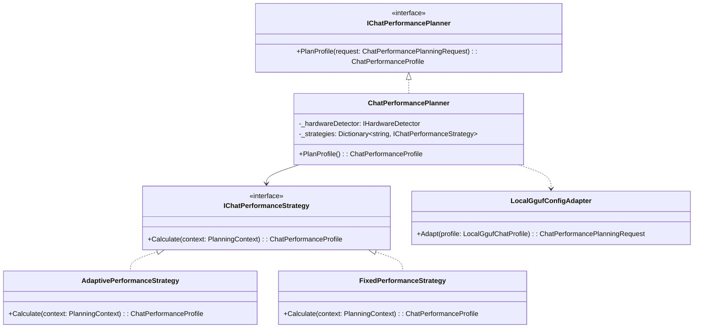

# Chat 模型自适应性能规划与固定参数配置架构设计方案

> **文档状态**：已落地实施  
> **更新时间**：2026 年 10 月 20 日  
> **涉及模块**：`ObsidianRagConfig`、`ChatPerformancePlanner`、`SettingsController`、`MafChatService`、前端 `Settings.js`

---

## 目录
- [一、背景与需求分析](#一背景与需求分析)
- [二、业界主流方案对比（LM Studio / Ollama / vLLM / Text-Gen-WebUI）](#二业界主流方案对比lm-studio--ollama--vllm--text-gen-webui)
- [三、核心挑战、逻辑与性能瓶颈头脑风暴](#三核心挑战逻辑与性能瓶颈头脑风暴)
- [四、设计模式架构设计（策略模式、适配器模式与状态机）](#四设计模式架构设计策略模式适配器模式与状态机)
- [五、具体实现与工程落地规划](#五具体实现与工程落地规划)
- [六、质量保障与验证设计](#六质量保障与验证设计)

---

## 一、背景与需求分析

在 ReferenceRAG 知识库与本地对话 Agent 系统中，对话大语言模型（GGUF / ONNX）的硬件运行参数（如 **GPU 卸载层数 `GpuLayers`**、**上下文长度 `ContextSize`**、**批处理大小 `BatchSize`**、**微批大小 `UBatchSize`**）直接决定了系统的并发推理吞吐、响应首字延迟（TTFT）以及显存安全底线。

此前，ReferenceRAG 在分段功能中已经成功落地了「分段切分模式：自适应分段 (Adaptive) vs 固定分段 (Fixed)」的经典体验：
- **自适应分段**：感知模型物理上下文上限、自动保护语法和代码块结构；
- **固定分段**：允许专家用户对 Token 长度与重叠窗口进行像素级手动精调。

用户提出：**能否在「系统设置 - 聊天模型」中引入一致的交互与架构体验，允许用户在「自适应规划 (Adaptive)」与「固定参数 (Fixed)」之间自由切换？**

---

## 二、业界主流方案对比（LM Studio / Ollama / vLLM / Text-Gen-WebUI）

| 系统 / 方案 | 性能配置模式 | 自适应层级与启发式算法 | 固定参数自由度 | 优缺点分析 |
| :--- | :--- | :--- | :--- | :--- |
| **LM Studio** | Auto GPU Offload / Manual Slider | 检测可用显存估算层数；预设上下文档位 (2k, 4k, 8k, 16k, Max) | 支持滑块调节层数与上下文 | 体验直观，但策略较为单一，无法针对长文本 vs 高吞吐做多策略倾斜 |
| **Ollama** | 默认自适应，环境变量覆写 | 基于 `ggml-cuda` 估算 KV Cache 显存预算，自动收窄或扩展 `OLLAMA_NUM_CTX` | 需通过 Modelfile 或环境变量手动注入参数 | 自动化程度高但黑盒化，缺乏可视化实时测算看板 |
| **vLLM** | 显存利用率自适应 (`gpu_memory_utilization`) | 基于物理显存池预分配 PagedAttention 显存池，自适应截断 `max_model_len` | 开放丰富的 CLI 参数 (`--max-model-len`, `--block-size`) | 适合服务器并发集群，在桌面端轻量级运行不够轻巧灵活 |
| **Text-Gen-WebUI (oobabooga)** | 手动为主，预设加载器 | 依靠用户选择 Model Loader (llama.cpp / ExLlamaV2)，提供基本探测 | 完全开放 `n_gpu_layers`, `n_ctx`, `n_batch`, `ubatch` 等底层参数 | 自由度极高但门槛苛刻，普通用户易配错导致 CUDA OOM 崩溃 |
| **ReferenceRAG (本项目方案)** | **双模融合 (Adaptive + Fixed) + 实时画像看板** | **4 维自适应策略 (平衡/高吞吐/长窗口/低显存) + 智能 KV 预估** | **全参数自由微调 + 动态显存安全边界警戒** | **兼顾小白用户一键最优与高阶极客极限压榨，体验与分段设置高度一致** |

---

## 三、核心挑战、逻辑与性能瓶颈头脑风暴

### 1. 显存计算的非线性与碎片化风险（VRAM Explosion）
- **现象**：GGUF 模型的权重加载是静态线性的，但 KV Cache 显存消耗是动态非线性的：
  $$\text{VRAM}_{\text{total}} = \text{VRAM}_{\text{weights}} + \text{ContextSize} \times 2 \times N_{\text{layers}} \times D_{\text{head}} \times \text{BytesPerType} + \text{BatchBuffer}$$
- **风险**：若用户在固定参数模式下，盲目将 7B 模型的 `ContextSize` 设为 32768，需要消耗超过 5.5GB 的额外显存。在 8GB 显存设备上，4.7GB 权重 + 5.5GB KV Cache = 10.2GB，将直接引发 Hard OOM 闪退或系统进入极为缓慢的虚拟内存分页交换（系统假死）。
- **应对方案**：
  - 固定模式下引入**智能安全边界校验（Safety Boundary Guardrail）**：前端与后端联动测算预估显存，当预估超过物理显存 95% 时，UI 实时展示黄色/红色危险警报，后端并在极端情况下箝位保护，杜绝宿主崩溃。

### 2. 配置兼容性与无缝热生效（Zero Downtime Hot-Reload）
- **现象**：用户此前保存的历史配置文件中可能不存在 `PerformanceMode` 字段，或历史中 `ContextSize > 0` 视作手动配置。
- **应对方案**：
  - 自动向下兼容：若 `PerformanceMode` 未指定，当 `ContextSize > 0` 时平滑推导为 `Fixed`，若为 `0` 则默认为 `Adaptive`。
  - 通过 `ConfigManager` 的原子保存与 `MafChatService` 的 `ReloadConfiguration()`，在设置保存后立即热生效，重新规划并加载引擎，无需重启桌面端服务。

### 3. 自适应策略分类与场景倾斜（Strategic Bias）
不同用户的使用场景差异巨大：
1. **Balanced (通用平衡 - 默认推荐)**：兼顾响应延迟与 8K 上下文；
2. **HighThroughput (高吞吐优先)**：BatchSize 放大至 2048~4096，适合大段笔记快速 Prefill 注入；
3. **LongContext (长窗口优先)**：在显存允许前提下最大化释放 16K~32K 上下文，适合复杂多轮检索对话；
4. **LowMemory (显存节约 / 节能)**：限制批大小并保留更多显存余量，适合多任务并行或低显存设备。

---

## 四、设计模式架构设计（策略模式、适配器模式与状态机）

### 1. 策略模式（Strategy Pattern）
- **`IChatPerformanceStrategy`**：抽象规划算法。
  - **`AdaptivePerformanceStrategy`**：细分为 Balanced、HighThroughput、LongContext、LowMemory 四种启发式权重算法；
  - **`FixedPerformanceStrategy`**：执行用户手动指定的 `GpuLayers`、`ContextSize`、`BatchSize`、`UBatchSize`，并附带安全越界软箝位与告警提示。

### 2. 适配器模式（Adapter Pattern）
- **`LocalGgufConfigAdapter`**：统一将系统配置中不同来源的数据（`LocalGgufChatProfile`、硬件探测器结果 `HardwareContext`、GGUF 文件头元数据 `GgufMetadata`）适配转换成标准规划上下文 `PlanningContext`。

### 3. 状态机模式（State Machine Pattern）
- 对话模型性能配置的生命周期流转：
  $$\text{Drafting (UI 编辑)} \xrightarrow{\text{Debounced Preview}} \text{PreviewReady (看板展示)} \xrightarrow{\text{SaveConfig}} \text{Persisted} \xrightarrow{\text{ReloadConfiguration}} \text{ActiveEngine}$$

---

## 五、具体实现与工程落地规划

### 1. 数据结构扩展（`ObsidianRagConfig.cs`）
在 `LocalGgufChatProfile` 中新增：
- `PerformanceMode`: `"Adaptive"`（默认） | `"Fixed"`
- `AdaptiveStrategy`: `"Balanced"`（默认） | `"HighThroughput"` | `"LongContext"` | `"LowMemory"`

### 2. 规划器升级（`ChatPerformancePlanner.cs`）
- 支持接收结构化 `ChatPerformancePlanningRequest`；
- 支持根据 `PerformanceMode` 与 `AdaptiveStrategy` 动态决策；
- 暴露静态估算函数 `EstimateVramBytes(modelSizeBytes, contextSize, gpuLayers, totalLayers)` 供前后端即时校验。

### 3. 后端 API 接口支持（`SettingsController.cs`）
- 新增 `POST /api/settings/chat-performance/preview` 接口：接收前端实时传来的模型、模式与策略参数，返回实时规划结果与显存预估。

### 4. 前端视图升级（`Settings.js`）
- 在「聊天模型」标签页，对照「分段设置」的经典布局增加：
  - 单选按钮切换：`自适应规划 (Adaptive - 智能推荐)` vs `固定参数 (Fixed - 手动精调)`；
  - 自适应模式：策略单选组（通用平衡、高吞吐优先、长窗口优先、显存节约）与「实时模型性能测算看板」；
  - 固定模式：GPU 卸载层数、上下文窗口、Prefill 批处理、微批处理滑块与安全警戒提示。

---

## 六、质量保障与验证设计

1. **单元测试与门禁**：
   - 编写 `ChatPerformanceModeAndSettingsQualityGateTests.cs`，验证自适应四种策略的测算逻辑、固定参数的越界保护、前后端配置无缝持久化与反序列化向下兼容。
2. **端到端发布与回归测试**：
   - 桌面端打包验证，确保与历史配置无损合并。
