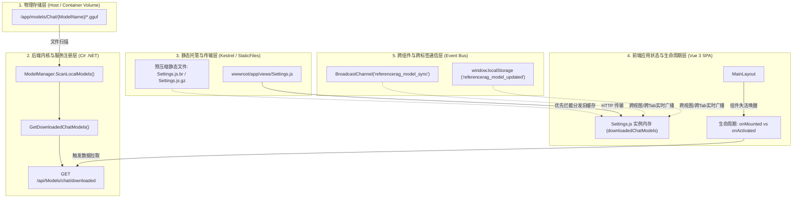

# 本地大模型与前端 Keep-Alive 状态失步排查方案与标准处置流程 (SOP Runbook)

> **文档适用场景**：
> - 用户在「模型管理」成功下载 GGUF 聊天模型/ONNX 嵌入模型后，设置页面或对话页面依然显示“未检测到已下载模型”；
> - 页面组件在 Vue 3 `<keep-alive>` 路由缓存下出现“状态死滞、需强刷浏览器才能更新”；
> - 容器化运行环境下热更新前端静态文件不生效；
> - 异构环境（CPU/核显/独显）大模型挂载与硬件加速探针状态割裂。

---

## 1. 架构流转全景与故障拓扑

在前后端分离架构（ASP.NET Core WebHost + Vue 3 SPA）中，大模型生命周期管理与前端状态感知经历如下 5 层流转：



任何一层发生割裂（如 Keep-Alive 唤醒未绑定、预压缩静态文件阻断最新脚本传输、配置占位符竞态覆盖），都会导致界面出现“模型已下载却提示未检测到”的假象。

---

## 2. 标准排查七步法 (Standard 7-Step Troubleshooting Workflow)

### 步骤 1：底层物理模型文件核验 (Physical Filesystem Verification)
**排查目标**：确认模型文件是否完整下载至目标目录，无 `.tmp` 临时文件残留，格式与命名合规。
```bash
# 1.1 查看模型目录物理层级与文件大小
find /app/models -maxdepth 4 -ls

# 1.2 确认 Chat 模型子目录结构标准：
# 规范路径: /app/models/Chat/{ModelId}/{ModelId}.{Variant}.gguf
# 示例: /app/models/Chat/Qwen3.5-0.8B-Instruct-GGUF/Qwen3.5-0.8B.Q4_K_M.gguf
# 若伴随视觉多模态投影器:
# 示例: /app/models/Chat/Qwen3.5-0.8B-Instruct-GGUF/Qwen3.5-0.8B.F16-mmproj.gguf

# 1.3 校验文件完整性（GGUF Magic Header: 'G' 'G' 'U' 'F' 即 0x47 0x47 0x55 0x46）
head -c 4 /app/models/Chat/Qwen3.5-0.8B-Instruct-GGUF/Qwen3.5-0.8B.Q4_K_M.gguf | hexdump -C
```

### 步骤 2：后端诊断接口与模型就绪接口探测 (Backend API Verification)
**排查目标**：验证后端内存注册表是否已感知到物理模型，排除后端扫描异常。
```bash
# 2.1 请求已下载聊天模型列表
curl -s -X GET http://localhost:5123/api/Models/chat/downloaded \
     -H "X-API-Key: my-business-api-key@123" | jq .

# 预期输出示例：
# [
#   {
#     "name": "Qwen3.5-0.8B-Instruct-GGUF",
#     "displayName": "Qwen3.5 0.8B Instruct (GGUF)",
#     "modelType": "chat",
#     "isDownloaded": true,
#     "localPath": "/app/models/Chat/Qwen3.5-0.8B-Instruct-GGUF",
#     "installedVariants": [...]
#   }
# ]

# 2.2 若返回为空数组 []：
# 说明后端尚未刷新内存模型注册表。调用冷扫描或自愈扫描端点：
curl -s -X POST http://localhost:5123/api/Models/scan \
     -H "X-API-Key: my-business-api-key@123"
```

### 步骤 3：静态资源托管层预压缩缓存核查 (Precompressed Cache Invalidation)
**排查目标**：排除 ASP.NET Core 的 `UseStaticFiles` 自动优先命中 `.br` / `.gz` 导致热补丁失效。
```bash
# ASP.NET Core 静态文件中间件逻辑：
# 当客户端支持 Accept-Encoding: gzip, br 时，系统会优先返回 Settings.js.br 或 Settings.js.gz
# 即使修改了 Settings.js，旧的 .br/.gz 依然会将旧代码输出给浏览器！

# 3.1 检查是否存在历史预压缩包
ls -la /app/wwwroot/app/views/Settings.js*

# 3.2 容器内更新或热修复时必须同步清理压缩副本：
rm -f /app/wwwroot/app/views/Settings.js.br /app/wwwroot/app/views/Settings.js.gz
```

### 步骤 4：前端组件生命周期与 Keep-Alive 缓存排查 (KeepAlive Tracing)
**排查目标**：确认组件在多视图切换时是否正确触发失活重入（`onActivated`）。
1. 打开浏览器 DevTools Console，输入检查：
   ```javascript
   // 检查组件是否包含 onActivated 处理
   console.log('Current Route:', window.location.hash);
   ```
2. **根因特征判定**：
   - 如果刷新页面（F5）警告消失、模型正常显示，但通过左侧导航栏在「模型管理」与「设置」之间往返切换时出现警告或模型丢失；
   - **100% 判定为 `<keep-alive>` 路由缓存生命周期失步**。
3. **修复规范**：
   在组件 setup 顶层必须导入并同时声明 `onMounted` 与 `onActivated`：
   ```javascript
   import { onMounted, onActivated, onUnmounted } from 'vue';

   onMounted(async () => {
       await syncAllState();
   });

   onActivated(async () => {
       // 组件从 KeepAlive 唤醒时重新拉取动态外部状态
       await syncAllState();
   });
   ```

### 步骤 5：异步数据流配置覆盖竞态排查 (Async Race Condition)
**排查目标**：防止拉取配置（`loadConfig`）与拉取模型（`loadDownloadedChatModels`）并发执行时，配置中的旧值/未安装默认值覆盖了已自愈的有效模型。
```javascript
// ❌ 错误做法：两个异步方法无序并发，谁后结束谁覆盖 config.chat.localGguf.modelName
onActivated(() => {
    loadDownloadedChatModels(); // 5ms 完成，将 modelName 设为 Qwen3.5
    loadConfig();               // 50ms 完成，从服务端取回默认 Qwen2.5 幽灵值并全量覆盖！
});

// ✅ 正确做法：合并并发等待，统一收敛自愈函数
onActivated(async () => {
    initTabFromUrl();
    await Promise.all([loadConfig(), loadDownloadedChatModels()]);
    ensureValidChatModelSelection(); // 核心自愈闭环
});
```

### 步骤 6：跨页面/跨标签页实时广播通信排查 (BroadcastChannel Tracing)
**排查目标**：验证在「模型管理」页面下载完成时，其他已在内存中打开的页面（「设置」、「对话」）是否能零刷新热感知。
1. 在浏览器 Console 监听：
   ```javascript
   const ch = new BroadcastChannel('referencerag_model_sync');
   ch.onmessage = (e) => console.log('[Trace Broadcast Received]', e.data);
   ```
2. 在「模型管理」页面下载一个模型或触发更新：
   ```javascript
   // 触发方规范代码：
   const ch = new BroadcastChannel('referencerag_model_sync');
   ch.postMessage({ type: 'MODEL_DOWNLOADED', modelType: 'chat' });
   localStorage.setItem('referencerag_model_updated', Date.now().toString());
   ```

### 步骤 7：单元测试与环境隔离核验 (Test Isolation & Quality Gates)
**排查目标**：确保修复代码具备自动化质量门禁，且测试用例之间无并发文件竞争或静态环境污染。
```powershell
# 运行专用防回归测试
dotnet test tests/ReferenceRAG.Tests/ReferenceRAG.Tests.csproj --filter "FullyQualifiedName~ChatModelDetectionAndKeepAliveTests"

# 运行全量 Host 测试
dotnet test tests/ReferenceRAG.Host.Tests/ReferenceRAG.Host.Tests.csproj
```

---

## 3. 常见故障模式图谱与应急处方 (Root Cause Atlas & Prescriptions)

### 故障模式 A：模型已下载，但设置页显示“尚未检测到已下载的本地 GGUF 对话模型”
- **现象**：打开设置页，顶部红/黄警告框显示无模型，按钮禁用。
- **根因**：
  1. Vue `<keep-alive>` 缺少 `onActivated`，组件复用内存中最初的空状态；
  2. Tab 切换（`onTabChange`）未联动拉取对应分类模型；
  3. 后端服务启动未落盘扫描。
- **处置方案**：
  - 前端：接入 `onActivated` 刷新、`onTabChange` 切至 `chat` 时刷新；
  - 后端：在 `GetDownloadedChatModels()` 中增加兜底自愈：若内存计数为 0 但磁盘存在 `*.gguf`，触发 `ScanLocalModels()`。

### 故障模式 B：模型已下载，但模型名称下拉框显示未下载的“幽灵模型”（如 Qwen2.5-7B）
- **现象**：虽然没有弹警告，但下拉框内是一个出厂默认但用户根本没下载的模型名称。
- **根因**：
  - 前端仅在 `!config.chat.localGguf.modelName` 为空时才绑定已下载模型；当配置字段已有出厂默认文本时，阻断了绑定分支。
- **处置方案**：
  ```javascript
  const ensureValidChatModelSelection = () => {
      if (downloadedChatModels.value.length > 0 && config.value?.chat?.localGguf) {
          const current = config.value.chat.localGguf.modelName;
          const exists = downloadedChatModels.value.some(m => m.name === current);
          // 若未配置，或配置的模型根本不在本地物理列表中，自愈纠正为首个有效实体
          if (!current || !exists) {
              onLocalChatModelSelect(downloadedChatModels.value[0].name);
          }
      }
  };
  ```

### 故障模式 C：在聊天 Tab 搜索并下载社区变体，却在聊天模型列表中找不到
- **现象**：在模型管理聊天 Tab 搜索变体下载成功，但在设置页对话模型列表死活看不到。
- **根因**：
  - `selectVariantFileForDownload` 硬编码了 `modelType: 'embedding'`，导致聊天变体被放置到了 `models/Embedding/` 目录。
- **处置方案**：
  ```javascript
  // 必须基于当前 activeModelTab 动态确定模型类别
  const targetType = activeModelTab.value || 'chat';
  const targetPool = targetType === 'chat' ? chatModels.value : (targetType === 'reranker' ? rerankModels.value : models.value);
  ```

### 故障模式 D：在容器中替换了 .js 视图文件，浏览器 Ctrl+F5 依然加载旧代码
- **现象**：修改了容器内 `/app/wwwroot/app/views/Settings.js`，但网络面板依然传输旧逻辑。
- **根因**：
  - 静态编译目录中残存 `Settings.js.br`（Brotli）或 `Settings.js.gz`（Gzip），Kestrel 静态中间件优先分发预压缩文件。
- **处置方案**：
  - 在部署/热补丁脚本中加入清理命令：
    ```bash
    rm -f /app/wwwroot/app/views/*.br /app/wwwroot/app/views/*.gz
    ```

---

## 4. 关键代码模式标准 (Code Patterns Standard)

### 4.1 Vue 3 Keep-Alive 激活与双通道广播同步模板
```javascript
// 1. 广播通道初始化
let modelSyncChannel = null;
try {
    if (typeof BroadcastChannel !== 'undefined') {
        modelSyncChannel = new BroadcastChannel('referencerag_model_sync');
        modelSyncChannel.onmessage = async (e) => {
            if (e.data?.type === 'MODEL_DOWNLOADED' || e.data?.type === 'MODEL_UPDATED') {
                await Promise.all([loadDownloadedChatModels(), loadConfig()]);
                ensureValidChatModelSelection();
            }
        };
    }
} catch (e) {
    console.warn('[Sync] BroadcastChannel init error', e);
}

// 2. Storage 跨Tab降级监听
const handleStorageChange = async (e) => {
    if (e.key === 'referencerag_model_updated' || e.key === 'modelsPathChanged') {
        await Promise.all([loadDownloadedChatModels(), loadConfig()]);
        ensureValidChatModelSelection();
    }
};

// 3. 生命周期绑定
onMounted(async () => {
    initTabFromUrl();
    await Promise.all([loadConfig(), loadDownloadedChatModels()]);
    ensureValidChatModelSelection();
    window.addEventListener('storage', handleStorageChange);
});

onActivated(async () => {
    initTabFromUrl();
    await Promise.all([loadConfig(), loadDownloadedChatModels()]);
    ensureValidChatModelSelection();
});

onUnmounted(() => {
    window.removeEventListener('storage', handleStorageChange);
    if (modelSyncChannel) {
        try { modelSyncChannel.close(); } catch {}
    }
});
```

### 4.2 后端物理文件自愈探测模板 (`ModelManager.cs`)
```csharp
public List<PredefinedModel> GetDownloadedChatModels()
{
    var list = _localModels.Values
        .Where(m => m.IsDownloaded && string.Equals(m.ModelType, "chat", StringComparison.OrdinalIgnoreCase))
        .ToList();

    // 自愈保障：若内存未注册任何聊天模型，但物理 Chat 目录下存在真实 .gguf 文件，自动触发重新探测
    if (list.Count == 0 && Directory.Exists(_modelsRootPath))
    {
        var chatDir = Path.Combine(_modelsRootPath, "Chat");
        if (Directory.Exists(chatDir) && Directory.EnumerateFiles(chatDir, "*.gguf", SearchOption.AllDirectories).Any())
        {
            _logger.LogInformation("[ModelManager] 检测到物理磁盘存在 GGUF 聊天模型但内存登记为空，启动自动自愈扫描...");
            ScanLocalModels();
            list = _localModels.Values
                .Where(m => m.IsDownloaded && string.Equals(m.ModelType, "chat", StringComparison.OrdinalIgnoreCase))
                .ToList();
        }
    }

    return list;
}
```

---

## 5. 防回归质量门禁契约 (Quality Gates Contract)

在 `tests/ReferenceRAG.Tests/ChatModelDetectionAndKeepAliveTests.cs` 中常态化运行以下三大门禁测试：

| 测试用例名 | 门禁级别 | 检验契约 |
| :--- | :--- | :--- |
| `GetDownloadedChatModels_WhenPhysicalChatModelExists_ReturnsDownloadedModel` | P0 (Backend) | 验证物理磁盘存有 GGUF 时，即使初态未登记也必须 100% 自愈识别并返回变体信息 |
| `SettingsJs_KeepAliveAndSyncContract_EnforcesOnActivatedAndBroadcast` | P0 (Frontend) | 静态代码契约门禁：断言 `Settings.js` 必须实现 `onActivated`、`onUnmounted`、`referencerag_model_sync`、`ensureValidChatModelSelection`、`goToModelManagement` |
| `ModelsJs_CommunityVariantSearch_EnforcesContextAwareModelTypeResolution` | P0 (Frontend) | 静态代码契约门禁：断言 `Models.js` 在处理变体下载时必须绑定 `activeModelTab`，杜绝硬编码 embedding |

---

## 6. 应急诊断速查指令卡片 (Cheat Sheet)

```bash
# [1] 远程接入 TemporaryDiagnostics MCP 执行诊断
python scratch/diag_cmd.py "ls -la /app/models/Chat"

# [2] 校验当前已加载配置与模型
python scratch/diag_cmd.py "curl -s http://localhost:5123/api/Models/chat/downloaded"

# [3] 强制清除容器中的静态压缩缓存
python scratch/diag_cmd.py "rm -f /app/wwwroot/app/views/*.br /app/wwwroot/app/views/*.gz"

# [4] 热更新指定视图脚本（Base64分片无损替换）
python scratch/upload_settings.py

# [5] 验证硬件探针在容器内的实际执行情况
python scratch/diag_cmd.py "dotnet /app/ReferenceRAG.WebHost.dll --probe-hardware"
```
