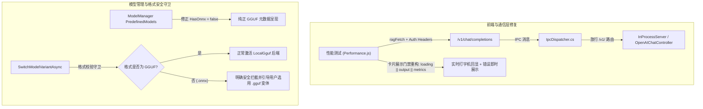

# 聊天模型性能测试失效与 ONNX Chat 模型支持深度调研与修复方案

> 关联模块：性能测试 (`Performance.js`)、桌面 IPC 通信分发 (`IpcDispatcher.cs` / `InProcessServer.cs`)、OpenAI 兼容接口 (`OpenAIChatController.cs`)、模型管理与变体策略 (`ModelManager.cs`)、本地对话引擎 (`LocalLlamaChatClient.cs` / `MafChatService.cs`)

---

## 一、问题背景与现状

在本地 GGUF 聊天模型（`Qwen 2.5 1.5B Instruct` / `qwen2.5-1.5b-instruct-q4_0.gguf`）加载就绪后，用户在项目使用中反馈两项核心问题：
1. **模型测试（性能测试 -> 聊天模型测速）没效果**：在「性能测试」->「聊天模型 (Chat)」页签点击「运行流式测速」后，界面无任何响应或生成结果卡片未展现，表现为“没效果”。
2. **ONNX Chat 模型是否存在同样问题**：系统内预定义模型或社区搜索变体中的 ONNX Chat 模型是否可用，是否存在格式加载、推理中断或 API Key 报错等同类问题。

---

## 二、问题 1：性能测试（Chat 测速）失效根因分析

经过对前端视图代码与后端 IPC 传输链路的联合追踪，确认该问题由以下三层缺陷叠加导致：

### 1. 桌面端 IPC 路由白名单直接阻断 `/v1/` 接口（核心阻断点）
- **现象**：在桌面宿主（WebView2 `app://localhost/index.html`）运行环境下，所有网络调用均拦截并转由 `IpcDispatcher` 进行进程内分发。
- **根因**：[`IpcDispatcher.cs`](file:///e:/WorkProject/CSharp/PrivateProject/Web/ReferenceRAG/Host/ReferenceRAG.ApiHost/Transport/IpcDispatcher.cs) 第 49-50 行硬编码了路径白名单校验：
  ```csharp
  if(request.Path is null || (!request.Path.StartsWith("/api/", StringComparison.OrdinalIgnoreCase)
      && !request.Path.StartsWith("/swagger/", StringComparison.OrdinalIgnoreCase))) 
      throw new ArgumentException("Unsupported IPC route");
  ```
  `Performance.js` 发起的流式测速请求路径为 `/v1/chat/completions`，因未匹配 `/api/` 前缀，被 `IpcDispatcher` 直接判定为“非法 IPC 路由”，并返回通用错误：`操作失败，请查看日志`。

### 2. 前端结果看板渲染门禁与异常吞没
- **现象**：测速失败后，界面没有任何错误提示，按钮转圈结束后恢复原状，控制台虽有错误但界面空白。
- **根因**：在 [`Performance.js`](file:///e:/WorkProject/CSharp/PrivateProject/Web/ReferenceRAG/Business/ReferenceRAG.Business/wwwroot/app/views/Performance.js) 模板中，结果卡片的渲染条件为：
  ```html
  <n-card v-if="chatBenchmarkMetrics" title="生成性能诊断与指标总览">
  ```
  `chatBenchmarkMetrics` 初始为 `null`，仅在**流式 SSE 完整接收且计算出 TTFT/TPS 后**才赋值。
  当 IPC 抛出 500 异常时，虽然 `catch (err)` 将错误信息写入了 `chatBenchmarkOutput.value = '[测速失败]: ...'`，但由于 `chatBenchmarkMetrics` 仍为 `null`，整个卡片（包括输出区域）被 Vue `v-if` 完全隐藏，导致用户看到“毫无反应”。同时，在正常的流式接收过程中，因首字至流结束期间 `chatBenchmarkMetrics` 为 `null`，打字机实时回显也无法实时呈现。

### 3. 前端 ES 模块 Import 位置异常与鉴权缺失
- `Performance.js` 第 2910 行将 `import {ragFetch as fetch} from '/core/transport/index.js';` 置于 `export default component;` 之后，导致运行期变量绑定混乱；且请求未通过 `getHeaders()` 注入当前站点的 `X-API-Key` / `Authorization` 认证头，在开启鉴权环境下将被网关二次拦截。

---

## 三、问题 2：ONNX Chat 模型可行性深度调研

针对“ONNX Chat 模型是否存在同样问题”，进行了全工程依赖、运行时架构与模型生态的深度调研：

### 1. 架构定位：Encoder 与 Decoder 的本质差异
- **Embedding & Rerank (ONNX 胜任)**：基于 BERT/Bi-Encoder/Cross-Encoder，属于非自回归编码器模型。单次前向推理即可得到特征张量或相关性分数，现存 `OnnxEmbeddingAdapter` 和 `OnnxRerankAdapter` 运行稳定高效。
- **Chat LLM (ONNX 存在巨大鸿沟)**：属于自回归大模型（Causal LM / Decoder），需要逐 Token 递归解码、动态管理 Past Key-Value (KV Cache)、Logits 偏置与核采样（Sampling）。原生 `Microsoft.ML.OnnxRuntime` 无法直接运行未经包装的单体 `.onnx` 大模型，必须依赖微软针对 GenAI 特别开发的 `Microsoft.ML.OnnxRuntimeGenAI` (OGA) 运行时。

### 2. 当前工程元数据标记偏差（误导源头）
- 在 [`ModelManager.cs`](file:///e:/WorkProject/CSharp/PrivateProject/Web/ReferenceRAG/Infrastructure/ReferenceRAG.Infrastructure/Features/ModelManagement/Services/ModelManager.cs) 的 `PredefinedModels` 中：
  ```csharp
  new ModelInfo
  {
      Name = "Qwen2.5-1.5B-Instruct-GGUF",
      ModelType = "chat",
      HasOnnx = true // ❌ 错误标记，实际上此模型纯属 GGUF 变体仓库
  }
  ```
  将纯 GGUF 格式的聊天模型标记为 `HasOnnx = true`，导致前端误认为存在官方 ONNX 格式，误导用户下载与切换。

### 3. ONNX Chat 模型切换与加载的致命断裂点
如果用户通过社区搜索下载了一个真实的 `.onnx` 聊天变体并在界面点击“激活”：
1. **ModelManager 路径错位**：[`ModelManager.SwitchModelVariantAsync`](file:///e:/WorkProject/CSharp/PrivateProject/Web/ReferenceRAG/Infrastructure/ReferenceRAG.Infrastructure/Features/ModelManagement/Services/ModelManager.cs) 会直接把 `config.Chat.ActiveBackend` 设为 `"LocalGguf"`，并将 `.onnx` 文件的绝对路径赋给 `LocalGguf.ModelPath`。
2. **底层引擎魔数崩溃**：`MafChatService` 会将该路径送入 [`LocalLlamaChatClient`](file:///e:/WorkProject/CSharp/PrivateProject/Web/ReferenceRAG/Business/ReferenceRAG.Business/Features/Chat/Services/LocalLlamaChatClient.cs)。底层的 `LLamaSharp` (llama.cpp) 原生库期望读取 GGUF 头部魔数（`GGUF`），遇到 ONNX 文件的 Protobuf 头部直接抛出 `RuntimeError: invalid magic number` 致命异常。
3. **服务状态降级**：客户端加载失败，`_client` 变为 `null`，对话页面与性能测试同时挂起并返回错误。

---

## 四、解决方案与实施规划



### 1. 放行 IPC `/v1/` 路由 ([`IpcDispatcher.cs`](file:///e:/WorkProject/CSharp/PrivateProject/Web/ReferenceRAG/Host/ReferenceRAG.ApiHost/Transport/IpcDispatcher.cs))
- 在路径校验中允许 `/v1/` 路由（包括 `/v1/chat/completions`, `/v1/models`, `/v1/embeddings`），使桌面端与浏览器端能力完全对齐。

### 2. 重构性能测试测速逻辑与视图渲染 ([`Performance.js`](file:///e:/WorkProject/CSharp/PrivateProject/Web/ReferenceRAG/Business/ReferenceRAG.Business/wwwroot/app/views/Performance.js))
- 将 `ragFetch` 与 `API_URL` 移至文件头部标准 import 区。
- 在发起请求时附带 `localStorage` 中的鉴权 Key。
- 绑定 UI 中的 `chatBenchmarkStream` 开关至请求 payload。
- 将结果卡片渲染条件放宽为 `v-if="chatBenchmarkLoading || chatBenchmarkOutput || chatBenchmarkMetrics"`，保证生成过程中即时打字机回显，遇到错误时即时弹出 Alert 错误横幅，杜绝“无效果”现象。

### 3. 规范 Chat 模型元数据与增加格式守卫 ([`ModelManager.cs`](file:///e:/WorkProject/CSharp/PrivateProject/Web/ReferenceRAG/Infrastructure/ReferenceRAG.Infrastructure/Features/ModelManagement/Services/ModelManager.cs))
- 将预定义 Chat 模型的 `HasOnnx` 修正为 `false`。
- 在切换聊天模型变体时增加格式校验：若尝试激活 `.onnx` 格式，返回清晰拦截提示：`“本地对话引擎当前基于 llama.cpp 构建，仅支持 .gguf 变体，请在变体列表中选用 .gguf 模型”`，避免底层崩溃。
