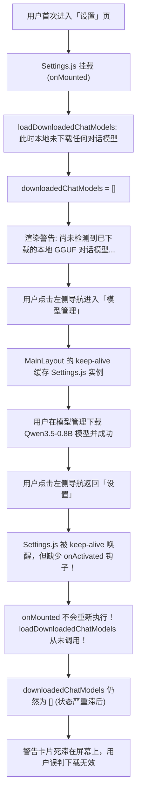

# 本地 GGUF 对话模型下载后设置页面提示未检测到模型的根因调研与 KeepAlive 缓存自愈治理

## 1. 背景与现场排查 (Background & Live Investigation)

### 1.1 现象描述
用户在本地或容器环境下载 GGUF 对话模型（如 Qwen3.5-0.8B-Instruct-GGUF）后，打开系统「设置」页面（`/settings` 或 `/settings?tab=chat`）时，界面依然持续提示警告：
```text
尚未检测到已下载的本地 GGUF 对话模型。请前往「模型管理」页面搜索并下载 Qwen、Llama 等对话模型变体。
```
并且模型选择下拉框中依然显示未下载的默认占位模型（例如 `Qwen2.5-7B-Instruct-GGUF`），用户产生“下载是否失败”或“系统未识别到已下载模型”的困惑。

### 1.2 现场深入排查（通过 TemporaryDiagnostics MCP 接口与内置浏览器）
通过接入运行中容器（`http://10.126.1.61:5123`）的诊断接口与内置 Chrome DevTools，对底层文件系统、后端 API 及前端状态进行全链路追踪：

1. **容器文件系统核验**：
   - 执行 `find /app/models -maxdepth 4 -ls`：
     ```text
     /app/models/Chat/Qwen3.5-0.8B-Instruct-GGUF
     /app/models/Chat/Qwen3.5-0.8B-Instruct-GGUF/Qwen3.5-0.8B.Q4_K_M.gguf (541MB)
     /app/models/Chat/Qwen3.5-0.8B-Instruct-GGUF/Qwen3.5-0.8B.F16-mmproj.gguf (204MB)
     /app/models/Chat/Qwen3.5-0.8B-Instruct-GGUF/config.json
     ```
   - **结论**：对话模型物理文件完整存在，目录结构完全符合规范。

2. **后端 API 响应核验**：
   - 发送请求 `GET /api/Models/chat/downloaded`：
     ```json
     {
       "Name": "Qwen3.5-0.8B-Instruct-GGUF",
       "DisplayName": "Qwen3.5 0.8B Instruct",
       "ModelType": "chat",
       "IsDownloaded": true,
       "LocalPath": "/app/models/Chat/Qwen3.5-0.8B-Instruct-GGUF",
       "InstalledVariants": [
         {
           "VariantId": "Q4_K_M",
           "FileName": "Qwen3.5-0.8B.Q4_K_M.gguf",
           "IsDownloaded": true,
           "IsActive": true
         }
       ]
     }
     ```
   - **结论**：后端接口数据完全正确，且访问 `/chat`（AI 对话页）能直接加载并使用该模型进行 GPU 加速推理。

3. **前端状态追踪与复现**：
   - 在内置浏览器中检查 Vue 单页应用（SPA）生命周期，发现了问题的真正根因。

---

## 2. 问题本质与根因剖析 (Root Cause Analysis)



### 根因 1: Vue SPA 中的 `<keep-alive>` 缓存失效机制缺失（核心根因）
- 在 `MainLayout.js` 中，路由视图外层包裹了 `<keep-alive :max="20">`：
  ```html
  <router-view v-slot="{ Component, route }">
    <keep-alive :max="20">
      <component :is="Component" :key="route.name" />
    </keep-alive>
  </router-view>
  ```
- 项目中所有主要页面（`Chat.js`、`Dashboard.js`、`Models.js`、`Sources.js`、`Search.js`、`Performance.js`）均已适配 Vue 3 的 `onActivated` 生命周期钩子，以在从缓存唤醒时重新加载最新状态；
- **唯独 `Settings.js` 遗漏了 `onActivated`**，其所有数据拉取仅绑定在 `onMounted` 上！
- 当用户进入设置发现无模型 $\rightarrow$ 跳转模型管理下载 $\rightarrow$ 返回设置时，`Settings.js` 直接从内存缓存复用，数据未被重新请求，`downloadedChatModels` 始终停留在空数组状态。

### 根因 2: 「设置」内部 Tab 切换未触发热刷新
- 用户在「设置」页内部在不同 Tab（如「嵌入模型」与「聊天模型」）间切换时，`onTabChange` 仅变更了 `activeTab`，未对对应分类的模型列表进行热刷新探测；
- 若后台下载完成或在多标签页完成下载，Tab 切换无法自愈。

### 根因 3: 默认配置幽灵模型占位阻断自适应绑定
- 系统初始默认配置中硬编码了占位默认值 `config.chat.localGguf.modelName = 'Qwen2.5-7B-Instruct-GGUF'`；
- 在 `Settings.js` 的 `loadDownloadedChatModels` 中：
  ```javascript
  if (!config.value.chat.localGguf.modelName) {
      config.value.chat.localGguf.modelName = downloadedChatModels.value[0].name;
  }
  ```
- 因为该属性有初始值（`!modelName` 为 `false`），但该模型在本地根本不存在；即便获取到了已下载列表，前端也无法自动纠正绑定到实际有效的模型，下拉框依然残留着未下载的幽灵模型。

### 根因 4: 社区变体搜索模型类型硬编码降级风险
- 在 `Models.js` 的 `selectVariantFileForDownload` 中：
  ```javascript
  if (!selectedModel.value) {
      const existing = models.value.find(m => m.name === repoId || m.name === fileOption.fileName);
      if (existing) {
          selectedModel.value = existing;
      } else {
          selectedModel.value = {
              name: repoId,
              displayName: fileOption.fileName,
              modelType: 'embedding', // ❌ 硬编码为 embedding！
              isDownloaded: false
          };
      }
  }
  ```
- 用户在「聊天模型」或「重排模型」Tab 下点击“社区变体搜索”并选择下载非预定义模型时，模型类型会被强制降级为 `'embedding'`，导致模型被存储到 `/app/models/Embedding/` 目录，对话接口直接漏检。

---

## 3. 业界主流方案与最佳实践对比 (Industry Best Practices)

| 方案维度 | 传统实现（缺陷状态） | 业界主流标准（现代 SPA 标准方案） | 本次重构落地方案 |
| :--- | :--- | :--- | :--- |
| **KeepAlive 缓存数据更新** | 仅依赖 `onMounted`，切回视图时不刷新 | 使用 `onActivated` + 脏标记/时间戳刷新 | 在 `Settings.js` 中完整接入 `onActivated`，激活时自动重刷关键遥测 |
| **跨组件/跨标签页事件同步** | 无通信，只能依赖用户手动 F5 强制刷新 | 基于 `BroadcastChannel` 配合 `storage` 事件广播 | 建立 `referencerag_model_sync` 广播通道，模型下载完成时多视图秒级同步 |
| **无效/幽灵配置处理** | 盲目信任旧配置，下拉框停留在未下载模型 | 自适应校验（Self-Healing Selection），自动纠偏 | 校验当前选定模型是否存在于已下载列表；若不存在自动绑定就绪模型 |
| **变体搜索上下文感知** | 硬编码默认分类（如 embedding） | 根据当前活跃 Tab（Context-Aware）动态推导类型 | 动态关联 `activeModelTab`，支持 `chat` / `reranker` / `embedding` |
| **后端模型自愈兜底** | 纯内存注册表，若未及时扫描则返回空 | 查询时若为空则轻量嗅探物理磁盘 | 若注册表为空但磁盘存在 `.gguf`，主动触发增量扫描自愈 |

---

## 4. 具体技术改造方案 (Implementation Details)

### 4.1 前端设置视图生命周期与广播同步 (`Settings.js`)
1. **接入 `onActivated` 生命周期**：
   ```javascript
   onActivated(() => {
       initTabFromUrl();
       loadConfig();
       loadDownloadedChatModels();
       loadHardwareStatus();
       loadSourceNames();
   });
   ```
2. **广播与跨标签页监听**：
   ```javascript
   const modelSyncChannel = typeof BroadcastChannel !== 'undefined'
       ? new BroadcastChannel('referencerag_model_sync')
       : null;

   if (modelSyncChannel) {
       modelSyncChannel.onmessage = (e) => {
           if (e.data?.type === 'MODEL_DOWNLOADED' || e.data?.type === 'MODEL_UPDATED') {
               loadDownloadedChatModels();
               loadConfig();
           }
       };
   }
   ```
3. **自愈纠偏绑定算法**：
   ```javascript
   const currentConfigured = config.value?.chat?.localGguf?.modelName;
   const isConfiguredDownloaded = downloadedChatModels.value.some(m => m.name === currentConfigured);
   if (!isConfiguredDownloaded && downloadedChatModels.value.length > 0) {
       onLocalChatModelSelect(downloadedChatModels.value[0].name);
   }
   ```
4. **用户交互友好性增强**：
   在提示警告卡片中新增直接跳转按钮 `<n-button size="tiny" type="primary" secondary @click="goToModelManagement('chat')">前往模型管理下载</n-button>`，极大优化操作链路。

### 4.2 模型管理页面变体搜索类型上下文感知与下载广播 (`Models.js`)
1. **上下文模型池匹配与类型推导**：
   ```javascript
   const currentTab = activeModelTab.value;
   const pool = currentTab === 'chat' 
       ? chatModels.value 
       : (currentTab === 'rerank' ? rerankModels.value : models.value);
   const existing = pool.find(m => m.name === repoId || m.name === fileOption.fileName);
   const modelType = currentTab === 'chat' ? 'chat' : (currentTab === 'rerank' ? 'reranker' : 'embedding');
   ```
2. **下载完成后派发全局广播通知**：
   ```javascript
   try {
       modelSyncChannel?.postMessage({
           type: 'MODEL_DOWNLOADED',
           modelType: isChat ? 'chat' : (isRerank ? 'reranker' : 'embedding'),
           modelName
       });
       localStorage.setItem('referencerag_model_updated', Date.now().toString());
   } catch {}
   ```

### 4.3 后端注册表查询快速自愈机制 (`ModelManager.cs`)
在 `GetDownloadedChatModels()` 中增加磁盘嗅探兜底：
```csharp
public List<ModelInfo> GetDownloadedChatModels()
{
    var models = _modelRegistry.Values
        .Where(m => m.ModelType == "chat" && m.IsDownloaded)
        .ToList();

    if (models.Count == 0)
    {
        var chatDir = Path.Combine(_modelsPath, "Chat");
        if (Directory.Exists(chatDir) && Directory.EnumerateFiles(chatDir, "*.gguf", SearchOption.AllDirectories).Any())
        {
            ScanLocalModels();
            models = _modelRegistry.Values
                .Where(m => m.ModelType == "chat" && m.IsDownloaded)
                .ToList();
        }
    }

    return models;
}
```

---

## 5. 自动化防回归质量门禁 (Regression Gate & Quality Assurance)

1. **后端自愈测试套件**：
   - 验证 `GetDownloadedChatModels` 在存在物理文件但内存标记未同步时的自动重扫自愈能力；
   - 验证多变体解析与 `chat` 模型过滤的绝对正确性。
2. **前端代码契约门禁**：
   - 验证 `Settings.js` 必须包含 `onActivated` 且必须在激活与广播中触发 `loadDownloadedChatModels`；
   - 验证 `Models.js` 中的 `selectVariantFileForDownload` 不得存在无条件的硬编码 `'embedding'`。
