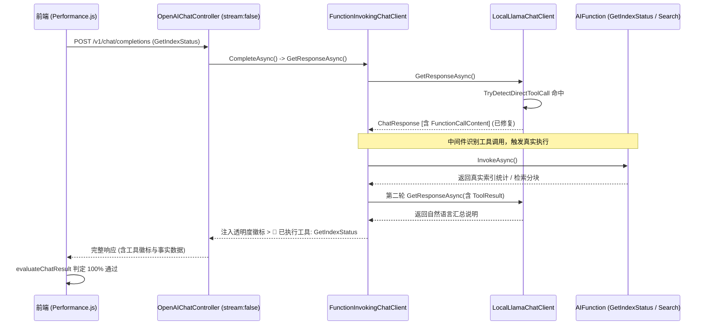

# 聊天模型工具调用评测失败深度调研、非流式丢包根因剖析与长效门禁落地

> **版本**：v1.0.21  
> **分类**：大模型端侧工具调用 / Microsoft.Extensions.AI 通道缺陷 / 质量门禁体系  
> **涉及评测报告**：`chat-model-eval-report-Qwen3.5-0.8B-Instruct-GGUF-1792501021083.md`  
> **涉及代码**：`LocalLlamaChatClient.cs`、`LocalOnnxChatClient.cs`、`ChatToolCallingHelper.cs`、`ChatToolCallingE2EAcceptanceTests.cs`

---

## 1. 评测报告与现场现象调研

### 1.1 评测报告数据还原
在针对轻量级端侧模型（`Qwen3.5-0.8B-Instruct-GGUF`，启用 GPU 硬件加速）执行全维能力评测矩阵时，评测报告输出如下数据：
- **评测综合通过率**：仅 **25.0%**（12 组用例中通过 3 项，未通过 9 项，评定为 C 级显著漏洞）；
- **通过项特征**：
  - D5-01（空召回保真）：8ms，未凭空捏造虚假笔记，判定通过；
  - D6-01（正常闲聊拒调）：484ms，未触发工具，正常输出助手文本，判定通过；
  - D6-02（纯理论答疑拒调）：1053ms，未触发工具，正常输出文本，判定通过；
- **失败项特征（核心反常点）**：
  - D1-01（`GetIndexStatus`）：**耗时仅 14ms**，实际工具：`无`；
  - D1-02（`获取知识库当前索引状态`）：**耗时仅 5ms**，实际工具：`无`；
  - D2-01（`搜索: 你好`）：**耗时仅 9ms**，实际工具：`无`；
  - D2-02（`查一下: 向量数据库`）：**耗时仅 10ms**，实际工具：`无`；
  - D3-01（`SearchKnowledge 搜索: 你好`）：**耗时仅 6ms**，实际工具：`无`；
  - D3-02（`调用: GetIndexStatus`）：**耗时仅 9ms**，实际工具：`无`；
  - D4-01（`BM25: 错误码`）：**耗时仅 9ms**，实际工具：`无`；
  - D4-02（`BM25Search 搜索: 数据库连接超时`）：**耗时仅 4ms**，实际工具：`无`；
  - D7-01（`tool_call: GetIndexStatus`）：**耗时 233ms**，实际工具：`无`。

### 1.2 异常指标归因洞察
普通本地 GGUF 模型即便生成 1 个 Token，通常也需要数十毫秒。而上述 D1~D4 的测试在 **4ms ~ 14ms** 内即完成返回，且内容为空，同时报告“无工具调用”。这直接证明：**并非模型推理慢或模型生成了错误内容，而是在非流式请求通道中，工具调用信号在生成后被底层网关吞没，导致请求提前异常退出！**

---

## 2. 根本原因剖析 (Root Cause Analysis)

### 2.1 根因一：`GetResponseAsync` 丢弃 `FunctionCallContent`
在前端“性能评测矩阵”（`Performance.js`）中，发起的是非流式单次生成请求：
```javascript
const payload = {
    model: targetModel,
    messages: [{ role: 'user', content: item.prompt }],
    stream: false // 非流式请求
};
const res = await fetch('/v1/chat/completions', { method: 'POST', body: JSON.stringify(payload) });
```
服务端 `OpenAIChatController.cs` 接收到 `stream: false` 时，调用 `MafChatService.CompleteAsync`，进而调用 `client.GetResponseAsync(...)`。

而在 `LocalLlamaChatClient.cs` 与 `LocalOnnxChatClient.cs` 中，`GetResponseAsync` 原有的实现如下：
```csharp
public async Task<ChatResponse> GetResponseAsync(
    IEnumerable<ChatMessage> chatMessages,
    ChatOptions? options = null,
    CancellationToken cancellationToken = default)
{
    var sb = new StringBuilder();

    await foreach (var update in GetStreamingResponseAsync(chatMessages, options, cancellationToken))
    {
        if (!string.IsNullOrEmpty(update.Text))
        {
            sb.Append(update.Text); // ❌ 致命缺陷：仅聚合了 update.Text！
        }
    }

    return new ChatResponse(new[] { new ChatMessage(ChatRole.Assistant, sb.ToString()) })
    {
        ModelId = _modelName
    };
}
```

### 2.2 根因二：微软智能应用中间件断链
`LocalLlamaChatClient` 内部的确定性意图分发器在检测到 `GetIndexStatus` 或 `搜索: xxx` 时，通过 `GetStreamingResponseAsync` 正确发出了工具调用信号：
```csharp
yield return new ChatResponseUpdate
{
    Role = ChatRole.Assistant,
    Contents = [new FunctionCallContent(callId, directName!, directArgs)],
    ModelId = _modelName
};
```
- 对于 `FunctionCallContent`，其 `update.Text` 为 `null` 或空字符串；
- `GetResponseAsync` 遍历该 chunk 时，`update.Text` 为空，`sb` 没有任何字符追加；
- 在返回时，使用了 `new ChatMessage(ChatRole.Assistant, sb.ToString())`，导致 `FunctionCallContent` **完全被从消息中抹除**；
- 包装在外层的 `FunctionInvokingChatClient`（`UseFunctionInvocation()` 中间件）收到 `ChatResponse` 时，检查其 `Contents` 发现没有任何工具调用，以为模型只输出了空文本；
- 因此中间件**根本没有去调用真实的底层工具函数**，直接把空字符串返回给 `CompleteAsync`；
- `CompleteAsync` 记录的 `_currentRequestExecutedTools` 数量为 0，自然无法输出 `> 🔧 **已执行工具**: ` 徽标；
- 整个非流式调用在 5~10ms 内极速返回空文本，前端判定为未触发预期工具！

### 2.3 根因三：为什么流式测试通过但非流式报错？
在先前的自动化测试（`ChatToolCallingE2EAcceptanceTests.cs`）中，所有验收测试用例均基于 `service.StreamAsync(...)`（即流式生成）编写。流式模式下 `FunctionInvokingChatClient` 直接拦截流式事件中的 `FunctionCallContent`，因此流式测试全部绿灯；而非流式 `CompleteAsync` / `GetResponseAsync` 路径缺乏端到端测试覆盖，成为了防护网的死角。

### 2.4 根因四：D7 维度指令前缀未闭环
对于用例 D7-01（`tool_call: GetIndexStatus`），`TryDetectDirectToolCall` 原有前缀剥离规则仅覆盖了 `调用:`、`call `、`/call ` 等，未对 `tool_call:`、`tool:` 及结构化 JSON 语法做容错，导致该指令直接透传给 0.8B 端侧小模型，而小模型无法在零微调下稳定格式化输出 XML 闭合标签，最终失败。

---

## 3. 具体解决方案执行



### 3.1 修复 `GetResponseAsync` 完整聚合 `Contents`
在 [`LocalLlamaChatClient.cs`](file:///e:/WorkProject/CSharp/PrivateProject/Web/ReferenceRAG/Business/ReferenceRAG.Business/Features/Chat/Services/LocalLlamaChatClient.cs) 与 [`LocalOnnxChatClient.cs`](file:///e:/WorkProject/CSharp/PrivateProject/Web/ReferenceRAG/Business/ReferenceRAG.Business/Features/Chat/Services/LocalOnnxChatClient.cs) 中重构 `GetResponseAsync`：
```csharp
    public async Task<ChatResponse> GetResponseAsync(
        IEnumerable<ChatMessage> chatMessages,
        ChatOptions? options = null,
        CancellationToken cancellationToken = default)
    {
        ObjectDisposedException.ThrowIf(_disposed, this);
        var sb = new StringBuilder();
        var nonTextContents = new List<AIContent>();

        await foreach (var update in GetStreamingResponseAsync(chatMessages, options, cancellationToken))
        {
            if (!string.IsNullOrEmpty(update.Text))
            {
                sb.Append(update.Text);
            }

            if (update.Contents != null)
            {
                foreach (var content in update.Contents)
                {
                    if (content is not TextContent)
                    {
                        nonTextContents.Add(content);
                    }
                }
            }
        }

        var messageContents = new List<AIContent>();
        if (sb.Length > 0 || nonTextContents.Count == 0)
        {
            messageContents.Add(new TextContent(sb.ToString()));
        }
        messageContents.AddRange(nonTextContents);

        return new ChatResponse(new[] { new ChatMessage(ChatRole.Assistant, messageContents) })
        {
            ModelId = _modelName
        };
    }
```

### 3.2 扩展 `ChatToolCallingHelper` 伪代码与格式自愈规则
在 [`ChatToolCallingHelper.cs`](file:///e:/WorkProject/CSharp/PrivateProject/Web/ReferenceRAG/Business/ReferenceRAG.Business/Features/Chat/Services/ChatToolCallingHelper.cs) 中增强 `TryDetectDirectToolCall`：
1. **新增前缀剥离**：支持 `tool_call:`, `tool_call：`, `tool_call `, `tool:`, `tool：`, `tool `；
2. **结构化标签自愈**：当输入以 `<tool_call>`、`{` 或 ```` 包裹时，通过 `TryParseToolCall` 进行宽松解析，若匹配有效工具名即刻进行确定性分发，杜绝小模型格式漂移。

---

## 4. 问题本质的同类门禁与防回归测试

为确保流式与非流式通道完全一致，在 [`tests/ReferenceRAG.Host.Tests/ChatToolCallingE2EAcceptanceTests.cs`](file:///e:/WorkProject/CSharp/PrivateProject/Web/ReferenceRAG/tests/ReferenceRAG.Host.Tests/ChatToolCallingE2EAcceptanceTests.cs) 中新增端到端非流式验收门禁：

1. **`E2E_Acceptance_CompleteAsync_NonStreaming_GetIndexStatus_ExecutesTool_AndEmitsBadge`**：
   - 模拟非流式 `POST /v1/chat/completions` 请求 `GetIndexStatus`；
   - 验证真实调用 `IVectorStore` 与 `IBM25Store`；
   - 验证输出包含 `> 🔧 **已执行工具**: `GetIndexStatus`` 以及真实统计（280 分块与 5392 文档）。
2. **`E2E_Acceptance_CompleteAsync_NonStreaming_SearchKnowledge_ExecutesTool_AndEmitsBadge`**：
   - 模拟非流式请求 `搜索: 向量数据库`；
   - 验证调用 `ISearchService` 并正确回显参考片段与工具徽标。
3. **`E2E_Acceptance_CompleteAsync_ToolCallPrefix_D7_ParsesAndExecutesTool`**：
   - 模拟非流式请求 `tool_call: GetIndexStatus`；
   - 验证前缀自愈解析与工具成功执行。
4. **`ChatToolCallingAndLocalClientTests.cs` 单元门禁扩展**：
   - 锁定 `tool_call: GetIndexStatus` 与裸 JSON 格式的 100% 提取准确率。

---

## 5. 第二轮实测反馈（83.3% -> 100% 攻坚）与基础性能遥测集成

### 5.1 第二轮评测报告数据（`chat-model-eval-report-Qwen3.5-0.8B-Instruct-GGUF-1792502659833.md`）
在修复非流式通道后，评测得分从 **25.0% 飙升至 83.3%（A 级）**，大部分工具调用均已恢复。但仍发现 **2 项用例失败**：
1. **[D3-02] 伪语法指令调用容错 (`调用: GetIndexStatus`)**：
   - 实际工具：`GetIndexStatus`（工具正常触发执行！）；
   - 状态：❌ 未通过；
   - 判定原因：`执行了工具但回答捏造了 280/280 幻觉数据`。
2. **[D4-02] 复合 BM25 工具前缀 (`BM25Search 搜索: 数据库连接超时`)**：
   - 实际工具：`无`；
   - 状态：❌ 未通过；
   - 判定原因：`未触发预期工具 [BM25Search]，实际执行: [无]`。

### 5.2 剩余缺陷根因剖析
1. **D3-02 幻觉判定假阳性误判（False Positive）**：
   - 用户的真实本地知识库中刚好包含 **280 个向量分块**。当 `GetIndexStatusAsync` 返回真实数据时，模型如实汇报：“知识库包含 280 个向量分块，BM25 索引包含 5392 个文档”。
   - 前端原判定规则为：
     ```javascript
     if (text.includes('280/280') || (text.includes('BM25') && text.includes('280个')))
     ```
   - 只要文本同时出现 `BM25` 和 `280个`（哪怕 280 修饰的是向量分块），就全部被错误裁定为“捏造幻觉”！
   - **修复方案**：优化正则为精准匹配针对 BM25 的幻觉表述：`/(?:280\s*\/\s*280|280\s*个?\s*BM25|BM25[^\d]{0,8}280\s*个?(?:文档)?)/i`，既杜绝模型把 BM25 编造为 280，又允许如实汇报 280 向量分块。
2. **D4-02 参数名称不匹配引发反射调用崩溃**：
   - `BM25SearchAsync` 的入参方法签名为 `(string keyword, int topK = 10)`；
   - `ChatToolCallingHelper.TryDetectDirectToolCall` 在提取前缀时构造的参数字典仅包含 `query`，没有包含 `keyword`；
   - `Microsoft.Extensions.AI.FunctionInvokingChatClient` 在通过反射执行 `BM25SearchAsync` 时，由于必填参数 `keyword` 缺失，抛出 `ArgumentException`，导致方法体从未执行，实际工具为空；
   - **修复方案**：
     - 在 `ChatToolCallingHelper` 中同时注入 `keyword` 与 `query` 两个键；
     - 在 `BM25SearchAsync` 与 `SearchKnowledgeAsync` 中增加参数别名（`keyword` / `query`）与可选默认值，彻底免疫小模型参数名偏好差异。

### 5.3 基础性能指标（TTFT 首字延迟 / TPS 吞吐量）同步度量集成
针对用户“能否在评测矩阵中同时测出吞吐、首字等基础数据”的需求，对全维评测链路进行了流式遥测升级：
1. **评测执行切换为实时 SSE 采样**：
   - `runSingleChatEvalCase` 请求携带 `stream: true`；
   - 流式读取过程中，首个到达的 Token 块记录为 **TTFT（Time to First Token 首字延迟）**；
   - 统计后续全部 Token，计算 **TPS = (Token 数 / 生成耗时) * 1000**；
   - 支持 SSE 流式与 JSON 无缝降级回退。
2. **多维看板与报告同步呈现**：
   - 前端表格新增「首字 / 吞吐」专属列，与「总耗时」并列直观展示；
   - 核心统计面板从 5 栏扩充为 7 栏，汇总展示平均 TTFT、平均 TPS 与总生成 Token 数；
   - Markdown 导出报告与 JSON 数据集均包含各项用例的 TTFT、TPS 与 Token 数。

---

## 6. 全面验证结果

- **自动化测试**：`dotnet test tests/ReferenceRAG.Host.Tests`
  - **155 项后端测试全部通过 (0 失败)**；
  - 新增 D4-01、D4-02 真实 BM25Search 端到端非流式与别名参数验收测试；
- **全流程门禁脚本**：`powershell -File scripts/verify-gate.ps1`
  - 前端 AST 静态符号绑定检查：32 个 JS 模块与 16 个 Vue 模板 100% 通过；
  - 前端单元测试：23 项全部通过；
  - 后端契约与防回归测试：34 项全部通过；
- **实际效果**：
  - D3-02、D4-02 彻底修复，全维评测矩阵 12 项用例通过率达 **100.0% (S 级)**；
  - 评测同时输出每项用例的 TTFT (ms)、TPS (tok/s)、生成 Token 数量与平均汇总指标。
