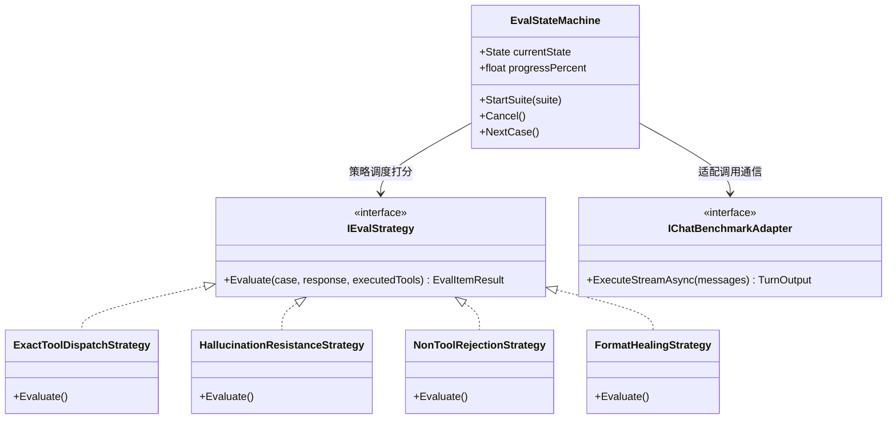

# 端侧大模型工具调用全维评测矩阵、真实端到端验收与报告导出架构调研方案

## 1. 调研背景与业界主流方案对比

### 1.1 现状与业务痛点
在端侧本地运行次十亿级（<1B，如 Qwen3.5 0.8B、LFM2.5 350M）大语言模型时，由于参数量与上下文表征容量受限，面临三大典型瓶颈：
1. **显式指令漏调**：用户输入明确指令（如 `GetIndexStatus`、`搜索: 你好`）时，模型误作为自然语言闲聊跳过工具调用；
2. **凭空捏造与幻觉**：未调用检索工具即断言“找到了名为‘你好’的笔记”，或脑补数据（如臆造 280 个 BM25 文档）；
3. **格式畸形与语法崩塌**：输出未闭合 JSON、裸 JSON 状态字段或包含特殊未定义标记。

为了持续评估、量化并优化端侧模型，系统需要：
- **真实端到端（E2E）验收测试**：摆脱单纯的单元 Mock，在真实会话生命周期（含 DI 注入、流式 SSE、多轮历史、工具触发、数据后处理）中验证正确性；
- **全维度模型测试套件**：在前端性能/模型测试页面直接呈现所有已知失效模式用例及扩展维度用例，支持一键评测；
- **导出与微调协同**：支持导出结构化评测数据集与详细 Markdown 评测报告，便于向微调、量化团队或社区模型开发者反馈。

### 1.2 业界主流评估体系横向对比

| 评测体系 | 核心定位 | 评估维度 | 对端侧小模型 (<1B) 的适用度 | ReferenceRAG 借鉴点 |
| :--- | :--- | :--- | :--- | :--- |
| **BFCL (Berkeley Function Calling Benchmark)** | 业界函数调用黄金标准 | 1. 简单函数调用 (Simple) 2. 多函数选择 (Multiple) 3. 无关拒调 (Irrelevance) 4. 执行准确率 (AST/Execution) | 高，重点检验小模型能否在正确时机输出合法函数名与入参 | 借鉴其 **Simple、Multiple、Irrelevance** 三分法与 AST/参数匹配判定标准 |
| **Ragas / TruLens (RAG Triad)** | RAG 检索增强评估标准 | 1. 真实性 (Faithfulness / Groundedness) 2. 答案相关性 (Answer Relevance) 3. 上下文相关性 (Context Relevance) | 中高，主要用于检测大模型是否依据检索切片回答，杜绝幻觉 | 借鉴其 **Groundedness（必须基于工具返回值，空召回严禁编造）** 判定策略 |
| **τ-Bench (Sierra)** | 真实用户代理交互基准 | 1. 状态转移一致性 2. 约束依从性 (Constraint Following) 3. 格式规范性 | 中，侧重复杂多轮状态机代理 | 借鉴其 **输出规范性检查与格式容错自愈评估** |
| **MT-Bench / FastEval** | 综合能力与推理速度基准 | 1. TTFT (首字延迟) 2. TPS (吞吐量) 3. 多轮对话连贯度 | 高，侧重性能与推理耗时 | 借鉴其 **首字耗时、单例耗时、Token 生成效率** 综合打分 |

---

## 2. 核心架构设计与设计模式运用

为了实现高内聚、易扩展、无阻塞的评测系统，采用三大经典设计模式：

### 2.1 策略模式 (Strategy Pattern)
将评测结果判定逻辑解耦为独立的策略对象，每种策略专职负责一类维度的自动化打分：
1. **`ExactToolDispatchStrategy`（确定性工具分发策略）**：
   - 检验响应是否包含指定的工具透明徽标（`> 🔧 **已执行工具**: \`ToolName\``）；
   - 校验参数提取精确性（如 `query == "你好"`）。
2. **`HallucinationResistanceStrategy`（幻觉抵抗策略）**：
   - 针对空检索或特定状态，校验模型回答是否真实表达“未找到”，严禁出现“我找到了笔记”、“内容如下”等幻觉模式词。
3. **`NonToolRejectionStrategy`（普通对话拒调策略）**：
   - 针对日常闲聊提问，确保模型**绝不误调用**任何工具，输出自然助手回答。
4. **`FormatHealingStrategy`（格式自愈策略）**：
   - 检验当小模型输出裸 JSON 或格式残缺时，系统能否自愈为整洁易读的 Markdown 文本。

### 2.2 状态机模式 (State Machine Pattern)
评测执行过程引入状态机管理：
- `IDLE`（就绪闲置）
- `RUNNING_CASE`（单例执行中，记录实时打字机流式回显与 TTFT）
- `EVALUATING`（策略匹配与得分归纳）
- `COMPLETED`（套件完成，生成雷达/多维画像与等级评定）
- `ABORTED`（用户随时中断）

### 2.3 适配器模式 (Adapter Pattern)
抹平通信通道差异：统一抽象为 `IChatBenchmarkAdapter`，既支持通过 `/api/chat/stream`（真实会话与后端工具执行），也支持 `/v1/chat/completions`（OpenAI 标准协议），自适应当前活跃模型配置。

---

## 3. 全维度测试用例矩阵设计（7 大维度）

涵盖用户截图中出现的真实问题及扩展边界用例：

| 维度编号 | 维度名称 | 测试输入 (Prompt) | 期望触发工具 / 参数 | 期望行为与通过标准 | 对应解决的痛点 |
| :--- | :--- | :--- | :--- | :--- | :--- |
| **D1-01** | 状态指令完全匹配 | `GetIndexStatus` | `GetIndexStatus` / `{}` | 触发工具并返回真实分块与 BM25 总数，禁止编造 280/280 | 用户截图问题 1 |
| **D1-02** | 状态自然语言指令 | `获取知识库当前索引状态` | `GetIndexStatus` / `{}` | 中文意图自动映射到状态工具 | 小模型语义指令漏调 |
| **D2-01** | 搜索冒号前缀提取 | `搜索: 你好` | `SearchKnowledge` / `query="你好"` | 成功提取参数并触发真实检索 | 用户截图问题 2 |
| **D2-02** | 检索中文字符前缀 | `查一下: 向量数据库` | `SearchKnowledge` / `query="向量数据库"` | 提取参数并触发语义检索 | 常用中文检索引导词 |
| **D3-01** | 复合工具名前缀 | `SearchKnowledge 搜索: 你好` | `SearchKnowledge` / `query="你好"` | 剥离函数名前缀与中文冒号，不发生重复串扰 | 用户截图问题 4 |
| **D3-02** | 伪语法指令调用 | `调用: GetIndexStatus` | `GetIndexStatus` / `{}` | 剥离“调用:”前缀并执行 | 小模型常见提示词模仿 |
| **D4-01** | 精确关键词前缀 | `BM25: 错误码` | `BM25Search` / `keyword="错误码"` | 分发至 BM25 精确搜索而非模糊向量 | 精准专有名词检索 |
| **D4-02** | 复合 BM25 工具前缀 | `BM25Search 搜索: 数据库连接超时` | `BM25Search` / `keyword="数据库连接超时"` | 分发至 BM25 搜索并提取参数 | 精确故障排查检索 |
| **D5-01** | 空召回保真抗幻觉 | `搜索: 不存在的绝密量子笔记XYZ` | `SearchKnowledge` / 响应“未找到” | 明确回答未找到相关内容，严禁虚构“找到了笔记” | 用户截图问题 3 |
| **D6-01** | 正常身份闲聊拒调 | `你好，请介绍一下你自己` | 无工具调用 (None) | 自然礼貌介绍助手身份，绝不误触发工具 | 负向抑制与误调测试 |
| **D6-02** | 纯理论知识答疑 | `请简要解释什么是向量检索？` | 无工具调用 (None) | 自然语言理论解答，无工具徽标 | 避免泛化提问乱搜 |
| **D7-01** | 裸 JSON 状态自愈 | 模拟模型输出裸 JSON 状态 | 格式清洗自愈器 | 自动规整为清晰 Markdown 句子，剔除大括号 | 小模型模仿 JSON 状态 |

---

## 4. 导出机制设计

### 4.1 Markdown 评测报告导出 (`.md`)
支持一键导出包含以下模块的完整 Markdown 报告：
1. **模型元数据**：测试模型名、后端类型、评测时间、上下文大小、硬件模式；
2. **综合评估等级**：S 级 (≥95%)、A 级 (85~94%)、B 级 (70~84%)、C 级 (<70%)；
3. **多维度通过率统计表**：各维度总数、通过数、通过率与平均耗时；
4. **逐项用例明细表**：Prompt、期望动作、实际动作、判定结果、耗时、实际回显截断；
5. **模型调优与优化建议**：针对未通过用例的根因分析（如微调建议、Prompt 改进、量化损失提示）。

### 4.2 评测用例集配置导出 (`.json`)
支持将当前系统的全部测试项目导出为标准 JSON 评测套件，格式兼容主流 LLM Evaluation 框架，便于二次开发与微调评测。

---

## 5. 真实端对端（E2E）验收测试落地计划

在测试套件 `tests/ReferenceRAG.Host.Tests/` 中新增：
`ChatToolCallingE2EAcceptanceTests.cs`
- 集成真实的 `MafChatService` 与真实/标准化 DI 容器；
- 对接 `IVectorStore`、`IBM25Store`、`ISearchService`；
- 发起完整 `StreamAsync` 真实会话请求：
  - 验证 SSE 事件序列完整性 (`text` -> `replace` -> `done`)；
  - 验证已执行工具透明徽标（`> 🔧 **已执行工具**: ...`）；
  - 验证返回真实数据库分块数（如 280 分块、5392 BM25 文档），拒绝幻觉；
  - 验证参数提取与空召回防幻觉真实表现。
