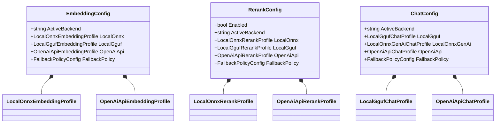
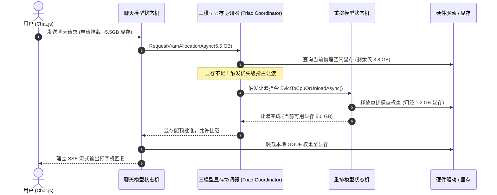
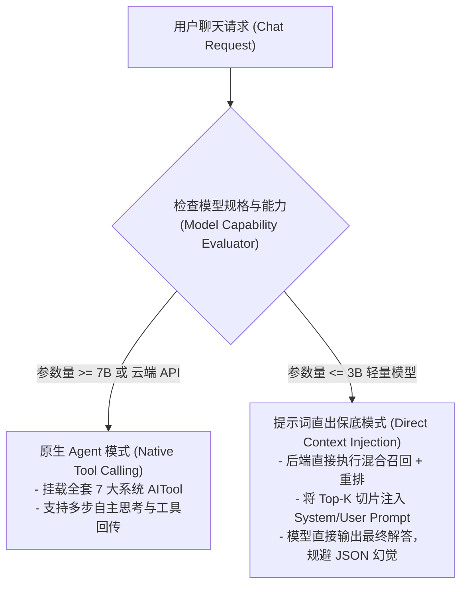
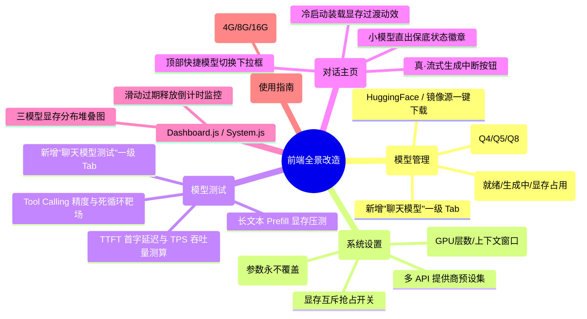
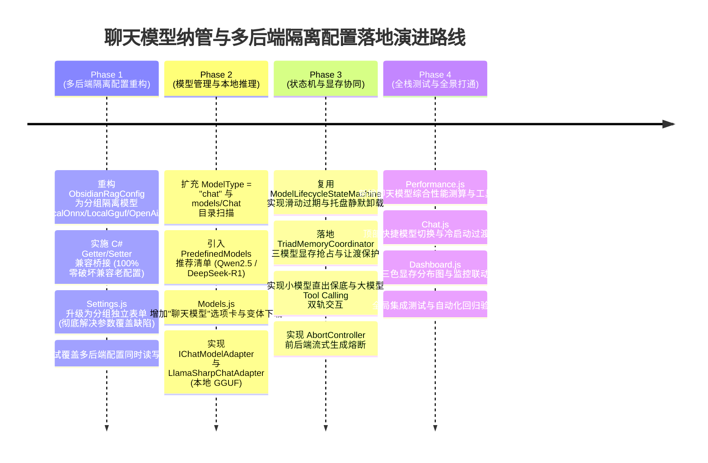

# 聊天模型纳管、多后端隔离配置与全栈生命周期架构优化方案
(Chat Model Management, Multi-Backend Isolated Profiles & Full-Stack Lifecycle Architecture Design)

---

## 1. 架构演进背景与现实痛点剖析

在 ReferenceRAG 当前的系统架构中，模型推理体系分为三大类核心任务：
1. **向量嵌入 (Embedding)**：编码器模型，用于文档切片向量化与语义召回；
2. **重排精选 (Rerank)**：交叉编码器或自回归打分模型，用于 Top-N 候选文档深度语义精排；
3. **对话生成 (Chat / RAG Agent)**：自回归大语言模型（LLM），结合检索上下文进行多轮对话、问答与 Agentic 工具调用。

### 1.1 核心痛点与缺陷全景

系统在硬件加速抽象（`AccelerationBackend`）重构完成后，暴露出以下**深层架构瓶颈与交互缺陷**：

```mermaid
flowchart TD
    subgraph 痛点一: 参数破坏性覆盖 (Destructive Overwrite)
        P1["Embedding / Rerank 配置采用单体平铺对象 (Flat Object)<br/>在本地 ONNX 与 API 模式间切换时<br/>共用 modelName 等字段，保存即互相篡改覆盖!"]
    end

    subgraph 痛点二: 聊天模型孤岛化 (Chat Model Silo)
        P2["Chat 仅支持单体 OpenAI API，排斥在模型管理之外<br/>无法下载/部署/切换本地开源小钢炮 (Qwen2.5/DeepSeek-R1)<br/>离线涉密环境完全瘫痪"]
    end

    subgraph 痛点三: 多服务商预设缺失 (No Multi-Provider Profiles)
        P3["无法同时保存 Ollama、SiliconFlow、OpenAI 等多套配置<br/>切换提供商必须全量手动覆盖 Key/URL，体验极差"]
    end

    subgraph 痛点四: 前端测试与运行时感知脱节 (Frontend Blind Spots)
        P4["模型测试页面无 Chat 评测靶场<br/>对话页面缺乏本地模型冷启动预热反馈与快速切模下拉<br/>流式生成缺乏真正能中止底层的 Abort 机制"]
    end

    P1 --- P2
    P2 --- P3
    P3 --- P4
```

> [!CAUTION]
> **关键设计缺陷示例**：
> 在现存的 `Settings.js` 与 `EmbeddingConfig` 中，本地 ONNX 模式（默认 `bge-small-zh-v1.5`）与 API 模式（如 `bge-m3`）共用同一个 `config.embedding.modelName` 变量。用户一旦在 API 模式下输入模型名称并保存，切回本地模式时，本地模型路径立即被篡改损坏！重排模型存在完全相同的破坏性覆盖隐患。

---

## 2. 全局多后端隔离配置模型架构 (Multi-Backend Isolated Profiles)

为彻底根除参数覆盖冲突，并支持多后端配置永久并存与主备容灾降级，将配置体系从**“单体平铺对象（Flat Object）”**重构为**“分组隔离配置集（Grouped Profiles）+ 激活指针（ActiveBackend）”**。

### 2.1 隔离配置架构设计

每个推理流水线（Embedding、Rerank、Chat）均持有独立的分组配置结构，各自维护私有参数，互不污染：



### 2.2 规范化 JSON 配置定义 (`appsettings.json`)

```json
{
  "Embedding": {
    "ActiveBackend": "LocalOnnx",
    "LocalOnnx": {
      "ModelName": "bge-small-zh-v1.5",
      "ModelPath": "models/Embedding/bge-small-zh-v1.5/model.onnx",
      "Acceleration": { "Backend": "Auto", "DeviceId": 0, "FallbackToCpuOnFailure": true },
      "MaxSequenceLength": 512,
      "BatchSize": 32
    },
    "LocalGguf": {
      "ModelName": "bge-m3-gguf",
      "ModelPath": "models/Embedding/bge-m3-gguf/bge-m3-q8_0.gguf",
      "GpuLayers": 33
    },
    "OpenAiApi": {
      "BaseUrl": "https://api.siliconflow.cn/v1",
      "ApiKey": "sk-silicon-key",
      "ModelName": "BAAI/bge-m3",
      "Dimension": 1024
    },
    "FallbackPolicy": {
      "EnableAutoFallback": true,
      "FallbackBackend": "OpenAiApi",
      "FallbackOnVramOom": true,
      "FallbackOnTimeoutMs": 3000
    }
  },
  "Rerank": {
    "Enabled": true,
    "ActiveBackend": "LocalOnnx",
    "LocalOnnx": {
      "ModelName": "bge-reranker-base",
      "ModelPath": "models/Reranker/bge-reranker-base/model.onnx",
      "Acceleration": { "Backend": "Auto", "DeviceId": 0 }
    },
    "OpenAiApi": {
      "BaseUrl": "https://api.siliconflow.cn/v1",
      "ApiKey": "sk-silicon-key",
      "ModelName": "BAAI/bge-reranker-v2-m3"
    },
    "TopN": 10,
    "RecallFactor": 3
  },
  "Chat": {
    "ActiveBackend": "LocalGguf",
    "LocalGguf": {
      "ModelName": "Qwen2.5-7B-Instruct-GGUF",
      "Variant": "qwen2.5-7b-instruct-q4_k_m.gguf",
      "GpuLayers": 28,
      "ContextSize": 4096,
      "Acceleration": { "Backend": "Auto", "DeviceId": 0 }
    },
    "OpenAiApi": {
      "Endpoint": "https://api.deepseek.com/v1",
      "ApiKey": "sk-deepseek-key",
      "Model": "deepseek-chat",
      "TimeoutSeconds": 60
    },
    "SystemPrompt": "你是 ReferenceRAG 智能助手。",
    "Temperature": 0.7,
    "TopP": 0.9,
    "IdleTimeoutSeconds": 300
  }
}
```

### 2.3 零破坏性向后兼容桥接（C# Getter/Setter 方案）

为确保升级不会破坏存量 `appsettings.json`（只有顶层平铺字段），在 C# 领域类中使用动态桥接属性：

```csharp
public class EmbeddingConfig
{
    public string ActiveBackend { get; set; } = "LocalOnnx";
    public LocalOnnxEmbeddingProfile LocalOnnx { get; set; } = new();
    public LocalGgufEmbeddingProfile LocalGguf { get; set; } = new();
    public OpenAiApiEmbeddingProfile OpenAiApi { get; set; } = new();

    // ── 向后兼容老平铺字段桥接 ──
    [JsonIgnore]
    public string Mode
    {
        get => ActiveBackend == "OpenAiApi" ? "openai" : "onnx";
        set => ActiveBackend = string.Equals(value, "openai", StringComparison.OrdinalIgnoreCase) ? "OpenAiApi" : "LocalOnnx";
    }

    [JsonIgnore]
    public string ModelName
    {
        get => ActiveBackend == "OpenAiApi" ? OpenAiApi.ModelName : LocalOnnx.ModelName;
        set
        {
            if (ActiveBackend == "OpenAiApi") OpenAiApi.ModelName = value;
            else LocalOnnx.ModelName = value;
        }
    }

    [JsonIgnore]
    public string? ApiBaseUrl
    {
        get => OpenAiApi.BaseUrl;
        set => OpenAiApi.BaseUrl = value;
    }
    // 其余老字段通过相同模式透明映射...
}
```

---

## 3. 聊天模型纳管与自回归推理引擎选型

### 3.1 推理引擎选型矩阵

| 推理引擎 | 支持格式 | 推荐硬件场景 | 优势与选型建议 |
| :--- | :--- | :--- | :--- |
| **LLamaSharp (llama.cpp)** | `.gguf` | NVIDIA GPU (CUDA) / 纯 CPU | **【首选推荐】** 后端在 Reranker 中已成功引入原生库。支持动态 GPU Layer Offload、K-Quants 量化（Q4_K_M, Q5_K_M）、内存占用极低。 |
| **Microsoft.ML.OnnxRuntimeGenAI** | `.onnx` | Windows DirectML (AMD/Intel 独显/核显) | 微软官方为 Windows Copilot 生态打造的自回归引擎，适配 DirectML 通用加速。 |
| **Microsoft.Extensions.AI (MEAI)** | REST API | DeepSeek, OpenAI, Ollama, vLLM | **【成熟基建】** 现存 `MafChatService` 已基于 `IChatClient`，可零成本封装为标准适配器。 |

### 3.2 规范化目录结构 (`models/Chat/`)

```
models/
├── Embedding/
│   └── bge-small-zh-v1.5/
│       └── model.onnx
├── Reranker/
│   └── bge-reranker-base/
│       └── model.onnx
└── Chat/                                  # 聊天模型主目录
    ├── Qwen2.5-1.5B-Instruct-GGUF/         # 极速轻量模型 (核显/CPU首选)
    │   ├── qwen2.5-1.5b-instruct-q4_k_m.gguf
    │   └── qwen2.5-1.5b-instruct-q8_0.gguf
    ├── Qwen2.5-7B-Instruct-GGUF/           # 满血智商模型 (独显首选)
    │   └── qwen2.5-7b-instruct-q4_k_m.gguf
    └── DeepSeek-R1-Distill-Qwen-1.5B-GGUF/ # 推理思维链小钢炮
        └── deepseek-r1-distill-qwen-1.5b-q4_k_m.gguf
```

---

## 4. 关键挑战与设计模式优化

### 4.1 挑战一：显存三模型抢占危机与协调器 (Triad Memory Coordinator)

> [!CAUTION]
> **显存冲突预警**：
> 消费级电脑显存通常为 6GB ~ 8GB。
> Embedding (~500MB) + Rerank (~1.2GB) 常驻约 1.7GB。本地 7B-Q4 模型权重需 **4.5GB ~ 5.2GB**，外加 4K 上下文 KV Cache (约 **1.2GB**)。
> 若三者同时常驻显存，瞬时总需求高达 **7.4GB ~ 8.1GB**，极易引爆 CUDA Out-Of-Memory (OOM) 导致进程崩溃！

#### 💡 应对方案：三模型显存协调器 (Priority Preemption)



1. **优先级仲裁**：`Chat (前台用户直接交互，优先级最高)` > `Rerank (检索瞬时计算，优先级次之)` > `Embedding (后台切片索引，可平滑降级)`；
2. **显存互斥让渡**：Chat 开始推理前向协调器登记，显存紧张时主动触发 Rerank 状态机临时卸载或降级到 CPU；
3. **强力滑动过期**：Chat 模型默认设置 180~300 秒无消息自动释放 KV Cache 并卸载显存（`SlidingExpiration`）。

---

### 4.2 挑战二：小模型 Tool Calling 幻觉陷阱与双轨交互策略

当前 `MafChatService` 挂载了 7 大系统 RAG 工具（`SearchKnowledgeAsync`、`DrillDownChunkAsync` 等）。
- **现象**：云端大模型（GPT-4o、DeepSeek-V3）对 JSON Schema 理解深刻，函数调用精准；
- **陷阱**：<=3B 的微型本地模型（如 Qwen2.5-1.5B）易出现格式畸形、参数幻觉或陷入工具死循环。

#### 💡 应对策略：双轨交互策略 (Dual-Track Interaction Strategy)



---

### 4.3 挑战三：长时流式会话与真正中断 (Streaming Abort Mechanism)

- 嵌入/重排为瞬间借用（Lease 毫秒级归零），对话生成为长达数秒到数十秒的流式会话；
- **前端中断穿透**：前端点击“停止生成”按钮时，通过 `AbortController` 向后端发起取消信号；
- **后端任务熔断**：`MafChatService` 监听 `HttpContext.RequestAborted` 或取消 Token，**立即打断 LLM 解码循环**，杜绝显卡在用户离开后继续空转。

---

## 5. 前端全景改造实施矩阵 (Frontend Evolution Matrix)

为提供完整、自洽、顺畅的使用体验，需对前端 6 大核心模块进行协同升级：



### 5.1 页面具体改动说明表

| 页面 | 核心新增组件 / 功能项 | 关键技术实现与交互逻辑 |
| :--- | :--- | :--- |
| **`Models.js`** | **聊天模型管理 Tab** | 1. 扩充 `activeModelTab === 'chat'` 路由参数；<br/>2. 呈现本地 GGUF 模型卡片与变体切换弹窗；<br/>3. 在线 HuggingFace 检索与断点续传下载大文件。 |
| **`Settings.js`** | **多后端隔离与本地超参** | 1. 彻底解耦本地与 API 的表单绑定（`config.embedding.localOnnx` vs `openAiApi`）；<br/>2. 增加 GPU 卸载层数（`GpuLayers`）、上下文大小（`ContextSize`）滑块；<br/>3. 提供显存让渡保护开关与滑动过期秒数。 |
| **`Performance.js`** | **聊天模型测试与靶场** | 1. 新增 Tab：单次生成交互测试，输出 TTFT 与 TPS 核心指标；<br/>2. 工具调用靶场：自动校验模型对 RAG 函数的 JSON 生成合规度；<br/>3. 并发与长文本显存压测。 |
| **`Chat.js`** | **快捷切换与状态感知** | 1. 顶栏新增模型快捷选择器，无缝在本地轻量、本地满血与云端 API 间切换；<br/>2. 冷启动提示：*“正在挂载模型权重至 GPU 显存...”*；<br/>3. 停止生成按钮通过 `AbortController` 真正阻断 GPU 解码。 |
| **`Dashboard.js`** | **三模型显存分布** | 1. 显存看板采用三色堆叠图：Embedding (蓝)、Reranker (橙)、Chat (绿)、剩余系统显存 (灰)；<br/>2. 展示空闲自动卸载倒计时。 |
| **`Guide.js`** | **硬件天梯与选型指南** | 1. 4GB 显存 / 纯 CPU：推荐 Qwen2.5-0.5B/1.5B (Q4_K_M)；<br/>2. 6GB~8GB 显存：推荐 Qwen2.5-3B/7B (Q4_K_M，开启显存让渡)；<br/>3. 12GB~16GB+：推荐 Qwen2.5-7B/14B (Q5/Q8 满血 Offload)。 |

---

## 6. 核心接口与代码契约定义

### 6.1 聊天模型适配器契约：`IChatModelAdapter`

```csharp
namespace ReferenceRAG.Core.Features.ModelManagement.Chat.Adapters;

public enum ChatModelBackendType
{
    LlamaSharpGguf,
    OnnxGenAi,
    OpenAiCompatibleApi,
    Mock
}

/// <summary>
/// 统一聊天模型适配器契约
/// </summary>
public interface IChatModelAdapter : IAsyncDisposable, IDisposable
{
    string Name { get; }
    string ModelPath { get; }
    ChatModelBackendType BackendType { get; }
    bool SupportsToolCalling { get; }
    
    /// <summary>
    /// 获取符合 Microsoft.Extensions.AI 标准的统一聊天客户端
    /// </summary>
    IChatClient GetChatClient();

    /// <summary>
    /// 根据硬件加速策略与超参初始化模型实例与上下文
    /// </summary>
    Task InitializeAsync(HardwareAccelerationConfig acceleration, ChatInferenceOptions options, CancellationToken ct = default);

    /// <summary>
    /// 释放显存与上下文占用
    /// </summary>
    Task UnloadAsync();

    /// <summary>
    /// 获取当前模型显存与内存物理开销估算
    /// </summary>
    ModelMemoryFootprint GetMemoryUsage();
}
```

### 6.2 三模型显存协调器契约：`ITriadMemoryCoordinator`

```csharp
namespace ReferenceRAG.Core.Features.HardwareAcceleration.Coordination;

public interface ITriadMemoryCoordinator
{
    /// <summary>
    /// 当聊天模型需要启动推理时，请求分配显存；显存不足时自动调度重排模型让渡
    /// </summary>
    Task<bool> RequestAllocationForChatAsync(long requiredVramBytes, CancellationToken ct = default);

    /// <summary>
    /// 聊天推理完成或取消时通知协调器
    /// </summary>
    void NotifyChatCompleted();

    /// <summary>
    /// 获取当前三大模型（Embedding/Rerank/Chat）的显存占用快照
    /// </summary>
    TriadVramSnapshot GetVramSnapshot();
}
```

---

## 7. 分阶段落地路线图 (Phased Implementation Roadmap)



---

## 8. 方案总结与执行建议

1. **先治根本（Phase 1）**：优先实施**多后端隔离配置模型**重构，彻底修复 `modelName` 参数破坏性覆盖的顽疾，为重排、嵌入和聊天模型提供坚固、无冲突的配置底座；
2. **渐进引入（Phase 2 & 3）**：本地大模型以开源生态最成熟的 `LLamaSharp` GGUF 为切入点，牢牢守住**三模型显存互斥协调**和**小模型直出保底**两大防线；
3. **全栈闭环（Phase 4）**：在前端形成由 `Models.js`（生命周期管理）+ `Settings.js`（多后端隔离配置）+ `Performance.js`（性能与靶场评测）+ `Chat.js`（体验感知与流式中断）构成的现代化全栈 RAG 智能体系统。
