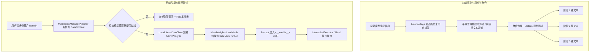

# 思考内容重复展开与 GGUF 视觉多模态架构设计及实现规范

## 1. 概述与问题背景

在 ReferenceRAG 的日常使用与 Agent 交互场景中，近期发现了两类严重影响用户体验的问题：
1. **思考过程展开内容阶梯式重复与正文被吞（UI/DOM 解析问题）**：
   - 用户在展开「💭 思考过程 (共 3 轮 Agent 思考与推理)」折叠面板时，阶段 #1 包含了阶段 #1、#2、#3 的全部内容，阶段 #2 包含了 #2 和 #3 的内容，呈现阶梯式的重复累加。
   - 在部分场景下，模型生成思维链后未主动闭合 `</think>` 标签，前端标签平衡逻辑简单地在全文末尾追加 `</think>`，导致后续的所有正文回答均被吞入思考折叠卡片，使正文区域呈现空白。
2. **本地 GGUF 视觉模型无法查看图片（推理引擎接入与提示词问题）**：
   - 用户上传图片并发送问候或提问时，模型回答“本地文本引擎未挂载视觉投影器，已优先基于文本与知识库为您解答”，无法识别图片内容。
   - 经排查，后端 `ChatToolCallingHelper.FormatSingleMessage` 中无条件硬编码了降级警告文本并注入到 Prompt 中，模型直接读取了这一提示词并据此产生幻觉。同时，`LocalLlamaChatClient` 仅基于纯文本 `StatelessExecutor`，未实际加载配对的 `mmproj` 视觉投影器（LLamaSharp `MtmdWeights`）及图像媒体数据。

---

## 2. 根因剖析 (Root Cause Analysis)

### 2.1 思考阶梯式重复的数学与 DOM 根因

#### 现象分析
在 Agent 多轮工具调用推理中，模型输出流可能如下：
```text
<think>阶段 1 思考分析<tool_call>{"name":"SearchKnowledge"}</tool_call>
<think>阶段 2 思考分析<tool_call>{"name":"ReadFileContent"}</tool_call>
<think>阶段 3 最终决策</think>正文回答内容
```
注意在阶段 1 和阶段 2 输出 `<tool_call>` 之前，模型漏掉了 `</think>` 闭标签。

#### DOM 解析陷阱
1. `<think>` 属于未知自定义 HTML 元素（HTMLUnknownElement），浏览器默认按标准嵌套方式解析未知块级元素。
2. 原前端 `balanceTags` 函数仅在 `thinkOpen > thinkClose` 时追加单个 `</think>`，导致 DOM 解析形成父子嵌套树：
   ```html
   <think>
     阶段 1 思考分析
     <think>
       阶段 2 思考分析
       <think>
         阶段 3 最终决策
       </think>
     </think>
   </think>
   ```
3. `template.content.querySelectorAll('think, thought')` 会依次检索出 3 个节点：
   - 节点 0（外层）：其 `Node.textContent` 按照 W3C DOM 标准返回**自身及所有子代节点的文本**，即 `阶段 1 + 阶段 2 + 阶段 3`。
   - 节点 1（中层）：其 `textContent` 为 `阶段 2 + 阶段 3`。
   - 节点 2（内层）：其 `textContent` 为 `阶段 3`。
4. 前端直接将每个节点的 `textContent` 渲染为思考步骤，导致了完美的阶梯式累加重复！

#### 正文被吞根因
当模型生成完思维链进入正文回答且未闭合 `</think>` 时：
- `balanceTags` 在全文的最末尾补齐 `</think>`。
- 整个正文回答变成了 `<think>` 的子节点，被包裹进 `<details>` 折叠卡片，造成正文缺失空白假象。

---

### 2.2 GGUF 视觉无法查看图片的根因

#### 根因 1：硬编码降级提示词直接送给大模型
在 `ChatToolCallingHelper.FormatSingleMessage` 中：
```csharp
if (totalImages > 0)
{
    var imgNotes = new List<string>();
    for (int i = 0; i < dataContents.Count; i++)
    {
        var dc = dataContents[i];
        imgNotes.Add($"[附带图像 #{i + 1} ({dc.MediaType ?? "image/jpeg"}), 本地文本引擎未挂载视觉投影器，已优先基于文本与知识库为您解答]");
    }
    // 直接拼接进入 user Prompt！
}
```
无论本地是否已下载并配对了 `mmproj-F16.gguf`，用户消息都被强行改写为了包含“未挂载视觉投影器”的文本。大模型读到这个指令后，只能顺从并复读该提示。

#### 根因 2：未接入 LLamaSharp 0.30.0 的 `MtmdWeights` 多模态引擎
在 LLamaSharp 0.30.0 中：
- GGUF 视觉模型采用 `MtmdWeights`（Multi-Modal Tokenizer & Decoder）架构加载配对的 `mmproj`；
- 原 `LocalLlamaChatClient` 仅实例化了纯文本的 `StatelessExecutor`，从未加载 `MtmdWeights`，也未调用 `LoadMedia` 转换传入的图像字节，更未向 Prompt 注入正确的媒体占位符 `<__media__>`。

---

## 3. 架构设计与解决方案



### 3.1 前端思维链平级解耦与直接文本提取策略

1. **直接子节点文本过滤（Direct Child Text Nodes Only）**：
   在提取每个 `<think>` 的文本时，过滤掉所有子代标签节点的文本，仅保留当前节点的直接文本内容：
   ```javascript
   function getDirectTextContent(element) {
     let text = '';
     for (const node of element.childNodes) {
       if (node.nodeType === Node.TEXT_NODE) {
         text += node.nodeValue;
       } else if (node.nodeType === Node.ELEMENT_NODE && !['THINK', 'THOUGHT'].includes(node.tagName.toUpperCase())) {
         text += node.textContent;
       }
     }
     return text.trim();
   }
   ```
2. **多重未闭合标签精确配对**：
   统计未闭合标签数量差额 `thinkOpen - thinkClose`，循环补齐相等数量的闭合标签；在遇到 `<tool_call>` 边界时，主动在 `<tool_call>` 前关闭思考块。
3. **正文隔离保护**：
   后端在流式发射 `<tool_call>` 或模型完成思维链时，若存在未闭合的 `<think>`，强制追加 `</think>` 截断，防止正文回答被卷入。

---

### 3.2 GGUF 视觉多模态加载与图像编码管线

1. **投影器自动扫描与生命周期管理**：
   - `LocalLlamaChatClient` 初始化时，通过 `GgufVisionMatchingStrategy` 自动探测同目录或上级目录下的 `*mmproj*.gguf`。
   - 使用 `MtmdWeights.LoadFromFile(projectorPath, _weights, new MtmdContextParams())` 完成多模态视觉模型权重的挂载。
2. **Prompt 图像占位符对齐**：
   - 移除 `ChatToolCallingHelper` 中硬编码的假降级文本。
   - 具备视觉能力时，根据 llama.cpp 规范在用户输入前注入 `<__media__>` 占位标记。
   - 当确实无视觉投影器时，由外层逻辑生成明确的用户通知，而非污染大模型的 Prompt 上下文。
3. **图像多模态推理执行器**：
   - 提取 `DataContent` 的二进制字节数组，调用 `_mtmdWeights.LoadMedia(bytes)` 生成 `SafeMtmdEmbed`；
   - 采用多模态执行器驱动图像嵌入并生成回答流。

---

## 4. 门禁与防回归测试规范

1. **前端 AST 与逻辑门禁 (`frontend-logic.test.mjs`)**：
   - 测试三阶段嵌套 `<think>` 渲染后，各阶段的文字彼此独立，杜绝阶梯包含重复。
   - 测试未闭合 `<think>` 且紧跟正文时，正文依然正常显示在折叠卡片之外。
2. **后端质量门禁 (`ReferenceRAG.Host.Tests`)**：
   - 测试 Prompt 构建时，视觉模型正确嵌入 `<__media__>` 占位符且不包含虚假降级文本。
   - 测试 `LocalLlamaChatClient` 正确检测并挂载 `MtmdWeights`。
   - 执行 `node check.mjs` 与 `verify-gate.ps1` 确保全绿。
