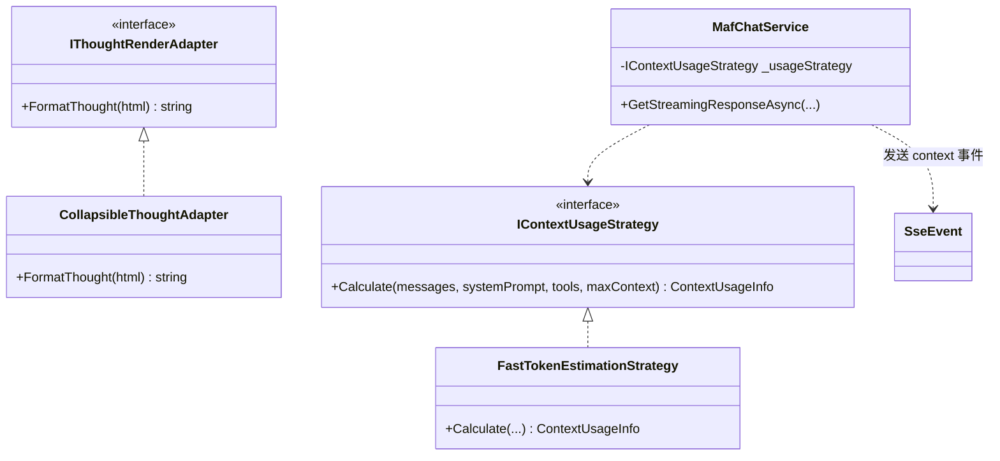

# Agent 回复排版异常与会话上下文用量展示：根因分析、头脑风暴与设计模式重构方案

## 1. 背景与问题定义

在 ReferenceRAG 的日常使用与测试中，通过真实截图观察到两个突出的用户体验痛点：

### 问题 1：Agent 回复内容排版异常（出现灰色代码块与水平长滚动条）
- **现象特征**：
  - 在截图一中，模型对“你好”和“介绍 操虫师”的回答顶部，均突兀地出现了一块包含灰色背景与水平横向长滚动条的区域；
  - 灰色块内的文字均为大模型的第一人称思考独白（例如：“*用户只是简单地用“你好”来打招呼，没有具体需求，我需要根据搜索结果来给出一个友好而简洁的回复...*”）；
  - 在截图二中，甚至连续堆叠了 3 个长条状的灰色水平滚动框；
  - 这种布局严重割裂了正文阅读，产生了极其难看的横向滚动条，界面失真。

### 问题 2：缺乏会话上下文用量显示（已使用上下文 / 总上下文）
- **现象特征**：
  - 用户无法感知当前会话已经积累了多少轮对话、检索注入了多少 Tokens，以及距离模型显存或 KV Cache 的上限（4k/8k/16k）还剩多少安全裕度；
  - 当上下文接近上限时，容易静默触发模型 KV 槽位溢出（NoKvSlot）或历史被强制截断，用户缺少知情权与确定感。

---

## 2. 根因深度剖析（Root Cause Analysis）

### 2.1 排版异常的根因：思考标签（`<think>`）被激进误转换为 `<pre><code>`
1. **模型端（Reasoning / Instruct CoT 习惯）**：
   - 截图中的运行模型为 `Qwen3.5 2B Instruct`（具体变体为 `Qwen3.5-2B-GPT-5.1-HighIQ-INSTRUCT.i1-Q4_0.gguf`）。此类前沿 Instruct 或带轻度推理能力的模型，倾向于在输出最终 Markdown 前生成思考过程，通常用 `<think>...</think>` 或 `<thought>...</thought>` 包裹。
2. **前端 Markdown 消毒器（`safe-markdown.js`）的白名单回退漏洞**：
   - 检查 `Business/ReferenceRAG.Business/wwwroot/shared/safe-markdown.js` 的实现：
     ```javascript
     const tags = new Set('P BR HR H1 H2 H3 H4 H5 H6 STRONG EM DEL S PRE CODE BLOCKQUOTE UL OL LI TABLE THEAD TBODY TR TH TD A SPAN DIV'.split(' '));
     ...
     for(const element of [...template.content.querySelectorAll('*')]) {
       if(!tags.has(element.tagName)){
         const text = element.textContent||'';
         if(text.trim()){
           const pre = document.createElement('pre');
           const code = document.createElement('code');
           code.textContent = text;
           pre.appendChild(code);
           element.replaceWith(pre);
         }
       }
     }
     ```
   - 当 `marked.js` 将 `<think>思考内容</think>` 解析为自定义 DOM 节点 `<think>` 时，由于 `tags.has('THINK')` 为 false，`safe-markdown.js` 盲目地**将 `<think>` 节点整体替换为了 `<pre><code>`**！
3. **CSS 样式缺少断行约束引发水平滚动条**：
   - 默认的 `<pre>` 样式具有 `white-space: pre` 与 `overflow-x: auto`。未分行的长中文思考句子在单行内展开数十米长，从而在气泡内部生成了横向滚动条。

---

## 3. 业界主流方案调研与对比

### 3.1 思考过程（Thinking / Reasoning Process）的业界处理范式
| 平台 / 框架 | 处理方式 | 交互体验 | 优缺点分析 |
| :--- | :--- | :--- | :--- |
| **DeepSeek (网页端 / 官方 App)** | 自定义思考手风琴卡片（Collapsible Details） | 默认折叠，带有耗时计时器（如“已深度思考 3 秒”），点击可展开阅读，字体淡灰 | 体验极佳，既保证正文整洁，又满足极客探查模型思考路径的需求 |
| **Open WebUI** | 自动捕获 `<think>` 标签并转为专属 UI Block | 支持在设置中切换“始终展开/始终折叠/完全隐藏” | 灵活性高，适合不同偏好的用户 |
| **ChatGPT / Claude (Extended Thinking)** | 独立 Tab 或折叠抽屉渲染 | 思考过程与最终输出从数据流阶段就分开（通过 stream role 区分） | 架构严密，但需要模型 API 原生支持字段分离 |
| **Ollama / Chatbox** | 客户端正则表达式提取 `<think>` | 用 CSS 卡片样式配合 `details/summary` 原生折叠渲染 | 实现轻量，零服务端侵入，完全兼容标准 Markdown |

### 3.2 上下文用量（Context Window Usage）的业界呈现范式
| 平台 / 框架 | 呈现机制 | 视觉形态 | 适用场景 |
| :--- | :--- | :--- | :--- |
| **Open WebUI** | 聊天顶部实时计算并展示 `Tokens: 2.1k / 8.2k (25%)` | 状态栏胶囊标签 + 悬浮提示框 | 私有化部署与本地大模型标配 |
| **LibreChat** | 消息底部展示单轮 Prompt/Completion Tokens，顶部展示总容量条 | 带有红黄绿三色进度条 | 专业 Agent 开发调试 |
| **Cursor / Cline** | 交互界面常驻上下文百分比环形图或进度条 | `Context: 38% (12.4k/32k)` | 开发者代码生成与长会话控制 |

---

## 4. 批判性头脑风暴：可行性、逻辑闭环与性能开销的深度辩难

### 4.1 可行性维度的潜在欠缺与应对
- ❌ **流式传输中未闭合标签导致排版抖动**：
  在 SSE 流式生成过程中，模型首先吐出 `<think>`，数十秒后才吐出 `</think>`。如果前端等待闭合后再渲染，会导致“首字延迟（TTFT）”看起来非常长；如果没闭合就让 marked 解析，可能会导致 HTML 树断裂。
  ✅ **应对策略（流式自愈适配器）**：
  在前端渲染层增加流式标签自动补全机制：当检测到文本中存在未闭合的 `<think>` 时，虚拟追加 `</think>` 后再送入 Markdown 渲染器，使思考卡片能够以打字机方式平滑展开，收尾时再平滑收纳。
- ❌ **纯文本模型输出缩进引发的误报**：
  部分小模型可能使用 4 个空格或 Tab 开头输出文字，Markdown 标准会将其误判为缩进代码块。
  ✅ **应对策略**：在全局 CSS 中对所有的 `.markdown-body pre` 和 `pre > code` 施加 `white-space: pre-wrap; word-break: break-word;` 规则，即使出现普通代码块，也绝对不允许撑出无意义的横向长滚动条。

### 4.2 逻辑闭环维度的潜在漏洞与应对
- ❌ **总上下文大小（Context Window）的动态多变**：
  本地 GGUF 可以配置 4096 / 8192 / 16384；本地 ONNX 为默认配置；线上 API（如 GPT-4o-mini）可能为 128k。如果写死数字会导致展示虚假进度。
  ✅ **应对策略**：统一从当前激活的聊天客户端模型实例（`LocalLlamaChatClient.ContextSize` / `LocalOnnxChatClient` / 线上 API 配置）动态获取权威 `MaxContextTokens`，并随模型热切换而实时重置更新。
- ❌ **上下文统计口径的一致性**：
  单轮会话中不仅包含用户输入的文字，还包含系统提示词（`SystemPrompt`）、工具协议声明（`FormatToolsPrompt`）、以及多轮历史记录和知识库注入切片。
  ✅ **应对策略**：后端在 `MafChatService` 组装完整输入消息时，调用单例 `TokenEstimator.EstimateTokens` 统一计量；同时将实时统计结果封装为专有的 `context` 类型 SSE 事件回传前端，保证前后端口径绝对一致。

### 4.3 性能与吞吐维度的潜在瓶颈与应对
- ❌ **频繁计算全会话 Token 导致卡顿**：
  若在每吐出一个词元（Update.Text）都重新扫描几万字符计算 Token，会产生微小的 CPU 消耗。
  ✅ **应对策略**：仅在“流式接收启动时（评估输入 Prompt 成本）”与“流式结束收尾时（累加最终 Completion 成本）”各计算一次并派发 `context` 事件，推理中间过程保持零额外计算。

---

## 5. 设计模式重构与架构设计

我们应用**适配器模式（Adapter Pattern）**、**策略模式（Strategy Pattern）**与**观察者/事件驱动模式（Observer/Event Pattern）**进行系统解耦：



### 5.1 适配器模式（Adapter Pattern）：思考内容与 Markdown 优雅转换
- **接口/职责**：拦截 Markdown AST 解析树中的未知自定义节点。
- **实现方案**：
  - 在 `safe-markdown.js` 中增加针对 `THINK`、`THOUGHT` 的专属转换器：
    将其包装为带有语义化类名的 `<details class="chat-thought-container"><summary class="chat-thought-summary">💭 思考过程</summary><div class="chat-thought-content">...</div></details>`；
  - 允许用户自由展开与折叠思考过程；
  - 配合柔和的 CSS 背景、圆角边框与半透明文字，与正文形成清晰的视觉层级分隔。

### 5.2 策略模式（Strategy Pattern）：跨端上下文容量度量
- **抽象**：`IContextUsageStrategy`
- **实现**：
  - `FastTokenEstimationStrategy`：使用单次遍历字符扫描算法（`TokenEstimator`），结合中英字符权重极速计量；
  - 产出结构化度量模型：
    ```csharp
    public record ContextUsageInfo(int UsedTokens, int MaxContextTokens, double Percent);
    ```
  - 当会话加载或流式推进时，通过统一的数据传输管道向下派发。

### 5.3 响应式事件与界面绑定（SSE Event & Vue Reactive Store）
- **SSE 事件协议扩展**：
  - 新增 `type: "context"` 事件：
    ```json
    {"type":"context","delta":"{\"usedTokens\":1420,\"maxTokens\":8192,\"percent\":17.3}"}
    ```
- **前端 Vue 渲染**：
  - 在 `Chat.js` 头部操作栏增加上下文用量胶囊：
    - 形式：`上下文: 1,420 / 8,192 (17%)`；
    - 配色根据利用率自适应切换：`<70%` 绿（健康），`70%~90%` 橙（适中），`>90%` 红（预警）；
    - 悬浮显示 Tooltip 提示“当前会话已占用的 Token 容量与最大上下文窗口上限”。

---

## 6. 实施路线图与验证标准

1. **第一步（前端排版修复）**：修改 `safe-markdown.js` 与 `Chat.js` 样式，增加思考折叠组件与 `pre-wrap` 防溢出样式。
2. **第二步（后端用量度量与推送）**：在 `MafChatService.cs` 中实现 `GetSessionContextUsage`，并在流式首尾派发 `context` 事件。
3. **第三步（前端用量展示）**：在 `Chat.js` 头部增加上下文胶囊徽章与响应式更新。
4. **第四步（自动化测试验证）**：添加针对思考过程渲染与上下文用量计算的防回归测试。
5. **第五步（全量门禁检查）**：运行 `powershell -File scripts/verify-gate.ps1`，确保前端与后端测试 100% 绿灯。
