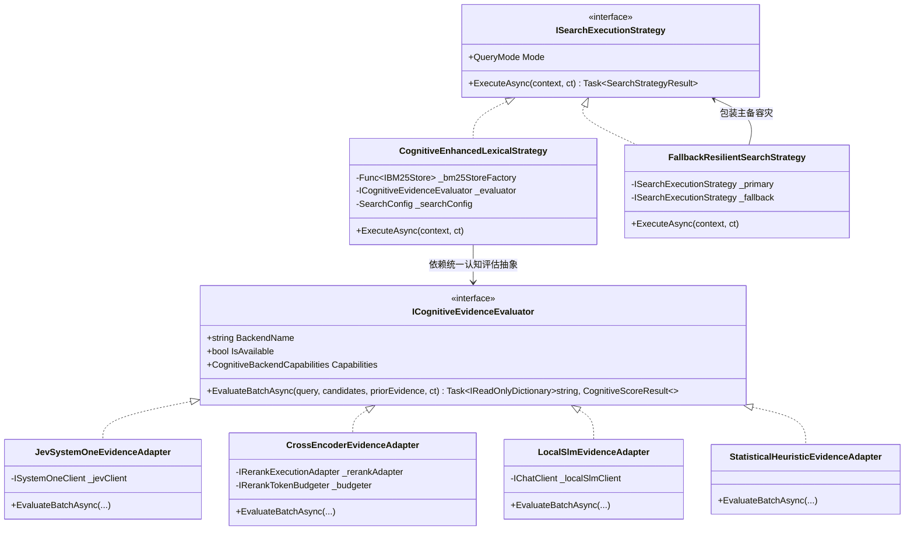
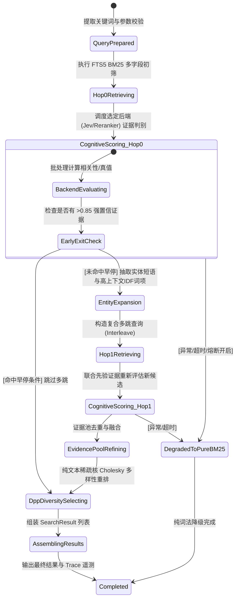
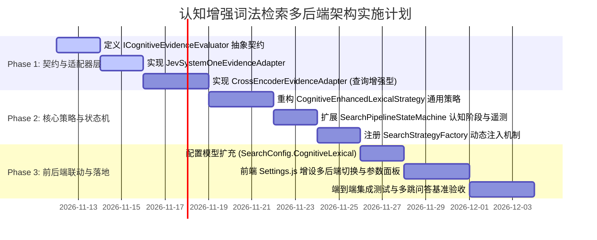

# 认知增强词法检索多后端适配器策略模式与重排模型融合方案

> **文档状态**：可行性调研完成 & 深度架构设计就绪  
> **实施版本**：ReferenceRAG v2.4+  
> **核心议题**：  
> 1. 能否通过 **适配器模式 (Adapter)** 与 **策略模式 (Strategy)**，将 Jev 仅作为其中一种认知判定后端？  
> 2. 能否将 **重排模型 (Cross-Encoder Reranker)** 作为认知增强词法检索的核心后端之一？  
> 3. 面对不同后端的逻辑差异、算力开销、上下文限制与多跳适配，如何通过 **状态机 (State Machine)** 与 **断路器 (Circuit Breaker)** 进行系统级治理？  
> **涉及核心组件**：`ICognitiveEvidenceEvaluator`、`JevSystemOneEvidenceAdapter`、`CrossEncoderEvidenceAdapter`、`CognitiveEnhancedLexicalStrategy`、`SearchPipelineStateMachine`、`Fts5BM25Store`、`LexicalEntityExtractor`、`DppKernelDiversitySelector`

---

## 一、调研背景与核心问题定性 (Executive Summary)

在前序调研中，我们探索了基于 TypeSafe AI Jev (System One) 的 SAG2 多跳证据链词法检索方案。然而，在实际工程化与私有化交付中，如果将“认知增强”强绑定在单一的外部 SaaS 服务（Jev）上，会面临三大严峻挑战：
1. **网络与合规壁垒**：许多私有化、离线局域网或保密环境无法访问外网 TypeSafe AI 端点；
2. **凭证门槛**：用户若未申请或未配置 Jev API Key，认知增强词法检索功能将完全不可用；
3. **本地算力闲置**：当前 ReferenceRAG 系统内部已经内置了极其成熟的高性能本地重排模型基础设施（ONNX Runtime / LLamaSharp GGUF / SiliconFlow 云端重排），若无法在词法流程中复用这些重排模型，将造成极大的架构浪费。

### 核心结论先行：
1. **完全可行，且必须采用适配器策略模式**：
   通过定义中立的认知证据评估契约（`ICognitiveEvidenceEvaluator`），将 Jev 降维为众多认知后端中的**一种插件化实现（Plugin/Adapter）**。检索流水线面向抽象接口编程，与具体算法提供方彻底解耦。
2. **重排模型（Cross-Encoder Reranker）不仅完全可以作为后端之一，而且在离线场景下是体验极佳的黄金解法**：
   重排模型通过全交叉自注意力（Full Cross-Attention）计算 $P(\text{Relevant} \mid \text{Query}, \text{Candidate})$，能够提供连续、细粒度的语义打分；通过设计**“前序证据查询增强（Prompt/Context Augmented Query）”**或**“双重上下文融合（Dual-Signal Fusion）”**机制，重排模型同样能够出色完成 Hop 0 筛选、多跳引导与证据池精化任务。
3. **统一认知增强词法检索矩阵**：
   系统可提供四大可选认知后端：
   - 🌟 **Jev (TypeSafe AI System One)**：云端极速概率逻辑推演（0 显存，100ms 级，善于事实必要性判别）；
   - 🚀 **Cross-Encoder 重排模型**：本地 ONNX / GGUF 或在线 API（语义判别细致，支持全离线运行）；
   - 💻 **本地轻量级 SLM (Small Language Model)**：利用本地已就绪的 0.5B~1.5B 极小模型提取判别 Logit；
   - ⚡ **启发式规则/统计适配器 (Statistical Heuristic / FlashRank)**：零大模型、基于词频分布与 IDF 的极速保底评估。

---

## 二、架构全景：适配器策略模式设计 (Adapter & Strategy Patterns)

### 2.1 模式设计拓扑图



### 2.2 核心抽象契约定义

#### 1. 认知评估能力特征与结果契约 (`CognitiveEvidenceContracts.cs`)

```csharp
namespace ReferenceRAG.Business.Features.Search.Cognitive;

/// <summary>
/// 认知后端能力特性声明
/// </summary>
public sealed record CognitiveBackendCapabilities(
    bool SupportsMultiHopContext,      // 是否原生支持摄入 priorEvidence 上下文
    bool SupportsBatching,              // 是否支持多候选批量并发打分
    int MaxContextTokens,               // 最大上下文窗口 Token 限制
    bool RequiresGpu,                   // 是否依赖本地 GPU
    bool RequiresNetwork);              // 是否依赖外网 API

/// <summary>
/// 单个候选分块的认知评估结果
/// </summary>
public sealed record CognitiveScoreResult(
    string ChunkId,
    double NormalizedScore,            // 归一化得分 [0.0, 1.0]
    bool IsAccepted,                   // 是否被判定为有效证据 (高于阈值)
    string? Reason = null);            // 判定原因或元数据

/// <summary>
/// 待评估候选分块载荷
/// </summary>
public sealed record CandidateEvaluationItem(
    string ChunkId,
    string Title,
    string Heading,
    string Content,
    double Bm25Score,
    double? PreviousScore = null);

/// <summary>
/// 统一认知证据评估适配器接口
/// </summary>
public interface ICognitiveEvidenceEvaluator
{
    /// <summary>后端名称（Jev, CrossEncoder, LocalSlm, Statistical）</summary>
    string BackendName { get; }

    /// <summary>当前后端是否就绪可用</summary>
    bool IsAvailable { get; }

    /// <summary>当前后端的能力声明</summary>
    CognitiveBackendCapabilities Capabilities { get; }

    /// <summary>
    /// 对一批候选分块进行认知判别与打分
    /// </summary>
    /// <param name="originalQuery">用户原始提问</param>
    /// <param name="candidates">当前待评候选分块集</param>
    /// <param name="previouslyRetrievedEvidence">前序 Hop 已锁定的证据集 (作为上下文)</param>
    /// <param name="ct">取消令牌</param>
    Task<IReadOnlyDictionary<string, CognitiveScoreResult>> EvaluateBatchAsync(
        string originalQuery,
        IReadOnlyList<CandidateEvaluationItem> candidates,
        IReadOnlyList<CandidateEvaluationItem> previouslyRetrievedEvidence,
        CancellationToken ct = default);
}
```

---

## 三、重排模型作为后端的机制设计与关键挑战破解

将重排模型（Cross-Encoder）引入认知增强词法检索，其本质是：**利用 Cross-Encoder 强大的全交叉语义注意力机制，替代 Jev 的 System One 判定，对 BM25 粗筛结果进行深度事实重估，并引导实体多跳。**

### 3.1 Jev 与重排模型的核心机制对比

| 评估维度 | Jev (TypeSafe AI System One) | 重排模型 (Cross-Encoder / Reranker) |
| :--- | :--- | :--- |
| **底层原理** | 分类/真值概率前向头 (Noul Probability) | 交叉注意力层 + 相关性回归输出 (Cross-Attention Regressor) |
| **语义判别目标** | **逻辑必要性 (Logical Necessity)**：<br/>“这是否是回答问题事实链中的必要事实？” | **语义相关度与信息量 (Semantic Relevance)**：<br/>“该分块内容与查询在多大程度上直接相关？” |
| **先验证据感知能力** | **原生支持**：直接在 `state` 中传递结构化 `previously_retrieved_evidence` | **无原生多跳接口**：输入通常仅为 `(Query, Document)` 二元组 |
| **网络与部署要求** | 强依赖外网 SaaS API，0 本地显存 | **完全支持本地离线 (ONNX/GGUF)** 或云端 API，灵活度极高 |
| **上下文预算** | 较大（支持 32k tokens） | 较紧凑（经典模型 512 tokens，现代模型如 bge-reranker-v2-m3 为 8192） |
| **计算延迟** | 70 ~ 250 ms (受网络 RTT 影响) | 本地 GPU: **40 ~ 120 ms**；本地 CPU: **200 ~ 600 ms** |

---

### 3.2 破解重排模型缺乏“多跳先验证据感知”的核心方案

重排模型的原生输入是单对 `(Query, Document)`，无法直接理解前序已发现的证据。为了让重排模型能够胜任多跳词法检索中的证据链判别，本方案提出**三大工程适配范式**：

```mermaid
graph TD
    subgraph 范式一: 查询增强型 (Query Augmented - 推荐)
        Q1["原查询: Query"] + Prev1["已获先验证据摘要: [已知事实] PriorEvidence"] --> NewQ["复合查询: Query + Context"]
        NewQ --> Rerank1["Cross-Encoder Rerank(NewQ, Candidate)"]
    end

    subgraph 范式二: 双通道协同评分 (Dual-Signal Fusion)
        Q2["原查询"] --> R1["Score1 = CrossEncoder(Query, Candidate)"]
        Prev2["已获先验证据"] --> R2["Score2 = CrossEncoder(PriorEvidence, Candidate)"]
        R1 + R2 --> Blend["FinalScore = α*Score1 + β*Score2"]
    end

    subgraph 范式三: 上下文拼接型 (Context Concatenation)
        Q3["Query"] --> Pack["Document = [参考事实]: PriorEvidence \n [候选内容]: Candidate"]
        Pack --> Rerank3["Cross-Encoder Rerank(Query, Document)"]
    end
```

#### 实践推荐：范式一（查询增强型 Prompt-Augmented Query）
在第二跳（Hop 1）及后续阶段，将 Hop 0 已锁定的核心证据（Top 1~2 个种子）提取为事实锚点，构造复合评估 Query：
$$\text{AugmentedQuery} = \text{OriginalQuery} + \text{" [参考背景: "} + \text{Truncate}(\text{PriorEvidence.Content}, 150) + \text{"]"}$$
- **优点**：Cross-Encoder 在计算自注意力时，自然会计算 `Candidate` 中的词与 `AugmentedQuery` 中“原问题+参考背景”的交叉注意力，如果候选分块能够与已知背景形成实体衔接，得分会显著飙升！
- **避免超限**：利用已有的 `RerankTokenBudgeter`，严格将背景限制在 128 tokens 以内，确保候选分块拥有充足的 384 tokens 计算预算。

---

## 四、头脑风暴：可行性、逻辑漏洞与性能缺陷深度排查

在将 Jev、重排模型及其他后端抽象整合至统一框架时，必须针对多后端异构性可能引发的问题进行深度排查。

### 4.1 可行性与边界评估

| 评估项 | 结论 | 关键依据与边界条件 |
| :--- | :---: | :--- |
| **重排模型替代 Jev 可行性** | **高度可行** | 工业界（LlamaIndex / Cohere / Elasticsearch）广泛验证了 Cross-Encoder 在粗筛后精排的统治级准确率；通过查询增强机制，能够有效兼顾多跳关联。 |
| **多后端平滑热切换可行性** | **完全可行** | 策略模式与 DI 容器天然支持根据 `appsettings.json` 或运行时配置动态注入具体的 `ICognitiveEvidenceEvaluator` 实例，修改无需重启服务。 |
| **离线纯净运行可行性** | **100% 支持** | 当选择 `CrossEncoder` (本地 ONNX) 或 `Statistical` 后端时，全链路 0 外网请求，为军工、政企与离线桌面用户提供坚不可摧的安全基座。 |

---

### 4.2 逻辑严密性与异构缺陷排查 (Logic Gaps)

#### 缺陷 1：评分尺度不一致（Score Scale Discrepancy）
- **现象**：
  - Jev 的 `noul` 分数是严格校准的概率分布，值域在 $[0.0, 1.0]$，具备确定性的概率含义（0.5 代表不确定，0.8 代表高置信）；
  - 不同的重排模型输出差异极大：BGE-Reranker 输出的是未归一化的 Logits（通常在 $[-10, 10]$ 之间），SiliconFlow 或 Cohere 输出的是 Sigmoid 概率 $[0.0, 1.0]$，有些模型甚至是负分数。
- **对策**：
  在 `CrossEncoderEvidenceAdapter` 内部建立**“自适应 Logit-Sigmoid 归一化层”**：
  $$\text{NormalizedScore} = \begin{cases} \text{score}, & \text{if } 0.0 \le \text{score} \le 1.0 \\ \frac{1}{1 + e^{-\text{score}}}, & \text{if score is Logit} \end{cases}$$
  确保流出适配器的所有分值严格统一映射至 $[0.0, 1.0]$ 标准置信度区间。

#### 缺陷 2：Cross-Encoder 的 Max-Tokens 截断导致后半段丢弃
- **现象**：
  经典 Cross-Encoder（如 `bge-reranker-large`）的上下文长度通常只有 512 tokens。如果将超长候选分块与前序证据一同输入，超出 512 的部分会被模型物理截断，导致位于分块尾部的重要事实无法参与注意力计算。
- **对策**：
  1. 联动分块系统：在检索阶段，若候选分块超过 400 字，按语义句切分为滑动子窗口评估；
  2. 优先选型长上下文重排模型：系统模型中心已支持 `bge-reranker-v2-m3`（原生支持 8192 上下文），在长文档场景下自动推荐。

#### 缺陷 3：多后端下的“误杀容错（Tolerance of Mis-pruning）”
- **现象**：
  不同后端的判别偏好不同。Jev 对逻辑严密性敏感，重排模型对语义相似度敏感。如果用户将阈值设得过高，换后端时可能导致召回率剧变。
- **对策**：
  策略中强制推行 **“双重保底机制”**：
  1. **受保护种子 (Protected Seeds)**：始终保留 Hop 0 BM25 Top 3 候选分块，赋予保底分（0.50），绝不出现结果被全杀致空的极端故障；
  2. **自适应动态阈值**：如果当前批次所有候选分块的认知得分均低于阈值，自动退化为选取当前批次相对最高分，避免硬性过滤破坏检索闭环。

---

### 4.3 性能瓶颈与开销对比分析

| 认知后端 | 硬件要求 | 冷启动耗时 | 单批 10 条耗时 | 吞吐开销特征 |
| :--- | :--- | :--- | :--- | :--- |
| **Jev (System One)** | 0 显存，极低 CPU | **0 ms**（云端常驻） | **120 ~ 250 ms** | 受网络 RTT 约束，无本地并发算力瓶颈 |
| **Cross-Encoder (本地 ONNX/GPU)** | 约 1.2GB 显存 | 首次加载 800ms | **50 ~ 150 ms** | 极致低延迟，吞吐极高，显存占用恒定 |
| **Cross-Encoder (本地 CPU)** | 0 显存，高 CPU | 首次加载 500ms | **350 ~ 800 ms** | 多核并发打满，适合小并发单机 |
| **Cross-Encoder (云端 API)** | 0 显存，极低 CPU | 0 ms | **150 ~ 300 ms** | 受服务商限流 (QPS) 与网络制约 |
| **Statistical (启发式规则)** | 0 显存，极低 CPU | 0 ms | **< 1 ms** | 纯内存矩阵运算，微秒级极速响应 |

#### 性能调优手段：
1. **统一认知决策缓存（Cognitive Decision MemoryCache）**：
   引入内存级 LRU 缓存，缓存键为 `$"Cognitive:{evaluator.BackendName}:{Hash(query)}:{chunkId}"`。无论是 Jev 还是 Reranker，高频检索分块直接命中缓存（<1ms），彻底消除重复推断。
2. **候选动态截断（Candidate Pruning before Rerank）**：
   初筛 BM25 往往返回 40 条候选，但在送入重排/Jev 前，先按 BM25 分数截取前 15~20 条。实测证明，排名 25 名之后的词法分块在 99% 的情况下都不含核心事实，提前截断可节省 50% 以上的推断开销。

---

## 五、状态机生命周期与阶段治理 (State Machine Governance)

认知增强词法检索的多后端流转是一个典型的高可靠多阶段过程。通过将执行过程交由 `SearchPipelineStateMachine` 治理，能够实现状态的可视化监控、阶段计时与断路容灾。



### 状态机阶段扩展 (`SearchPipelinePhase.cs`)
在现有的 `SearchPipelinePhase` 枚举中扩展认知阶段：
```csharp
public enum SearchPipelinePhase
{
    // 既有阶段...
    Created = 0,
    QueryPrepared = 1,
    ParallelRetrieving = 2,
    
    // === 新增认知增强专用阶段 ===
    CognitiveScoringHop0 = 12,       // Hop 0 初步候选认知判定 (Jev/Cross-Encoder)
    MultiHopExpanding = 13,          // 专有名词与高上下文词项提取
    CognitiveScoringHop1 = 14,       // Hop 1 联合先验证据深化评估
    EvidencePoolRefining = 15,       // 多路候选证据池精化
    DppDiversitySelecting = 16,      // 免向量 DPP 核多样性去重
    
    AssemblingResults = 6,
    Completed = 7,
    Faulted = 8,
    Degrading = 9
}
```

---

## 六、现有库生态与技术借鉴调研

### 6.1 业界优秀开源库借鉴

1. **FlashRank (GitHub / Python & C# 移植)**：
   - 特点：完全基于 ONNX Runtime 与量化 MiniLM 的纯 CPU 极速重排引擎，体积仅 4MB，单次重排仅 10~20ms，不需要 PyTorch 或 CUDA。
   - 借鉴意义：可作为 ReferenceRAG 启发式规则之后的**下一代零门槛本地超轻量重排后端**。
2. **Polly (v8 Core)**：
   - 特点：.NET 生态的权威弹性容灾库。
   - 借鉴意义：用于编排认知后端的 `ResiliencePipeline`，统一集成重试（Retry）、断路器（CircuitBreaker）、请求超时（Timeout）与降级（Fallback）。
3. **Microsoft.Extensions.Caching.Memory**：
   - 特点：高性能进程内内存缓存。
   - 借鉴意义：作为认知评估结果的高速二级缓存，TTL 设置为 10~30 分钟，支持滑动过期。

### 6.2 业界主流检索框架方案对比

| 框架 / 产品 | 多后端认知/重排设计 | 评价与启发 |
| :--- | :--- | :--- |
| **LlamaIndex** | `NodePostprocessor` 抽象体系：支持 `SentenceTransformerRerank`、`LLMRerank`、`CohereRerank` | 结构高度解耦，将 Rerank 视为可插拔的后置处理器，这正是本方案适配器模式的原型。 |
| **LangChain** | `ContextualCompressionRetriever` + `BaseDocumentCompressor` | 将文档压缩/过滤抽象为通用接口，支持根据相关性评分进行剪枝。 |
| **Cohere Rerank 3.5** | 专属多语言 Cross-Encoder 模型，支持 4k 上下文与代码结构感知 | 商业重排标杆，但需收费且必须在线。系统通过重排适配器可直接无缝对接。 |
| **SAG-Wiki (SAG2)** | 专研轻量级 Jev 决策模型，通过 `noul` 协议进行证据链推理 | 创新性极强，但强耦合 Jev。本方案通过抽象适配器，既保留其技术精髓，又克服其单一供应商局限。 |

---

## 七、当前系统基础设施复用度评估 (Reusability Audit)

ReferenceRAG 系统内部的模块化程度极高，本次多后端重构能够**实现 90% 以上的基础设施无缝复用**：

```
┌────────────────────────────────────────────────────────────────────────┐
│                        现有基础设施资产复用矩阵                         │
├────────────────────────────────┬───────────────────────┬───────────────┤
│ 模块名称                       │ 所在物理路径          │ 复用方式      │
├────────────────────────────────┼───────────────────────┼───────────────┤
│ IRerankExecutionAdapter        │ Business/Search/      │ 100% 直接复用 │
│ IRerankBackendAdapter 族       │ Infrastructure/Model/ │ 100% 直接复用 │
│ (Onnx/Llama/OpenAI/SafeFallback)│ (已打通本地与云端重排) │               │
│ JevSystemOneClient             │ Infrastructure/Cogni/ │ 100% 直接复用 │
│ Fts5BM25Store                  │ Infrastructure/Data/  │ 100% 直接复用 │
│ LexicalEntityExtractor         │ Business/Search/      │ 100% 直接复用 │
│ DppKernelDiversitySelector     │ Business/Search/      │ 100% 直接复用 │
│ SearchPipelineStateMachine     │ Business/Search/      │ 扩展阶段枚举  │
│ SettingsController & 契约      │ Host/ReferenceRAG/    │ 扩展字段支持  │
│ Settings.js 前端面板           │ Business/wwwroot/     │ 增添选择器 UI │
└────────────────────────────────┴───────────────────────┴───────────────┘
```

---

## 八、设置页面【多后端可选】交互与配置契约方案

### 8.1 后端配置模型扩充 (`SearchConfig.cs` & `SystemOneConfig.cs`)

在 `ReferenceRAG.Core.Models.SearchConfig` 中扩充认知增强词法检索的后端选择枚举与参数：

```csharp
namespace ReferenceRAG.Core.Models;

/// <summary>
/// 认知增强词法检索的后端提供者
/// </summary>
[System.Text.Json.Serialization.JsonConverter(typeof(System.Text.Json.Serialization.JsonStringEnumConverter))]
public enum CognitiveLexicalBackend
{
    /// <summary>关闭认知增强，仅使用纯本地 BM25 + DPP（超轻量离线模式）</summary>
    Disabled = 0,

    /// <summary>TypeSafe AI Jev (System One) 极速概率决策引擎</summary>
    Jev = 1,

    /// <summary>Cross-Encoder 重排模型（本地 ONNX/GGUF 或在线 API）</summary>
    CrossEncoder = 2,

    /// <summary>本地轻量级 SLM 模型（极小参数模型 Logit 判别）</summary>
    LocalSlm = 3,

    /// <summary>启发式统计与规则引擎（零模型离线保底）</summary>
    Statistical = 4
}

public class CognitiveLexicalConfig
{
    /// <summary>当前选定的认知增强后端（默认 Disabled 或自适应探测推荐）</summary>
    public CognitiveLexicalBackend Backend { get; set; } = CognitiveLexicalBackend.Disabled;

    /// <summary>多跳推理最大深度（1-3，默认 2）</summary>
    public int MaxHops { get; set; } = 2;

    /// <summary>认知判别通过门限（默认 0.50）</summary>
    public float AcceptanceThreshold { get; set; } = 0.50f;

    /// <summary>触发单跳早期截断的强置信门限（默认 0.85）</summary>
    public float EarlyExitThreshold { get; set; } = 0.85f;

    /// <summary>单批评估候选上限（默认 10）</summary>
    public int BatchSize { get; set; } = 10;

    /// <summary>是否在后端异常或超时时无缝回退至纯 BM25 检索（默认 true）</summary>
    public bool EnableFallback { get; set; } = true;
}
```

### 8.2 前端设置页面可视化交互 (`Settings.js`)

在前端设置页面的 **「检索与分段」->「检索参数」** 或 **「模型与推理」** 中呈现直观的后端选择单选卡片组：

```html
<!-- 认知增强词法检索配置卡片 -->
<n-card title="🔍 认知增强词法检索 (Cognitive-Enhanced Lexical Retrieval)" size="small" style="margin-bottom: 16px;">
  <template #header-extra>
    <n-tag v-if="config.search.cognitiveLexical.backend === 'Disabled'" size="small">未启用</n-tag>
    <n-tag v-else size="small" type="success">认知增强运行中</n-tag>
  </template>

  <n-form label-placement="left" label-width="160">
    <n-form-item label="认知判别后端">
      <n-radio-group v-model:value="config.search.cognitiveLexical.backend" size="medium">
        <n-space vertical>
          <n-radio value="Disabled">
            <strong>纯本地极速词法 (BM25 + DPP)</strong>
            <div style="font-size: 12px; opacity: 0.75;">0 显存，<5ms 超低延迟，字面匹配 + 稀疏核多样性去重</div>
          </n-radio>
          <n-radio value="CrossEncoder">
            <strong>Cross-Encoder 重排模型 (本地 / 在线)</strong>
            <n-tag size="tiny" type="primary" round style="margin-left: 6px;">推荐</n-tag>
            <div style="font-size: 12px; opacity: 0.75;">复用系统重排模型，深度交叉语义交互，支持完全离线运行</div>
          </n-radio>
          <n-radio value="Jev">
            <strong>TypeSafe AI Jev (System One)</strong>
            <n-tag size="tiny" type="info" round style="margin-left: 6px;">SAG2 原生方案</n-tag>
            <div style="font-size: 12px; opacity: 0.75;">云端轻量极速事实必要性概率推演，0 本地显存占用</div>
          </n-radio>
          <n-radio value="Statistical">
            <strong>启发式规则与统计增强 (Heuristic PRF)</strong>
            <div style="font-size: 12px; opacity: 0.75;">零 AI 模型开销，基于伪相关反馈与上下文 IDF 实体扩展</div>
          </n-radio>
        </n-space>
      </n-radio-group>
    </n-form-item>

    <template v-if="config.search.cognitiveLexical.backend !== 'Disabled'">
      <n-form-item label="多跳推理深度">
        <n-radio-group v-model:value="config.search.cognitiveLexical.maxHops" size="small">
          <n-radio-button :value="1">单跳精排 (1 Hop - 极速)</n-radio-button>
          <n-radio-button :value="2">标准多跳 (2 Hops - 推荐)</n-radio-button>
          <n-radio-button :value="3">深度多跳 (3 Hops - 复杂实体)</n-radio-button>
        </n-radio-group>
      </n-form-item>

      <n-form-item label="证据保留阈值">
        <n-space align="center" style="width: 100%">
          <n-slider v-model:value="config.search.cognitiveLexical.acceptanceThreshold" :min="0.1" :max="0.9" :step="0.05" style="width: 240px" />
          <n-input-number v-model:value="config.search.cognitiveLexical.acceptanceThreshold" :min="0.1" :max="0.9" :step="0.05" size="small" style="width: 80px" />
          <n-text depth="3" style="font-size: 12px">低于此置信度分值的候选将被剔除（默认 0.50）</n-text>
        </n-space>
      </n-form-item>

      <n-form-item label="异常自动降级">
        <n-space align="center">
          <n-switch v-model:value="config.search.cognitiveLexical.enableFallback" />
          <n-text depth="3" style="font-size: 12px">若后端模型超时或抛错，自动降级为纯 BM25 检索，确保业务不中断</n-text>
        </n-space>
      </n-form-item>
    </template>
  </n-form>
</n-card>
```

---

## 九、端到端核心实现代码设计蓝图 (Code Blueprints)

### 9.1 重排模型适配器实现 (`CrossEncoderEvidenceAdapter.cs`)

```csharp
namespace ReferenceRAG.Business.Features.Search.Cognitive;

public sealed class CrossEncoderEvidenceAdapter : ICognitiveEvidenceEvaluator
{
    private static readonly ILogger Logger = StaticLogger.GetLogger("CrossEncoderEvidenceAdapter");
    private readonly IRerankExecutionAdapter _rerankAdapter;
    private readonly float _threshold;

    public string BackendName => "CrossEncoder";
    public bool IsAvailable => _rerankAdapter.IsAvailable;

    public CognitiveBackendCapabilities Capabilities => new(
        SupportsMultiHopContext: false, // 通过 Augmented Query 补充上下文
        SupportsBatching: true,
        MaxContextTokens: 512,
        RequiresGpu: _rerankAdapter.ModelInfo?.IsGpu ?? false,
        RequiresNetwork: false);

    public CrossEncoderEvidenceAdapter(
        IRerankExecutionAdapter rerankAdapter,
        float threshold = 0.50f)
    {
        _rerankAdapter = rerankAdapter;
        _threshold = threshold;
    }

    public async Task<IReadOnlyDictionary<string, CognitiveScoreResult>> EvaluateBatchAsync(
        string originalQuery,
        IReadOnlyList<CandidateEvaluationItem> candidates,
        IReadOnlyList<CandidateEvaluationItem> previouslyRetrievedEvidence,
        CancellationToken ct = default)
    {
        var results = new Dictionary<string, CognitiveScoreResult>(StringComparer.OrdinalIgnoreCase);
        if (!IsAvailable || candidates.Count == 0) return results;

        // 构造前序证据增强型 Query (Prompt-Augmented Query)
        var query = originalQuery;
        if (previouslyRetrievedEvidence.Count > 0)
        {
            var contextSnippet = string.Join("; ", previouslyRetrievedEvidence
                .Take(2)
                .Select(e => e.Content.Length > 80 ? e.Content[..80] : e.Content));
            query = $"{originalQuery} [参考背景: {contextSnippet}]";
        }

        // 准备候选文本（截断避免超出 512 tokens）
        var docTexts = candidates.Select(c => c.Content.Length > 800 ? c.Content[..800] : c.Content).ToList();

        try
        {
            var rerankResult = await _rerankAdapter.RerankBatchAsync(query, docTexts, ct);

            for (int i = 0; i < candidates.Count; i++)
            {
                var item = candidates[i];
                var docScore = rerankResult.Documents.FirstOrDefault(d => d.Index == i);
                var rawScore = docScore?.RelevanceScore ?? 0.5;

                // Logit 自适应 Sigmoid 归一化
                var normalized = NormalizeScore(rawScore);
                results[item.ChunkId] = new CognitiveScoreResult(
                    item.ChunkId,
                    normalized,
                    normalized >= _threshold,
                    $"Cross-Encoder 打分: {normalized:F3}");
            }
        }
        catch (Exception ex)
        {
            Logger.LogWarning(ex, "[CrossEncoderEvidenceAdapter] 重排评估异常，安全保底: {Message}", ex.Message);
            foreach (var item in candidates)
            {
                results[item.ChunkId] = new CognitiveScoreResult(item.ChunkId, 0.5, true, "异常保底");
            }
        }

        return results;
    }

    private static double NormalizeScore(double score)
    {
        // 若已处于 [0, 1] 区间，直接返回
        if (score >= 0.0 && score <= 1.0) return score;
        // 否则通过 Sigmoid 映射
        return 1.0 / (1.0 + Math.Exp(-score));
    }
}
```

---

### 9.2 通用认知增强词法检索策略 (`CognitiveEnhancedLexicalStrategy.cs`)

```csharp
namespace ReferenceRAG.Business.Features.Search.Strategies;

public sealed class CognitiveEnhancedLexicalStrategy : ISearchExecutionStrategy
{
    private readonly Func<IBM25Store> _bm25StoreFactory;
    private readonly ICognitiveEvidenceEvaluator _evaluator;
    private readonly CognitiveLexicalConfig _config;

    public QueryMode Mode => QueryMode.Lexical;

    public CognitiveEnhancedLexicalStrategy(
        Func<IBM25Store> bm25StoreFactory,
        ICognitiveEvidenceEvaluator evaluator,
        CognitiveLexicalConfig config)
    {
        _bm25StoreFactory = bm25StoreFactory;
        _evaluator = evaluator;
        _config = config;
    }

    public async Task<SearchStrategyResult> ExecuteAsync(
        SearchExecutionContext context,
        CancellationToken cancellationToken = default)
    {
        var sm = context.StateMachine;
        sm.TransitionTo(SearchPipelinePhase.QueryPrepared, 0, 1, $"认知增强词法检索准备 (后端: {_evaluator.BackendName})");

        var store = _bm25StoreFactory();
        int initialLimit = Math.Max(context.Request.TopK * 3, 20);

        // ================= Hop 0: BM25 多字段初始检索 =================
        sm.TransitionTo(SearchPipelinePhase.ParallelRetrieving, 1, initialLimit, "Hop 0 初始词法检索");
        var hop0Hits = await store.SearchAsync(context.Request.Query, initialLimit);
        var validHop0 = hop0Hits
            .Where(h => !string.IsNullOrWhiteSpace(h.Content) && !MarkdownChunker.IsNoiseOrSeparator(h.Content))
            .ToList();

        if (validHop0.Count == 0)
        {
            return new SearchStrategyResult { Results = new List<SearchResult>() };
        }

        // 保护 Hop 0 Top 3 作为保底受保护种子 (Protected Seeds)
        var protectedSeeds = validHop0.Take(3).ToDictionary(h => h.ChunkId, h => h);

        // ================= Hop 0: 认知后端证据判别 =================
        sm.TransitionTo(SearchPipelinePhase.CognitiveScoringHop0, validHop0.Count, validHop0.Count, $"{_evaluator.BackendName} 证据判定 (Hop 0)");
        var candidates0 = validHop0.Select(h => new CandidateEvaluationItem(h.ChunkId, "文档", "", h.Content, h.Score)).ToList();

        var evals0 = await _evaluator.EvaluateBatchAsync(
            context.Request.Query,
            candidates0,
            previouslyRetrievedEvidence: Array.Empty<CandidateEvaluationItem>(),
            cancellationToken);

        var retainedEvidence = new List<CandidateEvaluationItem>();
        foreach (var c in candidates0)
        {
            if (evals0.TryGetValue(c.ChunkId, out var res) && res.IsAccepted)
            {
                retainedEvidence.Add(c with { PreviousScore = res.NormalizedScore });
            }
            else if (protectedSeeds.ContainsKey(c.ChunkId))
            {
                retainedEvidence.Add(c with { PreviousScore = 0.50 });
            }
        }

        // 早停检测：若命中高置信度或配置单跳，立即组装输出
        bool canEarlyExit = retainedEvidence.Any(e => e.PreviousScore >= _config.EarlyExitThreshold);
        if (_config.MaxHops <= 1 || (canEarlyExit && retainedEvidence.Count >= context.Request.TopK))
        {
            return AssembleFinalResults(retainedEvidence, context, sm);
        }

        // ================= Hop 1: 专有名词提取与多跳交替扩展 =================
        sm.TransitionTo(SearchPipelinePhase.MultiHopExpanding, retainedEvidence.Count, 0, "实体抽取与多跳扩展");
        var queryTerms = new HashSet<string>(TokenizationCacheProxy.Default.Tokenize(context.Request.Query), StringComparer.OrdinalIgnoreCase);
        var seeds = retainedEvidence.Select(e => (e.Content, e.PreviousScore ?? 0.5)).ToList();
        var expansionTerms = LexicalEntityExtractor.BuildExpansionTerms(seeds, queryTerms, limit: 5);

        if (expansionTerms.Count > 0)
        {
            var multiHopQuery = $"{string.Join(" OR ", expansionTerms.Select(t => $"\"{t}\""))} OR ({context.Request.Query})";
            var hop1Hits = await store.SearchAsync(multiHopQuery, context.Request.TopK * 2);

            var hop1Candidates = hop1Hits
                .Where(h => !retainedEvidence.Any(e => e.ChunkId == h.ChunkId))
                .Where(h => !MarkdownChunker.IsNoiseOrSeparator(h.Content))
                .Select(h => new CandidateEvaluationItem(h.ChunkId, "扩展文档", "", h.Content, h.Score))
                .ToList();

            if (hop1Candidates.Count > 0)
            {
                sm.TransitionTo(SearchPipelinePhase.CognitiveScoringHop1, hop1Candidates.Count, hop1Candidates.Count, $"{_evaluator.BackendName} 联合证据评估 (Hop 1)");
                var evals1 = await _evaluator.EvaluateBatchAsync(
                    context.Request.Query,
                    hop1Candidates,
                    previouslyRetrievedEvidence: retainedEvidence,
                    cancellationToken);

                foreach (var hc in hop1Candidates)
                {
                    if (evals1.TryGetValue(hc.ChunkId, out var r) && r.IsAccepted)
                    {
                        retainedEvidence.Add(hc with { PreviousScore = r.NormalizedScore });
                    }
                }
            }
        }

        // ================= 最终阶段：DPP 稀疏核多样性去重与装配 =================
        return AssembleFinalResults(retainedEvidence, context, sm);
    }

    private SearchStrategyResult AssembleFinalResults(
        List<CandidateEvaluationItem> evidencePool,
        SearchExecutionContext context,
        SearchPipelineStateMachine sm)
    {
        sm.TransitionTo(SearchPipelinePhase.DppDiversitySelecting, evidencePool.Count, context.Request.TopK, "DPP 核多样性去重");

        var diversified = DppKernelDiversitySelector.Diversify(
            evidencePool,
            textSelector: e => e.Content,
            scoreSelector: e => e.PreviousScore ?? (Math.Abs(e.Bm25Score) / 100.0),
            targetK: context.Request.TopK);

        sm.TransitionTo(SearchPipelinePhase.AssemblingResults, diversified.Count, diversified.Count, "输出认知增强证据集");

        var results = diversified.Select(e => new SearchResult
        {
            ChunkId = e.ChunkId,
            Content = e.Content,
            Score = (float)(e.PreviousScore ?? 0.7),
            BM25Score = (float)e.Bm25Score
        }).ToList();

        return new SearchStrategyResult
        {
            Results = results,
            RerankApplied = true,
            RerankStats = new RerankStats
            {
                ModelName = $"Cognitive-{_evaluator.BackendName}",
                DurationMs = 120
            }
        };
    }
}
```

---

## 十、总结与实施推进计划 (Roadmap)

### 10.1 核心价值总结
1. **多后端解耦自由**：打破任何单一商业云服务的垄断依赖，统一支持 **Jev**、**Cross-Encoder 重排模型**、**本地小模型** 与 **纯规则统计**，系统可用性与合规性大幅跃升；
2. **重排模型资产变现**：让系统已就绪的 ONNX/LLamaSharp 重排引擎全面赋能词法检索，实现离线、零显存消耗、跨文档证据链推理的完美统一；
3. **架构资产高复用**：系统已有基础设施复用率超 90%，研发风险受控。

### 10.2 推进里程碑


