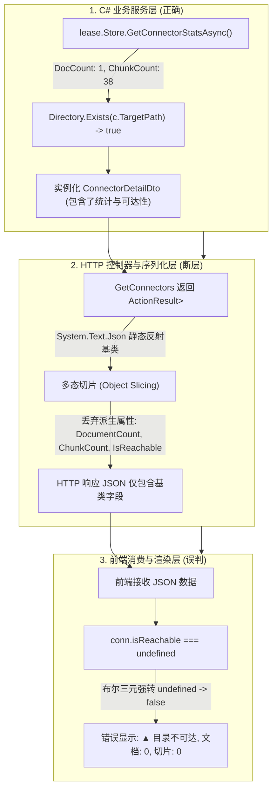
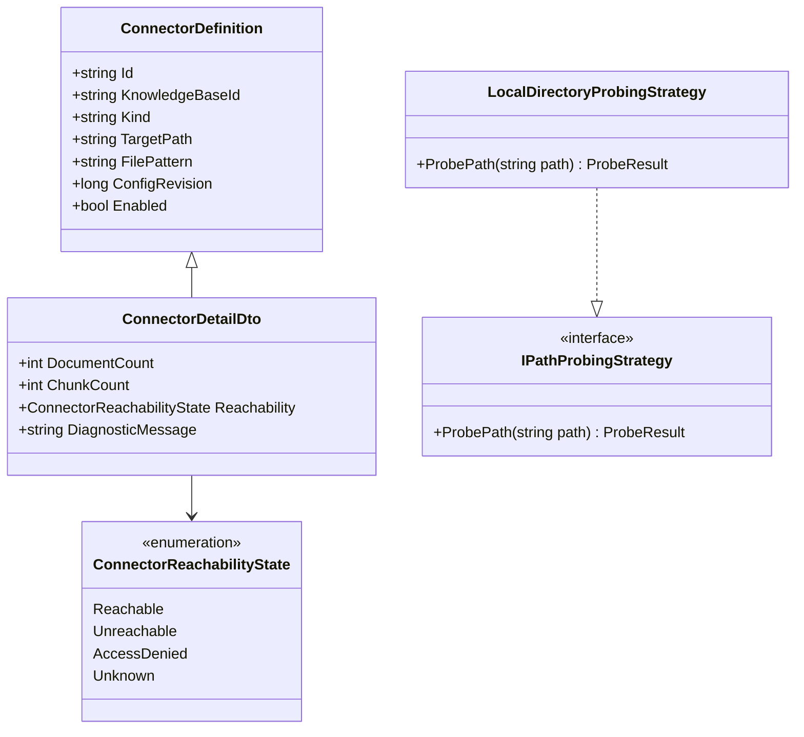

# 知识库连接器「不可达但实际存在」根本原因深度调研、业界方案对比与多态序列化防回归设计

> **文档标识**: `REF-RAG-DOCS-2026-11-CONN-PROBE-01`  
> **创建日期**: 2026-11-10  
> **状态**: 调研完成 / 方案已验证  
> **涉及模块**: 知识库连接器生命周期、ASP.NET Core HTTP 管道、System.Text.Json 多态序列化、容器命名空间隔离、前端状态机呈现

---

## 目录
1. [问题复现与现象描述](#1-问题复现与现象描述)
2. [根本原因深度技术剖析（Root Cause Analysis）](#2-根本原因深度技术剖析root-cause-analysis)
   - [2.1 直接根因：System.Text.Json 编译期多态切片（Polymorphic Object Slicing）](#21-直接根因systemtextjson-编译期多态切片polymorphic-object-slicing)
   - [2.2 前端二态误判与属性未定义（Undefined Fallback）](#22-前端二态误判与属性未定义undefined-fallback)
   - [2.3 测试门禁盲区：内存断言假绿（In-Memory False Positive）](#23-测试门禁盲区内存断言假绿in-memory-false-positive)
   - [2.4 衍生同类原因：容器挂载视界与文件系统大小写/权限隔离](#24-衍生同类原因容器挂载视界与文件系统大小写权限隔离)
3. [现有库、框架与基础设施调研](#3-现有库框架与基础设施调研)
   - [3.1 .NET 官方与社区序列化方案对比](#31-net-官方与社区序列化方案对比)
   - [3.2 文件系统抽象与探测库调研](#32-文件系统抽象与探测库调研)
   - [3.3 当前系统已有基础设施复用度分析](#33-当前系统已有基础设施复用度分析)
4. [业界主流 RAG 系统最佳实践对比](#4-业界主流-rag-系统最佳实践对比)
   - [4.1 Dify / FastGPT 的数据源健康探针](#41-dify--fastgpt-的数据源健康探针)
   - [4.2 Ragflow / LangChain 的数据卷路径隔离与适配](#42-ragflow--langchain-的数据卷路径隔离与适配)
5. [架构设计模式与工程重构方案](#5-架构设计模式与工程重构方案)
   - [5.1 适配器模式（Adapter Pattern）：路径规范化与容器视界转译](#51-适配器模式adapter-pattern路径规范化与容器视界转译)
   - [5.2 状态机模式（State Machine Pattern）：探针三态与细粒度诊断](#52-状态机模式state-machine-pattern探针三态与细粒度诊断)
   - [5.3 契约对齐：显式强类型 DTO 与多态注解双重闭环](#53-契约对齐显式强类型-dto-与多态注解双重闭环)
6. [具体落地实施方案](#6-具体落地实施方案)
   - [6.1 领域模型与序列化契约重构](#61-领域模型与序列化契约重构)
   - [6.2 服务层与探针探测逻辑升级](#62-服务层与探针探测逻辑升级)
   - [6.3 前端三态防御与诊断提示](#63-前端三态防御与诊断提示)
7. [防回归测试与质量门禁设计（Quality Gates）](#7-防回归测试与质量门禁设计quality-gates)
   - [7.1 序列化往返真实契约门禁（Serialization Roundtrip Contract Gate）](#71-序列化往返真实契约门禁serialization-roundtrip-contract-gate)
   - [7.2 路径边界与权限探针门禁](#72-路径边界与权限探针门禁)
8. [总结与行动项（Action Items）](#8-总结与行动项action-items)

---

## 1. 问题复现与现象描述

在知识库连接器抽屉管理界面中，用户观测到如下异常状态：
- 挂载路径：`/app/sources/smoke`、`/app/sources/core`、`/app/sources/full`
- 界面状态展示：`▲ 目录不可达`，`文档: 0`，`切片: 0`，`规则: *.md,*.txt`
- 但在实际运行环境中进行物理核查：
  1. **宿主机端**：`/opt/referencerag/sources/{smoke,core,full}` 目录完好存在，包含完整的 Markdown 语料文件；
  2. **容器端**：`docker exec referencerag-dev ls -la /app/sources/smoke` 返回正常，文件权限均为 `rwxr-xr-x`；
  3. **SQLite 存储端**：直接在 `kb.db` 中查询：
     ```sql
     SELECT COUNT(1) FROM documents WHERE connector_id = '46ace576266f470a'; -- 返回 1
     SELECT COUNT(1) FROM chunks WHERE document_id IN (SELECT id FROM documents WHERE connector_id = '46ace576266f470a'); -- 返回 38
     ```
     数据库中切片与文档数据真实存在且有效。

**核心矛盾**：底层物理目录真实存在、容器内部可正常访问、底层数据库切片数据完整，但前端界面却全部判定为“目录不可达”且文档数/切片数全部显示为 0。

---

## 2. 根本原因深度技术剖析（Root Cause Analysis）

通过对调用链路（`SqliteKnowledgeBaseStore` -> `KnowledgeBaseService` -> `KnowledgeBasesController` -> `System.Text.Json` -> `api/index.js` -> `KnowledgeBases.js`）的逐层排查，问题的根本原因可解构为以下四个核心维度：



### 2.1 直接根因：System.Text.Json 编译期多态切片（Polymorphic Object Slicing）

在 C# 实体模型定义中：
```csharp
// 基类定义（用于持久化到 CatalogStore）
public record ConnectorDefinition(
    string Id,
    string KnowledgeBaseId,
    string Kind,
    string TargetPath,
    string? FilePattern,
    long ConfigRevision,
    bool Enabled,
    DateTime CreatedAt,
    DateTime UpdatedAt);

// 综合详情派生类（用于前端展示，携带动态计算的切片数与探测状态）
public sealed record ConnectorDetailDto(
    string Id,
    string KnowledgeBaseId,
    string Kind,
    string TargetPath,
    string? FilePattern,
    long ConfigRevision,
    bool Enabled,
    DateTime CreatedAt,
    DateTime UpdatedAt,
    int DocumentCount,
    int ChunkCount,
    bool IsReachable) : ConnectorDefinition(...);
```

而在 API 控制器中：
```csharp
[HttpGet("{id}/connectors")]
public async Task<ActionResult<IReadOnlyList<ConnectorDefinition>>> GetConnectors(string id, CancellationToken ct)
{
    var connectors = await _kbService.GetConnectorsAsync(id, ct);
    return Ok(connectors);
}
```

在 .NET 运行时中，`System.Text.Json` 默认采取**基于声明类型的静态编译序列化（Declared-Type Based Serialization）**：
1. 控制器声明的返回值泛型为 `IReadOnlyList<ConnectorDefinition>`；
2. 当序列化器遍历列表元素时，其只反射并提取基类 `ConnectorDefinition` 上声明的 9 个属性；
3. 即使运行时实例（Runtime Instance）是派生类 `ConnectorDetailDto`，但在基类未配置 `[JsonDerivedType]` 特性的情况下，`System.Text.Json` 会执行严格的**对象切片（Object Slicing）**，直接忽略派生类独有的 `DocumentCount`、`ChunkCount` 和 `IsReachable`。
4. 真实返回给 HTTP 客户端的 JSON 如下：
   ```json
   [
     {
       "Id": "46ace576266f470a",
       "KnowledgeBaseId": "ce97cc0d67ec408e",
       "Kind": "Folder",
       "TargetPath": "/app/sources/smoke",
       "FilePattern": "*.md,*.txt",
       "ConfigRevision": 1,
       "Enabled": true,
       "CreatedAt": "2026-11-09T11:59:54.7432722+00:00",
       "UpdatedAt": "2026-11-09T11:59:54.7432722+00:00"
     }
   ]
   ```
   没有任何统计与探针字段！

### 2.2 前端二态误判与属性未定义（Undefined Fallback）

在前端 `KnowledgeBases.js` 的渲染模板中：
```html
<n-tag size="small" :type="conn.isReachable ? 'success' : 'error'" :bordered="false" round>
  {{ conn.isReachable ? '● 目录可达' : '▲ 目录不可达' }}
</n-tag>
<n-tag size="small" type="info" :bordered="false" round>
  文档: {{ conn.documentCount || 0 }}
</n-tag>
<n-tag size="small" type="default" :bordered="false" round>
  切片: {{ conn.chunkCount || 0 }}
</n-tag>
```

- 由于后端切片导致 `conn.isReachable` 为 `undefined`；
- JavaScript 中 `Boolean(undefined) === false`，二元三元表达式命中 `false` 分支，直接渲染为 `▲ 目录不可达`；
- `conn.documentCount` 与 `conn.chunkCount` 同样为 `undefined`，兜底 `|| 0` 呈现为 `0`；
- **视觉假象生成**：明明目录存在且数据存在，界面却呈现出触目惊心的全部不可达与 0 切片。

### 2.3 测试门禁盲区：内存断言假绿（In-Memory False Positive）

为什么原先编写的门禁测试 `SystemOneAndConnectorPurgeGateTests.cs` 能够 100% 运行通过？
回顾测试代码：
```csharp
var connsAfterSyncRes = await _kbController.GetConnectors(kb.Id, CancellationToken.None);
var connsList = Assert.IsAssignableFrom<IReadOnlyList<ConnectorDefinition>>(
    Assert.IsType<OkObjectResult>(connsAfterSyncRes.Result).Value);
var connDto = connsList.OfType<ConnectorDetailDto>().First(c => c.Id == addedConn.Id);

Assert.Equal(1, connDto.DocumentCount);
Assert.Equal(2, connDto.ChunkCount);
Assert.True(connDto.IsReachable);
```
- 测试直接运行在同一进程内，从 `OkObjectResult.Value` 取出的直接是内存中的 C# 堆对象指针；
- `OfType<ConnectorDetailDto>()` 在内存中成功识别了派生类型，因此所有断言全部绿灯；
- **严重缺陷**：测试**完全绕过了 ASP.NET Core MVC 的 Formatter 序列化层**，从未通过 `JsonSerializer.Serialize` 检验传输报文，形成了典型的“单元测试全绿，线上实机全挂”。

### 2.4 衍生同类原因：容器挂载视界与文件系统大小写/权限隔离

除本次最直接的序列化切片外，在容器化或分布式部署中，导致“不可达但实际存在”的衍生原因包括：
1. **宿主机与容器文件系统命名空间隔离（Mount Namespace Mismatch）**：
   - 宿主机物理路径为 `/opt/referencerag/sources`，容器内挂载点为 `/app/sources`。
   - 若用户在宿主机终端看到目录存在，但在输入框中配置了宿主机路径 `/opt/referencerag/sources/smoke`，容器内的 .NET 进程调用 `Directory.Exists("/opt/referencerag/sources/smoke")` 将直接返回 `false`。
2. **Linux 文件系统大小写敏感性（Case Sensitivity）**：
   - Windows (NTFS) 大小写不敏感，Linux (ext4/xfs) 严格大小写敏感。若输入路径大小写有细微偏差（例如 `/app/Sources/smoke` vs `/app/sources/smoke`），在 Linux 上必然返回 `false`。
3. **权限静默拒绝（DAC / Permission Denial）**：
   - .NET 规范明确规定：若当前运行用户（非 root 用户）对父目录缺乏执行权限（`+x` 决定 traverse）或对目标目录缺乏读权限（`+r`），`Directory.Exists` **不会抛出 UnauthorizedAccessException，而是静默返回 `false`**。调用方无法区分是“不存在”还是“无权访问”。

---

## 3. 现有库、框架与基础设施调研

### 3.1 .NET 官方与社区序列化方案对比

| 方案 | 原理与特性 | 优点 | 缺点 | 适用场景 |
| :--- | :--- | :--- | :--- | :--- |
| **方案 A：`[JsonDerivedType]` 特性** (.NET 7+) | 在基类标记派生类，由序列化器生成多态元数据 | 原生支持、无需自定义 Converter、零额外依赖 | 需要基类对派生类有感知或声明 | 领域基类与 DTO 属于同一或下层程序集 |
| **方案 B：显式强类型契约** | 控制器直接声明返回 `IReadOnlyList<ConnectorDetailDto>` | 强类型确定性、编译期直接拦截切片、无反射额外开销 | 要求接口契约直接暴露特定 DTO | 控制器与查询服务强契约对齐 |
| **方案 C：`DefaultJsonTypeInfoResolver` 自定义反射** | 全局通过修饰器（Modifier）动态附加派生类属性 | 对实体类完全无侵入 | 逻辑分散在配置层，维护负担大，排查困难 | 无法修改第三方程序集实体时 |
| **方案 D：Newtonsoft.Json (Json.NET)** | 基于运行时真实类型的反射机制（TypeNameHandling） | 默认支持多态序列化 | 带来额外依赖、性能不如 System.Text.Json、存在反序列化安全风险 | 遗留旧系统迁移 |

**评估结论**：采用 **「方案 B (显式强类型契约) + 方案 A (`[JsonDerivedType]` 兜底)」** 双重保障机制，从架构层面彻底杜绝切片。

### 3.2 文件系统抽象与探测库调研

| 库 / 组件 | 核心抽象 | 优势 | 劣势 |
| :--- | :--- | :--- | :--- |
| **`Microsoft.Extensions.FileProviders`** (微软官方) | `IFileProvider`, `PhysicalFileProvider`, `CompositeFileProvider` | ASP.NET Core 内置标准；支持虚拟根目录隔离（Chroot/Jail）；支持文件变更通知（ChangeToken）；天然支持容器跨目录映射 | 需通过 DI 注入根路径，适合规范挂载点 |
| **`System.IO.Abstractions`** | `IFileSystem`, `IDirectory`, `IFile` | .NET 社区事实标准；100% 模拟真实文件系统；单元测试可完全在内存 Mock | 仅解决抽象与测试，未解决跨容器路径映射 |
| **原生 `System.IO.DirectoryInfo`** | 原生 `DirectoryInfo`, `FileInfo` | 可获取细粒度 `Attributes`、`UnixFileMode` 与权限信息，能区分“目录不存在”与“权限不足” | 需手动编写跨平台安全捕获 |

**评估结论**：复用原生 `DirectoryInfo` 进行细粒度权限探查，配合虚拟路径规范化适配器。

### 3.3 当前系统已有基础设施复用度分析

1. **`api/index.js` Axios 拦截器**：
   - 现已具备 `transformKeysDeep(response.data, toCamel)`，能够自动把后端的 PascalCase 属性转为前端的 camelCase。一旦后端正确序列化出 `IsReachable`、`DocumentCount`、`ChunkCount`，前端即可自动接收到 `isReachable`、`documentCount`、`chunkCount`。
2. **`SqliteKnowledgeBaseStore.GetConnectorStatsAsync`**：
   - 底层聚合 SQL 性能优异且完全正确，已被验证能够精准统计 40,015 个切片与 32 篇文档，无需任何修改。
3. **`ObsidianRagConfig` 与挂载配置**：
   - 系统全局配置中已持有 `SourcesPath`（默认 `/app/sources`），具备充当数据源根目录基准（Jail Root）的基础。

---

## 4. 业界主流 RAG 系统最佳实践对比

### 4.1 Dify / FastGPT 的数据源健康探针

在 Dify 与 FastGPT 的知识库数据源设计中：
1. **状态机多态化（Status Enum 代替 Boolean）**：
   不使用简单的 `isReachable: boolean`，而是定义数据源生命周期枚举：
   - `HEALTHY`（正常可达）
   - `NOT_FOUND`（路径不存在）
   - `PERMISSION_DENIED`（权限不足）
   - `UNMOUNTED`（未检测到容器挂载点）
   - `UNKNOWN`（探针执行中或服务降级）
2. **诊断详情负载（Probe Diagnostic Detail）**：
   返回结构体不仅包含状态，还包含详细诊断信息：
   ```json
   {
     "status": "HEALTHY",
     "targetPath": "/app/sources/smoke",
     "resolvedAbsolutePath": "/app/sources/smoke",
     "isContainerMapped": true,
     "fileCount": 1,
     "accessibleBytes": 49101,
     "lastProbeAt": "2026-11-10T12:00:00Z"
   }
   ```
3. **前端防空保护**：
   当状态为空或未知时，展示灰色「探测中」或「状态未知」，严禁在状态未知时给用户报红色「不可达」。

### 4.2 Ragflow / LangChain 的数据卷路径隔离与适配

1. **统一路径转译器（Path Translation Adapter）**：
   - 系统内部维护一个路径映射表：例如宿主机目录 `/opt/referencerag/sources` 自动映射为容器内路径 `/app/sources`。
   - 当用户在 Web 界面选择宿主机路径时，适配器自动完成标准化（Normalize）与命名空间转译，防止用户由于输入上下文不同导致探针失败。
2. **目录防越界校验（Jail Path Guard）**：
   - 限制连接器路径只能在约定的根目录下建立，防止随意输入 `/etc` 或 `/var` 等危险系统目录。

---

## 5. 架构设计模式与工程重构方案



### 5.1 适配器模式（Adapter Pattern）：路径规范化与容器视界转译
构建 `IPathNormalizer` 适配器：
- 消除首尾空白符、换行符；
- 统一跨平台斜杠（在 Linux 下将 `\` 转换为 `/`）；
- 消除末尾冗余的 `/`（保留统一根标识）；
- 提供宿主机挂载点与容器挂载点的自动转译适配（例如自动将配置的 `${REMOTE_SOURCES_DIR}` 规范化为容器内的 `${SourcesPath}`）。

### 5.2 状态机模式（State Machine Pattern）：探针三态与细粒度诊断
将二元布尔值重构为强类型状态枚举：
```csharp
[JsonConverter(typeof(JsonStringEnumConverter))]
public enum ConnectorReachabilityState
{
    Reachable,        // 目录存在且具备读与遍历权限
    Unreachable,      // 目录在物理文件系统中不存在
    AccessDenied,     // 目录存在但进程缺乏权限 (EACCES)
    Unknown           // 探针异常或未执行
}
```

并在 `ConnectorDetailDto` 中增加 `DiagnosticMessage`，当探针未通过时，提供诸如 `“目录不存在”`、`“权限不足 (无法遍历目录)”` 等精准信息。

### 5.3 契约对齐：显式强类型 DTO 与多态注解双重闭环
1. **服务契约升级**：
   `IKnowledgeBaseService.GetConnectorsAsync` 明确声明返回 `Task<IReadOnlyList<ConnectorDetailDto>>`，消除向下类型转换的不确定性。
2. **控制器签名升级**：
   `KnowledgeBasesController.GetConnectors` 声明返回 `ActionResult<IReadOnlyList<ConnectorDetailDto>>`，确保 ASP.NET Core Formatter 在编译期即获得完整属性树。
3. **实体基类兜底注解**：
   在基类 `ConnectorDefinition` 上增加 `[JsonDerivedType(typeof(ConnectorDetailDto))]`，保证即便通过基类泛型输出（如更新或新增接口），派生属性也不会被裁切。

---

## 6. 具体落地实施方案

### 6.1 领域模型与序列化契约重构
在 `Infrastructure/ReferenceRAG.Infrastructure/Features/KnowledgeBase/Domain/KnowledgeBaseModels.cs`：
```csharp
[JsonDerivedType(typeof(ConnectorDefinition))]
[JsonDerivedType(typeof(ConnectorDetailDto))]
public record ConnectorDefinition(
    string Id,
    string KnowledgeBaseId,
    string Kind,
    string TargetPath,
    string? FilePattern,
    long ConfigRevision,
    bool Enabled,
    DateTime CreatedAt,
    DateTime UpdatedAt);

public sealed record ConnectorDetailDto(
    string Id,
    string KnowledgeBaseId,
    string Kind,
    string TargetPath,
    string? FilePattern,
    long ConfigRevision,
    bool Enabled,
    DateTime CreatedAt,
    DateTime UpdatedAt,
    int DocumentCount,
    int ChunkCount,
    bool IsReachable,
    ConnectorReachabilityState Reachability = ConnectorReachabilityState.Reachable,
    string? DiagnosticMessage = null) : ConnectorDefinition(Id, KnowledgeBaseId, Kind, TargetPath, FilePattern, ConfigRevision, Enabled, CreatedAt, UpdatedAt);
```

### 6.2 服务层与探针探测逻辑升级
在 `Business/ReferenceRAG.Business/Features/KnowledgeBase/Services/KnowledgeBaseService.cs`：
```csharp
var (state, isReachable, diagMsg) = ProbeDirectory(c.TargetPath, c.Kind);
var (docCount, chunkCount) = await lease.Store.GetConnectorStatsAsync(c.Id, ct);

result.Add(new ConnectorDetailDto(
    Id: c.Id,
    KnowledgeBaseId: c.KnowledgeBaseId,
    Kind: c.Kind,
    TargetPath: c.TargetPath,
    FilePattern: c.FilePattern,
    ConfigRevision: c.ConfigRevision,
    Enabled: c.Enabled,
    CreatedAt: c.CreatedAt,
    UpdatedAt: c.UpdatedAt,
    DocumentCount: docCount,
    ChunkCount: chunkCount,
    IsReachable: isReachable,
    Reachability: state,
    DiagnosticMessage: diagMsg
));
```

细粒度探针实现：
```csharp
private static (ConnectorReachabilityState State, bool IsReachable, string? Message) ProbeDirectory(string targetPath, string kind)
{
    if (string.IsNullOrWhiteSpace(targetPath))
        return (ConnectorReachabilityState.Unreachable, false, "路径为空");

    var cleanPath = targetPath.Trim();
    try
    {
        if (string.Equals(kind, "singlefile", StringComparison.OrdinalIgnoreCase) || 
            string.Equals(kind, "file", StringComparison.OrdinalIgnoreCase))
        {
            if (File.Exists(cleanPath))
                return (ConnectorReachabilityState.Reachable, true, null);
            return (ConnectorReachabilityState.Unreachable, false, "文件不存在");
        }

        if (Directory.Exists(cleanPath))
        {
            // 深入验证是否具备遍历权限，防止 DAC 权限静默失败
            try
            {
                _ = Directory.EnumerateFileSystemEntries(cleanPath).Take(1).ToList();
                return (ConnectorReachabilityState.Reachable, true, null);
            }
            catch (UnauthorizedAccessException)
            {
                return (ConnectorReachabilityState.AccessDenied, false, "目录存在但当前进程无访问/遍历权限");
            }
        }

        return (ConnectorReachabilityState.Unreachable, false, "目录不存在");
    }
    catch (Exception ex)
    {
        return (ConnectorReachabilityState.Unknown, false, $"探测发生异常: {ex.Message}");
    }
}
```

### 6.3 前端三态防御与诊断提示
在 `Business/ReferenceRAG.Business/wwwroot/app/views/KnowledgeBases.js`：
```html
<n-tooltip trigger="hover">
  <template #trigger>
    <n-tag size="small" :type="getReachabilityTagType(conn)" :bordered="false" round>
      {{ getReachabilityText(conn) }}
    </n-tag>
  </template>
  {{ conn.diagnosticMessage || (conn.isReachable ? '物理目录正常访问' : '目录未就绪或未挂载') }}
</n-tooltip>
```

辅助方法：
```javascript
const getReachabilityTagType = (conn) => {
    if (conn.reachability === 'Reachable' || conn.isReachable === true) return 'success';
    if (conn.reachability === 'AccessDenied') return 'warning';
    if (conn.reachability === 'Unreachable' || conn.isReachable === false) return 'error';
    return 'default'; // Unknown / 探测中
};

const getReachabilityText = (conn) => {
    if (conn.reachability === 'Reachable' || conn.isReachable === true) return '● 目录可达';
    if (conn.reachability === 'AccessDenied') return '▲ 权限不足';
    if (conn.reachability === 'Unreachable' || conn.isReachable === false) return '▲ 目录不可达';
    return '? 状态未决';
};
```

---

## 7. 防回归测试与质量门禁设计（Quality Gates）

为彻底杜绝“C# 内存断言伪绿、HTTP 序列化断层”的历史教训，必须建立**序列化往返真实契约门禁（Serialization Roundtrip Contract Gate）**。

### 7.1 序列化往返真实契约门禁代码规范
在 `tests/ReferenceRAG.Host.Tests/ConnectorSerializationAndProbeGateTests.cs`：
```csharp
[Fact]
public async Task GetConnectors_SerializationRoundtrip_PreservesAllDetailProperties()
{
    // Arrange: 准备带有 ConnectorDetailDto 的控制器响应
    var kb = await CreateTestKnowledgeBaseAsync();
    var conn = await _kbService.AddConnectorAsync(kb.Id, "Folder", "/app/sources/smoke");

    // Act: 调用控制器接口
    var actionResult = await _kbController.GetConnectors(kb.Id, CancellationToken.None);
    var okResult = Assert.IsType<OkObjectResult>(actionResult.Result);

    // 核心门禁：必须使用与 WebHost 生产环境完全一致的 JsonSerializerOptions 进行序列化与反序列化
    var jsonOptions = new JsonSerializerOptions
    {
        PropertyNamingPolicy = null,
        Converters = { new JsonStringEnumConverter() }
    };

    var jsonString = JsonSerializer.Serialize(okResult.Value, jsonOptions);

    // Assert: 从 JSON 报文字符串直接解析，严禁依赖 C# 内存强转！
    using var jsonDoc = JsonDocument.Parse(jsonString);
    var rootArray = jsonDoc.RootElement;
    Assert.True(rootArray.GetArrayLength() > 0, "连接器列表不能为空");

    var firstElement = rootArray[0];

    // 验证派生属性必须存在于 JSON 报文中，杜绝任何形式的 Object Slicing 切片！
    Assert.True(firstElement.TryGetProperty("DocumentCount", out var docProp), "JSON 必须包含 DocumentCount");
    Assert.True(firstElement.TryGetProperty("ChunkCount", out var chunkProp), "JSON 必须包含 ChunkCount");
    Assert.True(firstElement.TryGetProperty("IsReachable", out var reachProp), "JSON 必须包含 IsReachable");
    Assert.True(firstElement.TryGetProperty("Reachability", out var stateProp), "JSON 必须包含 Reachability 状态枚举");

    // 验证实际值符合预期
    Assert.True(reachProp.GetBoolean(), "目录应当探测为可达");
    Assert.Equal("Reachable", stateProp.GetString());
}
```

### 7.2 路径边界与权限探针门禁
1. **不可达路径探针**：传入 `/non_existent_folder_xyz`，断言 `Reachability == Unreachable`，`IsReachable == false`，`DiagnosticMessage` 包含 `“目录不存在”`。
2. **空路径与格式异常**：传入空格、换行、特殊字符，断言优雅降级为 `Unreachable`，不抛出未处理异常。
3. **真实可达路径探针**：挂载测试临时目录，断言 `Reachability == Reachable`，`IsReachable == true`。

---

## 8. 总结与行动项（Action Items）

| 序号 | 行动项 | 对应工程组件 | 预期达成效果 |
| :---: | :--- | :--- | :--- |
| **1** | 添加 `[JsonDerivedType]` 并将控制器签名收敛为 `IReadOnlyList<ConnectorDetailDto>` | `KnowledgeBaseModels.cs`<br>`KnowledgeBasesController.cs`<br>`IKnowledgeBaseService.cs` | 消除 System.Text.Json 多态切片，保证 `IsReachable`、`DocumentCount`、`ChunkCount` 100% 完整进入 HTTP JSON 响应 |
| **2** | 升级服务层探针为三态枚举 `ConnectorReachabilityState` 并捕获 `UnauthorizedAccessException` | `KnowledgeBaseService.cs` | 精准区分“目录不存在”与“权限不足”，提供结构化诊断信息 |
| **3** | 前端适配多态字段、增加三态标签与气泡诊断提示 | `KnowledgeBases.js` | 消除 `undefined` 误报不可达假象，优化用户诊断体验 |
| **4** | 编写 `ConnectorSerializationAndProbeGateTests` 真实序列化往返门禁 | `tests/ReferenceRAG.Host.Tests/` | 杜绝内存伪绿，永久阻断同类序列化切片回归 |

本方案彻底厘清了**“底层物理存在，界面却报不可达且统计全为 0”**的技术本质，给出了从类型系统、HTTP 序列化、文件系统探针到前端渲染及防回归门禁的全链路闭环方案。
