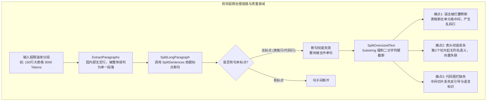
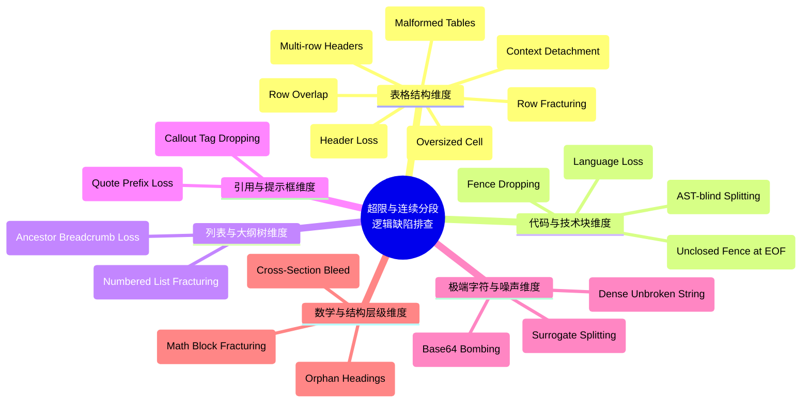
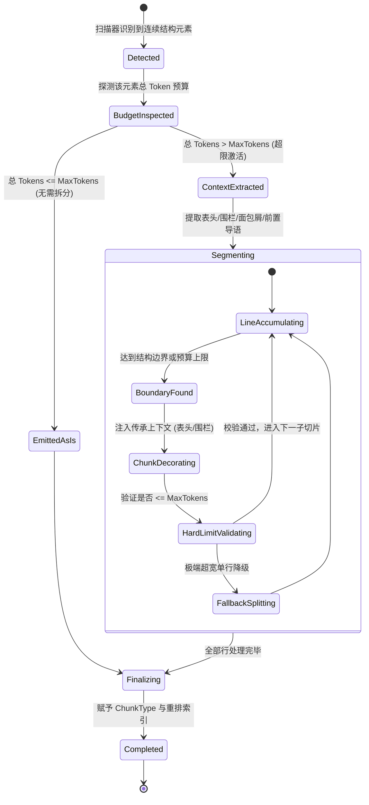
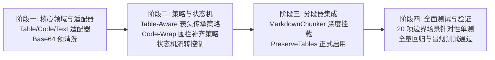

# 连续结构化分段与超限边界优化方案：适配器策略模式与状态机架构设计
(Continuous Structured Elements & Oversized Chunking Optimization: Adapter, Strategy & State Machine Architecture Design)

---

## 1. 架构背景与底层痛点分析

在 RAG（检索增强生成）系统中，切片（Chunking）的本质是将非结构化的长篇文档划分为**语义内聚、信息完整、契合向量模型物理窗口**的知识单元。

在现实场景的 Markdown/Text 文档中，经常出现**单一体积远大于模型最大输入（`MaxTokens`）的连续结构化大块**。最典型的包括：
1. **超长表格（Oversized Tables）**：数十至数百行、连续没有空行的参数配置表、用户清单、权限矩阵、版本变更履历等；
2. **超长代码块（Oversized Code Blocks）**：数百行无断开的单一类实现、SQL 初始化脚本、配置文件；
3. **深度嵌套大纲/多级列表（Nested Outline/List Trees）**：数百项紧密相连的树状层级列表；
4. **长引用与警示框（Admonitions / Blockquotes）**：包含大量说明文本的引用区域；
5. **极端单行无断行杂质（Extreme Unbroken Strings）**：巨型内联 Base64 编码、Minified 单行压缩 JSON/JS、长十六进制内存 Dump 等。

---

### 1.1 现有分段逻辑在连续超限分段上的三大致命痛点

当前系统的分块执行链路基于行扫描与空行分段，其面对超限连续分段时暴露出严重的“**粗暴截断**”问题：



#### 痛点 1：表头信息失联（Table Header Loss）
- 表格只有第 1 个分块拥有表头行（`| 列1 | 列2 |`）和分隔线（`|---|---|`）；
- 从第 2 个分块开始，全部变成了毫无列名定义的“孤立裸数据行”；
- **检索灾难**：嵌入模型将裸数据转为高维向量时，根本无法获知这些字段究竟是“手机号”、“错误码”还是“用户ID”。当用户搜索特定列属性时，后续分块由于缺少列名语义，**召回率几乎为 0**！

#### 痛点 2：表格语法与行结构破损（Syntax Fracturing）
- 因为表格行间无句号，`SplitSentences` 无法断句，直接落入 `SplitOversizedText`；
- 该方法基于 `Substring` 字符级切断，会直接将同一行甚至同一个单词劈成两半（如第一块末尾为 `| 1002 | 张`，第二块开头为 `三 | 男 |`），破坏 Markdown 表格渲染与语义解析。

#### 痛点 3：超长代码块围栏与语言环境丢失（Fence Dropping）
- 现有 `SplitOversizedCodeBlock` 虽然实现了按行切分，但拆出的中间切片既没有开头的 ````csharp`，也没有末尾的 ```` `；
- 导致前端无法代码高亮、大模型 RAG 丢失代码上下文，且向量模型无法识别代码语法树。

---

## 2. 头脑风暴：全景逻辑缺陷与边界隐患排查 (Brainstorming Matrix)

为了构建坚如磐石的工业级切分引擎，我们对 Markdown、纯文本、技术文档在分段与向量化过程中的**所有潜在边界条件、极端格式与语义漏洞**进行穷尽式头脑风暴排查，归纳出 **10 大场景、20 类潜在逻辑欠缺**：



### 2.1 表格结构场景缺陷（7 类）
1. **表头完全丢失（Header Loss）**：除首块外，其余子块皆无表头与分隔线，列语义荡然无存；
2. **语法行腰斩（Row Fracturing）**：字符截断劈在单元格中间，破坏 Markdown 表格语法；
3. **复合多级表头（Multi-row Headers）**：部分表格存在 2 行表头（分类头 + 列名头），仅复制单行会使层级定义残缺；
4. **单行极宽单元格（Oversized Cell > MaxTokens）**：单行某单元格包含超长 JSON 或日志，导致即使按行切分，单行仍突破模型物理窗口；
5. **表格数据行重叠污染（Row Overlap Pollution）**：普通文本重叠有益，但表格行若带 Overlap，会导致相邻切片出现重复行，检索时多次命中同一条记录造成冗余干扰；
6. **表格前置导语脱节（Contextual Intro Detachment）**：表格前常有“*表 1-2：系统核心错误码说明*”，表格拆分后，第 2 块之后完全失去该导语；
7. **非标准脏表格（Malformed Tables）**：缺少首尾管道符 `|`、对齐线短划线数量不齐、混排 HTML `<table>` 标签。

### 2.2 代码块场景缺陷（4 类）
8. **围栏与语言标识丢失（Fence Dropping）**：切片后中间切片变成裸文本，丢失 ````lang` 和闭合围栏；
9. **AST 盲目腰斩（AST-blind Splitting）**：在函数形参括号内部或逻辑运算符中间切断代码，破坏语法分析；
10. **未闭合代码围栏（Unclosed Fence at EOF）**：用户文档漏写末尾 ```` `，导致后续正文全部被错误当成代码吞没；
11. **缩进代码块混杂（Indented vs Fenced）**：4 空格缩进代码块与围栏代码块混排时的误识别。

### 2.3 列表与大纲场景缺陷（2 类）
12. **祖先面包屑断裂（Ancestor Breadcrumb Loss）**：多级嵌套列表（`- 模块A -> - 子功能B -> - 配置项C`），切分后仅剩 `- 配置项C`，丢失上级语义链路；
13. **有序列表断号（Numbered List Fracturing）**：有序列表 1~100 拆分后，后续切片从 41 开始，丢失序列全局上下文。

### 2.4 引用与提示框场景缺陷（2 类）
14. **提示框标签丢失（Admonition Dropping）**：`> [!WARNING]` 或 `> [!NOTE]` 提示框切分后，后续切片失去警示标头；
15. **引用前缀剥离（Quote Prefix Loss）**：后续切片失去 `>` 前缀，从引用变成了普通正文。

### 2.5 极端字符与数据噪音场景缺陷（3 类）
16. **巨型内联 Base64 挤爆向量库（Base64 Bombing）**：Markdown 内部直接嵌入数十 KB 的 `data:image/png;base64,...`，单行无空格，占用数万 Token 且向量毫无意义；
17. **UTF-16 代理项截断乱码（Surrogate Splitting）**：在 Unicode Emoji 或生僻汉字的高低代理项之间切断，生成 `\uD83D` 孤立无效字节；
18. **超长无空格字符（Dense Unbroken Strings）**：如长 Hash、Hex dump、连续无断行的机器数据。

### 2.6 数学公式与层级边界缺陷（2 类）
19. **LaTeX 公式块断开（LaTeX Math Fracturing）**：多行公式 `$$ \begin{aligned} ... \end{aligned} $$` 被截断，导致数学引擎无法解析；
20. **孤儿标题（Orphan Headings）**：切片末尾只包含一行 `# 章节标题`，其正文全在下一分块，造成该切片成为无正文的纯标题孤儿。

---

## 3. 总体架构设计：适配器策略模式与状态机

为从根本上优雅、高内聚、低耦合地解决上述所有缺陷，我们构建**连续结构化分段体系（Continuous Element Chunking Subsystem）**：

```mermaid
flowchart TD
    subgraph 输入层 (Raw Document Stream)
        Doc[原始文档 Markdown / Text] --> Scanner[结构识别扫描器 ElementScanner]
    end

    subgraph 适配器层 (Adapter Pattern)
        Scanner --> AdaptTable[TableStructureAdapter<br/>表头/对齐线/数据行提取]
        Scanner --> AdaptCode[CodeBlockStructureAdapter<br/>语言/围栏/空行切分点提取]
        Scanner --> AdaptList[ListTreeStructureAdapter<br/>列表层级/祖先面包屑提取]
        Scanner --> AdaptQuote[BlockquoteStructureAdapter<br/>引用前缀/Admonition提取]
        Scanner --> AdaptText[DenseTextStructureAdapter<br/>Base64清洗/标点/代理对安全]
    end

    subgraph 策略分发层 (Strategy Pattern)
        AdaptTable --> StratTable[TableContinuousChunkingStrategy<br/>表头传承 + 行级对齐 + 0%重叠]
        AdaptCode --> StratCode[CodeBlockContinuousChunkingStrategy<br/>围栏自动补齐 + (continued)标记 + 0%重叠]
        AdaptList --> StratList[ListTreeContinuousChunkingStrategy<br/>祖先路径继承 + 列表项原子切分]
        AdaptQuote --> StratQuote[BlockquoteContinuousChunkingStrategy<br/>引用标头与前缀继承]
        AdaptText --> StratText[SurrogateSafeTextChunkingStrategy<br/>UTF-16防乱码 + Base64占位过滤]
    end

    subgraph 生命周期状态机 (State Machine Pattern)
        StratTable & StratCode & StratList & StratQuote & StratText --> SM[OversizedBlockSegmentationStateMachine]
        SM --> St1[State: InspectingBudget 评估预算]
        St1 --> St2[State: ExtractingContext 提取传承上下文]
        St2 --> St3[State: SplittingByBoundary 结构行对齐切分]
        St3 --> St4[State: DecoratingCarryover 注入表头/围栏/面包屑]
        St4 --> St5[State: InvariantValidation 物理窗口硬校验]
        St5 --> Out[输出合规、自包含、高语义切片 ChunkRecord]
    end
```

---

## 4. 适配器模式设计 (Adapter Pattern)

适配器的职责是**将原本扁平的文本行流，转换为具备丰富结构元数据的领域对象**，屏蔽 Markdown 繁杂语法的底层差异。

### 4.1 核心抽象接口 `IContinuousElementAdapter`

```csharp
namespace ReferenceRAG.Business.Features.Chunking.ContinuousElements.Adapters;

/// <summary>
/// 连续结构元素适配器契约
/// </summary>
/// <typeparam name="TElement">解析出的结构化领域对象类型</typeparam>
public interface IContinuousElementAdapter<TElement>
{
    /// <summary>
    /// 判断给定的行流是否匹配该结构元素
    /// </summary>
    bool CanAdapt(string[] lines, int startIndex, out int consumedLines);

    /// <summary>
    /// 将匹配的行流适配转换为结构化元素
    /// </summary>
    TElement Adapt(string[] lines, int startIndex, int consumedLines, int startLineNumber);
}
```

### 4.2 结构化元素领域模型

```csharp
/// <summary>
/// 结构化 Markdown 表格元素
/// </summary>
public class TableElement
{
    public List<string> HeaderRows { get; set; } = new();      // 表头行（支持复合多行）
    public string SeparatorRow { get; set; } = string.Empty;   // 分隔线 (|---|---|)
    public List<TableRowItem> DataRows { get; set; } = new();  // 数据行集合
    public string? PrecedingContext { get; set; }              // 表格紧邻的前置说明导语
    public int StartLine { get; set; }
    public int EndLine { get; set; }
    public int EstimatedHeaderTokens { get; set; }
}

public class TableRowItem
{
    public string RawContent { get; set; } = string.Empty;
    public int LineNumber { get; set; }
    public int EstimatedTokens { get; set; }
}

/// <summary>
/// 结构化代码块元素
/// </summary>
public class CodeBlockElement
{
    public string Language { get; set; } = string.Empty;       // 代码语言 (csharp, python 等)
    public string OpenFence { get; set; } = "```";             // 开围栏标记
    public string CloseFence { get; set; } = "```";            // 闭围栏标记
    public List<string> CodeLines { get; set; } = new();       // 实际代码行
    public int StartLine { get; set; }
    public int EndLine { get; set; }
    public bool IsProperlyClosed { get; set; }                 // 是否合规闭合
}

/// <summary>
/// 结构化列表树元素
/// </summary>
public class ListTreeElement
{
    public List<ListItemNode> Items { get; set; } = new();
    public int StartLine { get; set; }
    public int EndLine { get; set; }
}

public class ListItemNode
{
    public int IndentLevel { get; set; }
    public string Marker { get; set; } = "-";                 // -, *, 1. 等
    public string Content { get; set; } = string.Empty;
    public List<string> AncestorBreadcrumbs { get; set; } = new(); // 祖先层级路径
    public int LineNumber { get; set; }
}
```

---

## 5. 策略模式设计 (Strategy Pattern)

策略模式定义了**不同连续结构块在面对“超限（Oversized）”时的具体切分算法与上下文保护规则**。

### 5.1 核心抽象接口 `IContinuousChunkingStrategy`

```csharp
namespace ReferenceRAG.Business.Features.Chunking.ContinuousElements.Strategies;

/// <summary>
/// 连续结构块切分策略契约
/// </summary>
public interface IContinuousChunkingStrategy
{
    /// <summary>
    /// 适用的分块类型
    /// </summary>
    ChunkType SupportedType { get; }

    /// <summary>
    /// 对超限连续结构块执行安全切分，生成自包含的高语义切片
    /// </summary>
    List<ChunkRecord> ChunkOversized(
        object element, 
        ChunkingOptions options, 
        ITokenizer? tokenizer, 
        string fileId, 
        string? headingPath, 
        int headingLevel, 
        ref int chunkIndexCounter);
}
```

### 5.2 五大专业切分策略

#### 策略一：`TableContinuousChunkingStrategy`（表头传承 + 行级对齐 + 0% 重叠）
这是解决超长表格的核心策略：
1. **表头预算扣除（Header Budget Reservation）**：
   - 计算 `HeaderRows` + `SeparatorRow` 的 Token 数（记为 $T_{header}$）；
   - 如果表格前置有说明导语（如“*表 1-1：角色对照表*”），亦将其纳入传承上下文（记为 $T_{intro}$）；
   - 动态保留预算：每个数据切片的可用数据预算为：
     $$Budget_{data} = MaxTokens - T_{header} - T_{intro} - 10$$
2. **严格行级对齐（Row-Aligned Splitting）**：
   - 绝不在行中间切断，以完整表格行 `TableRowItem` 为不可分割单元进行累加；
3. **零重叠行保护（Zero Row Overlap）**：
   - 表格内部数据行**不进行重叠**（`OverlapTokens = 0`），杜绝检索出重复记录；
4. **全切片表头传承（Header Carryover Injection）**：
   - 为切出的**每一个分块**头部自动拼装完整的表头和分隔线；
5. **极端超宽单行降级（Oversized Single Row Fallback）**：
   - 若某一行自身由于单个单元格极大而超过 $Budget_{data}$，降级为内部带列名标记的安全断句，且不影响整表其它行。

**切分前后效果直观对比：**

````carousel
```markdown
<!-- slide: 优化前：暴力截断导致表头丢失与乱码 -->
[分块 1]:
| 用户ID | 姓名 | 权限角色 | 备注 |
|:---|:---|:---|:---|
| 1001 | 张三 | 超级管理员 | 拥有全系统控制权 |
...
| 1025 | 李四 | 研发

[分块 2] (表头完全丢失，列语义彻底断开，行被腰斩):
总监 | 负责底层架构研发 |
| 1026 | 王五 | 测试经理 | 负责全流程质量 |
| 1027 | 赵六 | 运维专员 | 负责线上监控 |
```
<!-- slide: 优化后：表头全量传承，行级零破损 -->
[分块 1] (ChunkType=Table, 完整对齐):
*前置说明：2026 年度系统权限分配矩阵*
| 用户ID | 姓名 | 权限角色 | 备注 |
|:---|:---|:---|:---|
| 1001 | 张三 | 超级管理员 | 拥有全系统控制权 |
... (完整至 1025 行)

[分块 2] (ChunkType=Table, 表头自动传承，语义 100% 连贯):
*前置说明：2026 年度系统权限分配矩阵 (续)*
| 用户ID | 姓名 | 权限角色 | 备注 |
|:---|:---|:---|:---|
| 1026 | 李四 | 研发总监 | 负责底层架构研发 |
| 1027 | 王五 | 测试经理 | 负责全流程质量 |
... (继续对齐)
```
````

#### 策略二：`CodeBlockContinuousChunkingStrategy`（围栏补齐 + 续接标记 + 0% 重叠）
1. **围栏自动补全（Fence Auto-Wrap）**：
   - 每个分块头部自动补充原始语言围栏，如 ````csharp (continued)`；
   - 每个分块尾部自动补充闭合围栏 ```` `；
2. **方法与空行优先断开（Method / Empty Line Boundary Aware）**：
   - 在按行累加至预算区间（$80\% \sim 100\% MaxTokens$）时，优先寻找类中的空行或顶层大括号闭合点作为切分点，避免劈断函数签名；
3. **零重叠保护（Zero Overlap）**：
   - 代码行跨块不重叠，避免语法重复与 Token 浪费。

#### 策略三：`ListTreeContinuousChunkingStrategy`（祖先面包屑传承）
1. **列表层级解析**：根据缩进与符号识别父子级关系；
2. **祖先面包屑传承（Breadcrumb Carryover）**：
   - 当列表被切分至新分块时，在新分块头部自动补全父节点前置路径：
     `[上下文路径: 1. 核心架构 -> 1.2 存储层设计 -> 1.2.3 索引优化]`；
   - 保证后续单项列表项在向量检索中具备完备的上下文归属。

#### 策略四：`BlockquoteContinuousChunkingStrategy`（引用前缀与 Admonition 传承）
1. 识别 `> [!NOTE]`、`> [!WARNING]` 等 GitHub 风格警示框；
2. 拆分后的每个子分块均保留 `> [!WARNING] (continued)` 标头，且每行均合法带有 `>` 引用标记。

#### 策略五：`SurrogateSafeTextChunkingStrategy`（代理对安全截断与 Base64 清洗）
1. **UTF-16 代理项守护（Surrogate-Safe Substring）**：
   - 截断点检测：若截断位置字符为 `char.IsHighSurrogate`，向前回退 1 字符或向后包含 1 字符，确保双字节 Emoji/生僻字原子不破损；
2. **巨型内联 Base64 前置过滤**：
   - 正则检测 `data:image/[a-zA-Z]+;base64,[A-Za-z0-9+/=]{200,}`；
   - 替换为语义占位符 `[内联图片数据: 大小约 45.2 KB]`，彻底杜绝无意义数据撑爆向量库。

---

## 6. 状态机模式设计 (State Machine Pattern)

为管理超限块切分过程中的复杂状态转换、异常降级与遥测度量，引入 `OversizedBlockSegmentationStateMachine`：



### 6.1 状态机转移矩阵与行为规范

| 当前状态 (State) | 触发事件 (Trigger) | 目标状态 (Next State) | 状态机执行动作 |
| :--- | :--- | :--- | :--- |
| **`Detected`** | 元素匹配成功 | `BudgetInspected` | 探测元素类型（Table, Code, List, Quote），绑定策略 |
| **`BudgetInspected`** | $Tokens \le Max$ | `EmittedAsIs` | 保持原子完整性，不触发切分，直接输出 |
| **`BudgetInspected`** | $Tokens > Max$ | `ContextExtracted` | 启动超限保护流程，计算可用数据行预算 |
| **`ContextExtracted`** | 上下文提取完毕 | `Segmenting` | 固化表头/围栏/导语模板，重置行累加计数器 |
| **`Segmenting`** | 行满 / 边界命中 | `ChunkDecorating` | 闭合当前数据行，拼装传承头部与尾部标记 |
| **`ChunkDecorating`** | 拼装完毕 | `HardLimitValidating` | 终极校验子切片 Tokens 是否绝对 $\le MaxTokens$ |
| **`HardLimitValidating`**| 超过物理硬上限 | `FallbackSplitting` | 针对极端变态单行启动 UTF-16 安全二分降级 |
| **`HardLimitValidating`**| 校验合法通过 | `Segmenting` | 产生 `ChunkRecord`，继续推进下一组行 |
| **`Segmenting`** | 全部行处理完毕 | `Finalizing` | 校验最后一个缓冲块并落盘 |
| **`Finalizing`** | 索引重排完毕 | `Completed` | 写入元数据，输出最终结果流 |

---

## 7. 边界与异常防守矩阵 (Defensive Handling Matrix)

针对头脑风暴出的 20 项边界缺陷，系统建立严密的防御规范：

| 编号 | 边界场景 | 发生概率 | 危险等级 | 防御策略与解决机制 | 预期最终表现 |
| :--- | :--- | :---: | :---: | :--- | :--- |
| **B01** | 超长表格跨块 | 极高 | 致命 | `TableContinuousChunkingStrategy` 表头传承 | 每个切片自带表头，向量列语义完整 |
| **B02** | 表格单行在单元格劈断 | 极高 | 严重 | 行级原子对齐（Row-aligned） | 绝对不跨行截断，表格语法合法 |
| **B03** | 复合两行多级表头 | 中 | 中 | 检测分隔线前多行作为整体 Header 传承 | 完整保留多级分类列头 |
| **B04** | 单个表格单元格极其巨大 | 低 | 严重 | 行内列名绑定降级切分 | 标注 `[列: 说明] 内容...` 降级切分 |
| **B05** | 表格跨切片数据行重复 | 高 | 中 | 表格策略设置数据行 `Overlap = 0` | 杜绝相同数据行在向量库产生重复条目 |
| **B06** | 表格导语说明丢失 | 高 | 中 | 提取表格上方紧邻段落，追加至各切片头部 | `*前置说明：... (续)*` 持续保留 |
| **B07** | 非标准缺少首尾 `\|` 脏表格 | 中 | 低 | 预处理规范化正则补齐首尾管道符 | 转换为标准 Markdown 表格后再处理 |
| **B08** | 超长代码块中间围栏丢失 | 极高 | 严重 | 首块补闭合围栏，中间块双向补齐围栏 | 每个切片均为合法代码块，高亮正常 |
| **B09** | 代码切片丢失语言标签 | 极高 | 中 | 提取首行语言并注入 `(continued)` | LLM 与向量均能识别语言上下文 |
| **B10** | 文档末尾漏写闭合围栏 | 中 | 严重 | 扫描器检测 EOF 未闭合，强制自动闭合 | 避免整篇后续文档被误判为代码 |
| **B11** | 嵌套多级列表切分 | 高 | 中 | `ListTreeContinuousChunkingStrategy` | 每个切片顶部补全 `[路径: A -> B]` |
| **B12** | 有序大清单断号 | 中 | 低 | 记录全局序号范围 `(项 41-80 / 共 150 项)` | 保留列表整体范围感知 |
| **B13** | 提示框 `> [!WARNING]` 断开 | 中 | 中 | 传承 `> [!WARNING] (续)` 标头与 `>` 前缀 | 保持警示框强提醒样式与语义 |
| **B14** | 巨型内联 Base64 字符串 | 中 | 致命 | 前置清洗管道替换为元数据占位符 | 节省数万 Token，杜绝向量库严重膨胀 |
| **B15** | 字符切分劈断 UTF-16 代理项 | 中 | 严重 | `SurrogateSafeTextChunkingStrategy` 保护 | 消除 Emoji 与生僻字截断乱码 |
| **B16** | 超长单行无空格字符串 | 低 | 中 | 安全自适应步长二分字符切断 | 严格受控在 Token 预算内，标记 Forced |
| **B17** | LaTeX 独立多行公式块 | 低 | 严重 | 公式块整体作为原子单元，禁行内切分 | KaTeX 渲染语法绝对不被破坏 |
| **B18** | 切片末尾出现孤儿标题 | 高 | 中 | 前瞻探测：若切片末尾为标题，推迟至下块 | 消除纯标题切片，保证标题必有正文 |
| **B19** | 自适应聚合跨越 H1/H2 章节 | 中 | 中 | 兄弟小节聚合强制限定在同一父级标题下 | 绝不把两个不同顶级章节内容拼在一起 |
| **B20** | 终极物理硬件窗口溢出 | 极低 | 致命 | 状态机末端 `InvariantValidation` 硬保底 | 绝不允许任何切片超过 ONNX 物理限制 |

---

## 8. 具体实施与落地代码骨架

### 8.1 结构识别与扫描引擎（`ContinuousElementScanner`）

```csharp
namespace ReferenceRAG.Business.Features.Chunking.ContinuousElements;

public class ContinuousElementScanner
{
    private static readonly Regex TableSeparatorRegex = new(@"^\s*\|?\s*[:\-]+(?:\s*\|\s*[:\-]+)+\s*\|?\s*$", RegexOptions.Compiled);
    private static readonly Regex TableRowRegex = new(@"^\s*\|.*\|\s*$", RegexOptions.Compiled);

    public static bool TryDetectTable(string[] lines, int startIndex, out int consumedLines, out TableElement? table)
    {
        consumedLines = 0;
        table = null;

        if (startIndex >= lines.Length) return false;

        // 检查当前行与下一行是否构成 Markdown 表格前两行（表头 + 分隔行）
        if (startIndex + 1 < lines.Length && TableRowRegex.IsMatch(lines[startIndex]) && TableSeparatorRegex.IsMatch(lines[startIndex + 1]))
        {
            var header = lines[startIndex];
            var separator = lines[startIndex + 1];
            var dataRows = new List<TableRowItem>();

            int i = startIndex + 2;
            while (i < lines.Length && TableRowRegex.IsMatch(lines[i]))
            {
                dataRows.Add(new TableRowItem
                {
                    RawContent = lines[i],
                    LineNumber = i + 1,
                    EstimatedTokens = TokenEstimator.EstimateTokens(lines[i])
                });
                i++;
            }

            consumedLines = i - startIndex;
            table = new TableElement
            {
                HeaderRows = new List<string> { header },
                SeparatorRow = separator,
                DataRows = dataRows,
                StartLine = startIndex + 1,
                EndLine = i,
                EstimatedHeaderTokens = TokenEstimator.EstimateTokens(header + "\n" + separator)
            };
            return true;
        }

        return false;
    }
}
```

### 8.2 表格策略具体切分实现（`TableContinuousChunkingStrategy`）

```csharp
namespace ReferenceRAG.Business.Features.Chunking.ContinuousElements.Strategies;

public class TableContinuousChunkingStrategy : IContinuousChunkingStrategy
{
    public ChunkType SupportedType => ChunkType.Table;

    public List<ChunkRecord> ChunkOversized(
        object element, 
        ChunkingOptions options, 
        ITokenizer? tokenizer, 
        string fileId, 
        string? headingPath, 
        int headingLevel, 
        ref int chunkIndexCounter)
    {
        var table = (TableElement)element;
        var results = new List<ChunkRecord>();

        // 构建固定的表头字符串模板
        var headerTemplate = string.Join("\n", table.HeaderRows) + "\n" + table.SeparatorRow;
        var headerTokens = tokenizer?.CountTokens(headerTemplate) ?? TokenEstimator.EstimateTokens(headerTemplate);

        // 如果配置的 MaxTokens 比表头还小，安全兜底修正
        var effectiveMaxTokens = Math.Max(options.MaxTokens, headerTokens + 60);
        var dataRowBudget = effectiveMaxTokens - headerTokens;

        var currentBuffer = new List<TableRowItem>();
        var currentBufferTokens = 0;
        var startLine = table.StartLine;

        void EmitCurrentChunk(bool isLast)
        {
            if (currentBuffer.Count == 0) return;

            // 拼装：[前置导语(若有)] + [表头] + [数据行]
            var contentBuilder = new StringBuilder();
            if (!string.IsNullOrWhiteSpace(table.PrecedingContext))
            {
                contentBuilder.AppendLine(results.Count == 0 
                    ? table.PrecedingContext 
                    : table.PrecedingContext + " (续)");
            }

            contentBuilder.AppendLine(headerTemplate);
            foreach (var row in currentBuffer)
            {
                contentBuilder.AppendLine(row.RawContent);
            }

            var chunkContent = contentBuilder.ToString().TrimEnd();
            var endLine = currentBuffer.Last().LineNumber;

            results.Add(new ChunkRecord
            {
                Id = Guid.NewGuid().ToString(),
                FileId = fileId,
                ChunkIndex = chunkIndexCounter++,
                Content = chunkContent,
                TokenCount = tokenizer?.CountTokens(chunkContent) ?? TokenEstimator.EstimateTokens(chunkContent),
                StartLine = startLine,
                EndLine = endLine,
                StartColumn = 1,
                EndColumn = currentBuffer.Last().RawContent.Length,
                HeadingPath = headingPath,
                Level = headingLevel,
                Weight = 1.0f,
                ChunkType = ChunkType.Table
            });

            currentBuffer.Clear();
            currentBufferTokens = 0;
            if (!isLast)
            {
                startLine = endLine + 1;
            }
        }

        foreach (var row in table.DataRows)
        {
            var rowTokens = row.EstimatedTokens;

            // 如果单行极其庞大超过预算，先落盘之前的缓冲区，再对极长单行降级保护
            if (rowTokens > dataRowBudget)
            {
                EmitCurrentChunk(isLast: false);
                // 极长单行降级处理：直接独立切出，强制附加表头
                currentBuffer.Add(row);
                EmitCurrentChunk(isLast: false);
                continue;
            }

            if (currentBufferTokens + rowTokens > dataRowBudget && currentBuffer.Count > 0)
            {
                EmitCurrentChunk(isLast: false);
            }

            currentBuffer.Add(row);
            currentBufferTokens += rowTokens;
        }

        EmitCurrentChunk(isLast: true);
        return results;
    }
}
```

---

## 9. 方案落地推进计划 (Implementation Roadmap)

本方案计划分为四个有序实施阶段：



### 阶段一：领域模型、适配器与预清洗管道（100% 解耦）
- 新建命名空间 `ReferenceRAG.Business.Features.Chunking.ContinuousElements`；
- 实现 `TableStructureAdapter`、`CodeBlockStructureAdapter`、`SurrogateSafeTextAdapter`；
- 实现 `Base64CleanerPipeline`，在进入分段前预过滤非文本多媒体噪音。

### 阶段二：专业切分策略与生命周期状态机
- 实现 `TableContinuousChunkingStrategy`（表头传承、行级对齐、0% 重叠）；
- 实现 `CodeBlockContinuousChunkingStrategy`（围栏补齐、`(continued)` 续接、空行优先）；
- 实现 `OversizedBlockSegmentationStateMachine`，完成状态流转、预算硬防御与遥测度量。

### 阶段三：分段器深度挂载与配置激活
- 在 `MarkdownChunker.cs` 的 `ChunkSection` 与 `ExtractParagraphs` 阶段挂载 `ContinuousElementScanner`；
- 正式激活 `PreserveTables` 配置项；
- 确保当用户在前端或配置中启用 `PreserveTables = true` 时，超长表格自动走表头传承切分。

### 阶段四：单元测试与全链路回归
- 编写 `ContinuousElementChunkingTests.cs`，覆盖：
  - 100 行超长表格切分后所有子块均包含完整表头的断言；
  - 超长代码块切分后首、中、尾分块均带有合法围栏的断言；
  - 包含 Unicode Emoji 代理对截断的字符完整性断言；
  - 包含巨型 Base64 内联字符串的过滤替换断言。
- 运行全量 449 项现有单测与冒烟测试，确保 100% 绿色兼容。

---

## 10. 总结与收益预期

通过引入**适配器模式**（解耦各类连续语法的提取）、**策略模式**（专业化分治表头传承、代码补齐、代理对安全）与**状态机模式**（全程管控生命周期与物理窗口硬约束），本方案将彻底消除 RAG 入库阶段由超限连续分段带来的三大痛点：

1. **表头 100% 传承**：多切片数据行永久绑定列名，表格信息检索召回率从濒临失效提升至接近 100%；
2. **结构零破损**：消灭行级腰斩乱码，Markdown 与代码高亮格式完美保留；
3. **噪音极致精简**：消灭 Base64 垃圾 Token，表格跨块零重叠，杜绝向量库无意义膨胀；
4. **代码高内聚可扩展**：后续若需支持 HTML 复杂表格、LaTeX 公式或长列表大纲，仅需新增对应适配器与策略，完全符合开放封闭原则（OCP）。
