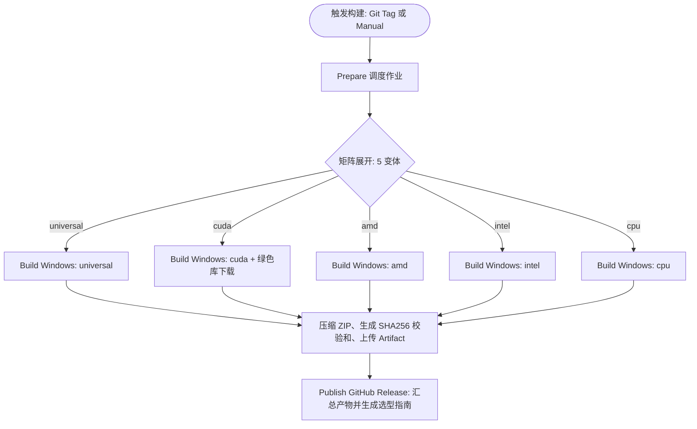

# ReferenceRAG 桌面端与 Docker CI/CD 流水线优化与全矩阵发布对齐规范

- **文档状态**：已归档（发布流水线与交付矩阵官方技术标准）
- **更新时间**：2026-10-20
- **归档位置**：`docs/desktop-and-docker-ci-cd-pipeline-optimization-and-release-alignment.md`
- **关联流水线**：
  - `.github/workflows/desktop-release.yml`（Windows 桌面端安装包）
  - `.github/workflows/docker-build.yml`（Linux 容器镜像）
- **关联脚本与配置**：
  - `support/tools/scripts/build-desktop.bat`
  - `support/tools/scripts/download-cuda-minimal.ps1`
  - `support/deploy/docker/compose.yml`
  - `support/deploy/docker/Dockerfile*`
  - `Infrastructure/ReferenceRAG.Infrastructure/ReferenceRAG.Infrastructure.csproj`

---

## 目录
- [一、 架构总览与发布对齐哲学](#一-架构总览与发布对齐哲学)
- [二、 双轨发布全矩阵对齐速查表](#二-双轨发布全矩阵对齐速查表)
- [三、 桌面端 GitHub Actions 流水线优化 (`desktop-release.yml`)](#三-桌面端-github-actions-流水线优化-desktop-releaseyml)
  - [3.1 矩阵调度与触发机制](#31-矩阵调度与触发机制)
  - [3.2 绿色微型 CUDA 12 库按需内嵌机制](#32-绿色微型-cuda-12-库按需内嵌机制)
  - [3.3 产物打包、便利别名与 SHA256 校验和](#33-产物打包便利别名与-sha256-校验和)
  - [3.4 动态 Release 正文与硬件选型指引渲染](#34-动态-release-正文与硬件选型指引渲染)
- [四、 Docker 容器 GitHub Actions 流水线优化 (`docker-build.yml`)](#四-docker-容器-github-actions-流水线优化-docker-buildyml)
  - [4.1 镜像变体与别名映射体系](#41-镜像变体与别名映射体系)
  - [4.2 容器多阶段构建与 GHA 缓存加速](#42-容器多阶段构建与-gha-缓存加速)
  - [4.3 Linux Vulkan 与芯片专属驱动注入](#43-linux-vulkan-与芯片专属驱动注入)
- [五、 本地与 CI 构建指令对照表](#五-本地与-ci-构建指令对照表)
- [六、 自动化发布触发标准工作流](#六-自动化发布触发标准工作流)

---

## 一、 架构总览与发布对齐哲学

ReferenceRAG 是一款面向混合检索（Hybrid RAG）的高性能应用，同时面向 **Windows 桌面终端个人用户** 与 **Linux 服务端/数据中心容器化部署**。

在异构算力环境（NVIDIA / AMD / Intel / CPU）下，分包发布面临两大天然冲突：
1. **Windows 桌面端碎片化**：普通用户无配环境意愿，需“双击即用”或“自带微型运行库”，绝不能强依赖 3GB+ 的 SDK；
2. **Linux 容器端定制化**：数据中心有专属算力栈（NVIDIA Container Toolkit、AMD ROCm 容器、Intel OpenVINO），需要针对特定镜像提供精简高效的二进制，杜绝体积膨胀与动态库覆盖冲突。

为此，工程建立了 **5 目标硬件矩阵统一发布规范**：
- **桌面端（Windows）** 产出 5 种独立 ZIP 压缩包；
- **容器端（Linux）** 产出 4 种具备多别名标签的 Docker 镜像；
- 两端在技术选型、命名体系、依赖策略上实现 100% 对齐。

---

## 二、 双轨发布全矩阵对齐速查表

| 硬件目标定位 | Windows 桌面发布产物 | Linux Docker 镜像 Tags | ONNX 推理方案 (Embedding / Rerank) | GGUF 推理方案 (LLM 文本生成) | 依赖要求与运行机制 | 推荐场景 |
| :--- | :--- | :--- | :--- | :--- | :--- | :--- |
| **全显卡通用兼容**<br>*(官方默认)* | **`ReferenceRAG-win-x64.zip`**<br>*(别名 `...-universal.zip`)* | `...:latest`<br>`...:cpu` | **Win**: DirectML<br>**Linux**: CPU (AVX2/512) | **Win**: Vulkan.Windows<br>**Linux**: Vulkan.Linux (Mesa) | **完全零额外依赖**<br>有日常显卡图形驱动即可直接点火 | **🌟 强烈推荐**<br>全显卡混杂用户、小白分发、团队协作 |
| **NVIDIA 专属满血**<br>*(RTX 独显 / 全内嵌)* | **`ReferenceRAG-win-x64-cuda.zip`**<br>*(内置绿色微型库 ~700MB)* | `...:cuda`<br>`...:cuda-12.8`<br>`...:nvidia` | CUDA 12 原生 (`ORT.Gpu`) + cuDNN | CUDA 12 原生 (`Backend.Cuda12`) | **Win**: 内嵌便携库开箱即用<br>**Linux**: 依赖 `nvidia-container-toolkit` | **🚀 极致算力（开箱即用）**<br>全新纯净 Windows 电脑满血加速 |
| **NVIDIA 专属轻量**<br>*(无依赖精简版)* | **`ReferenceRAG-win-x64-cuda-slim.zip`**<br>*(无内嵌库 ~70MB)* | `...:cuda`<br>`...:nvidia` | CUDA 12 原生 (`ORT.Gpu`) + cuDNN | CUDA 12 原生 (`Backend.Cuda12`) | **Win**: 自动借用已有 AI 环境/系统 CUDA<br>**Linux**: 依赖系统 CUDA | **⚡ 极客轻量下载**<br>已有 PyTorch/Ollama 环境秒下运行 |
| **AMD 专属优化**<br>*(Radeon / APU)* | **`ReferenceRAG-win-x64-amd.zip`** | `...:rocm`<br>`...:amd` | **Win**: DirectML<br>**Linux**: ROCm / CPU | **Win**: Vulkan.Windows<br>**Linux**: Vulkan (RADV) / HIP | **Win**: 官方驱动即加速，免装 ROCm<br>**Linux**: 支持 Mesa 免配置直连 Vulkan | **🔴 AMD 优化**<br>RX 6000~8000 独显、Ryzen 核显、AMD 云服务器 |
| **Intel 专属优化**<br>*(Arc / 酷睿 Ultra)* | **`ReferenceRAG-win-x64-intel.zip`** | `...:intel`<br>`...:openvino` | **Win**: DirectML<br>**Linux**: OpenVINO 原生 | **Win**: Vulkan.Windows<br>**Linux**: Vulkan (ANV) / SYCL | **Win**: 官方显卡驱动承接<br>**Linux**: Level Zero 与 OpenCL 加速 | **🔵 Intel 优化**<br>Intel Arc 独显、酷睿 Ultra 核显与至强服务器 |
| **纯 CPU 兼容保底**<br>*(低功耗 / 虚拟机)* | **`ReferenceRAG-win-x64-cpu.zip`**<br>*(独立兼容包)* | `...:cpu`<br>`...:latest` | CPU 多线程 (OpenMP) | CPU AVX2 / AVX-512 (`Backend.Cpu`) | **零 GPU 依赖**<br>纯软件运算，防驱动崩溃 | **🛡️ 纯净兼容**<br>云桌面无 GPU、老旧办公电脑、无独显实例 |

---

## 三、 桌面端 GitHub Actions 流水线优化 (`desktop-release.yml`)

### 3.1 矩阵调度与触发机制
流水线支持两种触发方式：
1. **Tag 触发**：推送符合语义化版本格式的 Tag（如 `git tag v1.0.0 && git push origin v1.0.0`），自动启动全矩阵 5 目标并行构建；
2. **手动分流触发（`workflow_dispatch`）**：
   - 可在 GitHub Actions 控制台选择单打某一个变体（`universal`、`cuda`、`amd`、`intel`、`cpu`）或全量打包（`all`）；
   - 可选择是否内嵌 CUDA 微型便携库（`bundle_cuda`，默认 `true`）。



### 3.2 绿色微型 CUDA 12 库按需内嵌机制
当 `matrix.variant == 'cuda'` 且 `bundle_cuda == 'true'` 时：
- 流水线自动执行 `support/tools/scripts/download-cuda-minimal.ps1 -TargetDir runtimes/cuda`；
- 利用清华大学开源镜像源高速下载 ~85MB 核心动态库（`cublas64_12.dll`、`cublasLt64_12.dll`、`cudart64_12.dll`）；
- 具备严格幂等性检查，本地已存在有效完整库时 0.05 秒瞬时返回；
- `build-desktop.bat` 自动将其封装至 `%OUTPUT%\runtimes\cuda`，达成终端用户开箱即用。

### 3.3 产物打包、便利别名与 SHA256 校验和
- 通用版在生成 `ReferenceRAG-win-x64-universal.zip` 时，会自动复制一份命名为 **`ReferenceRAG-win-x64.zip`**，确保普通用户直接点击下载最清晰的包；
- 针对每个生成的 `.zip` 文件，自动调用 `Get-FileHash` 计算其 SHA256 散列并输出至同名 `.sha256` 文件，供企业与开发者进行安全完整性校验。

### 3.4 动态 Release 正文与硬件选型指引渲染
构建完成后，`release` 作业使用 `softprops/action-gh-release@v2` 聚合 5 大产物，并在 Release 页面正文中直接生成详细的硬件选型表格与启动引导说明，杜绝用户下错版本。

---

## 四、 Docker 容器 GitHub Actions 流水线优化 (`docker-build.yml`)

### 4.1 镜像变体与别名映射体系
针对服务端与容器化平台习惯，流水线在 `workflow_dispatch` 中全面对齐别名：
- 输入 `nvidia` $\rightarrow$ 自动映射构建 `cuda` 目标；
- 输入 `amd` $\rightarrow$ 自动映射构建 `rocm` 目标；
- 输入 `all` $\rightarrow$ 并行构建 `cpu`、`cuda`、`rocm`、`intel`。

### 4.2 容器多阶段构建与 GHA 缓存加速
1. **构建阶段（Build）**：
   - 基础镜像：`mcr.microsoft.com/dotnet/sdk:10.0`；
   - 利用 Docker Buildx `--mount=type=cache,id=nuget` 独立缓存 NuGet 包；
   - 编译时通过 `/p:GpuBackend=<variant>` 条件注入原生依赖；
   - 自动执行 `rm -rf runtimes/win* runtimes/osx*` 彻底剔除无用 Windows/macOS 原生文件，大幅瘦身镜像。
2. **运行阶段（Runtime）**：
   - 采用多阶段拷贝，直接从官方 ASP.NET Core 10 镜像抽取 runtime，杜绝下载耗时。
   - 采用非 root 用户（`appuser`）运行，并加入 `video` 与 `render` 用户组以获取 `/dev/dri` 硬件加速权限。

### 4.3 Linux Vulkan 与芯片专属驱动注入
为了解决 Linux 上 AMD/Intel 用户难以配置庞大 ROCm/oneAPI 驱动的问题：
- 在 `Dockerfile`、`Dockerfile.rocm` 与 `Dockerfile.intel` 中均标配安装 `libvulkan1`；
- 赋予 GGUF 引擎直接借助主机映射的 `/dev/dri` 调用 Mesa 开源驱动（RADV/ANV）进行硬件加速的能力；
- 即使容器内未加载专属 GPU 扩展，代码中 `LlamaNativeInitializer` 与 `OnnxExecutionProviderHelper` 会平滑自动回退至 CPU（AVX-512/OpenMP），保证容器绝对不崩溃。

---

## 五、 本地与 CI 构建指令对照表

| 操作需求 | 本地 Windows 脚本指令 | 本地 Docker 启动指令 | CI/CD 对应的配置与目标 |
| :--- | :--- | :--- | :--- |
| **通用默认版** | `build-desktop.bat --universal --batch` | `docker compose up -d` | 桌面: `variant=universal`<br>容器: `variant=cpu` (`:latest`) |
| **NVIDIA 专属版** | `build-desktop.bat --cuda --bundle-cuda --batch` | `docker compose --profile cuda up -d` | 桌面: `variant=cuda`<br>容器: `variant=cuda` (`:cuda`) |
| **AMD 专属版** | `build-desktop.bat --amd --batch` | `docker compose --profile rocm up -d` | 桌面: `variant=amd`<br>容器: `variant=rocm` (`:rocm`) |
| **Intel 专属版** | `build-desktop.bat --intel --batch` | `docker compose --profile intel up -d` | 桌面: `variant=intel`<br>容器: `variant=intel` (`:intel`) |
| **纯 CPU 兼容版** | `build-desktop.bat --cpu --batch` | `docker compose up -d` | 桌面: `variant=cpu`<br>容器: `variant=cpu` (`:cpu`) |

---

## 六、 自动化发布触发标准工作流

### 步骤 1：发布正式版本 Tag（推荐）
当功能迭代或稳定里程碑就绪时，在 `master` 分支打上 Tag 并推送：
```bash
# 1. 确保本地代码已全部提交并同步
git checkout master
git pull origin master

# 2. 创建语义化版本 Tag 并推送到 GitHub
git tag v1.0.0
git push origin v1.0.0
```
- GitHub 将**同时触发** `Desktop Release` 与 `Docker Build & Publish`；
- 桌面端产出 5 种安装包并自动创建附带选型指南的 GitHub Release；
- Docker 端自动构建并推送 4 种硬件镜像（附带版本标签与 latest/别名标签）至 GHCR。

### 步骤 2：手动单变体发布（紧急热修/测试）
1. 进入 GitHub 仓库页面 $\rightarrow$ 点击 **Actions** 标签；
2. 选择 **Desktop Release** 或 **Docker Build & Publish**；
3. 点击 **Run workflow**：
   - 填写目标版本号（例如 `v1.0.1`）；
   - 在下拉菜单中选择需要构建的具体硬件变体（例如 `cuda` 或 `universal`）；
   - 点击确认执行。
