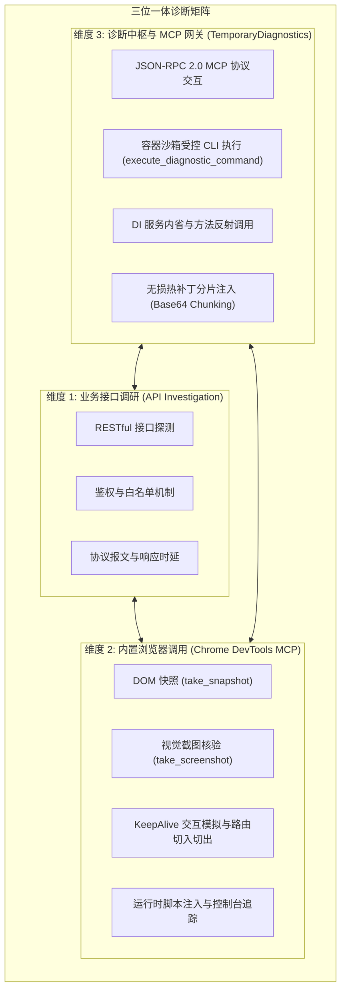
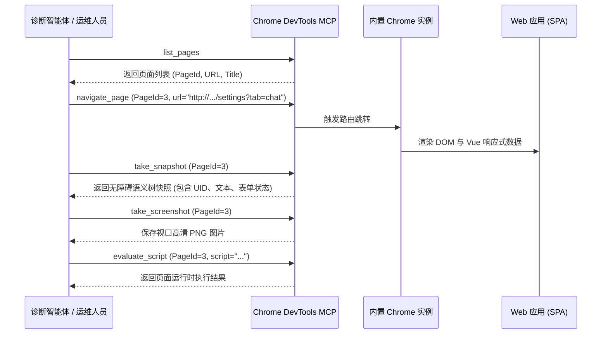

# ReferenceRAG 诊断方案与工具链实战指南：接口调研、内置浏览器调用与诊断中枢调用手册

> **文档定位**：
> 本文是 ReferenceRAG 系统在复杂异构环境（宿主机、Docker 容器、远程服务器、跨平台多端）下的**深度排错与诊断技术实战手册**。
> 涵盖 **“接口调研 (API Investigation)”**、**“内置浏览器调用 (Chrome DevTools MCP)”** 与 **“诊断中枢调用 (TemporaryDiagnostics & JSON-RPC Gateway)”** 三大核心维度，提供规范化的调用流程、代码脚本与实战排错方法。

---

## 1. 三位一体诊断架构全景 (Panoramic Architecture)

在异构软硬件环境（Intel 核显、NVIDIA CUDA、DirectML、Linux 容器）运行大模型与 RAG 应用时，传统的“只看后端控制台输出”往往无法定位复杂问题（如前端 Vue `<keep-alive>` 状态死滞、原生 C++ 动态库 dlopen 符号缺失、Docker 容器健康探针超时等）。

ReferenceRAG 构建了**三位一体诊断矩阵**：



---

## 2. 第一部分：接口调研与协议排查指南 (API Investigation)

### 2.1 鉴权机制与白名单规则
ReferenceRAG 采用统一的 `ApiKeyMiddleware` 进行安全拦截：
- **认证方式**：
  - HTTP Header：`X-API-Key: <your-business-key>`
  - Query String：`?apiKey=<your-business-key>`
- **匿名白名单端点（无需密钥）**：
  - 静态资源：`/`, `/index.html`, `/app/**`, `/core/**`, `/assets/**`
  - 健康检查探针：`/api/system/health`（支持 `GET` 与 Docker `HEALTHCHECK` 使用的 `HEAD`）
  - 硬件就绪状态探针：`/api/Settings/hardware-acceleration/status`
  - CUDA 状态探针：`/api/Settings/cuda-availability`
  - 临时诊断中枢入口：`/__diag` 及其子路径（受专属 `DIAG_KEY` 独立保护）

### 2.2 核心监控与控制接口调研速查

| 端点路径 | HTTP 方法 | 功能描述 | 核心字段/预期响应 |
| :--- | :--- | :--- | :--- |
| `/api/system/health` | `GET` / `HEAD` | 服务健康心跳 | `{"status":"healthy","uptime":"..."}` |
| `/api/system/metrics` | `GET` | 系统资源差分滑动采样（CPU/内存/磁盘） | `cpuUsagePercent`, `memoryUsedBytes`, `memoryTotalBytes`, `diskUsedBytes`, `uptimeSeconds` |
| `/api/Settings` | `GET` / `POST` | 系统全量配置读取与即时热生效保存 | `sources`, `embedding`, `rerank`, `chat`, `chunking` |
| `/api/Settings/hardware-acceleration/status` | `GET` | 硬件能力进程级隔离探测结果 | `activeBackend`, `primaryGpu`, `isReady`, `message` |
| `/api/Models/chat/downloaded` | `GET` | 已下载本地 GGUF 聊天模型列表 | 模型名称、变体列表（`installedVariants`）、格式、物理路径 |
| `/api/Models/scan` | `POST` | 触发底层物理模型目录重新全量扫描 | `{"scannedCount": 2, "message": "..."}` |
| `/api/chat/completions` | `POST` | OpenAI 兼容聊天推理接口 | SSE 流式输出或非流式 JSON 响应 |

### 2.3 接口调研常用工具与脚本模板

#### 选项 A：使用 cURL
```bash
# 1. 探测硬件状态接口
curl -s -X GET "http://10.126.1.61:5123/api/Settings/hardware-acceleration/status" | jq .

# 2. 带有业务 API Key 请求下载模型列表
curl -s -X GET "http://10.126.1.61:5123/api/Models/chat/downloaded" \
     -H "X-API-Key: my-business-api-key@123" | jq .

# 3. 触发配置热重载
curl -s -X POST "http://10.126.1.61:5123/api/Settings" \
     -H "Content-Type: application/json" \
     -H "X-API-Key: my-business-api-key@123" \
     -d '{"chat":{"activeBackend":"LocalGguf"}}'
```

#### 选项 B：使用 Python 脚本进行自动化响应分析
```python
import urllib.request
import json

BASE_URL = "http://10.126.1.61:5123"
API_KEY = "my-business-api-key@123"

def query_api(path, method="GET", body=None):
    url = f"{BASE_URL}{path}"
    headers = {"X-API-Key": API_KEY, "Content-Type": "application/json"}
    data = json.dumps(body).encode('utf-8') if body else None
    req = urllib.request.Request(url, data=data, headers=headers, method=method)
    try:
        with urllib.request.urlopen(req) as resp:
            print(f"[{method}] {path} -> HTTP {resp.status}")
            return json.loads(resp.read().decode('utf-8'))
    except urllib.error.HTTPError as e:
        print(f"[{method}] {path} -> HTTP Error {e.code}: {e.read().decode('utf-8')}")
        return None

# 测试探测
metrics = query_api("/api/system/metrics")
print("CPU:", metrics.get("cpuUsagePercent"), "%")
print("Memory Used:", metrics.get("memoryUsedBytes"), "bytes")
```

---

## 3. 第二部分：内置浏览器自动化调用指南 (Chrome DevTools MCP)

当遇到**界面警告死滞、按钮点击无反应、Keep-Alive 路由组件状态不同步、下拉框未自动选中**等纯前端 UI 状态问题时，内置无头浏览器是最高效的验证和复现手段。

### 3.1 核心操作工具与流程



### 3.2 典型实战指令流

#### 1. 枚举与选择页面
```json
// 调用 list_pages
{}
// 返回:
// 3: 设置 - ReferenceRAG (http://10.126.1.61:5123/settings?tab=chat) [selected]
```

#### 2. 精确导航与 URL 参数初始化
```json
// 调用 navigate_page
{
  "pageId": 3,
  "url": "http://10.126.1.61:5123/settings?tab=chat"
}
```

#### 3. 提取语义可访问树快照 (`take_snapshot`)
> **优势**：比纯 HTML 源码更真实，直接反映屏幕阅读器和用户实际看到的渲染文本与状态（如 `checked`, `value`, `disabled`, `alert`）。
```text
uid=23_37 radio "本地 GGUF" checked
uid=23_41 "模型名称"
uid=23_43 "Qwen3.5 0.8B Instruct (GGUF)"
uid=23_49 "硬件就绪状态"
uid=23_51 "已匹配最佳加速方案: OpenVino (已就绪 (Intel GPU / 酷睿核显 OpenVINO 原生硬件加速))"
```
**诊断断言技巧**：
- 检查是否存在 `尚未检测到已下载的本地 GGUF 对话模型` 字符串；若存在，说明模型未检测到告警被触发；
- 检查下拉框紧随项是否为期望模型名称（如 `Qwen3.5 0.8B Instruct (GGUF)`），排查默认幽灵值。

#### 4. 高保真截图证据留存 (`take_screenshot`)
```json
{
  "pageId": 3,
  "format": "png"
}
// 截图输出至本地工件目录，用于复盘和提交验证
```

#### 5. 跨 Keep-Alive 路由生命周期自动化回归测试
验证用户在页面之间反复横跳时，缓存状态是否正确自愈：
1. `navigate_page` 至 `http://10.126.1.61:5123/models`；
2. 等待 1 秒；
3. `navigate_page` 切回 `http://10.126.1.61:5123/settings?tab=chat`；
4. 执行 `take_snapshot`，断言下拉框依然为有效模型且无警告横条。

---

## 4. 第三部分：诊断中枢与 TemporaryDiagnostics 深度调用 (Diagnostic Engine)

ReferenceRAG 深度集成了 `TemporaryDiagnostics.AspNetCore` 组件，在容器或生产环境下提供零入侵但能力极强的诊断中枢。

### 4.1 安全接入机制
- **路由前缀**：默认 `/__diag`（可通过配置文件或环境变量 `DIAG_ROUTE_PREFIX` 自定义）；
- **访问控制**：采用安全密钥验证，通过请求头 `X-Diag-Key: <key>` 或 Cookie `__diag_token=<token>` 鉴权；
- **环境变量优先级**：
  1. `appsettings.json` 中配置的 `TemporaryDiagnostics.Key`
  2. 环境变量 `DIAG_KEY` / `TEMPORARY_DIAGNOSTICS_KEY`
  3. 最小熵要求 $\ge 8$ 字符。

### 4.2 MCP (Model Context Protocol) JSON-RPC 2.0 网关
诊断中枢内置了基于标准 MCP 规范的 HTTP 网关（`/__diag/mcp`），允许通过标准的 JSON-RPC 2.0 协议直接调用诊断工具。

#### 核心协议报文格式：
```http
POST /__diag/mcp HTTP/1.1
Host: 10.126.1.61:5123
Content-Type: application/json
X-Diag-Key: MyStrongDiagKey@2026@123

{
  "jsonrpc": "2.0",
  "id": 1,
  "method": "tools/call",
  "params": {
    "name": "execute_diagnostic_command",
    "arguments": {
      "command": "uname -a && cat /etc/os-release",
      "timeout_seconds": 30
    }
  }
}
```

### 4.3 核心诊断工具与实战操作

#### 1. 受控容器命令行执行 (`execute_diagnostic_command`)
在无需开启 SSH 或 `docker exec` 端口映射的情况下，直接在容器安全沙箱内执行排查命令：
```python
# 通用诊断调用脚本 (scratch/diag_cmd.py)
import sys, json, urllib.request

def run_cmd(cmd):
    req_body = {
        'jsonrpc': '2.0',
        'id': 1,
        'method': 'tools/call',
        'params': {
            'name': 'execute_diagnostic_command',
            'arguments': {'command': cmd, 'timeout_seconds': 30}
        }
    }
    req = urllib.request.Request(
        'http://10.126.1.61:5123/__diag/mcp',
        data=json.dumps(req_body).encode('utf-8'),
        headers={'Content-Type': 'application/json', 'X-Diag-Key': 'MyStrongDiagKey@2026@123'}
    )
    with urllib.request.urlopen(req) as resp:
        res = json.loads(resp.read().decode('utf-8'))
        for item in res.get('result', {}).get('content', []):
            print(item.get('text', ''))

if __name__ == '__main__':
    run_cmd(' '.join(sys.argv[1:]) if len(sys.argv) > 1 else 'echo ready')
```
**常用排查命令示例**：
```bash
# 检查 GPU 设备与驱动节点
python scratch/diag_cmd.py "ls -la /dev/dri && clinfo -l"

# 检查 OpenVINO / ONNX 原生依赖链接
python scratch/diag_cmd.py "ldd /app/runtimes/linux-x64/native/libonnxruntime_providers_openvino.so"

# 查看容器系统指标与 cgroups 限额
python scratch/diag_cmd.py "cat /sys/fs/cgroup/memory.max 2>/dev/null || cat /sys/fs/cgroup/memory/memory.limit_in_bytes"
```

#### 2. 容器热文件替换（分片 Base64 注入技术）
当需要对容器内的前端 JavaScript、CSS 或配置文件打热补丁且不想重新构建镜像时：
- **痛点**：通过 HTTP JSON-RPC 传输超大单行命令时容易触发子进程命令行长度限制（`Argument list too long`）；
- **标准解法（Chunked Base64 Injection SOP）**：
  1. 在本地读取文件并转为 Base64 字符串；
  2. 以 20KB 为切片，通过 `echo '<chunk>' >> /tmp/temp.b64` 循环追加；
  3. 执行 `base64 -d /tmp/temp.b64 > /target/path` 解码还原；
  4. 清理临时文件并删除预压缩包（`.br` / `.gz`）。
```python
# 分片热补丁脚本核心逻辑 (scratch/upload_settings.py)
import base64

with open("Settings.js", "rb") as f:
    b64 = base64.b64encode(f.read()).decode("ascii")

run_cmd("rm -f /tmp/settings.b64")
CHUNK = 20000
for i in range(0, len(b64), CHUNK):
    run_cmd(f"echo '{b64[i:i+CHUNK]}' >> /tmp/settings.b64")

run_cmd("base64 -d /tmp/settings.b64 > /app/wwwroot/app/views/Settings.js")
run_cmd("rm -f /app/wwwroot/app/views/Settings.js.br /app/wwwroot/app/views/Settings.js.gz /tmp/settings.b64")
```

#### 3. 依赖注入 (DI) 服务状态内省
诊断中枢支持内省 ASP.NET Core `IServiceCollection` 中注册的所有单例与作用域服务：
```http
POST /__diag/mcp HTTP/1.1
...
{
  "jsonrpc": "2.0",
  "id": 2,
  "method": "tools/call",
  "params": {
    "name": "inspect_di_services",
    "arguments": { "filter": "Hardware" }
  }
}
```
**输出**：列出实现类、生命周期（Singleton / Scoped）、程序集版本，迅速确认目标服务是否已被替换或注入。

---

## 5. 第四部分：综合联动实战诊断案例库 (Case Studies)

### 案例 1：Intel N100 核显硬件探测 ExitCode 127 根因排查
1. **现象**：前端设置页面显示“硬件驱动未就绪或原生库不兼容 (ExitCode=127)，已安全降级为 CPU 运算”。
2. **第一步（接口调研）**：
   - 访问 `/api/Settings/hardware-acceleration/status`，确认 `activeBackendReason` 包含 `ExitCode=127`。
3. **第二步（诊断中枢执行 CLI）**：
   - 执行 `python scratch/diag_cmd.py "dotnet /app/ReferenceRAG.WebHost.dll --probe-hardware"`；
   - 捕获底层标准错误输出：`dotnet: symbol lookup error: /app/runtimes/linux-x64/native/libonnxruntime_providers_openvino.so: undefined symbol: Provider_GetHost`。
4. **第三步（根因定位）**：
   - 锁定为 `OnnxExecutionProviderHelper.cs` 在没有初始化主运行时的情况下，静态独立 `dlopen` 了执行提供者插件，触发符号缺失崩溃；
5. **第四步（热修复与验证）**：
   - 修复 C# 代码中的预加载列表，移除提供者插件的独立 dlopen；
   - 在内置浏览器中复核，硬件就绪状态从 `ExitCode=127` 恢复为 `OpenVino (已就绪)`。

### 案例 2：GGUF 对话模型下载后设置页面提示未检测到模型
1. **现象**：下载完模型后，设置页面弹出“尚未检测到已下载的本地 GGUF 对话模型”警告。
2. **第一步（底层核验）**：
   - 通过诊断中枢执行 `ls /app/models/Chat/Qwen3.5-0.8B-Instruct-GGUF/`，文件完整存在。
3. **第二步（接口核验）**：
   - 调用 `GET /api/Models/chat/downloaded`，后端正确返回包含 `Qwen3.5-0.8B-Instruct-GGUF` 的 JSON 数组。
4. **第三步（内置浏览器追踪）**：
   - 使用 Chrome DevTools MCP 执行 `take_snapshot`，发现刷新页面后模型正常，但从导航切换页面回来就再次报错；
   - 明确锁定为 Vue 3 `<keep-alive>` 缺少 `onActivated`，组件实例内存状态死滞。
5. **第四步（热部署与复测）**：
   - 修改 `Settings.js`，补全 `onActivated`、`BroadcastChannel` 监听及 `ensureValidChatModelSelection`；
   - 清理 `.br`/`.gz` 预压缩文件；
   - 通过内置浏览器在 `Models` 与 `Settings` 间多轮往返跳转，警告横条彻底消失，模型自动绑定成功。

---

## 6. 附录：开箱即用诊断脚本库清单

| 脚本文件路径 | 语言 | 核心作用与使用说明 |
| :--- | :--- | :--- |
| [`scratch/diag_cmd.py`](file:///C:/Users/hlr/.gemini/antigravity/brain/86b7125b-0339-48ce-987b-05e292c1e135/scratch/diag_cmd.py) | Python | 基于 JSON-RPC 2.0 协议连接 TemporaryDiagnostics MCP 执行任意容器 Linux 指令 |
| [`scratch/upload_settings.py`](file:///C:/Users/hlr/.gemini/antigravity/brain/86b7125b-0339-48ce-987b-05e292c1e135/scratch/upload_settings.py) | Python | 解决命令行参数超长限制，采用 Base64 分片方式向容器内无损注入并还原前端 JS 文件 |
| [`tests/ReferenceRAG.Tests/ChatModelDetectionAndKeepAliveTests.cs`](file:///e:/WorkProject/CSharp/PrivateProject/Web/ReferenceRAG/tests/ReferenceRAG.Tests/ChatModelDetectionAndKeepAliveTests.cs) | C# | 物理模型检测、前端 KeepAlive 契约与广播同步的自动化防回归质量门禁用例 |
