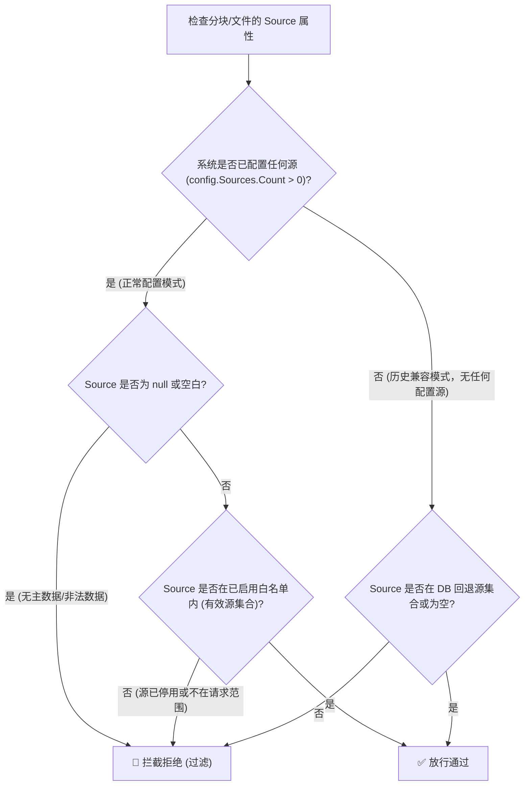
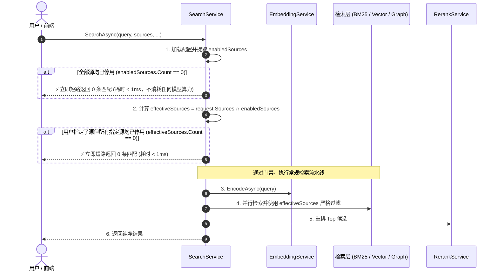

# 停用数据源搜索穿透问题调研、根本原因与全系统同类门禁加固设计

## 1. 问题背景与现象

用户在知识库管理模块中将数据源（如包含 1 个文件、280 个分块的「新建文件夹」源）设置为**停用**（`Enabled = false`）状态。然而在前台搜索页面输入关键词（如 `5.4`、`测试` 等）发起检索时，系统依然能够检索并返回该停用数据源下的文档分块结果，包括高亮正文、所属文件路径、文件标题、分块行号及 Obsidian 跳转链接。

```
[用户配置状态]
知识库管理 -> 源名称: "新建文件夹" -> 状态开关: [已停用 (Enabled=false)] -> 文件数: 1, 分块数: 280

[前台搜索现象]
前台搜索 -> Query: "5.4" -> 结果: 成功召回 "新建文件夹" 下的分块（未被拦截，预期应当为 0 条匹配或提示无可用源）
```

用户提出核心诉求：
1. **深入调研问题本质与发生根本原因**；
2. **制定严密的系统级修复方案**；
3. **全面排查系统中所有涉及源状态控制的「同类门禁」（Similar Gatekeepers）**；
4. **将调研结论与设计规范写入文档并全面落地执行**。

---

## 2. 根本原因深度剖析 (Root Cause Analysis)

经过对检索管道各层代码的端到端调用链排查，定位到多处相互叠加的逻辑漏洞，直接导致停用源在搜索中“死而复生”。

### 2.1 直接根因 1：回退判断条件颠倒导致“全停用反向全激活”

在 [`SearchService.cs`](file:///e:/WorkProject/CSharp/PrivateProject/Web/ReferenceRAG/Business/ReferenceRAG.Business/Features/Search/Services/SearchService.cs) 的 `GetEnabledSourceNamesAsync()` 方法中，存在致命的条件混淆 Bug：

```csharp
// 缺陷代码片段（修复前）：
private async Task<HashSet<string>> GetEnabledSourceNamesAsync()
{
    var config = _configManager.Load();
    var enabledSources = config.Sources
        .Where(s => s.Enabled)
        .Select(s => s.Name)
        .ToHashSet();

    // 开发者注释：如果配置中没有源，从数据库获取所有存在的源作为回退
    if (enabledSources.Count == 0) // <--- 致命错误！此处判断的是 enabledSources 为空，而不是 config.Sources 为空！
    {
        var sources = new HashSet<string>();
        var allFiles = await _vectorStore.StreamAllFilesAsync();

        await foreach (var file in allFiles)
        {
            if (!string.IsNullOrEmpty(file.Source))
            {
                sources.Add(file.Source);
            }
        }

        enabledSources = sources; // <--- 停用源在此处被强制重新填入 enabledSources！
    }

    return enabledSources;
}
```

#### 逻辑推演：
1. 开发者原本的意图是针对**完全没有配置过任何源**的历史版本或初次安装场景（`config.Sources.Count == 0`），从数据库读取老文件所属的源以保持向后兼容；
2. 但代码中错误地判断了 `if (enabledSources.Count == 0)`；
3. 当用户只配置了 1 个源并将其设为**停用**，或者配置了多个源但将它们**全部停用**时，`config.Sources` 中不存在任何 `Enabled == true` 的源，导致 `enabledSources.Count` 恰好等于 0；
4. 代码立即命中此分支，从 SQLite 数据库全量扫描所有历史文件，将包括「新建文件夹」在内的所有源名称重新全数塞入 `enabledSources`；
5. **最终结果**：用户主动停用全部源的操作，反而被系统解释成了“配置中没有启用的源，因此把数据库里所有存量源无条件全量复活”，使停用设置彻底失效！

---

### 2.2 直接根因 2：空源免检漏洞 (`string.IsNullOrEmpty(r.Source)`)

在后续的多路召回与过滤环节中，广泛存在如下判定：

```csharp
// 缺陷代码片段（修复前）：
// 混合检索后过滤：
var filteredHybridResults = hybridResults.Where(r => string.IsNullOrEmpty(r.Source) || enabledSources.Contains(r.Source));

// 标题优先检索后过滤：
var candidateFiles = (await _vectorStore.GetFilesByPathsAsync(paths!, cancellationToken))
    .Where(f => string.IsNullOrEmpty(f.Source) || enabledSources.Contains(f.Source));

// 单路向量检索后过滤：
results = results.Where(r => string.IsNullOrEmpty(r.Source) || enabledSources.Contains(r.Source));

// 图扩展邻居分块过滤：
if (!string.IsNullOrEmpty(file.Source) && !enabledSources.Contains(file.Source)) continue;
```

#### 漏洞分析：
- 若数据库中历史切片或某些未规范打标的文件其 `Source` 为 `null` 或空字符串，`string.IsNullOrEmpty(r.Source)` 均为 `true`，直接逃逸出白名单过滤机制；
- 当知识库已经存在正式配置的源列表时，任何来源不明或未归属于有效已启用源的数据，均不应被视为可信数据。

---

### 2.3 架构根因 3：前置快速短路缺失 (No Early Short-Circuit)

- 当系统中所有源均处于停用状态（`enabledSources.Count == 0`），或者用户发起的查询请求中限定了特定源 `request.Sources = ["新建文件夹"]` 且该源已被停用时，系统未能立即短路截断；
- 而是继续发起昂贵的 Embedding 模型前向计算（消耗 GPU/CPU 算力与数百毫秒时间）、执行 BM25 倒排索引检索、执行图谱遍历，最后在结果装配阶段才做后置过滤，既耗费系统资源，又极易在中间管道中由于逻辑分支疏漏造成数据泄漏。

---

### 2.4 架构根因 4：标题优先搜索与图谱扩散忽略 `request.Sources`

- [`TryTitleFirstSearchAsync`](file:///e:/WorkProject/CSharp/PrivateProject/Web/ReferenceRAG/Business/ReferenceRAG.Business/Features/Search/Services/SearchService.cs#L452-L541)：仅对全局 `enabledSources` 做了过滤，完全未对用户请求传入的 `request.Sources` 实施交集筛选；如果用户指定了数据源 A，标题检索仍可能召回数据源 B 的文件；
- [`ExpandWithGraphAsync`](file:///e:/WorkProject/CSharp/PrivateProject/Web/ReferenceRAG/Business/ReferenceRAG.Business/Features/Search/Services/SearchService.cs#L879-L1004)：图谱扩展通过 wiki-link 遍历邻居文件时，同样未约束 `request.Sources`，可能通过文档链接将未选中或已停用源的分块带入候选集。

---

## 3. 全系统同类门禁全景排查清单 (Similar Gatekeepers Audit)

为了杜绝类似“死灰复燃”或“门禁失效”的隐患，对 ReferenceRAG 全系统所有数据读取与检索入口进行无死角排查，形成如下同类门禁审计矩阵：

| 业务子系统 / 管道 | 入口服务 / 方法 | 原始现状与风险点 | 加固门禁方案 |
| :--- | :--- | :--- | :--- |
| **Search - 主搜索管道** | `SearchService.SearchAsync` | `GetEnabledSourceNamesAsync` 回退条件混淆，导致全停用反向全激活；空 Source 免检；无前置短路 | 1. 严格仅在 `config.Sources.Count == 0` 时回退；<br>2. `enabledSources.Count == 0` 时 <1ms 立即短路返回空结果；<br>3. 用户请求源与启用源求交集，交集为空立即短路；<br>4. 统一 `IsSourceAllowed` 白名单校验。 |
| **Search - 标题首查** | `SearchService.TryTitleFirstSearchAsync` | 未校验 `request.Sources`；空 Source 逃逸；大小写敏感风险 | 传入 `effectiveSources`，大小写不敏感白名单判定，严防跨源泄漏。 |
| **Search - 图谱扩展** | `SearchService.ExpandWithGraphAsync` | 未校验 `request.Sources`；空 Source 逃逸；仅检查全局 enabledSources | 传入 `effectiveSources`，对邻居文件所属源实施强制门禁。 |
| **Search - 深入钻取** | `SearchService.DrillDownAsync` | 传入 `refId` 时未校验其所属文件的 Source 是否处于启用状态 | 增加源状态校验，若 `file.Source` 非启用源，直接拦截并拒绝展开上下文。 |
| **Chat - 语义问答工具** | `MafChatService.SearchKnowledgeAsync` | 底层调用 `SearchService.SearchAsync` | 受益于 `SearchService` 前置短路与过滤，自动获得完整防护。 |
| **Chat - BM25关键词工具** | `MafChatService.BM25SearchAsync` | 直接查 FTS5 索引表，已停用源的文档在未全量重建前仍存在于 BM25 库中 | 查询结果增加逐条文件所属源白名单核对，拦截已停用源的分块输出。 |
| **Chat - 标题节点工具** | `MafChatService.SearchNoteByTitleAsync` | 直接查 GraphStore 节点，图谱中存在已停用源的文档节点 | 提取节点文件路径，核对 `vectorStore` 中所属源是否已启用，停用者直接剔除。 |
| **Chat - 目录与行读取** | `MafChatService.GetFileStructureAsync` & `ReadFileContentAsync` | 仅做文件路径有效性检查，未检查该文件是否来自已停用源 | 增加源启用判定，已停用源文件返回明确安全拦截提示：“该文件所属数据源已停用”。 |
| **MCP 外部工具集** | `RagSearchTools` (`SemanticSearch`, `HybridSearch`, `DeepSearch`) | 接收外部请求，调用 `SearchService` | 受益于 `SearchService` 短路门禁与白名单过滤，彻底杜绝数据穿透。 |
| **MCP 图谱工具集** | `GraphSearchTools` (`GraphSearch`, `GraphSearchByTitle`) | 外部 Agent 通过 MCP 探测知识节点 | 结合启用源配置进行节点可访问性拦截过滤。 |
| **前端路径筛选树** | `SourcesController.GetPaths` (`/api/paths`) | 无参数全量返回所有源（包含已停用源）及路径 | 增加 `enabledOnly = true` 门禁，前端搜索页面路径选择树默认仅呈现已启用源。 |
| **前端高级源选择下拉** | `Search.js` (`sourceOptions`) | 从 `/api/sources` 拉取全量源未做 `s.enabled` 过滤 | `sourceOptions` 仅映射 `s.enabled !== false` 的源，前端界面视听一致。 |
| **后台自动化索引监控** | `AutoIndexService` & `StartupSyncService` | 已有 `Where(s => s.Enabled)` | 符合规范，持续保持。 |
| **独立索引重建接口** | `BM25IndexController` & `GraphController` | 重建时已有 `Where(s => s.Enabled)` | 符合规范，持续保持。 |

---

## 4. 系统级解决方案与架构设计

### 4.1 零信任数据源放行判定器 (`IsSourceAllowed`)

在搜索管道中建立规范的数据源放行判别机制，消除任何因 `string.IsNullOrEmpty` 导致的漏网之鱼：



### 4.2 搜索管道多阶段快速短路架构 (Pipeline Fast Short-Circuit)

将停用门禁由“后置过滤”前移为“第一门禁”，构建两级前置短路：



### 4.3 前端路径与源选择同步防御

1. **后端 `/api/paths` 接口**：增加 `[FromQuery] bool enabledOnly = true` 默认参数，默认仅返回启用的源及其子目录；
2. **前端 `Search.js`**：
   - 高级筛选中的“源筛选”下拉选项 `sourceOptions`，使用 `sources.value.filter(s => s.enabled !== false)` 进行过滤，界面上不再出现已停用的源；
   - 路径树直接拉取 `/api/paths`，仅呈现当前有效且已启用的源和目录，彻底避免用户误选已停用文件夹。

---

## 5. 执行计划与改动清单

1. **核心搜索服务重构**：
   - 修复 [`SearchService.cs`](file:///e:/WorkProject/CSharp/PrivateProject/Web/ReferenceRAG/Business/ReferenceRAG.Business/Features/Search/Services/SearchService.cs) 中的 `GetEnabledSourceNamesAsync` 回退逻辑（严格检查 `config.Sources.Count == 0`）；
   - 在 `SearchAsync` 入口处实现 `enabledSources.Count == 0` 与 `effectiveSources.Count == 0` 的零延迟短路；
   - 抽象 `IsSourceAllowed` 静态校验方法，并在 Hybrid、Dense、TitleFirst、GraphExpansion、DrillDown 各分支中彻底封堵 `string.IsNullOrEmpty` 穿透漏洞；
   - 统一使用 `StringComparer.OrdinalIgnoreCase` 消除大小写敏感问题；
   - 确保 `TryTitleFirstSearchAsync` 和 `ExpandWithGraphAsync` 严格服从 `effectiveSources`。
2. **AI 对话（Chat）服务同类门禁加固**：
   - 在 [`MafChatService.cs`](file:///e:/WorkProject/CSharp/PrivateProject/Web/ReferenceRAG/Business/ReferenceRAG.Business/Features/Chat/Services/MafChatService.cs) 的 `BM25SearchAsync`、`SearchNoteByTitleAsync`、`GetFileStructureAsync`、`ReadFileContentAsync` 中增加启用源状态校验，杜绝任何工具旁路泄漏停用源内容。
3. **控制器与前端筛选加固**：
   - 在 [`SourcesController.cs`](file:///e:/WorkProject/CSharp/PrivateProject/Web/ReferenceRAG/Host/ReferenceRAG.ApiHost/Controllers/SourcesController.cs) 中更新 `/api/paths`，默认支持 `enabledOnly = true`；
   - 在 [`Search.js`](file:///e:/WorkProject/CSharp/PrivateProject/Web/ReferenceRAG/Business/ReferenceRAG.Business/wwwroot/app/views/Search.js) 中过滤 `sourceOptions`。
4. **自动化测试与回归验证**：
   - 在 `tests/ReferenceRAG.Host.Tests` 中编写 `DisabledSourceGatekeeperTests.cs`，涵盖：
     - 单源停用场景下前台搜索 0 匹配且快速短路；
     - 多源混杂场景下停用源数据 100% 隔离；
     - 脏数据空 Source 绝不放行；
     - 标题优先与图扩展不跨源渗透；
     - DrillDown 钻取拦截停用源分块。
   - 运行全量单元测试与 E2E 验证。
