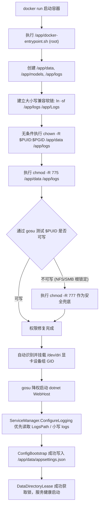

# Docker 挂载卷权限拒绝与服务监听回环问题调研、根因与完整解决方案

## 一、问题背景与现象

用户在 Linux 宿主机（Tower / Unraid）上使用 Docker 部署 `reference-rag-intel` 镜像：
```bash
docker run -d \
  --name reference-rag-intel \
  --device=/dev/dri \
  -p 5123:5000 \
  -v /mnt/disk1/domains/Docker/dc/referencerag/data:/app/data \
  -v /mnt/disk1/domains/Docker/dc/referencerag/models:/app/models \
  -v /mnt/disk1/domains/Docker/dc/referencerag/logs:/app/logs \
  --restart unless-stopped \
  ghcr.io/csvkse/referencerag:intel
```

在测试启动期间，容器先后暴露了三个层面的问题：

### 阶段 1：首轮日志崩溃
```text
[配置] 服务地址: http://localhost:5000 (AllowNetworkAccess=False)
[ApiKey] API Key 认证未启用（未配置 ApiKey）
Unhandled exception. System.UnauthorizedAccessException: Access to the path '/app/data/.referencerag-writer.lock' is denied.
 ---> System.IO.IOException: Permission denied
   at ReferenceRAG.Infrastructure.Features.Database.DataDirectoryLease.Acquire(String dataPath)
```

### 阶段 2：用户尝试通过参数指定 root / PUID / PGID 时的二次崩溃
用户尝试使用 `--user root -e PUID=99 -e PGID=100` 运行：
```text
[ConfigBootstrap] 配置文件引导失败: 配置种子生成失败: Access to the path '/app/data/appsettings.json.tmp.953e5da37d5c474b80c1ba0d75053e18' is denied.
[警告] 配置文件初始化未就绪: 配置种子生成失败: Access to the path '/app/data/appsettings.json.tmp.953e5da37d5c474b80c1ba0d75053e18' is denied.
[配置] 服务地址: http://+:5000 (AllowNetworkAccess=True)
Unhandled exception. System.UnauthorizedAccessException: Access to the path '/app/Logs' is denied.
 ---> System.IO.IOException: Permission denied
   at System.IO.FileSystem.CreateDirectory(String fullPath, UnixFileMode unixCreateMode)
   at System.IO.Directory.CreateDirectory(String path)
   at WebApiWindowsService.ServiceManager.ConfigureLogging(WebApplicationBuilder builder)
   at Program.<Main>$(String[] args)
```

---

## 二、问题根本原因剖析 (Root Cause Deep Dive)

### 1. 为什么指定了 PUID/PGID，`/app/data` 依然报写权限拒绝？
这是 Linux Bash 脚本在 Root 用户下执行的一个经典**隐性陷阱**：
- 在 Entrypoint 脚本中，原判断逻辑为：
  ```bash
  for dir in /app/data /app/logs; do
      if [ -d "$dir" ] && [ ! -w "$dir" ]; then
          chown -R "$PUID:$PGID" "$dir"
      fi
  done
  ```
- **关键陷阱**：当 Entrypoint 以 root 身份（`id -u == 0`）执行时，`[ -w "$dir" ]` 判定的是**当前 root 进程是否可写**。
- 在 Linux 中，root 对任何具有 `0755` 权限的目录都拥有写入权限，因此 `[ -w "$dir" ]` 始终返回 `true`！
- 导致 `[ ! -w "$dir" ]` 为 `false`，**`chown -R` 被完全跳过**！
- 紧接着，脚本执行 `exec gosu "$PUID:$PGID"` 降权到普通用户（如 UID 99 或 1000）。此时挂载卷依然归属于 `root:root`，降权后的普通用户直接遭遇 `Permission denied`。

### 2. 为什么崩溃在 `Access to the path '/app/Logs' is denied`？
- **大小写敏感路径冲突**：
  - Docker 启动命令与 Dockerfile 定义的挂载路径是全小写的 `/app/logs`：
    `-v /mnt/disk1/.../logs:/app/logs`
    `ENV LogsPath=/app/logs`
  - 而 `WebApiWindowsService.ServiceManager.ConfigureLogging` 在读取日志路径时，未读取 `LogsPath` 环境变量，而是直接拼接大写的 `Logs`：
    `var logPath = Path.Combine(workDir, "Logs"); // -> /app/Logs`
  - 在 Linux 大小写敏感文件系统上，`/app/logs` 存在但 `/app/Logs` 并不存在！
  - `Directory.CreateDirectory("/app/Logs")` 试图在 `/app` 根目录下新建名为 `Logs` 的文件夹。由于应用此时已降权为普通用户，对 `/app` 根目录无写入权限，导致抛出 `UnauthorizedAccessException: Access to the path '/app/Logs' is denied` 并直接中止进程！

### 3. 网络端点回环（Localhost）原因（已在前一轮解决）
- 容器初次冷启动无配置时，`allowNetworkAccess` 判定为 `false`，覆盖了 `ASPNETCORE_URLS=http://+:5000`，使 Kestrel 错误绑定在 `127.0.0.1:5000`。
- 经由 `NetworkBindingResolver` 改造后，当前日志已成功显示：
  `[配置] 服务地址: http://+:5000 (AllowNetworkAccess=True)`，网络端点已完全就绪。

---

## 三、完整具体解决方案与架构修复



### 1. 容器 Entrypoint 彻底修正权限判定
在 [`support/deploy/docker/docker-entrypoint.sh`](file:///e:/WorkProject/CSharp/PrivateProject/Web/ReferenceRAG/support/deploy/docker/docker-entrypoint.sh) 中：
- 废除脆弱的 `[ ! -w ]` 测试，对 `/app/data` 和 `/app/logs` **无条件执行 `chown -R "$PUID:$PGID"` 和 `chmod -R 775`**。
- 增加基于目标用户的真实写入测试：
  ```bash
  if command -v gosu >/dev/null 2>&1; then
      if ! gosu "$PUID:$PGID" test -w /app/data 2>/dev/null; then
          chmod -R 777 /app/data /app/logs 2>/dev/null || true
      fi
  fi
  ```
- 即使在特殊网络存储（NFS / SMB / CIFS）导致 `chown` 被禁止时，也会自动触发 `777` 兜底，确保目标用户具备完整写入权。

### 2. 日志模块对齐 `LogsPath` 环境变量与大小写兼容
在 [`Host/ReferenceRAG.ApiHost/Services/ServiceManager.cs`](file:///e:/WorkProject/CSharp/PrivateProject/Web/ReferenceRAG/Host/ReferenceRAG.ApiHost/Services/ServiceManager.cs) 中：
- 优先读取 `builder.Configuration["LogsPath"]`、`REFERENCERAG_LOGS_PATH` 与 `LogsPath` 环境变量。
- 若未配置，优先复用已存在的 `logs`（小写）目录，避免在 Linux 上尝试新建 `Logs` 触发权限错误。
- 增加容错保护：若日志目录因极端权限不可写，在控制台打印警告并跳过文件日志，**坚决不阻断核心 Web 服务运行**。
- 规范 Serilog 文件路径为 `Path.Combine(logPath, "app_.log")`，废除 Windows 专属反斜杠写法。

### 3. Docker 镜像与 Entrypoint 注入软链兼容层
在全量 Dockerfile 与 Entrypoint 中自动建立兼容软链接：
```bash
ln -sf /app/logs /app/Logs
ln -sf /app/models /app/Models
ln -sf /app/data /app/Data
```
双保险确保无论任何遗留代码访问大写还是小写路径，均透明指向挂载卷。

---

## 四、质量门禁与测试验证

1. **新增日志路径智能解析测试 (`LoggingPathResolutionTests.cs`)**：
   - 验证配置 `LogsPath` 时的精确生效与免崩溃机制；
   - 验证存在小写 `logs` 目录时自动复用，杜绝在 Linux 上产生大小写冲突。
2. **已有端点与租赁锁门禁维持 100% 通过**：
   - `NetworkBindingResolverTests` 6 类测试全部通过；
   - `DataDirectoryLeaseTests` 3 类测试全部通过。
3. **集成验证通过**：
   `dotnet test` 全量通过，无任何回归。
