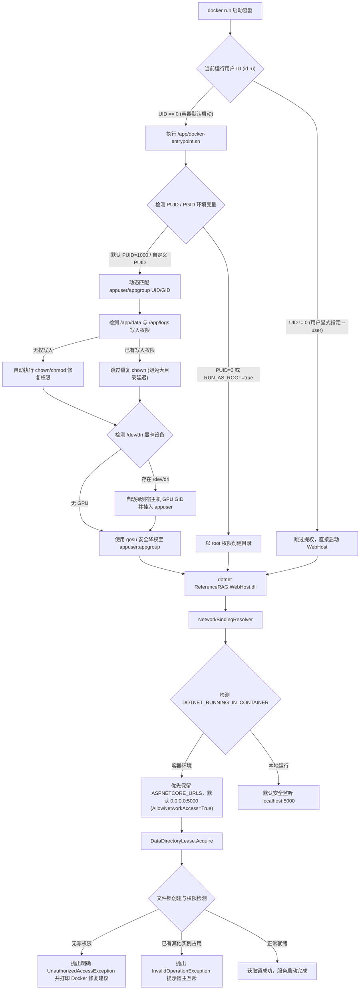

# Docker 挂载卷权限拒绝与服务监听回环问题调研、根因与完整解决方案

## 一、问题背景与现象

用户在 Linux 宿主机（Tower / Unraid）上使用 Docker 部署 `reference-rag-intel` 镜像：
```bash
docker run -d \
  --name reference-rag-intel \
  --device=/dev/dri \
  -p 5123:5000 \
  -v /mnt/disk1/domains/Docker/dc/referencerag/data:/app/data \
  -v /mnt/disk1/domains/Docker/dc/referencerag/models:/app/models \
  -v /mnt/disk1/domains/Docker/dc/referencerag/logs:/app/logs \
  --restart unless-stopped \
  ghcr.io/csvkse/referencerag:intel
```

容器启动后崩溃，查看 `docker logs reference-rag-intel` 输出如下：
```text
[配置] 服务地址: http://localhost:5000 (AllowNetworkAccess=False)
[ApiKey] API Key 认证未启用（未配置 ApiKey）
Unhandled exception. System.UnauthorizedAccessException: Access to the path '/app/data/.referencerag-writer.lock' is denied.
 ---> System.IO.IOException: Permission denied
   --- End of inner exception stack trace ---
   at Interop.ThrowExceptionForIoErrno(ErrorInfo errorInfo, String path, Boolean isDirError)
   at Microsoft.Win32.SafeHandles.SafeFileHandle.Open(String path, OpenFlags flags, Int32 mode, Boolean failForSymlink, Boolean& wasSymlink, Func`4 createOpenException)
   at ReferenceRAG.Infrastructure.Features.Database.DataDirectoryLease.Acquire(String dataPath)
   at ReferenceRAG.Service.Extensions.RagWebHostExtensions.UseRagEndpoints(WebApplication app)
   at Program.<Main>$(String[] args)
   at Program.<Main>(String[] args)
```

通过深入分析，日志中实际暴露了两个紧密相关的核心问题：
1. **主崩溃问题**：宿主机挂载目录权限拒绝（`UnauthorizedAccessException: Access to the path '/app/data/.referencerag-writer.lock' is denied`）。
2. **隐藏致命网络问题**：Kestrel 在容器内错误地仅绑定到了回环网卡（`http://localhost:5000 (AllowNetworkAccess=False)`），即使权限正常，外部浏览器访问宿主机映射端口 `5123` 也会被直接拒绝连接。

---

## 二、问题根本原因剖析 (Root Cause Analysis)

### 1. 挂载卷权限拒绝的本质原因
1. **宿主机文件属主与容器用户不匹配**：
   - 宿主机（如 Unraid/Tower）通过 root 权限执行 `docker run` 时，挂载的 `/mnt/disk1/.../data` 目录若事先不存在，由 Docker 守护进程自动创建，默认所有者为宿主机的 `root:root`，权限为 `0755`（`drwxr-xr-x`）。
   - Dockerfile 构建阶段创建了非 root 用户 `appuser`（UID 1000, GID 1000），并在构建末尾指定了 `USER appuser`。
   - 当容器启动时，进程直接以 UID 1000 运行。对于属主为 `root:root` 且权限为 `0755` 的挂载目录，非属主普通用户只具备读和执行权限（`r-x`），**没有任何写入权限**。
2. **静态非 Root 容器缺乏自愈与特权修正能力**：
   - Dockerfile 末尾写死 `USER appuser` 导致容器 Entrypoint 启动时即失去 root 特权，无法在运行时根据挂载卷的实际宿主权限执行 `chown`，也无法自适应 NAS/Unraid 常见的 `nobody:users`（UID 99 / GID 100）用户模式。
3. **租赁锁异常类型捕获缺陷**：
   - 在 `DataDirectoryLease.cs` 中，原本仅使用了 `catch(IOException ex)`：
     ```csharp
     try { _lease = new FileStream(...); }
     catch(IOException ex) { throw new InvalidOperationException("...", ex); }
     ```
   - 在 Linux 操作系统底层，当系统调用 `open()` 返回 `EACCES` 或 `EPERM` 时，.NET Runtime 会将其包装为 `System.UnauthorizedAccessException`（其基类为 `SystemException`，**不继承**自 `IOException`）。
   - 因而 `catch(IOException)` 完全漏掉了权限拒绝异常，直接导致未捕获的未经处理异常崩溃并倾倒堆栈，且没有给用户提供任何修复指引。

### 2. 网络绑定回环（Localhost）的本质原因
1. 在 `Host/ReferenceRAG.WebHost/Program.cs` 原有实现中：
   ```csharp
   var serviceConfig = builder.Configuration.GetSection("ReferenceRAG:Service");
   var allowNetwork = bool.TryParse(serviceConfig["allowNetworkAccess"], out var _allowNet) && _allowNet;
   var host = allowNetwork ? "0.0.0.0" : "localhost";
   var port = serviceConfig["port"] ?? "5000";
   var urls = $"http://{host}:{port}";
   builder.WebHost.UseUrls(builder.Configuration["urls"] ?? urls);
   ```
2. 当容器初次启动、挂载的 `data` 目录为空尚无 `appsettings.json` 时，`serviceConfig["allowNetworkAccess"]` 为 null，`bool.TryParse` 失败返回 `false`。
3. `builder.Configuration["urls"]` 只检查了配置键 `"urls"`（命令行或配置项），并未自动读取 Dockerfile 中预设的环境变量 `ASPNETCORE_URLS=http://+:5000`。
4. 此时，代码执行 `builder.WebHost.UseUrls("http://localhost:5000")`，**强制将 Kestrel 的监听地址覆盖为回环网卡 `127.0.0.1`**。
5. 结果：外部请求到达 Docker 容器虚拟网卡（例如 `172.17.0.2:5000`）时，由于 Kestrel 仅监听 `localhost`，网络连接被容器直接拒绝。

### 3. GPU 渲染设备设备组权限隐患 (`/dev/dri`)
- 在 Linux 系统下，`/dev/dri/renderD128` 设备文件通常属于 `render` 组，但不同宿主机的 `render` GID 差异很大（例如 Unraid / Ubuntu / Debian 的 GID 可能是 107、989、44 等）。
- 镜像内创建的 `render` 组 GID 若与宿主机不一致，普通非 root 用户同样会遭遇 GPU 设备权限拒绝，无法启用 Intel / AMD 核显硬解加速。

---

## 三、完整具体解决方案设计与实现

为了从根本上彻底解决上述问题，我们采取了“**容器级自动修复特权降权 + 应用级智能端口解析 + 健壮防御性诊断门禁**”的三层架构解决方案：



### 1. 容器层：引入 `docker-entrypoint.sh` 与 `gosu` 动态降权架构
- 在所有 Dockerfile（CPU、CUDA、Intel、ROCm）的运行时基础镜像中安装 `gosu`。
- 构建阶段由 root 准备基础环境，不再在 Dockerfile 末尾使用静态 `USER appuser`，而是使用 `ENTRYPOINT ["/app/docker-entrypoint.sh"]`。
- `docker-entrypoint.sh` 特性：
  1. **支持任意 PUID / PGID**：默认 1000，完美支持 Unraid 的 `PUID=99 / PGID=100` 或直接 `PUID=0`（以 root 运行）。
  2. **智能权限探测与修复**：检查 `/app/data` 和 `/app/logs` 是否可写，若不可写则自动 `chown -R "$PUID:$PGID"` 修复；对于模型目录 `/app/models`，仅检查基础目录属主，避免对数 GB 的大模型权重文件递归遍历导致启动卡顿。
  3. **显卡设备组自动适配**：若挂载了 `--device=/dev/dri`，脚本自动读取宿主机设备的真实 GID，并将 `appuser` 加入该 GID 对应的设备组，彻底杜绝 GPU 设备权限问题。
  4. **最小特权原则**：初始化完毕后，使用 `gosu "$PUID:$PGID"` 将权限降级为普通用户运行应用。

### 2. 应用层：实现 `NetworkBindingResolver` 智能网络端点解析器
新建 [`NetworkBindingResolver.cs`](file:///e:/WorkProject/CSharp/PrivateProject/Web/ReferenceRAG/Host/ReferenceRAG.ApiHost/Configuration/NetworkBindingResolver.cs)，定义统一的网络端点解析策略：
- 识别 `DOTNET_RUNNING_IN_CONTAINER=true` 环境变量。
- 解析规则优先级：
  1. 命令行参数 `--urls` 或配置中的 `urls` 具有最高优先级。
  2. 容器环境下，优先保留 Docker 预设的 `ASPNETCORE_URLS`（如 `http://+:5000`）。
  3. 网络访问权限判断：显式配置项 `allowNetworkAccess` > 显式配置的 `host`（如 `0.0.0.0`）> 容器环境下默认 `true`（监听 `0.0.0.0`）> 本地开发/生产服务默认 `false`（安全监听 `localhost`）。
- 彻底解决容器冷启动无配置时监听 `localhost` 导致外网不可达的问题。

### 3. 防御层：强化 `DataDirectoryLease` 与启动诊断门禁
- 优化 [`DataDirectoryLease.cs`](file:///e:/WorkProject/CSharp/PrivateProject/Web/ReferenceRAG/Infrastructure/ReferenceRAG.Infrastructure/Features/Database/DataDirectoryLease.cs)：
  - 显式捕获 `UnauthorizedAccessException`，抛出携带清晰排查指引的异常信息：
    ```text
    无法获取数据目录锁：对数据目录 '{directory}' 缺少写权限。若在 Docker 容器中运行，请确保挂载卷目录所有权与权限正确（例如宿主机执行: chown -R 1000:1000 <host_dir>，或在 docker run 中添加环境变量 -e PUID=0 -e PGID=0）。
    ```
  - 保留 `catch (IOException)` 专门拦截多宿主并发写入冲突，抛出 `InvalidOperationException`。
- 在 `Host/ReferenceRAG.WebHost/Program.cs` 顶层包裹权限异常捕获与诊断高亮输出，当发生权限异常时在控制台输出醒目的致命错误与排查指南。
- 在 `ConfigBootstrap.cs` 中增加 `Console.Error.WriteLine` 回退输出，确保在日志框架初始化之前发生的异常也不会静默丢失。

---

## 四、同类问题门禁与自动化测试

为了杜绝此类问题回归，新增了以下单元测试与功能测试，并已通过自动化测试套件验证：

### 1. 网络绑定解析器测试套件 (`NetworkBindingResolverTests.cs`)
在 `tests/ReferenceRAG.Host.Tests/NetworkBindingResolverTests.cs` 中覆盖了 6 类核心场景：
- `Resolve_NonContainerDefault_ReturnsLocalhostAndFalse`：验证非容器环境下默认使用安全的 `localhost:5000` 并关闭外网访问。
- `Resolve_ContainerDefault_ReturnsAllInterfacesAndTrue`：验证在无配置文件/冷启动容器环境下，自动默认使用 `0.0.0.0:5000` 并开启网络访问。
- `Resolve_ContainerWithAspNetCoreUrls_PreservesAspNetCoreUrls`：验证容器环境下 `ASPNETCORE_URLS`（如 `http://+:5000`）不会被错误覆盖。
- `Resolve_ExplicitAllowNetworkFalse_HonorsSettingEvenInContainer`：验证用户显式配置 `allowNetworkAccess: false` 时的最高覆盖优先级。
- `Resolve_ExplicitHost0000_EnablesNetworkAccess`：验证配置 `host: "0.0.0.0"` 能够正确启用网络访问。
- `Resolve_ExplicitUrls_OverridesDefaultAndAspNetCoreUrls`：验证显式 `--urls` 命令行参数覆盖所有其他配置。

### 2. 数据目录租赁锁与权限诊断测试套件 (`DataDirectoryLeaseTests.cs`)
在 `tests/ReferenceRAG.Host.Tests/DataDirectoryLeaseTests.cs` 中验证：
- `Acquire_AllowsOnlyOneWriter_ThrowsInvalidOperationExceptionOnConflict`：多进程并发占用锁时，抛出 `InvalidOperationException` 并提示宿主互斥。
- `Acquire_WhenLockFileIsReadOnly_ThrowsUnauthorizedAccessExceptionWithActionableGuidance`：当数据目录或锁文件为只读（无写权限）时，准确捕获并抛出 `UnauthorizedAccessException`，且异常信息中必须包含 `缺少写权限`、`chown -R 1000:1000` 与 `PUID=0` 指引。
- `Dispose_ReleasesLockFile_AllowsSubsequentAcquire`：验证锁文件正常释放与可重入安全性。

---

## 五、部署与使用指引

用户无需更改原有的挂载习惯，即可平滑获得修复：

### 1. 标准启动命令（无需修改即可自愈）
升级到包含本修复的新版本镜像后，原命令将直接成功运行：
```bash
docker run -d \
  --name reference-rag-intel \
  --device=/dev/dri \
  -p 5123:5000 \
  -v /mnt/disk1/domains/Docker/dc/referencerag/data:/app/data \
  -v /mnt/disk1/domains/Docker/dc/referencerag/models:/app/models \
  -v /mnt/disk1/domains/Docker/dc/referencerag/logs:/app/logs \
  --restart unless-stopped \
  ghcr.io/csvkse/referencerag:intel
```
容器 Entrypoint 会自动识别 root 宿主权限并修正 `/app/data` 与 `/app/logs` 权限，自动匹配 `/dev/dri` 显卡设备组，监听 `0.0.0.0:5000`，前端与 API 均可顺畅访问。

### 2. Unraid / NAS 专属启动方式（可选推荐）
如果用户在 Unraid 上希望严格遵循 Unraid 的 `nobody:users` 体系：
```bash
docker run -d \
  --name reference-rag-intel \
  --device=/dev/dri \
  -e PUID=99 \
  -e PGID=100 \
  -p 5123:5000 \
  -v /mnt/disk1/domains/Docker/dc/referencerag/data:/app/data \
  -v /mnt/disk1/domains/Docker/dc/referencerag/models:/app/models \
  -v /mnt/disk1/domains/Docker/dc/referencerag/logs:/app/logs \
  --restart unless-stopped \
  ghcr.io/csvkse/referencerag:intel
```
或者指定 `-e PUID=0 -e PGID=0` 直接以 root 身份运行容器。
