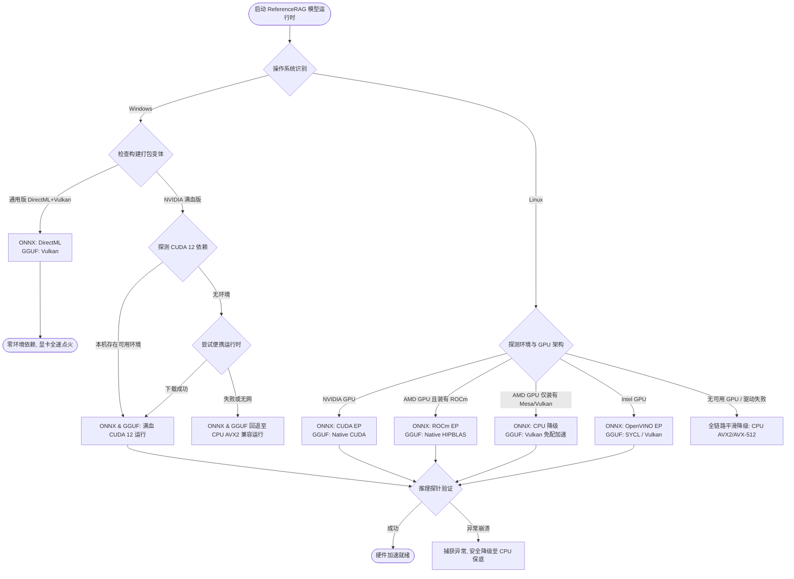

# Windows & Linux 双平台双引擎（ONNX & GGUF）混合部署架构与平滑降级设计规范

- **文档状态**：已归档（核心架构决策 ADR）
- **更新时间**：2026-10-20
- **归档位置**：`docs/dual-os-cross-engine-hybrid-deployment-architecture.md`
- **关联组件**：
  - `Infrastructure/ReferenceRAG.Infrastructure/Features/HardwareAcceleration`
  - `support/tools/scripts/build-desktop.bat`
  - `docs/onnx-and-gguf-cross-platform-runtimes-and-driver-dependencies.md`
  - `docs/desktop-build-variants-and-gpu-dependency-guide.md`

---

## 目录
- [一、 架构总览与核心设计哲学](#一-架构总览与核心设计哲学)
- [二、 Windows 端架构设计：双兼容保底与 NV 满血版](#二-windows-端架构设计双兼容保底与-nv-满血版)
  - [2.1 变体一：通用兼容版（DirectML + Vulkan）](#21-变体一通用兼容版directml--vulkan)
  - [2.2 变体二：NVIDIA 专属满血版（CUDA 12 + 智能探针 + 降级）](#22-变体二nvidia-专属满血版cuda-12--智能探针--降级)
  - [2.3 C# / .NET 动态链接库冲突与多构建变体隔离机制](#23-c--net-动态链接库冲突与多构建变体隔离机制)
- [三、 Linux 端架构设计：全原生生态与降级保障](#三-linux-端架构设计全原生生态与降级保障)
  - [3.1 ONNX 侧：全原生 EP 与 CPU 兼容降级](#31-onnx-侧全原生-ep-与-cpu-兼容降级)
  - [3.2 GGUF 侧：全原生计算栈与 Vulkan 免配救生圈](#32-gguf-侧全原生计算栈与-vulkan-免配救生圈)
- [四、 全系统自适应仲裁与优雅降级决策流（Mermaid）](#四-全系统自适应仲裁与优雅降级决策流mermaid)
- [五、 双平台部署形态与产物分发矩阵](#五-双平台部署形态与产物分发矩阵)
- [六、 演进路线：从双引擎共存向 GGUF 全栈归一](#六-演进路线从双引擎共存向-gguf-全栈归一)

---

## 一、 架构总览与核心设计哲学

针对跨操作系统（Windows / Linux）与跨硬件厂商（NVIDIA / AMD / Intel）的异构算力环境，ReferenceRAG 确立以下混合推理部署架构：

* **Windows 桌面端**：
  - **核心痛点**：普通用户电脑环境碎片化严重，绝大多数用户缺乏配环境（CUDA/Conda/Python）的意愿与能力。
  - **解法**：主推 **【通用兼容版】（ONNX DirectML + GGUF Vulkan）** 达成驱动即用、零外部依赖；同时提供 **【NVIDIA 专属满血版】（CUDA 12 + 便携运行时 + 兼容降级）** 满足专业用户对 Tensor Core 极限算力的追求。
* **Linux 服务端 / 工作站**：
  - **核心痛点**：没有 Windows DirectX 12 统一底座（DirectML 彻底失效）；但具备完善的容器化（Docker/K8s）调度能力与强大的数据中心原生算力生态。
  - **解法**：ONNX 实施 **【全原生容器化 + CPU 保底降级】**；GGUF 实施 **【全原生编译 + Vulkan 免 ROCm 救生圈】**。

---

## 二、 Windows 端架构设计：双兼容保底与 NV 满血版

### 2.1 变体一：通用兼容版（DirectML + Vulkan）

- **技术栈**：`Microsoft.ML.OnnxRuntime.DirectML` + `LLamaSharp.Backend.Vulkan.Windows`。
- **定位**：**默认构建选项，官方推荐交付标准**。
- **执行逻辑**：
  - 向量嵌入与重排（ONNX）：调用系统 D3D12 图形计算接口，由显卡驱动承接；
  - 大语言模型生成（GGUF）：调用 `ggml-vulkan.dll`，通过系统 `vulkan-1.dll` 驱动层调用着色器矩阵加速。
- **工程收益**：
  - **真正零额外环境**：全系列覆盖 AMD Radeon/核显、Intel Arc/核显、NVIDIA 显卡、高通骁龙；用户只要装了显卡日常驱动，双击即全硬件加速。

### 2.2 变体二：NVIDIA 专属满血版（CUDA 12 + 智能探针 + 降级）

- **技术栈**：`Microsoft.ML.OnnxRuntime.Gpu` + `LLamaSharp.Backend.Cuda12.Windows`。
- **定位**：针对 GeForce RTX 30/40/50 系列游戏本、台式机与深度学习开发机的极致性能版本。
- **自适应降级防护网**：
  1. **层级 1（本机探针）**：通过 `CudaEnvironmentScanner` 自动扫描本机是否装有 PyTorch、Ollama、ComfyUI、SD-WebUI 等现有 AI 环境，动态借用 `cublasLt64_12.dll`；
  2. **层级 2（按需微型包）**：若纯净系统无环境，触发 `PortableCudaManager` 从国内镜像拉取 ~85MB 极简核心运行库，杜绝 3GB+ 臃肿安装；
  3. **层级 3（安全兜底）**：若拉取失败或无网络，自动平滑退回到 CPU（AVX2/AVX-512）运行，确保系统不崩溃。

### 2.3 C# / .NET 动态链接库冲突与多构建变体隔离机制

在 .NET 依赖管理中，**无法将 ONNX CUDA 与 ONNX DirectML 打包进同一个运行时目录**：
- NuGet 官方的 `Microsoft.ML.OnnxRuntime.Gpu` 和 `Microsoft.ML.OnnxRuntime.DirectML` 均导出了同名的核心文件（如 `onnxruntime.dll`、`onnxruntime_providers_shared.dll`），放在同一目录会引发 DLL 覆盖冲突。
- **工程最佳实践**：采用 **编译期构建变体隔离（Build Variants）**：
  在 `ReferenceRAG.Infrastructure.csproj` 中通过 MSBuild 条件属性 `$(GpuBackend)` 进行包隔离：
  ```xml
  <!-- 通用版 (默认) -->
  <ItemGroup Condition="'$(GpuBackend)' == '' or '$(GpuBackend)' == 'universal'">
    <PackageReference Include="Microsoft.ML.OnnxRuntime.DirectML" />
    <PackageReference Include="LLamaSharp.Backend.Vulkan.Windows" />
  </ItemGroup>

  <!-- NVIDIA 专属满血版 -->
  <ItemGroup Condition="'$(GpuBackend)' == 'nvidia' or '$(GpuBackend)' == 'cuda'">
    <PackageReference Include="Microsoft.ML.OnnxRuntime.Gpu" />
    <PackageReference Include="LLamaSharp.Backend.Cuda12.Windows" />
  </ItemGroup>
  ```
- 配合 `support/tools/scripts/build-desktop.bat` 脚本，在发布时一键产出独立的通用包与 NV 满血包。

---

## 三、 Linux 端架构设计：全原生生态与降级保障

### 3.1 ONNX 侧：全原生 EP 与 CPU 兼容降级

在原生 Linux 物理机或 Docker 容器中，由于缺乏 DirectX 12 内核支撑，DirectML 完全不可用。必须转向各芯片厂商的原生计算栈：

1. **NVIDIA 容器实例**：部署 `Microsoft.ML.OnnxRuntime.Gpu`，底层基于 NVIDIA Container Toolkit（CUDA 12 + cuDNN 9）；
2. **AMD 容器实例**：部署 `Microsoft.ML.OnnxRuntime.ROCm`，基于官方 ROCm 镜像，调用 MIGraphX 与 rocBLAS；
3. **Intel 实例**：部署 `Microsoft.ML.OnnxRuntime.OpenVINO`，调度 Intel 数据中心 GPU 或至强 CPU 矩阵加速；
4. **兼容降级（Fallback）**：当服务器无独立 GPU 或驱动加载失败时，ONNX Runtime 会自动降级至 **CPU Execution Provider**，结合 OpenMP 多线程与 **AVX-512 / AMX** 指令集运行。

### 3.2 GGUF 侧：全原生计算栈与 Vulkan 免配救生圈

Linux 下的 `llama.cpp` 具有更强的原生灵活性：

1. **顶级算力通道（Native Runtimes）**：
   - NVIDIA: `ggml-cuda.so`；
   - AMD: `ggml-hip.so`（Linux 下 ROCm 生态成熟，算力对标 CUDA）；
   - Intel: `ggml-sycl.so`（结合 oneAPI DPC++ 释放 Arc / Data Center Max 算力）。
2. **轻量免配救生圈（Vulkan 通用通道）**：
   - **痛点**：Linux 桌面开发机（如搭载 AMD Radeon 独显的 Ubuntu 个人机）用户通常极难成功安装数 GB 且极度挑内核版本的 ROCm 完整软件栈。
   - **解法**：保留并编译 `ggml-vulkan.so`。在 Linux 下，开源图形驱动 **Mesa** 标配了极其成熟的高性能 Vulkan 驱动（RADV / ANV）。
   - **效果**：用户**无需安装任何 ROCm 或 oneAPI**，只需安装系统轻量库 `libvulkan1`，GGUF 即可在 AMD / Intel 显卡上以硬件全速推理。

---

## 四、 全系统自适应仲裁与优雅降级决策流（Mermaid）



---

## 五、 双平台部署形态与产物分发矩阵

| 部署形态 | 目标受众与场景 | ONNX 推理方案 | GGUF 推理方案 | 终端前置环境依赖 |
| :--- | :--- | :--- | :--- | :--- |
| **Win 桌面通用版**<br>*(默认分发)* | 个人分发、企业小白、全显卡混杂用户 | DirectML | Vulkan | 仅需常规显卡图形驱动 |
| **Win 桌面 NV 版**<br>*(极客/专业)* | RTX 独显用户、高性能检索工作站 | CUDA 12 (带便携兜底) | CUDA 12 | CUDA 12 或便携包 (~85MB) |
| **Linux 容器 (NVIDIA)** | 云上 GPU 实例、NVIDIA Docker | CUDA / TensorRT | CUDA Native | NVIDIA Container Toolkit |
| **Linux 容器 (AMD)** | AMD Instinct 云服务器、ROCm 容器 | ROCm / MIGraphX | HIPBLAS Native | ROCm 软件栈 |
| **Linux 桌面 / 个人机** | 开发者个人 Linux 机器 (AMD/Intel) | CPU (AVX2/AVX-512) | **Vulkan (Mesa)** | 系统 `libvulkan1` |
| **Linux 纯 CPU 实例** | 无 GPU 轻量云服务器、低成本节点 | CPU (OpenMP) | CPU (AVX-512) | 零依赖（仅需系统 glibc） |

---

## 六、 演进路线：从双引擎共存向 GGUF 全栈归一

虽然当前采用“ONNX + GGUF”双引擎架构能够很好地支持现有的 Encoder / Cross-Encoder 模型，但长期的终极演进路线是 **全面向 GGUF 格式收敛**：

1. **格式收敛**：
   - 将 BGE / Qwen 等 Embedding 与 Reranker 模型全面替换为成熟的 GGUF 变体（如 `Q4_K_M`、`Q8_0`、`FP16`）。
2. **彻底消灭 ONNX 依赖包冲突**：
   - 移除 `Microsoft.ML.OnnxRuntime.Gpu` 与 `Microsoft.ML.OnnxRuntime.DirectML`；
   - 彻底摆脱 `cublasLt64_12.dll` 与 `cudnn` 等百兆外部动态库。
3. **单安装包实现全平台自适应**：
   - `LLamaSharp` 原生具备单包挂载多后端的架构优势；
   - 最终只需在单个安装包内内置 `ggml-cuda`、`ggml-vulkan` 与 `ggml-cpu`，即可在运行时动态自适应切换，达成 **“单二进制、全平台、全显卡、零外部 SDK”** 的终极工业级体验。
