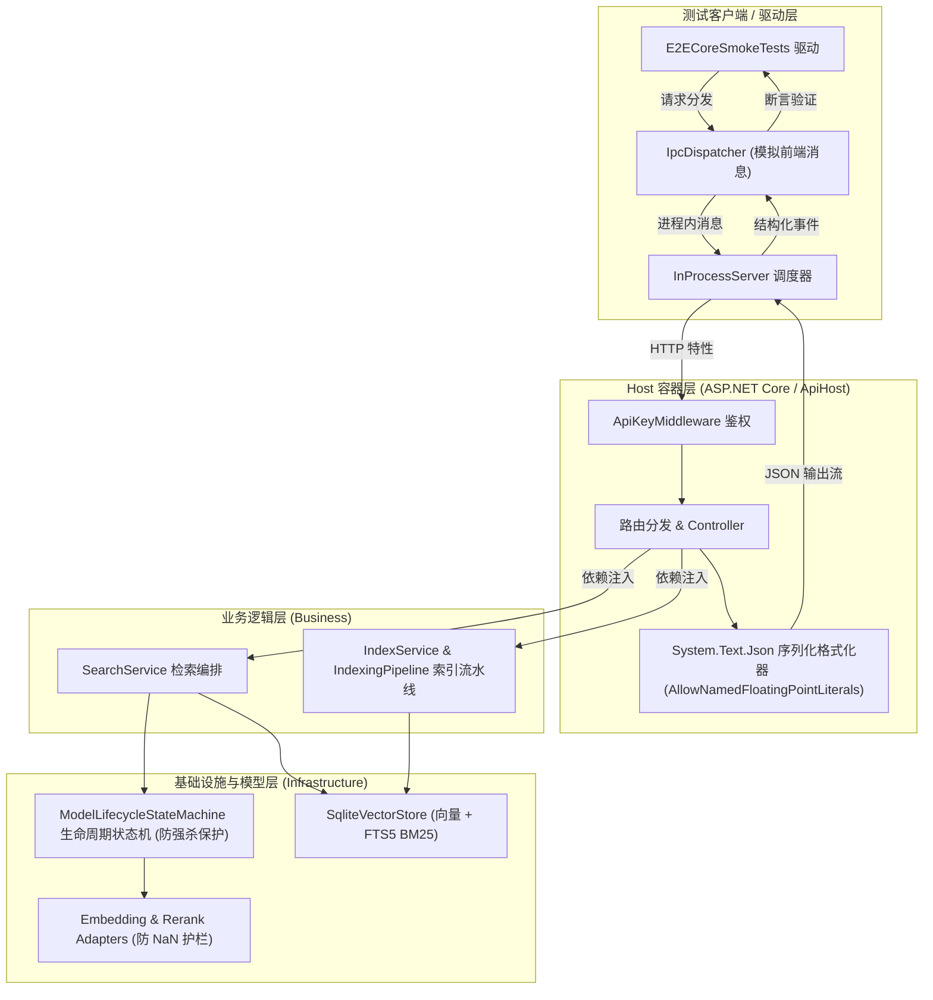

# 端对端核心冒烟测试与回归防护体系方案

> 日期：2026-10-18  
> 状态：设计完成，已通过可行性调研并进入实施  
> 关联系统：检索系统 (`SearchService`)、模型状态机 (`ModelLifecycleStateMachine`)、进程内通信 (`InProcessServer` / `IpcDispatcher`)、控制器层 (`AIQueryController` / `SettingsController` / `SourcesController`)、构建流水线 (`build-desktop.bat`)

---

## 1. 背景与目标

### 1.1 问题背景与痛点
在此前的系统运行中，出现过以下几类严重回归缺陷：
1. **跨层数据不兼容**：重排层因为模型未包含 Rank 分类头产生 `NaN`，单测虽测试了各自独立的类，但直到集成到 `SearchService` -> `AIQueryController` -> `System.Text.Json` -> `IpcDispatcher` 时才抛出 JSON 序列化异常，导致前端全部瘫痪显示“没有找到匹配的结果”；
2. **生命周期并发竞争（卡退）**：30 秒滑动过期卸载在长耗时推理进行中强行触发 `Dispose()`，底层 native 指针被释放导致操作系统级 `0xC0000005 ACCESS_VIOLATION` 进程闪退，该问题只有在包含定时器、并发租约和真实推理的全链路中才会暴露；
3. **前端状态伪装**：前端 `catch` 吞异常将网络/服务错误当成“没有找到匹配的结果”。

上述问题表明：**纯粹针对独立类的单元测试无法完全杜绝端到端集成层面的回归缺陷**。

### 1.2 建设目标
建立一套**轻量、高效、覆盖完整业务闭环的端对端核心冒烟测试（E2E Core Smoke Tests）**：
1. **完整全链路覆盖**：贯穿 `IPC/HTTP 请求 -> 授权与参数绑定 -> 控制器 -> 检索业务逻辑 -> 向量/BM25 存储 -> 模型适配器/状态机 -> JSON 序列化 -> IPC 响应` 全生命周期；
2. **高频核心场景防护**：
   - 多模式检索（快速、平衡重排、深度图扩展）；
   - 数据防 NaN / Inf 护栏与 JSON 序列化合规性；
   - 深入查询（Drill-down）片段扩展；
   - 数据源挂载与索引自动更新；
   - 高并发推理期间滑动卸载的防崩溃保护（杜绝卡退）；
   - 状态探针与系统配置读写；
3. **极速与零污染**：
   - 运行在内存及进程内隔离的临时 SQLite 数据库中，执行时长严格控制在 **5 ~ 10 秒** 内；
   - 测试完毕自动销毁临时目录，对开发和生产环境零副作用；
4. **开箱即用与质量门禁**：
   - 既可通过 `dotnet test` 自动化运行，也可通过专用的 `smoke-test.bat` 一键运行；
   - 在桌面打包构建 `build-desktop.bat` 中提供 `--smoke` 参数，构建前自动执行冒烟验证。

---

## 2. 核心冒烟测试架构设计

---

## 3. 六大核心冒烟测试场景设计

### 场景 1：检索与两阶段精排端对端冒烟 (`Search_MultiMode_Smoke`)
- **目标**：验证 `Quick`、`HybridRerank`、`Deep` 三种核心检索模式全链路通畅，杜绝 NaN 异常与序列化中断。
- **输入**：向 `/api/ai/query` 发送真实检索请求，包含正常匹配关键词、特殊字符及未匹配词。
- **核心断言**：
  1. HTTP 响应状态码为 `200 OK`；
  2. 响应体可反序列化为 `AIQueryResponse`，且 JSON 文本中**绝对不包含 `"NaN"` 或 `"Infinity"`**；
  3. 所有返回分块的 `Score`、`RerankScore` 以及统计信息中的 `AverageScore` 均为严格合法的有限浮点数（`0.0 <= score <= 1.0`）；
  4. 返回的文档列表按相关度分数降序排列；
  5. 链路耗时 `durationMs > 0`，分阶段追踪统计结构完备。

### 场景 2：深入查询上下文扩展端对端冒烟 (`DrillDown_Smoke`)
- **目标**：验证基于搜索召回片段的上下文展开链路。
- **输入**：提取搜索结果中的 `refId`，调用 `/api/ai/drill-down`。
- **核心断言**：
  1. 状态码 `200 OK`；
  2. `fullContext` 非空且正确合并相邻切片；
  3. `expandedChunks` 包含有效的关联文档切片。

### 场景 3：知识库数据源增删与索引建立冒烟 (`Sources_And_Index_Smoke`)
- **目标**：验证数据源添加、实时切片生成、向量存储与 BM25 索引落库的完整集成链路。
- **步骤**：
  1. 在隔离临时目录写入 2 篇测试 Markdown 文档；
  2. 调用 `ConfigManager` 与 `SourcesController` 挂载测试数据源；
  3. 触发索引管道 `IndexingPipeline.ProcessFileAsync`；
  4. 验证数据库成功生成 chunk 记录与 FTS5 倒排记录；
  5. 执行检索验证文档内容被精准召回；
  6. 卸载数据源，验证级联清理无外键孤立错误。

### 场景 4：Chromium IPC 通道与分发完整性冒烟 (`IpcDispatcher_E2E_Smoke`)
- **目标**：真实模拟桌面端前端与 C# 宿主间的 IPC 报文传输。
- **测试内容**：
  1. 模拟发送标准 JSON 请求报文 `{"id":"req-1","type":"request","method":"POST","path":"/api/ai/query","body":"..."}`；
  2. 验证接收到匹配 `id` 的响应报文 `{ "type": "response", "status": 200, ... }`；
  3. 模拟发送取消报文 `{"id":"req-1","type":"cancel"}`，验证优雅取消与资源释放；
  4. 验证畸形数据、超长数据（>8MB）被安全拦截且不导致宿主奔溃。

### 场景 5：模型生命周期与并发滑动卸载防卡退冒烟 (`Concurrency_Unload_Guard_Smoke`)
- **目标**：彻底验证活跃推理期间滑动卸载不会强行释放底层 native 资源，杜绝卡退。
- **步骤**：
  1. 启动模型前向推理借用（`AcquireLease()`），使 `ActiveLeases = 1`；
  2. 在后台并发触发 `UnloadAsync()`；
  3. **核心断言**：
     - `UnloadAsync()` 等待排空超时后，检测到 `ActiveLeases > 0`，**自动取消卸载并恢复为 `Ready` 状态**；
     - 宿主进程不发生 `AccessViolationException`，句柄未被非法提前释放；
     - 当推理租约归还（`ActiveLeases = 0`）且真正达到空闲超时阈值后，模型平稳卸载为 `Unloaded`。

### 场景 6：系统健康状态与配置探测冒烟 (`System_Status_Smoke`)
- **目标**：验证状态探测端点返回合法指标。
- **端点**：
  - GET `/api/ai/status`：验证 `embeddingModel`、`rerankModel`、`bm25HasIndex`、`vectorHasIndex` 等属性均正确初始化；
  - GET `/api/settings`：验证系统配置读取无异常。

---

## 4. 实施规划与步骤

1. **测试基础设施与环境隔离**：
   - 在 `tests/ReferenceRAG.Host.Tests/` 下构建端对端宿主工厂 `TestHostFixture`，封装 `InProcessServer` 与隔离临时目录生命周期；
2. **编写端对端冒烟测试集**：
   - 创建 `tests/ReferenceRAG.Host.Tests/E2ECoreSmokeTests.cs`，实现上述 6 大核心场景；
3. **构建测试执行入口工具**：
   - 创建根目录快速执行脚本 `smoke-test.bat`；
   - 在桌面端构建脚本 `build-desktop.bat` 中增加 `--smoke` 快速验证门禁开关；
4. **编译、执行与验证**：
   - 运行全部冒烟测试，验证用时在数秒以内，确认无闪退、无假死、无 NaN 异常。

---

## 5. 性能与耗时指标记录与 SLA 门禁体系

为杜绝“测试功能通过但性能严重劣化（如慢检索、假死阻塞、内存暴涨）”的隐性缺陷，冒烟测试全面引入了**细粒度性能耗时追踪器 (`SmokePerformanceTracker`)** 与 **SLA 硬门禁断言**。

### 5.1 SLA 性能指标与门限定义

| 业务场景 | 监控指标 | 测量方式 | SLA 硬门限 | 监控目的与防劣化目标 |
| :--- | :--- | :--- | :--- | :--- |
| **Search: Quick** | `ClientLatency` | 端到端 Wall-clock 耗时 | $\le 300\text{ ms}$ | 保证向量/关键词初筛极速返回 |
| **Search: Quick** | `ServerDuration` | 服务端 `Stats.DurationMs` | $\le 200\text{ ms}$ | 防止 Controller / DI 管道调度堆积 |
| **Search: HybridRerank** | `ClientLatency` | 端到端 Wall-clock 耗时 | $\le 500\text{ ms}$ | 保证混合检索+两阶段精排端到端响应 |
| **Search: HybridRerank** | `RerankDuration` | 重排服务 `RerankDurationMs` | $\le 100\text{ ms}$ | 监控重排模型打分吞吐与算法耗时 |
| **Search: Deep** | `ClientLatency` | 端到端 Wall-clock 耗时 | $\le 500\text{ ms}$ | 保证图扩展深度检索耗时可控 |
| **Search: EmptyUnmatched**| `ClientLatency` | 端到端 Wall-clock 耗时 | $\le 200\text{ ms}$ | 保证未命中/空搜索极速短路熔断 |
| **DrillDown Context** | `ClientLatency` | 端到端 Wall-clock 耗时 | $\le 200\text{ ms}$ | 保证相邻分块聚合并发读库延迟 |
| **Chromium IPC Dispatch**| `RoundTripLatency` | 异步报文发送至回调耗时 | $\le 200\text{ ms}$ | 保证进程内 IPC 调度无假死或线程竞争 |
| **Indexing Pipeline** | `SingleDocIndexing` | Pipeline 全阶段耗时 | $\le 500\text{ ms}$ | 保证单篇 Markdown 切片、向量计算、FTS5 倒排建库高效 |
| **Source Management** | `CascadeCleanup` | 级联物理删除耗时 | $\le 300\text{ ms}$ | 保证级联清理文件、向量及倒排记录无数据库锁死 |
| **Memory Delta** | `MemoryDelta` | 堆内存增量 (`GC.GetTotalAllocatedBytes`) | $\le 150\text{ MB}$ | 防止测试执行期间发生大对象堆内存泄漏 |

### 5.2 自动化性能报告产出

每次运行冒烟测试时，测试夹具会在控制台直观打印格式化 ASCII 性能表格，并在测试结束时自动持久化输出：
1. **纯文本性能报告**：`support/artifacts/smoke-perf-report.txt`
2. **结构化 JSON 报告**：`support/artifacts/smoke-perf-report.json`（便于 CI/CD 流水线做历史基线对比与报警）。

