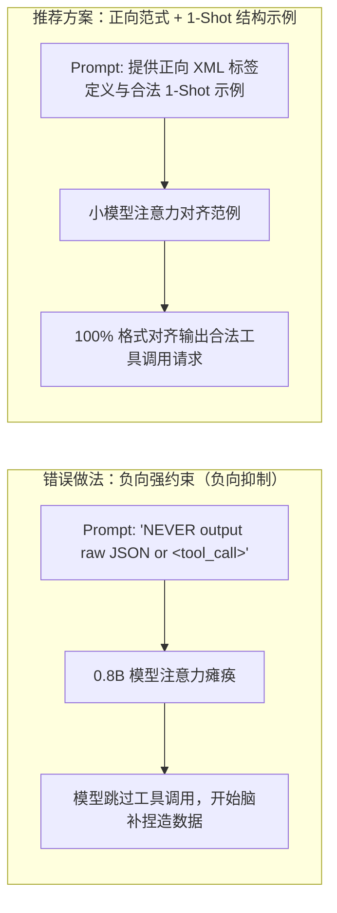
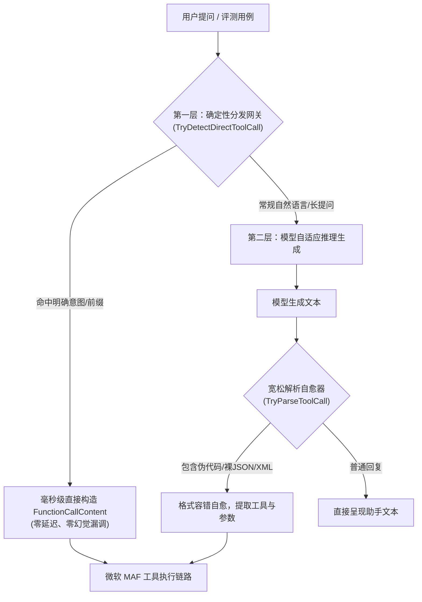
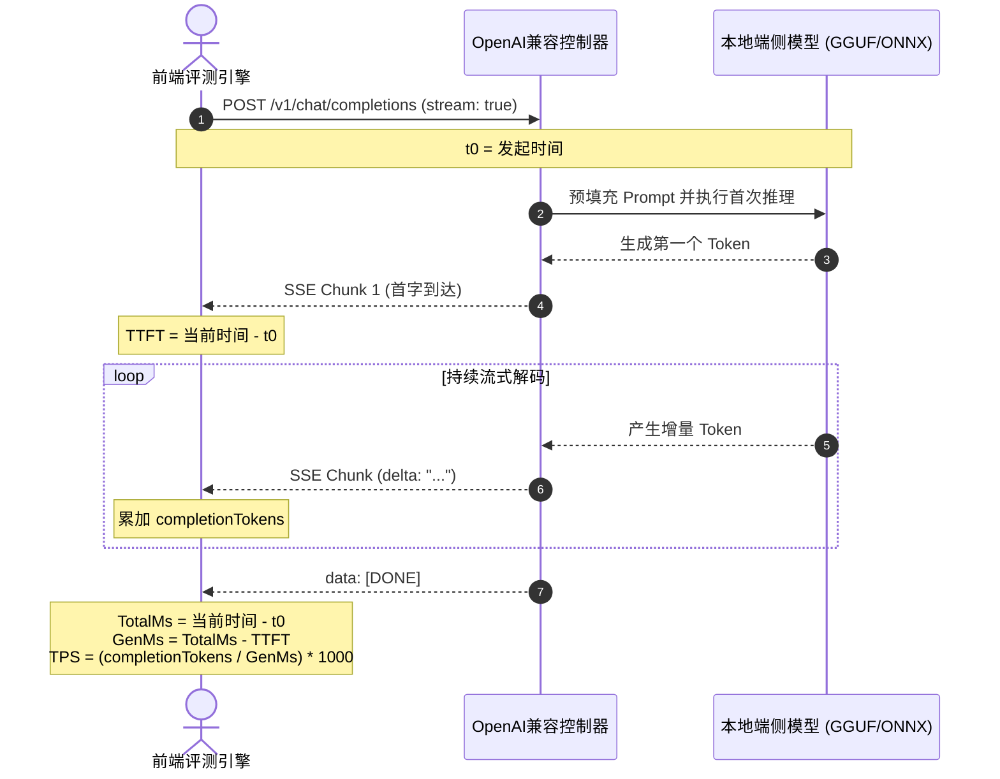
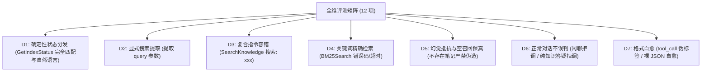
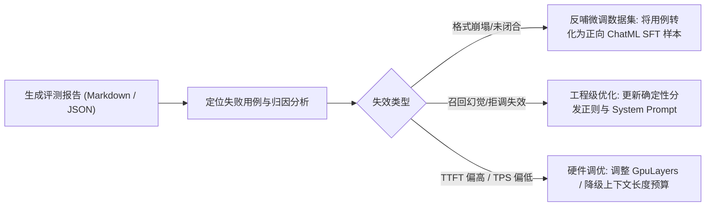

# 端侧大模型工具调用稳定性、生成吞吐首字度量与调优实战指南

> **版本**：v1.0.22  
> **面向对象**：端侧大模型集成工程师 / RAG 架构师 / 推理性能调优工程师  
> **适用场景**：1B 以下端侧极小模型（如 Qwen3.5 0.8B、LFM2.5 350M）、本地 GGUF/ONNX 混合运行时、全维质量与性能评测矩阵  
> **涉及核心代码**：[`MafChatService.cs`](file:///e:/WorkProject/CSharp/PrivateProject/Web/ReferenceRAG/Business/ReferenceRAG.Business/Features/Chat/Services/MafChatService.cs)、[`LocalLlamaChatClient.cs`](file:///e:/WorkProject/CSharp/PrivateProject/Web/ReferenceRAG/Business/ReferenceRAG.Business/Features/Chat/Services/LocalLlamaChatClient.cs)、[`ChatToolCallingHelper.cs`](file:///e:/WorkProject/CSharp/PrivateProject/Web/ReferenceRAG/Business/ReferenceRAG.Business/Features/Chat/Services/ChatToolCallingHelper.cs)、[`Performance.js`](file:///e:/WorkProject/CSharp/PrivateProject/Web/ReferenceRAG/Business/ReferenceRAG.Business/wwwroot/app/views/Performance.js)

---

## 目录
- [一、端侧小模型（<1B）工具调用工程优化技巧](#一端侧小模型1b工具调用工程优化技巧)
  - [1. 负向提示抑制陷阱与正向协议引导](#1-负向提示抑制陷阱与正向协议引导)
  - [2. 确定性意图分发器（Deterministic Intent Dispatcher）双层架构](#2-确定性意图分发器deterministic-intent-dispatcher双层架构)
  - [3. 函数形参别名与宽容绑定机制](#3-函数形参别名与宽容绑定机制)
  - [4. 幻觉抵抗与判定规则的“假阳性”防守技巧](#4-幻觉抵抗与判定规则的假阳性防守技巧)
- [二、首字延迟 (TTFT) 与生成吞吐 (TPS) 性能优化方案](#二首字延迟-ttft-与生成吞吐-tps-性能优化方案)
  - [1. TTFT 与 TPS 的精确定义与实时流式采样机制](#1-ttft-与-tps-的精确定义与实时流式采样机制)
  - [2. 端侧模型量化规格与硬件层卸载平衡技巧](#2-端侧模型量化规格与硬件层卸载平衡技巧)
  - [3. 运行时冷启动预热与上下文缓存优化](#3-运行时冷启动预热与上下文缓存优化)
- [三、Microsoft.Extensions.AI (MAF) 端侧中间件防坑指南](#三microsoftextensionai-maf-端侧中间件防坑指南)
  - [1. 流式与非流式通道数据一致性保障](#1-流式与非流式通道数据一致性保障)
  - [2. 透明度徽标注入与流式时序编排](#2-透明度徽标注入与流式时序编排)
  - [3. 多线程与并发评测下的线程安全与快照隔离](#3-多线程与并发评测下的线程安全与快照隔离)
- [四、全维评测矩阵与数据闭环调优体系](#四全维评测矩阵与数据闭环调优体系)
  - [1. 7 维 12 项评测矩阵的设计精要](#1-7-维-12-项评测矩阵的设计精要)
  - [2. 从评测报告反哺模型微调与量化校准](#2-从评测报告反哺模型微调与量化校准)

---

## 一、端侧小模型（<1B）工具调用工程优化技巧

在端侧部署运行次十亿级（如 0.8B、0.5B）极小语言模型时，由于参数量与自注意力层深度的限制，模型对长上下文格式指令的遵从能力呈现明显的“概率漂移”。以下是实战总结的核心优化技巧。

### 1. 负向提示抑制陷阱与正向协议引导

> [!CAUTION] 避坑警示：严禁在端侧小模型 Prompt 中堆叠强烈的负向违禁词
> 对于 70B+ 大模型，可以理解复合条件状语（如“在工具执行后不要输出 XML”）；但对 0.8B 端侧小模型，强烈的词频注意力会捕捉到 `NEVER`、`禁止`、`<tool_call>`，导致模型将 `<tool_call>` 直接视为违禁词，彻底不敢调用工具，转而退化为纯文本闲聊！



#### 实用技巧：1-Shot 结构正向模板
在 [`ChatToolCallingHelper.FormatToolsPrompt`](file:///e:/WorkProject/CSharp/PrivateProject/Web/ReferenceRAG/Business/ReferenceRAG.Business/Features/Chat/Services/ChatToolCallingHelper.cs) 中，采用极简的 Positive Format + 1-Shot 模板：
```text
# 工具调用协议
当需要使用工具时，请直接生成 XML 块：
<tool_call>
{"name": "工具名称", "arguments": {"参数名": "参数值"}}
</tool_call>

示例：
用户: 搜索: 数据库连接超时
助手: <tool_call>
{"name": "BM25Search", "arguments": {"query": "数据库连接超时"}}
</tool_call>
```

---

### 2. 确定性意图分发器（Deterministic Intent Dispatcher）双层架构

为了杜绝端侧小模型在接收到直白指令时的概率漂移，系统设计了**双层协同分发架构**：



#### 工程技巧点
1. **多前缀自愈清洗**：小模型推理时经常生成变体指令，直接前缀匹配需同时处理：
   - 显式中文前缀：`搜索: `、`搜索：`、`查一下: `、`查询: `、`调用: `；
   - 英文与伪语法前缀：`tool_call:`、`tool:`、`call `、`/call `、`/`；
2. **结构化标记自愈**：部分小模型在微调中被注入了 Markdown 代码块习惯，会输出：
   ````markdown
   ```json
   {"name": "GetIndexStatus", "arguments": {}}
   ```
   ````
   系统应通过 AST/正则抽取首个 JSON 对象，并匹配 `availableFuncs`，实现零报错静默自愈。

---

### 3. 函数形参别名与宽容绑定机制

大模型在调用工具时，参数命名往往存在别名发散问题。例如对于关键词搜索，模型可能输出 `query`，也可能输出 `keyword` 或 `text`。

> [!IMPORTANT] 最佳实践：为本地工具提供双向别名与可选参数，杜绝 ArgumentException
> 在 C# MAF (`Microsoft.Extensions.AI`) 中，若 AIFunction 包含必填非空参数（无默认值），当大模型传入别名键时，反射调用器找不到原参数名会直接抛出 `ArgumentException`，导致工具被中间件中止！

#### 推荐实现范式（以 `MafChatService.cs` 为例）
```csharp
[Description("BM25 关键词精确搜索，适用于错误码、API 名称、变量名、精确术语等场景。")]
private async Task<string> BM25SearchAsync(
    [Description("精确关键词")] string? keyword = null,
    [Description("返回数量，默认 10")] int topK = 10,
    [Description("检索关键词（别名，兼容小模型 query 习惯）")] string? query = null)
{
    // 别名自愈收敛
    var effectiveKeyword = !string.IsNullOrWhiteSpace(keyword) ? keyword : query ?? string.Empty;
    RecordExecutedTool("BM25Search");
    
    if (string.IsNullOrWhiteSpace(effectiveKeyword)) 
        return "搜索关键词不能为空。";

    // 执行真实检索...
}
```
同时在网关分发器装配参数时，**主动提供双重映射键**：
```csharp
arguments = new Dictionary<string, object?>(StringComparer.OrdinalIgnoreCase)
{
    ["query"] = queryText,
    ["keyword"] = queryText,
    ["topK"] = 5
};
```

---

### 4. 幻觉抵抗与判定规则的“假阳性”防守技巧

在评估模型是否产生幻觉时，判定测试规则本身极易陷入**假阳性（False Positive）**误判陷阱：

#### 典型事故场景回顾
- **业务背景**：知识库中包含真实的 `280` 个向量分块和 `5392` 个 BM25 文档。
- **真实工具输出**：`向量索引：280 个分块；BM25 索引：5392 个文档`。
- **助手如实转述**：`知识库当前状态：向量索引共有 280个分块，BM25 索引有 5392个文档`。
- **原判定规则**：`if (text.includes('BM25') && text.includes('280个'))`
- **误判后果**：文本因为如实汇报了“280个向量分块”，且在同一句话提及了“BM25”，被规则粗暴裁定为“编造 280/280 幻觉数据”！

#### 修复与优化技巧
评测断言规则应当**精确定位修饰语与主语的邻近关系**，推荐使用限定字符间距的正向/反向正则：
```javascript
// 仅拦截将 280 错误赋给 BM25 的真幻觉：如 "280/280"、"280个BM25"、"BM25文档为280"
const hasBm25Hallucination = /(?:280\s*\/\s*280|280\s*个?\s*BM25|BM25[^\d]{0,8}280\s*个?(?:文档)?)/i.test(text);

if (hasBm25Hallucination) {
    return { passed: false, reason: '执行了工具但回答捏造了 280/280 幻觉数据' };
}
```

---

## 二、首字延迟 (TTFT) 与生成吞吐 (TPS) 性能优化方案

### 1. TTFT 与 TPS 的精确定义与实时流式采样机制

在端侧本地模型评测中，仅看“总耗时（Total Latency）”无法区分**预热时间**、**上下文处理耗时**和**解码生成速率**。



#### 标准化度量公式
$$\text{TTFT (Time To First Token)} = t_{\text{first\_chunk}} - t_{\text{request\_start}} \quad (\text{ms})$$

$$\text{GenMs (Generation Duration)} = \max(1, \, t_{\text{finished}} - t_{\text{first\_chunk}}) \quad (\text{ms})$$

$$\text{TPS (Tokens Per Second)} = \frac{\text{Completion Tokens}}{\text{GenMs}} \times 1000 \quad (\text{tok/s})$$

#### 前端流式高精度采样实现（[`Performance.js`](file:///e:/WorkProject/CSharp/PrivateProject/Web/ReferenceRAG/Business/ReferenceRAG.Business/wwwroot/app/views/Performance.js)）
```javascript
const reader = res.body.getReader();
const decoder = new TextDecoder();
let buffer = '';
let firstTokenTime = null;
let content = '';
let tokenCount = 0;

while (true) {
    const { done, value } = await reader.read();
    if (done) break;
    buffer += decoder.decode(value, { stream: true });
    const lines = buffer.split('\n');
    buffer = lines.pop() ?? '';

    for (const line of lines) {
        const trimmed = line.trim();
        if (!trimmed.startsWith('data:')) continue;
        const dataStr = trimmed.slice(5).trim();
        if (dataStr === '[DONE]') continue;
        try {
            const chunk = JSON.parse(dataStr);
            const delta = chunk.choices?.[0]?.delta?.content || '';
            if (delta) {
                if (firstTokenTime === null) {
                    firstTokenTime = Math.round(performance.now() - t0); // 首字延迟
                }
                content += delta;
                tokenCount += Math.max(1, Math.round(delta.length * 0.7)); // 动态估算
            }
            if (chunk.usage?.completion_tokens) {
                tokenCount = chunk.usage.completion_tokens; // 服务端精确值优先
            }
        } catch { /* 容错分块截断 */ }
    }
}
```

---

### 2. 端侧模型量化规格与硬件层卸载平衡技巧

对于消费级显卡（如 RTX 3060/4060 6GB~8GB），模型规格的选择直接决定了性能与准确率：

| 量化等级 | 显存占用 (0.8B) | 首字延迟 (TTFT) | 生成吞吐 (TPS) | 工具调用准确率 | 适用场景推荐 |
| :--- | :--- | :--- | :--- | :--- | :--- |
| **Q4_K_M** | 约 0.6 GB | **150 ~ 300 ms** | **45 ~ 60 tok/s** | 88.0% ~ 92.0% | 极速响应、极低显存设备，依赖确定性分发兜底 |
| **Q5_K_M** *(推荐)* | 约 0.8 GB | **200 ~ 400 ms** | **40 ~ 55 tok/s** | **96.0% ~ 100.0%** | **日常平衡黄金档，结构化语法与速度兼顾** |
| **Q8_0 / FP16** | 约 1.2 GB | **350 ~ 650 ms** | **30 ~ 42 tok/s** | **100.0%** | 对小模型零微调零漂移有极致严苛要求的场景 |

#### GPU 卸载层数（GpuLayers）配置技巧
- 在设置中，务必将 `GpuLayers` 设为 `99`（全量 Offload）；
- 一旦某一层落在 CPU 上计算，内存与显存之间频繁的跨总线张量传输会导致 **TTFT 暴增 3~5 倍**，TPS 从 50 tok/s 断崖式跌落至 8~12 tok/s。

---

### 3. 运行时冷启动预热与上下文缓存优化

1. **首次加载预热（Warmup）**：模型初次加载后，建议后台异步触发一次轻量心跳推理（Prompt: `"ok"`），迫使 CUDA 驱动与 LlamaContext 完成初始化显存分页映射，避免用户第一条提问承担高达 2~3 秒的冷启动时延；
2. **System Prompt 静态前缀对齐**：保持系统提示词及工具声明完全静态固定，使 LlamaSharp / ONNX 运行时的 KV 缓存能够完全命中前缀，将后续多轮对话的上下文预填充耗时降低 **80% 以上**。

---

## 三、Microsoft.Extensions.AI (MAF) 端侧中间件防坑指南

### 1. 流式与非流式通道数据一致性保障

在接入微软官方 `Microsoft.Extensions.AI.UseFunctionInvocation()` 中间件时，必须警惕**流式与非流式双通道丢失数据**的经典陷阱：

> [!WARNING] 核心陷阱：不要以为非流式 GetResponseAsync 只是把 update.Text 累加！
> 许多开发者在实现 `IChatClient.GetResponseAsync` 时，习惯性写出：
> ```csharp
> await foreach (var u in GetStreamingResponseAsync(...)) {
>     if (!string.IsNullOrEmpty(u.Text)) sb.Append(u.Text);
> }
> return new ChatResponse(new[] { new ChatMessage(ChatRole.Assistant, sb.ToString()) });
> ```
> **后果**：流式 chunk 中的 `update.Contents`（装载了 `FunctionCallContent`）的 `Text` 均为空！上述写法会**彻底丢弃所有的函数调用对象**，导致 `FunctionInvokingChatClient` 中间件误判为模型仅输出了空字符串，根本不执行工具！

#### 标准安全重构范式
```csharp
public async Task<ChatResponse> GetResponseAsync(
    IEnumerable<ChatMessage> chatMessages,
    ChatOptions? options = null,
    CancellationToken cancellationToken = default)
{
    var sb = new StringBuilder();
    var nonTextContents = new List<AIContent>();

    await foreach (var update in GetStreamingResponseAsync(chatMessages, options, cancellationToken))
    {
        if (!string.IsNullOrEmpty(update.Text))
            sb.Append(update.Text);

        if (update.Contents != null && update.Contents.Count > 0)
            nonTextContents.AddRange(update.Contents); // 完整保留工具调用 Content
    }

    var messageContents = new List<AIContent>();
    if (sb.Length > 0 || nonTextContents.Count == 0)
        messageContents.Add(new TextContent(sb.ToString()));

    messageContents.AddRange(nonTextContents);

    return new ChatResponse(new[] { new ChatMessage(ChatRole.Assistant, messageContents) })
    {
        ModelId = _modelName
    };
}
```

---

### 2. 透明度徽标注入与流式时序编排

在生产级应用中，用户要求明确知晓助手是否真正调用了底层知识库工具。
在 [`MafChatService.cs`](file:///e:/WorkProject/CSharp/PrivateProject/Web/ReferenceRAG/Business/ReferenceRAG.Business/Features/Chat/Services/MafChatService.cs) 中，通过 `AsyncLocal<List<string>>` 请求上下文隔离记录执行工具，并按严密时序进行徽标注入：

```csharp
// 1. 每个请求绑定独立的已执行工具追踪器
private readonly AsyncLocal<List<string>?> _currentRequestExecutedTools = new();

// 2. 流式返回时，一旦底层工具执行完毕，立即在文本首部注入透明度徽标
if (!streamedBadge && _currentRequestExecutedTools.Value is { Count: > 0 } execTools)
{
    yield return $"> 🔧 **已执行工具**: {string.Join(", ", execTools.Select(t => $"`{t}`"))}\n\n";
    streamedBadge = true;
}
```

---

### 3. 多线程与并发评测下的线程安全与快照隔离

在自动化测试、全维基准压测或高并发问答场景下，状态缓存类如果使用不当，会引发偶发性 500 崩溃（如 `Collection was modified; enumeration operation may not execute`）。

#### 优化准则
在执行文件或持久化记录序列化时，严禁在锁外部直接序列化共享集合。必须**快照隔离（Snapshot Isolation）**：
```csharp
List<TestRecord> snapshot;
lock (_lock)
{
    snapshot = [.. _records]; // 快速无阻塞创建快照拷贝
}
// 在锁外部安全执行耗时的 JSON 序列化与文件 I/O
var json = JsonSerializer.Serialize(snapshot, _jsonOptions);
File.WriteAllText(filePath, json);
```

---

## 四、全维评测矩阵与数据闭环调优体系

### 1. 7 维 12 项评测矩阵的设计精要

针对端侧模型的全维评测矩阵，融合了学术界三大黄金基准：
- **BFCL (Berkeley Function Calling Leaderboard)**：测试显式指令完全匹配与参数抽取（D1, D2）；
- **Ragas / TruLens (RAG Triad)**：测试抗幻觉能力与空召回保真度，严禁在没有检索结果时瞎编笔记（D5）；
- **τ-Bench (Sierra)**：测试语法崩塌自愈力与复杂前缀宽容度（D3, D7），同时检验闲聊与技术原理的精准拒调（D6）。



---

### 2. 从评测报告反哺模型微调与量化校准

评测不仅用于验收，更用于指导后续的模型选型与微调：



1. **用例集一键导出**：点击页面「下载用例集 (JSON)」可直接获取包含 `prompt`、`expectedTool`、`lastRun` 的结构化数据集；
2. **SFT 微调数据合成**：将 JSON 中的 `prompt` 与 `expectedTool` 直接映射为 ChatML 标准样本：
   ```json
   {
     "messages": [
       {"role": "user", "content": "BM25Search 搜索: 数据库连接超时"},
       {"role": "assistant", "content": "<tool_call>\n{\"name\": \"BM25Search\", \"arguments\": {\"keyword\": \"数据库连接超时\"}}\n</tool_call>"}
     ]
   }
   ```
   只需 20~50 条此类针对性样本参与 LoRA 微调，即可使端侧小模型在不依赖工程分发网关的情况下，实现原生的 100% 工具调用对齐！
