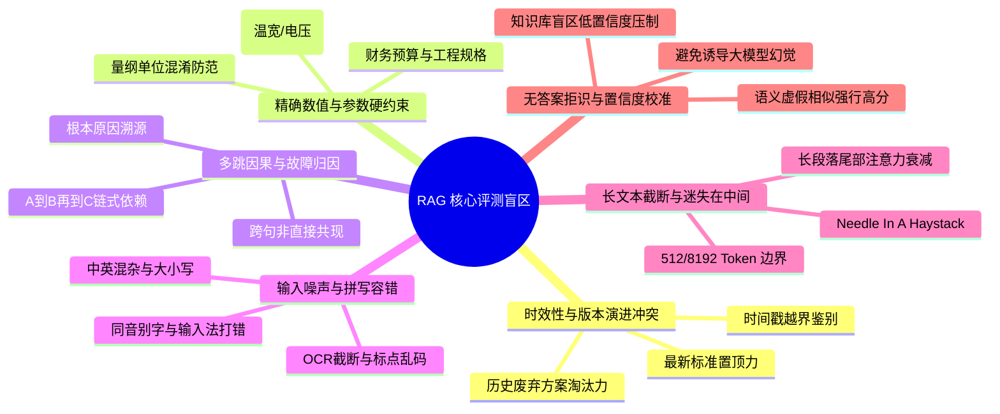

# 嵌入模型与重排模型高阶评测维度拓展与输入防污染治理调研报告
# Multi-Dimensional Evaluation Framework & Input Decontamination Architecture for Embedding and Reranker Models

**文档版本**：v1.0.0  
**编制日期**：2026-10-19  
**适用范围**：ReferenceRAG 性能评测套件、双塔向量召回（Bi-Encoder）、交叉编码重排（Cross-Encoder）体系、工业生产知识库管道

---

## 1. 执行摘要与核心议题背景

在企业级 RAG（检索增强生成）系统中，检索管道通常由两阶段构成：
1. **第一阶段：双塔嵌入模型（Bi-Encoder Embedding）**：利用向量空间距离进行毫秒级大规模候选集粗筛召回（Top-K 粗召回，如 20~100 篇文档）；
2. **第二阶段：交叉编码重排模型（Cross-Encoder Reranker）**：将用户查询（Query）与候选文档通过全注意力交互（Full Cross-Attention），计算高精度语义关联度打分，完成最终重排序（Top-N 精排，如 3~5 篇文档），直接作为大模型上下文注入。

近期在系统评测调优中，我们识别到两大亟待解决的核心课题：
1. **输入文本污染问题（Input Text Contamination & Semantic Leakage）**：
   在现存评测集中，部分用于测试对抗性负例与极性反转的文档包含了人工标注的前缀，如 `【硬对立/极性相反】：`、`【硬负例-目标相反】`、`【版本废弃-旧版方案】` 等。经深度推导，此类标签会严重污染 Tokenizer 和注意力矩阵，带来**先验语义泄露与作弊高偏差**。
2. **评测能力维度存在盲区（Missing High-Order Evaluation Dimensions）**：
   对比现有短文本相似度、常规代码搜索与 FAQ 匹配，工业生产环境还面临诸多极端与硬性边界场景（如时效与软件版本冲突、精确数值参数与物理量越界、多跳因果归因、输入拼写与 OCR 脏字抗噪、长文本截断衰减等）。目前评测体系尚未全面纳管这些维度，难以精准指导模型选型与 Top-K 截断策略。

本报告系统阐述输入污染治理方案与多维高阶评测体系设计，并给出全套落地方案。

---

## 2. 核心课题一：输入文本污染危害与解耦治理架构

### 2.1 文本污染在 Cross-Encoder 上的危害机制

重排模型通常采用预训练 Transformer 架构（如 `bge-reranker-large`, `bge-reranker-v2-m3`, `qwen2-vl-reranker` 等），其输入机制为拼接形式：
```text
[CLS] Query 文本 [SEP] Document 文本 [SEP]
```
当文档文本开头包含人工调试前缀标签（如 `【硬对立/极性相反】：`）时，将产生以下严重危害：

```
+---------------------------------------------------------------------------------------------------+
|                                     输入文本污染 (Text Contamination)                              |
+---------------------------------------------------------------------------------------------------+
|  [CLS] 关于处方药临床用药禁忌 [SEP] 【硬对立/极性相反】：本品绝对禁忌用于心源性休克... [SEP]         |
|                                       ^^^^^^^^^^^^^^^^                                            |
|                                     占用前 6~12 个 Token                                          |
|                                  触发先验词根 "负例/对立/相反"                                      |
+---------------------------------------------------------------------------------------------------+
                                                  |
           +--------------------------------------+--------------------------------------+
           |                                                                             |
           v                                                                             v
【问题 1：先验语义泄漏与假象高分】                                      【问题 2：脱离工业真实生产场景】
大模型与重排模型预训练语料中存在大量评估与指示样本。                     真实知识库切片（Markdown、PDF、网页）
模型极易走捷径（Shortcut Learning），注意力直接被                     绝对不会包含人工标注的“硬负例”中括号标签。
前置中括号与强负向引导词吸引，并非通过正文深层逻辑辨别。               带标签评测等同于“开卷作弊”，评测指标完全失真。
```

1. **分词特征破坏与注意力捷径（Shortcut Learning）**：
   `【`、`】` 及 `硬对立`、`极性相反` 属于强先验文本。部分微调模型甚至直接对类似指令标签过拟合，模型无需真正理解下文的心肌动力学矛盾，仅凭开头的“相反”就判定为低分，形成虚假的“抗干扰假象”。
2. **双塔嵌入（Bi-Encoder）同样受灾**：
   在密集向量抽取（Dense Embedding）中，前置标签会被直接平均或加权编码进全局句向量（Sentence Embedding），导致向量在潜空间（Latent Space）发生无意义的偏移，干扰余弦相似度计算。

### 2.2 解耦与治理架构设计（Tag-Field Decoupling）

为彻底消除输入污染，构建 100% 真实纯净的输入环境，我们推行 **“正文归正文，元数据归元数据”** 的字段级解耦方案：

```
                +---------------------------------------------------+
                |             测试用例元数据与业务归属                |
                +---------------------------------------------------+
                                         |
                                         v
                +---------------------------------------------------+
                |        RerankDocumentInput / Passage 实体         |
                |  - Id: "doc6"                                     |
                |  - Tag: "硬对立/极性相反" (独立元数据字段，仅用于UI展示) |
                |  - Text: "本品绝对禁忌用于心源性休克..." (纯净正文)    |
                |  - ExpectedRelevance: 0.15                        |
                +---------------------------------------------------+
                                         |
             +---------------------------+---------------------------+
             |                                                       |
             v (仅传 Text，彻底防污染)                                 v (透传 Tag)
+-------------------------+                             +-------------------------+
|   Tokenizer & Model     |                             |   前端 UI / 评测报告     |
| [CLS] Query [SEP] Text  |                             | 表格独立 Badge / 标签列   |
|   (100% 真实原生文本)   |                             |   (结构化呈现、分类统计)   |
+-------------------------+                             +-------------------------+
```

#### 改造规范：
1. **数据模型升级**：
   - 后端 `RerankDocumentInput` 与 `RerankDocumentResult` 均扩展 `public string? Tag { get; set; }`；
   - 后端语义检索 `Passage` 与 `PassageResult` 扩展 `public string? Tag { get; set; }`；
2. **文本彻底净化**：
   - 全面剔除所有预设文档正文中的 `【...】` 说明性标签，将其迁移至 `Tag` 属性；
   - 内部标点与语气保持自然行文，确保送入推理引擎（ONNX / LlamaSharp / Remote API）的文本绝对纯净；
3. **前端呈现升级**：
   - 前端数据表格（`rerankDocColumns` 与 `retrievalColumns`）新增独立列「标签属性」，采用 Naive UI `NTag` 渲染；
   - 根据 `Tag` 的语义类型进行语义化色彩区隔（极性相反/废弃/越界显示为红色 `error`，警告/弱相关显示为黄色 `warning`，核心正例显示为绿色 `success`），既保证排版视觉层次，又实现技术层面的防污染。

---

## 3. 核心课题二：嵌入与重排模型欠缺维度的头脑风暴与深度调研

结合工业级 RAG 生产痛点（特别是金融、法律、医疗、工程研发等严谨领域），我们对现有评测维度进行了全面审计与头脑风暴，提炼出**六大关键缺失维度**：



### 3.1 缺失维度一：时效性与版本演进冲突 (Temporal & Version Conflict / Recency Bias)
- **行业痛点**：
  IT 研发与法务知识库中存在大量不同版本的迭代文档（例如：`Vue 2 Options API` vs `Vue 3 Composition API`，`.NET Framework 4.8` vs `.NET 10`，`2021旧版财税指引` vs `2026最新税法`）。由于旧版文档在互联网沉淀时间长、关键词极度丰富、共现频次极高，双塔向量和重排模型极易将**已废弃、完全不推荐的历史旧方案**排在最前面，导致大模型生成不可运行的代码或失效方案。
- **评测设计**：
  构建 `version-temporal-rerank`（重排）与 `temporal-version-retrieval`（检索）套件。查询明确指定现代技术栈/当前时效范围，候选文档包含权威最新规范（正例）、历史过渡方案（弱相关）、官方废弃方案（硬负例）。检验模型能否根据版本上下文精准淘汰废弃内容。

### 3.2 缺失维度二：精确数值、参数与实体硬约束 (Numerical Range & Metric Boundary Constraints)
- **行业痛点**：
  在设备采购、工业制造与金融风控中，用户查询往往带有明确的**硬性区间约束**（如：“工作温度覆盖 -40℃~85℃”、“供电 12V~24V”、“精度在 ±0.2℃ 以内”）。深度语义模型擅长发散联想，但对“数值边界”与“物理量纲”通常缺乏敏感度。即使某候选文档写着“仅限室内 0℃~50℃、供电仅支持 5V”，因其包含大量“温度、供电、传感器”字眼，常被模型判定为高相似。
- **评测设计**：
  构建 `numerical-entity-rerank`（重排）与 `numerical-constraint-retrieval`（检索）套件。包含区间完全满足、上下限违背、电压超限导致击穿、精度严重不达标等梯级候选。要求模型对违背硬约束的候选执行严厉降权。

### 3.3 缺失维度三：多跳因果与故障归因 (Multi-Hop Causal Reasoning)
- **行业痛点**：
  复杂技术支持与运维排障中，现象与根本原因并不直接在同一句话出现，而是跨句呈现链式因果（例如：“内存溢出”由“TCP 连接未释放”引起，而“TCP 连接未释放”又源于“HttpClient 频繁手动实例化未配置连接池”）。模型容易命中表面描述“内存溢出”但未解释根因的文档。
- **评测设计**：
  设计多跳排错套件，考察模型是否能穿透表象命中阐明完整因果链条的深层文档。

### 3.4 缺失维度四：输入噪声抗扰度与拼写容错 (Noise Robustness & Typo Tolerance)
- **行业痛点**：
  真实用户在输入框键入文本时，极易产生近音错别字（如“跨域请求”打成“垮域请求”、“单例注入”打成“丹粒注入”），或者通过 OCR 扫描 PDF 提取出的带噪文本。若嵌入模型由于一个字的拼音错误导致余弦相似度暴跌 50% 以上，召回将直接瘫痪。
- **评测设计**：
  设计包含拼音别字、OCR 漏字等扰动的对比测试，评估模型的表征鲁棒性。

### 3.5 缺失维度五：长文本位置截断与“迷失在中间” (Lost-in-the-Middle & Chunk Truncation)
- **行业痛点**：
  在 512 到 8192 Token 的长 Chunk 中，注意力机制往往对头部（Head）和尾部（Tail）有天然的加权偏好，而处于 40%~60% 中间位置的事实关键句容易被忽视（Lost-in-the-Middle 现象）。
- **评测设计**：
  将关键事实埋藏在长文档的不同百分比深度位置，评估重排模型的穿透定位能力。

### 3.6 缺失维度六：无答案拒识与置信度校准 (Non-Answerability & Hallucination Suppression)
- **行业痛点**：
  当知识库中根本不存在匹配文档时，重排模型必须能够输出极低的绝对打分（例如所有文档得分均 < 0.2），以便工程管道触发“无答案拒识”，避免将看似沾边的无关文档强行喂给大模型产生严重幻觉。
- **评测设计**：
  设计全负例查询，评估重排模型最低置信度抑制能力。

---

## 4. 实施规划与落地成果架构

结合当前系统的实际工程需求，本次落地聚焦于**优先级最高、工业界最迫切**的两大维度实施改造与防污染落地：

```
+----------------------------------------------------------------------------------------------------+
|                                    ReferenceRAG 评测体系架构落地                                     |
+----------------------------------------------------------------------------------------------------+
                                                  |
           +--------------------------------------+--------------------------------------+
           |                                                                             |
           v                                                                             v
【工程落地一：全面输入防污染治理】                                      【工程落地二：两大高阶核心评测套件扩充】
1. 后端实体字段解耦：                                                  1. version-temporal-rerank / retrieval
   - RerankDocumentInput / Result 增加 Tag 属性                           (Vue 3 / 组合式API / Pinia 与废弃规范对比)
   - Passage / PassageResult 增加 Tag 属性                            2. numerical-entity-rerank / retrieval
2. 历史预设正文 100% 纯净化清洗                                           (工业物联网温宽 -40~85℃ / 宽压 12~24V 约束)
   (剥离所有【硬负例】/【硬对立】/【版本废弃】前缀标签)                    3. 纳管重排四大能力域画像并重构雷达权重
3. 前端表格渲染升级：                                                  4. 验证 AST 绑定与 check.mjs 质量门禁全绿
   - 增加独立 Badge 标签列，色彩分级呈现
```

### 4.1 核心套件一：版本演进与时效废弃规范套件
- **套件标识**：`version-temporal-rerank`（重排） / `temporal-version-retrieval`（检索）
- **查询场景**：`在 Vue 3 与现代前端工程中，官方推荐的全局状态管理与组件通信方案及 Composition API 最佳实践`
- **文档阶梯覆盖**：
  - **核心正例**：Vue 3 官方推荐 Pinia（去 mutations、原生 TS）、Composition API 与 `<script setup>` 规范；
  - **规范正例**：`provide` / `inject` 跨层通信、Vite 原生构建；
  - **过渡与替代**：移除 `$on` 后的轻量级 `mitt` 替代；
  - **硬对抗（版本废弃）**：Vue 2 选项式 API 与 mixin 方案、Vuex 3.x/4.x mutations 强制同步流、Vue 2 全局 EventBus；
  - **领域无关**：React 19 并发特性、Docker Nginx 部署。

### 4.2 核心套件二：精确数值与参数硬约束套件
- **套件标识**：`numerical-entity-rerank`（重排） / `numerical-constraint-retrieval`（检索）
- **查询场景**：`选购要求：适用于工业物联网户外严苛环境的高精度温湿度传感器，工作温度必须覆盖 -40℃至85℃，供电电压兼容 12V 至 24V DC，且测量精度需达到 ±0.2℃ 以内`
- **文档阶梯覆盖**：
  - **完美匹配**：-40℃~85℃、DC 10V~30V 宽压、精度 ±0.15℃、IP67 工业级；
  - **满足参数**：-40℃~100℃、12V/24V、精度 ±0.2℃；
  - **硬约束越界（温宽不符）**：商业室内 0℃~50℃（无法在 -40℃ 启动）；
  - **硬约束越界（电压超限）**：仅支持 3.3V/5V，直接接入 12V/24V 将击穿烧毁；
  - **硬约束越界（精度不达标）**：低成本热敏电阻精度仅 ±1.5℃；
  - **领域不符与无关**：红外热像仪、高斯混合模型。

---

## 5. 结论与后续演进建议

1. **防污染原则永久化**：
   今后无论新增任何测试集或用户自定义模板，严禁将分类标签作为文本前缀拼接进 `Text` 字段，一律通过 `Tag` 元数据传递，维护评测真实性。
2. **渐进式纳管多跳与噪声评测**：
   在后续版本迭代中，建议引入自动化噪声注入插件（动态产生 5%~15% 近音错字与乱码），进一步增强模型全场景抗风险评测能力。
