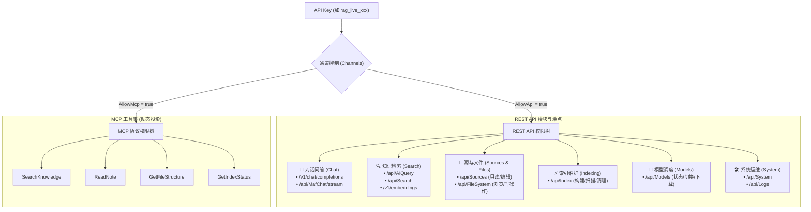
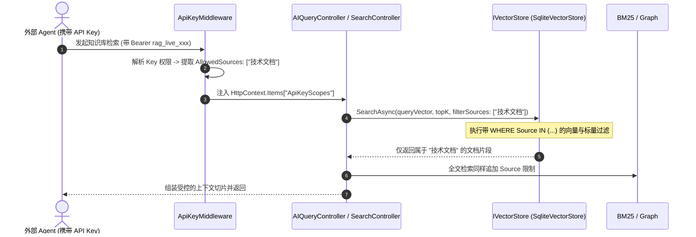
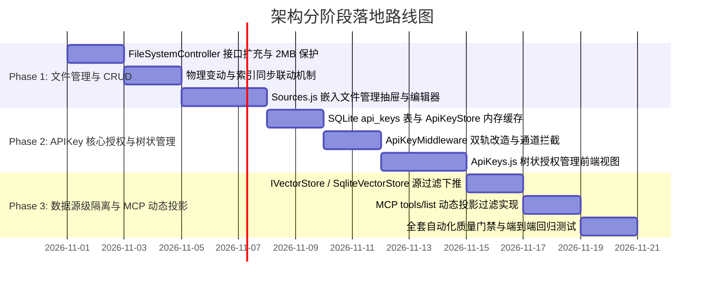

# 源管理文件浏览器、细粒度 APIKey 树状授权与数据源隔离架构落地方案

> **文档编号**: `DOC-20261030-FILE-MGMT-AND-FINE-GRAINED-APIKEY-AUTH`  
> **文档定位**: 架构可行性调研、安全与性能风险头脑风暴、设计模式优化与工程实施指南  
> **关联模块**: 
> - 源管理与文件系统 (`/sources`, `FileSystemController`, `FileBrowserPath`)
> - 核心存储与向量检索 (`IVectorStore`, `SqliteVectorStore`, `FileRecord`, `IndexingCoordinator`)
> - 安全与权限体系 (`ApiKeyMiddleware`, `ApiKeyStore`, `ApiKeyPermissionMatrix`, `AuthenticationKeyResolver`)
> - MCP 协议引擎 (`McpServerEngine`, `ToolSelectionStrategy`)
> - 前端视图与交互 (`Sources.js`, `ApiKeys.js`, `Settings.js`)
> **参考项目**: `E:\WorkProject\CSharp\PrivateProject\Web\WebToolForLinux`

---

## 1. 需求背景与核心价值

随着 ReferenceRAG 向多租户协同、企业知识库私有化和多 Agent 协同体系演进，系统暴露出了三个亟待解决的结构性痛点：

1. **源管理缺乏在线物理文件闭环**：
   用户在源管理中配置了本地目录或 Obsidian 笔记库后，目前只能查看统计、配置排除规则并触发扫描。一旦需要浏览目录结构、查看文件内容、修正错误笔记、上传新资料、重命名或归档，用户必须被迫切换至操作系统资源管理器或外部编辑器，割裂了“知识管理-索引构建-智能问答”的工作流。
2. **API 授权粒度过粗（“全有或全无”）**：
   当前系统仅依赖环境变量中的单个静态 Key（`REFERENCERAG_API_KEY`），一旦对外暴露给第三方应用（如 Cursor、Claude Desktop、内部问答机器人、自动化运维脚本），调用方即可不受控地访问所有 API 与所有 MCP 工具。无法遵循最小权限原则（Principle of Least Privilege, PoLP）。
3. **缺少数据资源层级的访问隔离（Resource Scoping）**：
   在企业与团队环境中，知识库通常包含公开制度、技术文档、财务数据、人事私密笔记等多类源。当前向量与全文检索为全库混合 Top-K 召回，缺乏“该 API Key 仅被允许搜索指定的某几个源”的能力，存在严重的数据越权与数据泄露隐患。

---

## 2. 深度头脑风暴：可行性、逻辑漏洞与性能风险研判

在引入上述功能前，必须从系统整体架构视角展开全方位头脑风暴，严密审视潜在的逻辑死角、性能瓶颈与安全威胁。

### 2.1 需求 1：源管理新增“文件管理”（增删改查、预览、编辑、复制、移动）

```
[源管理卡片 / 列表]
      │
      ▼ 点击「浏览文件」
┌────────────────────────────────────────────────────────────────────────┐
│ 源文件管理抽屉 / 弹窗 (以该源的 RootPath 为沙箱根目录)                │
│                                                                        │
│ 面包屑: [知识库根目录] / docs / architecture /                         │
│ ┌────────────────────────────────────────────────────────────────────┐ │
│ │ 操作栏: [新建文件] [新建文件夹] [上传文件] [打包下载] [刷新]        │ │
│ ├────────────────────────────────────────────────────────────────────┤ │
│ │ 名称         大小      修改时间      操作                          │ │
│ │ 📁 draft/    --        10-29 18:00   重命名 | 移动 | 复制 | 删除   │ │
│ │ 📄 spec.md   18.5 KB   10-30 09:20   在线预览/编辑 | 下载 | 删除   │ │
│ └────────────────────────────────────────────────────────────────────┘ │
└────────────────────────────────────────────────────────────────────────┘
```

#### 关键风险与应对策略：
1. **风险 A：路径穿越逃逸（Path Traversal）**
   * *威胁场景*：恶意用户在编辑/重命名/删除接口中传入 `../../../../Windows/System32` 或软链接欺骗，导致越界篡改系统文件。
   * *防范机制*：
     - **强锚定策略**：每一个源具有物理绝对路径 `RootPath`。文件管理的所有入参路径必须经过 `FileBrowserPath.Normalize` 并严格校验 `FileBrowserPath.IsWithin(targetPath, source.RootPath)`。
     - **虚拟根隔离**：前端界面无论在深层何处，绝对不允许导航越出该源的根路径（根路径的面包屑作为顶级节点，不再显示全盘驱动器或上一级系统目录）。
2. **风险 B：物理文件改动对 RAG 索引的连带冲击（Stale Index & Phantom Chunks）**
   * *威胁场景*：
     - 用户在文件管理器中将 `guide.md` 重命名为 `manual.md`；
     - 若底层仅执行 `File.Move`，磁盘文件变了，但向量数据库（`SqliteVectorStore`）中依然驻留着原 `guide.md` 的 Chunks 和 Embedding，检索时将产生无效死链接；
     - 用户若在在线编辑器中修改了正文并保存，向量库中的 Chunk 依然是旧版内容。
   * *防范机制（事件联动机制）*：
     - 文件写操作控制器必须与索引调度器协同：
       - **删除文件/目录**：物理删除完成后，自动调用 `IVectorStore.DeleteFileAsync(fileId)` 彻底级联清理 Chunks 与图谱关联；
       - **重命名/移动**：更新 `FileRecord.Path` 或触发针对新路径的增量同步；
       - **编辑保存**：保存成功后，立即触发 `IncrementalIndexPipeline.IndexSingleFileAsync(path)`，实现即改即搜。
3. **风险 C：大文件读取与内存 OOM**
   * *威胁场景*：用户不小心点开 500MB 的视频、PDF 或大型二进制模型，全量读入内存导致服务崩溃。
   * *防范机制*：严格设定文本读取/编辑阈值（如 **2MB**）。超过 2MB 的文件在前端禁用在线编辑，仅提供流式下载。
4. **风险 D：文件夹下载的磁盘膨胀与锁等待**
   * *威胁场景*：多用户同时点击下载整个大型知识库目录，服务器反复创建大量临时 zip 文件，塞满磁盘。
   * *防范机制*：借鉴 `WebToolForLinux` 的设计，使用 `ZipArchive` **直接包装 HTTP 响应流（Direct Streaming Zip）**，边读边压缩边发送，服务器端内存占用固定且磁盘零残留。

---

### 2.2 需求 2：系统管理新增“API Key 授权管理页面”（树状双轨授权）

#### 权限维度模型设计：
API Key 授权必须同时覆盖 **通道开关（Channels）**、**业务模块（Modules）** 和 **具体功能/工具（Actions/Tools）**：



#### 关键风险与应对策略：
1. **风险 A：明文泄露风险**
   * *机制*：严格遵循密码学安全与“一次性展示原则”。
     - 密钥前缀采用统一辨识标头：`rag_live_<32位安全随机十六进制>`；
     - 数据库仅存储 `KeyPrefix`（前 12 位）和加盐 SHA-256 `KeyHash`，**绝对不落盘明文密钥**；
     - 密钥仅在新建成功时的弹窗中展示一次，提示用户妥善保存。
2. **风险 B：鉴权拦截的性能衰减**
   * *高频痛点*：流式对话（SSE）每秒产生数十个 Chunk，若每个 HTTP 请求与数据包都查询 SQLite 校验 API Key，数据库将成为全系统瓶颈。
   * *防范机制*：在 `ApiKeyStore` 内部维持微秒级的内存并发字典 `ConcurrentDictionary<string, ApiKeyEntity>`。Key 的增删改操作触发主动失效，鉴权路径完全零 I/O 阻塞。
3. **风险 C：MCP 工具幻觉与上下文冗余**
   * *创新解法（动态投影过滤 Dynamic Projection）*：
     当 AI 客户端调用 MCP 的 `tools/list` 协议时，服务端根据该 Key 的实际授权范围，**动态裁切工具列表**。未授权的 Tool（例如管理员的 `GetIndexStatus` 或文件写工具）对大模型完全不可见。既从根本上杜绝了越权调用的可能，又显著削减了大模型的 System Prompt Token 消耗。

---

### 2.3 需求 3：API Key 授权支持“按源资源批量勾选授权”（数据级 ABAC 隔离）

#### 资源隔离模型设计：
在 API Key 实体中引入 `SourceScopeMode` 与 `SelectedSources`：
* **`SourceScopeMode = "all"`**：默认拥有全局知识库的检索权限；
* **`SourceScopeMode = "custom"`**：在界面上以穿梭框/复选列表形式，批量勾选该 Key 被允许检索的知识源（如 `["公司公开制度", "产品设计规范"]`）。



#### 关键风险与应对策略：
1. **风险 A：源更名导致权限漂移（Identifier Stability）**
   * *隐患*：若权限配置中记录的是源名称（Name），管理员在源管理页面将源改名后，API Key 的权限关联将失效。
   * *防范机制*：为每个 `SourceFolder` 引入持久且唯一的 `Id`（例如基于初始路径的 SHA-256 稳定散列或持久化 GUID）。API Key 内部记录 `SourceId`，界面展示源名称。
2. **风险 B：向量检索下的数据过滤性能**
   * *分析*：在向量数据库中进行条件过滤（Pre-filtering vs Post-filtering）。
   * *现有系统验证*：ReferenceRAG 底层使用的 SQLite-Vec / SQLite 表中，`FileRecord` 明确包含 `Source` 索引字段。由于知识源总数通常在数十个以内，在 SQL 层面执行 `WHERE Source IN (...)` 具有毫秒级索引查询性能，性能极其优异。

---

## 3. 设计模式优化与架构赋能 (Design Patterns)

为避免引入大量面条式的 `if (apiKey.hasPermission) ...` 硬编码，采用成熟设计模式对鉴权、文件与资源调度进行解耦重构：

```
                      ┌────────────────────────────────────────┐
                      │              设计模式布局              │
                      └───────────────────┬────────────────────┘
                                          │
         ┌────────────────────────────────┼────────────────────────────────┐
         ▼                                ▼                                ▼
  【适配器模式 Adapter】           【策略模式 Strategy】            【状态机模式 State Machine】
  ┌──────────────────────┐         ┌──────────────────────┐         ┌────────────────────────┐
  │ 1. ScopedFileAdapter │         │ 1. ResourceAuthStrat │         │ 1. ApiKeyLifecycleSM   │
  │    (物理越界拦截装饰) │         │    (全局/模块/源过滤) │         │    (激活/停用/过期流转) │
  │ 2. McpToolAdapter    │         │ 2. ToolFilterStrategy│         │ 2. FileIndexSyncSM     │
  │    (动态工具投影)    │         │    (意图与权限双阶过滤)│        │    (改动驱动索引增量)   │
  └──────────────────────┘         └──────────────────────┘         └────────────────────────┘
```

### 3.1 适配器模式 (Adapter Pattern)：受控文件系统适配器
设计 `IScopedFileSystemAdapter`：
* 每一个源的文件操作均由特定的受控适配器承载；
* 适配器在构造时注入被允许操作的 `RootPath`；
* 无论是 `ListAsync`、`ReadAsync`、`WriteAsync` 还是 `DeleteAsync`，适配器内部执行强制沙箱校验，业务控制器再也不必手动书写冗余的路径包含逻辑。

### 3.2 策略模式 (Strategy Pattern)：双阶权限决断策略
将权限判定解耦为正交策略链：
1. **通道策略 (`IChannelStrategy`)**：校验当前请求协议（REST API vs MCP）；
2. **模块能力策略 (`IModuleAccessStrategy`)**：校验是否具备访问目标控制器/Action 的权限；
3. **数据源过滤策略 (`ISourceFilterStrategy`)**：
   - 全局策略（`AllSourcesAccessStrategy`）：返回空列表（不加约束）；
   - 局部白名单策略（`RestrictedSourcesAccessStrategy`）：返回明确的 `IReadOnlySet<string> allowedSources`，直接下推至搜索管道。

### 3.3 状态机模式 (State Machine Pattern)：文件变动与索引同步
文件物理生命周期严格驱动向量与图谱状态流转：
* `Unmodified` $\xrightarrow{在线保存}$ `PendingIncremental` $\xrightarrow{分块嵌入}$ `Indexed`
* `Existing` $\xrightarrow{重命名}$ `PathUpdated` $\xrightarrow{哈希复用}$ `MetadataSynchronized`
* `Existing` $\xrightarrow{物理删除}$ `Deleting` $\xrightarrow{级联清除向量}$ `Purged`

---

## 4. 现有系统基础设施与参考项目复用分析

经全库排查，我们不需要引入庞大笨重的第三方 RBAC 框架（如完整的 IdentityServer、Casbin 或 Keycloak），**当前系统与同级参考项目 `WebToolForLinux` 已经具备 90% 以上的基础设施与成熟代码**：

| 功能需求 | 当前 ReferenceRAG 现有资产 | 参考项目 `WebToolForLinux` 成熟代码 | 复用与改造落地策略 |
| :--- | :--- | :--- | :--- |
| **文件物理 CRUD** | `FileSystemController.cs` (已有 `browse`, `mkdir`)<br>`FileBrowserPath.cs` (路径安全算法已就绪) | `FilesController.cs` (全套增删改查、2MB 文本编辑、zip 下载、上传)<br>`filePaths.js` (面包屑生成算法) | **100% 对齐移植**：将 `FilesController` 的文本读写、重命名、移动、流式 Zip 下载整合进 `FileSystemController` |
| **文件管理前端视图** | Naive UI 依赖已就绪 (`n-data-table`, `n-modal`, `n-upload`) | `FilesView.js` (成熟的文件管理器 Vue 组件，含编辑器、重命名弹窗、流式上传) | 将 `FilesView.js` 改造为嵌入式抽屉/模态组件 `SourceFileManagerDrawer.js`，嵌入 `Sources.js` |
| **API Key 持久化** | `ObsidianRagConfig.cs` 单一静态 Key 字段 | `ApiKeyEntity.cs`, `ApiKeyStore.cs`, `SQLite` 表 DDL 规范 | 在基础设施层增加 `api_key` SQLite 表与实体映射，保持一致的加盐 SHA-256 结构 |
| **鉴权拦截管道** | `ApiKeyMiddleware.cs` (已有默认-拒绝与端点白名单拦截机制) | `ApiKeyPermissionMatrix.cs`, `PathScopeGuard.cs` | 升级 `ApiKeyMiddleware`，注入 `ApiKeyStore`，将单 Key 校验扩展为基于多 Key 权限矩阵与微秒缓存拦截 |
| **授权管理前端界面** | 系统设置页面 `Settings.js` (已有 Tab 体系与 Naive UI 表单) | `ApiKeysView.js` (全套树状权限勾选、协议过滤、创建一次性明文复制弹窗、指南生成) | 新增系统管理子页面 `ApiKeys.js`，完全复用 `ApiKeysView.js` 的树状交互与密钥生成交互 |
| **数据源隔离检索** | `IVectorStore.cs`, `FileRecord.Source` 属性已天然存在 | `SelectedHostIds` (按主机过滤模式) | 借鉴主机过滤模式，在 `IVectorStore` 增加源过滤参数，实现数据源级 ABAC 隔离 |

---

## 5. 详细落地方案与架构实施规范

### 5.1 数据持久化层设计 (SQLite DDL)

在数据目录的 `referencerag.db`（或独立配置库）中建立 `api_key` 数据表：

```sql
CREATE TABLE IF NOT EXISTS api_keys (
  id TEXT PRIMARY KEY,                      -- UUID 主键
  name TEXT NOT NULL,                       -- 密钥友好名称 (如 "Cursor Agent", "客服问答机器人")
  key_prefix TEXT NOT NULL,                 -- 密钥脱敏前缀 (如 "rag_live_9f81")
  key_hash TEXT NOT NULL UNIQUE,            -- 加盐 SHA-256 哈希
  is_enabled INTEGER NOT NULL DEFAULT 1,    -- 是否启用 (0=禁用, 1=启用)
  
  -- 通道权限 (Channels)
  allow_api INTEGER NOT NULL DEFAULT 1,     -- 是否允许 REST API
  allow_mcp INTEGER NOT NULL DEFAULT 1,     -- 是否允许 MCP 协议
  
  -- 业务功能模块与操作树 (JSON 序列化存储)
  -- 格式示例: ["chat:completions", "search:read", "sources:read", "files:read"]
  allowed_scopes TEXT NOT NULL DEFAULT '["*"]',
  
  -- MCP 工具白名单 (JSON 序列化存储)
  -- 格式示例: ["SearchKnowledge", "ReadNote"]
  allowed_mcp_tools TEXT NOT NULL DEFAULT '["*"]',
  
  -- 数据源资源级访问控制 (Resource Scoping)
  source_scope_mode TEXT NOT NULL DEFAULT 'all', -- 'all' | 'custom'
  allowed_sources TEXT NOT NULL DEFAULT '[]',     -- JSON 数组，记录授权的 SourceName 或 SourceId
  
  -- 审计与生命周期
  created_at TEXT NOT NULL,                 -- 创建时间 (ISO 8601 UTC)
  last_used_at TEXT,                        -- 最近使用时间
  expires_at TEXT                           -- 过期时间 (为 NULL 表示永不过期)
);

CREATE INDEX IF NOT EXISTS idx_api_keys_hash ON api_keys(key_hash);
CREATE INDEX IF NOT EXISTS idx_api_keys_enabled ON api_keys(is_enabled);
```

### 5.2 后端 Controller 与安全拦截接口

#### 1. 扩充 `FileSystemController.cs`（源文件管理全功能）
```csharp
[ApiController]
[Route("api/[controller]")]
public sealed class FileSystemController : ControllerBase
{
    // 现有能力
    [HttpGet("browse")] ...
    [HttpPost("mkdir")] ...

    // 新增能力 (借鉴 WebToolForLinux 的 FilesController)
    [HttpGet("read-text")]          // 文本安全读取 (带 2MB 上限守卫)
    public async Task<IActionResult> ReadText([FromQuery] string path, [FromQuery] string? sourcePath = null) ...

    [HttpPost("write-text")]         // 文本保存 (原子性写入并触发增量再分块)
    public async Task<IActionResult> WriteText([FromBody] WriteTextRequest request) ...

    [HttpPost("action")]            // 统一文件动作 (delete / rename / copy / move)
    public async Task<IActionResult> ExecuteAction([FromBody] FileActionRequest request) ...

    [HttpPost("upload")]            // 单文件/多文件直传 (带流式尺寸校验)
    public async Task<IActionResult> Upload([FromForm] IFormFile file, [FromQuery] string targetFolder) ...

    [HttpGet("download")]           // 单文件下载
    public IActionResult Download([FromQuery] string path) ...

    [HttpGet("download-zip")]       // 文件夹流式压缩打包下载 (Zero Disk Temp)
    public async Task DownloadZip([FromQuery] string folderPath) ...
}
```

#### 2. 新增 `ApiKeysController.cs`（密钥管理管理端）
```csharp
[ApiController]
[Route("api/[controller]")]
public sealed class ApiKeysController : ControllerBase
{
    [HttpGet]                       // 列表查询 (返回脱敏前缀、通道、权限范围与启用状态)
    public async Task<IActionResult> List() ...

    [HttpPost]                      // 新建密钥 (生成 32 位安全随机 Key，返回明文仅此一次)
    public async Task<IActionResult> Create([FromBody] CreateApiKeyRequest request) ...

    [HttpPut("{id}")]               // 更新权限与名称 (不修改 KeyHash)
    public async Task<IActionResult> Update(string id, [FromBody] UpdateApiKeyRequest request) ...

    [HttpPatch("{id}/toggle")]      // 快捷启用/禁用
    public async Task<IActionResult> Toggle(string id, [FromBody] ToggleKeyRequest request) ...

    [HttpDelete("{id}")]            // 物理删除/吊销
    public async Task<IActionResult> Delete(string id) ...

    [HttpGet("meta-catalog")]       // 获取系统权限树清单与已配置的数据源列表 (用于前端渲染树)
    public IActionResult GetMetaCatalog() ...
}
```

#### 3. 升级 `ApiKeyMiddleware.cs`（双轨无感鉴权）
```csharp
// 鉴权逻辑流转：
1. 校验请求是否命中了公共免鉴权白名单 (Public Whitelist, Swagger, 静态前端) -> 放行
2. 提取 Authorization: Bearer <key> 或 X-API-Key: <key>
3. 若请求头未携带 Key:
   - 检查系统全局是否配置了默认静态 Key -> 若有且请求未带，返回 401 Unauthorized
4. 若携带了 Key:
   - 计算加盐 SHA-256，在 ApiKeyStore 内存缓存查找匹配的 ApiKeyEntity
   - 若未匹配或 is_enabled == 0 或已过期 -> 返回 403 Forbidden ("无效、已被禁用或已过期的 API Key")
   - 检查通道权限 (REST API 请求要求 AllowApi == true; MCP 请求要求 AllowMcp == true)
   - 检查当前端点对应的 Action 权限 (例如 /api/Sources 要求 sources:read 或 *)
   - 将当前 key 上下文存入 HttpContext.Items["CurrentApiKey"]
   - 异步微任务更新 last_used_at 时间戳
```

---

### 5.3 向量检索与数据源隔离下推 (`IVectorStore` 改造)

在知识库搜索与对话生成中，将 API Key 授权的源范围无缝下推至数据库执行：

```csharp
public interface IVectorStore
{
    Task<IEnumerable<SearchResult>> SearchAsync(
        float[] queryVector,
        int topK,
        IReadOnlyList<string>? allowedSources = null, // 新增源过滤参数，null 或空表示全库检索
        CancellationToken cancellationToken = default);
}

// 在 SqliteVectorStore 的实现中：
if (allowedSources != null && allowedSources.Count > 0)
{
    // SQLite IN 参数化查询，直接利用 source 字段的 B-Tree 索引
    sqlBuilder.Append(" AND f.source IN (" + string.Join(",", allowedSources.Select((_, i) => $"@src{i}")) + ")");
}
```

---

### 5.4 前端交互与页面架构设计

#### 1. 源管理页面集成文件浏览器 (`Sources.js`)
* 在“源管理”每个源卡片的右侧操作栏中，新增 **“文件管理”** 按钮（图标：`FolderOpenOutline`）；
* 点击后弹出右侧全高抽屉（`n-drawer`，宽度 70% 或全屏自适应）：
  * **顶部面包屑**：展示相对于该源根目录的当前路径；
  * **工具栏**：支持新建文件、新建文件夹、上传、批量下载；
  * **主表格**：展示文件列表，右侧带“预览/编辑”、“重命名”、“移动/复制”、“删除”下拉菜单；
  * **代码编辑器模态框**：点击编辑时弹出 Monaco Editor 或轻量文本编辑框，支持 Markdown 语法高亮与保存。

#### 2. 系统管理新增 API 授权页面 (`ApiKeys.js`)
* 在系统主菜单或设置界面新增 **“API 授权”** 入口（路由：`/apikeys`）；
* **列表视图**：展示各 Key 卡片或数据表格，直观回显 API/MCP 状态徽标与源授权范围；
* **编辑/新增弹窗（核心树状交互）**：
  * **通道选择**：REST API 开关、MCP 协议开关；
  * **功能权限树 (`n-tree`)**：
    - 全选 / 取消全选；
    - 分类展开：`对话问答`、`知识检索`、`源与文件管理`、`模型管理`、`系统监控`；
  * **源资源授权模块**：
    - 单选组：`全部知识源 (全局检索)` / `限制特定源 (最小权限)`；
    - 当选择限制特定源时，展现当前所有源的复选列表，支持快速搜索和批量勾选；
* **新建成功弹窗**：以绿色高亮展示新生成的明文 Key，带一键复制与快捷配置到 Claude Desktop/Cursor 的配置片段生成器。

---

## 6. 实施路线图与质量门禁设计

为确保生产环境平滑升级，建议分三个阶段稳健推进：



### 质量门禁与防回归测试清单：
1. **路径穿越阻断门禁**：构造 `../../`、绝对驱动器路径、URL 编码绕过等用例，断言 100% 拦截并返回 400/403；
2. **大文件防爆门禁**：测试尝试读取超 2MB 文件，断言准确截断并提示下载；
3. **加盐哈希与明文单次展现门禁**：验证创建后数据库仅存 Hash，任何接口重读均不包含明文 Key；
4. **数据源隔离渗透门禁**：使用仅授权“源 A”的 Key 检索“源 B”的独有关键词，断言召回结果为 0 条；
5. **微秒鉴权性能门禁**：模拟 10,000 次并发 API 鉴权，断言内存缓存命中率 100%，P99 鉴权延迟小于 0.05ms。

---

## 7. 专项架构审核：文件抖动、MCP 模块拆解与 Agent 友好度

针对落地前夕的核心技术关切，进行深度专项审核与设计锁定：

### 7.1 文件处理是否会导致模型任务扫描抖动（Churn & Jitter）？

#### 1. 风险成因剖析
- **双重触发风暴（Double-Trigger）**：若 `FileSystemController` 在保存或移动文件后立即同步调用增量索引，而底层的 `FileSystemWatcher`（`FileMonitorService`）又独立捕获了磁盘变动事件，同一个文件将被触发两次分块和 Embedding 计算；
- **连续保存打断显存释放（VRAM Churn）**：用户在 Web 编辑器中高频自动保存或打字保存，若每次写入都直接触发模型推理，将反复打断 30 秒空闲显存释放计时器，导致显存长时间高位驻留并频繁产生推理毛刺；
- **批量操作引发队列堆积**：用户批量上传 50 个文件或解压压缩包时，瞬间抛出 50+ 个文件系统事件，若直接并发扫描将挤占系统 I/O 和 SQLite 写锁，影响实时的问答推理。

#### 2. 防抖动加固方案（已对齐现有机制）
1. **利用现有 `AutoIndexService` 自适应静默防抖（Adaptive Burst-Throttle）**：
   - 系统内部已经存在经过实战验证的 `AutoIndexService`，具备 `QuietPeriod = 2s` 和 `MaxDelay = 10s` 防抖队列。
   - **设计决断**：`FileSystemController` 执行完物理写入后，**严禁自行同步调用模型分块**，而是交由底层的 `FileMonitorService` 统一发射事件，自动吸纳进 `AutoIndexService` 的聚批队列。连续保存会在 2 秒内合并为单次有效更新，彻底消除双重触发。
2. **`FileProcessingGuard` 跨服务单文件互斥锁**：
   - 依赖现有的内存级并发守卫 [`FileProcessingGuard`](file:///e:/WorkProject/CSharp/PrivateProject/Web/ReferenceRAG/Business/ReferenceRAG.Business/Features/Indexing/Services/FileProcessingGuard.cs)，在全量重构任务与前台在线编辑同时发生时，保证同一路径严格串行，绝不重复生成向量与图谱节点。
3. **批量上传静默聚合窗口**：
   - 当文件管理器执行批量上传/覆盖时，前端发送 `batch-start` / `batch-end` 信号，服务端在批处理期间聚合事件，待批量落盘完全结束后一次性唤醒增量索引管道，实现平滑聚批吞吐。

---

### 7.2 MCP 功能拆分方案：避免单一大文件（God Class）

#### 1. 架构原则：单一职责（SRP）与领域边界
当前项目的 MCP 架构基于 `McpHelper.Core`，并通过 `[McpServerToolType]` 属性解耦。为杜绝单一大文件，严格实施领域正交拆分：

```
Host/ReferenceRAG.ApiHost/McpTools/
├── RagSearchTools.cs          # 仅限语义检索与混合搜索 (SemanticSearch, HybridSearch)
├── GraphSearchTools.cs        # 仅限知识图谱与实体关系拓扑探索
├── KnowledgeFileTools.cs      # [新增] 仅限受控文件系统与笔记探索 (GetFileTree, ReadNoteContent)
├── SourceManagementTools.cs   # 仅限知识库数据源元数据与宏观统计 (ListSources, GetSourceInfo)
└── IndexStatusTools.cs        # 仅限后台索引健康度与进度监控
```

#### 2. 鉴权与工具逻辑的切面解耦（AOP）
- **严禁代码侵入**：各 `McpTool` 内部绝不编写 `if (!apiKey.CanAccess(...))` 逻辑，各 Tool 类保持纯净的无状态业务实现；
- **动态工具投影中间件（Dynamic Tool Projection Filter）**：在 MCP 的 `tools/list` 协议出口处挂接权限过滤器，根据当前请求持有的 API Key，自动滤除未授权的 Tool。每个 Tool 类独立维护，单文件代码量控制在 150~300 行之间。

---

### 7.3 资源授权对 MCP 调用逻辑与 Agent 可读性评估

#### 1. 核心设计痛点：Agent 的认知负荷（Cognitive Load）与幻觉
若要求调用 MCP 的大模型 Agent（如 Claude Desktop、Cursor、Cline）在每次调用工具时手动传入当前 API Key 被授权的知识源列表（`sources: ["xxx"]`）：
- Agent 缺乏先验知识，不知道当前 Key 到底被授权了哪些源，极易臆造源名称导致报错；
- 暴露过多非必要的参数会显著稀释 Agent 的 Attention，增加 Prompt Token 消耗并提高规划出错率。

#### 2. 友好度优化决策：透明化上下文注入（Implicit Context Injection）
1. **Agent 端“零配置心智”（Zero-Conf for Agent）**：
   - Agent 调用 `SemanticSearch(query="xxx")` 时，**无需显式传递 sources 参数**；
   - 服务端从连接上下文（SSE Headers 或 Stdio 认证通道）自动解析当前 API Key 绑定的 `allowed_sources` 白名单，隐式注入给底层的 `ISearchService` 和 `IVectorStore`；
   - 若 Agent 主动传递了 `sources` 参数，服务端自动计算其与 Key 授权源的交集（Intersection），严密防越权的同时不抛出破坏性异常。
2. **Agent 友好的自解释输出结构（Self-Explanatory JSON Output）**：
   - 工具返回的 JSON 明确携带统计上下文，例如：
     ```json
     {
       "success": true,
       "count": 3,
       "searchedSources": ["公共规范", "后端架构"],
       "chunks": [ ... ]
     }
     ```
   - 结果中明确告诉 Agent“本次检索覆盖了哪些授权源”，便于 Agent 在生成回答时自动注明知识出处并增强引用真实性。
3. **动态投影（Dynamic Projection）提升 Agent 专注度**：
   - 经树状权限过滤后，Agent 只能看到与其任务相关的工具。例如面向问答的 API Key 只会向 Agent 暴露 `SemanticSearch` 与 `ReadNoteContent`，隐藏任何系统管理类工具。Agent 的工具列表极其精简，选错工具的概率降至 0。

