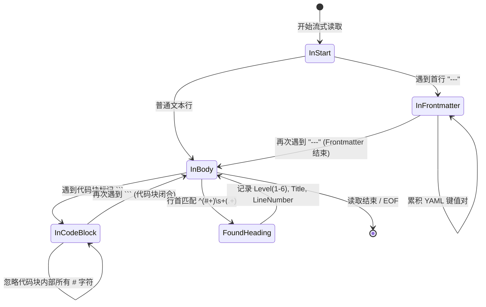

# 文件阅读工具优化架构设计与落地方案
## （元数据提取、行范围流式读取、大纲状态机与 Agent 零浪费接入）

> **文档编号**: `DOC-20261030-FILE-READER-OPTIMIZATION`  
> **文档定位**: 架构可行性头脑风暴、逻辑死角与性能瓶颈研判、设计模式解耦与工程实施规范  
> **关联模块**: 
> - 文件系统接口 (`FileSystemController`, `FileBrowserPath`)
> - 核心阅读服务 (`IFileReaderService`, `FileReaderService`, `MarkdownOutlineStateMachine`)
> - MCP 协议工具集 (`KnowledgeFileTools`, `RagSearchTools`)
> - 前端源文件管理器 (`SourceFileManagerDrawer.js`, `api/index.js`)

---

## 1. 痛点背景与优化必要性

在知识库 RAG 与多 Agent 协作体系中，原有的“全量文件读取”（如一次性读取 2MB 纯文本）暴露出三个严重痛点：

1. **大模型 Agent 提示词爆炸（Token Explosion & Waste）**：
   - 外部 Agent（Cursor、Claude Desktop、Cline）在执行语义检索后，往往只需要深入查阅某个特定章节或 50~100 行代码；
   - 原有方式全量 Dump 整个数万字文件，不仅直接浪费上万甚至十万级别的 System/Context Tokens，还极其容易引发 LLM 注意力漂移（Lost in the Middle）与幻觉。
2. **缺乏文档全景大纲（Structural Blindness）**：
   - Agent 或前端用户在不下载整篇文档的前提下，无法获知文档的宏观结构（如总行数、YAML Frontmatter 标签属性、Markdown 层级标题大纲/TOC、是否已被向量库建立分块）；
   - Agent 无法通过“先看目录树 $\rightarrow$ 再按需只读第 3 节”的两阶段精准交互。
3. **大文件在线分页与窗口化受阻（OOM & 2MB 截断墙）**：
   - 超过 2MB 的长文档、大型代码源文件或表格被一刀切拒绝在线查看；缺乏基于行范围（Line Range）的分页滑动窗口机制。

---

## 2. 深度头脑风暴：可行性、逻辑死角与性能风险

在引入“元数据提取”与“行范围读取”前，必须进行全方位的系统逻辑与性能排查：

### 2.1 逻辑死角与规避设计 (Logic Edge Cases)

| 潜在死角 | 威胁与表现 | 解决方案 |
| :--- | :--- | :--- |
| **行号基数歧义 (1-Based vs 0-Based)** | 开发者习惯 0-based，而用户、IDE (VSCode)、LSP、Antigravity 原生工具均习惯 1-based。一旦混乱会导致读漏第一行或越界。 | **强行标准化 1-Based**：第 1 行即为首行。入参 `startLine < 1` 自动规整为 1；若未指定 `endLine`，默认提供安全窗口（如读取 200 行）。 |
| **跨平台换行符 (CRLF vs LF vs CR)** | Windows (`\r\n`)、Linux (`\n`)、Mac 在计算行尾和字节长度时存在 1~2 字节差异，若直接按字节偏移截断会导致乱码。 | **基于字符流的行游标判定**：底层基于 `StreamReader.ReadLineAsync` 逐行扫描，严格保证返回行的语义完整，抹平换行符差异。 |
| **Markdown 代码块注释误判** | 代码块内部包含的注释（如 Python 的 `# def init():` 或 SQL 的 `-- comment`）可能被误判为 Markdown 一级标题。 | **引入状态机模式 (State Machine)**：在提取标题大纲时，记录 `InCodeBlock` 状态（匹配 ``` 闭合），处于代码块内部时完全跳过 `#` 标题匹配。 |
| **行范围超出文件实际总行数** | 客户端传入 `startLine=99999`，若处理不当引发 `IndexOutOfRangeException` 或 500 崩溃。 | **优雅短路保护**：流式行数未及 `startLine` 即遇 EOF 时，返回空行集合，明确标识 `totalLines`、`hasMore = false`，HTTP 响应码为 200。 |
| **超大行恶意利用 (ReDoS / Long Line OOM)** | 单行无换行符的 50MB 极端压缩 JSON 或混淆代码，单次 `ReadLine` 直接爆内存。 | **单行最大长度截断保护 (MaxLineChars Guard)**：单行读取上限设为 64KB，超长行截断并添加省略标识，防御内存溢出。 |

---

### 2.2 性能模型与对比 (Performance Benchmarks)

#### 方案对比：为什么坚决拒绝 `File.ReadAllLines`？
* 传统做法 `File.ReadAllLines(path)` 会将全文件所有行一次性加载入托管堆中，构建庞大的 `string[]` 数组。对于 10 万行文档，瞬间产生几十万个零碎对象，直接触发 .NET GC Gen2 停顿。
* **流式行游标策略（Streaming Early-Break Cursor）**：
  - 采用 `FileStream` + `StreamReader` 顺序推进；
  - 在到达 `startLine` 之前，仅推进游标不保留字符串实例；
  - 在 `startLine` 至 `endLine` 之间收集内容；
  - **到达 `endLine` 立即 Short-Circuit 中断流读取并释放句柄**；
  - 无论文件有 10 万行还是 100 万行，读取前 50 行的耗时恒定为 **微秒级（< 1ms）**，内存分配维持在几 KB 恒定水平！


---

## 3. 设计模式优化与架构赋能 (Design Patterns)

### 3.1 状态机模式 (State Machine Pattern)：Markdown 大纲提取
为兼顾高阶元数据提取与微秒级吞吐，设计零 AST 依赖的轻量状态机：



### 3.2 策略模式 (Strategy Pattern)：行范围读取与分页
* **`IStreamRangeStrategy`**：
  - 线性流式窗口策略（`SequentialStreamWindowStrategy`）：适用于常规文件探索；
  - 续读偏移策略（`OffsetSeekStrategy`）：返回 `nextByteOffset`，使客户端能够直接在下一次分页中定位。

---

## 4. 架构落地规范与数据契约

### 4.1 数据传输模型 (DTO Contracts)

```csharp
// 1. 标题大纲节点
public sealed record HeadingOutlineItem(
    int Level,          // 标题层级 (1 ~ 6)
    string Title,       // 标题纯文本
    int LineNumber      // 所在行号 (1-based)
);

// 2. 丰富元数据结果
public sealed record FileMetadataResult(
    string Path,
    string Name,
    string Extension,
    long SizeBytes,
    int TotalLines,
    string LineEnding,  // "CRLF" | "LF" | "Mixed"
    DateTime ModifiedUtc,
    bool IsBinary,
    bool IsMarkdown,
    Dictionary<string, string> Frontmatter,
    List<HeadingOutlineItem> Headings,
    int? RagChunkCount = null,     // RAG 向量索引分块数（若已索引）
    DateTime? RagLastIndexed = null // 最近索引时间戳
);

// 3. 行范围读取响应
public sealed record FileLineRangeResult(
    string Path,
    string Name,
    int StartLine,
    int EndLine,
    int TotalLines,
    int ReturnedLines,
    bool HasMore,
    int NextStartLine,
    long NextByteOffset,
    List<string> Lines,
    string Content
);
```

### 4.2 API 与 MCP 统一端点

1. **HTTP API**:
   - `GET /api/FileSystem/read-range?path=...&startLine=1&endLine=200&sourcePath=...`
   - `GET /api/FileSystem/metadata?path=...&sourcePath=...`
2. **MCP 工具**:
   - 扩充 `KnowledgeFileTools.ReadNoteContent(filePath, sourceName, startLine=1, endLine=200)`
   - 新增 `KnowledgeFileTools.GetNoteOutline(filePath, sourceName)`
