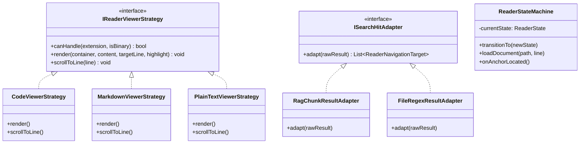
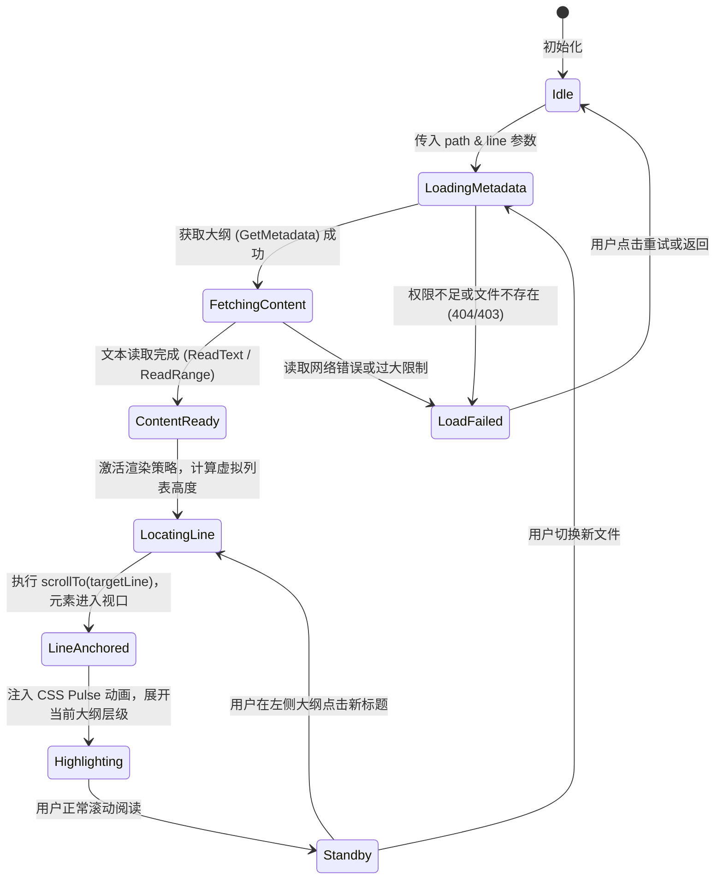
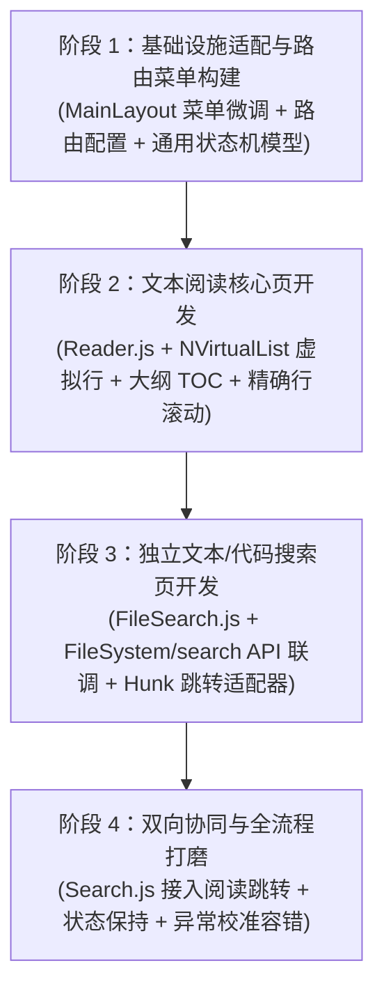

# 文件源管理与文本阅读中心架构设计与可行性调研方案

## 1. 需求背景与核心价值闭环

在知识库系统（ReferenceRAG）中，传统的搜索链路往往停留在 **“查询输入 → 返回切片（Chunk）摘要卡片”**。然而在实际研究、代码审计和知识阅读场景中，用户的真实认知路径是闭环的：


目前 ReferenceRAG 已经具备完善的底层文件系统读写能力（`FileSystemController`）、行范围流式读取（`IFileReaderService`）、Markdown 标题大纲提取、高性能文件正则/关键词匹配引擎（`IFileSearchEngine`）以及基础的数据源管理（`Sources.js`）和源管理抽屉（`SourceFileManagerDrawer.js`）。

但系统在 **“搜索到阅读的平滑跳转”** 与 **“独立深度的文本阅读器菜单”** 上仍存在断层：
1. **搜索结果无法直接在 Web 界面原位跳转阅读**：当前 `Search.js` 仅提供“在 Obsidian 中打开”或“深入查询”，若用户未配置外部 Obsidian URI，则无法直接在应用内阅读完整文件。
2. **源管理缺乏独立的阅读器视图**：现有的文件查看仅作为 `SourceFileManagerDrawer.js` 内的弹窗简单预览，不支持大文本虚拟滚动、代码行号装订线、语法着色及目录大纲联动。
3. **缺少专门的代码与文本精准搜索页**：现有的 `Search.js` 聚焦于向量混合检索，缺乏专门面向精确字串、文件名通配和正则行扫描的独立检索工作台。

因此，新增 **“文件源管理与文本阅读菜单功能”**，构建包含 **文本/代码搜索**、**精确到行流式阅读** 和 **双向状态协同** 的一体化工作台，具有极高的实用价值与技术可行性。

---

## 2. 现有系统基础设施与能力复用度评估

经过对 `ReferenceRAG` 代码库的全面探查，本项目在后端基础设施和前端核心组件上已经拥有极高的资产沉淀，**无需引入庞大臃肿的外部服务，复用度高达 85% 以上**：

| 模块分层 | 现有基础设施 / 库 | 当前实现位置 | 在新功能中的复用价值 |
| :--- | :--- | :--- | :--- |
| **后端检索引擎** | `IFileSearchEngine`<br>`ManagedFileSearchEngine` | `ReferenceRAG.Infrastructure`<br>`Features/FileSystem` | **100% 复用**。已实现基于 SIMD Teddy 算法的极速子串检索、.NET NonBacktracking 线性时间正则匹配、Hunk 智能合并有限状态机、二进制 NUL 探测早停与黑名单目录跳过。 |
| **后端流式阅读** | `IFileReaderService`<br>`FileReaderService` | `ReferenceRAG.Infrastructure`<br>`Features/FileSystem` | **100% 复用**。已实现 `ReadLineRangeAsync`（任意行范围滑动窗口流式读取，单行上限 64KB 防内存风暴，`byteOffset` 随机寻址）与 `GetMetadataAsync`（流式计算总行数、提取 Markdown Frontmatter 及 H1~H6 层级标题与行号）。 |
| **后端控制器** | `FileSystemController` | `ReferenceRAG.ApiHost`<br>`Controllers` | **100% 复用**。已有路由：<br>- `GET /api/FileSystem/browse`<br>- `GET /api/FileSystem/read-range` (支持 `startLine`, `endLine`)<br>- `GET /api/FileSystem/read-text` (整文件文本)<br>- `GET /api/FileSystem/metadata` (大纲与统计)<br>- `POST /api/FileSystem/search` (正则/字串检索)<br>- `GET /api/FileSystem/find-files` (文件名通配) |
| **安全与权限** | `ApiKeyPermissionMatrix`<br>`FileBrowserPath.IsWithin` | `ReferenceRAG.ApiHost.Services` | **100% 复用**。天然继承 API Key ABAC 矩阵与路径沙箱校验，彻底杜绝 `../` 目录遍历攻击与越权访问。 |
| **前端 API 包装** | `fileSystemApi` | `wwwroot/app/api/index.js` | **100% 复用**。已封装好 `browse`、`readRange`、`getMetadata`、`search`、`findFiles`、`readText`、`writeText` 等完整异步调用。 |
| **前端虚拟列表** | `NVirtualList` (Naive UI) | `wwwroot/vendor/naive-ui.js` | **100% 复用**。经过 Node ESM 环境探查，Naive UI 核心库内置导出了 `NVirtualList` 与 `NCode`，无需额外安装外部 npm 虚拟列表包即可处理数万行文本渲染。 |
| **前端大纲解析** | `marked` | `wwwroot/vendor/marked.js` | **100% 复用**。支持本地纯前端 Markdown AST 解析与渲染，可用于富文本阅读模式。 |
| **路由缓存系统** | `<keep-alive>` | `wwwroot/app/layouts/MainLayout.js` | **100% 复用**。当前 `MainLayout` 已配置 `<keep-alive :max="20">`，支持页面切换时保留搜索关键词、分页、展开项与滚动位。 |

---

## 3. 业界主流方案调研与标杆对比

针对“文本搜索 → 精确定位行阅读”的交互体验，调研了业界 4 款标杆系统：


### 3.1 深度技术对比矩阵

| 维度 | GitHub (Blob + Code Search) | VS Code Web (Monaco) | Sourcegraph | 本方案建议实践 (ReferenceRAG) |
| :--- | :--- | :--- | :--- | :--- |
| **行锚点定位协议** | URL Hash 模式：`#L42` 或 `#L42-L55` | 路径参数或命令栈：`openFile(uri, { selection: range })` | Query 模式：`?L42:10` | **Query + Hash 兼容契约**：<br>`/reader?source=X&path=foo.md&line=42&highlight=keyword#L42` |
| **大文件渲染机制** | 分段服务端水合 + 纯 CSS 虚拟化 | Monaco 自主 Canvas/DOM 视口裁剪 | 纯虚拟滚动列表 | **Naive UI `NVirtualList`**：按固定行高/动态插槽虚拟化，百万行无 DOM 停顿 |
| **高亮视觉反馈** | 目标行浅黄色背景闪烁，行号装订线变色 | 编辑器当前行底色高亮 + 行内字符 Range 装饰 | 字符级背景高亮 + 迷你地图标点 | **CSS 关键帧脉冲动画 (`@keyframes line-pulse`)** + 行内字串高亮 Tag |
| **目录/大纲联动** | 侧边栏 AST Symbols 树，点击滚到对应定义 | Outline 树形视图，与滚动位置双向联动响应 | 符号树，支持文件内外跨级导航 | **双栏布局**：左侧树形大纲（由 `getMetadata` 提供的 H1~H6），点击精准平移到对应行 |
| **阅读视图形态** | 纯源码视图 / Markdown 渲染视图切换 | 源码模式 / 预览模式（分栏或单栏切换） | 纯代码高亮视图 | **三模策略切换**：<br>1. 代码行号模式（Monospace + 虚拟滚动）<br>2. Markdown 双向渲染模式<br>3. 原始纯文本模式 |

---

## 4. 头脑风暴：可行性、逻辑缺陷与性能风险深度剖析

要在工程上落地“从搜索精准跳转到阅读器”，不能仅做简单的 `window.scrollTo`，必须深入排查以下 7 项关键逻辑陷阱与性能风险：

### 4.1 逻辑陷阱 1：文件磁盘变更导致的“行号漂移”（Stale Line Drift）
- **现象描述**：用户在 10:00 执行了搜索，命中了 `src/foo.cs` 的第 142 行；在 10:05 用户点击跳转前，外部编辑工具或 Git 拉取修改了该文件，前置插入了 10 行，导致原本的内容跑到了第 152 行。如果阅读器强行滚到 142 行，高亮的将是完全无关的内容。
- **治理策略**：
  1. **元数据快照指纹**：搜索结果返回时附带 `fileModifiedTime` 或 `contentHash`。
  2. **阅读器就绪时的上下文容错重定位（Contextual Fuzzy Match）**：
     - 阅读器接收到 `line=142` 和 `highlight="OnInitialized"` 时，先校验第 142 行文本是否包含 `"OnInitialized"`；
     - 若不包含，在目标行上下各 30 行窗口内执行局部扫描寻找最贴近的匹配行，自动修正为真实命中行，并弹出轻量通知：*“检测到文件变更，已自动为您校准至第 152 行”*。

### 4.2 逻辑陷阱 2：Markdown 渲染富文本与源码绝对行号的失真问题
- **现象描述**：Markdown 源码的第 80 行可能是一个无序列表项或表格的一行，但在通过 `marked.js` 渲染成富文本 HTML 后，由于 CSS 换行、段落边距、代码块折叠，HTML 元素与源码物理行数不再保持线性像素比例。
- **治理策略**：
  - **解耦“源码行模式”与“富文本渲染模式”**：
    - 精确到行的跳转，默认首先进入 **“带行号装订线的代码/源码视口”（Source View）**，保证 100% 的行号绝对对应；
    - 若用户切换为 **“富文本渲染模式”（Rendered Markdown）**，则基于 AST 解析为每个标题和段落注入 `data-line-start="80"` 属性，通过属性选择器定位 `document.querySelector('[data-line-start="80"]')` 执行最近块级定位。

### 4.3 逻辑陷阱 3：跨平台路径格式与安全沙箱穿越
- **现象描述**：Windows 系统下的物理路径（`D:\Repo\Docs\test.md`）包含冒号与反斜杠，在 URL Query 参数中若处理不当，可能导致路由解析失效、斜杠截断；恶意用户可能伪造 URL 参数 `?path=../../../../Windows/System32` 试图越权探测服务器文件。
- **治理策略**：
  - **前端统一正斜杠归一化与 URL 编码**：所有前端路径在放入路由参数前强制执行 `encodeURIComponent(path.replace(/\\/g, '/'))`。
  - **后端沙箱边界严格校验**：`FileSystemController` 强制执行 `FileBrowserPath.IsWithin(path, sourcePath)`，非所属源路径直接拒绝（HTTP 403 Forbidden）。

### 4.4 性能瓶颈 1：大文件渲染与超长行引发的 DOM 内存雪崩
- **现象描述**：若用户打开一个 3MB、20,000 行的日志、SQL 转储或源码文件，若直接在页面生成 20,000 个 `<tr>` 或 `<div>`，浏览器渲染进程将卡死数秒，内存瞬间暴涨数万 DOM 节点。
- **治理策略**：
  - **小文件（< 5,000 行）**：一次性加载全量文本，使用 Naive UI 的 `NVirtualList` 进行视口虚拟化渲染（屏幕只渲染可见的 40~50 行 DOM，滚动平滑至 60 FPS）。
  - **大文件（> 5,000 行）**：采用后端 `read-range` 滑动窗口分页加载，初始直接加载目标行周围的窗口数据（如 `[targetLine - 100, targetLine + 100]`），随用户滚动动态上滑/下滑追加内容块。

### 4.5 性能瓶颈 2：搜索结果展开与多 Hunk 渲染性能
- **现象描述**：全局正则搜索命中了几百个文件、数千处 Hunk，若全量一次性在前端展开渲染代码块，会导致搜索结果列表极度卡顿。
- **治理策略**：
  - 搜索结果按文件聚合，默认只展开匹配度最高的前 3 个文件；
  - 每个文件内部的 Hunk 采用手风琴（Collapse）折叠，展示简要匹配行数，点击展开后再做格式化着色。

### 4.6 交互状态防丢：浏览器前进/后退与 Keep-Alive 协同
- **现象描述**：用户在搜索页面输入复杂关键词、勾选特定数据源后，搜索出了 20 条结果；点击第 3 条结果跳转至阅读页面；阅读完毕后点击浏览器“返回”，若搜索页面刷新，用户输入的关键词、已检索出的列表和滚动位置全部丢失，交互体验极差。
- **治理策略**：
  - 在 `MainLayout.js` 的 `<keep-alive>` 中，将 `Search` 与 `Reader` 页面均纳入缓存名单；
  - 搜索状态（查询词、高级筛选、结果集、滚动 Top）同步保存在 Pinia/Store 或当前路由的组件实例中；
  - 阅读页面提供顶部的 **“返回搜索结果”** 显式面包屑/操作按钮，调用 `router.back()` 无感恢复。

---

## 5. 设计模式重构与架构落地

为了避免代码演化为“面条式”的庞大文件，必须引入合理的设计模式，将数据源、渲染展示、状态跳转进行解耦：



### 5.1 策略模式（Strategy Pattern）：多格式内容展示策略

针对不同后缀名与文件类型的阅读场景，抽象 `ReaderViewerStrategy`：

```typescript
// 1. 策略契约
export interface IReaderViewerStrategy {
    readonly name: string;
    canHandle(ext: string, isBinary: boolean): boolean;
    // 挂载并渲染
    mount(context: ReaderContext): void;
    // 精确定位至某行
    scrollToLine(line: number, smooth?: boolean): void;
    // 高亮指定关键词或行
    applyHighlight(line: number, keyword?: string): void;
}

// 2. 策略实装一：代码行号视口策略 (适用 .cs, .js, .ts, .json, .py, .yml 等)
export class CodeViewerStrategy implements IReaderViewerStrategy {
    readonly name = 'code';
    canHandle(ext: string, isBinary: boolean) {
        return !isBinary && ext !== '.md' && ext !== '.markdown';
    }
    mount(ctx: ReaderContext) {
        // 利用 Naive UI NVirtualList 构建行号装订线 + Monospace 视口
    }
    scrollToLine(line: number, smooth = true) {
        // NVirtualList.scrollTo({ index: line - 1, behavior: smooth ? 'smooth' : 'auto' })
    }
    applyHighlight(line: number, keyword?: string) {
        // 激活目标行 CSS 脉冲动画，并对关键词进行 Mark 标记
    }
}

// 3. 策略实装二：Markdown 语义双模策略 (适用 .md, .markdown)
export class MarkdownViewerStrategy implements IReaderViewerStrategy {
    readonly name = 'markdown';
    canHandle(ext: string, isBinary: boolean) {
        return !isBinary && (ext === '.md' || ext === '.markdown');
    }
    // 支持按源码行号精准跳转，以及目录大纲 (TOC) 联动
}

// 4. 策略工场 (Strategy Factory)
export class ReaderStrategyFactory {
    private static strategies: IReaderViewerStrategy[] = [
        new MarkdownViewerStrategy(),
        new CodeViewerStrategy(),
        new PlainTextViewerStrategy(),
        new BinaryFallbackStrategy()
    ];
    public static getStrategy(filePath: string, isBinary: boolean): IReaderViewerStrategy {
        const ext = '.' + filePath.split('.').pop()?.toLowerCase();
        return this.strategies.find(s => s.canHandle(ext, isBinary)) || new PlainTextViewerStrategy();
    }
}
```

### 5.2 适配器模式（Adapter Pattern）：统一搜索结果跳转契约

系统中存在两种截然不同的搜索结果来源：
1. **RAG 向量/混合检索**：返回 `displayChunks`，字段为 `chunk.filePath`、`chunk.startLine`、`chunk.endLine`、`chunk.content`；
2. **文件级快速/正则搜索**：返回 `FileSearchResult`，内含 `FileSearchMatchGroup`、`SearchHunk`、`SearchMatchLine` (`MatchIndex`, `MatchLength`)。

通过适配器将异构数据转换为标准导航模型 `ReaderNavigationTarget`：

```typescript
export interface ReaderNavigationTarget {
    sourceName: string;
    filePath: string;
    fileName: string;
    targetLine: number;
    endLine?: number;
    highlightPattern: string;
    isRegex?: boolean;
    previewSnippet?: string;
}

// 适配器统一转换
export class SearchHitAdapter {
    // 适配 RAG Chunk
    public static fromRagChunk(chunk: any, query: string): ReaderNavigationTarget {
        return {
            sourceName: chunk.source || '',
            filePath: chunk.filePath || '',
            fileName: (chunk.filePath || '').split('/').pop() || '',
            targetLine: chunk.startLine > 0 ? chunk.startLine : 1,
            endLine: chunk.endLine,
            highlightPattern: query,
            previewSnippet: chunk.content
        };
    }

    // 适配 FileSearch Hunk/Line
    public static fromFileMatch(file: any, line: any, query: string, isRegex: boolean): ReaderNavigationTarget {
        return {
            sourceName: file.sourceName,
            filePath: file.fullPath,
            fileName: file.relativePath.split('/').pop() || '',
            targetLine: line.lineNumber,
            highlightPattern: query,
            isRegex: isRegex,
            previewSnippet: line.text
        };
    }
}
```

### 5.3 状态机模式（Finite State Machine）：阅读器加载与锚点定位生命周期

防止文件加载网络延迟、行定位竞态、大纲解析未就绪导致的跳动与崩溃：



- **状态机优势**：保证只有在 `ContentReady` 且虚拟列表挂载完成后才触发 `LocatingLine`，避免在 DOM 为空时调用滚动导致定位失效；并在定位成功后单次触发高亮闪烁，防止重复触发。

---

## 6. 菜单重构与功能页面全景规划

### 6.1 菜单结构优化：新增“文件与阅读”中心

在系统侧边栏中，建议在“核心功能”或“数据管理”板块增加面向文件与阅读的独立模块：

```javascript
// MainLayout.js 菜单规划
{
    label: '文件与阅读',
    key: 'files-and-reading',
    icon: renderIcon(DocumentTextOutline),
    children: [
        {
            label: '源文件管理',
            key: 'Sources',              // 现有 Sources.js (路由已有，菜单正式外露)
            icon: renderIcon(FolderOutline)
        },
        {
            label: '文本代码搜索',
            key: 'FileSearch',           // 新增：专门的文件字串/正则精确搜索页
            icon: renderIcon(SearchOutline)
        },
        {
            label: '文档阅读器',
            key: 'Reader',               // 新增：全功能流式文本阅读器
            icon: renderIcon(BookOutline)
        }
    ]
}
```

### 6.2 页面一：文本代码精确搜索页面 (`FileSearch.js`)

不同于 `Search.js`（偏重语义混合向量搜索与重排），`FileSearch.js` 专注于 **秒级精确文件与正则代码排查**：
- **搜索控制面板**：
  - 关键词输入框（支持明文与正则表达式切换 `.*` 按钮）；
  - 数据源下拉选择（支持单选/全选）；
  - 文件通配符过滤（如 `*.md, *.cs, *.json`）；
  - 大小写匹配开关（`Aa`）；
  - 上下文行数调节（0 ~ 5 行）。
- **结果呈现列表**：
  - 文件分组展示（命中文件名、相对路径、命中次数 Badge）；
  - Hunk 代码块折叠呈现，匹配行加粗高亮；
  - **核心操作按钮**：每处命中行右侧提供 **“跳转阅读第 X 行”** 按钮。
- **跳转动作**：
  ```javascript
  const jumpToReader = (file, line) => {
      router.push({
          name: 'Reader',
          query: {
              source: file.sourceName,
              path: file.fullPath,
              line: line.lineNumber,
              query: searchQuery.value,
              isRegex: isRegex.value ? '1' : '0'
          }
      });
  };
  ```

### 6.3 页面二：文档文本阅读器页面 (`Reader.js`)

全屏双栏专业阅读工作台：

```
+----------------------------------------------------------------------------------------------------+
| 顶部操作栏: [返回搜索] | 路径面包屑: DataSources / MyNotes / arch.md | 行数: 1,420 | 编码: UTF-8        |
| 右侧工具: [源码/渲染切换] [字号 +/-] [搜索本文件] [下载文件] [在系统打开]                             |
+-----------------------------------+----------------------------------------------------------------+
| 左侧大纲与目录 (280px)              | 右侧主视口: NVirtualList / Code (动态撑满)                       |
| [目录大纲] [同级文件]               |                                                                |
|                                   |  138 |      public async Task<bool> VerifyAsync()                    |
| > 1. 项目架构演进 (L1)             |  139 |      {                                                         |
|   v 1.1 核心检索痛点 (L24)         |  140 |          // 正在核对数据源                                      |
|     - 向量匹配盲区 (L35)           |  141 |          var source = await GetSourceAsync();                  |
|     - 行号失真问题 (L58)           |>>142 |  >>>>    var result = await fileSearchEngine.Search();  <<<<   |
|   > 1.2 业界方案剖析 (L90)         |  143 |          return result.Success;                                |
|   > 1.3 状态机模型 (L150)          |  144 |      }                                                         |
|                                   |                                                                |
+-----------------------------------+----------------------------------------------------------------+
```

1. **左侧大纲抽屉/侧栏（TOC）**：
   - 自动调用 `fileSystemApi.getMetadata(path)`，实时渲染 H1~H6 树形标题；
   - 点击任一标题项，主视口瞬间平滑滚动至对应的 `heading.lineNumber`。
2. **主视口虚拟滚动（Virtual List）**：
   - 行号装订线（Gutter）与代码行左右联动；
   - 接收到路由参数 `line=142` 后，自动计算行高度或直接调用虚拟列表 API 居中滚动（`block: 'center'`）；
   - 注入 CSS 脉冲动画（例如 `@keyframes pulse-line { 0% { background: #ffeaa7; } 100% { background: transparent; } }`），保持 3 秒显眼提示后淡出。
3. **视图模式无缝切换**：
   - **源码行号模式**：极速虚拟列表，完全保真代码缩进与物理行；
   - **Markdown 渲染模式**：使用 `marked` 渲染富文本，标题带可点击锚点。

---

## 7. 搜索页面联动改造：现有 `Search.js` 扩展

在现有的向量/混合搜索页面 `Search.js` 中，现有卡片已经解析出了 `chunk.startLine` 与 `chunk.filePath`：

```javascript
// 在 Search.js 的每个匹配卡片操作栏中追加“原位阅读”按钮：
<n-space style="margin-top: 8px">
  <n-button text size="small" type="primary" @click="handleJumpToReader(chunk)">
    <template #icon><n-icon :component="BookOutline" /></template>
    原位阅读 (第 {{ chunk.startLine }} 行)
  </n-button>
  <n-button text size="small" @click="handleDrilldown(chunk)">
    <template #icon><n-icon :component="ArrowDownOutline" /></template>
    深入查询
  </n-button>
</n-space>
```

当用户点击该按钮时，同样直接调用路由跳转到 `Reader.js`，实现向量检索结果与阅读器的无缝打通。

---

## 8. 分阶段实施路径规划（Milestones）



### Milestone 1：路由与导航重构
- 在 `wwwroot/app/router/index.js` 中注册 `/reader` 与 `/file-search`；
- 在 `MainLayout.js` 的侧边栏中配置“文件源与阅读”专属菜单组与 Ionicons 图标；
- 建立 `SearchHitAdapter` 与 `ReaderNavigationTarget` 基础规范。

### Milestone 2：全功能文本阅读器（`Reader.js`）
- 基于 Naive UI `NVirtualList` 实现行号与文本的虚拟渲染；
- 接入 `fileSystemApi.readText` 与 `fileSystemApi.getMetadata`；
- 实现 URL 参数解析（`path`, `line`, `highlight`）；
- 完成动态高度行精确定位逻辑与 CSS 高亮脉冲动效。

### Milestone 3：独立文本搜索页（`FileSearch.js`）
- 接入后端已有的 `POST /api/FileSystem/search`；
- 实现关键词与正则表达式检索交互；
- 实现以文件为维度的 Hunk 折叠与匹配行渲染；
- 一键跳转按钮绑定 `jumpToReader`。

### Milestone 4：全局检索联动与端到端优化
- 在 `Search.js` 中为每个召回切片添加“原位阅读”一键直达入口；
- 启用 Vue `<keep-alive>` 保证前进后退不丢失检索参数与滚动位；
- 落地行号漂移检测与就近容错高亮。

---

## 9. 结论与技术裁决

1. **绝对可行**：后端已具备完善的 `ManagedFileSearchEngine`（SIMD/Teddy + DFA/NonBacktracking 正则）、`FileReaderService`（按行流式与大纲提取）以及完整权限沙箱；前端 Naive UI 原生内置 `NVirtualList`，无需引入任何额外第三方 npm 依赖包。
2. **架构优良**：通过适配器模式解决多源结果格式差异，通过策略模式实现代码/Markdown/纯文本多模渲染，通过状态机杜绝渲染与定位的竞态条件。
3. **体验飞跃**：将 ReferenceRAG 从单一的“知识库碎片召回工具”升级为“搜索、排查、阅读与研读一体化工作台”。

---

## 10. 源管理与知识库连接器的边界（2026-11-13 实施）

### 10.1 实体关系

- **知识库（KB）**：逻辑归属与治理单元（嵌入规范、分块规范、文档/切片、漂移检测、重建）。
- **连接器（Connector）**：`{知识库 → 物理目录}` 的挂载点，`Kind=LocalFolder`，由 `ICatalogStore` 持久化。
- **`config.Sources`**：旧版源注册表，仍用于文件监控与旧索引链路。
- **聚合视图**：`GET /api/Sources` 把 `config.Sources` 与所有连接器合并返回（按 `Path` 去重），连接器行 `Type=KnowledgeBaseConnector`、`Name="{知识库名} - {目录名}"`。
- **双写**：`POST /api/Sources` 新增源时，除写入 `config.Sources` 外，还会异步注册为第一个启用知识库的 `LocalFolder` 连接器（`SourcesController.Create`）。

### 10.2 接口契约

| 操作 | `config.Sources` 行 | 连接器行 |
| :--- | :--- | :--- |
| `GET /api/Sources/{name}` | 200 | 200，`IsConnector=true`，附带 `KnowledgeBaseId` / `ConnectorId` |
| `GET /api/Sources/{name}/files` | 索引查询（`files.source`） | **目录枚举**（按 `TargetPath` + `FilePattern`，不依赖索引 `source` 字段） |
| `GET /api/Sources/{name}/scan` | 目录扫描 | 目录扫描 |
| `PUT /api/Sources/{name}` | 正常 | **409** `ConnectorManagedByKnowledgeBase` |
| `DELETE /api/Sources/{name}` | 正常 | **409** 同上 |
| `PATCH /api/Sources/{name}/toggle` | 正常 | **409** 同上 |
| `POST /api/index/rebuild/{name}`、`rechunk/{name}` | 正常 | **409** 同上，提示在知识库管理中重建 |

409 载荷包含 `code`、`knowledgeBaseId`、`knowledgeBaseName`、`connectorId`、`connectorPath`，前端可据此定位。

### 10.3 实现位置

- `SourcesController.ResolveSourceAsync`：先 `config.Sources`，再遍历 `ICatalogStore` 连接器，按「显示名 / TargetPath」匹配并投影为只读 `SourceFolder`；
- `SourcesController.ConnectorWriteConflict`：统一 409 响应；
- `SourcesController.EnumerateConnectorFiles`：连接器文件列表按目录枚举并分页；
- `IndexController.TryBuildConnectorConflictAsync`：重建索引 / 切片的 409 识别；
- `Sources.js`：`isConnectorRow` 分支，连接器行仅保留「文件管理 / 搜索 / 探查 / 去知识库管理」。

### 10.4 注意事项

- 连接器的索引统计（文件数 / 分块数）不在源管理展示，应在知识库管理查看；源管理对连接器显示 `-`。
- 索引写入的 `source` 字段取自索引调用方传入的 `SourceFolder.Name`（`FileIndexPipeline.PrepareAsync`），**不能假定等于连接器显示名**，因此连接器的只读文件列表走目录枚举而非索引查询。
- 若后续需要「连接器索引统计」或「在源管理内重建连接器」，应扩展为按 `TargetPath` 前缀查询索引，或直接调用 `/knowledge-bases/{id}/reindex`。
