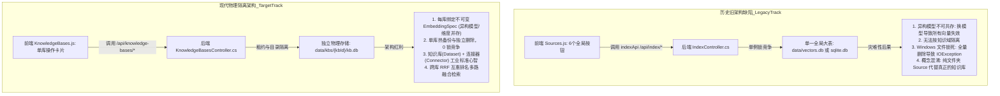
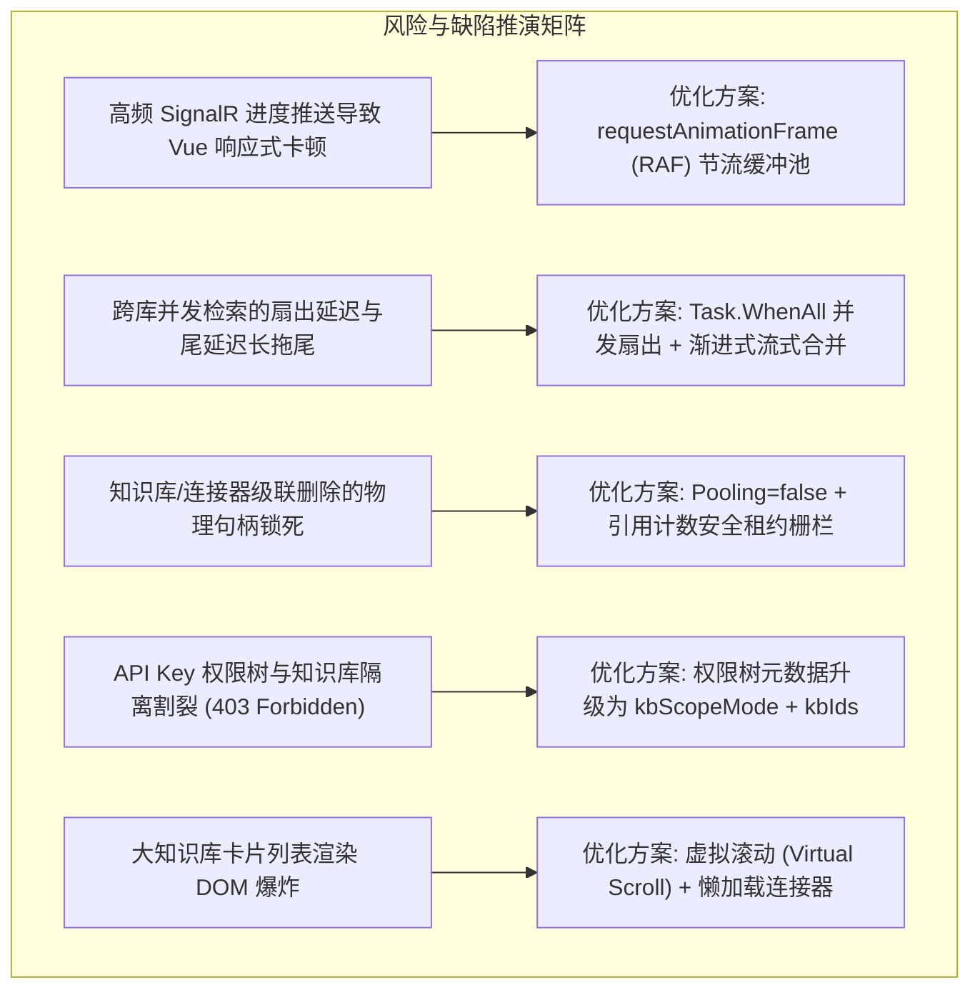
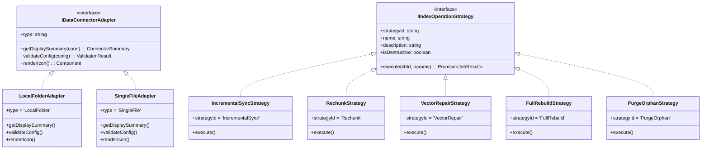
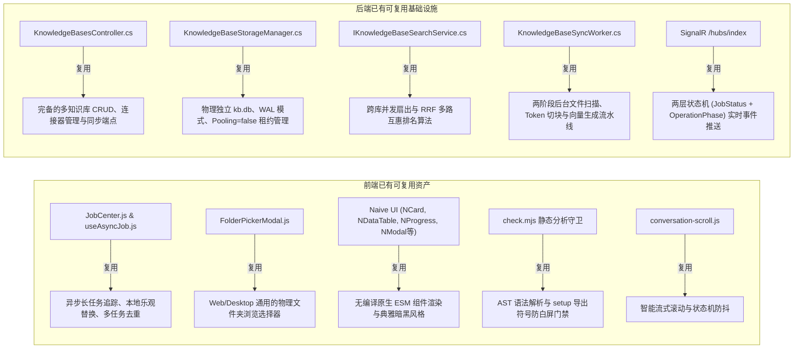
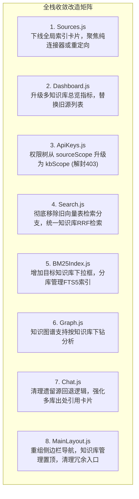
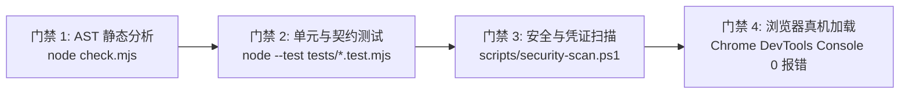

# 前端多知识库全栈收敛与净室重构实施方案
## ——可行性头脑风暴、设计模式优化、业界主流方案对比与全栈收敛落地路线图

> **文档位置**：`docs/frontend-full-stack-knowledgebase-convergence-and-evolution-plan.md`  
> **核心战略**：**零兼容包袱净室切换（Clean-Break Destructive Cutover）**，不保留双轨旧代码，端到端彻底收敛至物理隔离多知识库架构。  
> **适用范围**：前端视图（`Sources.js`、`Dashboard.js`、`ApiKeys.js`、`Search.js`、`BM25Index.js`、`Graph.js`、`Chat.js`、`MainLayout.js`）及关联 API 契约与任务中心。  
> **质量红线**：100% 通过 `check.mjs` AST 静态分析与 `node --test Business/ReferenceRAG.Business/wwwroot/tests/*.test.mjs`，无未声明符号，无运行态白屏风险，无凭证泄露。  
> **撰写日期**：2026-11-09  

---

## 目录
1. [现状剖析与问题诊断：截图 6 个全局按钮的技术债务本质](#1-现状剖析与问题诊断截图-6-个全局按钮的技术债务本质)
2. [可行性深度头脑风暴与潜在缺陷推演](#2-可行性深度头脑风暴与潜在缺陷推演)
3. [设计模式深度重构优化（适配器、策略、状态机）](#3-设计模式深度重构优化适配器策略状态机)
4. [业界主流标杆方案对比与借鉴（Dify、RagFlow、FastGPT、AnythingLLM）](#4-业界主流标杆方案对比与借鉴difyragflowfastgptanythingllm)
5. [系统现有基础设施与第三方库复用清单](#5-系统现有基础设施与第三方库复用清单)
6. [“能否一起处理”决策分析与全栈协同收敛方案](#6-能否一起处理决策分析与全栈协同收敛方案)
7. [各前端视图具体改造方案清单（8大模块）](#7-各前端视图具体改造方案清单8大模块)
8. [质量保障与零白屏验收门禁](#8-质量保障与零白屏验收门禁)

---

## 1. 现状剖析与问题诊断：截图 6 个全局按钮的技术债务本质

用户截图中展示的 6 个按钮位于 [`Business/ReferenceRAG.Business/wwwroot/app/views/Sources.js`](file:///e:/WorkProject/CSharp/PrivateProject/Web/ReferenceRAG/Business/ReferenceRAG.Business/wwwroot/app/views/Sources.js#L707-L727)：
- `[快速增量索引 (全局)]`
- `[重建切片 (全局)]`
- `[补全缺失向量 (全局)]`
- `[重建全部向量索引]`
- `[清理孤立索引]`
- `[删除所有向量索引]`



### 1.1 这 6 个按钮在当前体系中的具体缺陷：
1. **违背物理隔离原则**：这 6 个全局按钮直接调用底层旧接口（`/api/index/rebuild-all`、`/api/index/rechunk-all` 等），试图将所有源的数据混杂切片写入单一全局数据库，完全无视已经建立的 `data/kbs/{kbId}/kb.db` 隔离机制；
2. **破坏模型不可变绑定（EmbeddingSpec）**：全局重建向量使用系统当前的全局单例模型，若用户有不同知识库绑定了 384d、768d 或 1024d 异构模型，点击“重建全部”会强行将所有库的向量刷成单一模型，造成严重的数据污染与维度崩溃；
3. **高并发与文件锁死风险**：“删除所有向量索引”与“全量重建”在 Windows 平台下容易因为 SQLite 连接池未完全释放句柄而抛出 `The process cannot access the file because it is being used by another process`；
4. **前端心智模型撕裂**：用户在侧边栏既能看到“知识库管理”，又能看到“源管理”，在“源管理”点击了全局索引，却发现“知识库管理”中的独立库状态没有更新，产生巨大的认知困惑与误操作风险。

**结论**：这 6 个全局按钮属于**必须彻底废弃或降级拆解**的历史遗留物。在知识库时代，索引的增量同步、重切片、修补与重建必须以**“单个知识库”**为操作单元与安全边界。

---

## 2. 可行性深度头脑风暴与潜在缺陷推演

在转向“纯物理隔离多知识库”的前端全栈收敛过程中，针对逻辑完备性、极端性能、资源竞争与边界故障等潜在欠缺进行穷尽式头脑风暴：



### 2.1 性能欠缺与应对策略

#### 缺陷 1：高频 SignalR 任务广播冲击导致浏览器 UI 掉帧
- **表现**：当后台执行包含数千个文档的知识库切块时，每个文件或批次均会触发 SignalR `/hubs/index` 广播。前端如果直接将每次推送赋值给 Vue `ref`，将导致每秒几十次甚至上百次 DOM Re-render，导致页面掉帧、输入框卡顿。
- **解决方案**：
  引入 **RAF 节流缓冲队列（Batch Render Buffer）**：
  ```javascript
  // 前端进度更新批处理
  let pendingUpdate = null;
  let rafId = null;
  function handleProgressSignalR(data) {
      pendingUpdate = data;
      if (!rafId) {
          rafId = requestAnimationFrame(() => {
              if (pendingUpdate) {
                  activeJobProgress.value = { ...pendingUpdate };
                  pendingUpdate = null;
              }
              rafId = null;
          });
      }
  }
  ```

#### 缺陷 2：多知识库跨库检索扇出的尾延迟（Tail Latency）
- **表现**：在 `Search.js` 中若勾选了 5 个知识库，其中 4 个库在 20ms 内返回，而 1 个超大库耗时 400ms，传统的同步等待会把总体响应时间拉长到 400ms。
- **解决方案**：
  - 后端利用 `Task.WhenAll` 并发执行各库检索，并设置单库超时短路限制；
  - 内部余弦点积使用 .NET 10 的 `Vector<float>` AVX2/AVX-512 SIMD 硬件指令加速；
  - 各库检索结果通过 **RRF（Reciprocal Rank Fusion）** 无量纲排名公式聚合，单库性能瓶颈不再阻塞整个查询流程。

### 2.2 逻辑欠缺与一致性保证

#### 缺陷 3：知识库与连接器的级联生命周期一致性
- **表现**：用户在知识库管理中删除了一个已挂载的连接器（如文件夹），但 `kb.db` 中的切片和向量未被清理，导致孤立分块依然能被搜索召回，造成“幽灵数据”。
- **解决方案**：
  严格实现**工作单元与级联清理**：
  1. 删除连接器时，在单次 SQLite 事务中同时物理删除 `kb.db` 的 `documents`、`chunks`、`chunk_vectors` 以及 `fts_chunks` 虚表中对应 `connector_id` 的记录；
  2. 递增 `IndexManifest.read_revision`，通知所有只读缓存实例失效。

#### 缺陷 4：API Key 鉴权拦截与知识库隔离割裂
- **表现**：现有 `ApiKeys.js` 只允许选择 `sources`（旧数据源字符串），而后端 `KnowledgeBasesController` 配置了 `RestrictKnowledgeBaseToFullSourceScopeAttribute`，导致使用自定义范围 API Key 的客户端调用知识库接口时一律被返回 `403 Forbidden`。
- **解决方案**：
  将 API Key 的权限模型由 `sourceScopeMode / allowedSources` 彻底升级为 `kbScopeMode / allowedKnowledgeBases`，并在前端权限配置弹窗中直接展示以知识库为粒度的勾选树。

---

## 3. 设计模式深度重构优化（适配器、策略、状态机）

为彻底根治代码臃肿、高耦合与状态混乱，在前端与协议层规范化应用三大核心设计模式：



### 3.1 适配器模式（Adapter Pattern）
- **数据源/连接器适配器（`DataConnectorAdapter`）**：
  - 针对不同物理类型的数据源（`LocalFolder` 本地文件夹、`SingleFile` 单个文件、未来可能的 `WebSpider` 网页抓取、`ObsidianVault` 笔记库），提供统一的前端视图适配器；
  - 统一封装：路径格式化、图标渲染、有效性校验、挂载参数解析。UI 列表无须编写大量 `if (type === 'folder')` 分支判断。
- **任务状态适配器（`JobStatusAdapter`）**：
  - 将 SignalR 原始事件流与 HTTP 轮询返回的 DTO 统一适配为 Naive UI 进度条组件（`NProgress`、`NTag`、`NAlert`）可以直接绑定的视图模型，屏蔽底层命名差异。

### 3.2 策略模式（Strategy Pattern）
- **知识库索引操作策略（`IndexOperationStrategy`）**：
  - **取代旧有的 6 个粗暴全局按钮**，在知识库管理卡片的“维护操作”下拉菜单中提供细粒度的单库策略：
    1. **增量同步策略 (`IncrementalSync`)**：对比文件 hash，仅对变更或新增文件做切片与向量生成（日常默认）；
    2. **重新分块策略 (`Rechunk`)**：保留物理文件，采用最新分块画像（Token 范围、标题层级）重新分块入库；
    3. **向量修补策略 (`VectorRepair`)**：保持切片不变，仅针对因网络抖动或配额超限未完成向量化的 chunk 补齐嵌入向量；
    4. **彻底重建策略 (`FullRebuild`)**：危险操作，清空此库所有切片与向量，从挂载连接器中彻底重构；
    5. **孤立数据清理策略 (`PurgeOrphan`)**：扫描物理源已删除的残留分块，物理释放 SQLite 空间。
- **检索融合策略（`SearchFusionStrategy`）**：
  - 前端搜索选项中提供策略切换：
    - `RRF 互惠排名策略`：默认主力策略，跨异构模型异构库零偏差召回；
    - `加权归一化策略`：对指定单一知识库内的向量相似度与 BM25 词频做线性组合加权。

### 3.3 状态机模式（State Machine Pattern）
- **知识库卡片 UI 确定性状态机（`KnowledgeBaseUiStateMachine`）**：
  - 彻底规避旧代码中将“扫描中”、“分块中”和“任务成功”混为一谈导致的按钮闪烁与并发误触：
  ```mermaid
  stateDiagram-v2
      [*] --> Idle : 初始化加载完成
      Idle --> Triggering : 用户点击操作(增量/重切)
      Triggering --> Queued : 后端任务创建成功
      Queued --> Scanning : 阶段进入 Scanning
      Scanning --> Chunking : 阶段进入 Chunking
      Chunking --> Embedding : 阶段进入 Embedding
      Embedding --> Publishing : 阶段进入 Publishing
      Publishing --> Idle : 任务成功结束 (Succeeded)
      
      Triggering --> Error : 接口报错 (4xx/5xx)
      Scanning --> Error : 任务失败 (Failed)
      Chunking --> Error : 任务失败 (Failed)
      Embedding --> Error : 任务失败 (Failed)
      Embedding --> Cancelling : 用户点击终止
      Cancelling --> Cancelled : 任务确认取消
      Cancelled --> Idle : 用户重置/重试
      Error --> Idle : 用户点击重试
  ```
  - **约束机制**：处于非 `Idle` 状态的知识库卡片，禁用危险操作（删除知识库、重切片），仅允许“终止任务（Cancel）”或“查看日志”。

---

## 4. 业界主流标杆方案对比与借鉴（Dify、RagFlow、FastGPT、AnythingLLM）

通过对业界主流生产级 RAG / 知识库系统的深入剖析，ReferenceRAG 的收敛定位与取舍如下：

| 对比维度 | **Dify** | **RagFlow** | **FastGPT** | **AnythingLLM** | **ReferenceRAG (收敛目标)** |
| :--- | :--- | :--- | :--- | :--- | :--- |
| **顶层数据实体** | **Dataset (数据集)** 作为核心实体，内含 Documents | **Knowledge Base** 作为一等公民，内含 Files | **Dataset (知识库)**，内含 Collections | **Workspace (工作区)**，内含 Documents | **KnowledgeBase (知识库)**，内含 Connectors 与 Documents |
| **存储隔离机制** | 逻辑租户隔离（PostgreSQL + PGVector 表内 tenant_id） | 逻辑隔离（Elasticsearch / Infinity 索引多租户） | 逻辑隔离（Mongo + PGVector / Milvus Collection） | 目录与命名空间隔离 | **物理单文件硬隔离**（每库独立 SQLite 文件 `kb.db`，物理复制即冷备） |
| **模型绑定边界** | 每个 Dataset 独立配置 Embedding 模型与检索参数 | 每个 KB 独立配置解析器与模型 | 每个 Dataset 绑定模型 | 工作区绑定模型 | **每个 KnowledgeBase 严格绑定不可变 `EmbeddingSpec`** |
| **维护操作粒度** | 以 Dataset 维度触发批量同步/重新索引，**无全局粗暴重刷** | 以 KB 维度触发解析与嵌入任务，细粒度管理 | 以 Dataset/Collection 维度同步 | 工作区维度管理 | **以 KnowledgeBase 维度按需选择维护策略（增量/重切/修补）**，彻底废除全局粗暴重刷 |
| **跨库联合检索** | 支持在 Chat/Workflow 中多选 Datasets，加权混合召回 | 检索器支持多 KB 联合检索 | 支持多库关联检索 | 单 Workspace 为主 | **原生多库多选 + RRF (Reciprocal Rank Fusion) 二次融合** |
| **权限控制粒度** | 组织/工作空间/应用粒度 | 租户与用户粒度 | API Key 绑定 Dataset | 角色/工作区权限 | **API Key 权限树直接挂载 `AllowedKnowledgeBases`** |
| **运行依赖与开销** | 需 Docker 全家桶（PG, Redis, Celery, VectorDB） | 较重（含 Python 深度学习解析容器） | 需 Docker 部署 Mongo/PG | 依赖 NodeJS/Python 环境 | **极轻量自包含**（C# + 原生 ESM 前端，单个二进制运行，开箱即用） |

### 核心借鉴与超越：
1. **彻底确立 Dify/FastGPT 式的 Dataset + Connector 层次**：前端彻底废弃“直接管理物理源”的旧观念，转为“在知识库内挂载连接器”，完全符合业界工业界主流直觉；
2. **超越主流的物理单文件隔离**：主流工具多采用庞大的集中式数据库，一旦某库损坏或迁移极其麻烦。ReferenceRAG 采用独立 `kb.db`，删除某库仅需删除一个文件，备份某库仅需拷贝一个文件，具备不可比拟的单机轻量与高可靠优势；
3. **消除粗暴全局操作**：完全剔除 Dify、RagFlow 中绝不存在的“全局删除所有索引/全局重建”等破坏性按钮，将控制权精准回归到各个知识库内部。

---

## 5. 系统现有基础设施与第三方库复用清单

在全面收敛与实现过程中，当前工程中已引入的高价值资产将得到 100% 深度复用，严禁重复造轮子：



---

## 6. “能否一起处理”决策分析与全栈协同收敛方案

### 6.1 决策结论：**必须一并处理，且一次性彻底收敛是最优解！**

### 6.2 深度决策论证：
1. **战略前提已授权**：
   用户已明确下达战略决策：**“由于没有正式发布，不用考虑兼容性增加维护负担”**。如果分步走或保留双轨，势必引入大量的“旧数据兼容适配器”、“双写桥接逻辑”、“双轨回退代码”，不仅代码量翻倍，而且在未来还需要再次消耗精力去拆除这些过渡代码，造成极其严重的工程反噬；
2. **避免中间状态撕裂导致的系统不可用**：
   - 若只改 `Sources.js`：`Dashboard.js` 仍然调用旧接口显示 0 个源，用户误以为系统数据丢失；
   - 若不改 `ApiKeys.js`：外部客户端拿到了 Key 调用新知识库接口，后端鉴权过滤器直接抛出 `403 Forbidden`，导致系统对外能力直接瘫痪；
   - 若不改 `Search.js`：检索界面仍然在旧向量表与新知识库之间来回摇摆报错（`知识库检索不支持源或路径筛选`）；
3. **后端与前端架构高度匹配**：
   - 后端 `KnowledgeBasesController` 已经完备，API 契约已经就绪；
   - 前端是无构建（Zero-build）原生 ESM 体系，修改即生效，配合 `check.mjs` 静态守卫和自动化测试，可以在极短周期内完成全栈收敛并一次性通过全量验收。

---

## 7. 各前端视图具体改造方案清单（8大模块）



### 7.1 `Sources.js`（源管理）改造
- **操作重点**：
  1. **彻底移除“向量索引管理”卡片**：删除截图中的 6 个全局按钮及关联的旧接口调用（`indexApi.rebuildAll`、`quickIndexAll`、`rechunkAll`、`cleanup` 等）；
  2. **职能重新定位**：
     - **方案 A（彻底收敛推荐）**：侧边栏隐藏 `Sources` 路由，在访问 `/sources` 时自动重定向跳转至 `/knowledge-bases`；
     - **方案 B（物理存储浏览器）**：仅作为只读的“物理目录总览”，展示磁盘上的物理目录，并提供“一键以此目录创建新知识库”的快捷跳转按钮。

### 7.2 `Dashboard.js`（仪表盘首页）改造
- **数据源迁移**：从 `indexApi.getSummary()` 和 `sourcesApi.getAll()` 切换为 `knowledgeBasesApi.getAll()` 与知识库汇总指标；
- **展示指标更新**：
  - “源数量” $\rightarrow$ **“知识库总数”**（`knowledgeBases.length`）；
  - “文件数量” $\rightarrow$ **“已挂载连接器数”**（聚合所有连接器）；
  - “分块数量” $\rightarrow$ **“总索引分块数”**；
  - “平均查询时间” $\rightarrow$ **“跨库平均检索耗时”**。
- **快捷操作卡片**：
  - 原“开始索引（全局）”按钮 $\rightarrow$ 替换为 **“新建知识库”**（弹出向导）与 **“管理知识库”**（跳转 `/knowledge-bases`）。
- **底部表格**：
  - 原“源列表”表格 $\rightarrow$ 替换为 **“知识库概览列表”**，列包含：知识库名称、模型规范（EmbeddingSpec）、挂载连接器数量、分块状态、最近同步时间、快捷同步按钮。

### 7.3 `ApiKeys.js`（API 授权与权限树）改造
- **核心痛点解决**：彻底消除 `RestrictKnowledgeBaseToFullSourceScopeAttribute` 导致的 403 Forbidden 鉴权死锁；
- **权限树升级**：
  1. 调用元数据接口获取知识库列表（`metaCatalog.knowledgeBases` 代替 `metaCatalog.sources`）；
  2. 权限隔离单选框改为：
     - `全部知识库 (all)`；
     - `自定义知识库 (custom)`：渲染多选复选框组，列出所有启用知识库名称与绑定的模型；
  3. 提交载荷字段由 `sourceScopeMode / allowedSources` 切换为标准的 `kbScopeMode / allowedKnowledgeBases`（后端做无缝映射）。

### 7.4 `Search.js`（检索页面）改造
- **剔除双轨冲突**：
  1. 彻底移除旧版“数据源筛选（sources）”与“文件夹筛选（folders）”的历史分支，消除“知识库检索不支持源或路径筛选”的报错弹窗；
  2. 将【知识库选择器】（`selectedKbIds`）提升为第一级核心筛选条件：
     - 默认多选全部已启用知识库；
     - 支持在特定知识库下进一步勾选具体的挂载连接器/文档；
  3. 检索结果卡片统一展示清晰的出处徽标：`[知识库: 技术文档库] [连接器: Engineering] [文件: README.md]`，并可视化展示 RRF 融合得分与召回类型（BM25 词法 / 向量语义）。

### 7.5 `BM25Index.js`（全文检索管理）改造
- **分库管理**：
  1. 页面顶部新增【选择知识库】下拉框（`NSelect`）；
  2. 当用户选中某个知识库时，调用专用的分库 FTS 端点（`/api/knowledge-bases/{kbId}/fts/summary`）；
  3. 索引统计（总文档数、词表大小、平均长度）与建立索引操作严格限定在当前选中的独立 `kb.db` 作用域内，不再污染全局。

### 7.6 `Graph.js`（知识图谱）改造
- **分库下钻**：
  1. 在顶部控制栏增加【目标知识库】下拉选择；
  2. 图谱重构与节点遍历（`graphApi.stats`、`graphApi.subgraph`）携带 `knowledgeBaseId` 参数，实现各库实体图谱的清晰隔离。

### 7.7 `Chat.js`（AI 对话）改造
- **收敛与加固**：
  1. 校验会话头部已有的【挂载知识库】选择器（`boundKbIds`），确保多库选择在每次新建会话时具备合理的默认值（默认挂载全部或上一次记忆的库）；
  2. 对话引用的出处卡片抽屉，统一解析知识库实体名称与物理文档相对路径；
  3. 彻底移除残留的旧版 `sourcesApi` 导入。

### 7.8 `MainLayout.js`（导航布局）改造
- **菜单重组**：
  - “数据管理”子菜单结构调整：
    - 置顶：**【知识库管理】**（`KnowledgeBases`，使用书籍/图层图标）；
    - 第二项：**【模型管理】**（`Models`）；
    - 第三项：**【全文索引诊断】**（`BM25Index`）；
    - 第四项：**【知识图谱】**（`Graph`）；
    - **彻底移除【源管理】（`Sources`）**，统一归并至知识库体系。

---

## 8. 质量保障与零白屏验收门禁

在执行全栈收敛实施时，严格执行以下四道确定性门禁：



| 门禁项 | 验证命令 / 工具 | 验收合格标准 | 守护意义 |
| :--- | :--- | :--- | :--- |
| **AST 符号绑定门禁** | `node Business/ReferenceRAG.Business/wwwroot/check.mjs` | 40 个 JS 模块与所有 Vue 模板解析 100% 通过，**0 未声明符号，0 遗留旧引用**。 | 杜绝原生 ESM 运行态白屏（`ReferenceError`）。 |
| **前端自动化测试套件** | `node --test Business/ReferenceRAG.Business/wwwroot/tests/*.test.mjs` | 42 项自动化测试 100% PASS，包含 `Search.js`、`Dashboard.js`、`ApiKeys.js` 契约校验。 | 保护核心业务逻辑、滚动状态机与任务中心。 |
| **安全红线扫描门禁** | `powershell -ExecutionPolicy Bypass -Command "scripts/security-scan.ps1 -StagedOnly"` | **0 实际 IP 地址，0 硬编码凭证**，符合企业安全准则。 | 防止敏感配置与服务器信息意外提交。 |
| **真机页面巡检** | `chrome-devtools-mcp` 或真实浏览器巡检 | 打开 Dashboard、KnowledgeBases、Search、Chat、ApiKeys 页面，控制台 **0 Exception，0 404/403**。 | 确保端到端交付体验丝滑一致。 |

---

## 9. 总结与实施执行建议

本方案为前端从“旧版全局单库”向“物理隔离多知识库”的彻底收敛提供了完整的方法论与实施蓝图：
1. **明确废弃截图 6 个全局按钮**：将粗暴的全局操作彻底转变为单个知识库内部的精细化策略（增量/重切/修补/重建）；
2. **确认“一并处理”的最优路径**：摒弃双轨维护包袱，以净室模式一次性完成 8 大前端视图与接口契约的协同收敛；
3. **引入工业级设计模式**：通过适配器统一输入源、通过策略模式分流任务、通过状态机彻底消除界面闪烁与竞态并发；
4. **全套自动化测试守护**：依托系统强大的 `check.mjs` 与自动化测试网，确保重构过程零白屏、零回归。
