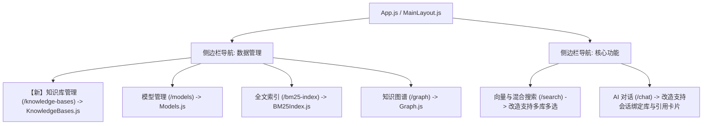
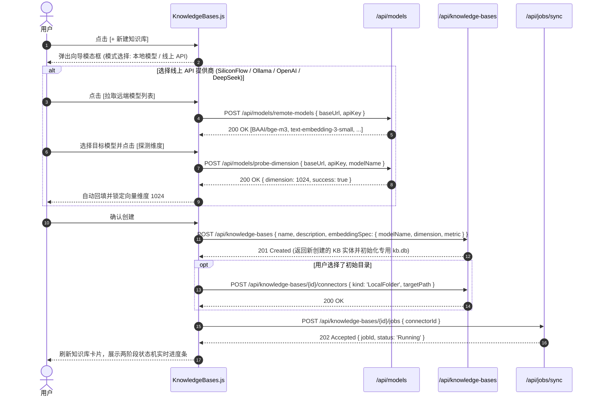
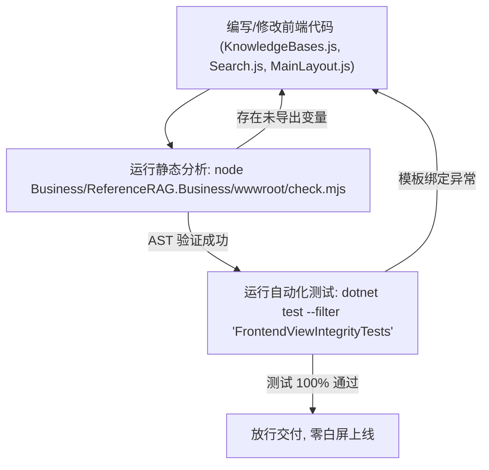

# 前端多知识库 UI 交互重构与界面改造工程规范
## ——Vue 3 + Naive UI 体系下的组件拓扑、状态流转、原型设计与零白屏实施蓝图

> 文档位置：`docs/frontend-knowledgebase-ui-architecture-and-migration-specification.md`  
> 适用技术栈：Vue 3 (Composition API / Setup) + Naive UI + Pinia + SignalR + ESM Module  
> 质量守卫要求：必须 100% 通过 `check.mjs` AST 静态分析与 `FrontendViewIntegrityTests` 自动化门禁。  
> 撰写日期：2026-11-01  

---

## 目录
1. [前端改造总体目标与设计原则](#1-前端改造总体目标与设计原则)
2. [前端路由与导航系统重构](#2-前端路由与导航系统重构)
3. [核心新建视图：`KnowledgeBases.js` 详细设计](#3-核心新建视图knowledgebasesjs-详细设计)
4. [现有视图增强改造设计 (`Search.js` 与 `Chat.js`)](#4-现有视图增强改造设计-searchjs-与-chatjs)
5. [前端 API 层与契约适配 (`app/api/index.js`)](#5-前端-api-层与契约适配-appapiindexjs)
6. [一键无感迁移向导设计](#6-一键无感迁移向导设计)
7. [零白屏质量保障与 AST 校验流程](#7-零白屏质量保障与-ast-校验流程)

---

## 1. 前端改造总体目标与设计原则

### 1.1 核心问题定位
后端的单源物理隔离（`catalog.db` + 每库 `kb.db`）、两层任务状态机、多模型显存动态调度以及跨库 RRF 检索已全面交付，但前端视图目前仍然停留于旧版单源混杂逻辑：
- 现有 `Sources.js` 只能管理无物理隔离的纯本地路径；
- 现有 `Search.js` 只能对全局单一向量索引发起查询，无法展示多库隔离来源与多路 RRF 排名；
- 现有 `Chat.js` 无法按会话选择绑定的知识库集合，更无法可视化引用出处。

### 1.2 前端改造四大设计原则
1. **心智模型对齐（Dataset + Connector）**：
   与 Dify、FastGPT、RagFlow 等主流产品对齐，确立“**知识库（Knowledge Base）作为存储/模型边界，连接器（Connector）作为输入通道**”的一级心智模型；
2. **零白屏与 AST 守卫契约**：
   由于前端运行于自包含 ESM 模式且配置了 `check.mjs` 静态分析与 `FrontendViewIntegrityTests`，所有组件的 `setup` 导出变量、模板插槽与引用图标必须 100% 静态闭环，杜绝任何运行态 `ReferenceError`；
3. **极简操作流（30 秒建库同步）**：
   提供“**库名与描述 → 绑定模型规范 → 选择本地文件夹 → 一键触发后台两阶段同步**”的沉浸式向导；
4. **渐进式零破坏切换**：
   保留原有数据目录不破坏，提供“**从现有旧数据源一键初始化为新知识库**”的平滑向导卡片。

---

## 2. 前端路由与导航系统重构



### 2.1 侧边栏菜单更新（[`app/layouts/MainLayout.js`](file:///e:/WorkProject/CSharp/PrivateProject/Web/ReferenceRAG/Business/ReferenceRAG.Business/wwwroot/app/layouts/MainLayout.js)）
将 `menuOptions` 中“数据管理”菜单下的原 `Sources`（源管理）调整为置顶的【知识库管理】：
```javascript
{
    label: '数据管理',
    key: 'data',
    icon: renderIcon(FolderOutline),
    children: [
        {
            label: '知识库管理',
            key: 'KnowledgeBases',
            icon: renderIcon(BookOutline) // 采用典雅的书籍/知识库图标
        },
        {
            label: '模型管理',
            key: 'Models',
            icon: renderIcon(CubeOutline)
        },
        {
            label: '全文索引',
            key: 'BM25Index',
            icon: renderIcon(LayersOutline)
        },
        {
            label: '知识图谱',
            key: 'Graph',
            icon: renderIcon(GitNetworkOutline)
        }
    ]
}
```

### 2.2 路由注册更新（[`app/router/index.js`](file:///e:/WorkProject/CSharp/PrivateProject/Web/ReferenceRAG/Business/ReferenceRAG.Business/wwwroot/app/router/index.js)）
```javascript
{
    path: 'knowledge-bases',
    name: 'KnowledgeBases',
    component: () => import('/app/views/KnowledgeBases.js'),
    meta: { title: '知识库管理' }
}
```

### 2.3 宿主 SPA Fallback 路由更新（[`RagWebHostExtensions.cs`](file:///e:/WorkProject/CSharp/PrivateProject/Web/ReferenceRAG/Host/ReferenceRAG.ApiHost/Extensions/RagWebHostExtensions.cs)）
在后端 SPA Fallback 映射列表中同步添加 `/knowledge-bases`，保障浏览器直接刷新不报 404。

---

## 3. 核心新建视图：`KnowledgeBases.js` 详细设计

新建视图路径：[`Business/ReferenceRAG.Business/wwwroot/app/views/KnowledgeBases.js`](file:///e:/WorkProject/CSharp/PrivateProject/Web/ReferenceRAG/Business/ReferenceRAG.Business/wwwroot/app/views/KnowledgeBases.js)。

### 3.1 页面视觉原型与布局拓扑（Wireframe）

```
+----------------------------------------------------------------------------------------------------+
|  知识库管理 (Knowledge Bases)                                      [一键导入旧源]  [+ 新建知识库]   |
|  每个知识库拥有独立的物理存储文件(kb.db)与专用模型规范，保障数据严格隔离。                         |
+----------------------------------------------------------------------------------------------------+
| [ 知识库卡片 1: 技术工程文档 ]                   | [ 知识库卡片 2: 法律协议与合同 ]                 |
| 状态: [ 已就绪 (Ready) ]                          | 状态: [ 同步中 (Chunking 45%) ]                  |
| 嵌入模型: bge-m3 (1024d)    分块画像: 通用文档    | 嵌入模型: bge-large-zh (1024d)  分块画像: 法律合同 |
| 物理存储: data/kbs/kb_tech/kb.db                 | 物理存储: data/kbs/kb_legal/kb.db               |
| 挂载连接器 (2 个):                               | 挂载连接器 (1 个):                              |
|   - [目录] E:/Docs/Engineering (124 文件)        |   - [目录] D:/Contracts/2026 (58 文件)          |
|   - [文件] D:/Manual/ArchGuide.md                |                                                  |
| 统计: 文档 125 篇 | 分块 1,420 个                | 统计: 文档 58 篇 | 分块 680 个                   |
| ------------------------------------------------ | ------------------------------------------------ |
| [连接器管理]   [在线备份]   [立即同步 (Sync)]   | [连接器管理]   [在线备份]   [取消同步 (Cancel)] |
+----------------------------------------------------------------------------------------------------+
```

### 3.2 核心 Vue 响应式状态模型（State Design）
```javascript
// 核心列表与加载态
const loading = ref(false);
const knowledgeBases = ref([]);

// 新建向导模态框状态
const showCreateModal = ref(false);
const creating = ref(false);
const createForm = ref({
    name: '',
    description: '',
    // 模型绑定核心配置（支持本地模型与线上 API 提供商）
    modelBindingMode: 'local', // 'local' | 'online'
    localModelName: 'bge-m3',
    onlineProvider: 'siliconflow', // 'siliconflow' | 'ollama' | 'openai' | 'deepseek' | 'custom'
    onlineBaseUrl: 'https://api.siliconflow.cn/v1',
    onlineApiKey: '',
    onlineModelName: '',
    onlineModelOptions: [], // 动态拉取自 GET {baseUrl}/models
    fetchingModels: false,
    probingDimension: false,
    detectedDimension: 1024, // 探针探测得出的真实向量维度
    profileId: 'general',
    initialFolder: ''
});

// 连接器管理抽屉状态
const showConnectorDrawer = ref(false);
const currentKb = ref(null);
const connectors = ref([]);
const loadingConnectors = ref(false);

// 后台同步任务跟踪状态
const syncingKbs = ref(new Set()); // 正在同步中的 kbId 集合
const syncProgressMap = ref(new Map()); // kbId -> { phase, percent, processed, total }
```

### 3.3 交互逻辑与 API 调用时序 (含线上模型发现与探针)



### 3.4 任务进度与两层状态机可视化
在卡片上直接呈现后端的两层状态机：
- 当 `JobStatus == 'Running'` 时，展示具体的 `OperationPhase`：
  - `Scanning`：正在扫描本地目录；
  - `Chunking`：正在根据画像策略（如合同条款）拆分文本分块；
  - `Embedding`：正在执行浮点向量批处理运算；
  - `Publishing`：正在提交事务到 `kb.db` 并更新 ReadRevision。

---

## 4. 现有视图增强改造设计 (`Search.js` 与 `Chat.js`)

### 4.1 向量与混合搜索视图改造（[`app/views/Search.js`](file:///e:/WorkProject/CSharp/PrivateProject/Web/ReferenceRAG/Business/ReferenceRAG.Business/wwwroot/app/views/Search.js)）

#### 改造点 1：检索栏集成“多知识库选择器”
在搜索输入框上方或高级筛选抽屉中，提供多选控件：
```javascript
// 动态加载所有启用的知识库供多选
const kbOptions = computed(() => 
    knowledgeBases.value.map(kb => ({
        label: `${kb.name} (${kb.embeddingSpecId})`,
        value: kb.id
    }))
);
const selectedKbIds = ref([]); // 默认勾选全部
```

#### 改造点 2：调用跨库 RRF 融合接口
弃用旧的单库 `/ai/query`，调用新后端的跨库检索接口：
```javascript
const handleSearch = async () => {
    loading.value = true;
    try {
        const response = await knowledgeBasesApi.search({
            query: searchQuery.value,
            knowledgeBaseIds: selectedKbIds.value.length > 0 ? selectedKbIds.value : undefined,
            topK: searchOptions.value.topK || 10
        });
        // 渲染 RRF 融合后的命中项
        searchResults.value = response.items;
        searchTelemetry.value = {
            successfulKbs: response.successfulKnowledgeBaseIds,
            failedKbs: response.failedKnowledgeBaseIds,
            scoreKind: response.scoreKind,
            elapsed: response.elapsed
        };
    } finally {
        loading.value = false;
    }
};
```

#### 改造点 3：结果卡片展示知识库与来源徽标
在结果分块头部展示：
- 知识库归属徽标：`<NTag type="info" size="small">{{ item.knowledgeBaseId }}</NTag>`
- 来源文件：`<NText depth="2">{{ item.sourceKey }}</NText>`
- RRF 综合评分：`<NTag type="success" size="small">RRF: {{ item.score.toFixed(4) }}</NTag>`

---

### 4.2 AI 对话视图改造（[`app/views/Chat.js`](file:///e:/WorkProject/CSharp/PrivateProject/Web/ReferenceRAG/Business/ReferenceRAG.Business/wwwroot/app/views/Chat.js)）

#### 改造点 1：会话知识库绑定（Session Context Binding）
在对话输入框上方或侧边栏，增加【会话关联知识库】快捷选择器（支持单选或全选），将当前选中的 `kbIds` 保存在当前会话状态中。

#### 改造点 2：请求传递与后端两阶段防死锁对接
在发送用户提问时，同时传递所绑定的知识库 ID：
```javascript
const payload = {
    model: selectedModel.value || 'reference-rag',
    knowledge_base_ids: boundKbIds.value,
    messages: conversationMessages.value,
    stream: true
};
```
后端 `OpenAIChatController` 接收到 `knowledge_base_ids` 后：
1. 自动调用 `IKnowledgeBaseSearchService` 定向检索目标知识库；
2. 借用两阶段租约机制在调用检索工具前主动释放 LLM 租约，彻底杜绝 GPU 显存死锁；
3. 将检索到的参考资料片段结构化注入提示词头部；
4. 流式返回最终答案。

#### 改造点 3：出处引用（Citations）折叠面板
在助手回复气泡的底部，新增可展开的“参考资料出处”折叠面板：
```html
<n-collapse v-if="message.citations && message.citations.length > 0">
    <n-collapse-item :title="'参考出处 (' + message.citations.length + ' 处资料)'" name="citations">
        <div v-for="(cite, idx) in message.citations" :key="idx" class="citation-item">
            <n-tag size="small" type="primary">[{{ idx + 1 }}] {{ cite.sourceKey }}</n-tag>
            <p class="citation-text">{{ cite.text }}</p>
        </div>
    </n-collapse-item>
</n-collapse>
```

---

## 5. 前端 API 层与契约适配 (`app/api/index.js`)

在 [`Business/ReferenceRAG.Business/wwwroot/app/api/index.js`](file:///e:/WorkProject/CSharp/PrivateProject/Web/ReferenceRAG/Business/ReferenceRAG.Business/wwwroot/app/api/index.js) 中追加 `knowledgeBasesApi` 模块：

```javascript
// ==========================================
// 知识库物理隔离与多模型调度 API (v3.3 规范)
// ==========================================
export const knowledgeBasesApi = {
    // 知识库 CRUD
    getAll: () => api.get('/knowledge-bases'),
    getById: (id) => api.get(`/knowledge-bases/${encodeURIComponent(id)}`),
    create: (data) => api.post('/knowledge-bases', data),
    delete: (id) => api.delete(`/knowledge-bases/${encodeURIComponent(id)}`),
    
    // 连接器管理
    getConnectors: (kbId) => api.get(`/knowledge-bases/${encodeURIComponent(kbId)}/connectors`),
    addConnector: (kbId, data) => api.post(`/knowledge-bases/${encodeURIComponent(kbId)}/connectors`, data),
    deleteConnector: (connectorId) => api.delete(`/knowledge-bases/connectors/${encodeURIComponent(connectorId)}`),
    
    // 后台同步作业
    syncJob: (data) => api.post('/jobs/sync', data),
    getJobStatus: (jobId) => api.get(`/jobs/${encodeURIComponent(jobId)}`),
    
    // 跨库 RRF 混合检索
    search: (data) => api.post('/knowledge-base-search', data)
};
```

---

## 6. 一键无感迁移向导设计

由于明确**不需要考虑历史数据兼容性与接口兼容性**，为了消除用户的迁移门槛，我们在前端设计了**一键无感转入（One-Click Clean Import）**机制：

### 6.1 首次启动自动探测
当用户打开全新的【知识库管理】页面时：
- 前端调用 `knowledgeBasesApi.getAll()`；
- 若返回的知识库列表为空（0 个），但从系统配置 `settingsApi.get()` 中检测到旧配置中存在 `sources` 目录路径；
- 页面顶部自动浮现优雅的迁移引导卡片（`NAlert`）：

```html
<n-alert title="检测到存量本地数据源" type="info" closable>
    检测到您的配置文件中曾添加过 2 个本地文件夹。系统已全面升级为新一代物理隔离架构，点击下方按钮可自动为您转换为独立知识库并初始化同步！
    <template #action>
        <n-button type="primary" size="small" :loading="migrating" @click="handleAutoMigrateOldSources">
            一键导入为独立知识库
        </n-button>
    </template>
</n-alert>
```

### 6.2 导入执行逻辑
用户点击【一键导入】后：
1. 前端依次遍历旧目录路径，自动提取文件夹末级名称作为知识库名称；
2. 逐一调用 `knowledgeBasesApi.create()` 创建独立知识库；
3. 挂载对应的 `LocalFolderConnector`；
4. 触发初始后台同步任务；
5. 完成后刷新卡片列表，无缝进入新架构时代！

---

## 7. 零白屏质量保障与 AST 校验流程

所有前端视图代码的改动与新增，必须遵循严格的质量放行门禁：



### 必须满足的硬性指标：
1. **未声明变量零容忍**：不得在 `<template>` 中使用未在 `setup()` 中通过 `return { ... }` 或 `__returned__` 暴露的变量，否则 `check.mjs` 会直接报错拦截；
2. **图标与导入对齐**：所有引用的图标必须在 `@vicons/ionicons5` 中存在有效导出，防止构建时丢失符号；
3. **样式与 Naive UI 兼容**：严格使用 Naive UI 的标准主题与组件 API，避免硬编码不可用的全局 CSS 类名。

---

## 8. 总结与推进建议

通过本文档的详尽工程设计，前端界面的改造方案已具备了完全的落地执行力：
1. **视图全**：不仅有新建的 `KnowledgeBases.js` 工作台，还有 `Search.js` 与 `Chat.js` 的多库定向召回改造；
2. **时序清**：明确了模态框、连接器抽屉、后台任务轮询与 API 请求的完整时序图；
3. **体验佳**：提供了一键从旧配置自动建库的引导机制，用户零痛感迁移；
4. **质量硬**：以 `check.mjs` 和 `FrontendViewIntegrityTests` 作为质量看门狗，绝对杜绝浏览器白屏。
