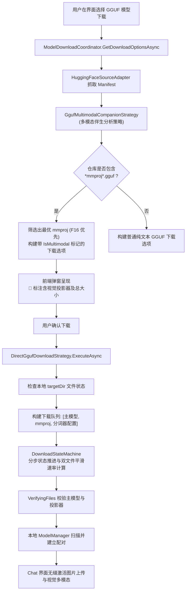

# GGUF 视觉模型（VLM）联合下载与多模态配对架构方案

## 一、问题背景与现状诊断

### 1.1 现状诊断
在当前 ReferenceRAG 的本地模型生态中：
- 视觉语言模型（VLM，如 `Qwen2.5-VL`、`Qwen3.5-VL`、`LLaVA`、`MiniCPM-V` 等）在 GGUF 架构下采用**双文件解耦架构**：
  1. **语言主模型**：如 `Qwen2.5-VL-7B-Instruct-Q4_K_M.gguf`（负责自回归文本解码）；
  2. **视觉投影器（Vision Projector / Encoder）**：如 `mmproj-model-f16.gguf` 或 `mmproj-Qwen2.5-VL-7B-Instruct-f16.gguf`（负责图像 ViT 特征提取与跨模态投影）；
- **当前下载逻辑的技术缺陷**：
  1. **漏下视觉组件**：原 `DirectGgufDownloadStrategy` 仅根据量化优先级筛选并下载了单个 `targetGguf` 文件，**完全忽略了仓库中的 `mmproj-*.gguf` 视觉投影器**；
  2. **下载选项混淆**：在 `ModelDownloadCoordinator.GetDownloadOptionsAsync` 中，`mmproj` 被粗暴地当成了普通 GGUF 变体（例如标为“GGUF F16”），导致用户极易误选单一下载了无语言解码器的孤立投影器；
  3. **运行时多模态不可用**：下载完成后进入 Chat 界面，由于缺少 `mmproj`，系统被迫降级为纯文本模式，弹出多模态警告无法识别图像。

### 1.2 用户的核心诉求
1. **下载 GGUF 时如何联合下载视觉模型？**
2. **参考业界主流做法优化**（Ollama、LM Studio、llama.cpp 官方规范）；
3. **深度头脑风暴**：可行性、逻辑闭环、性能隐患、设计模式（适配器、策略、状态机）；
4. **完整工程落地**：写入 docs 文档并全链路实现。

---

## 二、业界主流方案调研与横向对比

| 平台 / 运行时 | 多模态存储形态 | 下载机制 | 用户感知与交互 | 投影器精度策略 |
| :--- | :--- | :--- | :--- | :--- |
| **llama.cpp 官方** | 独立双文件：`model.gguf` + `mmproj.gguf` | 命令行参数 `-m <model> --mmproj <mmproj>`，HuggingFace 仓库内平铺存放 | 用户需显式指定两个文件 | 强烈推荐 F16 / BF16，严禁过度量化 |
| **Ollama** | Manifest 清单封装（多 Blob） | `ollama run qwen2.5-vl` 一键拉取，底层并行下载 text-blob 与 mmproj-blob | 用户无感知，开箱即用支持图文 | 官方打包时已固定最佳匹配 mmproj |
| **LM Studio** | 单模型目录下双文件 | 识别模型卡片 Multimodal 标签，下载弹窗默认勾选 `[x] Download matching mmproj` | 展示模型 + 视觉投影器总大小，联动下载 | 默认匹配 F16 投影器 |
| **Jan.ai** | Multi-Artifact 任务流 | 在任务清单中维护多个 Artifact（LLM + Projector），状态机串行/并行传输 | 任务面板展示多文件分步下载进度 | 自动绑合 |

---

## 三、可行性、逻辑闭环与性能深度头脑风暴

### 3.1 可行性（Feasibility）
- **仓库文件拓扑**：在 Hugging Face（如 `Qwen/Qwen2.5-VL-7B-Instruct-GGUF`、`bartowski/Qwen2.5-VL-7B-Instruct-GGUF`、`second-state`）上，`mmproj` 文件均与量化主模型共存于同一仓库中；
- **基础构件完备**：ReferenceRAG 已具备 `ModelManifest` 文件清单抓取、`DownloadStateMachine` 多文件细粒度进度追踪、以及 `GgufVisionMatchingStrategy` 本地投影器扫描能力。实现**伴生联合下载**完全可行且符合现有技术栈。

### 3.2 逻辑闭环（Logical Completeness）
1. **多模态检测与分类（Classification）**：
   - 依据文件名正则（`^mmproj`、`-mmproj-`、`_mmproj_`）精准识别视觉投影器；
   - 区分“主语言模型（Text GGUF）”与“伴生视觉投影器（Vision mmproj）”。
2. **下载选项智能捆绑（Companion Bundling）**：
   - 在下载选项列表中，`mmproj` 不作为独立模型出现，而是作为 `OnnxFileOption` 的伴生元数据（`IsMultimodal = true`、`CompanionMmprojPath`、`CompanionMmprojSize`）；
   - 预估大小自动累加：`TotalSize = TextGgufSize + CompanionMmprojSize`，避免用户感知容量不符。
3. **断点增量补全（Incremental Healing）**：
   - 若用户此前已下载了 4GB 文本模型，二次触发时检测到本地已存在主模型，则**仅下载缺失的 600MB mmproj 文件**，零冗余流量。
4. **模型目录变体扫描防护（Variant Isolation）**：
   - 本地扫描模型时，`ScanDirectoryVariants` 排除 `mmproj*.gguf` 成为主对话模型，防止切到投影器导致崩溃。

### 3.3 性能隐患与防御性设计
- **隐患 1：投影器精度失真（Quantization Loss）**：
  - 现象：部分仓库提供 `mmproj-f16.gguf` 与 `mmproj-q4_0.gguf`。若随意选择 Q4 投影器，会导致 ViT 特征空间畸变，OCR 识别率暴跌 30% 以上。
  - 防御：制定**精度优先策略（Precision-First Strategy）**，默认按 `f16` > `bf16` > `q8_0` > `q4_0` 优先级匹配。
- **隐患 2：网络抖动与多文件进度错乱**：
  - 防御：状态机使用二元任务流（主模型 -> 视觉投影器），在单步中实时汇报 `(1/2) 正在下载主模型` 与 `(2/2) 正在下载视觉投影器`，平滑计算综合速率与剩余时间。

---

## 四、架构设计与设计模式运用

### 4.1 策略模式（Strategy Pattern）：`GgufMultimodalCompanionStrategy`
封装多模态投影器的亲和度匹配算法与精度评选：
- `PickBestMmproj(modelName, mmprojFiles)`：根据模型家族名称（如 `Qwen2.5-VL`、`LLaVA`）计算亲和度，并优先挑选 F16 格式。

### 4.2 适配器模式（Adapter Pattern）：`ModelFileItem` 与 `OnnxFileOption`
- 扩展 `ModelFileItem.IsMmproj` 与 `ModelManifest.GetTextGgufFiles()`；
- 扩展 `OnnxFileOption.IsMultimodal`、`CompanionMmprojPath`、`CompanionMmprojSize`，抹平单文件与多构件联合下载的数据契约。

### 4.3 状态机模式（State Machine Pattern）：细粒度多文件传输流转
- 扩展 `DownloadStage` 与阶段描述，在多文件下载循环中实时汇报：
  - `(1/2) 正在传输主语言模型: {textGguf}`；
  - `(2/2) 正在传输视觉多模态投影器: {mmproj}`；
  - 自动校验双文件哈希与尺寸完整性。

---

## 五、实施步骤与落地计划

1. **协议层扩展**：
   - 在 `ModelFileItem` 与 `ModelManifest` 增加 `IsMmproj` 与 `GetMmprojFiles()`；
   - 在 `OnnxFileOption` 与 `ModelVariantFileOption` 增加 `IsMultimodal` 与伴生投影器元数据。
2. **策略层实现**：
   - 新增 `GgufMultimodalCompanionStrategy` 负责 F16 优先策略与亲和度选择。
3. **协调中心与下载策略重构**：
   - 重构 `ModelDownloadCoordinator.GetDownloadOptionsAsync`，实现主模型与 mmproj 的自动打包，隐藏孤立 mmproj；
   - 重构 `DirectGgufDownloadStrategy.ExecuteAsync`，实现主模型与 mmproj 的成对下载与增量补齐。
4. **模型管理扫描升级**：
   - 在 `ModelManager.ScanDirectoryVariants` 中过滤孤立 mmproj，确保主模型识别为伴生多模态。
5. **单元测试与质量门禁**：
   - 编写专门针对 GGUF 视觉模型下载选项、投影器配对、增量补齐的测试用例，通过 `verify-gate.ps1`。
