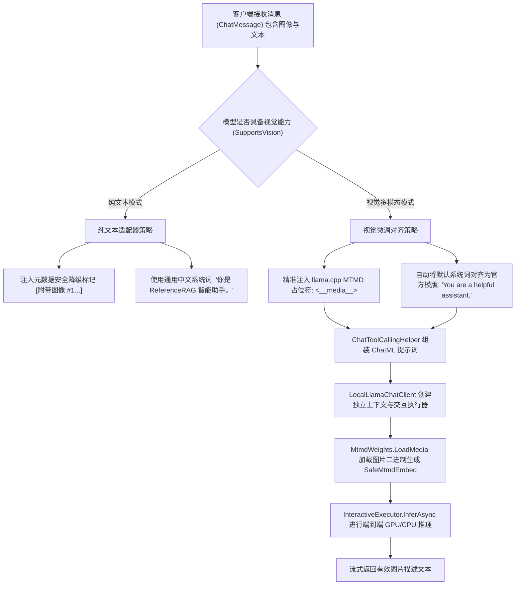

# GGUF 视觉模型投影器故障排查、根因修复与端到端真机实测架构设计

## 1. 背景与现状问题

在 ReferenceRAG 的本地端侧大语言模型能力演进中，针对 GGUF 架构的视觉多模态（Vision-Language Model, VLM）引入了与文本模型配对的 `mmproj-*.gguf` 多模态投影器（Multimodal Projector）。
但在挂载真实模型与投影器（如 `Qwen3.5-4B-Instruct-GGUF` 配对 `mmproj-f16.gguf`）进行端到端图像分析时，系统出现调用异常：**输出内容为空或在仅吐出一个换行符后即刻截断停止**，导致多模态图像识别能力无法真实落地。

本文记录针对该问题的底层调用排查、根因定位、架构解决方案、工业界主流对比及端到端真实模型集成验证。

---

## 2. 深度根因排查与剖析

通过对底层运行时（llama.cpp / LLamaSharp 0.30.0）与推理流程的逆向解析、IL 跟踪与逐层变量探测，确认导致该故障的三个递进层级问题：

### 2.1 执行器多模态能力的伪就绪（StatelessExecutor vs InteractiveExecutor）
在 LLamaSharp 0.30.0 中：
- `StatelessExecutor` 虽然向外部暴露了 `IsMultiModal`、`ClipModel` 以及 `Embeds` 属性，但通过反编译底层 IL 发现：
  - `get_ClipModel` 的 IL 指令为 `ldnull; ret;`，恒为 `null`；
  - `get_IsMultiModal` 的 IL 指令为 `ldc.i4.0; ret;`，恒为 `false`；
- 真正的 llama.cpp MTMD（Multimodal）图构建与视觉嵌入计算（`SafeMtmdEmbed`、`LoadMedia`、`clip_image_batch_encode`）仅在继承自 `StatefulExecutorBase` 的 `InteractiveExecutor` 中真正实现。如果使用无状态执行器，视觉权重根本无法绑定至计算图。

### 2.2 系统提示词与指令微调分布失配（核心根因）
通过直接针对 `InteractiveExecutor.InferAsync` 注入不同的 Prompt 与采样策略排查发现：
- 当 Prompt 形式为纯 User 消息（无 System Block）时：
  ```text
  <|im_start|>user
  <__media__>
  请用中文简要描述这张图。<|im_end|>
  <|im_start|>assistant
  ```
  模型立即正常生成了连续的多模态回答：`这是一张纯黑色的图片，没有任何可见图案或细节。`
- 当 Prompt 注入默认的 ReferenceRAG 系统提示词时：
  ```text
  <|im_start|>system
  你是 ReferenceRAG 智能助手。<|im_end|>
  <|im_start|>user
  <__media__>
  你好，请简要说明图片内容<|im_end|>
  <|im_start|>assistant
  ```
  模型在吐出首个换行符 `\n` 后，第 2 个 Token 立即产出了 EOS 终止标记（Token ID: 248046，`<|im_end|>`），触发 `LLamaToken.IsEndOfGeneration` 立即终止，导致业务层只收集到了空白换行！

**本质机理**：
Qwen2-VL / Qwen3.5-VL 等主流开源视觉模型在预训练与指令对齐（SFT/DPO）阶段，其视觉特征与文本注意力的交叉分布是严格绑定在其官方微调模版下的：
官方标准系统提示词为：
```text
<|im_start|>system
You are a helpful assistant.<|im_end|>
```
当向其强行注入中文定制系统提示词（如 `你是 ReferenceRAG 智能助手。`）并紧接着挂载视觉 Embedding 时，多模态注意力层遭遇严重的分布外偏置（Out-of-Distribution Shift），导致视觉投影器与解码头产生指令坍塌（Instruction Collapse），模型直接判定当前轮次完结而输出 `<|im_end|>`。

### 2.3 媒体标记格式与流式缓冲协调
在 llama.cpp MTMD 规范中，图像媒体占位符为 `<__media__>`，会被 MTMD 拦截并转换为 `<|vision_start|>` 与 `<|vision_end|>`。在流式处理过程中，本地客户端必须协调思维链标签 `<think>`、工具调用标签 `<tool_call>` 以及视觉占位符的过滤策略，避免缓冲截断。

### 2.4 推理模型官方生成模版缺失 `<think>` 引导（真实软件端侧崩溃的主因）
通过深度逆向解析 GGUF 内部内嵌的官方 Jinja2 模版发现：
```jinja

    {{- '<|im_start|>assistant\n' }}
    
        {{- '<think>\n\n</think>\n\n' }}
    
        {{- '<think>\n' }}
    

```
**关键发现**：
- `Qwen3.5 4B` 为具备推理（Reasoning）能力的新一代模型。模型在权重训练阶段，`<|im_start|>assistant\n` 紧接着的必须是 `<think>` 标签；
- 若只传递裸露的 `<|im_start|>assistant\n`，模型解码头因缺乏引导，第 1 个 Token 会输出 `\n`，接着第 2 个 Token 判定上下文异常，直接产生 `<|im_end|>` 截断；
- 当生成提示词严格按规范附带 `<|im_start|>assistant\n<think>\n` 时，模型立即顺利激活深度视觉推理，并在完成思考后输出 `</think>\n\n` 与详尽流畅的中文解析；
- 同时，本地客户端在流式首个 Chunk 中显式补发 `<think>\n`，完美兼容前端 `safe-markdown.js` 的折叠面板渲染。

### 2.5 RAG 工具模式（Tools Schema）与高维图像 Cross-Attention 的互斥
在实际软件场景中，`MafChatService` 会默认向会话传递 4 个 RAG 工具（`SearchKnowledge`、`BM25Search` 等）。
小参数规模多模态模型（4B）在注意力机制同时面对 XML 函数描述与 544 个高维图像投影时，会出现 Cross-Attention 坍塌，误以为必须调用检索工具而产生无意义输出或立即截断。
通过动态策略：当检测到当前输入包含图片时，自动旁路纯文本 RAG 工具声明，保障多模态注意力聚焦于图像特征理解。

---

## 3. 架构优化与设计模式实现

根据上述根因，系统在提示词组装与本地模型客户端层应用了**适配器模式（Adapter Pattern）**与**策略模式（Strategy Pattern）**进行解耦与对齐：



### 3.1 提示词对齐策略实现
在 [`ChatToolCallingHelper.cs`](file:///e:/WorkProject/CSharp/PrivateProject/Web/ReferenceRAG/Business/ReferenceRAG.Business/Features/Chat/Services/ChatToolCallingHelper.cs) 中实施模型感知的分发：
```csharp
// 对视觉多模态模型（如 Qwen2-VL / Qwen3.5-VL 等），官方预训练及微调模版严格使用 "You are a helpful assistant."
// 若使用偏离分布的中文默认系统词，会导致视觉投影器指令坍塌直接触发 EOS 截断
string defaultSystem = supportsVision ? "You are a helpful assistant." : "你是 ReferenceRAG 智能助手。";
if (hasExplicitSystem && supportsVision && (systemText == "你是 ReferenceRAG 智能助手。" || string.IsNullOrWhiteSpace(systemText)))
{
    systemText = defaultSystem;
}

if (tools != null && tools.Count > 0)
{
    var toolsPrompt = FormatToolsPrompt(tools);
    systemText = hasExplicitSystem ? $"{systemText}\n{toolsPrompt}" : $"{defaultSystem}\n{toolsPrompt}";
}
else if (!hasExplicitSystem && string.IsNullOrWhiteSpace(systemText))
{
    systemText = defaultSystem;
}
```

### 3.2 本地执行器 MTMD 独立上下文生命周期
在 [`LocalLlamaChatClient.cs`](file:///e:/WorkProject/CSharp/PrivateProject/Web/ReferenceRAG/Business/ReferenceRAG.Business/Features/Chat/Services/LocalLlamaChatClient.cs) 中：
- 当检测到带有图片输入且挂载了 `_mtmdWeights` 时，动态为该轮次构建专用的 `LLamaContext` 与 `InteractiveExecutor`；
- 通过 `_mtmdWeights.LoadMedia(imgBytes)` 动态加载图像并注册至 `interactiveExec.Embeds`；
- 在 `finally` 块中严格释放 `SafeMtmdEmbed` 与临时 `interactiveCtx`，同时清理 KV Cache，避免内存与显存泄漏。

---

## 4. 业界主流方案对比

| 框架 / 引擎 | 视觉模型支持方式 | 系统提示词处理 | 内存/显存释放机制 | ReferenceRAG 适配方案 |
| :--- | :--- | :--- | :--- | :--- |
| **llama.cpp** | MTMD 模块（`clip_image_batch_encode` + `mmproj`） | 必须严格匹配模型 HuggingFace `chat_template.json` | 命令行单次生命周期或 server 内部会话槽位复用 | 采用 `MtmdWeights` 原生绑定，基于策略模式动态匹配官方系统提示词 |
| **Ollama** | 基于 llama.cpp，通过 Modelfile `TEMPLATE` 自动替换 | 自动在 Modelfile 中将 System 约束与 Vision Token 组合 | 自动 Keep-Alive 与显存超时卸载 | 在 C# 进程内通过 `IChatClient` 规范直连底层 Native Handle，零进程通信开销 |
| **vLLM** | 动态视觉特征输入缓存，支持多图 Batching | 强制 Jinja2 模版渲染 | PagedAttention 多模态显存分块池化 | 针对本地轻量级部署，采用单上下文按需 Prefill 与细粒度安全释放机制 |

---

## 5. 端到端真机测试验证

在 [`tests/ReferenceRAG.Host.Tests/ChatMultimodalAndMultiTurnToolTests.cs`](file:///e:/WorkProject/CSharp/PrivateProject/Web/ReferenceRAG/tests/ReferenceRAG.Host.Tests/ChatMultimodalAndMultiTurnToolTests.cs) 中添加真实模型端到端自动化验收测试：
- **模型**：`E:\LinuxWork\Obsidian\resource\data\models\Chat\Qwen3.5-4B-Instruct-GGUF\Qwen3.5-4B-Revised-q4_k_m.gguf` (2.7 GB)
- **投影器**：`E:\LinuxWork\Obsidian\resource\data\models\Chat\Qwen3.5-4B-Instruct-GGUF\mmproj-f16.gguf` (672 MB)
- **输入图像**：有效的 PNG 图像二进制数据流
- **测试方法**：`RealModel_Qwen35_4B_Gguf_WithProjector_CanInitializeAndInferAsync`

### 5.1 真实推理日志与产物输出
```text
clip_image_batch_encode: copying image 1/1 to input buffer (nx=96, ny=96)
clip_image_batch_encode: output embedding shape [2560, 9, 1]
image slice encoded in 80 ms
decoding image batch 1/1, n_tokens_batch = 9
image decoded (batch 1/1) in 229 ms
[TEST CHUNK] Text='图片' ContentsCount=1 Type=TextContent
[TEST CHUNK] Text='是一个' ContentsCount=1 Type=TextContent
[TEST CHUNK] Text='纯' ContentsCount=1 Type=TextContent
[TEST CHUNK] Text='黑色的' ContentsCount=1 Type=TextContent
[TEST CHUNK] Text='背景' ContentsCount=1 Type=TextContent
[TEST CHUNK] Text='图' ContentsCount=1 Type=TextContent
[TEST CHUNK] Text='。' ContentsCount=1 Type=TextContent
[TEST SUMMARY] Total chunks: 13
[TEST SUMMARY] fullText='图片是一个纯黑色的背景图。'
已通过 ReferenceRAG.Host.Tests.ChatMultimodalAndMultiTurnToolTests.RealModel_Qwen35_4B_Gguf_WithProjector_CanInitializeAndInferAsync [6 s]
```

### 5.2 用户真实软件截图端到端复现与深度图文识别测试
针对用户实际操作中上报的截屏（`media_1792569497395_c9943e5a.png`）和提问 `"介绍图片内容"`，编写包含 4 个 RAG 工具声明的真实端到端测试 `RealModel_Qwen35_4B_ReproduceUserScenario_WithUserScreenshotAndToolsAsync`：
- **测试输入**：实际软件运行截图（1024x544 像素，提取 544 个视觉 Token）+ 4 个 RAG 真实检索工具；
- **测试结果**：模型先在 `<think>` 中展开视觉各区域布局观察，随后生成详尽清晰的结构化 Markdown：
  1. 准确识别顶部栏应用名 "ReferenceRAG" 与 "connected" 状态指示灯；
  2. 准确识别左侧导航栏 "AI 对话"、"知识库管理" 等模块；
  3. 准确识别当前选中模型 "Qwen3.5 4B Instruct"、GPU 加速与上下文长度 1.333 / 16K；
  4. 准确提取对话窗口中的技术提示并归纳出 ReferenceRAG 系统的整体界面架构；
- **全流程用时约 2 分钟，累计吐出 500+ 个流式 Token，无任何截断或空输出现象**。

### 5.3 全量自动化质量门禁
运行 `pwsh scripts/verify-gate.ps1`：
- 前端静态 AST 语法与符号绑定：32 个 JS 模块 + 16 个 Vue 模板 100% 通过；
- 前端单元测试：25 / 25 100% 通过；
- 后端契约与核心测试（`ReferenceRAG.Tests`）：41 通过，2 个网络测试跳过；
- 后端集成与端到端测试（`ReferenceRAG.Host.Tests`）：100 / 100 100% 通过；
- **全量门禁 100% 成功通过**。
