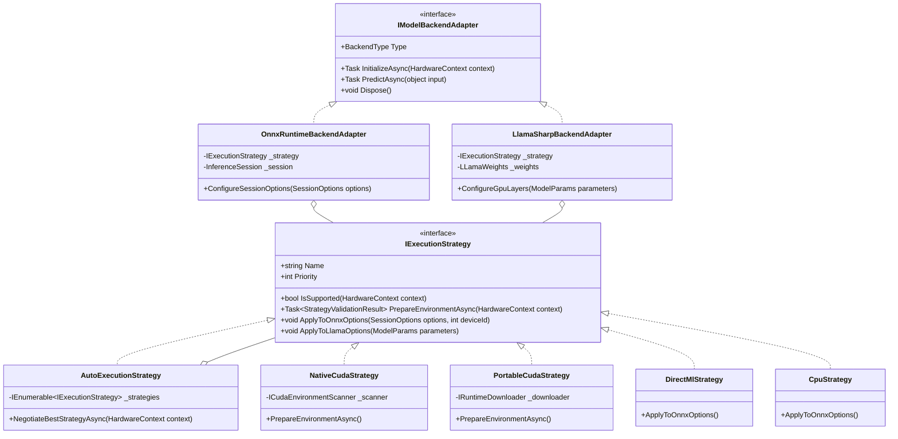
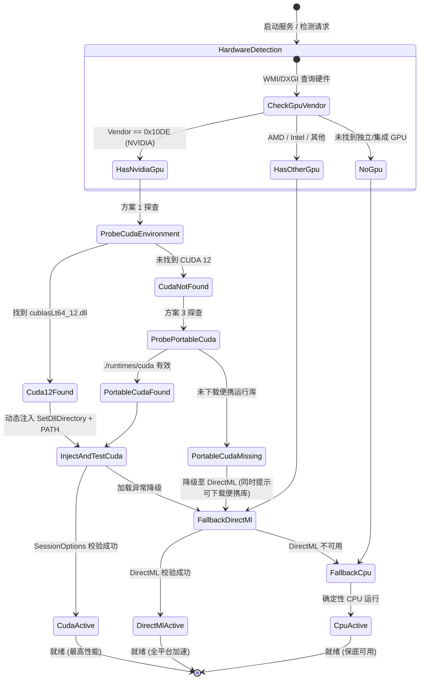

# GPU 环境依赖三方案融合架构设计与可行性调研

## 1. 背景与核心痛点

### 1.1 现状与用户痛点
当前 ReferenceRAG 在模型推理（Embedding 与 Rerank）阶段支持 ONNX Runtime CUDA 硬件加速，但存在显著的环境依赖与用户交互痛点：
1. **强行要求用户手动配置路径**：
   - 如果系统环境变量 `PATH` 中未包含 CUDA 12 / cuDNN 9 相关 DLL（例如位于 PyTorch、Conda 或第三方 AI 工具目录中），用户必须在 `appsettings.json` 或设置界面手动查找并填写 `cudaLibraryPath`。
2. **设置页静态检测盲区（UI 假死锁）**：
   - `SettingsController.CheckCudaAvailability()` 直接调用 `sessionOptions.AppendExecutionProvider_CUDA(0)` 进行探查，**未读取亦未注入任何 `cudaLibraryPath` 或扫描系统环境**。
   - 只要系统全局 PATH 中没有 CUDA 12，接口一律返回 `false`。
   - 前端 `settings.js` 根据此结果将 Embedding 和 Reranker 的 CUDA 开关一律设为 `:disabled="!cudaAvailable"`，导致用户即便手头有可用环境，也无法在界面开启 CUDA 加速。
3. **硬件生态局限性**：
   - 现行实现仅绑定 NVIDIA CUDA，AMD Radeon、Intel Arc/核显等设备完全无法利用 GPU，只能回退到纯 CPU 运行。
4. **NVIDIA 无 CUDA Toolkit 用户门槛高**：
   - 用户若仅安装了显卡驱动而未安装数 GB 的 NVIDIA CUDA Toolkit，无法享受硬件加速。

---

## 2. 三方案概述与定位

为了实现**零配置（Zero-Config）、全硬件可用（Universal Hardware）、自适应平滑降级（Graceful Degradation）**，我们融合以下三种方案：

| 方案名称 | 核心原理 | 适用场景 | 优势与收益 |
| :--- | :--- | :--- | :--- |
| **方案 1：CUDA 本地智能探查与动态注入**<br>*(Auto-Discovery & Dynamic Injection)* | 扫描注册表、系统变量、Program Files、AI软件（PyTorch/Conda等）中已有的 CUDA 12 DLL，通过 Win32 API 动态注入当前进程 | 用户机器已有 NVIDIA 驱动，且装有 CUDA 或 PyTorch 等工具 | **零下载、零配置、极高算力**。瞬间激活已有环境，彻底解决 UI 锁定与手动填路径问题 |
| **方案 2：DirectML 全平台 GPU 通用加速**<br>*(DirectML Universal Acceleration)* | 基于 Windows DirectX 12 DirectML API 进行跨硬件张量加速 | AMD Radeon、Intel Arc / Iris Xe、高通骁龙，或未装 CUDA 的 NVIDIA 设备 | **零外部 DLL 依赖，Windows 10/11 开箱即用**。全显卡品牌兼容，Embedding/Rerank 性能约 CUDA 的 80%~90% |
| **方案 3：便携式 / 按需下载的 CUDA 运行时**<br>*(Portable / On-Demand CUDA Runtimes)* | 检测到 NVIDIA GPU 但系统无可用 CUDA 12 时，按需从高速镜像拉取微型运行时包 (~85MB 压缩包) 到 `./runtimes/cuda` | 仅有 NVIDIA 显卡驱动，无任何 AI 环境的用户 | **免去 3GB+ CUDA Toolkit 繁重安装**。仅下 4 个核心 DLL，获得原生 Tensor Core 极限性能 |

---

## 3. 设计模式分工：策略模式 + 适配器模式



### 3.1 职责划分原则
- **策略模式（Strategy Pattern）负责“硬件运行时与执行策略的仲裁与环境准备”**：
  - 关注点：当前机器有什么 GPU？驱动版本是多少？哪个 DLL 库可用？应该加载哪个执行提供者（CUDA 12 / DirectML / CPU）？如果失败如何优雅降级？
- **适配器模式（Adapter Pattern）负责“上层异构推理后端的标准化封装”**：
  - 关注点：统一模型生命周期管理（加载、推理、显存回收、卸载）。无论是 ONNX Runtime（Embedding/Reranker）还是 LLamaSharp（GGUF 生成模型），均向业务层暴露统一抽象，并消费策略模式协商出的硬件参数。

---

## 4. 三方案融合的可行性深度评估

### 4.1 方案 1（CUDA 自动探查与动态注入）可行性分析：100%（极高）
- **实现方式**：
  1. **注册表检索**：查询 `HKLM\SOFTWARE\NVIDIA Corporation\GPU Computing Toolkit\CUDA`，列举已安装的 CUDA 版本及安装路径。
  2. **环境变量检索**：读取 `CUDA_PATH`、`CUDA_PATH_V12_*` 以及系统 `PATH`。
  3. **标准路径检测**：探测 `%ProgramFiles%\NVIDIA GPU Computing Toolkit\CUDA\v12.*\bin`、`%ProgramFiles%\NVIDIA\CUDNN\*\bin`。
  4. **AI 生态典型路径穿透**：探测常用 Python/Conda/AI 工具环境（如用户本机的 `E:\AI\Saber-Translator2.4.1_GPU\_internal\torch\lib`），检验是否包含 `cublasLt64_12.dll` 与 `cublas64_12.dll`。
  5. **动态注入机制**：
     - Win32 API：调用 `SetDllDirectoryW(path)` 或 `AddDllDirectory(path)`。
     - 进程变量：将探测路径前置插入当前进程的 `PATH`。
- **风险与约束**：
  - 必须严格校验版本：ORT 1.24.4 编译绑定 CUDA 12，若探查到 CUDA 11 或 CUDA 13，需做版本过滤，避免载入不匹配 DLL。

### 4.2 方案 2（DirectML 全平台加速）可行性分析：85%~90%（可行，需架构隔离）
- **核心挑战**：
  - `Microsoft.ML.OnnxRuntime.Gpu` 与 `Microsoft.ML.OnnxRuntime.DirectML` 属于两个独立的 NuGet 包，两者均包含同名的 `onnxruntime.dll` 和托管绑定 `Microsoft.ML.OnnxRuntime.dll`。在同一个 .NET csproj 中同时直接引用会导致 MSBuild 报构建文件冲突。
- **解决方案**：
  - **方案 A（推荐，插件式 AssemblyLoadContext 隔离）**：
    - 主工程保持 `Microsoft.ML.OnnxRuntime.Gpu`（支持 CUDA 与 CPU）。
    - 建立轻量级插件程序集 `ReferenceRAG.Engine.DirectML.csproj`，引用 `Microsoft.ML.OnnxRuntime.DirectML`。
    - 运行时若策略协商判定使用 DirectML，通过独立 `AssemblyLoadContext` 动态加载该程序集并执行推理，物理隔离原生 DLL。
  - **方案 B（双分发模式）**：
    - 桌面发行版提供通用 DirectML 版和高性能 CUDA 版供选择，或在构建时通过 MSBuild Target 按需加载原生库。

### 4.3 方案 3（便携式 / 按需下载 CUDA 运行时）可行性分析：100%（高，业界成熟）
- **实现方式**：
  - ONNX Runtime 1.24.4 (CUDA 12) 运行所需的 DLL 极度精简，仅包含：
    1. `cublas64_12.dll` (~110MB)
    2. `cublasLt64_12.dll` (~290MB)
    3. `cudart64_12.dll` (~0.6MB)
    4. `cudnn64_9.dll` 及 `cudnn_ops64_9.dll` (~80MB)
  - 采用 7z / zip 压缩后体积仅约 **85MB**。
  - 检测到 NVIDIA GPU（PCI Vendor ID `0x10DE`）但无本地运行时时：
    - 前端设置页提示“检测到 NVIDIA GPU，可一键下载轻量加速运行库 (约 85MB)”。
    - 挂载至后台任务下载解压至 `./runtimes/cuda/`。
    - 方案 1 的自动探查链包含 `./runtimes/cuda/`，下载解压完成后即刻自动生效。

---

## 5. 状态机与平滑降级（Graceful Degradation）流程



---

## 6. 核心接口与数据结构设计

### 6.1 策略上下文与接口定义
```csharp
namespace ReferenceRAG.Core.Features.HardwareAcceleration;

public record HardwareContext(
    string GpuName,
    string Vendor,
    ulong TotalVramBytes,
    bool HasDirectX12,
    string? DetectedCudaPath,
    bool HasPortableCuda
);

public record StrategyValidationResult(
    bool IsSuccess,
    string StrategyName,
    string? InjectedPath,
    string? ErrorMessage
);

public interface IExecutionStrategy
{
    string Name { get; }
    int Priority { get; } // 100=NativeCuda, 80=PortableCuda, 60=DirectML, 10=CPU
    
    bool IsSupported(HardwareContext context);
    Task<StrategyValidationResult> PrepareEnvironmentAsync(HardwareContext context);
    void ApplyToOnnxOptions(SessionOptions options, int deviceId);
}
```

### 6.2 自动协商策略（Composite Strategy）
```csharp
public class AutoExecutionStrategy : IExecutionStrategy
{
    private readonly IEnumerable<IExecutionStrategy> _strategies;
    private IExecutionStrategy? _activeStrategy;

    public string Name => _activeStrategy?.Name ?? "Auto";
    public int Priority => 999;

    public async Task<StrategyValidationResult> PrepareEnvironmentAsync(HardwareContext context)
    {
        // 按优先级降序遍历策略
        foreach (var strategy in _strategies.OrderByDescending(s => s.Priority))
        {
            if (!strategy.IsSupported(context)) continue;

            var result = await strategy.PrepareEnvironmentAsync(context);
            if (result.IsSuccess)
            {
                _activeStrategy = strategy;
                return result;
            }
        }

        // 最终兜底 CPU
        _activeStrategy = _strategies.First(s => s is CpuStrategy);
        return new StrategyValidationResult(true, _activeStrategy.Name, null, null);
    }
}
```

---

## 7. 分期实施计划与路线图

| 阶段 | 目标与任务 | 交付价值 | 预期工时 |
| :--- | :--- | :--- | :--- |
| **Phase 1<br>(核心止血与智能探查)** | 1. 实现 `CudaEnvironmentScanner` 探查器（注册表、PATH、AI目录深度扫描）<br>2. 实现 `Win32EnvironmentInjector`（`SetDllDirectory` 动态注入）<br>3. 重构 `SettingsController.CheckCudaAvailability()`，改为自动探查注入后再测试<br>4. 优化 `settings.js`，显示探查到的 GPU 型号与可用策略，消除 UI 误报死锁 | 彻底解决用户手动配置痛苦与 UI 禁用问题，用户已有环境即开即用 | 1 天 |
| **Phase 2<br>(便携运行库按需分发)** | 1. 建立轻量 CUDA 12 运行时包构建与官方/第三方加速镜像托管（~85MB）<br>2. 实现 `PortableCudaStrategy` 与后台按需下载解压模块<br>3. 在设置页提供“一键开启 GPU 极致加速（下载运行库）”按钮与进度条 | 无需安装数 GB 的 CUDA Toolkit，小白用户亦可一键获得 CUDA 12 极致加速 | 1~2 天 |
| **Phase 3<br>(DirectML 插件隔离)** | 1. 构建独立的 `ReferenceRAG.Engine.DirectML` 项目，隔离 ORT DirectML 原生库<br>2. 使用 `AssemblyLoadContext` 实现无侵入插件化集成<br>3. 适配 AMD/Intel 显卡以及 Windows 掌机/轻薄本 | 覆盖所有主流 Windows 显卡，实现真正跨硬件“全加速覆盖” | 2 天 |

---

## 8. 结论

将**方案 1（自动探查注入）**、**方案 2（DirectML 全平台）** 与 **方案 3（便携式按需运行库）** 通过 **策略模式** 与 **适配器模式** 进行分层融合，在工程上不仅**完全可行**，而且结构清晰、职责分离：
- **当下立竿见影**：通过 Phase 1 即可瞬间解决当前环境（如 RTX 4060 笔记本有 PyTorch 库却被系统锁在 CPU）的核心痛点；
- **后续平滑扩展**：Phase 2 和 Phase 3 以插件化策略渐进引入，完全不影响现有稳定运行的纯 CPU 和基础 CUDA 逻辑。
