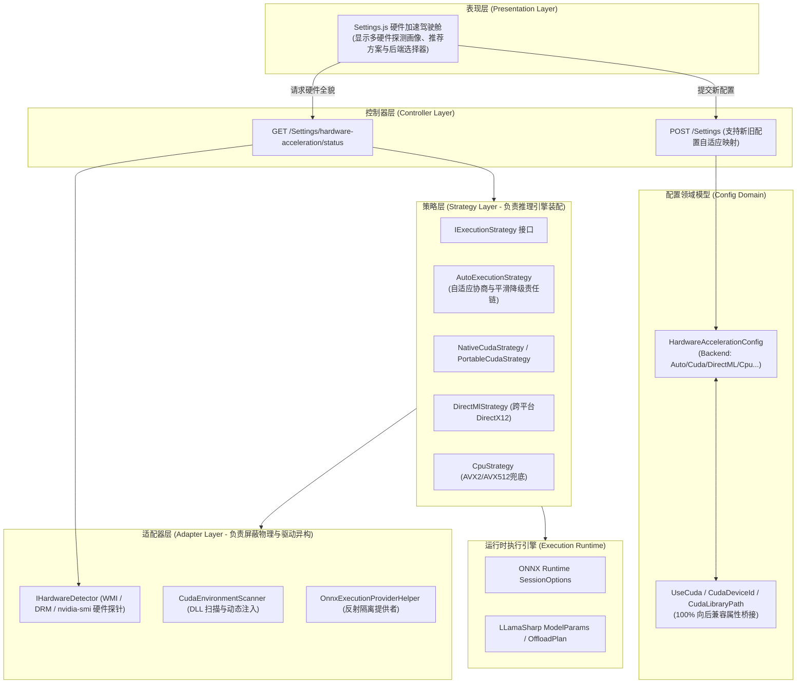

# 硬件加速适配器与策略模式解耦架构设计与实施方案

## 1. 背景与现状剖析

### 1.1 演进背景
ReferenceRAG 经过持续演化，已在多目标分发与跨平台硬件加速层完成了深度拓展：
1. **构建分发矩阵**：CI/CD 流水线已原生支持 6 大 Windows 桌面端分包（`win-x64` 通用 DirectML/Vulkan 版、`win-x64-cuda` 满血版、`win-x64-cuda-slim` 精简版、`win-x64-rocm` AMD 版、`win-x64-intel` Intel 版、`win-x64-cpu` 纯 CPU 版）以及 4 大 Docker 镜像（CUDA、ROCm、Intel GPU、CPU）。
2. **底层算力反射解耦**：基础设施层已通过 `OnnxExecutionProviderHelper` 实现了对 CUDA、DirectML、OpenVINO 的反射动态探查，杜绝了多 NuGet 包链接冲突。

### 1.2 现有痛点与架构断层
尽管底层已具备全硬件加速能力，但**顶层配置模型、接口抽象与前端设置界面依然被锁死在“仅认 NVIDIA CUDA”的历史单路设计中**：
* **认知与体验鸿沟**：当用户在 AMD 显卡（DirectML / Vulkan）或 Intel 显卡运行通用版时，前端「设置」页面依然显示“使用 CUDA（禁用）”，提示“未检测到 CUDA 支持”，导致用户产生“此软件只能在 NVIDIA 显卡加速”的严重误解。
* **探针一票否决**：`SettingsController.GetCudaAvailability` 仅探测 `AppendExecutionProvider_CUDA`，在非 NV 机器上一律返回 `false`，强行禁用了 GPU 开关。
* **配置语义矮化**：`EmbeddingConfig` 与 `RerankConfig` 中只有 `UseCuda: bool`、`CudaDeviceId: int`、`CudaLibraryPath: string`，无法表达“自动协商 (Auto)”、“通用 DirectML/Vulkan”、“指定卡号”、“平滑回退”等现代推理调度策略。

---

## 2. 核心架构设计：适配器模式 + 策略模式双层解耦

针对上述断层，本方案采用经典且优雅的 **“适配器模式（Adapter Pattern）+ 策略模式（Strategy Pattern）”** 协同架构：



### 2.1 适配器模式（Adapter Pattern）—— 屏蔽物理硬件与驱动规范差异
* **定位**：对下交互，抹平各 GPU 厂商的驱动规范、动态库命名以及环境变量注入差异。
* **组件职责**：
  * `HardwareDetector`：适配 Windows WMI (`Win32_VideoController`) 与 Linux DRM (`/sys/class/drm`)，结合 `nvidia-smi` 提取真实 GPU 厂商（Nvidia、Amd、Intel）、显存容量与驱动版本；
  * `CudaEnvironmentScanner` & `Win32EnvironmentInjector`：适配 CUDA 12 动态链接库（`cublas64_12.dll` 等）的路径定位与进程内动态注入；
  * `OnnxExecutionProviderHelper`：适配 ONNX Runtime 各 Execution Provider 的反射探测与动态装配。

### 2.2 策略模式（Strategy Pattern）—— 推理引擎执行装配与平滑降级
* **定位**：对上交互，将用户期望的后端策略（`Auto` / `Cuda` / `DirectML` / `Cpu`）装配为 ONNX Runtime 的 `SessionOptions` 与 LLamaSharp 的 `GpuLayers`。
* **核心策略**：
  * **AutoExecutionStrategy（自适应协商策略）**：按优先级尝试 `CUDA (100) -> DirectML (60) -> CPU (10)`。若最高性能后端校验失败（如缺少驱动或 DLL），自动无缝平滑回退至下一级，杜绝崩溃；
  * **NativeCudaStrategy**：显式装配 NVIDIA CUDA 专有加速内核，提供最高吞吐与 FP16/FlashAttention 能力；
  * **DirectMlStrategy**：显式装配通用 DirectML 加速内核，完美支持 AMD Radeon、Intel Arc/核显与通用分包；
  * **CpuStrategy**：纯 CPU 运行，确定性高可用保证。

---

## 3. 领域模型演进与向后兼容设计（100% Zero Breaking Changes）

### 3.1 新增硬件加速核心枚举与模型
```csharp
namespace ReferenceRAG.Core.Models;

[JsonConverter(typeof(JsonStringEnumConverter))]
public enum AccelerationBackend
{
    Auto,      // 自动感知协商（智能推荐）
    Cuda,      // NVIDIA CUDA 专有加速
    DirectML,  // 通用 DirectML 跨平台算力 (AMD/Intel/Windows)
    Vulkan,    // 通用 Vulkan 跨平台算力 (GGUF/llama.cpp)
    Rocm,      // AMD ROCm / HIP
    OpenVino,  // Intel OpenVINO / Level Zero
    Cpu        // 纯 CPU 运算
}

public class HardwareAccelerationConfig
{
    public AccelerationBackend Backend { get; set; } = AccelerationBackend.Auto;
    public int DeviceId { get; set; } = 0;
    public string? CustomLibraryPath { get; set; }
    public bool FallbackToCpuOnFailure { get; set; } = true;

    [JsonIgnore]
    public bool IsEnabled => Backend != AccelerationBackend.Cpu;
}
```

### 3.2 现有配置模型双向桥接（`EmbeddingConfig` / `RerankConfig`）
通过 C# 属性访问器与 JSON 序列化映射，实现新老格式互通：
```csharp
public class EmbeddingConfig
{
    public HardwareAccelerationConfig Acceleration { get; set; } = new();

    // ── 向后兼容属性桥接 ──
    [Obsolete("请使用 Acceleration.Backend 配置硬件加速")]
    public bool UseCuda
    {
        get => Acceleration.IsEnabled;
        set
        {
            if (!value) Acceleration.Backend = AccelerationBackend.Cpu;
            else if (Acceleration.Backend == AccelerationBackend.Cpu) Acceleration.Backend = AccelerationBackend.Auto;
        }
    }

    [Obsolete("请使用 Acceleration.DeviceId")]
    public int CudaDeviceId
    {
        get => Acceleration.DeviceId;
        set => Acceleration.DeviceId = value;
    }

    [Obsolete("请使用 Acceleration.CustomLibraryPath")]
    public string? CudaLibraryPath
    {
        get => Acceleration.CustomLibraryPath;
        set => Acceleration.CustomLibraryPath = value;
    }
}
```

---

## 4. API 接口与前端交互焕新方案

### 4.1 新增硬件全貌探针接口
* **Endpoint**：`GET /Settings/hardware-acceleration/status`
* **响应模型**：`HardwareAccelerationStatusResult`
  * `DetectedGpus`：当前系统探测到的全部物理/核心显卡列表（名称、厂商、显存、主卡标识）；
  * `RecommendedBackend`：根据当前主显卡和构建包推断的最优方案（如检测到 NV 显卡推荐 Auto/Cuda，检测到 AMD 推荐 Auto/DirectML）；
  * `ActiveBackend`：当前正在运行生效的后端标识；
  * `AvailableBackends`：当前构建与系统支持的可选后端清单及状态描述。
* **兼容保障**：保留原有 `GET /Settings/cuda-availability` 接口，并基于底层新探针返回兼容数据。

### 4.2 前端 Settings.js 交互升级（硬件加速驾驶舱）
1. **显卡画像状态徽标**：在嵌入模型与重排模型上方展示检测到的显卡芯片与显存；
2. **加速方案选择器**：
   * 🚀 `自动感知协商 (Auto - 智能推荐)`：启动时自动协商最高算力并平滑降级；
   * 🟢 `NVIDIA CUDA (满血版)`：针对 GeForce / Quadro / Tesla 硬件深度优化；
   * 🟣 `通用 DirectML (AMD/Intel/通用版)`：无外部重型 DLL 依赖，开箱即用；
   * ⚪ `纯 CPU 模式`：节能与服务器确定性计算；
3. **高级参数展开**：当选择 GPU 加速模式时，动态展示「设备 ID (DeviceId)」与「自定义库路径 (CustomLibraryPath)」。

---

## 5. 实施与验证步骤

1. **Phase 1**：在 `ReferenceRAG.Core` / `Infrastructure` 中定义 `AccelerationBackend` 与 `HardwareAccelerationConfig`，完成 `ObsidianRagConfig.cs` 的无损双向属性桥接；
2. **Phase 2**：在 `SettingsController` 扩展 `/hardware-acceleration/status`，对接 `HardwareDetector` 与 `AutoExecutionStrategy`；并在 `SettingsController.Save` 中加入 `Acceleration` 的变更检测以支持热重载；
3. **Phase 3**：在 `ModelBackendStrategyFactory`、`EmbeddingService` 与 `OnnxRerankService` 中接入 `HardwareAccelerationConfig`；
4. **Phase 4**：重构 `Settings.js` 与 `api/index.js`，通过 `node check.mjs` 静态 AST 检查及全量自动化测试；
5. **Phase 5**：执行 `dotnet test`，确保 460+ 单元测试与集成测试全绿通过。
