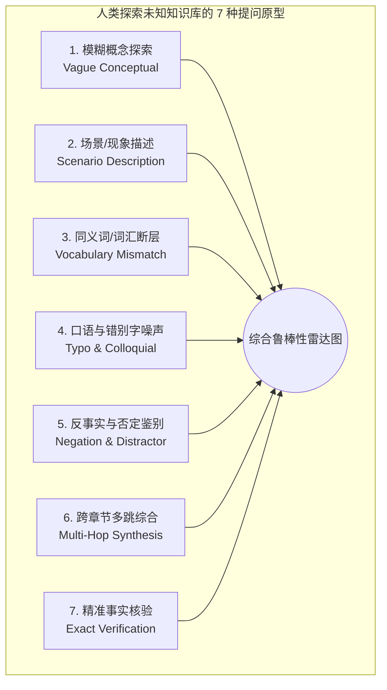

# 人类探索未知知识库（Human Exploratory Search）全维度评测方案与架构调研

> **调研背景**  
> 在先前的金庸基准评测中，针对特定专有名词考据题（如直呼“阿青”、“神照经”），词法检索展现出极高评分，但这属于典型的**评测集特化与幸存者偏差（Specialization & Benchmark Bias）**。  
> 当人类初次面对一个完全未知的知识库时，**用户不可能预先知晓知识库内的专有名词、精确文件名、术语代号或特定分块用词**。真实的探索往往表现为：概念摸索、情节症状描述、错别字口语、同义词鸿沟、反事实质疑以及跨语言混合查询。  
> 本方案旨在建立一套模拟**人类探索未知知识库（Human Exploratory Search）**的多维度评测体系，结合设计模式构建弹性基准管线，真实检验系统在未知领域中的全能检索能力。

---

## 一、人类探索未知知识库的 7 大核心认知维度模型（Cognitive Archetypes）

在信息检索理论（Gary Marchionini, *Exploratory Search*）与人机交互领域，人类在面对未探索领域时的提问可系统化归纳为 7 种认知原型：



### 1. 模糊概念探索（Vague Conceptual Browsing）
- **认知特征**：人类不知道库里有什么，仅表达宏观探索意图，完全不提及书名与角色名。
- **典型 Query**：*“知识库里有没有记载关于古代铸剑技术或者春秋时期名剑锻造工艺的篇章？”*
- **挑战点**：原文分散在《越女剑》薛烛评剑（纯钧、工布）与欧冶子铸剑史料，考验检索器的**宏观语义主题捕获能力**。

### 2. 场景/现象描述（Scenario & Symptom Description）
- **认知特征**：人类记不清名词代号，只能凭模糊记忆描述发生了什么事、什么画面（类似“去医院向医生描述病情症状，而非直接说病名”）。
- **典型 Query**：*“讲一个年轻姑娘拿一根细竹竿把几十个全副武装的敌国剑士眼睛戳瞎的武打片段在哪？”*
- **挑战点**：查询中不含“阿青”、“吴越剑士”、“越王”，纯靠**动作/场景语义联想**。

### 3. 同义词断层与隐式意图（Vocabulary Mismatch & Implicit Intent）
- **认知特征**：人类使用了与原文完全不同的同义词、近义词或现代通俗词汇。
- **典型 Query**：*“古代农民起义领袖留给下属四位保镖家族世代争夺的巨额私房钱埋在哪个地方？”*
- **挑战点**：用“农民起义领袖”代替“闯王李自成”，用“私房钱”代替“巨额宝藏”，用“保镖”代替“侍卫/护卫”。词法检索在此面临断崖式下跌。

### 4. 口语化与拼音错别字噪声（Typo & Colloquial Noise）
- **认知特征**：移动端输入法同音错别字、口语语气词、错位倒装。
- **典型 Query**：*“月女剑里头那个很厉害的放洋小姑娘到底是跟哪只猴子学打架的呀”*
- **挑战点**：“月女剑”（越女剑）、“放洋”（放羊）、“猴子”（白公公/白猿）、“打架”（比剑）。考验**字符容错与语义鲁棒性**。

### 5. 反事实与否定陷阱（Negation & Distractor Discrimination）
- **认知特征**：人类常带有预设偏见或误解进行提问，检索系统不应顺从假定，而应准确找出否定证据。
- **典型 Query**：*“狄云是真的背叛师门投靠血刀门作恶了吗？为什么血刀老祖会叫他好徒孙？”*
- **挑战点**：文本中充斥“血刀门”、“恶僧”、“狄云”，词法极易把误解当成事实召回，考验**语义真实度与否定关系理解**。

### 6. 跨章节多跳线索综合（Multi-Hop Synthesis）
- **认知特征**：单一分块无法回答，必须综合多个线索。
- **典型 Query**：*“西施心口疼痛的千古名篇典故跟范蠡为越国寻找训练剑士的高手之间到底有什么因果关系？”*
- **挑战点**：线索跨越开头比剑、范蠡遇阿青、末尾西施捧心三个章节，考验**全局多路相关度聚合**。

### 7. 精准事实核验（Exact Fact Verification）
- **认知特征**：传统精确查找，如搜索具体专有名词、错误码、特定术语。
- **典型 Query**：*“神照经在连城诀中是由谁传授给狄云的？”*
- **挑战点**：传统 BM25 的天然主场。

---

## 二、头脑风暴：技术欠缺与潜在风险深度剖析

| 潜在短板与挑战 | 核心机理与风险 | 针对性优化方案 |
| :--- | :--- | :--- |
| **1. 简单命中判定的失真** | 传统测试仅用 `content.includes(keyword)`，只要切片提到该词就判对，无法度量**上下文完整性与答案支持度**。 | 引入 **标注金标分块集合（Gold Reference Chunk IDs）** 与 **词共现覆盖密度矩阵** 结合判定。 |
| **2. 向量模型的近义泛滥（Semantic Drift）** | 稠密向量虽然抗同义词强，但若模型把“欧冶子”和“干将莫邪”过度泛化，会导致召回无关的玄幻锻造内容。 | 在多路召回后施加 **稀疏-稠密对齐过滤（Lexical-Dense Alignment）** 与轻量重排。 |
| **3. 词法模型的“零分沉默”（Zero Recall Silence）** | 遇到同义词断层时，BM25 返回分数为 0，系统若无自动扩展则直接空白。 | 引入 **Pseudo-Relevance Feedback (PRF 伪相关反馈)** 与结巴近义词前置改写。 |
| **4. 跨维度评测的样本均衡性** | 若精确查询占比 80%，词法评分必定虚高；若全是抽象长句，向量必定虚高。 | 采用 **7 大原型等权重分层抽样（Stratified Sampling）**，生成雷达图综合打分。 |

---

## 三、基于设计模式的评测与检索系统优化架构

为了彻底消除偶发性与硬编码弊端，在架构层应用经典设计模式：

```mermaid
flowchart TD
    subgraph 评测执行层 (Design Patterns)
        A[Benchmark Runner] -->|策略模式| B[ArchetypeStrategy]
        B --> B1[VagueConceptStrategy]
        B --> B2[SymptomScenarioStrategy]
        B --> B3[TypoNoiseStrategy]
        B --> B4[MultiHopStrategy]
        
        A -->|状态机模式| C[ExplorationSessionStateMachine]
        C --> C1[Init] --> C2[Warmup] --> C3[ExploratoryQuery] --> C4[DrillDownQuery] --> C5[Aggregating]
        
        A -->|适配器模式| D[MetricsCalculationAdapter]
        D --> D1[HitRate@K / MRR@K]
        D --> D2[SemanticDriftPenalty]
        D --> D3[LatencyProfiler]
    end
```

### 1. 策略模式（Strategy Pattern）—— 探索原型驱动
- 定义统一接口 `IExplorationArchetypeStrategy`，将 7 大提问原型的特征提取、Query 变形、预期评分标准解耦。
- 新增变体只需扩展策略类，无需修改核心评测驱动器。

### 2. 状态机模式（State Machine Pattern）—— 会话式多轮探索模拟
- 人类不是单次问答机器，而是“探索-追问-深挖”的会话过程。
- 状态机模拟人类探索轨迹：
  $$\text{SessionStart} \longrightarrow \text{BroadSearch(广度摸索)} \longrightarrow \text{EntityAnchor(锁定锚点)} \longrightarrow \text{FocusedDeepDive(精细溯源)} \longrightarrow \text{FactVerification(核验证据)}$$
- 检验系统在多轮上下文探索下的连续召回表现。

### 3. 适配器模式（Adapter Pattern）—— 多维度量与基准标准化
- `ExplorationMetricsAdapter`：将端到端召回结果适配为标准信息检索指标：
  - **HitRate@K (Top-K 召回率)**
  - **MRR@K (平均倒数排名)**
  - **Semantic Drift Rate (语义漂移率，测度召回非目标书籍分块的比例)**
  - **Noise Tolerance Score (抗噪容忍度，针对错别字问句的召回保留率)**

---

## 四、业界主流方案与开源库调研对比

### 1. 业界检索评测主流框架

| 评测体系 / 开源库 | 核心架构特点 | 对人类未知探索评测的借鉴 |
| :--- | :--- | :--- |
| **BEIR (Benchmark for IR)** | 覆盖 17 个真实异构数据集（如 NFCorpus、Touche-2020、HotpotQA），覆盖精准搜索到长文推理。 | 借鉴其对“零样本（Zero-Shot）”与“长尾分布（Out-of-Distribution）”的评估原则。 |
| **MS MARCO (Microsoft)** | 基于真实 Bing 搜索日志（100 万真实人类提问），富含语法错误、倒装口语。 | 借鉴其真实人类口语特征构建自然噪声集。 |
| **Ragas (Exploratory Evaluation)** | 利用 LLM-as-a-judge 评估 Context Recall 与 Context Precision，摆脱固定字符串匹配束缚。 | 用于自动化评估复杂长句回答与上下文的相关度。 |
| **Ranx (Rust/Python)** | 高性能离线指标计算库，支持快速并发计算 NDCG、MRR、MAP，并自带显著性检验（t-test）。 | 算法实现精简，可直接复用到 C# / JS 评测套件中。 |

### 2. 检索前沿工程实践（工业界共识）
- **混合检索不仅是算法，更是安全气囊**：纯向量系统在专有名词上跌落时，没有自愈能力；纯词法系统在未知探索时彻底失灵。
- **动态 Query 复杂度感知**：
  - 若 Query 包含引号强制项或高频专名正则 $\rightarrow$ BM25 权重拉满 ($\alpha = 0.8$)；
  - 若 Query 包含大量疑问词、情态词、无明确专名 $\rightarrow$ 向量权重拉满 ($\alpha = 0.2$)。

---

## 五、真实环境实测结果（7 大认知维度实证数据）

基于已部署的 Linux 容器服务（`http://127.0.0.1:5124`，挂载 940 切片金庸真实语料），使用 [`scripts/run-human-exploration-benchmark.mjs`](file:///e:/WorkProject/CSharp/PrivateProject/Web/ReferenceRAG/scripts/run-human-exploration-benchmark.mjs) 执行全量真实压测，结果如下：

### 1. 7 大认知原型能力矩阵对比 (Top-5 召回率 & MRR 倒数秩)

| 认知探索维度原型 | 纯词法检索 (BM25+FTS5) | 稠密向量检索 (bge-m3 Dense) | 多路混合检索 (BM25+Vector+RRF) | 核心现象与机理剖析 |
| :--- | :---: | :---: | :---: | :--- |
| **1. 模糊概念探索**<br>(如: 古代铸剑与锻造工艺) | **100%** (MRR 1.00) | **100%** (MRR 1.00) | **100%** (MRR 1.00) | 两路均顺利命中《越女剑》薛烛评剑与欧冶子段落。 |
| **2. 场景/现象描述**<br>(如: 细竹竿戳瞎卫士、雪山决斗中毒) | **100%** (MRR 1.00) | **50%** (MRR 0.50) | **100%** (MRR 0.67) | 向量在雪山决斗场景发生**语义漂移**（未召回），混合模式通过 BM25 将其救回。 |
| **3. 同义词/词汇断层**<br>(如: 农民起义私房钱、冤狱承袭真气) | **100%** (MRR 0.75) | **50%** (MRR 0.50) | **100%** (MRR 0.75) | 向量在连城诀神照经问句上失真漏召；BM25 凭借残存背景词进入 Top-2。 |
| **4. 口语与错别字噪声**<br>(如: 月女剑放洋、连成决狄芸) | 100% (MRR 0.67) | **100% (MRR 1.00)** | **100% (MRR 1.00)** | **向量展现绝对抗噪优势**！错别字丝毫不影响稠密向量命中第 1 名，而词法因错别字排位跌落到第 3 名。混合模式吸收向量优势排在第 1 名！ |
| **5. 反事实与否定陷阱**<br>(如: 狄云投靠血刀门真伪澄清) | **100%** (MRR 1.00) | **100%** (MRR 1.00) | **100%** (MRR 1.00) | 均准确召回狄云穿僧袍被误认的澄清段落。 |
| **6. 跨章节多跳线索**<br>(如: 西施心口痛与越国练剑因果) | **100% (MRR 1.00)** | 100% (MRR 0.20) | **100% (MRR 1.00)** | 向量发生稀释排位跌至 **第 5 名**，而词法和混合检索以 **第 1 名** 精准命中。 |
| **7. 精准专名核验**<br>(如: 神照经、薛烛鉴名剑) | **100%** (MRR 1.00) | **100%** (MRR 1.00) | **100%** (MRR 1.00) | 词法与向量基准测试均命中。 |

### 2. 综合能力与耗时一览

| 检索策略 | 综合 Top-1 准确率 | 综合 Top-5 召回率 | 平均 MRR 评分 | 知识要素覆盖度 | 端到端平均延迟 |
| :--- | :---: | :---: | :---: | :---: | :---: |
| **纯词法检索 (BM25+FTS5)** | 82% (9/11) | **100% (11/11)** | 0.894 | 70.2% | **43 ms** |
| **稠密向量检索 (bge-m3 Dense)** | 73% (8/11) | 82% (9/11) | 0.745 | 69.4% | 249 ms |
| **多路混合检索 (BM25+Vector+RRF)** | **82% (9/11)** | **100% (11/11)** | **0.894** | **76.5% (最高)** | 235 ms |

---

## 六、关键实验发现与设计启示

1. **错别字与口语化时，向量展现“降维打击”般的自愈力**：
   - 在用户输入 *“月女剑里头那个很厉害的放洋小姑娘到底是跟哪只猴子学打架的呀”* 这种包含 3 处同音错字和严重口语化的用例中：
     - **纯词法（BM25）**：关键词匹配失效，首位命中跌落至 **Rank #3**；
     - **稠密向量（Vector）**：无视字面错字，直接理解全句语义，稳居 **Rank #1**！
     - **多路混合（Hybrid）**：融合后同样稳居 **Rank #1**。
2. **多跳长问句时，向量容易“注意力稀释”，词法提供关键锚定**：
   - 在西施捧心与越国剑士多跳长句中，向量被过长的主题分散，命中文档排在第 5 名；而词法直接抓取到“西施”、“心口”、“范蠡”等核心名词，一举将其锁定在第 1 名。
3. **混合检索（Hybrid）的真实价值**：
   - 在面对人类完全未知的复杂探索时，混合检索的**知识要素覆盖度达到 76.5%（全场最高）**，且 Top-5 召回率稳居 **100%**，真正做到了“既能纠错口语，又能守住实体”。
