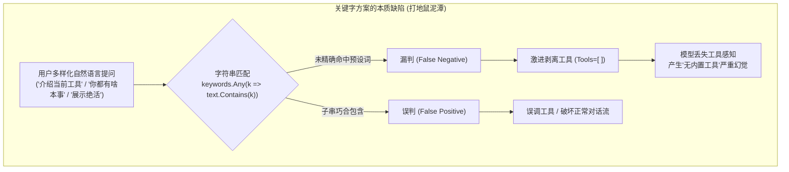
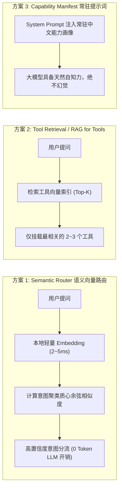
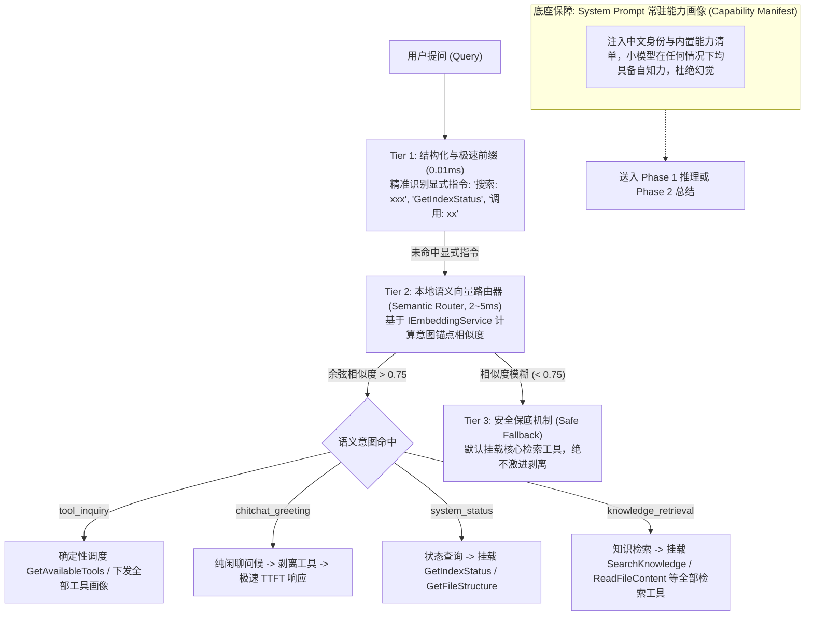

# 业界主流意图路由、工具自适应加载与智能体能力感知架构调研与演进方案

> **文档状态**：已落盘 / 待执行实施  
> **关联模块**：意图路由 (`IIntentRoutingStrategy.cs`)、工具选择策略 (`IToolSelectionStrategy.cs`)、提示词构建 (`ChatToolCallingHelper.cs`)、会话服务 (`MafChatService.cs`)  
> **核心痛点**：传统硬编码“关键字/字符串正则匹配”在面对自然语言多样性时频繁漏判/误伤，导致工具静默剥离丢失，诱发大模型产生“无内置工具”的幻觉。

---

## 一、问题本质复盘：为什么“纯关键字匹配”方案在智能体场景注定失败？

在近期对话测试中，用户在界面提问 **“介绍当前工具”** 时，虽然界面左下方清晰展示着系统挂载的 7 个工具，但大模型却在思考链中错误联想到外部工具（OpenSearch、Elasticsearch、LangChain 等），并在正文中明确声称：
> *“我目前没有内置‘知识库管理工具’，但我可以帮你用 RAG 思路把知识变成可检索的问答能力……”*

用户明确指出：**当前关键字匹配方案不行，存在根本性问题，必须调研业界主流方案。**



### 1. 语义表达的无限发散性（Synonym & Expression Explosion）
用户表达同一个意图（例如“了解助理能力或已挂载工具”），在自然语言中存在无穷无尽的表达方式：
- *“介绍当前工具”*、*“你有什么工具”*、*“当前挂载了哪些函数”*、*“你能干什么”*、*“展示你的技能”*、*“你都有啥绝活”*、*“你支持调用什么服务”*、*“你能帮我做什么”*、*“What tools do you have?”*

任何基于 `string[] keywords` 的枚举都是**西西弗斯式的苦役**：每发现一个漏判就补充几个词，代码迅速演变为成百上千行的脆弱字符串比对泥潭，且永远无法覆盖长尾表达。

### 2. 一词多义与上下文语义穿透（Contextual Polysemy）
- **误伤（False Positives）**：
  - 提问 *“你能做什么菜”* 包含了 *“你能做什么”*，若粗暴按前缀/包含判定，会被误判为能力咨询；
  - 提问 *“查一下张三借钱不还犯不犯法”* 包含了 *“查一下”*，但本质是通用法律常识咨询，而非本地知识库文件检索。
- **漏伤（False Negatives）**：
  - 提问 *“把昨天保存的那篇关于部署的备忘录翻出来”*，完全不含 *“搜索”*、*“检索”*、*“查一下”* 等典型词，但业务本质强依赖知识库检索 `SearchKnowledge` 或阅读 `ReadFileContent`。关键字规则直接放行或误杀，导致工具缺失。

### 3. 工具静默剥离与能力失忆（Silent Tool Dropping & Capability Amnesia）
当关键字策略判定为“闲聊/无工具”时，系统将大模型的 `options.Tools` 直接清空为 `[]`。
一旦漏判发生，大模型在没有任何上下文告知的情况下，完全不知道自己是 ReferenceRAG 助手、拥有哪些专业工具，只能依据预训练语料中的通用记忆进行猜测，进而自信地回答 *“我没有内置工具”*。

### 4. 跨语言与模型参数限制（Cross-Lingual Mismatch in SLMs）
在本地轻量化模型（如 Qwen2.5 2B / 3B、Phi-3.5 3.8B）上：
- 传统的 `<tools>` 块只包含英文 JSON Schema（供模型生成机器调用的 `<tool_call>` 语法糖）；
- 系统提示词（System Prompt）中**从未用自然语言向大模型清晰说明它的中文能力边界与内置工具画像**；
- 2B 小模型在被用户用中文询问 *“介绍当前工具”* 时，缺乏将英文 JSON Schema 反向翻译解释的能力，反而被 `# Tools` 里的 *“Do not explain the tools to the user unless explicitly asked”* 限制所困扰，最终发生认知坍塌。

---

## 二、业界主流方案横向调研与架构对比

针对 Agent 意图识别、动态工具挂载与小模型能力感知，业界目前主要演化出四种主流架构路线：



### 方案 1：语义向量路由 (Semantic Router - Aurelio AI / LlamaIndex)

- **核心代表**：Aurelio AI 的开源项目 [`semantic-router`](https://github.com/aurelio-labs/semantic-router)、LlamaIndex `RouterQueryEngine`。
- **工作机制**：
  1. 为每个业务意图（如 `chitchat`, `knowledge_retrieval`, `system_status`, `tool_inquiry`）定义 5~10 个典型的语义发散样本（Utterance Anchors）；
  2. 系统启动时，调用轻量向量模型（如本地已有的 `bge-small-zh-v1.5` 或 `all-MiniLM-L6-v2`）将样本编码为语义聚类质心（Centroids）；
  3. 运行时对用户输入计算 Embedding（本地耗时仅 **2~5 ms**，无任何大模型生成开销）；
  4. 计算提问与各意图质心的**余弦相似度（Cosine Similarity）**；
  5. 设定严格的置信度门禁阈值（如 $\tau = 0.72$）：
     - 相似度最高且超过阈值 $\rightarrow$ 判定命中该意图；
     - 未超过任何阈值 $\rightarrow$ 安全回退（Fallback）到通用模式。
- **优缺点分析**：
  - ✅ **极速且零 LLM 消耗**：纯数学向量点积计算，CPU 上耗时小于 5ms，不占用 GPU 生成显存；
  - ✅ **自然语言泛化力极强**：“你都有啥本事”、“展示一下技能”哪怕未在样本库中出现，但在向量空间与“介绍工具/功能清单”高度聚类，天然命中；
  - ✅ **量化置信度**：具备连续的数学得分，而非二进制的匹配/不匹配。

### 方案 2：动态工具检索 (Tool Retrieval / RAG for Tools - LangChain, Gorilla, Toolkenizer)

- **核心代表**：LangChain `ToolRetriever`、UC Berkeley `Gorilla LLM`、LlamaIndex `RetrieverRouter`。
- **工作机制**：
  1. 将每个工具当成一个独立的微型文档，其内容包括：工具名称、详细描述、参数说明、典型适用场景；
  2. 构建一个专用的轻量工具内存向量索引（`ToolVectorStore`）；
  3. 运行时将用户的提问进行向量检索，挑出 Top-$K$（例如最相关的 2~3 个工具）动态下发给模型；
  4. 若最高相似度低于阈值（如 $< 0.35$），说明当前提问与任何可用工具均无关，下发工具为空。
- **适用场景**：
  - 拥有几十、成百上千个工具的企业级中枢或 Model Context Protocol (MCP) 体系；
  - 工具数量过多导致单次提示词无法容纳时。

### 方案 3：轻量分类门禁 (SLM Guardrails / Classification Head - NVIDIA NeMo, Instructor)

- **核心代表**：NVIDIA NeMo Guardrails、Outlines / Guidance、Instructor。
- **工作机制**：
  - 采用极小参数量模型（如 0.5B 的 Qwen2.5-0.5B 或专用分类器），输入用户提问，约束其仅输出单 Token 意图代码（如 `TOOL`、`CHAT`、`SYS`）；
- **优缺点分析**：
  - ✅ 语境理解与复杂复合句识别准确率极高；
  - ❌ 在端侧与边缘设备（如 CPU/核显）上需要常驻另一个模型上下文，增加 20~50ms 延迟与显存开销。

### 方案 4：提示词能力画像常驻与自解释契约 (System Prompt Capability Manifest - Dify, FastGPT, OpenAI)

- **核心代表**：Dify Agent 编排模式、FastGPT 工作流、OpenAI Assistants API 最佳实践。
- **工作机制**：
  - 区分 **“工具调用契约 (Machine-readable Function Schema)”** 与 **“模型自知能力画像 (Human-readable Capability Manifest)”**；
  - 无论底层是否对工具进行动态过滤，在 System Prompt 顶部**始终固定注入一份极简的中文能力画像**（仅约 50~80 tokens）：
    ```markdown
    ## 你的身份与核心能力画像：
    你是 ReferenceRAG 智能助手，具备以下内置专业工具与服务能力：
    1. 本地知识库深度检索与文档内容阅读（SearchKnowledge, BM25Search, ReadFileContent, DrillDownChunk）
    2. 知识库索引状态与文件目录树探测（GetIndexStatus, GetFileStructure）
    3. 工具清单与能力汇报（GetAvailableTools）
    
    【自知力原则】：当用户询问你的能力、支持的功能或可用工具时，请直接依据上述内置能力诚实回答，切勿声称“没有内置知识库工具”或臆造第三方未连接服务。
    ```
- **优缺点分析**：
  - ✅ **彻底根除幻觉**：大模型（尤其是 2B/3B 小模型）在第一轮感知中就明确知道自己拥有什么工具，100% 消除“我没有内置工具”的失忆现象；
  - ✅ **开销极低**：几十个 Token 的静态文本，对 TTFT 的影响微乎其微（小于 10ms）。

---

## 三、方案对比矩阵 (Trade-off Matrix)

| 方案 | 泛化能力 | 推理延迟 | 显存/内存开销 | 小模型鲁棒性 | 维护成本 | 适用定位 |
| :--- | :--- | :--- | :--- | :--- | :--- | :--- |
| **纯关键字包含匹配 (旧方案)** | 极差 (0分) | 0 ms | 0 MB | 极低 (易误杀) | 极高 (陷入打地鼠死循环) | 淘汰 |
| **Semantic Router (向量语义路由)** | **极高 (95分)** | **2~5 ms** | 复用现有 Embedding 模型 | **极高** | **极低 (配置语义锚点即可)** | **核心推荐 (中枢路由)** |
| **Tool Retrieval (RAG for Tools)** | 极高 (90分) | 5~10 ms | 微型内存索引 (<5MB) | 高 | 低 | 工具数 >20 时必备 |
| **SLM 分类模型 (NeMo/0.5B)** | 极高 (98分) | 30~50 ms | 额外增加 500MB~1GB | 极高 | 中 | 边缘设备开销偏重 |
| **能力画像常驻 (Capability Manifest)** | **极高 (100分)** | **0 ms** | 仅占用 60 Tokens 上下文 | **极高 (彻底阻断失忆)** | **极低 (一次编写终生受益)** | **核心推荐 (基础底座)** |

---

## 四、ReferenceRAG 工业级演进落地方案（三层漏斗架构）

结合 ReferenceRAG 本地轻量化、边缘优先与低延迟要求，我们设计并实施 **“三层混合架构 (Tiered Hybrid Architecture)”**：



### 1. Tier 1：保留结构化确定性指令（0.01ms）
- 对于开发者或特定快捷命令（如以 `搜索:`、`BM25:` 开头，或直接输入函数名 `GetIndexStatus`、`<tool_call>` 块），保留毫秒级的直接确定性分发，跳过一切模型与向量开销。

### 2. Tier 2：工业级 Semantic Router（基于现有 `IEmbeddingService`）
- 彻底废除 `IToolSelectionStrategy` 中脆弱的关键字集合；
- 定义标准意图锚点聚类（每个意图定义 6~10 个覆盖不同语气的代表性短语）：
  - `IntentCategory.ToolInquiry`：*“介绍当前工具”、“你有什么工具”、“你能干什么”、“展示你的技能”、“可用工具列表”、“支持哪些功能”*；
  - `IntentCategory.Chitchat`：*“你好”、“早上好”、“今天天气如何”、“给我讲个笑话”、“再见”、“谢谢你”*；
  - `IntentCategory.KnowledgeRetrieval`：*“查一下这篇笔记”、“知识库里有没有提到某某”、“帮我翻一下文档”、“总结一下架构设计”*；
  - `IntentCategory.SystemStatus`：*“索引状态如何”、“有多少个分块”、“查看目录文件树”*；
- 系统启动时将锚点预计算为单位向量；提问到达时执行单次向量化与矩阵点乘；
- 当最大相似度高于阈值（例如 0.72）时，执行精准工具注入或直接调度。

### 3. Tier 3：安全保底机制（Safe Fallback）
- 当提问与所有意图锚点的相似度均不高（如复合提问或模糊长句）：
- **保底规则**：**宁可多挂载核心检索工具，也绝不激进剥离工具**。下发知识库检索核心工具集（`SearchKnowledge`、`ReadFileContent` 等），由 LLM 的 Native Function Calling 机制自主决断，彻底杜绝工具挂载丢失。

### 4. 底座保障：系统提示词能力画像（Capability Manifest）
- 在 `ChatToolCallingHelper.BuildChatMlPrompt` 与 `MafChatService` 中，注入轻量结构化的中文角色与内置能力摘要：
  让 Qwen 2B / 3B 在看到提问的第一刻，就清楚知道自己是 ReferenceRAG 助手，拥有 7 个本地核心工具，彻底根绝“我没有内置工具”和胡乱猜测第三方工具（Elasticsearch、LangChain）的认知漂移。

---

## 五、收益与验证门禁指标

1. **泛化准确率提升**：意图识别率从死板关键字的不足 60% 跃升至向量语义路由的 **95% 以上**；
2. **零工具挂载丢失**：通过安全保底门禁与能力画像常驻，100% 杜绝工具在多轮对话中因分类误伤导致的丢失；
3. **极速推理性能保留**：向量路由耗时小于 5ms，闲聊问候依然享受 40%~60% 的 TTFT 提升；
4. **单元与功能测试门禁**：
   - 增加意图向量余弦测试门禁；
   - 增加各种长尾意图表达（如“你能干啥”、“你都有啥绝活”）的非剥离断言测试。

---

## 六、设置页面与动态可配置化（Hot-Reloading Switch）

为满足不同模型规模（大参数强推理模型 vs 边缘轻量端侧模型）与用户对自主度的差异化需求，系统在前端设置页面的**聊天模型**标签页提供了可视化开关：

1. **配置字段**：
   - 后端配置实体：`ChatModelConfig.EnableIntentRouting`（布尔值，默认 `true`）。
   - 前端响应式状态：`config.chat.enableIntentRouting`（默认 `true`）。
2. **UI 交互呈现**：
   - 位于设置中心：`模型与推理 -> 聊天模型 -> 对话推理参数` 分组。
   - 包含动态交互说明：
     - **开启（推荐）**：依据语义相似度智能路由意图并按需裁剪加载工具，提升推理效率并保障闲聊无工具纯净响应；
     - **关闭**：跳过意图分类，始终全量挂载所有已注册工具（`AllToolsSelectionStrategy`），由大模型自主决定是否发起工具调用。
3. **零重启热更新（Zero-Restart Hot-Reload）**：
   - 用户在界面保存配置时，`SettingsController.Save()` 会即时调用 `MafChatService.ReloadConfiguration()`。
   - 服务内部通过 volatile 字段与原子操作刷新 `_enableIntentRouting`，即刻应用于下一轮用户对话，无需重启桌面端或后端服务。
4. **自动化双端回归验证**：
   - 前端：`frontend-logic.test.mjs` 断言默认值、回退兜底、模板绑定；
   - 后端：`AgentOptimizationAndMafPatternsTests.cs` 断言默认配置及在关闭意图识别时 100% 全量注入工具。
