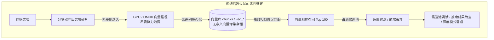
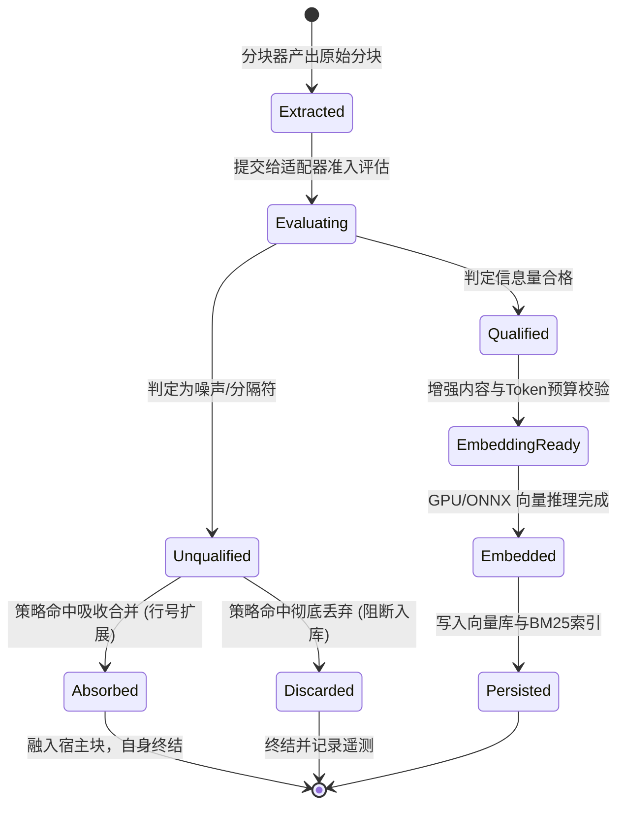

# 入库分块防噪适配器策略与生命周期状态机架构设计方案
(Ingestion Chunk Noise Filtering: Adapter, Strategy & Lifecycle State Machine Architecture Design)

---

## 1. 架构背景与底层痛点分析

在 RAG（检索增强生成）系统中，检索质量的上限由**入库数据的质量（Data Ingestion Quality）**直接决定。

系统历史实现中，文档在经过分块器（如 `MarkdownChunker`）切分后，由于文档排版习惯、自动切分边界或分页标记，常常产生以下几类**无独立语义的底层噪音碎片**：
1. **纯分隔线与页面标记**：例如 `=== (43-48) ===`、`---`、`***`、`======` 等；
2. **纯标点与修饰符**：包含极少数特殊符号（如 `·`、`|`、`---`）且没有任何自然语言词汇；
3. **极低信息密度碎片**：仅含单字、单序号（如 `1.`、`（一）`、`Page 1`）的短碎片；
4. **截断残留微碎片**：在根据 Token 上限截断时产生的末尾标点碎片。

### 1.1 传统“搜索时后置过滤”的缺陷与危害

在以往版本中，系统尝试在 `SearchService` 或前端展示层使用正则表达式后置剔除噪音。这种方式存在致命缺陷：



- **算力浪费**：无效碎片占用了昂贵的 GPU/CPU 向量推理时间（Embedding 批次处理变慢）；
- **索引污染**：纯数字与分隔符在向量空间中表现出不可控的高维余弦聚集，被大量误检索；
- **候选池挤占**：Top-K 粗排召回池被噪音占满，后置过滤后导致有效结果所剩无几（甚至为空）；
- **BM25 词频失真**：短噪音分块的高频词会导致逆文档频率（IDF）失真。

### 1.2 解决方案：入库准入网关（Ingestion Gatekeeping）

从根本上解决噪音，必须将防噪关口前移至**向量生成之前、持久化之前**。通过**适配器模式（Adapter Pattern）**对分块信息量与形态进行多维度准入判定，通过**策略模式（Strategy Pattern）**进行无损吸收（Absorb）或安全丢弃（Discard），并通过**分块入库生命周期状态机（StateMachine）**全程跟踪与度量，阻断脏数据入库。

---

## 2. 总体架构拓扑 (Overall Architecture Topology)

入库防噪网关集成在 `FileIndexPipeline` 与 `IndexingPipeline` 之间，整体拓扑如下：

```mermaid
flowchart TD
    subgraph 文档解析输入
        F[文件原始内容 FileContent] --> Parser[MarkdownChunker / DocumentParser]
        Parser --> RawChunks[原始分块列表 List RawChunk]
    end

    subgraph 准入网关调度与状态机
        Gatekeeper[ChunkGatekeeperService]
        SM[ChunkIngestionStateMachine<br/>生命周期遥测与计数]
    end

    subgraph 适配器评估链 (IChunkQualificationAdapter)
        Chain[CompositeChunkQualificationAdapter]
        A1[SeparatorNoiseAdapter<br/>纯分隔符与页码标记识别]
        A2[InformationDensityAdapter<br/>字数/标点比率/有效熵评估]
        A3[RegexPatternAdapter<br/>自定义规则扩展]
    end

    subgraph 策略分流处置 (IChunkIngestionStrategy)
        Router[ChunkIngestionStrategyResolver]
        S_Absorb[AbsorbToAdjacentStrategy<br/>向前/向后合并到有意义相邻块<br/>保留行号跨度与上下文]
        S_Discard[DiscardNoiseStrategy<br/>彻底安全丢弃纯噪音]
        S_Adaptive[AdaptiveIngestionStrategy<br/>有邻居则吸收，孤立则丢弃]
    end

    subgraph 最终净化输出
        CleanChunks[净水分块列表 Clean Chunks]
        CleanChunks --> EmbedStage[GPU / ONNX 向量推理 Stage 2]
        CleanChunks --> StorageStage[SQLite / BM25 存储 Stage 3]
    end

    RawChunks --> Gatekeeper
    Gatekeeper --> SM
    Gatekeeper --> Chain
    Chain --> A1
    Chain --> A2
    Chain --> A3
    Chain -->|返回评估结果| Router
    Router --> S_Absorb
    Router --> S_Discard
    Router --> S_Adaptive
    S_Absorb --> CleanChunks
    S_Discard -->|丢弃| SM
    S_Adaptive --> CleanChunks
```

---

## 3. 适配器模式设计 (Adapter Pattern)

### 3.1 准入评估契约：`IChunkQualificationAdapter`

```csharp
public sealed record ChunkQualificationResult
{
    public bool IsQualified { get; init; }
    public string Reason { get; init; } = string.Empty;
    public NoiseCategory Category { get; init; } = NoiseCategory.None;
    public IngestionActionType RecommendedAction { get; init; } = IngestionActionType.Accept;

    public static ChunkQualificationResult Qualified() =>
        new() { IsQualified = true, RecommendedAction = IngestionActionType.Accept };

    public static ChunkQualificationResult Unqualified(
        string reason,
        NoiseCategory category,
        IngestionActionType recommendedAction) =>
        new()
        {
            IsQualified = false,
            Reason = reason,
            Category = category,
            RecommendedAction = recommendedAction
        };
}

public enum NoiseCategory
{
    None,
    SeparatorLine,      // 分隔线如 ---, ===
    PaginationMarker,   // 页码标记如 === (43-48) ===
    PunctuationOnly,    // 纯标点或空白
    LowDensityFragment, // 低信息密度碎片 (< 5 有效字符)
    TruncationRemnant   // 截断遗留符
}

public enum IngestionActionType
{
    Accept,             // 合格入库
    AbsorbToAdjacent,   // 吸收合并到相邻块
    Discard             // 彻底丢弃
}

public interface IChunkQualificationAdapter
{
    string AdapterName { get; }
    int Priority { get; }
    ChunkQualificationResult Evaluate(ChunkRecord chunk, ChunkEvaluationContext context);
}
```

### 3.2 核心适配器实现

1. **`SeparatorNoiseAdapter`（分隔符与页码标记适配器）**：
   - 委托并复用全局 `NoiseChunkDetector`，识别 `=== (43-48) ===`、`---`、`***`、`======` 等。
   - 若匹配，返回 `Unqualified(category: PaginationMarker/SeparatorLine, action: AbsorbToAdjacent)`。
2. **`InformationDensityAdapter`（信息密度适配器）**：
   - 统计有效文字字符（中日韩统一表意文字、英文字母、数字）占总字符比率；
   - 过滤有效字符数 $< 6$ 且非标准标题的分块；
   - 识别单行无语义数字标号；
   - 若匹配，建议 `AbsorbToAdjacent`（若有邻居）或 `Discard`。
3. **`CompositeChunkQualificationAdapter`（组合责任链适配器）**：
   - 按优先级（Priority）由高到低串联多个子适配器；
   - 短路返回第一个不合格结论，若全部通过则裁定为合格（Qualified）。

---

## 4. 策略模式设计 (Strategy Pattern)

### 4.1 处置策略契约：`IChunkIngestionStrategy`

```csharp
public sealed record ChunkStrategyResult
{
    public bool ChunkRetained { get; init; }
    public ChunkRecord? MutatedAdjacentChunk { get; init; }
    public string OperationSummary { get; init; } = string.Empty;
}

public interface IChunkIngestionStrategy
{
    IngestionActionType ActionType { get; }
    ChunkStrategyResult Apply(
        ChunkRecord currentChunk,
        int currentIndex,
        List<ChunkRecord> allChunks,
        List<ChunkRecord> acceptedChunksSoFar);
}
```

### 4.2 核心处置策略实现

1. **`AbsorbToAdjacentStrategy`（相邻块吸收策略）**：
   - 优先向前合并（Forward Absorption）：若 `acceptedChunksSoFar` 中已有前置分块，将本分块的内容作为尾部附注拼接至前置分块，同时更新前置分块的 `EndLine` 与 `EndColumn`；
   - 次优向后合并（Backward Absorption）：若当前为文档开头（尚无已接收分块），则暂存至下一个合格分块的头部，并拉宽其 `StartLine`；
   - **核心优势**：既不产生无意义的独立向量，又完全保全文档原始代码行号跨度与上下文完整性。
2. **`DiscardNoiseStrategy`（彻底丢弃策略）**：
   - 针对纯噪声且无前后文本可依赖的孤立标记，直接丢弃；
   - 不生成任何向量，不写入 `chunks` 表，不更新 BM25。
3. **`AdaptiveIngestionStrategy`（自适应综合策略）**：
   - 根据分块上下文环境动态决定：有前后上下文可挂靠时执行吸收，无意义且孤立时直接丢弃。

---

## 5. 分块入库生命周期状态机 (Chunk Ingestion State Machine)

分块在入库过程中的状态流转严密受控，状态机负责驱动流转并汇总遥测数据：



### 5.1 状态机遥测指标 (`ChunkIngestionTelemetry`)

状态机实时输出以下度量，供日志记录、测试断言和前端性能看板呈现：
- `TotalExtracted`：原始分块总数
- `QualifiedCount`：直接准入分块数
- `AbsorbedCount`：被相邻块吸收的分块数
- `DiscardedCount`：被彻底丢弃的分块数
- `SavedEmbeddings`：节约的向量推理次数（`AbsorbedCount + DiscardedCount`）
- `SavedGpuTimeEstimateMs`：预估节约的 GPU 算力耗时

---

## 6. 深度模式（Deep Mode）检索优化方案

在解决了入库端噪音之后，检索端的深度模式（Deep Mode）亦需升级为真正的**旗舰深度多路重排检索**：

### 6.1 深度模式问题复盘
1. **未接入混合检索**：在 `SearchService.cs` 第 181 行，`QueryMode.Deep` 被意外排除在 `_hybridSearchService` 分支外，跌入纯向量搜索，缺乏 BM25 关键词精确校准；
2. **未强制启用重排**：`AIQueryController` 与 `DetermineRerankExecution` 仅对 `HybridRerank` 强制开启重排，`Deep` 模式跳过了 Cross-Encoder 重排；
3. **高 TopK 带来低信噪比**：`Deep` 模式返回 20 条结果，纯向量搜索的长尾相关度极低，加之弱候选上的图谱扩展发散，导致结果劣化严重。

### 6.2 深度模式优化规格

| 维度 | 平衡模式 (HybridRerank) | 深度模式 (Deep) 优化后 |
| :--- | :--- | :--- |
| **召回模式** | 双路混合 (BM25 + Dense) | 双路混合 (BM25 + Dense) + 增强图谱扩展 |
| **召回候选池** | `TopK * RecallFactor` (约 50 条) | `TopK * Max(RecallFactor, 10)` (200 条海量候选池) |
| **重排模型** | Cross-Encoder 精排 | Cross-Encoder 深度重排 (强力启用) |
| **重排候选深度** | 30 ~ 50 条 | 50 ~ 100 条候选深度交叉推理 |
| **最终输出** | Top 10 | Top 20 深度上下文 |
| **底噪控制** | 仅依赖后置过滤 | **底层入库防噪拦截 + 运行时防噪双重保障** |

---

## 7. 分步实施计划

1. **Step 1**: 实现分块准入适配器 (`IChunkQualificationAdapter`) 与具体实现（`SeparatorNoiseAdapter`, `InformationDensityAdapter`, `CompositeChunkQualificationAdapter`）；
2. **Step 2**: 实现处置策略 (`IChunkIngestionStrategy`, `AbsorbToAdjacentStrategy`, `DiscardNoiseStrategy`, `AdaptiveIngestionStrategy`)；
3. **Step 3**: 实现分块入库生命周期状态机 (`ChunkIngestionStateMachine`) 与网关服务 (`ChunkGatekeeperService`)；
4. **Step 4**: 将准入网关深度集成到 `FileIndexPipeline.cs` 与 `IndexingPipeline.cs`；
5. **Step 5**: 执行深度模式（Deep Mode）优化：
   - 修改 `AIQueryController.cs`（`AdjustRequestByMode` 深度模式启用重排）；
   - 修改 `SearchService.cs`（纳入混合检索与深度重排判定，扩充候选池）；
   - 实现 `DeepSearchStrategy.cs` 并更新 `SearchStrategyFactory.cs`；
   - 更新前端 `Search.js`（`modeDefaults.Deep = { topK: 20, enableRerank: true }`）；
6. **Step 6**: 编写完整的单元测试与端到端验证，确保编译、代码规范和测试 100% 绿灯。
