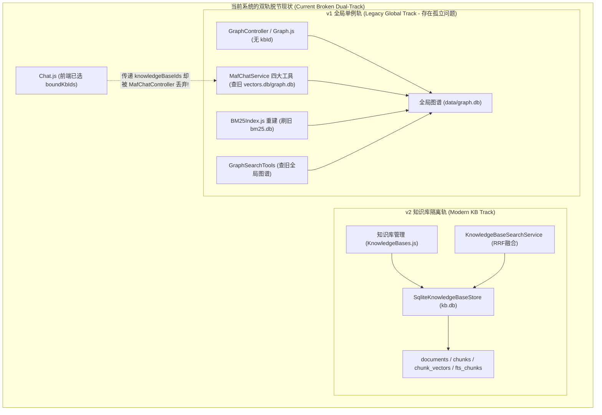
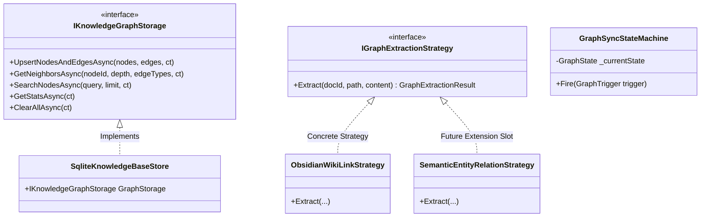

# 知识图谱按库物理隔离与全系统作用域收敛可行性调研报告
## ——基于“零兼容包袱”的端到端统一架构头脑风暴、设计模式优化、业界主流方案对比与落地实施规划

> 文档位置：`docs/knowledge-graph-and-system-scope-convergence-feasibility-study.md`  
> 核心命题：  
> 1. 知识图谱按知识库物理自闭环隔离的可行性、逻辑与性能推演；  
> 2. 系统中存在的类似“双轨脱节/全局作用域未对齐”问题全景排查与协同处理方案；  
> 3. 设计模式（适配器、策略、状态机）应用、业界主流标杆对比与系统现有基建复用清单；  
> 4. 落地实施路线图与质量验证门禁。  
> 撰写日期：2026-11-09  

---

## 目录
1. [执行摘要与问题定义](#1-执行摘要与问题定义)
2. [知识图谱按库物理隔离可行性深度分析](#2-知识图谱按库物理隔离可行性深度分析)
3. [系统全域类似“双轨脱节”问题排查清单与协同处置方案](#3-系统全域类似双轨脱节问题排查清单与协同处置方案)
4. [逻辑完备性、极端性能与边界缺陷头脑风暴](#4-逻辑完备性极端性能与边界缺陷头脑风暴)
5. [设计模式深度重构设计（适配器、策略、状态机）](#5-设计模式深度重构设计适配器策略状态机)
6. [业界主流方案深度调研与对比借鉴](#6-业界主流方案深度调研与对比借鉴)
7. [当前系统已有基础设施与第三方库复用清单](#7-当前系统已有基础设施与第三方库复用清单)
8. [端到端落地实施路线图与接口设计](#8-端到端落地实施路线图与接口设计)
9. [质量保障与验收门禁矩阵](#9-质量保障与验收门禁矩阵)

---

## 1. 执行摘要与问题定义

在系统的演进历史中，底层数据存储完成了从 **v1 时代单一全局 Vault（`data/vectors.db` + `data/graph.db` + `data/bm25.db`）** 向 **v2 时代物理多知识库隔离（`catalog.db` + `data/kbs/{kbId}/kb.db`）** 的重大跨越。

然而，本次深度系统级代码审计揭示了一个深层架构割裂现象：**系统的核心文本分块、向量与 FTS5 已成功迁入 `kb.db`，但知识图谱（Knowledge Graph）、AI 对话智能体检索工具（Chat Tools）、全文索引维护界面以及部分 MCP 工具仍滞留在 v1 全局单例体系中**。



用户提出的核心指示明确而果断：
> **“由于没有正式发布 不用考虑兼容性增加维护负担”**

这为我们提供了执行“净室重构（Clean-Break Refactoring）”的最佳窗口期：无需保留任何向后兼容胶水层或复杂的跨版本双写逻辑，直接将图谱及相关脱节模块**一次性、彻底地收敛到统一的物理知识库自闭环体系中**。

---

## 2. 知识图谱按库物理隔离可行性深度分析

### 2.1 存储层可行性：内嵌 `kb.db`
* **技术可行性：100% 极高**。
  每个知识库在磁盘上表现为单个 SQLite 文件 `data/kbs/{kbId}/kb.db`。当前 `kb.db` 已经通过 SQLite 统一管理了 `documents`、`chunks`、`chunk_vectors` 与 `fts_chunks`。
* **物理模型映射**：
  在 `SqliteKnowledgeBaseStore.EnsureTables` 中新增 `graph_nodes` 与 `graph_edges`：
  ```sql
  CREATE TABLE IF NOT EXISTS graph_nodes (
      id         TEXT PRIMARY KEY,
      title      TEXT NOT NULL DEFAULT '',
      type       TEXT NOT NULL DEFAULT 'document',
      chunk_ids  TEXT NOT NULL DEFAULT '[]',
      metadata   TEXT NOT NULL DEFAULT '{}'
  );

  CREATE TABLE IF NOT EXISTS graph_edges (
      from_id     TEXT NOT NULL,
      to_id       TEXT NOT NULL,
      type        TEXT NOT NULL DEFAULT 'wikilink',
      line_number INTEGER NOT NULL DEFAULT 0,
      document_id TEXT NOT NULL,
      PRIMARY KEY (from_id, to_id, type)
  );
  CREATE INDEX IF NOT EXISTS idx_graph_edges_from ON graph_edges(from_id);
  CREATE INDEX IF NOT EXISTS idx_graph_edges_to   ON graph_edges(to_id);
  CREATE INDEX IF NOT EXISTS idx_graph_edges_doc  ON graph_edges(document_id);
  ```
* **架构收益**：
  1. **零数据串扰**：不同知识库即使含有同名笔记（如 `README.md`、`index.md`）或同名标签（`#todo`），由于物理文件彻底隔离，绝不会产生错误跨库虚假连线。
  2. **物理生命周期原子绑定**：删除知识库即物理删除整个文件夹，瞬间清除所有节点与边，杜绝全局 `graph.db` 累积垃圾孤儿节点。
  3. **在线热备与迁移零成本**：原有的 `BackupKnowledgeBaseAsync`（基于 SQLite Online Backup API）无需任何修改，即可将文档、向量、全文索引及知识图谱打包在单个 `.db` 文件中完成冷热备份与迁移。

### 2.2 同步管线可行性：`KnowledgeBaseSyncWorker` 挂接
* **管线切入点**：
  在 `KnowledgeBaseSyncWorker.ExecuteSyncAsync` 扫描并处理每个 Markdown 文档时，既有的 `WikiLinkExtractor` 可以直接复用：
  - 提取出文档内的 `[[Note]]`、`[[Note#Heading]]`、`#tag`、`# Header` 以及嵌入链接；
  - 与 `documents` / `chunks` 处于**同一个 SQLite 事务**内批量写入 `graph_nodes` 和 `graph_edges`；
  - 彻底淘汰了需要全局全盘扫描的旧版 `FileIndexPipeline`。

---

## 3. 系统全域类似“双轨脱节”问题排查清单与协同处置方案

经代码全仓排查，系统中除“知识图谱未按库划分”外，共存在另外 **3 处严重的同源结构性脱节**。强烈建议在此次任务中**一并协同解决**：

| 脱节模块 | 现状与缺陷表现 | 根因定位 | 协同处置方案（一并根治） |
| :--- | :--- | :--- | :--- |
| **问题 1：知识图谱全局未隔离** | 全局唯一 `data/graph.db`；`Graph.js` 与 `/api/graph` 无 `kbId` 隔离；`KnowledgeBaseSyncWorker` 不建图。 | 遗留在 v1 单 Vault 时代。 | `kb.db` 扩建图谱表，`KnowledgeBaseSyncWorker` 写入，`/api/graph` 与 `Graph.js` 增加知识库作用域。 |
| **问题 2：AI 对话工具查旧库（严重！）** | 前端 `Chat.js` 允许勾选 `boundKbIds` 并发起请求，但 `MafChatController` 丢弃 `knowledgeBaseIds`；智能体工具 `SearchKnowledge`、`SearchBM25`、`find_note_by_title`、`GetIndexStatus` 直查旧版全局单库。 | `MafChatService` 工具集未对接 `IKnowledgeBaseSearchService` 与 `IKnowledgeBaseStorageManager`。 | 贯通 `MafChatController` 参数流；重构 `MafChatService` 工具使其优先在挂载的 `KnowledgeBaseIds` 范围内执行向量、BM25与图谱检索。 |
| **问题 3：BM25 全文索引管理界面脱节** | 菜单中保留“BM25索引 (`BM25Index.js`)”，其重建与清空按钮调用 `BM25IndexController` 刷新旧版 `data/bm25.db`，而用户实际数据在各库的 `fts_chunks`。 | `BM25IndexController` 仍面向旧 `config.Sources` 与 `vectors.db` 运作。 | `BM25Index.js` 与 `BM25IndexController` 全面改为按指定 `kbId` 进行单库 FTS 统计与单库重建（复用 `IKnowledgeBaseStorage.RebuildFtsIndexAsync`）。 |
| **问题 4：底层数据源 (Sources) 菜单冗余混淆** | 导航栏“数据管理”下同时存在“知识库管理”与“底层数据源”，新用户对概念产生严重混淆。 | `Sources.js` 为 v1 时代的目录注册入口，已完全被知识库的 `LocalFolderConnector` 覆盖。 | 移除导航栏中过期的“底层数据源”菜单（或将其归并为知识库连接器辅助视图），统一产品心智。 |

---

## 4. 逻辑完备性、极端性能与边界缺陷头脑风暴

针对知识图谱按库划分后，可能面临的逻辑、算法、性能与边界挑战展开系统性推演：

### 4.1 逻辑陷阱与边界防御
1. **短文件名解析歧义 (Wiki-link Ambiguity)**:
   - *陷阱*：Obsidian 常用短文件名引用 `[[Project Plan]]`。若库内存在 `2025/Project Plan.md` 与 `2026/Project Plan.md`，如何解析？
   - *防御*：每库在同步时，构建轻量内存映射表 `Dictionary<string, string> (shortName -> relativePath)`。发生同名冲突时，按“同级目录优先 > 最短路径优先”策略消歧；如果仍有歧义，记录警告并保留指向候选节点的歧义标记。
2. **文档增量修改时的“孤儿边”与“死节点”残留**:
   - *陷阱*：用户修改笔记，删除了文中的 `[[TargetB]]` 或修改了三级标题 `# Conclusion`。若采用简单追加，旧边和旧标题节点将永远滞留在图谱中。
   - *防御*：在 `graph_edges` 与 `graph_nodes` 中绑定 `document_id`。每次单个文档同步重写时：
     ```sql
     DELETE FROM graph_edges WHERE document_id = @docId;
     DELETE FROM graph_nodes WHERE id IN (SELECT id FROM graph_nodes WHERE json_extract(metadata, '$.documentId') = @docId AND type IN ('heading', 'tag'));
     ```
     在同一事务中重新插入新解析出的边与附属节点，实现 $O(1)$ 级精准增量自愈。
3. **跨库引用的边界语义**:
   - *陷阱*：如果 Markdown 中包含指向外部 URL 或其他 Vault 的协议链接（如 `obsidian://`），是否入库？
   - *防御*：统一归类为 `type = 'external'` 节点，仅作为叶子节点展示，**严禁跨越物理数据库连接进行虚拟跨库多跳扩散**，严格守护物理隔离红线。

### 4.2 性能极限推演与算法优化
1. **多跳邻居遍历（Graph Traversal）的组合爆炸**:
   - *痛点*：在密集引用知识库中，若 BFS 遍历深度设为 3~4，返回的节点可能成千上万，前端力导向图或表格直接卡死。
   - *优化*：
     - **服务端深度硬封顶**：限制最大深度为 3（默认 1，最大 3）；
     - **利用 SQLite 原生递归公用表表达式（Recursive CTE）单次查询**：
       ```sql
       WITH RECURSIVE Traversal(node_id, current_depth) AS (
           SELECT @rootId, 0
           UNION
           SELECT CASE WHEN e.from_id = t.node_id THEN e.to_id ELSE e.from_id END, t.current_depth + 1
           FROM graph_edges e
           JOIN Traversal t ON (e.from_id = t.node_id OR e.to_id = t.node_id)
           WHERE t.current_depth < @maxDepth
       )
       SELECT DISTINCT node_id, current_depth FROM Traversal;
       ```
       单次 SQL 往返在毫秒级内完成 3 跳拓扑提取，杜绝内存中反复进行 N+1 查询。
2. **高并发写入时的 SQLite 锁争用**:
   - *痛点*：知识库多文档并发 Ingestion 时，如果每个 Chunk 和 Edge 单独写库，会导致频繁的事务切换。
   - *优化*：与分块向量批量写入对齐，以 `BatchSize=100` 为单位在单一写入租约内批量提交，充分发挥 WAL 模式的吞吐优势。

---

## 5. 设计模式深度重构设计（适配器、策略、状态机）

为避免散落的 SQL 操作导致代码退化，采用面向对象经典模式进行架构封装：



### 5.1 适配器与门面模式（Adapter & Facade）
* **接口抽象**：定义 `IKnowledgeGraphStorage`，作为单知识库图谱操作的核心契约；
* **物理集成**：由 `SqliteKnowledgeBaseStore` 组合实现该接口。
* **上层门面**：`KnowledgeGraphManager` 接受 `kbId` 参数，利用系统成熟的 `IKnowledgeBaseStorageManager` 动态获取对应知识库的存储实例并执行租约管理，对外提供无缝的多库图谱服务。

### 5.2 策略模式（Strategy Pattern）：解析与检索扩展
* **提取策略 (`IGraphExtractionStrategy`)**：
  - `ObsidianWikiLinkStrategy`（核心主线）：轻量提取 wiki-link、tag、headings、embeds，零模型消耗，毫秒级完成；
  - `SemanticEntityRelationStrategy`（未来保留插槽）：预留 LLM 实体三元组提取接口，未来可无缝平滑切入。
* **检索融合策略 (`IGraphRAGFusionStrategy`)**：
  在 AI 对话与高级搜索中，策略决定如何将**向量得分、BM25 词法得分与图谱拓扑紧密度（Graph Proximity）** 进行融合与重排，避免规则硬编码。

### 5.3 状态机模式（State Machine Pattern）：图谱一致性生命周期
定义 `GraphSyncState` 与 `JobStateMachine` 联动：
* 状态流转：`Unindexed` $\to$ `Indexing` $\to$ `Synced` $\to$ `Dirty/Stale` $\to$ `Rebuilding`；
* 当知识库内发生文档增删时，状态机原子递增该知识库的 `GraphRevision`，若发生异常中断，可在系统启动时通过对账自愈。

---

## 6. 业界主流方案深度调研与对比借鉴

| 维度 | Microsoft GraphRAG | Obsidian 官方图谱 (Vault-Local) | Dify / FastGPT 知识库架构 | **ReferenceRAG 目标方案** |
| :--- | :--- | :--- | :--- | :--- |
| **隔离级别** | 逻辑项目级隔离 | **物理 Vault 级文件硬隔离** | 逻辑租户隔离 (PostgreSQL/PGVector) | **物理单库自闭环 (`kb.db` 硬隔离)** |
| **抽取方式** | 大模型全文本深度实体/事件抽取 | **轻量离线 Wiki-link / Tag / Headings 语法分析** | 主要是 Chunk 级分段，弱图谱支持 | **离线轻量 Wiki-link 核心 + 实体策略插槽** |
| **外部依赖** | 强依赖外部 LLM Token 与复杂图库 | **零外部依赖，纯本地解析** | 依赖 PG/Milvus/ES 等重型中间件 | **零外部依赖 (纯 SQLite + SIMD + 正则状态机)** |
| **运行成本** | 极高 (千页文档耗费数百万 Token) | **0 额外成本，极速扫描** | 中等 | **0 Token 成本，单机毫秒级响应** |
| **RAG 融合** | 社区摘要 (Community Summary) 层次召回 | 图谱可视化查看，原生无 RAG | 多路召回 + 重排 | **RRF (向量 + BM25) + 图拓扑邻居自动扩展** |
| **备份与迁移** | 复杂，涉及图库与向量库多端导出 | 极简单 (复制整个文件夹即备份) | 复杂，依赖云数据库导出工具 | **极简单 (单个 `kb.db` 在线快照即全量备份)** |

**结论**：借鉴 **Obsidian 的“零成本离线语法图谱与单 Vault 物理隔离”** 思想，融合 **RRF 多路 RAG 检索**，是私有化、轻量级、高安全性桌面/服务器系统最优雅的架构选择。

---

## 7. 当前系统已有基础设施与第三方库复用清单

系统内已有完备的基础设施，本方案开发将 **100% 复用现有基建**，无需引入任何外部重量级依赖：

1. **底层核心存储基建**：
   - [`SqliteKnowledgeBaseStore`](file:///e:/WorkProject/CSharp/PrivateProject/Web/ReferenceRAG/Infrastructure/ReferenceRAG.Infrastructure/Features/KnowledgeBase/Storage/SqliteKnowledgeBaseStore.cs)：已具备成熟的 SQLite 连接管理、WAL 配置、事务控制和在线备份机制。
   - [`KnowledgeBaseStorageManager`](file:///e:/WorkProject/CSharp/PrivateProject/Web/ReferenceRAG/Infrastructure/ReferenceRAG.Infrastructure/Features/KnowledgeBase/Storage/KnowledgeBaseStorageManager.cs)：已具备租约管理池（Lease Pool）与并发安全屏障。
2. **图谱语法解析组件**：
   - [`WikiLinkExtractor`](file:///e:/WorkProject/CSharp/PrivateProject/Web/ReferenceRAG/Business/ReferenceRAG.Business/Features/Graph/Services/WikiLinkExtractor.cs)：已具备完整的 wiki-link、标题、标签与嵌入链接正则表达式与状态机提取逻辑。
   - [`GraphFilenameMapper`](file:///e:/WorkProject/CSharp/PrivateProject/Web/ReferenceRAG/Business/ReferenceRAG.Business/Features/Graph/Services/GraphIndexingService.cs)：已具备文件名消歧与映射逻辑。
3. **跨知识库融合与检索基建**：
   - [`KnowledgeBaseSearchService`](file:///e:/WorkProject/CSharp/PrivateProject/Web/ReferenceRAG/Business/ReferenceRAG.Business/Features/KnowledgeBase/Services/KnowledgeBaseSearchService.cs) & `RrfSearchFusionStrategy`：跨库多路召回与 RRF 融合的标准实现。
4. **前端视图组件**：
   - [Graph.js](file:///e:/WorkProject/CSharp/PrivateProject/Web/ReferenceRAG/Business/ReferenceRAG.Business/wwwroot/app/views/Graph.js)：已有完善的节点/边表格、统计展示和遍历交互，只需接入知识库选择器。
   - [Chat.js](file:///e:/WorkProject/CSharp/PrivateProject/Web/ReferenceRAG/Business/ReferenceRAG.Business/wwwroot/app/views/Chat.js)：前端已有 `boundKbIds` 挂载组件与传参，只需后端连通。

---

## 8. 端到端落地实施路线图与接口设计

实施计划分为四个清晰的渐进阶段：


### 阶段 1：`kb.db` 存储引擎扩建与同步器集成
* 在 `SqliteKnowledgeBaseStore` 中建立 `graph_nodes` 和 `graph_edges` 表；
* 实现 `IKnowledgeGraphStorage` 增删改查方法（支持按 `docId` 增量替换）；
* 在 `KnowledgeBaseSyncWorker` 中注入 `WikiLinkExtractor`，在文档分块入库的同时完成图谱边与节点的批量插入。

### 阶段 2：控制器接口多库作用域化与 MCP 升级
* **`GraphController` 重构**：
  - `GET /api/graph/stats?kbId={id}`：查询指定库的图谱规模；
  - `GET /api/graph/neighbors?kbId={id}&nodeId={node}&depth={depth}`：单库内 BFS 遍历；
  - `GET /api/graph/search?kbId={id}&q={query}`：单库内模糊搜索；
  - `POST /api/graph/rebuild?kbId={id}`：仅针对该知识库进行图谱重建。
* **`GraphSearchTools` (MCP) 升级**：增加可选参数 `knowledgeBaseId`，支持 Agent 在特定知识库内探索实体图谱。

### 阶段 3：AI 对话智能体（`MafChatService`）多库作用域全贯通
* 修改 `MafChatController.StreamChat`，将前端传入的 `request.KnowledgeBaseIds` 完整传递给 `_chatService.StreamAsync`；
* 重构 `MafChatService` 工具调用：
  - `SearchKnowledgeAsync`：当请求携带 `knowledgeBaseIds` 时，直接路由至 `IKnowledgeBaseSearchService`，执行真正的单库/跨库向量召回与 RRF 融合；
  - `find_note_by_title`：在当前对话挂载的知识库 `kb.db` 的 `graph_nodes` 中精准检索；
  - `GetIndexStatus`：汇报当前会话所挂载知识库的真实物理分块数与向量数。

### 阶段 4：前端界面收敛与旧系统清理
* **`Graph.js`**：顶部增加知识库下拉选择框（默认选中第一个就绪知识库，支持动态切换）；
* **`BM25Index.js`**：下线全局重建逻辑，切换到单库局部 FTS 维护；
* **清理废弃文件与入口**：下线全局单例 `data/graph.db`，下线 `Sources.js`（底层数据源）过时导航。

---

## 9. 质量保障与验收门禁矩阵

| 门禁项 | 验证内容与判定标准 | 验证手段 |
| :--- | :--- | :--- |
| **G-Storage** | `kb.db` 中图谱增删改查隔离性：库 A 插入节点，库 B 绝不可见；删除库 A 时物理清理无泄漏。 | C# 单元测试 (`KnowledgeBaseGraphStorageTests.cs`) |
| **G-Sync** | `KnowledgeBaseSyncWorker` 同步含有 wiki-link 的 Markdown 时，自动产生正确的边和节点。 | 集成测试 (`KnowledgeBaseSyncGraphIntegrationTests.cs`) |
| **G-ChatScope** | AI 对话挂载知识库 A 时，`SearchKnowledge` 和 `find_note_by_title` 严格只检索知识库 A 的内容。 | 智能体对话单元测试 (`MafChatKnowledgeBaseScopeTests.cs`) |
| **G-Frontend** | `Graph.js` 切换不同知识库时，节点统计与拓扑实时刷新，无控制台报错。 | `node check.mjs` + 内置浏览器 (`chrome-devtools-mcp`) |
| **G-Security** | 全流程绝无真实 API 密钥、密码或私有环境敏感信息泄露。 | `powershell -File scripts/security-scan.ps1` (0 violations) |
