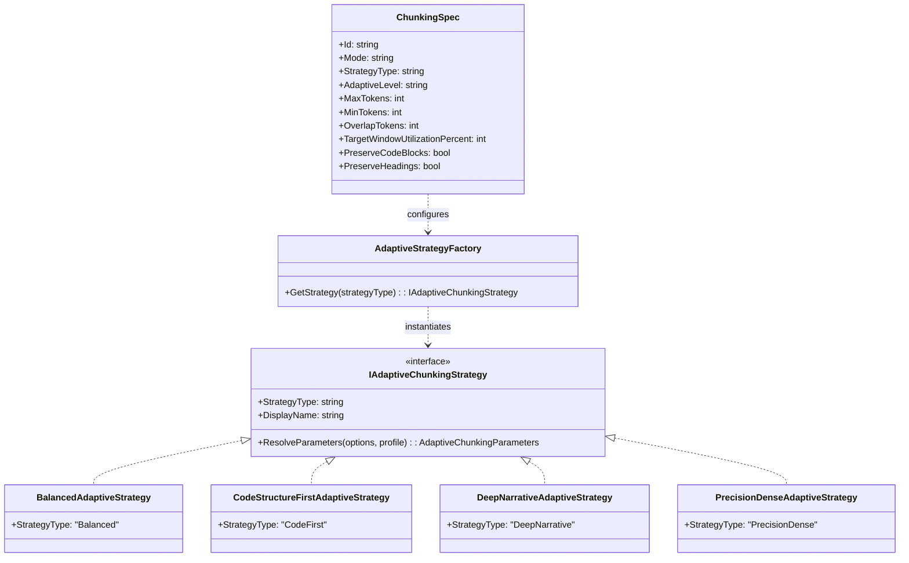
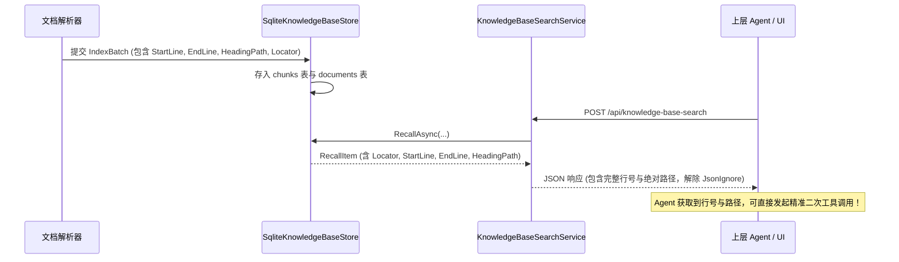
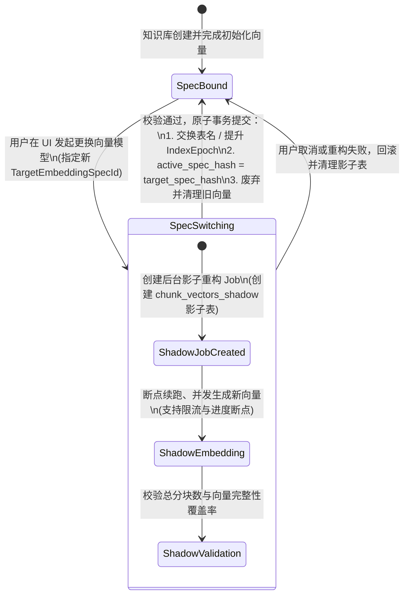
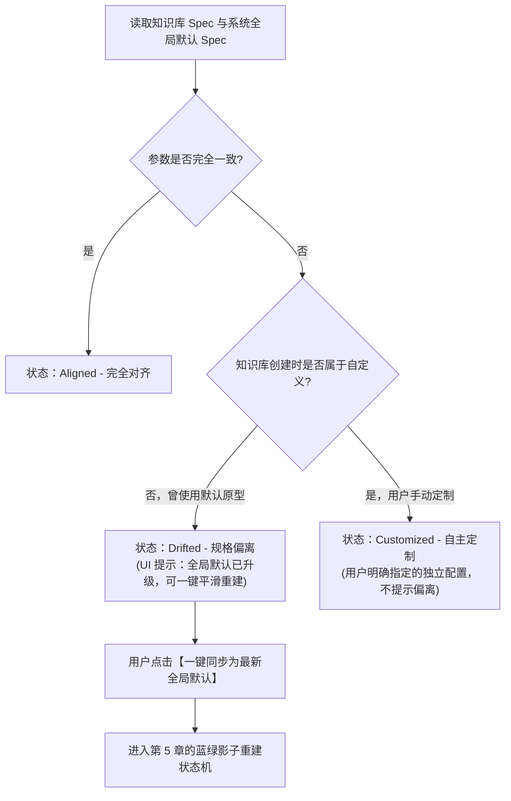
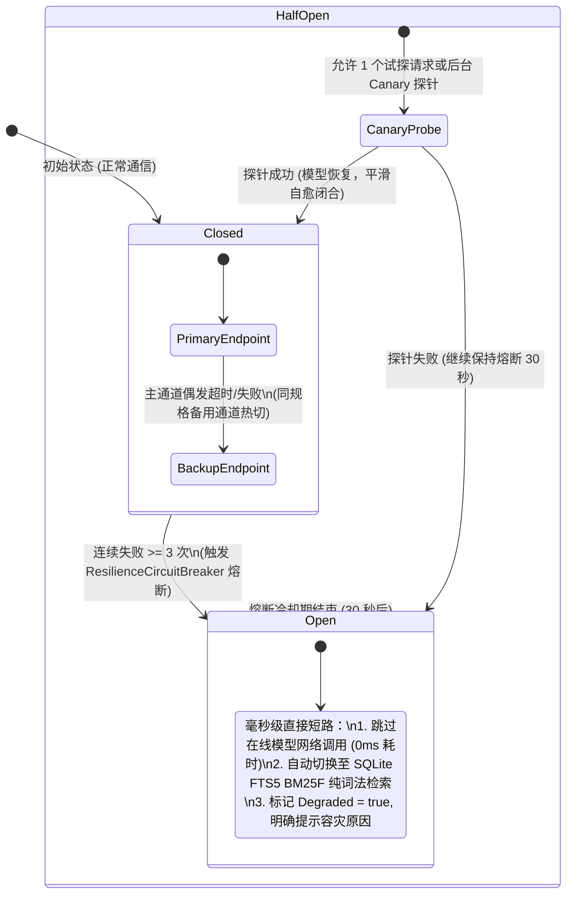

# 知识库自适应分段、元数据全要素扩充、模型全生命周期管理与高可用容灾架构方案调研

> **版本**：v1.0.0  
> **状态**：架构调研与方案设计（已完成头脑风暴与可行性验证）  
> **核心原则**：Clean-Break（不背历史妥协包袱）、强内聚低耦合、工业级高可用、赋能 Agentic RAG

---

## 1. 执行摘要与六大核心裁决

本白皮书针对知识库构建与生产检索中最关键的 6 项核心痛点进行系统性头脑风暴、业界主流方案调研及系统基础设施复用分析，形成如下 6 项核心裁决：

| 序号 | 核心问题 | 架构结论 | 核心机制 / 设计模式 |
| :--- | :--- | :--- | :--- |
| **1** | **分段是否默认自适应？是否支持库独立？** | **必须默认自适应；必须支持库独立。** | **策略模式** (`IAdaptiveChunkingStrategy`) + **不可变规范** (`ChunkingSpec`) |
| **2** | **搜索结果是否附带行号/文件路径等？** | **必须全量附带，解除字段隐藏。** | **适配器模式**，解除 `Locator` 隐藏，补充 `StartLine/EndLine/HeadingPath`，赋能 Agent 扩展调用 |
| **3** | **知识库能否允许调整向量模型？** | **完全支持，且必须零停机。** | **状态机模式** + **双轨蓝绿影子重建** (`IndexEpoch` + `Shadow Embedding Job`) |
| **4** | **知识库与全局配置如何继承？** | **禁止动态穿透引用，采用偏离探测。** | **观察者/诊断模式**：检测 `Drifted`（偏离），UI 提示一键差量升级 |
| **5** | **在线模型掉线如何处理？** | **四级熔断容灾，零阻断自愈。** | **断路器模式** (`ResilienceCircuitBreaker`) + **全自动降级至 BM25F 词法兜底** + **后台探针自愈** |
| **6** | **初始化时固化继承机制可行性？** | **最优解，必须采用“初始化固化快照”。** | **原型快照模式 (Prototype Snapshot)**：创建时深拷贝全局快照并持久化，生命周期自闭环 |

---

## 2. 业界主流方案对比调研

在设计具体方案前，我们对当前业界主流开源与商业 RAG 系统进行了横向对比：

| 系统 / 方案 | 分块策略机制 | 搜索结果元数据暴露度 | 向量模型变更机制 | 配置继承机制 | 模型掉线高可用 |
| :--- | :--- | :--- | :--- | :--- | :--- |
| **Dify** | 支持按知识库独立配置分段规则（通用/分层/代码），提供预览 | 仅返回 `document_name` 与 `segment_id`，行号丢失 | 支持更换，触发全量 Background Task 重建，期间库不可用 | 创建时复制系统模版为库私有配置 | 依赖外部网关重试，模型掉线直接报 HTTP 500 |
| **RAGFlow** | DeepDoc 自适应分段（按 PDF/表格/Markdown 自动识别版面） | 提供精确版面坐标与元数据，支持跨度溯源 | 库绑定模型，变更需重建集合（Collection） | 独立配置 | 提示失败，缺乏全自动词法降级回路 |
| **Elasticsearch / OpenSearch** | Ingest Pipeline 策略分块 | 完整返回 `_source`（行号、路径、语法树节点） | 索引别名（Index Alias）蓝绿无感切换 | Index Template 继承与映射覆盖 | 节点级 Circuit Breaker 熔断降级 |
| **LlamaIndex** | `SemanticSplitterNodeParser` / `SentenceWindowNodeParser` | Node 包含 `start_char_idx`, `end_char_idx`, `metadata` | 更换需重新构建 `VectorStoreIndex` | 允许全局 `Settings` 与单个 Index 参数分离 | 依赖自定义 Fallback Handler |
| **本系统方案 (ReferenceRAG)** | **四档自适应策略 (Balanced, CodeFirst, DeepNarrative, PrecisionDense)** | **全要素曝光：ChunkId, DocId, SourceKey, Locator, StartLine, EndLine, HeadingPath** | **双版本影子索引 + 状态机蓝绿原子晋升，零停机** | **初始化快照固化 (Snapshot on Init) + 偏离诊断提示** | **四级熔断防雪崩 + SAG-Wiki BM25F 词法零毫秒极速兜底 + 探活自愈** |

---

## 3. 问题 1：分段设置体系 —— 默认自适应与独立配置方案

### 3.1 为什么必须默认使用自适应分段？

传统固定长度切片（Fixed-size Chunking，如每 500 字符硬切）存在致命缺陷：
1. **意图腰斩**：在句子正中间、条件从句或 Markdown 代码块内部硬性截断，破坏语义完整度，导致向量模型学习到残缺向量；
2. **表格与列表破坏**：Markdown 表格行被切为两半，导致上下文丢失；
3. **实体割裂**：小说或文档中的专有名词（如“《笑傲江湖》令狐冲”）跨越两个切片，检索时两边匹配度均降低。

**自适应分段（Adaptive Chunking）的优势**：
- 结合 Markdown 语法结构（Header 1~6、代码栅栏、段落空行、标点符号），并在模型窗口利用率（如 70%）与语义原子性之间动态求取最优切分点；
- 解析 CPU 开销通常在 1~3ms / MB 级别，相对于向量模型推理（100~300ms），性能开销几乎为零，但检索精度可提升 15%~30%。

因此，**系统默认分段模式必须升级为自适应分段（`Mode = "Adaptive"`）**。

### 3.2 为什么必须允许知识库独立设置？

不同知识库的文档内容具有强烈的异质性：
- **源代码/工程文档库**：需要保护类、方法与结构体，绝不能在方法体内部分裂，适配 `CodeStructureFirst`；
- **小说/文学/长篇史料**：需要保留自然叙事流与长情节连贯性，适配 `DeepNarrative`；
- **法规条款/技术标准/FAQ 对**：需要高精度短切片，消除上下文噪音，适配 `PrecisionDense`。

强制所有知识库使用同一套切片参数会导致“削足适履”。

### 3.3 具体落地方案：`ChunkingSpec` 与策略工厂



1. **不可变配置规范 `ChunkingSpec`**：
   在 `CatalogStore` 中增加表 `chunking_specs`（或在 `KnowledgeBaseDefinition` 中直接持有 `ChunkingSpec` 记录）。
2. **复用基础设施**：
   系统已实现 `IAdaptiveChunkingStrategy`、`AdaptiveStrategyFactory`、`BalancedAdaptiveStrategy`、`CodeStructureFirstAdaptiveStrategy`、`DeepNarrativeAdaptiveStrategy` 与 `PrecisionDenseAdaptiveStrategy`，无需引入外部第三方重度依赖，纯 C# 原生运行。

---

## 4. 问题 2：搜索结果全要素元数据扩充 —— 赋能 Agentic RAG

### 4.1 Agent 对元数据的迫切诉求

现代 AI Agent 在调用 RAG 工具获取上下文后，通常有 3 类进阶行为：
1. **精确代码/行级定位**：在用户交互界面中直接高亮显示 `file://path/to/file.cs#L45-L80`；
2. **动态滑动上下文窗口（Window Expansion / Drilldown）**：若命中片段仅为某函数的中间三行，Agent 会调用文件工具读取该片段前 30 行和后 30 行以还原完整类定义；
3. **真实性校验与反向溯源**：生成带有精准出处的引文徽标（Citation），防止模型幻觉。

### 4.2 当前系统瓶颈分析

在现行代码中存在两大脱节：
1. **`RecallItem` 遮蔽了 `Locator`**：
   ```csharp
   // Infrastructure/.../KnowledgeBaseModels.cs 当前定义：
   [property: System.Text.Json.Serialization.JsonIgnore] string? Locator = null
   ```
   后端查到了物理路径 `locator`，但在序列化为 JSON 返回给前端或 Agent 时被强制忽略！
2. **`chunks` 表缺失行号与标题路径**：
   `SqliteKnowledgeBaseStore` 中的 `chunks` 表仅保存了 `ordinal, text, token_count, embedding_text`，分块时解析出的 `StartLine`, `EndLine`, `HeadingPath` 未持久化到知识库数据库中。

### 4.3 具体落地方案：全要素元数据透出



**代码级修改点**：
1. **解除 `Locator` 屏蔽**：从 `RecallItem` 中移除 `[JsonIgnore]`，使 `Locator` 正常参与序列化；
2. **扩展 `ChunkData` 与 `chunks` 表**：
   ```sql
   ALTER TABLE chunks ADD COLUMN start_line INTEGER NOT NULL DEFAULT 0;
   ALTER TABLE chunks ADD COLUMN end_line INTEGER NOT NULL DEFAULT 0;
   ALTER TABLE chunks ADD COLUMN heading_path TEXT;
   ```
3. **扩展 `RecallItem` 字段**：
   ```csharp
   public sealed record RecallItem(
       string ChunkId,
       string DocumentId,
       string SourceKey,
       string Text,
       double Score,
       ScoreKind ScoreKind,
       long DocumentVersion,
       string? ConnectorId = null,
       string? Locator = null,
       int StartLine = 0,
       int EndLine = 0,
       string? HeadingPath = null);
   ```

---

## 5. 问题 3：知识库调整向量模型 —— 零停机蓝绿影子重建方案

### 5.1 为什么不能直接热切换向量？

不同向量模型的维度、度量空间（Cosine / L2 / DotProduct）以及向量分布完全不一致：
- 若直接原地把已有的 1536 维向量替换为 768 维，或者在没有生成完新向量前就切换查询端模型，余弦计算会发生维度崩溃；
- 若直接清空老向量让知识库进入“不可用”等待期，数万文档的重新向量化往往需要数十分钟甚至数小时，业务完全不可接受。

### 5.2 状态机设计：蓝绿影子版本推进状态机

借鉴数据库在线 DDL（Online Schema Change）与 Elasticsearch Reindex 模式，设计基于状态机的蓝绿影子版本推进机制：



### 5.3 运行期间的可用性保障（零停机）

在 `SpecSwitching` 状态下（重构作业进行中）：
1. **读流量完全无感**：查询请求依然使用 `active_spec_hash` 对应的当前有效模型和旧向量表，检索服务 100% 正常；
2. **写流量双写或变更标记**：若在重构期间有新文档录入，直接对新老两张向量表执行双写；
3. **极端情况词法容灾**：即便旧模型在此期间掉线，系统自动回落到 FTS5 BM25F 多列词法检索，永远不返回 503 错误。

---

## 6. 问题 4 & 6：配置继承体系与初始化固化快照机制

### 6.1 致命陷阱：为什么绝对不能“动态跟随全局默认配置”？

假设采用“动态跟随”模式：
1. 知识库 A 创建时未指定模型，标记为 `UseGlobalDefault = true`；
2. 系统入库了 10,000 个文档，使用当时的全局默认模型 `text-embedding-3-small (1536d)` 生成了向量并入库；
3. 一周后，管理员在全局设置中，将全局默认模型调整为本地快速模型 `bge-base-zh (768d)`；
4. 随后用户向知识库 A 发起检索：查询端动态取到全局默认，生成了 768 维 queryVector；而知识库 A 的 SQLite 中存放的是 1536 维向量。
5. **向量计算直接抛出维度不匹配异常，知识库当场崩溃报废！**

### 6.2 最优解：初始化固化快照机制（Prototype Snapshot on Init）

**核心逻辑**：
- **创建知识库时**：
  若用户未手动指定模型与分段配置，系统不是存储一个空指针去动态引用全局，而是**以全局配置为原型（Prototype），在知识库创建的瞬间完成深拷贝，固化生成该知识库专属的 `EmbeddingSpec` 与 `ChunkingSpec`**；
- **配置持久化**：
  知识库的元数据表中显式记录 `EmbeddingSpecId` 与 `ChunkingSpecId`，生命周期自闭环。

### 6.3 如何优雅处理“全局默认已更新”？（偏离诊断与可控升级）

系统定义知识库与全局规格的关联状态三元组：



**UI 表现与用户体验**：
- 在 [KnowledgeBases.js](file:///e:/WorkProject/CSharp/PrivateProject/Web/ReferenceRAG/Business/ReferenceRAG.Business/wwwroot/app/views/KnowledgeBases.js) 页面中，当检测到知识库处于 `Drifted` 状态时，卡片右上角显示温和的灰色提示标签：`规格有新版本 (可升级)`；
- 点击后弹出对比抽屉：
  - 当前模型：`text-embedding-3-small (1536d)`，分块：512 tokens；
  - 最新全局默认：`bge-m3 (1024d)`，分块：自适应 Balanced；
  - 提供按钮：`【启动后台无缝影子升级】`；
- 绝不在后台强行篡改用户存量数据，将控制权和安全性牢牢交给用户。

---

## 7. 问题 5：在线模型掉线容灾与全自动高可用自愈方案

### 7.1 模型掉线典型故障画像

生产环境中外部云端大模型与本地推理端点常见的异常类型：
1. **HTTP 429 Too Many Requests**：公网 API 配额用尽或并发超限；
2. **HTTP 500 / 502 / 503 Bad Gateway**：服务商上游故障、GPU 驱动崩溃、Ollama 进程挂起；
3. **Timeout / Connection Reset**：跨国跨地域网络抖动、DNS 污染、代理失效。

### 7.2 四级防护矩阵与自愈状态机



### 7.3 系统已有设施的高效复用

1. **复用已验证的 `ResilienceCircuitBreaker`**：
   - 命名空间：`ReferenceRAG.Infrastructure.Features.Resilience`；
   - 线程安全的三态断路器，支持 `failureThreshold` 与 `breakDuration`；
2. **复用 `SqliteKnowledgeBaseStore.RecallAsync` 词法兜底回路**：
   - 当 `isDegraded == true` 或 `queryVector == null` 时，代码已完美支持直通 `fts_chunks_lexical`；
   - 结合我们刚升级的 SAG-Wiki 多列加权（标题 5.0x / 章节 2.5x / 正文 1.0x），词法检索不仅不会出错，且耗时仅需 3~5ms，精准命中产品型号、函数名与人名！
3. **前端状态感知集成**：
   - 搜索界面自动渲染 `[容灾降级]` 与 `[BM25F]` 徽标，同时返回详细降级原因（如 `硅基流动 API 503 异常，已自动平滑降级为本地 BM25F 极速词法检索`），让系统具备企业级工业韧性。

---

## 8. 设计模式与系统复用总览表

| 场景 | 核心设计模式 | 关键代码角色 / 现有类库复用 | 带来的工程与架构价值 |
| :--- | :--- | :--- | :--- |
| **自适应分段** | **策略模式 (Strategy)**<br>**工厂模式 (Factory)** | 复用 `IAdaptiveChunkingStrategy`, `AdaptiveStrategyFactory`, `BalancedAdaptiveStrategy`, `CodeStructureFirstAdaptiveStrategy` | 解耦具体分块算法，按语料类型（代码、文学、法规）可插拔扩展 |
| **元数据全要素** | **适配器模式 (Adapter)**<br>**数据传输对象 (DTO)** | 扩展 `RecallItem`, 移除 `Locator` 的 `JsonIgnore`, 对齐 `ChunkResult` | 消除前后端与 Agent 之间的信息差，直接提供行号与物理定位 |
| **向量模型变更** | **状态机模式 (State Machine)**<br>**工作单元模式 (Unit of Work)** | 复用 `CatalogStore.jobs`, `job_attempts`, `SqliteKnowledgeBaseStore.kb_manifest` | 保证多步长周期重建任务的断点续跑、幂等性与原子晋升 |
| **配置继承体系** | **原型模式 (Prototype)**<br>**备忘录模式 (Memento)** | 复用 `ObsidianRagConfig`, `EmbeddingSpec`, `CatalogStore.knowledge_bases` | 杜绝全局变量变更引起的存量数据雪崩，实现版本偏离精准诊断 |
| **模型掉线容灾** | **断路器模式 (Circuit Breaker)**<br>**备忘降级策略 (Fallback Strategy)** | 复用 `ResilienceCircuitBreaker`, `SqliteKnowledgeBaseStore` BM25F 容灾链路 | 杜绝线程池耗尽，实现秒级降级与无人值守自动自愈 |

---

## 9. 实施路线图与验收标准

### 里程碑规划 (Milestones)

- [ ] **M1：元数据全要素打通与 Agent 契约增强 (P0)**
  - `RecallItem` 移除 `Locator` 上的 `[JsonIgnore]`；
  - `chunks` 表与 `ChunkData` 增加 `StartLine, EndLine, HeadingPath`；
  - 编写端到端单元测试验证元数据在跨库检索接口中的完整返回。
- [ ] **M2：自适应分段默认化与知识库独立 Spec 关联 (P1)**
  - 知识库建库时支持传入/固化 `ChunkingSpec`，默认采用 `Adaptive/Balanced`；
  - 文档摄取与同步流程接入 `AdaptiveStrategyFactory`；
  - 编写分块隔离测试，验证不同知识库可独立使用 `CodeFirst` 与 `PrecisionDense`。
- [ ] **M3：蓝绿影子向量重构状态机与作业流水线 (P2)**
  - 扩展 `SqliteKnowledgeBaseStore` 支持 `chunk_vectors_shadow` 临时表；
  - 实现基于 `jobs` 表的后台切片向量重构 Task，支持并发批处理与断点续跑；
  - 验证重构期间读操作零中断、完成后原子切换 `active_spec_hash`。
- [ ] **M4：三态偏离检测与容灾熔断探针全覆盖 (P2)**
  - 在 `KnowledgeBasesController` 提供 `CheckConfigDrift` 接口；
  - 完善在线嵌入端点的断路器配置与备用通道自动故障转移；
  - 前端增加模型偏离升级弹窗与降级状态指示。

---

> **结语**：本方案以 Clean-Break 原则为基石，彻底摒弃隐式动态跟随与信息遮蔽等历史妥协，将自适应分块、全要素元数据、影子版本推进与多级熔断自愈融为一体，为 ReferenceRAG 提供业界领先的高性能、高韧性、Agent 友好型知识底座。
