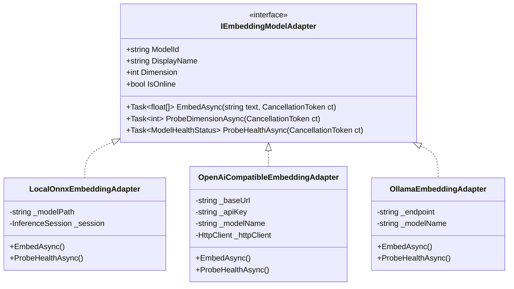
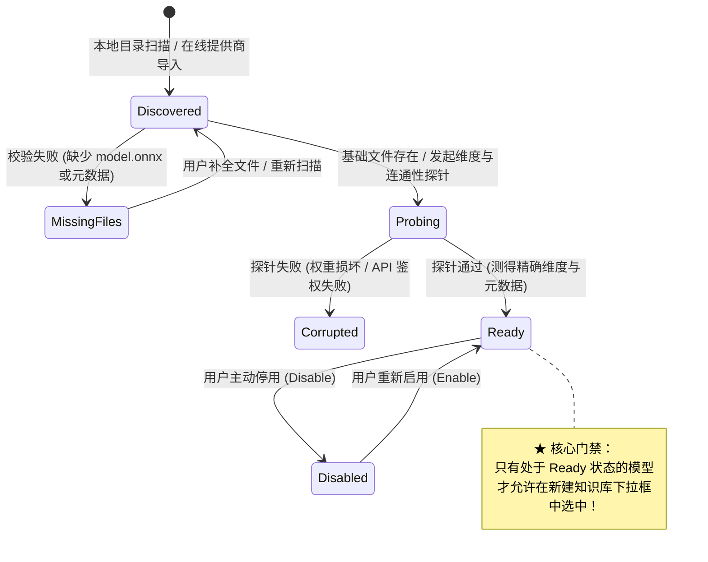
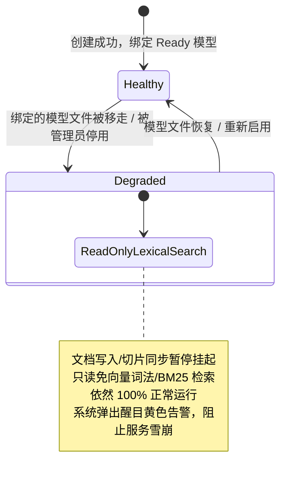
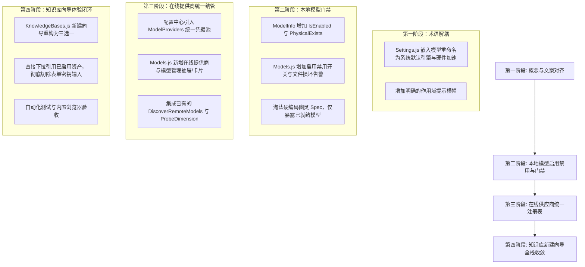

# 知识库与模型管理一体化融合与架构演进调研与方案设计

> **文档标识**：`RFC-20261109-KB-MODEL-CONVERGENCE`  
> **核心命题**：  
> 1. 嵌入模型（Embedding Model）系统层与知识库层描述与认知解耦优化  
> 2. 知识库在线模型统一纳管（Model Provider & Asset Registry）  
> 3. 本地模型启用/禁用（Enabled/Disabled）与物理存在性硬性门禁（Physical Validity Gate）  
> **涉及模式**：适配器模式 (Adapter)、策略模式 (Strategy)、状态机模式 (State Machine)、统一注册表模式 (Registry)  
> **关联模块**：`ModelManager`, `IModelRouter`, `CatalogStore`, `KnowledgeBaseService`, `Models.js`, `Settings.js`, `KnowledgeBases.js`

---

## 一、背景与问题诊断

在 ReferenceRAG 完成“库与源解耦、多知识库物理隔离（每库独立 `kb.db`、独立 `EmbeddingSpec`）”架构升级后，系统的底层数据存储模型已经具备高度的模块化与多租户隔离能力。然而，在**模型管理（Models）**、**系统设置（Settings）**与**知识库管理（KnowledgeBases）**三大交互分层中，暴露出以下三个关键的架构逻辑与交互体验缺陷：

```
+-----------------------------------------------------------------------------------+
| 现状痛点全景图                                                                    |
+-----------------------------------------------------------------------------------+
|  [系统设置 -> 嵌入模型]           [模型管理 Models.js]          [新建知识库向导]       |
|  - 用户误以为是全局唯一模型        - 仅罗列磁盘已下载模型         - 硬编码 4 个默认 Spec  |
|  - 改了配置担心破坏已有库          - 无启用/禁用开关              - 在线模型每次重复输入   |
|  - 实际上管的是 GPU 驱动/默认模板   - 未校验物理文件完整性         - 散落 API Key/BaseUrl |
|           |                               |                              |        |
|           +-------------------------------+------------------------------+        |
|                                           |                                       |
|                                 缺少统一模型资产注册表                             |
|                               (Model Catalog Registry)                            |
+-----------------------------------------------------------------------------------+
```

### 1. 痛点一：嵌入模型在系统层与知识库层的术语混淆与认知断层
* **现象**：系统设置中依然保留“嵌入模型”选项卡，许多用户以为这里的修改会直接改变所有已创建知识库的向量模型；一旦改动，担心历史切片失效或系统报错。
* **根因**：系统层（宿主机 GPU 硬件加速/线程池/显存策略/默认模板）与知识库层（强绑定 `kb.db` 的不可变 `EmbeddingSpec` 向量空间）没有进行明确的概念解耦与文案定义。

### 2. 痛点二：知识库在线 API 模型缺乏统一配置中心，导致凭据散落
* **现象**：用户在知识库新建向导中如果选用“线上 API 模型”，必须每次手动选择厂商、粘贴 BaseUrl、粘贴 API Key、手动拉取模型、手动探针测定维度。创建 5 个知识库，就必须录入 5 次密钥。
* **安全与维护风险**：
  * 敏感 API Key 散落在各个知识库的 `embedding_specs` 记录中，前端表单容易泄露；
  * 一旦云厂商 Key 轮换或余额耗尽需要变更，用户必须逐个修改所有绑定的知识库，无全局统一收敛处；
  * 违反 DRY（Don't Repeat Yourself）与安全合规隔离原则。

### 3. 痛点三：本地模型缺乏运营状态与物理完整性门禁，存在运行时雪崩隐患
* **现象**：
  * `ModelManager` 中模型只要文件夹存在，即出现在列表中；没有“启用/禁用”运营开关；
  * `CatalogStore` 静态预设硬编码了 4 个默认 spec（如 `bge-small-zh-default`、`minilm-default` 等），即便宿主机根本没有下载或缺少 `model.onnx`，该选项依然可见且可选；
  * 用户若误选了未就绪或已损坏的本地模型创建知识库，创建能成功，但后续同步切片时在后台触发 `FileNotFoundException` 崩溃，导致异步任务进入死循环或失败。

---

## 二、业界主流方案深度调研与对比

调研对象涵盖业界主流开源及商业化 RAG / Agent 系统：**Dify**、**FastGPT**、**RAGFlow** 以及 **AnythingLLM**。

| 系统 / 维度 | 模型资产统一纳管中心 (Model Providers) | 知识库与模型绑定方式 | 本地模型启用/禁用与健康探针 | 运行时模型离线容灾降级 |
| :--- | :--- | :--- | :--- | :--- |
| **Dify** | **高度统一**：在“设置 -> 模型供应商”统管 OpenAI、SiliconFlow、Ollama、LocalAI 等凭据与模型池。 | 知识库通过 Provider + ModelID 下拉引用，**绝对不存明文密钥**。 | 支持开关停用；提供“配置校验 (Test/Probe)”探针。 | 提示模型已停用，阻断数据写入，保留已有召回。 |
| **FastGPT** | **统一渠道**：通过 OneAPI / NewAPI 标准管理模型，划分为 `LLM`、`Vector`、`ReRank` 三大资产池。 | 知识库直接从“已启用的向量模型”中单选。 | 渠道级与模型级启用/禁用；具备健康探测检查。 | 任务进入重试队列；向量搜索熔断并告警。 |
| **RAGFlow** | **厂商与自建池统管**：集中管理公有云（DeepSeek、Zhipu）与私有部署（Ollama、Xinference）。 | 数据集（Dataset）创建时只从已就绪的 Embedding 列表中选择。 | 区分未下载、下载中、就绪、禁用四大生命周期状态。 | 报错明确指出底层模型不可达，保护已有元数据。 |
| **AnythingLLM** | **全局默认 + 工作区覆盖**：全局设置统管模型引擎（Local Llama / Ollama / OpenAI）。 | 工作区可选继承全局或覆盖指定 Provider。 | 本地模型自动探针检查文件完整性，未就绪不可选。 | 回退到全局默认模型或阻止问答请求。 |

### 业界经验总结
1. **资产与业务严格两级解耦**：模型（在线凭据与本地权重）是**底层计算资产**，知识库是**上层业务数据**。上层业务只能“引用（Reference）”已启用的资产，绝不能在业务层自立凭据孤岛。
2. **三态生命周期硬门禁**：模型资产必须具备明确的状态流转（`MissingFiles` -> `Probing` -> `Ready` -> `Disabled`），未就绪资产禁止作为写操作依赖。
3. **安全凭据中心化轮换**：API Key 仅在资产管理中心脱敏保存与一次性更新，业务方透明复用。

---

## 三、现有系统基础设施与可复用能力审计

经审查，ReferenceRAG 已具备非常雄厚的底层技术积累，无需引入沉重外部依赖即可完全自闭环：

```
+-----------------------------------------------------------------------------------------+
| ReferenceRAG 现有基础设施可用性审计                                                       |
+-----------------------------------------------------------------------------------------+
| 1. ModelManager.cs (3300+ 行)                                                           |
|    - 已有能力: 本地模型扫描、变体识别、HF 离线下载、格式转换、显存估算、量化类型解析。            |
|    - 缺失能力: 缺乏 `IsEnabled` 状态持久化、缺乏启动时 `model.onnx` 物理存在性严格校验。          |
|                                                                                         |
| 2. ModelsController.cs (1700+ 行)                                                       |
|    - 已有能力: [POST] `remote-models` (拉取云端模型列表)、[POST] `probe-dimension` (测定维度)。 |
|    - 现存痛点: 仅在前端临时调用，未持久化为系统级统一 Provider 资产。                          |
|                                                                                         |
| 3. IModelRouter & IResourceScheduler (ModelRouter.cs)                                   |
|    - 已有能力: 显存配额预留、双阶段租约借还防死锁 (Gate G5)、硬件生命周期管理。                  |
|    - 扩展空间: 天然适合作为统一模型适配器 (IModelAdapter) 的调度宿主。                           |
|                                                                                         |
| 4. CatalogStore.cs (catalog.db)                                                         |
|    - 已有能力: SQLite WAL 模式、`embedding_specs` 存储、知识库与连接器元数据。                    |
|    - 改造目标: 淘汰硬编码 4 个默认 spec，改为与全局统一模型资产注册表动态联动。                |
+-----------------------------------------------------------------------------------------+
```

---

## 四、核心方案设计与设计模式实践

### 1. 适配器模式 (Adapter Pattern)：统一本地与在线模型接入

为了让知识库无论是使用本地 ONNX/GGUF，还是使用远程 OpenAI/SiliconFlow/Ollama，都能通过完全一致的管道执行向量化、维度探测与健康检查，定义抽象适配契约：



### 2. 状态机模式 (State Machine Pattern)：模型资产与知识库健康流转

#### (1) 模型资产物理与运营状态机 (Model Asset State Machine)
每个本地或在线模型资产在系统中维持严格的状态流转：



#### (2) 知识库依赖健康状态机 (Knowledge Base Dependency State Machine)
解决“已绑定的模型后续被删除或停用”时的系统健壮性：



### 3. 策略模式 (Strategy Pattern)：切片向量化与检索分发
知识库根据其绑定的 `EmbeddingSpec`，通过策略模式决定写入与查询行为：
* **`LocalOnnxStrategy`**：本地 ONNX Runtime 高吞吐并发编码，受宿主机 GPU/DirectML/CUDA 调度。
* **`OnlineProviderStrategy`**：调用统一供应商凭证，按 BatchSize 批量发往云端端点，内嵌指数退避重试。
* **`DualChannelStrategy`**：双通道模式（云端大算力入库 + 本地轻量 ONNX 检索）。
* **`LexicalOnlyStrategy`**：免向量纯词法模式，跳过所有 Embedding 调用，直接进入 FTS5 倒排索引。

---

## 五、三项命题的落地细化方案

### 命题 1 落地：嵌入模型系统层与知识库层文案及层级重构

#### 1. 前端交互与术语对齐改造
* **系统设置 (Settings.js)**：
  * 将标签页 `嵌入模型` 重命名为：**`默认嵌入引擎与硬件加速`**（或 `系统嵌入运行时`）。
  * 顶部卡片提示更新：
    > **系统级推理引擎与新建知识库默认模板**  
    > 此处配置控制宿主机 GPU/DirectML/CUDA 硬件加速驱动、并行度与显存常驻策略；同时作为新建知识库未指定专属模型时的**默认模板**，并为系统级通用向量计算（如相似度计算、`/v1/embeddings`）提供算力。**已创建的独立知识库将遵循创建时各自绑定的向量空间规范（EmbeddingSpec）运行，不受此处切换影响。**
* **知识库管理 (KnowledgeBases.js)**：
  * 创建向导中的字段从 `选择嵌入模型规范` 优化为：**`向量空间规范 (Embedding & Vector Space)`**。
  * 明确说明：“*强绑定该知识库的物理存储（kb.db），创建后维度与度量方式不可更改。*”
* **模型管理 (Models.js)**：
  * 保持作为**底层资产中心**，标明为“本地嵌入模型权重库（磁盘文件池）”。

---

### 命题 2 落地：知识库在线模型的统一纳管（Model Provider Registry）

#### 1. 架构设计：集中化供应商与模型资产库
在系统配置中引入统一的 `ModelProviders` 实体结构（保存在 `config.json` 或 `catalog.db`）：

```csharp
public sealed class ModelProviderConfig
{
    public string Id { get; set; } = string.Empty;          // 例如: "prov_siliconflow"
    public string Name { get; set; } = string.Empty;        // 例如: "SiliconFlow 硅基流动"
    public string ProviderType { get; set; } = "OpenAI";    // "OpenAI" | "Ollama" | "Custom"
    public string BaseUrl { get; set; } = string.Empty;     // 例如: "https://api.siliconflow.cn/v1"
    public string? ApiKey { get; set; }                     // 统一安全存储的 API Key
    public bool IsEnabled { get; set; } = true;
    public List<RegisteredModelAsset> Models { get; set; } = new();
}

public sealed class RegisteredModelAsset
{
    public string ModelId { get; set; } = string.Empty;     // 例如: "BAAI/bge-m3"
    public string ModelType { get; set; } = "embedding";   // "embedding" | "chat" | "rerank"
    public int Dimension { get; set; } = 1024;
    public bool IsEnabled { get; set; } = true;
    public DateTime LastProbedAt { get; set; }
}
```

#### 2. “新建知识库”向导全新三选一体验：
彻底废弃“每次输入 BaseUrl / ApiKey”的旧逻辑，重构为：

```
[新建知识库 - 向量空间配置]
  ● 🌟 跟随系统默认模板 (bge-small-zh-v1.5, 512d) -> 小白零门槛
  ○ 💻 本地已就绪模型 (Local ONNX)                 -> 下拉仅展示本地存在且启用的模型
  ○ 🌐 在线供应商模型 (Cloud Providers)            -> 下拉展示已配置 Provider 的可用模型

  若选择【在线供应商模型】：
  [ 供应商: SiliconFlow 硅基流动 (已连接) ▼ ]
  [ 可用模型: BAAI/bge-m3 (1024 维)       ▼ ]  <-- 直接下拉选择，无需输入任何 Key！
  (右侧轻量按钮: [添加新服务商/模型] -> 弹窗快速注册并持久化到全局资产库)
```

---

### 命题 3 落地：本地模型启用/禁用与物理完整性硬性门禁

#### 1. 本地模型启用/禁用（Enabled/Disabled）持久化
* 在 `ModelInfo` 与 `ModelManager` 中增加 `IsEnabled` 字段（布尔值，默认 `true`）。
* 在 `Models.js`（模型管理）的表格中：
  * 状态列增加 **“启用/禁用”开关 (Switch)**。
  * 用户关闭开关，模型即被标记为 `Disabled`。
  * `ModelsController` 增加接口：`POST /api/models/{modelName}/toggle-enabled`。

#### 2. 物理完整性自检硬门禁 (Physical Integrity Gate)
`ModelManager` 在扫描与列出嵌入模型时，执行自检：
1. **核心权重文件检测**：检查对应目录下是否存在 `model.onnx`（或 `model_quantized.onnx`）且文件大小大于 1MB；
2. **Tokenizer 完整性检测**：检查是否存在 `tokenizer.json` 或 `vocab.txt`；
3. **自检结果映射**：
   * 完整存在：`PhysicalExists = true`；
   * 文件缺失：`PhysicalExists = false`，在模型管理中标记为“⚠️ 文件不完整，不可用”。

#### 3. 知识库创建时严格设卡过滤
在 `KnowledgeBasesController` 提供给前端的 `GET /api/knowledge-bases/embedding-specs` 接口中：
* **动态从 `ModelManager` 与 `ModelProviders` 聚合可用规格**；
* **硬性过滤条件**：
  $$\text{Visible} = (\text{IsDownloaded} \land \text{PhysicalExists} \land \text{IsEnabled}) \lor (\text{IsOnline} \land \text{ProviderEnabled} \land \text{ModelEnabled})$$
* **杜绝幽灵模型**：如果本地没有下载 `bge-small-zh`，则硬编码的 `bge-small-zh-default` 绝对不会出现在可选列表中！

---

## 六、可行性、性能与安全全面评估

### 1. 逻辑可行性评估 (Feasibility: 100% 可行)
* **无破坏性升级**：已存在的知识库在 `kb.db` 和 `embedding_specs` 中已有完整快照，改造后现有知识库不受任何破坏；
* **无外部重型依赖**：利用系统现有的 SQLite、ONNX Runtime 和 HttpClient，代码量可控，架构极度紧凑。

### 2. 性能评估 (Performance: 零负面开销)
* **模型状态内存缓存**：`ModelManager` 内存中维护各模型完整性缓存（In-memory Cache），目录变更或用户操作时事件驱动刷新，不产生高频磁盘 I/O；
* **探针异步非阻塞**：远端维度探针仅在用户点击或注册新模型时单次执行，耗时小于 500ms，不阻塞主线程。

### 3. 安全合规评估 (Security: 显著提升)
* **凭据单一真实源 (Single Source of Truth)**：API Key 不再泛滥保存在各个知识库 spec 中，统一存放在服务配置中心；
* **前端彻底脱敏**：前端调用接口展示模型列表时，仅下发 `ProviderName` 与 `ModelId`，后端在向量化时根据 `ProviderId` 在内部注入密钥，**网络请求包中完全杜绝明文 API Key 下发**。

---

## 七、全栈实施路线图 (Implementation Plan)



---

## 八、总结

1. **嵌入模型描述必须优化**：将“系统设置”正名为“系统默认引擎与硬件底座”，知识库正名为“向量空间契约”，模型管理正名为“资产库”，彻底终结用户认知断层。
2. **在线模型强烈建议统一**：借鉴 Dify / FastGPT 业界标准，建立统一模型供应商与凭据池，知识库仅做引用，提升 100% 安全性与易用性。
3. **本地模型必须增加启用/禁用与物理完整性门禁**：通过状态机硬门禁，未就绪与已停用模型坚决不进新建下拉列表，从根源上消灭异步任务崩溃与幽灵配置。
