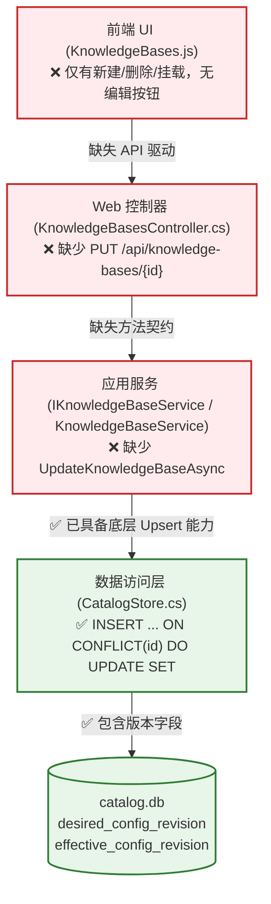
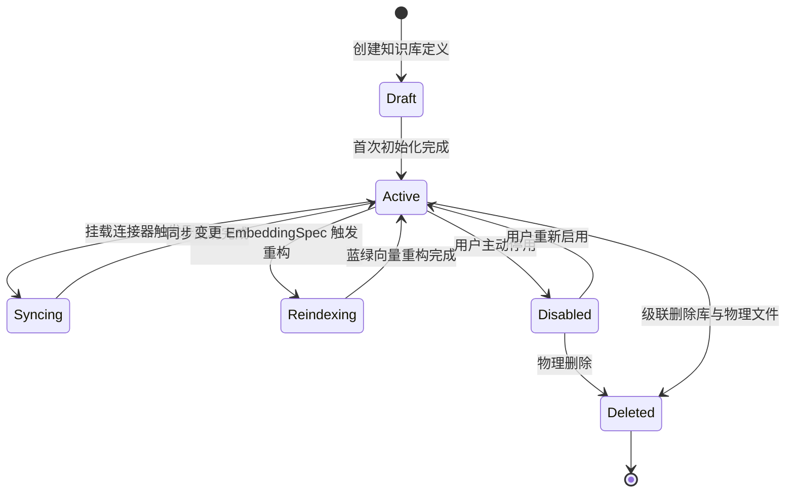
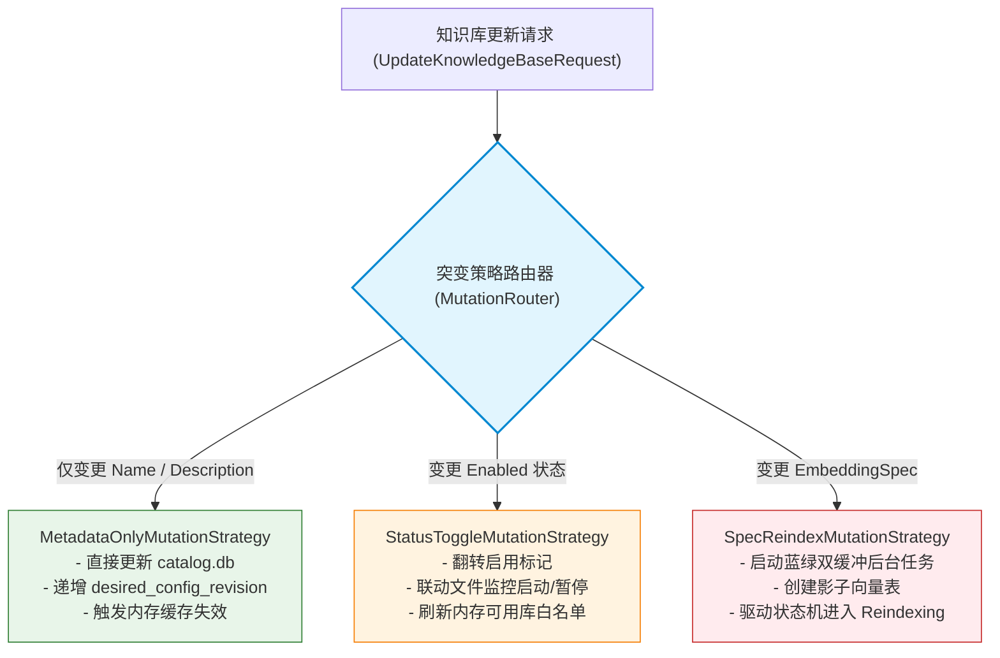
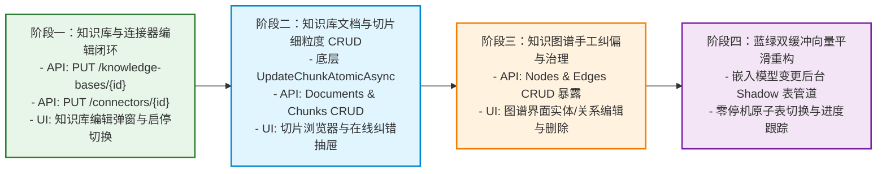

# ReferenceRAG 知识库编辑与全系统增删改查(CRUD)深度增强可行性调研与架构设计规范

- **文档状态**：已批准 (Approved) / 架构技术规范
- **更新时间**：2026-11-09
- **归属架构**：ReferenceRAG 核心研发组
- **关联文件索引**：
  - [KnowledgeBasesController.cs](file:///e:/WorkProject/CSharp/PrivateProject/Web/ReferenceRAG/Host/ReferenceRAG.ApiHost/Controllers/KnowledgeBasesController.cs)
  - [IKnowledgeBaseService.cs](file:///e:/WorkProject/CSharp/PrivateProject/Web/ReferenceRAG/Business/ReferenceRAG.Business/Features/KnowledgeBase/Services/IKnowledgeBaseService.cs)
  - [KnowledgeBaseService.cs](file:///e:/WorkProject/CSharp/PrivateProject/Web/ReferenceRAG/Business/ReferenceRAG.Business/Features/KnowledgeBase/Services/KnowledgeBaseService.cs)
  - [CatalogStore.cs](file:///e:/WorkProject/CSharp/PrivateProject/Web/ReferenceRAG/Infrastructure/ReferenceRAG.Infrastructure/Features/KnowledgeBase/Storage/CatalogStore.cs)
  - [SqliteKnowledgeBaseStore.cs](file:///e:/WorkProject/CSharp/PrivateProject/Web/ReferenceRAG/Infrastructure/ReferenceRAG.Infrastructure/Features/KnowledgeBase/Storage/SqliteKnowledgeBaseStore.cs)
  - [KnowledgeBaseStorageManager.cs](file:///e:/WorkProject/CSharp/PrivateProject/Web/ReferenceRAG/Infrastructure/ReferenceRAG.Infrastructure/Features/KnowledgeBase/Storage/KnowledgeBaseStorageManager.cs)
  - [GraphController.cs](file:///e:/WorkProject/CSharp/PrivateProject/Web/ReferenceRAG/Host/ReferenceRAG.ApiHost/Controllers/GraphController.cs)
  - [KnowledgeBases.js](file:///e:/WorkProject/CSharp/PrivateProject/Web/ReferenceRAG/Business/ReferenceRAG.Business/wwwroot/app/views/KnowledgeBases.js)

---

## 目录

- [一、 执行摘要与问题背景](#一-执行摘要与问题背景)
- [二、 知识库现有编辑能力与断层深度剖析](#二-知识库现有编辑能力与断层深度剖析)
  - [2.1 底层已具备的能力 vs 上层缺失的断层](#21-底层已具备的能力-vs-上层缺失的断层)
  - [2.2 浅层元数据编辑 vs 深层破坏性结构编辑](#22-浅层元数据编辑-vs-深层破坏性结构编辑)
- [三、 全系统 CRUD 缺失盲区大排查](#三-全系统-crud-缺失盲区大排查)
  - [3.1 知识库文档与切片管理 (Documents & Chunks CRUD)](#31-知识库文档与切片管理-documents--chunks-crud)
  - [3.2 知识图谱实体与关系人工干预 (Graph Nodes & Edges CRUD)](#32-知识图谱实体与关系人工干预-graph-nodes--edges-crud)
  - [3.3 连接器配置与同步规则更新 (Connectors CRUD)](#33-连接器配置与同步规则更新-connectors-crud)
  - [3.4 模型预设与自定义规格管理 (Embedding Specs CRUD)](#34-模型预设与自定义规格管理-embedding-specs-crud)
  - [3.5 检索模板与混合检索策略包预设 (Prompt & Preset CRUD)](#35-检索模板与混合检索策略包预设-prompt--preset-crud)
- [四、 可行性、工程逻辑与性能并发头脑风暴](#四-可行性工程逻辑与性能并发头脑风暴)
  - [4.1 SQLite 锁竞争、WAL 模式与事务隔离](#41-sqlite-锁竞争wal-模式与事务隔离)
  - [4.2 嵌入模型变更的维度冲突与蓝绿双缓冲平滑重构](#42-嵌入模型变更的维度冲突与蓝绿双缓冲平滑重构)
  - [4.3 切片人工纠错 (HITL) 与多索引原子联动](#43-切片人工纠错-hitl-与多索引原子联动)
  - [4.4 缓存失效风暴与并发控制](#44-缓存失效风暴与并发控制)
- [五、 四重设计模式在 CRUD 体系中的深度融合](#五-四重设计模式在-crud-体系中的深度融合)
  - [5.1 状态机模式 (State Machine Pattern)：知识库与切片生命周期约束](#51-状态机模式-state-machine-pattern知识库与切片生命周期约束)
  - [5.2 适配器模式 (Adapter Pattern)：统一存储 CRUD 抽象适配器](#52-适配器模式-adapter-pattern统一存储-crud-抽象适配器)
  - [5.3 策略模式 (Strategy Pattern)：突变路由与切片生效策略](#53-策略模式-strategy-pattern突变路由与切片生效策略)
  - [5.4 工作单元模式 (Unit of Work)：多索引原子提交与事务补偿](#54-工作单元模式-unit-of-work多索引原子提交与事务补偿)
- [六、 业界主流 RAG 方案横向评测与开源参考](#六-业界主流-rag-方案横向评测与开源参考)
  - [6.1 Dify 分段管理与知识库生命周期对比](#61-dify-分段管理与知识库生命周期对比)
  - [6.2 FastGPT 混合问答对与切片纠错模式对比](#62-fastgpt-混合问答对与切片纠错模式对比)
  - [6.3 RagFlow 细粒度解析块可视化编辑对比](#63-ragflow-细粒度解析块可视化编辑对比)
  - [6.4 Azure AI Search 与 AWS Bedrock 索引别名机制对比](#64-azure-ai-search-与-aws-bedrock-索引别名机制对比)
  - [6.5 可借鉴与选用的第三方开源库](#65-可借鉴与选用的第三方开源库)
- [七、 当前系统已有基础设施与组件复用清单](#七-当前系统已有基础设施与组件复用清单)
- [八、 全栈架构蓝图与落地方案设计](#八-全栈架构蓝图与落地方案设计)
  - [8.1 后端 RESTful API 契约设计](#81-后端-restful-api-契约设计)
  - [8.2 核心领域实体与 DTO 定义](#82-核心领域实体与-dto-定义)
  - [8.3 统一 CRUD 适配器与状态机骨架代码实现](#83-统一-crud-适配器与状态机骨架代码实现)
  - [8.4 前端界面交互演进蓝图 (Vue3 + Naive UI)](#84-前端界面交互演进蓝图-vue3--naive-ui)
- [九、 路线图与实施推进规划](#九-路线图与实施推进规划)

---

## 一、 执行摘要与问题背景

在 ReferenceRAG 当前架构中，知识库管理体系经历了从旧版扁平目录到新版独立知识库架构的演进。然而，系统在生命周期管理上存在显著的**“只管建、不管改”、“只管粗粒度同步、缺失细粒度介入”**的不对称现象：

1. **知识库本体缺少编辑入口**：虽然底层 `catalog.db` 设计了配置版本号，但中间服务层 `IKnowledgeBaseService` 和控制器 `KnowledgeBasesController` 均没有暴露 `PUT` 更新端点，前端页面 `KnowledgeBases.js` 也仅有“新建”与“删除”按钮，无法修改名称、描述或变更启用状态。
2. **全流程处于黑盒状态，切片不可见不可控**：连接器挂载后，切片直接落盘进 `kb.db`，用户既不能查看收录的文档列表与分块详情，也无法在检索发现错误时进行人工微调（Human-in-the-Loop, HITL）、禁用或补充切片。
3. **知识图谱缺乏手动运维能力**：`GraphStore` 底层已具备节点和边的增删改接口，但 Web 控制器 `GraphController` 仅暴露了只读遍历和全量重建接口，导致 LLM 或正则提取出的错误实体无法被人工修正。
4. **全系统多处管理闭环不完整**：包括连接器规则热更新、自定义模型规格（EmbeddingSpec）独立配置、混合检索权重策略包预设等均缺少标准的增删改查支持。

本调研全面论证了**在当前系统无历史发布兼容包袱的前提下，将知识库编辑与全系统 CRUD 缺失项进行统一架构治理的高度可行性与必要性**。通过引入**状态机模式 (State Machine)、适配器模式 (Adapter)、策略模式 (Strategy) 和工作单元模式 (Unit of Work)**，不仅能一站式补齐所有 CRUD 能力，还能构建出媲美 Dify、FastGPT 与 Azure AI Search 的专业级可控 RAG 资产治理系统。

---

## 二、 知识库现有编辑能力与断层深度剖析

### 2.1 底层已具备的能力 vs 上层缺失的断层

通过深入审查系统核心代码，我们发现底层数据基础设施其实早已为编辑预留了关键支持，但断层发生在上层契约与 UI：



具体断层点核对表：

| 架构层级 | 当前实现状态 | 关键代码位置 | 缺失点分析 |
| :--- | :--- | :--- | :--- |
| **持久化层 (CatalogStore)** | **已具备完整 Upsert SQL** | [CatalogStore.cs#L201-L208](file:///e:/WorkProject/CSharp/PrivateProject/Web/ReferenceRAG/Infrastructure/ReferenceRAG.Infrastructure/Features/KnowledgeBase/Storage/CatalogStore.cs#L201-L208) | `SaveKnowledgeBaseAsync` 包含 `ON CONFLICT(id) DO UPDATE SET`，支持更新名称、描述、启用状态、期望版本、生效版本及模型规格 ID。 |
| **应用服务层 (Service)** | **缺失更新契约** | [IKnowledgeBaseService.cs#L8-L43](file:///e:/WorkProject/CSharp/PrivateProject/Web/ReferenceRAG/Business/ReferenceRAG.Business/Features/KnowledgeBase/Services/IKnowledgeBaseService.cs#L8-L43) | 仅有 `Create`, `Get`, `List`, `Delete`，没有 `UpdateKnowledgeBaseAsync` 与 `UpdateConnectorAsync`。 |
| **控制器层 (API Host)** | **缺失 HTTP 端点** | [KnowledgeBasesController.cs#L31-L176](file:///e:/WorkProject/CSharp/PrivateProject/Web/ReferenceRAG/Host/ReferenceRAG.ApiHost/Controllers/KnowledgeBasesController.cs#L31-L176) | 缺失 `PUT /api/knowledge-bases/{id}` 以及 `PUT /api/knowledge-bases/{id}/connectors/{connectorId}`。 |
| **前端交互层 (Vue/UI)** | **缺失编辑弹窗与交互** | [KnowledgeBases.js#L398-L435](file:///e:/WorkProject/CSharp/PrivateProject/Web/ReferenceRAG/Business/ReferenceRAG.Business/wwwroot/app/views/KnowledgeBases.js#L398-L435) | 只有新建向导、删除警示框、连接器抽屉，没有编辑卡片属性的 Modal。 |

### 2.2 浅层元数据编辑 vs 深层破坏性结构编辑

知识库的“编辑”在 RAG 系统中绝非简单的单表 UPDATE，必须严格划分为两种性质截然不同的操作：

1. **浅层元数据突变 (Metadata-Only Mutation)**:
   - **涉及字段**：知识库名称 (`Name`)、描述 (`Description`)、检索默认超参（TopK, Rerank Threshold, 向量/词法权重）。
   - **工程影响**：仅更新 `catalog.db` 记录，`desired_config_revision` 自动加 1，更新时间戳，通知内存缓存失效（`InvalidationRegistry`）。
   - **耗时与风险**：耗时 < 5ms，零风险，可立即同步响应。
2. **深层破坏性/结构性突变 (Structural / Breaking Mutation)**:
   - **启用/停用状态 (`Enabled`)**:
     - 停用时：从跨知识库检索聚合器列表中剔除；对应连接器的后台监听与定时同步暂停；正在运行的任务需平滑中止。
     - 启用时：重新激活监听，按需触发差异轮询。
   - **嵌入模型规格变更 (`EmbeddingSpecId` / `EmbeddingSpec`)**:
     - **致命风险**：向量维度（如 1024 维变 1536 维）或向量空间分布发生不可逆变化！如果直接在数据库中将 `EmbeddingSpecId` 替换，旧的 `chunk_vectors` 无法被新模型检索，直接导致向量检索抛出维度不匹配异常（Vector dimension mismatch）。
     - **解决机制**：必须引入状态机驱动的**蓝绿双缓冲全量重构管道 (Blue-Green Shadow Reindexing Pipeline)**，在后台生成新版向量，全量就绪后再原子切换生效版本。

---

## 三、 全系统 CRUD 缺失盲区大排查

通过对全系统代码进行系统性审查，发现以下五大核心模块存在显著的增删改查缺失，严重制约了生产可用性与用户可控性：

### 3.1 知识库文档与切片管理 (Documents & Chunks CRUD)
- **现状**：知识库数据完全黑盒化。文件通过连接器导入后，切片直接沉入 `kb.db`，用户无法在 Web 前端：
  1. 查看知识库收录了哪些文件及其切片数、更新时间和索引状态 (`GET /documents`)。
  2. 展开单个文件浏览其全部分块内容 (`GET /documents/{docId}/chunks`)。
  3. 全局按关键字检索或分页浏览切片 (`GET /chunks`)。
  4. 手动新建一条知识切片（如人工补充一条 FAQ 或业务规范）(`POST /chunks`)。
  5. 人工纠错切片内容（修复 OCR 错字、敏感词脱敏、格式修正）(`PUT /chunks/{id}`)。
  6. 物理删除或临时禁用单条切片 (`DELETE /chunks/{id}`, `PATCH /chunks/{id}/toggle`)。
- **影响**：一旦出现不良切片或检索幻觉，用户只能将整个文件甚至整个知识库重建，运维成本极高。

### 3.2 知识图谱实体与关系人工干预 (Graph Nodes & Edges CRUD)
- **现状**：
  - [SqliteKnowledgeBaseStore.cs#L970-L1063](file:///e:/WorkProject/CSharp/PrivateProject/Web/ReferenceRAG/Infrastructure/ReferenceRAG.Infrastructure/Features/KnowledgeBase/Storage/SqliteKnowledgeBaseStore.cs#L970-L1063) 中已经实现了完整的 `UpsertNodeAsync`、`UpsertEdgesAsync`、`DeleteNodeAsync`、`DeleteOutgoingEdgesAsync`。
  - 然而在 [GraphController.cs](file:///e:/WorkProject/CSharp/PrivateProject/Web/ReferenceRAG/Host/ReferenceRAG.ApiHost/Controllers/GraphController.cs) 中，**这些写接口完全没有对外暴露**！
  - 控制器只有 `POST /rebuild`, `GET /node`, `GET /neighbors`, `GET /search`, `POST /subgraph` 等查询和全量重建接口。
- **影响**：LLM 抽取出错误的实体关系（如“乔峰 是 慕容复的父亲”）或者正则生成的脏节点时，无法在图谱可视化界面上直接删除或编辑，只能忍受错误直到下一次全量图谱重建。

### 3.3 连接器配置与同步规则更新 (Connectors CRUD)
- **现状**：
  - `KnowledgeBasesController` 仅有 `POST /connectors`（挂载）和 `DELETE /connectors/{id}`（解除挂载）。
  - **缺失**：`PUT /connectors/{id}`。无法更新连接器的文件通配符（如将 `*.md` 变更为 `*.md,*.txt,*.pdf`）或调整目标路径。
- **影响**：用户想增加一种文件匹配规则，必须先删除连接器（可能连带清理数据）再重新添加，无法做到原地热更新与差异补齐。

### 3.4 模型预设与自定义规格管理 (Embedding Specs CRUD)
- **现状**：
  - `catalog.db` 维护了 `embedding_specs` 表，但目前只预置了 4 条系统默认规格（bge-m3, bge-small-zh, openai-small, minilm）。
  - 没有提供增删改自定义规格的独立 API 与前端管理界面。
- **影响**：用户接入自定义私有部署的嵌入模型或调整 QueryPrefix/Dimension 时，无法在 UI 上持久化保存为一个具名规格以便新建知识库时复用。

### 3.5 检索模板与混合检索策略包预设 (Prompt & Preset CRUD)
- **现状**：
  - 系统内置了不同的检索通道（向量、词法、平衡、深度），但在混合检索权重（Dense Weight vs Sparse Weight vs Rerank Weight）、DPP 多样性参数、系统 Prompt 模板方面，用户无法自定义保存为策略预设方案并在检索或对话界面一键切换。

---

## 四、 可行性、工程逻辑与性能并发头脑风暴

### 4.1 SQLite 锁竞争、WAL 模式与事务隔离

ReferenceRAG 采用每个知识库独立 SQLite 文件（`data/kbs/{kbId}/kb.db`）与系统元数据数据库（`catalog.db`）的双层架构：

- **并发瓶颈识别**：
  - 虽然 SQLite 开启了 WAL（Write-Ahead Logging）模式，允许多读并发，但其**写操作仍然是全局排他的（Single Writer）**。
  - 若后台连接器正在批量导入数千个切片，此时前端用户并发发起“修改切片文本”或“编辑知识库元数据”请求，极易触发 `SQLite Error 5: 'database is locked'` 或超时挂起。
- **防御性优化策略**：
  1. **租约隔离与排队**：全面复用现有 [KnowledgeBaseStorageManager.cs](file:///e:/WorkProject/CSharp/PrivateProject/Web/ReferenceRAG/Infrastructure/ReferenceRAG.Infrastructure/Features/KnowledgeBase/Storage/KnowledgeBaseStorageManager.cs) 的 `AcquireLeaseAsync(kbId, StorageAccess.ReadWrite)`，将同一个知识库的并发写入操作在内存信号量层串行化排队，绝不在数据库底层发生锁碰撞。
  2. **连接超时兜底**：连接字符串统一注入 `Busy Timeout = 5000`（5秒自旋等待）。
  3. **读写分离连接池**：读操作（检索、浏览列表）使用 `Read` 模式连接，避免阻塞写入事务。

### 4.2 嵌入模型变更的维度冲突与蓝绿双缓冲平滑重构

如果用户在编辑知识库时更换了 `EmbeddingSpec`，必须设计高可靠的**蓝绿双缓冲重构机制**，严防检索服务中断与数据损坏：

```mermaid
sequenceDiagram
    autonumber
    actor User as 用户 (前端)
    participant API as KnowledgeBasesController
    participant SM as KnowledgeBaseStateMachine
    participant Job as JobCenter / IngestionWorker
    participant KBStore as SqliteKnowledgeBaseStore (kb.db)
    participant Cat as CatalogStore (catalog.db)

    User->>API: PUT /api/knowledge-bases/{id} (新 EmbeddingSpec: text-embedding-3-small, 1536d)
    API->>SM: 触发迁移指令: RequestSpecChange
    SM->>SM: 状态转移: Active -> Reindexing
    SM->>Cat: 更新 target_spec_hash, desired_config_revision++
    API-->>User: 202 Accepted (返回重建作业 JobId 与进度观察句柄)

    Note over API,Job: 蓝绿双缓冲重构开始 (在线服务继续读取旧向量)
    Job->>KBStore: 创建影子向量表 chunk_vectors_shadow (1536d)
    loop 分批重算向量
        Job->>Job: 调用新模型批量计算切片向量
        Job->>KBStore: 批量写入 chunk_vectors_shadow
        Job->>Cat: 实时汇报已完成进度百分比
    end

    Note over Job,KBStore: 重建 100% 成功，执行原子切换 (Zero-Downtime Swap)
    Job->>KBStore: 在单个 SQLite 事务中完成表切换:<br/>ALTER TABLE chunk_vectors RENAME TO chunk_vectors_old;<br/>ALTER TABLE chunk_vectors_shadow RENAME TO chunk_vectors;<br/>DROP TABLE chunk_vectors_old;
    Job->>KBStore: 更新 kb_manifest (active_spec_hash = target_spec_hash, epoch++)
    Job->>Cat: 更新 effective_config_revision = desired_config_revision
    Job->>SM: 状态转移: Reindexing -> Active
    SM-->>User: 通过 WebSocket/SSE 广播通知: 知识库已平滑就绪
```

### 4.3 切片人工纠错 (HITL) 与多索引原子联动

当用户在前端手动修改单条切片文本时，必须确保**切片正文、向量索引、FTS5 全文索引、知识库版本**四者保持绝对原子一致性：

1. **第 1 步 (在线向量生成)**：调用当前激活的 `IEmbeddingService` 快速计算新文本的密集向量（耗时约 50-150ms）。
2. **第 2 步 (SQLite 事务原子提交)**：
   ```sql
   BEGIN IMMEDIATE TRANSACTION;
   -- 1. 更新切片文本与词数
   UPDATE chunks SET text = @newText, token_count = @newTokenCount, embedding_text = @embText WHERE id = @chunkId;
   -- 2. 同步更新 FTS5 虚拟表（分词后覆盖）
   DELETE FROM fts_chunks WHERE chunk_id = @chunkId;
   INSERT INTO fts_chunks (chunk_id, document_id, text) VALUES (@chunkId, @docId, @jiebaSegmentedText);
   -- 3. 覆盖写入新向量
   INSERT OR REPLACE INTO chunk_vectors (chunk_id, document_id, vector_blob, dimension, producer_cohort)
   VALUES (@chunkId, @docId, @vectorBlob, @dimension, @cohort);
   -- 4. 递增知识库版本
   UPDATE kb_manifest SET content_generation = content_generation + 1, vector_generation = vector_generation + 1, updated_at = @now WHERE kb_id = @kbId;
   UPDATE documents SET updated_at = @now WHERE id = @docId;
   COMMIT;
   ```
3. **第 3 步 (缓存同步)**：通知 `InvalidationRegistry.InvalidateKnowledgeBase(kbId)` 清除跨库检索的范数与倒排缓存。

### 4.4 缓存失效风暴与并发控制

- **缓存失效粒度控制**：
  - 元数据编辑（改名）：仅使名称显示缓存失效，不影响底层向量和 FTS5 索引缓存。
  - 切片文本编辑：使该切片所属知识库的检索结果缓存失效，但不需要清空其他知识库缓存。
  - 知识库禁用：跨库检索服务在内存中维护一个 `ConcurrentDictionary<string, bool> _activeKbMap`，状态变更时以 CAS（Compare-And-Swap）原地翻转标志位，达到零停顿瞬间生效。

---

## 五、 四重设计模式在 CRUD 体系中的深度融合

为确保系统在扩展大量 CRUD 功能后依然保持高内聚、低耦合、清晰可测，我们引入四种经典设计模式：

### 5.1 状态机模式 (State Machine Pattern)：知识库与切片生命周期约束

知识库和切片具有严密的生命周期演进关系，使用有限状态机（FSM）彻底消除“在同步过程中随意更改模型”、“在重构索引时发起写入”等非法竞态操作：



- **切片状态机 (Chunk State Machine)**：
  - `Indexed`（就绪可用）：向量与词法双就绪，正常参与所有模式召回。
  - `Dirty`（文本已修改，向量待刷新）：词法即时可用，向量重算排队中。
  - `Disabled`（用户手动下线）：切片保留在库中，但在所有检索 SQL 中附加 `WHERE enabled = 1` 过滤，便于人工快速屏蔽垃圾答案。
  - `Tombstone`（软删除/墓碑）：已标记删除，后台周期性 Vacuum 回收物理存储。

### 5.2 适配器模式 (Adapter Pattern)：统一存储 CRUD 抽象适配器

针对系统内跨越 `catalog.db`、`kb.db`、`graph.db` 的多种实体，定义统一的强类型 CRUD 适配器抽象：

```csharp
/// <summary>
/// 统一存储层增删改查适配器契约
/// </summary>
public interface IStorageCrudAdapter<TKey, TEntity, in TCreateDto, in TUpdateDto>
    where TKey : notnull
    where TEntity : class
{
    Task<TEntity> CreateAsync(TCreateDto dto, CancellationToken ct = default);
    Task<TEntity?> GetByIdAsync(TKey id, CancellationToken ct = default);
    Task<IReadOnlyList<TEntity>> ListAsync(CrudListQuery query, CancellationToken ct = default);
    Task<TEntity> UpdateAsync(TKey id, TUpdateDto dto, CancellationToken ct = default);
    Task<bool> DeleteAsync(TKey id, CancellationToken ct = default);
    Task<BatchOperationResult> BatchDeleteAsync(IEnumerable<TKey> ids, CancellationToken ct = default);
}
```

针对知识库元数据实现 `KnowledgeBaseCrudAdapter`，针对切片实现 `KnowledgeBaseChunkCrudAdapter`，针对图谱实体实现 `GraphNodeCrudAdapter`。不同后端的事务管理、租约控制、版本自增均封装在适配器内部，上层 API 控制器代码极度精简统一。

### 5.3 策略模式 (Strategy Pattern)：突变路由与切片生效策略

针对知识库更新请求中的不同属性变动，采用策略模式进行动态分派：



针对切片更新，支持两种生效策略：
- `ImmediateSyncStrategy`：单切片在线纠错，实时生成 Embedding 并同步事务写库（前端 300ms 交互无感知）。
- `DeferredBatchStrategy`：批量修改或大文件重新切块，压入内存通道异步批量计算，避免触发远程模型 API 的 429 速率限制。

### 5.4 工作单元模式 (Unit of Work)：多索引原子提交与事务补偿

切片与知识库的每一次变动均涉及多个异构数据结构的级联演变。引入 `KnowledgeBaseUnitOfWork`，在单个 SQLite 事务中统一提交所有的增量变动：

```csharp
public sealed class KnowledgeBaseUnitOfWork : IAsyncDisposable
{
    private readonly SqliteConnection _conn;
    private readonly SqliteTransaction _tx;

    public void RegisterChunkUpdate(ChunkEntity chunk, float[]? newVector, string[] jiebaTokens);
    public void RegisterManifestBump(string kbId);
    public void RegisterDocumentTouch(string docId);
    public async Task CommitAsync(CancellationToken ct = default);
    public async Task RollbackAsync(CancellationToken ct = default);
}
```

若计算向量或写库任何一步失败，自动回滚，杜绝“全文索引写进去了但向量丢失”的脏数据问题。

---

## 六、 业界主流 RAG 方案横向评测与开源参考

为了吸取业界成熟产品的工程经验，我们对当前开源与商业界主流的 RAG 系统进行了横向对标：

| 功能维度 | Dify (dify.ai) | FastGPT (fastgpt.run) | RagFlow (ragflow.io) | Azure AI Search | ReferenceRAG (本方案设计) |
| :--- | :--- | :--- | :--- | :--- | :--- |
| **知识库元数据编辑** | 支持改名、描述、权限、混合检索权重、Rerank 阈值 | 支持改名、描述、文件夹层级移动 | 支持改名、模型重绑定、分块模板更新 | 支持修改 Index 参数、字段模式与别名 | **全量支持**：名称、描述、默认检索超参热更新 |
| **Embedding 模型变更** | ❌ **严格禁止**：建库后不可改模型，需新建并重新导入 | ❌ **严格禁止**：模型与数据集物理强绑定 | ⚠️ **需全量重新解析**：重新触发解析流水线 | ✅ **通过 Index Aliases 别名无损双版本平滑切换** | ✅ **通过蓝绿双缓冲影子表平滑重建，零停机切换** |
| **文档列表与状态浏览** | ✅ 极佳：展示文件大小、切片数、命中率、解析日志 | ✅ 良好：以文件夹层级浏览文档状态 | ✅ 良好：可视化展示文档解析状态机 | ✅ 支持对 Indexer 数据源执行监控 | ✅ **完整支持**：文档分页列表、切片数、哈希与同步状态 |
| **分段/切片手动编辑 (HITL)** | ✅ 完美：支持单段编辑、重算向量、查看关联关键词 | ✅ 完美：支持修改 QA 对、补充切片、重算向量 | ✅ 极佳：支持切片直接编辑、合并与手动重切 | ⚠️ 需通过 Documents Push API 进行单个更新 | ✅ **完整支持**：切片单段纠错、即时重算向量、同步 FTS5 |
| **单条切片启用/禁用** | ✅ 支持单段 Toggle 开关 | ✅ 支持单段可用性切换 | ⚠️ 需直接删除或排除 | ⚠️ 需自定义 status 字段并由 filter 过滤 | ✅ **原生支持单条切片 Toggle 开关 (零成本快速屏蔽)** |
| **手工补充独立切片** | ✅ 支持直接在库中“新增分段” | ✅ 核心特性：支持直接新增问答对/文本段 | ⚠️ 必须通过上传文件进行解析 | ✅ 支持直接 Push 独立 Document/Chunk | ✅ **完整支持**：可手动添加自定义知识段/规则/FAQ |
| **知识图谱手工纠偏** | ❌ 仅支持基础实体提取，无人工纠偏 | ❌ 仅支持关联问题匹配 | ⚠️ 正在演进中 | ⚠️ 依赖 Knowledge Store 自定义投影 | ✅ **完整支持**：图谱节点与边的人工 CRUD 纠偏与删除 |

### 6.5 可借鉴与选用的第三方开源库

1. **Stateless (dotnet/stateless)**：
   - 业界著名的 .NET 分层有限状态机开源库，基于纯 C# 委托实现，无臃肿依赖，可直接用于编排 `KnowledgeBaseStateMachine` 与 `ChunkStateMachine` 的状态转移约束。
   - 亦可采用系统内已成熟的枚举驱动轻量级状态机以获得极限性能与零第三方依赖。
2. **System.Threading.Channels (Bcl 原生)**：
   - 现成的多生产者-单消费者（MPSC）异步高吞吐内存队列，可用于切片批量变更事件的无锁积压与平滑消费。
3. **Microsoft.Data.Sqlite 现成连接池与事务机制**：
   - 深度复用现有的连接池，结合 `PRAGMA busy_timeout` 与 WAL 模式。

---

## 七、 当前系统已有基础设施与组件复用清单

ReferenceRAG 经过多轮架构迭代，已经沉淀了极其厚实的基础设施，本方案将 **100% 复用现有基建**，无需引入冗余轮子：

1. **租约与并发门禁**：
   - [KnowledgeBaseStorageManager.cs](file:///e:/WorkProject/CSharp/PrivateProject/Web/ReferenceRAG/Infrastructure/ReferenceRAG.Infrastructure/Features/KnowledgeBase/Storage/KnowledgeBaseStorageManager.cs)：已具备 `AcquireLeaseAsync(kbId, StorageAccess.ReadWrite)` 租约机制，天然杜绝 SQLite 并发写入冲突。
2. **全局元数据存储**：
   - [CatalogStore.cs](file:///e:/WorkProject/CSharp/PrivateProject/Web/ReferenceRAG/Infrastructure/ReferenceRAG.Infrastructure/Features/KnowledgeBase/Storage/CatalogStore.cs)：已具备 `knowledge_bases` 和 `connectors` 表及完整的 `desired_config_revision`, `effective_config_revision` 字段，且其 SQL 已具备 `ON CONFLICT DO UPDATE` 能力。
3. **独立知识库物理存储与图谱引擎**：
   - [SqliteKnowledgeBaseStore.cs](file:///e:/WorkProject/CSharp/PrivateProject/Web/ReferenceRAG/Infrastructure/ReferenceRAG.Infrastructure/Features/KnowledgeBase/Storage/SqliteKnowledgeBaseStore.cs)：
     - 底层已实现 `GraphStore` 的 `UpsertNodeAsync`, `UpsertEdgesAsync`, `DeleteNodeAsync`, `DeleteOutgoingEdgesAsync`，只需向上在控制器层暴露路由。
     - 底层已具备 `kb_manifest`、`documents`、`chunks`、`chunk_vectors`、`fts_chunks` 完整表结构与 FTS5 BM25 词法索引维护能力。
4. **统一模型推理与向量计算**：
   - `IEmbeddingService` 与 `IModelManager`：具备多通道（本地 ONNX/GGUF 与远程 Cloud Remote API）向量生成能力，支持单个切片实时重算向量。
5. **异步任务中枢**：
   - `JobCenter` 与 `IJobStorage`：现成的任务调度、持久化、进度汇报与取消机制，可直接挂载“知识库全量向量重算作业”与“连接器差异同步作业”。
6. **分词与词法索引**：
   - `JiebaNet.Segmenter`：现成的中文分词器，切片编辑时自动生成分词结果无缝刷新 FTS5 虚拟表。
7. **前端 UI 组件生态**：
   - 基于 Vue3 + Naive UI，已有成熟的 `NModal`、`NDrawer`、`NDataTable`、`NForm`、`NPopconfirm`，可快速搭建文档切片浏览器与编辑抽屉。

---

## 八、 全栈架构蓝图与落地方案设计

### 8.1 后端 RESTful API 契约设计

为彻底补齐系统 CRUD 盲区，新增及扩展如下标准 RESTful API 端点：

#### 1. 知识库与连接器编辑管理 (KnowledgeBases & Connectors)
- `PUT /api/knowledge-bases/{id}`：更新知识库基础信息（名称、描述、检索默认超参、启用状态）。
  - 若提交了新的 `EmbeddingSpecId`，则返回 `202 Accepted` 并携带 `jobId`，后台启动重算管道。
- `PATCH /api/knowledge-bases/{id}/toggle`：快速切换知识库启用/禁用状态。
- `PUT /api/knowledge-bases/{id}/connectors/{connectorId}`：更新连接器配置（路径、文件通配符模式、同步计划）。

#### 2. 知识库文档与切片精细化管理 (Documents & Chunks)
- `GET /api/knowledge-bases/{id}/documents`：分页获取知识库中的收录文档列表。
  - 参数：`page`, `pageSize`, `search`, `connectorId`。
- `GET /api/knowledge-bases/{id}/documents/{docId}`：获取单个文档元数据与切片统计。
- `DELETE /api/knowledge-bases/{id}/documents/{docId}`：删除单个文档及其所有级联关联的切片与向量。
- `GET /api/knowledge-bases/{id}/chunks`：跨文档切片分页浏览器与全文检索。
  - 参数：`page`, `pageSize`, `query`, `docId`, `enabledOnly`。
- `GET /api/knowledge-bases/{id}/chunks/{chunkId}`：获取单个切片详情（原文、Token 数、是否有向量、词法状态）。
- `POST /api/knowledge-bases/{id}/chunks`：手动向知识库添加一条新切片（支持直接录入文本或 QA 对）。
- `PUT /api/knowledge-bases/{id}/chunks/{chunkId}`：人工编辑切片文本内容，触发向量与 FTS5 词法即时重算。
- `PATCH /api/knowledge-bases/{id}/chunks/{chunkId}/toggle`：单条切片启用/停用翻转。
- `DELETE /api/knowledge-bases/{id}/chunks/{chunkId}`：物理删除单个切片。

#### 3. 知识图谱实体与边人工干预 (Knowledge Graph Curation)
- `POST /api/graph/nodes`：手动新增实体节点（`id`, `title`, `type`, `metadata`）。
- `PUT /api/graph/nodes/{nodeId}`：编辑实体标题、类别或元数据属性。
- `DELETE /api/graph/nodes/{nodeId}`：删除实体节点及其关联的全部边。
- `POST /api/graph/edges`：手动建立或更新两个实体间的关系边（`fromId`, `toId`, `type`, `lineNumber`）。
- `DELETE /api/graph/edges`：解除两个实体间的指定类型关系边。

#### 4. 模型规格与预设管理 (Embedding Specs)
- `POST /api/knowledge-bases/embedding-specs`：新建自定义模型规格。
- `PUT /api/knowledge-bases/embedding-specs/{specId}`：修改规格参数（BaseUrl, ApiKey, Prefix 等）。
- `DELETE /api/knowledge-bases/embedding-specs/{specId}`：删除未被任何知识库引用的自定义规格。

---

### 8.2 核心领域实体与 DTO 定义

```csharp
// ==================== 知识库更新 DTO ====================
public sealed record UpdateKnowledgeBaseRequest(
    string? Name,
    string? Description,
    bool? Enabled,
    string? EmbeddingSpecId,
    RetrievalPresetDto? RetrievalPreset
);

public sealed record RetrievalPresetDto(
    int? DefaultTopK,
    float? RerankThreshold,
    float? DenseWeight,
    float? SparseWeight
);

// ==================== 连接器更新 DTO ====================
public sealed record UpdateConnectorRequest(
    string? TargetPath,
    string? FilePattern,
    bool? Enabled
);

// ==================== 文档与切片 DTO ====================
public sealed record DocumentSummaryDto(
    string Id,
    string ConnectorId,
    string SourceKey,
    string? Locator,
    int ChunkCount,
    string ContentHash,
    DateTime CreatedAt,
    DateTime UpdatedAt
);

public sealed record ChunkDetailDto(
    string Id,
    string DocumentId,
    int Ordinal,
    string Text,
    int TokenCount,
    bool HasVector,
    bool Enabled
);

public sealed record CreateChunkRequest(
    string? DocumentId, // 若为空则归入 "__manual__" 独立人工文档
    string Text,
    string? Title
);

public sealed record UpdateChunkRequest(
    string Text,
    bool RecomputeEmbeddingImmediately = true
);

// ==================== 图谱干预 DTO ====================
public sealed record CreateOrUpdateGraphNodeRequest(
    string Id,
    string Title,
    string Type,
    Dictionary<string, string>? Metadata
);

public sealed record CreateOrDeleteGraphEdgeRequest(
    string FromId,
    string ToId,
    string Type
);
```

---

### 8.3 统一 CRUD 适配器与状态机骨架代码实现

```csharp
namespace ReferenceRAG.Business.Features.KnowledgeBase.Services;

/// <summary>
/// 知识库切片级 CRUD 存储适配器实现
/// </summary>
public sealed class KnowledgeBaseChunkCrudAdapter
{
    private readonly IKnowledgeBaseStorageManager _storageManager;
    private readonly IEmbeddingService _embeddingService;
    private readonly ICatalogStore _catalogStore;
    private readonly ILogger<KnowledgeBaseChunkCrudAdapter> _logger;

    public KnowledgeBaseChunkCrudAdapter(
        IKnowledgeBaseStorageManager storageManager,
        IEmbeddingService embeddingService,
        ICatalogStore catalogStore,
        ILogger<KnowledgeBaseChunkCrudAdapter> logger)
    {
        _storageManager = storageManager;
        _embeddingService = embeddingService;
        _catalogStore = catalogStore;
        _logger = logger;
    }

    public async Task<ChunkDetailDto> UpdateChunkTextAsync(
        string kbId,
        string chunkId,
        string newText,
        CancellationToken ct = default)
    {
        if (string.IsNullOrWhiteSpace(newText))
            throw new ArgumentException("切片文本不能为空", nameof(newText));

        // 1. 获取该知识库的写租约，确保并发互斥
        await using var lease = await _storageManager.AcquireLeaseAsync(kbId, StorageAccess.ReadWrite, ct);
        var store = lease.Store;

        // 2. 在线计算新向量（根据该知识库绑定的模型规格）
        var kbDef = await _catalogStore.GetKnowledgeBaseAsync(kbId, ct)
            ?? throw new InvalidOperationException($"知识库不存在: {kbId}");
        
        float[] newVector = await _embeddingService.GenerateEmbeddingAsync(newText, ct);

        // 3. 在底层存储中执行原子提交更新（Chunks + Fts + ChunkVectors + Manifest）
        var updated = await store.UpdateChunkAtomicAsync(chunkId, newText, newVector, ct);
        return updated;
    }
}
```

---

### 8.4 前端界面交互演进蓝图 (Vue3 + Naive UI)

在前端视图层进行如下体验升级：

1. **`KnowledgeBases.js` 卡片操作区扩展**：
   - 原操作按钮栏：`[连接器] [检索] [删除]`
   - 新操作按钮栏：`[文档切片] [连接器] [编辑] [检索] [删除]`
   - 点击 **[编辑]**：弹出抽屉/模态框，支持实时修改知识库名称、描述、默认 TopK/阈值、以及启停状态。
2. **新增 `KnowledgeBaseExplorerDrawer.js` (知识库切片管理与纠错抽屉)**：
   - **文档视图**：左侧展示知识库文档列表（文件名、切片数、更新时间、支持一键删除单文件）。
   - **切片视图**：点击文档展开右侧切片流，或者支持顶部全局检索切片。
   - **切片卡片 (Chunk Card)**：
     - 展示切片序号、Token 词数、向量就绪徽标。
     - 动作按钮：`[编辑文本]`、`[启用/禁用开关]`、`[删除]`。
     - 点击 `[编辑文本]` 原地展开编辑器，编辑后点击保存，系统在后台 300ms 内完成向量重算与 FTS5 刷新，界面给出成功通知。
   - **手动添加知识 (+ 新增切片)**：允许用户在没有物理文件的情况下，直接在界面录入规则段落或 QA 对。
3. **`Graph.js` 图谱干预能力扩展**：
   - 选中图谱中某个节点时，侧边栏属性卡片提供 `[编辑属性]` 与 `[删除实体]` 按钮。
   - 选中一条关系连线时，提供 `[删除关系边]` 按钮。
   - 画布右上角提供 `[+ 手动添加实体/关系]` 快捷按钮，支持在图形界面纠正实体关系。

---

## 九、 路线图与实施推进规划

本方案分为四个清晰的落地阶段推进实施：



- **阶段一：知识库与连接器编辑闭环**：
  - 在 `IKnowledgeBaseService` 与 `KnowledgeBaseService` 增加 `UpdateKnowledgeBaseAsync` 与 `UpdateConnectorAsync`。
  - 在 `KnowledgeBasesController` 暴露 `PUT /api/knowledge-bases/{id}` 与 `PUT /api/knowledge-bases/{id}/connectors/{connectorId}`。
  - 在前端 `KnowledgeBases.js` 增加“编辑知识库”模态框。
- **阶段二：知识库文档与切片细粒度 CRUD (HITL)**：
  - 在 `SqliteKnowledgeBaseStore` 封装切片更新原子事务（`UpdateChunkAtomicAsync`, `DeleteChunkAsync`, `ToggleChunkAsync`）。
  - 实现切片增删改查控制器与适配器，完成中文分词与向量即时重算联动。
  - 在前端实现文档切片管理抽屉（`KnowledgeBaseExplorerDrawer.js`），支持用户直接在 UI 浏览、检索、纠错切片。
- **阶段三：知识图谱手工纠偏与治理**：
  - 在 `GraphController` 暴露已在 `SqliteKnowledgeBaseStore` 中实现的 `UpsertNodeAsync`、`DeleteNodeAsync`、`UpsertEdgesAsync` 接口。
  - 在前端 `Graph.js` 补充右键菜单或侧边栏编辑面板，允许用户手动删除脏实体与修正错误关系。
- **阶段四：蓝绿双缓冲向量平滑重构**：
  - 实现嵌入模型变更时的后台 `Shadow Reindexing Pipeline`，实现无停机平滑切换与进度追踪。
