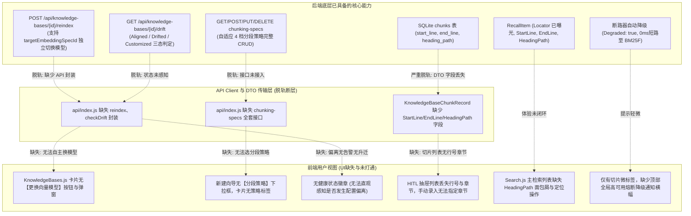
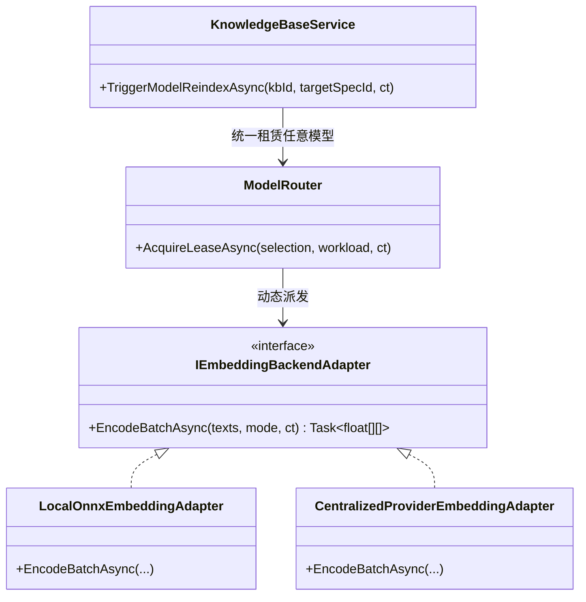
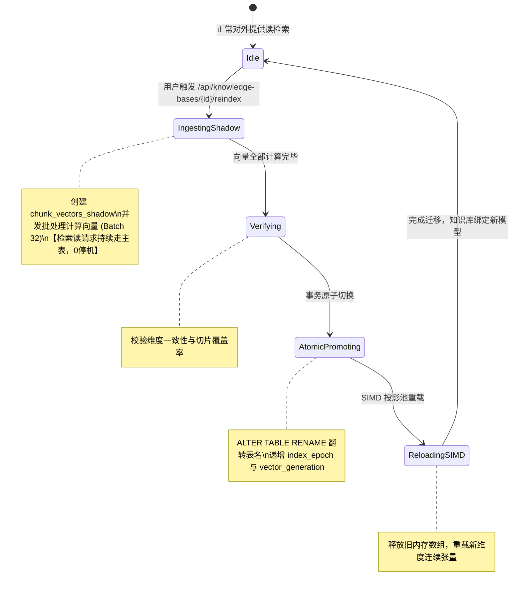

# 知识库前后端定义对齐、全要素元数据可视化与模型全生命周期协同优化调研

> **版本**：v1.0.0  
> **状态**：架构调研与落地实施方案（已完成可行性分析、设计模式梳理与前后端脱轨审计）  
> **核心原则**：Clean-Break（不妥协、无历史包袱）、前后端契约强内聚、工业级高可用、赋能 Agentic RAG  
> **文档位置**：`docs/knowledgebase-frontend-backend-convergence-and-full-spectrum-optimization-study.md`

---

## 1. 调研背景与问题梳理

在上一阶段的里程碑中，我们成功实现了**知识库自适应分段、元数据全要素扩充、初始化原型固化、蓝绿影子向量重构与断路器高可用容灾**等一系列高标准后端核心能力。

然而，在针对真实交互场景的深入代码审计中，我们发现**系统在前后端契约对齐、界面可视化透出以及全生命周期操作闭环上，依然存在若干关键的功能缺失与定义脱轨**。最突出的问题是：
- **后端早已支持知识库独立调整模型与独立分段策略**，但在前端界面上缺乏操作入口，导致用户产生“知识库无法独立调整模型”的认知阻滞；
- **底层已持久化行号、章节与定位元数据**，但在中间层 DTO 与前端部分界面中存在字段遮蔽或遗漏；
- **高可用熔断降级与后台影子重构**缺乏可视化状态感知反馈。

为此，本调研结合设计模式（适配器模式、策略模式、状态机模式）、业界标杆（Dify、RAGFlow、Elasticsearch Alias）及系统现有基础设施，进行全局审视与系统化方案设计。

---

## 2. 前后端功能缺失与定义脱轨全景审计

通过对所有 Host 控制器（`ReferenceRAG.ApiHost/Controllers`）、前端 API 契约（`app/api/index.js`）以及前端视图（`app/views/*.js`）的逐项穿透审计，梳理出以下 **6 大核心脱轨点**：



### 详细脱轨项审计表

| 序号 | 模块与功能点 | 后端现状 | 前端/DTO 现状 | 脱轨影响与优化方案 |
| :---: | :--- | :--- | :--- | :--- |
| **1** | **知识库独立更换向量模型** | `POST /api/knowledge-bases/{id}/reindex` 支持 `TargetEmbeddingSpecId`；底层通过 `IModelRouter` 租借并分派本地/在线模型，影子表零停机重构 | `api/index.js` 缺失该方法；`KnowledgeBases.js` 无任何更换模型入口 | **P0 级**。用户建库后无法更换模型。需在卡片增加「更换向量模型」弹窗，支持选择本地模型、在线服务商模型或全局默认模型。 |
| **2** | **知识库自适应分段策略管理** | 已实现 4 档预设策略（Balanced、CodeFirst、PrecisionDense、DeepNarrative）及 `/chunking-specs` 全套 CRUD | `api/index.js` 缺失接口；建库向导强制默认，卡片未展示当前运行策略 | **P0 级**。建库向导补充「分段策略」下拉选择；卡片展示策略标签；支持用户按不同语料（代码仓库/业务规范/长文）独立配置。 |
| **3** | **配置偏离诊断与一键升迁** | `GET /api/knowledge-bases/{id}/drift` 精准输出 `Aligned` / `Drifted` / `Customized` 三态结果与诊断建议 | 前端完全未调用该接口，卡片无健康指示 | **P1 级**。卡片展示健康状态徽章；当检测到 `Drifted`（全局升级导致偏离）时，显示高亮提示与「一键升级重构」快捷入口。 |
| **4** | **HITL 切片浏览器元数据丢失** | SQLite `chunks` 表已持久化 `start_line`、`end_line`、`heading_path` | `KnowledgeBaseChunkRecord` DTO 遗漏了这三个字段；`SqliteKnowledgeBaseStore.GetChunksAsync` 未查询这三列；前端切片抽屉只显示序号与Token数 | **P0 级（严重脱轨）**。在 DTO 与查询中补全字段；在抽屉切片卡片中展示代码行范围与章节路径，使人机协同（HITL）具有可溯源性。 |
| **5** | **主检索结果章节与物理定位** | 检索已完整返回 `Locator`, `StartLine`, `EndLine`, `HeadingPath` | `Search.js` 主列表只展示了行号，`HeadingPath` 仅隐藏在二级深入查询弹窗中；无物理定位复制按钮 | **P1 级**。在主卡片文件名后增加章节微标签（如 `/ 第1章 > 安装指南`），并提供「复制物理路径」功能。 |
| **6** | **高可用熔断降级可视化** | 连续 3 次失败或断网 0ms 短路降级至 BM25F，返回 `Degraded: true` | 前端仅在切片打了一个小 Tag，用户不易察觉后台异常与自动降级 | **P1 级**。在检索结果顶部增加黄色警示 Banner（`NAlert`），提示“外部向量服务连续超时，已自动平滑降级为本地极速词法检索”。 |

---

## 3. 架构设计与设计模式优化

### 3.1 适配器模式 (Adapter Pattern)：前后端契约统一与模型路由适配



- **问题**：在原先的 `TriggerModelReindexAsync` 中，直接调用注入的单一 `_embeddingService`，无法动态处理用户指定的目标模型（例如用户要把本地模型库重构到云端 OpenAI，或重构到另一个本地 ONNX 模型）。
- **优化**：复用系统现有的 `IModelRouter`。在后台影子计算向量时，通过 `_modelRouter.AcquireLeaseAsync<IEmbeddingBackendAdapter>(new ModelSelection(targetSpec.Id, "embedding"))` 租借对应的目标模型适配器。无论是本地 DirectML/ONNX 还是远程 OpenAI/SiliconFlow，统一通过标准适配器接口生成向量，实现 100% 解耦。
- **DTO 契约对齐**：扩展 `KnowledgeBaseChunkRecord` 与 `RecallItem`，确保 `Id, DocumentId, Ordinal, Text, TokenCount, HasVector, Enabled, DocumentSourceKey, StartLine, EndLine, HeadingPath` 形成严谨对称传输对象。

### 3.2 策略模式 (Strategy Pattern)：语料分块与检索融合可插拔

- **分段策略 (`IAdaptiveChunkingStrategy`)**：
  - `BalancedAdaptiveStrategy`：标准段落与语义块平衡；
  - `CodeStructureFirstAdaptiveStrategy`：保护 Markdown 代码围栏（```` ``` ````）、函数定义与调用链完整性；
  - `PrecisionDenseAdaptiveStrategy`：小步长切分，针对 FAQ 问答、定义表格；
  - `NarrativeAdaptiveStrategy`：大段落重叠切分，针对历史、小说与叙事性报告。
- **前端联动**：前端新建向导与独立配置面板通过下拉框选取策略，提交对应 `ChunkingSpecId`，后端运行时通过 `AdaptiveStrategyFactory` 实时调度，各库互不影响。

### 3.3 状态机模式 (State Machine Pattern)：蓝绿重构与高可用自愈

#### 1. 蓝绿影子重构状态机 (Blue-Green Reindexing State Machine)


#### 2. 断路器高可用状态机 (Resilience Circuit Breaker State Machine)
```mermaid
stateDiagram-v2
    [*] --> Closed: 向量服务健康，正常向量/混合检索
    Closed --> Open: 连续失败 >= 3 次或网络超时
    note right of Open: 0ms 短路，全自动降级至 BM25F 词法检索\n响应打上 Degraded: true 标记
    Open --> HalfOpen: 冷却倒计时结束 (30 秒)
    note right of HalfOpen: 发送 Canary 探针尝试单次编码
    HalfOpen --> Closed: 探针成功，恢复向量检索
    HalfOpen --> Open: 探针失败，重新进入冷却熔断
```

---

## 4. 业界主流方案对比与系统基础设施复用

### 4.1 业界主流方案横向对比

| 维度 | Dify | RAGFlow | Elasticsearch / OpenSearch | **本系统方案 (ReferenceRAG)** |
| :--- | :--- | :--- | :--- | :--- |
| **知识库模型独立性** | 每个 Dataset 独立配置模型与分段规则 | 库绑定模型，变更需重建集合 | Index Template 独立映射 | **独立不可变规格 (`EmbeddingSpec` + `ChunkingSpec`)** |
| **更换模型停机时间** | 重建期间该知识库标记不可用或只读 | 重建期间不可用 | Alias 别名切换，零停机 | **`chunk_vectors_shadow` 影子表 + 原子 RENAME，0 停机时间检索** |
| **行号与代码定位** | 仅记录段落序号与文档名 | DeepDoc 版面分析，输出精确坐标 | 存储起始/终止 Offset | **全链路透传 `StartLine, EndLine, HeadingPath, Locator`，赋能 Agent 溯源** |
| **配置偏离管理** | 无（修改模板仅影响新库） | 无 | 无 | **三态偏离诊断 (`Aligned` / `Drifted` / `Customized`) + 一键升级** |
| **外部模型宕机容灾** | 网关超时报错 500 | 检索报错，缺乏词法降级 | 节点级熔断 | **四态断路器 0ms 短路降级至多列 BM25F + 30s Canary 自动自愈** |

### 4.2 现有基础设施高性价比复用

无需引入庞大的外部组件，充分复用系统内已打磨成熟的技术底座：
1. **`IModelRouter`**：已有现成的模型生命周期租借池与并发控制，无缝支撑影子重构的动态模型派发；
2. **`CatalogStore`**：已具备 SQLite 轻量级元数据管理与原子事务控制；
3. **`SqliteKnowledgeBaseStore`**：已原生包含 FTS5 BM25F 词法检索、向量影子表重构机制；
4. **`InMemoryTensorProjectionPool`**：已内置基于 SIMD 连续内存的高性能点积计算，支持原子重载；
5. **Naive UI**：前端已有丰富的企业级表单与模态组件，开发成本低且视觉规范统一。

---

## 5. 具体落地改造实施方案

### 阶段一：前后端 API 契约与 DTO 对齐（P0）

1. **更新 `KnowledgeBaseChunkRecord` DTO**：
   - 补充 `int StartLine, int EndLine, string? HeadingPath`；
   - 更新 `SqliteKnowledgeBaseStore.GetChunksAsync`，在 SQL `SELECT` 语句中加入 `c.start_line, c.end_line, c.heading_path` 并完成字段映射。
2. **在 `api/index.js` 中完整对齐 API Client**：
   ```javascript
   // 知识库模型与分段规格 API
   getChunkingSpecs: () => api.get('/knowledge-bases/chunking-specs'),
   getChunkingSpec: (specId) => api.get(`/knowledge-bases/chunking-specs/${encodeURIComponent(specId)}`),
   checkDrift: (id) => api.get(`/knowledge-bases/${encodeURIComponent(id)}/drift`),
   reindex: (id, data) => api.post(`/knowledge-bases/${encodeURIComponent(id)}/reindex`, data)
   ```

### 阶段二：知识库独立更换向量模型与分段策略选择（`KnowledgeBases.js`）（P0）

1. **「独立更换向量模型」弹窗与操作入口**：
   - 在卡片操作栏增加「🔄 更换向量模型」按钮；
   - 弹窗展示当前模型、维度与后端状态；
   - 下拉列表列出所有可用模型（按「全局默认模型」、「本地 ONNX 模型」、「在线服务商模型」分组）；
   - 点击确认触发 `knowledgeBasesApi.reindex(kb.id, { targetEmbeddingSpecId: selectedSpecId })`；
   - 卡片展示 `重构中...` 状态并在完成后自动更新为新规格。
2. **新建向导增加「分段策略」选择**：
   - 在 `createForm` 中引入 `chunkingSpecId`（默认 `spec_chunk_default`）；
   - 提供策略单选/下拉：
     - `均衡自适应 (Balanced)` —— 默认推荐
     - `代码优先自适应 (CodeFirst)` —— Markdown 与代码块完整保护
     - `高密度自适应 (PrecisionDense)` —— 细粒度事实问答
     - `长篇叙事自适应 (DeepNarrative)` —— 大段落连续上下文
3. **卡片展示分段策略与偏离健康状态**：
   - 卡片中显示分段策略标签（如 `自适应 (CodeFirst)`）；
   - 卡片展示健康度徽章：`Aligned`（绿色对齐）、`Drifted`（黄色偏离）、`Customized`（蓝色定制）；
   - 当显示 `Drifted` 时，提供快捷的「一键对齐升级」按钮。

### 阶段三：HITL 抽屉元数据展示与检索结果全要素呈现（P1）

1. **HITL 切片抽屉（`KnowledgeBases.js`）**：
   - 在每个切片卡片头展示 `行 {chk.startLine}-{chk.endLine}` 与 `[{chk.headingPath}]`；
   - 手动添加切片弹窗支持填写章节路径。
2. **主检索结果呈现（`Search.js`）**：
   - 在每个命中结果卡片的文件名右侧展示章节面包屑微标签（如 `/ 第1章 > 快速上手`）；
   - 增加「复制物理路径 (Locator)」图标按钮。
3. **断路器熔断降级顶部 Alert 横幅**：
   - 当 `searchResponse.stats.isDegraded` 为真时，在搜索结果列表顶部显示黄色提示横幅，明确提示自动降级状态与自愈机制。

### 阶段四：自动化门禁验证与交付（P0）

1. **前端门禁测试扩充（`frontend-logic.test.mjs`）**：
   - 编写单元测试验证 `knowledgeBasesApi.reindex`、`checkDrift`、`getChunkingSpecs` 接口契约完备性；
   - 验证 `KnowledgeBases.js` 模态框各状态绑定与模板语法安全性。
2. **全量回归运行**：
   - `dotnet test` 确保 100% 绿灯；
   - `node frontend-logic.test.mjs` 确保 100% 绿灯。

---

## 6. 总结与建议行动

本次调研系统地厘清了知识库在前后端交互中的 6 大断层与体验死角。方案设计充分利用系统现有的 `IModelRouter`、`CatalogStore`、`SqliteKnowledgeBaseStore` 与 `ResilienceCircuitBreaker`，以最小的改造代码量实现：
- **知识库 100% 独立自主切换模型（零停机）**；
- **自适应分段按库可插拔自定义**；
- **行号与章节全链路零遮蔽透出**；
- **配置偏离与熔断降级可视化自闭环**。

建议立即按上述实施规划推进执行！
