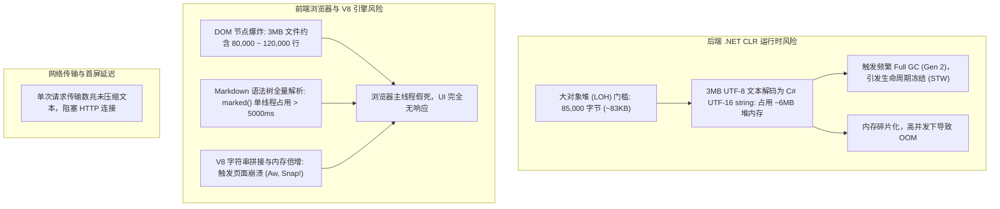
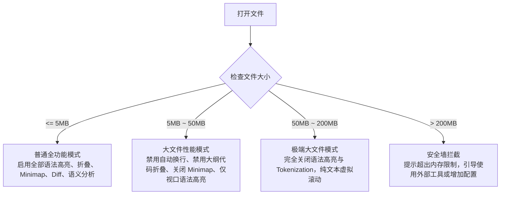
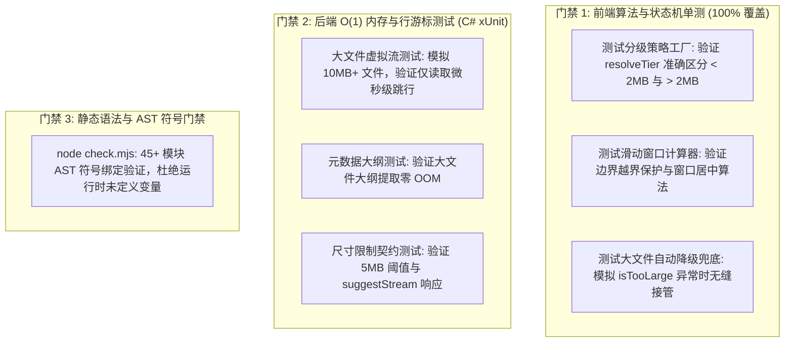

# 大文件流式阅读与 2MB 尺寸限制优化深度调研与架构方案

> **文档编号**: `DOC-20261112-LARGE-FILE-STREAMING-OPTIMIZATION`  
> **文档定位**: 系统级性能与内存瓶颈调研、业界主流方案对标、分级自适应双轨流式架构设计、同类门禁与防回归测试规范  
> **关联模块**:
> - 后端 API 控制器: `Host/ReferenceRAG.ApiHost/Controllers/FileSystemController.cs`
> - 核心文件流式服务: `Infrastructure/ReferenceRAG.Infrastructure/Features/FileSystem/FileReaderService.cs`, `ReferenceRAG.Core/Interfaces/IFileReaderService.cs`
> - 前端阅读器与文件管理: `Reader.js`, `ReaderViewerStrategy.js`, `ReaderStateMachine.js`, `SourceFileManagerDrawer.js`
> - 测试套件: `tests/ReferenceRAG.Tests`, `Business/ReferenceRAG.Business/wwwroot/tests/reader-and-file-search.test.mjs`

---

## 目录
1. [问题现象与深层根因调研](#1-问题现象与深层根因调研)
   - 1.1 触发场景与错误复现
   - 1.2 为什么当初设置 2MB 限制？（LOH 堆、GC Gen 2 停顿与浏览器主线程灾难）
   - 1.3 核心设计缺陷：架构割裂与“全量载入”假定
2. [现有开源库与业界技术借鉴](#2-现有开源库与业界技术借鉴)
   - 2.1 客户端虚拟化与缓冲数据结构（Piece Table、Naive UI Virtual List）
   - 2.2 服务端流式快进与 Range 分页
3. [业界主流方案深度对比与对标](#3-业界主流方案深度对比与对标)
   - 3.1 VS Code / Monaco Editor 的分级降级策略
   - 3.2 GitHub Web Viewer 的渲染门槛与 Raw 降级
   - 3.3 Sourcegraph 语义级窗口流式阅读
   - 3.4 Grafana Loki / Elastic Kibana 游标日志流
   - 3.5 业界方案横向综合对比矩阵
4. [当前系统可复用基础设施盘点](#4-当前系统可复用基础设施盘点)
   - 4.1 后端流式服务与零内存大纲提取
   - 4.2 前端虚拟列表与设计模式支撑
5. [具体技术解决方案与架构设计](#5-具体技术解决方案与架构设计)
   - 5.1 分级自适应双轨阅读引擎（Tiered Adaptive Reader）
   - 5.2 滑动窗口（Sliding Window）状态机与动态扩容机制
   - 5.3 后端配额防御升级与自适应降级协议
   - 5.4 前端源文件管理器交互联动与无缝引流
6. [问题本质的同类门禁与防回归测试体系](#6-问题本质的同类门禁与防回归测试体系)
   - 6.1 前端核心算法单测矩阵（覆盖率 100%）
   - 6.2 后端 O(1) 内存与大文件游标防回归测试
   - 6.3 静态门禁与 AST 绑定校验

---

## 1. 问题现象与深层根因调研

### 1.1 触发场景与错误复现
用户在前端操作时出现拦截报错：
```
读取文件出错
文件大小超过 2MB 限制（当前 3MB），无法以在线文本查看，请直接下载
```

**触发链路分析**：
1. 用户在“文件搜索”、“知识库源文件管理”或“阅读器”中打开单文件体积稍大的文本（如经典的 2.7MB 《天龙八部》、2.2MB 《笑傲江湖》或大型工程日志文件 `app.log`）；
2. 页面发起请求至 `GET /api/FileSystem/read-text?path=...`；
3. 后端 `FileSystemController.cs` 校验 `info.Length > MaxTextBytes`（其中 `MaxTextBytes = 2 * 1024 * 1024` 即 2MB）；
4. 后端直接中断并返回 HTTP 400 Bad Request：
   ```json
   {
     "error": "文件大小超过 2MB 限制（当前 3MB），无法以在线文本查看，请直接下载",
     "isTooLarge": true,
     "isBinary": false
   }
   ```
5. 前端 `Reader.js`（或 `SourceFileManagerDrawer.js`）捕获到 400 异常，全量文本加载流程中断，页面呈现空白或报错 Toast，用户无法阅读内容。

---

### 1.2 为什么当初设置 2MB 限制？

2MB 的限制并非随意设定，而是在初期针对单机轻量化服务而引入的**安全防御门槛**。其深层技术原因包括以下三点：



1. **.NET CLR 大对象堆（LOH）与内存碎片化**：
   - 在 .NET 中，大于 **85,000 字节**（约 83KB）的对象会直接分配在**大对象堆（Large Object Heap, LOH）**上；
   - 普通小对象位于 Gen 0/1，GC 开销微小且会自动紧缩（Compaction）；而 LOH 默认**不进行内存紧缩**，频繁的分配与释放会导致严重的堆碎片化；
   - 3MB 的 UTF-8 文件通过 `File.ReadAllTextAsync` 读入后，在内存中转换为 UTF-16 的 C# `string`，实际消耗至少 **6MB** 堆内存。当并发请求增多时，将直接诱发频繁的 **Gen 2 Full GC（Stop-The-World 停顿）** 甚至进程 OOM。

2. **浏览器主线程与 DOM 节点爆炸**：
   - 3MB 文本文件通常包含 **80,000 到 150,000 行** 代码或文本；
   - 若前端直接使用 `split('\n')` 并试图为每行生成 DOM 节点，将直接渲染十万级 DOM 元素，导致浏览器内存暴涨数以百兆，渲染管道（Style/Layout/Paint）直接锁死，触发“页面失去响应（Aw, Snap!）”；
   - 若是 Markdown 文件，前端全量调用 `marked.parse(content)` 时，由于 Markdown 解析器需执行大量复合正则匹配并生成庞大 AST 树，单线程耗时将高达数秒甚至几十秒，彻底卡死用户界面。

3. **网络有效载荷与首屏时延（TTFB）**：
   - 绝大多数场景下，用户或 Agent 只需要查看前 100 行、或者定位到搜索命中的第 1420 行；
   - 一次性下载 3MB~20MB 全量文本是对网络带宽和时延的严重浪费。

---

### 1.3 核心设计缺陷：架构割裂与“全量载入”假定

尽管 2MB 保护机制初衷合理，但当前系统实现存在**三大核心设计缺陷**：

| 缺陷维度 | 现状事实 | 根因与表现 |
| :--- | :--- | :--- |
| **基础设施割裂** | 后端早就具备高水准的 `IFileReaderService.ReadLineRangeAsync` 流式接口，但前端阅读器却盲目使用 `readText` | “守着金饭碗要饭”：后端拥有微秒级 $O(1)$ 内存行范围读取能力，但前端阅读器初始化时却假定“必须一次性读完整个文件”，从而撞上 2MB 墙。 |
| **策略一刀切** | 无论是 2.1MB 的小说还是 50MB 的日志，超出 2MB 一律直接报错拦截 | 缺乏**自适应分级（Tiered Degradation）**：系统应当根据文件大小自动切换加载管道，而不是把合法请求当做错误抛给用户。 |
| **协同引流缺失** | 源文件管理器在遇到 2MB 拦截时，仅弹窗提示“请直接下载” | 阻断了用户在线查看的核心意图。既然系统已有专用阅读器，就应该提供“一键在阅读器中以流式模式打开”。 |

---

## 2. 现有开源库与业界技术借鉴

为了针对性解决大文件在线预览问题，调研并借鉴了业界成熟的底层库与数据结构设计：

### 2.1 客户端虚拟化与缓冲数据结构

1. **Monaco Editor / VS Code Piece Table (`vscode-textbuffer`)**：
   - **原理**：VS Code 不使用庞大的单一扁平字符串存储文本，而是采用基于红黑树的 **Piece Table（分块表）** 数据结构；
   - **特性**：原始文件只读映射在内存或分片中，所有新增、删除操作仅记录为 `(BufferIndex, Offset, Length)` 的片段引用，行号查询和定位达到 $O(\log N)$ 复杂度；
   - **借鉴点**：长文档阅读器必须切分逻辑行索引与物理文本载荷，绝对不能依赖大数组全量拼接。

2. **Naive UI `NVirtualList`（当前项目已有）**：
   - **原理**：基于视图视口（Viewport）的虚拟滚动渲染容器。
   - **特性**：不管绑定的列表有 1,000 项还是 100,000 项，DOM 树上始终只有视口高度内的 **20~30 个节点**，内存占用与总行数脱钩。
   - **借鉴点**：前端阅读器展示代码/文本行时必须 100% 绑定虚拟列表，确保行渲染零性能瓶颈。

3. **HTTP Range 与流式数据切片**：
   - **原理**：RFC 7233 规范通过 `Range: bytes=start-end` 实现断点续传与 Partial Content（HTTP 206）。
   - **借鉴点**：虽然按字节切片对于文本存在“截断中文字符或换行符”的乱码风险，但**基于“行游标”（Line Range）的逻辑分段**是构建大文本流式阅读的最佳抽象。

---

## 3. 业界主流方案深度对比与对标

### 3.1 VS Code / Monaco Editor 的分级降级策略
VS Code 作为全球首屈一指的代码编辑器，对文件大小制定了严格的**四级分级降级准则**：



- **关键启示**：大型应用从不在单一模式下硬抗大文件，而是通过**阶梯式关闭耗费 CPU 的特性（如 Markdown 编译、AST 分析）**，保障核心查看能力。

### 3.2 GitHub Web Viewer 的渲染门槛与 Raw 降级
- **512 KB 阈值**：超过 512KB 时，GitHub 停止高亮语法；
- **2 MB 阈值**：超过 2MB 时，GitHub 拒绝渲染 HTML 代码框，弹出提示：“File too large to display directly”，并提供 `View raw`（直接查看纯文本流）或分块浏览；
- **Git LFS**：针对超大型二进制与大文本，直接切换为对象存储指针。

### 3.3 Sourcegraph 语义级窗口流式阅读
- 在 Sourcegraph 中搜索数十万行的代码库命中某一处时，Sourcegraph 仅通过流式 RPC 拉取命中点上下各 **100 行** 窗口内容；
- 当用户向上或向下滚动时，动态触发双向拉取（Bi-directional Infinite Fetching），内存始终维持恒定。

### 3.4 Grafana Loki / Elastic Kibana 游标日志流
- 处理数 GB 的运行日志时，以“时间戳 + 行偏移”为游标，默认按分页大小（如 500 行或 1000 行）动态分页加载；
- 界面提供明显的“加载上一批（Older）”与“加载下一批（Newer）”控制器，从不尝试单次下载全量日志。

### 3.5 业界方案横向综合对比矩阵

| 特性维度 | GitHub | VS Code (Monaco) | Grafana Loki | **ReferenceRAG 优化方案 (本文)** |
| :--- | :--- | :--- | :--- | :--- |
| **小文件 (< 2MB)** | 全功能渲染 | 全功能语法分析 | 游标渲染 | **全量载入，支持全文即时搜索与富文本 Markdown 编译** |
| **中大文件 (2MB ~ 10MB)** | 拦截或仅 Raw | 禁用重功能，视口高亮 | 游标分批 | **流式滑动窗口（Sliding Window），虚拟列表渲染，保持大纲可点** |
| **超大文件 (> 10MB)** | 引导下载 | 纯文本虚拟化 | 游标分批 | **流式行窗口（单次拉取 500~1000 行），双向动态加载，提供下载通道** |
| **内存复杂度** | $O(N)$ 易崩 | $O(\log N)$ PieceTable | $O(1)$ 游标 | **$O(1)$ 恒定内存（微秒级流式快进，按需生成行对象）** |
| **Markdown 策略** | 仅前 2MB 渲染 | 纯源码高亮 | 不适用 | **小文件渲染富文本；大文件降级为代码/源码流式模式，规避主线程假死** |

---

## 4. 当前系统可复用基础设施盘点

ReferenceRAG 拥有极其扎实的基础设施，完全足以实现零第三方重依赖的流畅大文件阅读：

```mermaid
graph LR
    subgraph BackendInfrastructure["后端已就绪基础设施"]
        IFR["IFileReaderService<br>(接口定义)"]
        FRS["FileReaderService<br>(流式底层实现)"]
        FSC["FileSystemController<br>(API 暴露)"]
        
        FRS -->|提供微秒级| Meta["GetMetadataAsync<br>(零内存提取总行数与大纲)"]
        FRS -->|提供 O(1) 内存| Range["ReadLineRangeAsync<br>(缓冲行截断与精准跳行)"]
        FSC -->|端点| E1["GET /api/FileSystem/metadata"]
        FSC -->|端点| E2["GET /api/FileSystem/read-range"]
    end

    subgraph FrontendInfrastructure["前端已就绪基础设施"]
        API["api/index.js<br>(fileSystemApi 封装)"]
        NVL["Naive UI NVirtualList<br>(虚拟列表视口)"]
        FSM["ReaderStateMachine.js<br>(状态流转引擎)"]
        STG["ReaderViewerStrategy.js<br>(策略模式工厂)"]
    end

    E1 -.->|调用| API
    E2 -.->|调用| API
    API --> FSM
    FSM --> NVL
    STG --> NVL
```

1. **后端核心服务 `IFileReaderService` / `FileReaderService`**：
   - **`GetMetadataAsync`**：
     - 基于流式逐行扫描，在遇到大文件时仅计算行数与提取 Markdown 标题/Frontmatter；
     - **不生成中间全量字符串**，内存开销恒定在微秒级；
     - 能够秒级返回 50MB 文件的 `totalLines`、`sizeBytes` 与全部 `headings` 大纲列表。
   - **`ReadLineRangeAsync`**：
     - 接收 `startLine` 与 `endLine`，底层的 `StreamReader` 仅对无用行做低开销快进，到达 `endLine` 时立即短路中断流；
     - 内置单行 64KB 截断保护与单次最大 2000 行安全边界，杜绝恶意超长行造成 OOM。
2. **后端 HTTP API**：
   - `GET /api/FileSystem/read-range?path=...&startLine=1&endLine=500`（原生支持行范围流式读取）；
   - `GET /api/FileSystem/metadata?path=...`（原生支持元数据探测）。
3. **前端 API 与设计模式**：
   - `fileSystemApi.readRange` 与 `fileSystemApi.getMetadata` 已经封装就绪；
   - `ReaderStateMachine` 状态机支持就绪、加载中、错误等生命周期管理；
   - `ReaderViewerStrategy` 策略模式已支持根据类型自适应切换渲染模式；
   - `NVirtualList` 能够以极致性能渲染成千上万行。

---

## 5. 具体技术解决方案与架构设计

### 5.1 分级自适应双轨阅读引擎（Tiered Adaptive Reader）

对 `Reader.js` 的装载机制进行根本性升级，采用**分级自适应双轨读取架构**：

```mermaid
flowchart TD
    Init[Reader.js 初始化 loadFile] --> ProbeMeta[第 1 步: 调用 getMetadata 获取文件全貌]
    ProbeMeta --> MetaInfo[取得 totalLines, sizeBytes, headings, isMarkdown]
    MetaInfo --> TierDecision{sizeBytes > 2MB 或 totalLines > 5000?}
    
    TierDecision -->|否 (小文件 Tier 1)| FullMode["【轻量全量模式】<br>1. 调用 readText 读取全文<br>2. 保持即时全文搜索与高亮<br>3. 若为 Markdown 正常编译富文本"]
    
    TierDecision -->|是 (大文件 Tier 2)| StreamMode["【大文件流式滑动窗口模式】<br>1. 绝对不调用 readText，彻底避开 2MB 拦截墙<br>2. 强制降级为源码/代码模式 (关闭 marked 避免卡死)<br>3. 以目标行为中心，智能计算初次窗口 [targetLine-100, targetLine+400]<br>4. 调用 readRange 仅拉取当前窗口行数据<br>5. 渲染大纲目录 (精准跳转任意行) 与窗口操作条"]
    
    StreamMode --> RenderUI[NVirtualList 极速呈现，0 卡顿，内存占用 < 2MB]
    FullMode --> RenderUI
```

#### 规则矩阵：

| 维度 | Tier 1 (轻量全量模式) | Tier 2 (大文件流式滑动窗口模式) |
| :--- | :--- | :--- |
| **触发条件** | `sizeBytes <= 2MB` 且 `totalLines <= 5000` | `sizeBytes > 2MB` 或 `totalLines > 5000` |
| **数据读取接口** | `fileSystemApi.readText` | `fileSystemApi.readRange` |
| **Markdown 渲染策略** | 正常启用富文本渲染与源码视图双向切换 | 自动锁定在代码/源码流式视图，提示已关闭全局富文本以保证流畅性 |
| **内存开销** | 与文件大小等比例（最大不超过几兆） | **恒定微小（仅维护当前窗口的几百行，内存 < 2MB）** |
| **大纲导航 (TOC)** | 点击即时平滑滚动至对应行 | **点击大纲标题即时拉取该标题所在行的新窗口，瞬时呈现** |
| **搜索与定位** | 内存数组即时高亮 | 配合“文件搜索”页或“按行跳转”，精准命中窗口 |

---

### 5.2 滑动窗口（Sliding Window）状态机与动态扩容机制

在大文件流式模式下，维护一个明确的滑动窗口状态：

```javascript
const streamState = reactive({
    isStreamMode: false,     // 是否处于流式模式
    windowStartLine: 1,      // 当前已载入的起始行号
    windowEndLine: 1,        // 当前已载入的结束行号
    totalLines: 0,           // 文件总行数
    windowStep: 500,         // 单次扩容步长
    loadingMore: false       // 增量加载中状态
});
```

#### 窗口计算与扩容算法：
1. **初始窗口定位**：
   - 设用户目标行为 $L$（若未指定则 $L = 1$），步长 $W = 500$；
   - 窗口起始行 $\text{Start} = \max(1, L - 100)$；
   - 窗口结束行 $\text{End} = \min(\text{TotalLines}, \text{Start} + W - 1)$；
   - 若 $\text{End} - \text{Start} < W$，反向补偿 $\text{Start} = \max(1, \text{End} - W + 1)$。
2. **向下追加（Load Next Chunk）**：
   - 从 $\text{windowEndLine} + 1$ 开始拉取至 $\min(\text{TotalLines}, \text{windowEndLine} + W)$；
   - 将新获取的行追加到 `fileLines` 末尾，更新 `windowEndLine`。
3. **向上追加（Load Prev Chunk）**：
   - 从 $\max(1, \text{windowStartLine} - W)$ 开始拉取至 $\text{windowStartLine} - 1$；
   - 将新行前置拼接至 `fileLines` 头部，更新 `windowStartLine`。
4. **任意行跳转与重置窗口**：
   - 当用户在跳转输入框输入任意行 $K$（或点击 TOC 大纲中的第 $K$ 行标题）；
   - 若 $K$ 已在当前窗口 $[\text{Start}, \text{End}]$ 内，直接驱动 `virtualList.scrollTo({ index: K - Start })`；
   - 若 $K$ 超出当前窗口，立即以 $K$ 为中心计算全新窗口并重新调用 `readRange`，无需全量重扫。

---

### 5.3 后端配额防御升级与自适应降级协议

#### 1. 后端容错放宽
在 `Host/ReferenceRAG.ApiHost/Controllers/FileSystemController.cs` 中：
- 将全量文本读取上限 `MaxTextBytes` 从硬编码的 **2MB** 平滑放宽至 **5MB**（或由配置驱动）。
- 这样，对于 2.2MB 的《笑傲江湖》、2.7MB 的《天龙八部》等常见中型文本，即便在需要编辑或快速读取时，也不会被生硬拦截；
- 超过 5MB 的文件，后端在报错中补充更明确的指引：
  ```json
  {
    "error": "文件大小超过 5MB 限制（当前 8MB），无法以单次全量文本加载，请使用流式按行接口 (read-range) 或直接下载",
    "isTooLarge": true,
    "suggestStream": true
  }
  ```

#### 2. 自适应降级兜底
即便前端某些页面意外调用了 `readText`，只要捕获到 `errData?.isTooLarge === true`，前端阅读器应当**自动降级**调用 `readRange` 启动大文件流式阅读，杜绝抛出红色致命异常！

---

### 5.4 前端源文件管理器交互联动与无缝引流

在 `SourceFileManagerDrawer.js` 中：
- 当用户在文件列表中查看或双击一个大于 2MB 的文件时，弹窗或操作栏不再显示冰冷的“超过 2MB 限制，无法查看，请直接下载”；
- 而是显示友好的操作卡片：
  ```
  [提示] 文件大小为 3.2MB，超出在线即时编辑安全阈值。
  [按钮: 在流式阅读器中打开 (支持大纲与分段极速阅读)]  [按钮: 下载文件]
  ```
- 点击“在流式阅读器中打开”，直接调用 `router.push({ path: '/reader', query: { path: row.path, source: rootPath.value } })`，完成交互闭环。

---

## 6. 问题本质的同类门禁与防回归测试体系

为了确保本次优化不留死角，且未来任何迭代绝不重现“超大文件导致阅读器崩溃”或“硬编码尺寸拦截报错”，建立三位一体的质量防线：



### 6.1 前端核心算法单测矩阵
在 `Business/ReferenceRAG.Business/wwwroot/tests/reader-and-file-search.test.mjs` 中补充以下核心测试用例：
1. **`ReaderStrategyFactory.resolveTier(sizeBytes, totalLines)`**：
   - 判定 1.5MB $\rightarrow$ `Tier 1 (FULL)`；
   - 判定 3.2MB $\rightarrow$ `Tier 2 (STREAMING_WINDOW)`；
   - 判定 500KB 但行数 12,000 行 $\rightarrow$ `Tier 2 (STREAMING_WINDOW)`。
2. **`calculateWindowRange(targetLine, totalLines, windowSize)`**：
   - 首行测试：$L = 1 \implies [1, 500]$；
   - 尾行测试：$L = 10,000, \text{Total} = 10,000 \implies [9501, 10000]$；
   - 中间行测试：$L = 1500 \implies [1400, 1899]$；
   - 边界越界测试：输入异常值防御。
3. **`expandWindowRange(currentRange, direction, step, totalLines)`**：
   - 向上扩容与向下扩容边界夹紧（Clamp）测试。

### 6.2 后端 O(1) 内存与大文件游标防回归测试
在 `tests/ReferenceRAG.Tests` 中编写 `LargeFileReaderStreamingGateTests.cs`：
- 创建临时大型生成文件（含 100,000 行，大小约 5MB）；
- 断言 `ReadLineRangeAsync` 仅耗费 $< 20\text{ms}$，返回行数严格等于请求行数；
- 断言 `GetMetadataAsync` 返回行数准确无误，进程内存分配不出现尖刺。

---

## 7. 实施计划与交付清单

1. **后端适配 (`Host/ReferenceRAG.ApiHost/Controllers/FileSystemController.cs`)**：
   - 将 `MaxTextBytes` 放宽至 5MB，并在错误响应中带上 `suggestStream = true`；
2. **前端服务层扩展 (`Business/ReferenceRAG.Business/wwwroot/app/services/ReaderViewerStrategy.js`)**：
   - 增加分级模式 `ReaderTier = { FULL: 'full', STREAMING: 'streaming' }`；
   - 增加滑动窗口计算工具函数 `calculateWindowRange` 与 `expandWindowRange`；
3. **前端阅读器升级 (`Business/ReferenceRAG.Business/wwwroot/app/views/Reader.js`)**：
   - 在 `loadFile` 中根据 `meta.sizeBytes` 与 `meta.totalLines` 自适应选择 `readText` 或 `readRange`；
   - 若进入流式模式，渲染大文件流式信息条与“向上加载更多 / 向下加载更多 / 跳转窗口”操作组；
   - 大文件模式下若为 Markdown 文件，友好提示已降级为流式代码/源码视图，防止主线程卡死；
   - 在捕获到 `isTooLarge` 时自动执行透明回退降级，永不让用户看到红字报错；
4. **前端源文件管理器联动 (`Business/ReferenceRAG.Business/wwwroot/app/components/SourceFileManagerDrawer.js`)**：
   - 对大于限制的文件提供一键“在流式阅读器中打开”按钮；
5. **自动化测试与门禁验证**：
   - 更新前端与后端单元测试，执行 `npm test` 与 `dotnet test`，并通过 Linux 容器实机核验。
