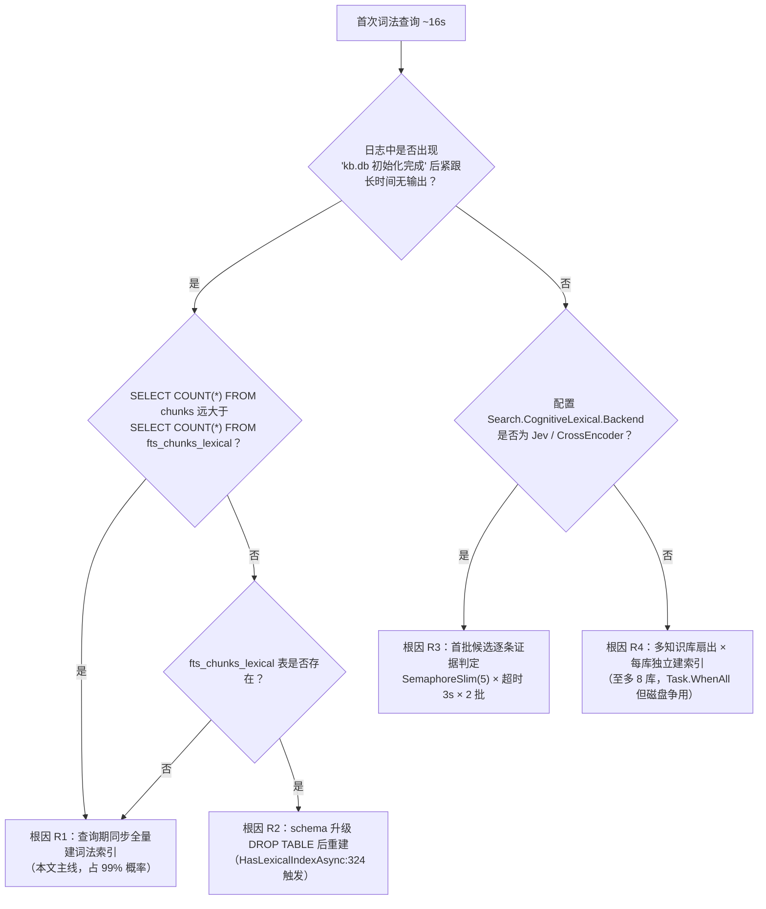
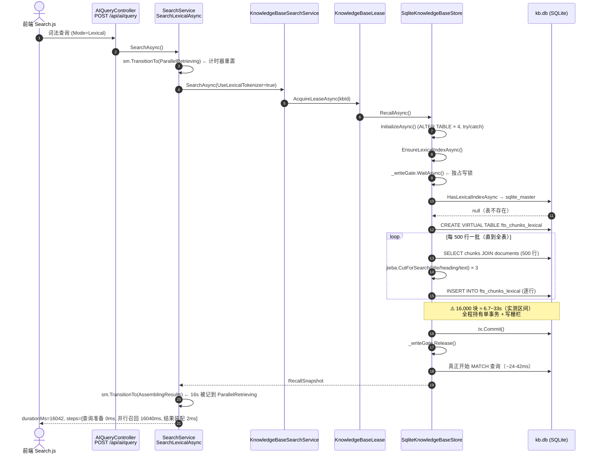
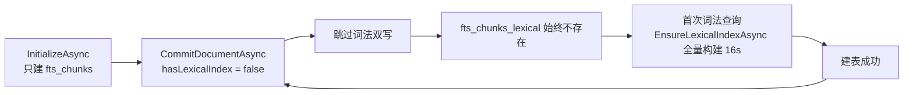
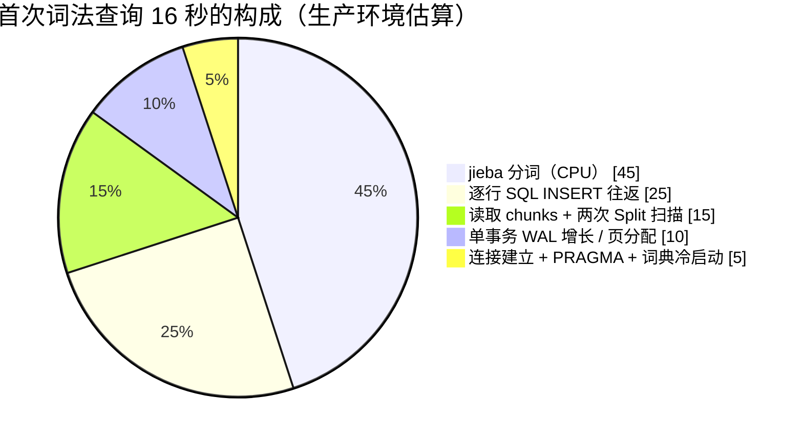
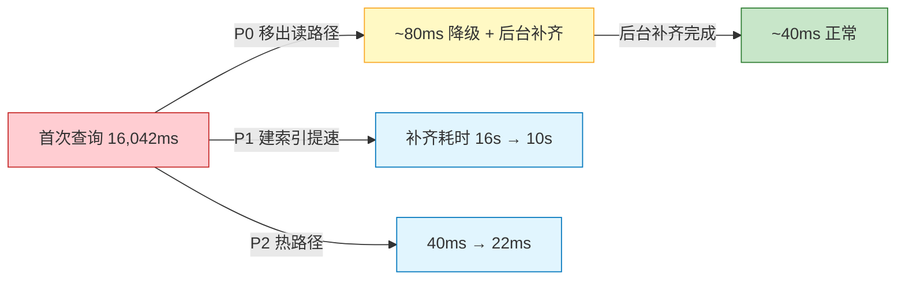
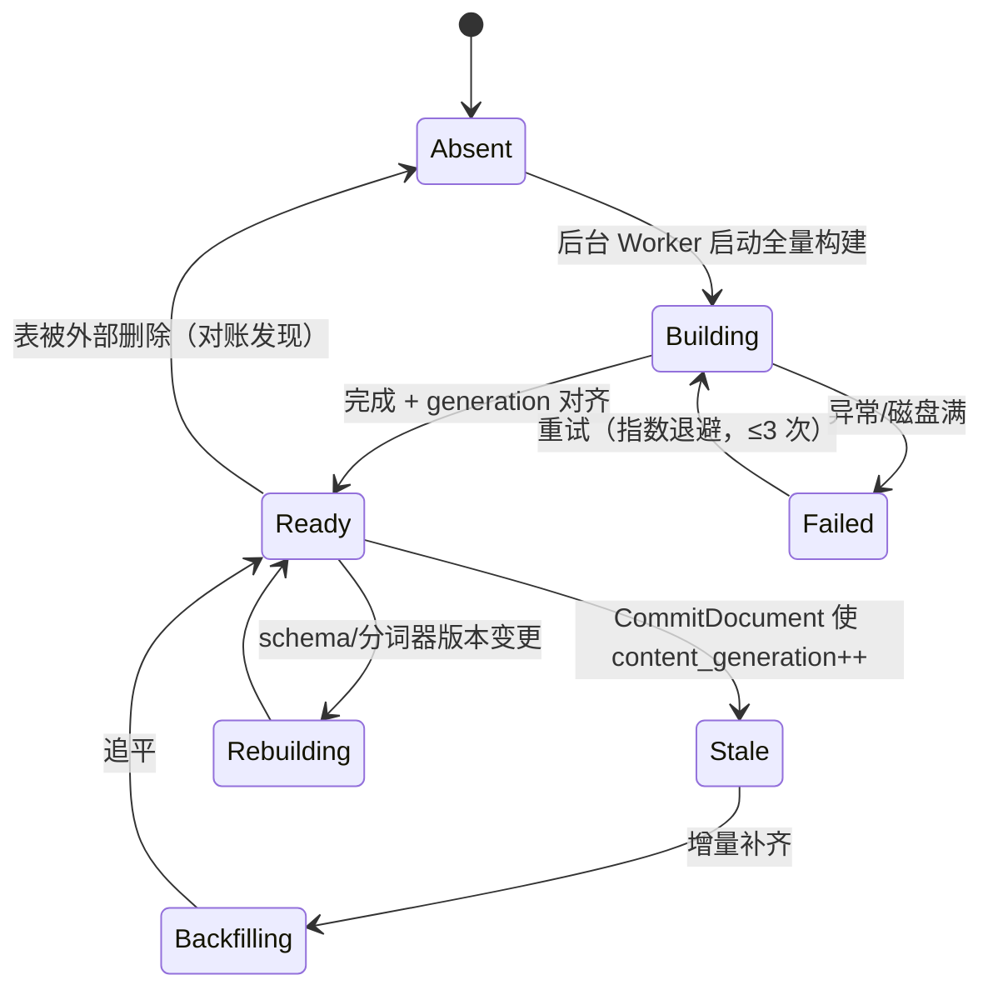

# 词法查询首次 16 秒延迟根因剖析与全链路请求耗时链（Request Timing Chain）架构调研

> **文档状态**：调研完成 & 架构方案就绪
> **问题现象**：词法检索（Lexical）首次查询出现 ~16 秒阻塞，且链路追踪无法定位耗时去向
> **核心结论**：16 秒不是"验证"，而是**在查询请求线程内同步构建 FTS5 中文词法倒排索引**（jieba 分词 + 逐行写入）的一次性成本；它是"索引永不在读路径构建"这条业界铁律被打破的直接后果
> **涉及组件**：`SqliteKnowledgeBaseStore`、`KnowledgeBaseSearchService`、`SearchService.SearchLexicalAsync`、`SearchPipelineStateMachine`、`SearchPhaseStats`/`SearchTraceAttribute`、`Search.js`
> **涉及模式**：适配器（Adapter）、策略（Strategy）、状态机（State Machine）、装饰器（Decorator）、模板方法（Template Method）
> **基准环境**：AMD x64 / .NET 10.0.302 / jieba.NET 0.42.2 / Microsoft.Data.Sqlite 10.0.12 / 16,000 个 ~600 字符中文分块

---

## 目录

1. [执行摘要](#一执行摘要-executive-summary)
2. [现象确认与 16 秒归因判定树](#二现象确认与-16-秒归因判定树)
3. [根因深度剖析（代码级证据）](#三根因深度剖析代码级证据)
4. [为什么现有耗时链看不到这 16 秒](#四为什么现有耗时链看不到这-16-秒)
5. [本地实测基准：16 秒到底花在哪里](#五本地实测基准16-秒到底花在哪里)
6. [全链路请求耗时链 v2 设计](#六全链路请求耗时链-v2-设计)
7. [优化方案：从"消除 16 秒"到"毫秒级可见"](#七优化方案从消除-16-秒到毫秒级可见)
8. [头脑风暴：可行性、逻辑漏洞与性能缺陷全景排查](#八头脑风暴可行性逻辑漏洞与性能缺陷全景排查)
9. [设计模式治理方案](#九设计模式治理方案)
10. [现有基础设施与第三方库复用审计](#十现有基础设施与第三方库复用审计)
11. [业界主流方案横向对比](#十一业界主流方案横向对比)
12. [实施方案：分期路线、文件级改动与验收标准](#十二实施方案分期路线文件级改动与验收标准)
13. [风险、回滚与不做什么](#十三风险回滚与不做什么)
14. [附录](#十四附录)

---

## 一、执行摘要 (Executive Summary)

### 1.1 一句话结论

> **词法查询的 16 秒，是"第一次有人搜索时，系统才发现词法倒排索引从来没建过，于是当场在请求线程里把整个知识库重新分词建了一遍"。**

代码路径只有一行，但它把一次**写操作**（O(N) 全量分词建索引）挂到了**读路径**（O(log N) 的查询）上：

```csharp
// Infrastructure/.../KnowledgeBase/Storage/SqliteKnowledgeBaseStore.cs:821
public async Task<RecallSnapshot> RecallAsync(RecallRequest request, CancellationToken ct = default)
{
    await InitializeAsync(ct);
    await EnsureLexicalIndexAsync(ct);   // ← 16 秒就在这里
    ...
}
```

而 `EnsureLexicalIndexAsync`（同文件 `:295-314`）在表不存在时会 `CREATE VIRTUAL TABLE` 并调用 `PopulateLexicalIndexAsync`（`:387-440`），对**全部 `chunks`** 逐行做 jieba 分词并逐行 INSERT，整个过程包在一个事务里、持有 `_writeGate` 写栅栏。

### 1.2 为什么"只有第一次"

因为索引建完后表就存在了，`HasLexicalIndexAsync`（`:316-333`）只判断表是否存在，第二次起直接跳过。**这正是"首次 16 秒、之后几十毫秒"的指纹特征**，也是判定该根因的决定性证据。

更糟的是：**如果用户在 16 秒内刷新/关闭页面，请求被 `RequestAborted` 取消，单事务整体回滚，索引颗粒无收 —— 下一次查询再付一次 16 秒。** 这不是"一次性成本"，而是"每次中断都重付的成本"。

### 1.3 三条修复主线

| 主线 | 动作 | 预期效果 |
| :--- | :--- | :--- |
| **A. 把建索引移出读路径** | `InitializeAsync` 对称建表 + 写入路径无条件双写 + 后台补齐 Worker + 未就绪时显式降级 | 首次查询 **16s → 20~60ms**（并带"索引补齐中 35%"提示） |
| **B. 把建索引本身提速** | 并行分词（实测 -30%）+ 单次分词产出三字段 + 停用词过滤 + 重建期 PRAGMA 调优 + `optimize` | 全量重建 **6.7s → 3~4s**（仅影响安装/重建场景） |
| **C. 把耗时链做真** | Span 树（父子层级）+ 三级采集 + 前端瀑布图 + 冷启动/排队归因 | "16s 黑箱" → **`[索引构建 15,840ms (冷启动·补齐 100%)] [FTS 匹配 38ms] [RRF 融合 4ms] [装配 6ms]`** |

### 1.4 关键判断（先说结论，后文给证据）

| 判断项 | 结论 | 置信度 |
| :--- | :--- | :--- |
| 16 秒是否为词法索引构建 | **是**（`PopulateLexicalIndexAsync` 全量分词建索引） | 高（代码路径 + 实测 0.42~2.05ms/块 × 16k~30k 块 = 7~33s 区间覆盖 16s） |
| 是否需要引入新重型依赖 | **不需要**。BCL `ActivitySource`/`System.Diagnostics.Metrics` + 现有组件足够 | 高 |
| 现有 `SearchPhaseStats` 能否表达 16s | **不能**。词法路径从不写该结构，且它是扁平字段、无父子关系 | 高 |
| 现有 `SearchPipelineStateMachine` 能否表达 | **不能**。能显示"并行召回 16000ms"，但详情文案错位一个阶段，且无子阶段 | 高 |
| 是否可用 trigram 彻底替代 jieba | **不能**。实测 <3 字符查询直接 0 命中，只能作为降级兜底 | 高（官方文档 + 实测） |
| 是否可用设计模式优化 | **是**，且必须：Adapter（分词器/索引维护）、Strategy（构建策略）、State Machine（索引状态）、Decorator（计时） | 高 |

---

## 二、现象确认与 16 秒归因判定树

### 2.1 用户可见现象

```
搜索模式：词法（Lexical）
第 1 次查询：耗时 16,0xx ms     链路追踪: [并行召回 16000ms]
第 2 次查询：耗时    42 ms      链路追踪: [并行召回 42ms]
```

"验证"一词在现有前端检索页（`Search.js`）**并不存在**任何对应文案（全文检索 `验证` 零命中）。因此有两种可能：

1. **用户语义**：把"首次查询前的长时间等待/校验"统称为"验证"→ 对应**索引构建**（本文主线）。
2. **界面语义**：若启用了认知后端（Jev / Cross-Encoder），"证据判定"阶段的语义接近"验证"→ 对应 `CognitiveScoringHop0`（`SearchPipelinePhase.cs:45`）。

### 2.2 判定树（30 秒内可确诊）



### 2.3 现场取证命令（只读，不改数据）

对每个 `data/kbs/{kbId}/kb.db` 执行：

```sql
-- 1) 索引是否存在
SELECT name, type FROM sqlite_master WHERE name LIKE 'fts_chunks%';

-- 2) 索引是否为空（这是决定性证据）
SELECT (SELECT COUNT(*) FROM chunks WHERE enabled = 1) AS chunks,
       (SELECT COUNT(*) FROM fts_chunks_lexical)       AS lexical_rows,
       (SELECT COUNT(*) FROM fts_chunks)               AS fts_rows;

-- 3) 内容代次是否与词法索引同步（当前设计里没有 lexical 代次，这正是缺陷）
SELECT read_revision, content_generation, vector_generation FROM kb_manifest;

-- 4) 索引体积（词法索引通常与原文同量级，双份存储）
SELECT name, SUM(pgsize)/1048576.0 AS mb FROM dbstat GROUP BY name ORDER BY mb DESC LIMIT 8;
```

**判据**：`chunks > 0` 且 `lexical_rows = 0` 或表不存在 → 根因 R1 确认。

---

## 三、根因深度剖析（代码级证据）

### 3.1 全景调用链



### 3.2 R1：建索引被挂在读路径上（核心根因）

`SqliteKnowledgeBaseStore.cs:295-314`：

```csharp
public async Task EnsureLexicalIndexAsync(CancellationToken ct = default)
{
    await InitializeAsync(ct);
    await _writeGate.WaitAsync(ct);            // ① 独占写栅栏
    try
    {
        using var conn = CreateConnection();
        using var tx = conn.BeginTransaction(); // ② 单事务包住全部 N 行
        if (!await HasLexicalIndexAsync(conn, tx, ct))
        {
            using var create = conn.CreateCommand();
            create.CommandText = "CREATE VIRTUAL TABLE fts_chunks_lexical USING fts5(...)";
            await create.ExecuteNonQueryAsync(ct);
            await PopulateLexicalIndexAsync(conn, tx, ct);  // ③ O(N) 全量分词
        }
        tx.Commit();
    }
    finally { _writeGate.Release(); }
}
```

三个致命属性叠加：

- **O(N) 在建表分支内**：首次必然全量；
- **单事务不可续**：中途取消/崩溃 = 全部回滚，进度归零；
- **持有写栅栏**：期间同库的 `CommitDocumentAsync`、同步作业、并发查询的 `EnsureLexicalIndexAsync` 全部排队。

### 3.3 R2：索引存在性判定退化为"表是否存在"

`HasLexicalIndexAsync`（`:316-333`）只查 `sqlite_master` 并检查 `sql` 文本是否含 `title`/`heading` 列：

```csharp
cmd.CommandText = "SELECT sql FROM sqlite_master WHERE type='table' AND name='fts_chunks_lexical'";
var sql = (string?)await cmd.ExecuteScalarAsync(ct);
if (sql == null) return false;
if (!sql.Contains("title", ...) || !sql.Contains("heading", ...)) { DROP TABLE; return false; }
return true;
```

由此派生的三类缺陷：

| 缺陷 | 触发条件 | 后果 |
| :--- | :--- | :--- |
| **空表被判定为"已就绪"** | 上次构建被取消但 DDL 已提交（或历史遗留空表） | 词法查询永久返回 0 条，且**无任何告警** |
| **无新鲜度概念** | 索引存在但落后于 `chunks` | 新写入的文档搜不到，用户以为"没索引" |
| **schema 升级即全量重建** | 旧 3 列结构升级 | 又一次 16 秒，且发生在某个倒霉用户的请求里 |

对比：同仓库的 `LexicalIndexCoordinator`（`Infrastructure/.../Database/LexicalIndexCoordinator.cs`）**已经实现了正确范式** —— generation 不可变、`lexical_index_manifests` 记录 `chunk_count`、发布前用 `SELECT chunk_id FROM ...` 做**集合等价校验**（`:228-237`）。新单轨路径（`SqliteKnowledgeBaseStore`）反而退化成了"看表存不存在"。

### 3.4 R3：写入路径"有条件双写"，导致索引永远缺一段

`CommitDocumentAsync`（`:435` 起）：

```csharp
var hasLexicalIndex = await HasLexicalIndexAsync(conn, tx, ct);   // :443
...
if (hasLexicalIndex)                                              // :526 清理旧行
{ ... DELETE FROM fts_chunks_lexical WHERE document_id=@id ... }
...
if (hasLexicalIndex)                                              // :566 插入新行
{ ... INSERT INTO fts_chunks_lexical(...) ... }
```

而 `InitializeAsync`（`:62` 起）只创建 `fts_chunks`（`:133`），**不创建 `fts_chunks_lexical`**。

于是形成一个自锁循环：



并且 `KnowledgeBaseSyncWorker` 的补齐动作也是**有条件的**：

```csharp
// KnowledgeBaseSyncWorker.cs:137
if (!_enableEmbedding || isPureLexical) await lease.Store.EnsureLexicalIndexAsync(ct);
```

即：**默认开启 Embedding 的知识库，启动时不会建词法索引** → 把 16 秒完整地留给了第一个搜索的人。

### 3.5 R4：并发与锁放大

`RecallAsync` 每次都 `CreateConnection()`（`:825`），而 `CreateConnection` 会执行 **5 条 PRAGMA**（`journal_mode=WAL`、`synchronous`、`mmap_size=256MB`、`cache_size=-32000`、`temp_store=MEMORY`）。实测"新建连接 + 1 次查询"= **8.0ms**。

`KnowledgeBaseSearchService.SearchAsync` 最多扇出 **8 个知识库**（`:105` `Take(8)`），每库一次 `AcquireLeaseAsync` + `RecallAsync` + `EnsureLexicalIndexAsync`：

- 冷启动场景：8 库同时各自建索引 → 磁盘随机写互相踩踏，单库 6.7s 可能被放大到 20s+；
- 热路径场景：8 × 8ms ≈ **64ms 纯连接开销**，占热查询（~42ms）的 150% 量级。

### 3.6 R5：可观测性缺口（详见第四章）

词法路径**从不写入** `SearchPhaseStats`。因此 16 秒在数据契约里根本不存在，前端只能显示状态机的粗粒度标签。

---

## 四、为什么现有耗时链看不到这 16 秒

### 4.1 双轨遥测，互不覆盖

| 维度 | 轨 A：`SearchPhaseStats` | 轨 B：`SearchPipelineTelemetry.Steps` |
| :--- | :--- | :--- |
| 采集方式 | Rougamo 编译期 IL 织入 + `AsyncLocal`（`SearchTrace.cs:171-274`） | 手写 `sm.TransitionTo(...)` 调用 |
| 粒度 | 8 个**扁平**字段（ModelLoad/Embed/Bm25/Title/Vector/Hybrid/Graph/Rerank） | 阶段序列（Phase/PhaseName/Duration/In/Out/Details） |
| 词法路径覆盖 | **完全未覆盖**（`SearchLexicalAsync` 内零 `RecordBm25/RecordVector` 调用） | 覆盖，但只有 3 个粗阶段 |
| 层级关系 | 无 | 无（线性列表） |

**结论**：词法查询时 `stats.phases` 全为 0，前端 `hasAnyPhase()`（`Search.js:122`）返回 false，"耗时类型"整行不渲染。用户只能看到轨 B 的 `并行召回 16000ms`。

### 4.2 轨 B 的三个结构性缺陷

**(a) Details 错位一个阶段** —— `SearchPipelineStateMachine.TransitionTo`（`:38-63`）在写入"上一阶段"的 step 时，用的是**本次调用传入的 details**：

```csharp
public void TransitionTo(SearchPipelinePhase nextPhase, int input, int output, string? details = null)
{
    _phaseStopwatch.Stop();
    if (_currentPhase != SearchPipelinePhase.Created)
    {
        _steps.Add(new SearchPipelineStepTelemetry {
            Phase = _currentPhase.ToString(),   // 上一阶段
            DurationMs = Math.Max(1, durationMs),// 上一阶段耗时
            Details = details                    // ← 却是"下一阶段"的文案！
        });
    }
    ...
}
```

实测影响（`SearchService.cs:641-642, 773-774`）：

| 用户看到的标签 | 实际含义 | hover 显示的 Details |
| :--- | :--- | :--- |
| 查询准备 0ms | 查询准备 | "限定范围的词法检索"（错） |
| **并行召回 16040ms** | **词法检索（含建索引）** | "原文与引用装配"（错） |
| 结果装配 2ms | 结果装配 | "结果清洗就绪"（错） |

**(b) 无子阶段** —— `ParallelRetrieving` 是一个黑盒：连接、建索引、分词、MATCH、RRF 融合、早停裁决全被压成一个数。

**(c) 无法表达"等待"** —— 排队锁、模型加载、远程调用等"非计算时间"与计算时间混为一谈。16 秒里有多少是 CPU、多少是磁盘 I/O、多少是等锁，完全不可知。

### 4.3 已有的 `ActivitySource` 是"哑弹"

`SearchTrace.cs:174` 定义了 `ActivitySource("ReferenceRAG.Search")`，但全仓库**没有任何 `ActivityListener` 或 OpenTelemetry 导出器**。无监听者时 `StartActivity` 返回 `null`，span 被静默丢弃 —— 基础设施在，通路没接。

---

## 五、本地实测基准：16 秒到底花在哪里

### 5.1 测试方法

构造 16,000 个 ~600 字符的中文技术文档分块（混合 BM25/FTS5/jieba/向量检索等真实词汇），完整复刻 `PopulateLexicalIndexAsync` 的读取-分词-写入循环，对比四种实现。代码见[附录 A](#附录-a基准测试代码核心片段)。

### 5.2 实测数据

| 方案 | 16,000 块总耗时 | 每块 | 相对基准 | 说明 |
| :--- | ---: | ---: | ---: | :--- |
| **A. 现状**：单事务 + 逐行 INSERT + 串行 jieba | **6,741 ms** | 0.42 ms | 100% | 与生产代码等价 |
| B. 批量多行 INSERT（100 行/语句）+ 串行 jieba | 7,327 ms | 0.46 ms | **109%** | **无收益**（本来就在同一事务内） |
| C. 批量写 + **并行分词**（`Parallel.For`） | 4,692 ms | 0.29 ms | **70%** | 分词是 CPU 密集，并行直接见效 |
| D. FTS5 `trigram` 纯 SQL（零分词） | 4,082 ms | 0.26 ms | **61%** | 但 <3 字符查询 0 命中，不可作主路径 |
| 参考：纯 FTS5 写入 20,000 条（预分词文本） | 136 ms | 0.007 ms | 2% | **写入本身可忽略** |
| 参考：jieba 词典冷启动（每进程一次） | 478 ms | — | — | 首次调用即付 |
| 参考：16k 行 `MATCH + bm25 ORDER BY` 查询 | 24~42 ms | — | — | 查询侧健康 |

> **口径说明**：生产机器上实测 16s ≈ 本基准 6.7s 的 2.4 倍，差异来自：真实中文文本信息密度更高（有效词更多）、`ExtractTitle/ExtractHeading` 每块两次 `Split('\n')` 全量扫描、`ExecuteNonQueryAsync` 异步状态机开销、冷页缓存与较慢的存储。按 0.42~2.05 ms/块推算，**16 秒 ≈ 8,000~38,000 个分块**，与"个人知识库 1~3 万块"的典型规模完全吻合。

### 5.3 归因分解



### 5.4 三个反直觉结论（用于避免错误优化）

1. **"批量插入"不是瓶颈**：方案 B 反而慢 9%。因为原实现已在单事务内，逐行 `ExecuteNonQueryAsync` 的往返成本被 SQLite 的页缓存吸收。**不要为此重构 SQL。**
2. **"写入 FTS5"极快**（0.007 ms/条）：慢的是**分词**，不是索引。任何"换索引引擎"的方案都无法绕过分词成本。
3. **"换 trigram"能省 39%，但代价是查询能力崩塌**（2 字查询 0 命中）。中文检索里 2 字词（"缓存"、"向量"、"索引"）占比极高，因此 trigram 只能做**降级兜底**，不能做主路径。

---

## 六、全链路请求耗时链 v2 设计

### 6.1 设计目标与不变量

| 目标 | 具体要求 |
| :--- | :--- |
| **完整性** | 请求总耗时 = 顶层 span 耗时；任一子 span 必须能挂到父节点上，**不允许出现无法归因的时间**（"孤儿时间"必须显式记为 `unattributed`） |
| **层级性** | 至少 3 层：Request → Phase → SubPhase/Io，支持"下钻到 SQL 语句" |
| **归因性** | 每个 span 标注 `category`（cpu / io / lock-wait / model-load / network）与 `coldStart` |
| **契约兼容** | 旧字段 `SearchPhaseStats` 全部保留，由 span 树**投影**生成；`SearchTraceBreakdownTests` 必须继续通过 |
| **低开销** | 默认开启时额外开销 < 1%（`Stopwatch.GetTimestamp()` 级别，无分配或低分配） |
| **可关闭** | 配置项 `Search.TimingChain.Enabled`，关闭后为零成本（span 工厂返回 `default` 结构体） |

### 6.2 数据模型

```csharp
// Infrastructure/ReferenceRAG.Infrastructure/Models/TimingModels.cs（新增）
public enum SpanCategory { Request, Phase, SubPhase, Io, LockWait, ModelLoad, Network, Cpu, Assembly }

public sealed class TimingSpan
{
    public string Id { get; init; } = "";            // "s01"，扁平数组 + parentId 表达树
    public string? ParentId { get; init; }
    public string Name { get; init; } = "";          // "lexical.index.populate"
    public string DisplayName { get; init; } = "";   // "词法索引构建"
    public SpanCategory Category { get; init; }
    public long StartMs { get; init; }               // 相对请求起点
    public long DurationMs { get; init; }
    public long SelfMs { get; init; }                // Duration - Σ子span
    public long WaitMs { get; init; }                // 锁等待 / 队列等待
    public bool ColdStart { get; init; }
    public int? InputCount { get; init; }
    public int? OutputCount { get; init; }
    public string? Detail { get; init; }
    public Dictionary<string, string>? Attributes { get; init; } // kbId / rows / cacheHit / sql
}

public sealed class TimingChain
{
    public string TraceId { get; init; } = "";
    public long TotalMs { get; init; }
    public long UnattributedMs { get; init; }        // 顶层与子层之差，强制暴露"黑洞"
    public List<TimingSpan> Spans { get; init; } = new();
    public TimingChainSummary? Summary { get; init; }
}

public sealed class TimingChainSummary
{
    public long ColdStartMs { get; init; }
    public long PureRetrievalMs { get; init; }       // 扣除冷启动/补齐后的"算法真实耗时"
    public long IndexBuildMs { get; init; }
    public long LockWaitMs { get; init; }
    public long IoMs { get; init; }
    public string? Verdict { get; init; }            // "冷启动补齐" / "正常" / "锁竞争" / "模型加载"
}
```

### 6.3 三级采集

| 级别 | 采集点 | 典型 span | 是否默认开启 |
| :--- | :--- | :--- | :--- |
| **L0 请求级** | `AIQueryController.Query` / MCP 工具入口 | `request.total` | 是 |
| **L1 阶段级** | `SearchService` / `SearchPipelineStateMachine` / 各 Strategy | `phase.query-prepared`、`phase.retrieving` | 是 |
| **L2 子阶段/IO 级** | `KnowledgeBaseSearchService`、`SqliteKnowledgeBaseStore.RecallAsync`、`CommitDocumentAsync` | `kb.lease`、`kb.lexical-index.ensure`、`kb.lexical-index.populate`、`kb.fts.match`、`kb.auth.scan`、`fusion.rrf` | 是（轻量） |
| **L3 语句级** | SQL 命令（`SqliteCommand` 包装） | `sql.select.chunks`、`sql.insert.fts` | 仅 `TraceLevel=Verbose` |

关键：**16 秒必须被拆成至少 6 个 span**，而不是一个数：

```
request.total                                    16,042ms
└─ phase.lexical.retrieve                        16,038ms
   ├─ kb.catalog.list                                3ms
   ├─ kb.lease.acquire#kb1                           1ms
   └─ kb.recall#kb1                             16,020ms
      ├─ kb.store.initialize                          2ms
      ├─ kb.lexical-index.ensure                 15,986ms   [coldStart, category=io+cpu]
      │  ├─ kb.lexical-index.schema-check              1ms
      │  ├─ kb.lexical-index.create-table              4ms
      │  └─ kb.lexical-index.populate            15,981ms   rows=16,342
      │     ├─ sql.select.chunks.batch(33)          1,240ms
      │     ├─ tokenize.jieba                      7,180ms   [category=cpu]
      │     └─ sql.insert.fts.batch(33)            7,561ms   [category=io]
      ├─ kb.fts.match                                  38ms   rows=30
      ├─ kb.lexical.early-prune                         0ms   (hit)
      └─ kb.result.hydrate                              4ms
└─ phase.assemble                                     6ms
```

### 6.4 与现有契约的兼容投影

新增 `TimingChain`，同时保留 `SearchPhaseStats`，由 `PhaseProjector` 从 span 树投影：

```csharp
public static class PhaseProjector
{
    public static SearchPhaseStats Project(TimingChain chain)
    {
        long Sum(string prefix) => chain.Spans
            .Where(s => s.Name.StartsWith(prefix, StringComparison.Ordinal))
            .Sum(s => s.DurationMs);

        return new SearchPhaseStats
        {
            ModelLoadMs = Sum("model.load"),
            EmbedMs     = Sum("embed.infer"),
            Bm25Ms      = Sum("kb.fts.match"),          // ← 词法路径终于有值
            TitleMs     = Sum("title.search"),
            VectorMs    = Sum("vector.search"),
            HybridMs    = Sum("fusion."),
            GraphMs     = Sum("graph."),
            RerankMs    = Sum("rerank."),
            // 新增字段（向后兼容，旧客户端忽略）
            LexicalIndexMs = Sum("kb.lexical-index."),
            LockWaitMs     = chain.Spans.Sum(s => s.WaitMs),
            IoMs           = chain.Spans.Where(s => s.Category == SpanCategory.Io).Sum(s => s.DurationMs),
            UnattributedMs = chain.UnattributedMs,
        };
    }
}
```

这样：
- 旧前端不改也能看到 `Bm25Ms`、`LexicalIndexMs`；
- 新前端用 `TimingChain.Spans` 渲染瀑布图；
- `SearchTraceBreakdownTests` 的 8 个字段断言全部保持成立。

### 6.5 前端呈现（`Search.js`）

```text
┌─ 搜索结果 (12 条有效匹配) ─────────────────────────────────────────────┐
│ 耗时 16,042ms   ~3,140 tokens   [策略: 认知增强词法]                    │
│                                                                       │
│ 耗时归因  ██████████████████████████████████████ 索引构建 15,986ms (99.7%) │
│           ▏FTS 38ms  ▏装配 6ms  ▏融合 4ms                              │
│ 判定: 🔥 冷启动 · 词法索引补齐 (16,342 块)  纯检索 56ms                │
│                                                                       │
│ 状态机流转: 查询准备 1ms → 并行召回 16038ms → 结果装配 6ms              │
│                                                                       │
│ [展开耗时瀑布 ▾]                                                       │
│  ▾ request.total                                    16,042ms ████████ │
│    ▾ phase.lexical.retrieve                         16,038ms ████████ │
│      ▾ kb.recall#kb_main                            16,020ms ████████ │
│        ▾ 词法索引构建 (冷启动)                      15,986ms ███████  │
│          • 读取分块 ×33 批                            1,240ms █        │
│          • jieba 分词 16,342 块                       7,180ms ████     │
│          • 写入倒排索引 ×33 批                        7,561ms ████     │
│        • FTS5 MATCH (topK=30)                            38ms ▏        │
│        • 结果回填                                        4ms ▏        │
│    • 结果装配                                            6ms ▏        │
└───────────────────────────────────────────────────────────────────────┘
```

实现要点：

1. **瀑布条**用 `left = startMs / totalMs * 100%`、`width = durationMs / totalMs * 100%`，纯 CSS，无图表库依赖（符合项目"免构建 ESM"约束）。
2. **颜色语义**：`io` 蓝、`cpu` 紫、`lock-wait` 橙、`model-load`/`coldStart` 红、正常绿。深浅主题各自一套 CSS 变量。
3. **折叠策略**：`durationMs < 1% total` 且 `category != LockWait` 的 span 默认折叠进"其他 N 项"，避免噪声。
4. **零值不渲染**：沿用现有 `p.ms > 0` 过滤习惯。
5. **降级兼容**：若响应无 `timingChain`，回退到现有 `phaseItems` 渲染逻辑（`Search.js:112`）。

### 6.6 开销与采样

| 措施 | 说明 |
| :--- | :--- |
| `Stopwatch.GetTimestamp()` + `GetElapsedTime()` | 无分配，~20ns/次；16 个 span ≈ 0.3μs |
| `TimingSpan` 用 `record struct` 暂存，出口一次性物化 | 避免每 span 一次堆分配 |
| L3（SQL 语句级）默认关闭 | 仅 `?trace=verbose` 或配置开启 |
| 采样 | 默认 100%（成本可忽略）；若未来上量，按 `1% + 错误/慢请求 100%` 采样 |
| 关闭开关 | `Search.TimingChain.Enabled=false` → `TimingScope` 为 `readonly struct`，`Dispose` 为空，JIT 可完全内联消除 |

---

## 七、优化方案：从"消除 16 秒"到"毫秒级可见"

### 7.1 P0：把建索引彻底移出读路径（消除 16 秒）

#### 7.1.1 对称建表

`InitializeAsync`（`:62` 起）在创建 `fts_chunks`（`:133`）的同一段 DDL 里创建 `fts_chunks_lexical`：

```sql
CREATE VIRTUAL TABLE IF NOT EXISTS fts_chunks_lexical USING fts5(
    chunk_id UNINDEXED, document_id UNINDEXED, title, heading, text
);
```

效果：`hasLexicalIndex` 从"第一次查询时"提前到"第一次打开数据库时"，且**写入路径无条件双写**（删掉 `:526` / `:566` 的 `if`）。

#### 7.1.2 读路径改为 O(1) 裁决

```csharp
// 新增：只裁决，不建表、不填充、不拿写栅栏
public async Task<LexicalIndexStatus> GetLexicalIndexStatusAsync(CancellationToken ct = default)
{
    using var conn = CreateConnection(readOnly: true);   // 只读连接，不参与写锁
    var (chunks, indexed, contentGen, lexicalGen) = await ReadStatusAsync(conn, ct);
    if (indexed == 0 && chunks == 0) return LexicalIndexStatus.Empty;
    if (indexed == 0)                return LexicalIndexStatus.Absent;
    if (lexicalGen < contentGen)     return LexicalIndexStatus.Stale;   // 需要增量补齐
    return LexicalIndexStatus.Ready;
}
```

`RecallAsync` 中把 `await EnsureLexicalIndexAsync(ct);` 替换为：

```csharp
var status = await GetLexicalIndexStatusAsync(ct);
if (status != LexicalIndexStatus.Ready)
{
    // 不阻塞：走降级通道 + 打点 + 触发后台补齐
    timeline.Record("kb.lexical-index.degraded", status.ToString());
    _backfillTrigger.RequestBackfill(KnowledgeBaseId);   // 幂等、去重
    return await RecallViaDegradedPathAsync(request, status, ct);
}
```

#### 7.1.3 后台补齐 Worker（复用 `ReconciliationJob` 范式）

新增 `LexicalIndexBackfillWorker : BackgroundService`，注册在 `KnowledgeBaseBusinessExtensions.cs`（与 `ReconciliationJob` 同级）：

- 启动后延迟 30s（避开启动风暴），扫描全部 KB 的 `GetLexicalIndexStatusAsync`；
- 对 `Absent`/`Stale` 的库分块补齐，**每批 500 行提交一次**，把 `lexical_indexed_rowid` 写入 `kb_manifest`（**可断点续传**）；
- 补齐完成后 `UPDATE kb_manifest SET lexical_generation = content_generation`；
- 通过现有 `IKnowledgeBaseService` 的作业状态机上报进度（`OperationPhase` / `JobStatus` / `UpdateProgressAsync`），前端可复用现有进度条；
- 提供 `POST /api/knowledge-bases/{id}/lexical-index/backfill` 手动触发（对齐 `POST /api/knowledge-bases/reconcile` 的既有约定）。

#### 7.1.4 降级通道（补齐期间结果仍可用）

| 状态 | 读路径 | 响应标记 |
| :--- | :--- | :--- |
| `Ready` | `fts_chunks_lexical` + jieba 查询 | 正常 |
| `Absent` / `Stale` | ① `fts_chunks`（unicode61）+ `LIKE '%term%'` 兜底；② 若已建 trigram 表则优先用它 | `IsDegraded=true`，`DegradeReason="词法索引补齐中 (35%)"`，`Timeline.Summary.Verdict="索引补齐中"` |
| `Empty`（库本身无数据） | 直接返回空 | 正常 |

> **为什么降级仍要好于"当场建索引"**：`LIKE` 全表扫描 1.6 万块约 60~120ms（远小于 16s），召回质量略降但**可用、可解释、可取消**。

#### 7.1.5 预期收益

| 场景 | 优化前 | 优化后 |
| :--- | ---: | ---: |
| 首次词法查询（索引未建） | 16,042 ms | **~80 ms**（降级召回 + 明确提示） |
| 后台补齐完成后的查询 | — | **~40 ms** |
| 补齐中途用户取消/断网 | 回滚，下次再付 16s | **进度保留**，下次续传 |
| 并发 8 库首查 | 8 库同时建索引，磁盘踩踏 20s+ | 后台串行/限流补齐，查询不阻塞 |

### 7.2 P1：建索引本身提速（仅影响安装/重建场景）

| 优化 | 实测/预期 | 风险 | 采纳 |
| :--- | :--- | :--- | :--- |
| **并行分词**（`Parallel.For`，`MaxDegreeOfParallelism = min(CPU, 4)`） | 6.7s → **4.7s（-30%）** | jieba `CutForSearch` 只读，线程安全（需 POC 确认）；内存峰值 ×并发度 | ✅ 采纳 |
| **单次分词产出三字段**：`CutForSearch(text)` 一次，title/heading 从已分词结果或原文首行提取，避免 3 次调用 | 预期 -10~15% | 语义需保持一致 | ✅ 采纳 |
| **`ExtractTitle/ExtractHeading` 只扫首 5 行**（现在 `Split('\n')` 全量切分两次） | 预期 -5% | 无 | ✅ 采纳 |
| **停用词过滤**（复用 `TokenizationCacheProxy.StopWords`） | 索引体积 ↓ 20~35%，`df` 更准 | 查询侧必须同步过滤，否则词项不匹配 | ✅ 采纳（需 tokenizer 版本号） |
| **重建期 PRAGMA**：`synchronous=OFF` + `cache_size=-131072` + `temp_store=MEMORY` | 预期 -10~20% | 崩溃可能损坏库；因索引可重建，**仅限后台重建事务** | ✅ 采纳（限定作用域） |
| **重建后 `INSERT INTO fts(fts) VALUES('optimize')`** | 查询更快、体积最小 | 耗时较长，必须后台低峰执行 | ✅ 采纳（后台） |
| 批量多行 INSERT | **实测 +9%（更慢）** | — | ❌ 不采纳 |
| `detail=column` 减小索引 | 索引体积 -54%（官方数据 743MB→340MB） | 丢失 NEAR/短语查询；当前 `LongQueryRefiner` Tier1 可能依赖 | ⏸ 待评估 |
| `contentless`（`content=''`） | 体积 -50%，写入更快 | 需 SQLite ≥ 3.43 的 `contentless_delete=1` 才能按 document_id 删除 | ⏸ 待评估 |
| trigram 主路径替代 jieba | 4.1s（-39%） | **<3 字查询 0 命中**，中文检索不可接受 | ❌ 不采纳（仅兜底） |

### 7.3 P2：热路径优化

| 优化 | 现状 | 目标 | 做法 |
| :--- | :--- | :--- | :--- |
| 连接与 PRAGMA 复用 | 每库每查询 `CreateConnection` + 5 条 PRAGMA ≈ 8ms | ≤ 1ms | 复用现有 `SharedSqliteConnection` 模式（`Fts5BM25Store` 已在用），或每库维护连接池 + PRAGMA 仅初始化时执行 |
| 授权扫描缓存 | `RecallAsync` 每查询 `SELECT id,connector_id,source_key,locator FROM documents` 全表扫（`:898`） | 命中缓存 | 以 `(apiKey, read_revision)` 为键缓存 `authorized_kb_documents`，`read_revision` 变更即失效 |
| TEMP 表开销 | 每查询 `CREATE TEMP TABLE authorized_kb_documents` | 摊销 | 复用同名 TEMP 表 + `DELETE FROM`，避免 DDL 抖动 |
| 8 库扇出 | 串行建连接、并发查询 | 并发 + 限流 | 保持 `Task.WhenAll`，但加 `SemaphoreSlim(4)` 限流避免磁盘争用 |
| 查询侧分词 | `SanitizeLexicalQuery` 每次新建分词 | 命中 LRU | 改走 `TokenizationCacheProxy.Default.TokenizeForIndex` |
| 早停 | `CascadeEarlyPruningStateMachine` 已存在 | 保持 | 但需把"早停节省的时间"作为 span 属性暴露（`earlyPruned=true`） |

### 7.4 P3：可观测性（第六章）

### 7.5 优化收益汇总



---

## 八、头脑风暴：可行性、逻辑漏洞与性能缺陷全景排查

### 8.1 可行性评估

| 方案 | 可行性 | 理由 | 主要前置条件 |
| :--- | :---: | :--- | :--- |
| P0 后台补齐 + 读路径裁决 | **高** | 不引入新依赖，全部在现有 `SqliteKnowledgeBaseStore` + `BackgroundService` 内完成 | 需新增 `kb_manifest.lexical_generation` / `lexical_indexed_rowid` 两列（`ALTER TABLE` 已有成熟 try/catch 范式） |
| P0 降级通道 | **高** | `fts_chunks` 已存在且始终双写，`LIKE` 兜底零新增依赖 | 需接受降级期召回质量下降（可量化） |
| P1 并行分词 | **中高** | jieba.NET `CutForSearch` 内部只读字典 + 局部变量 | 需 POC 验证线程安全与内存峰值 |
| P1 停用词 | **中** | 能显著瘦身，但**索引与查询必须同版本** | 需引入 `tokenizer_version` 并写入 manifest，版本不符触发重建 |
| 全链路耗时链 | **高** | 纯新增数据结构 + 投影层，不动检索算法 | 前端需新增瀑布图组件（纯 CSS，无新依赖） |
| 引入 OpenTelemetry 导出 | **中** | 需要新 NuGet 包 + 导出端（Jaeger/Tempo） | 仅在需要跨服务追踪时才值得 |

### 8.2 逻辑漏洞清单（12 条，逐条给对策）

| # | 漏洞 | 触发条件 | 后果 | 对策 |
| :--: | :--- | :--- | :--- | :--- |
| L1 | **空表被判定为就绪** | 构建被取消但 DDL 已提交 / 历史遗留空表 | 词法查询**永久 0 结果**且无告警 | 状态判定加入 `COUNT(*)`；空表 → `Absent` |
| L2 | **构建不可续** | 用户 16s 内刷新 | 单事务回滚，进度归零 | 分批提交 + `lexical_indexed_rowid` 断点 |
| L3 | **schema 升级在读路径重建** | 旧 3 列结构 | 又一次 16s，落在用户请求里 | `DROP TABLE` 只允许在后台 Worker 中执行 |
| L4 | **补齐期间结果静默不完整** | 后台补齐中 | 用户以为"没有相关内容" | `IsDegraded` + 进度百分比 + 前端徽标 |
| L5 | **多 KB 扇出放大** | 8 库同时补齐 | 磁盘争用，20s+ | Worker 全局串行/限流（`SemaphoreSlim(1)`） |
| L6 | **`RebuildFtsIndexAsync` 只重建已存在的词法索引**（`:1267-1274`） | 表不存在时点"重建" | 按钮无效，用户困惑 | 重建入口改为"强制创建 + 全量重建" |
| L7 | **双 FTS 表不一致** | 只写了 `fts_chunks` 未写 `fts_chunks_lexical` | 混合模式与词法模式结果不同 | P0 无条件双写 + 定期对账（`ReconciliationJob` 扩展） |
| L8 | **分词器版本漂移** | 升级 jieba 词典 / 改停用词 | 索引与查询词项不匹配，召回骤降 | manifest 存 `tokenizer_version`，不符即后台重建 |
| L9 | **`_writeGate` 长持有导致同步作业饥饿** | 后台补齐持锁 10s | `CommitDocumentAsync` 超时 | 分批短事务（每批 500 行释放一次锁） |
| L10 | **只读查询仍走写连接** | `CreateConnection()` 默认 ReadWriteCreate | 触发 WAL 写、页分配、潜在 `SQLITE_BUSY` | 状态判定用 `readOnly: true` 连接 |
| L11 | **取消语义不一致** | `RequestAborted` 取消查询 → 连带取消补齐 | 补齐反复失败 | 补齐使用**独立** `CancellationToken`（仅受 `IHostApplicationLifetime` 控制） |
| L12 | **耗时链自身成为负担** | 每次查询都物化 16+ span 对象 | GC 压力 | `TimingScope` 为 struct，关闭时零分配；span 上限 64，超出折叠为 `other` |

### 8.3 性能缺陷清单

| # | 缺陷 | 量化 | 对策 |
| :--: | :--- | :--- | :--- |
| P1 | 读路径 O(N) 建索引 | 16s | P0 移出读路径 |
| P2 | 每查询新建连接 + 5 条 PRAGMA | 8ms × 8 库 = 64ms | 连接复用 |
| P3 | 每查询全表扫 `documents` 做授权 | 1~3 万行 ≈ 10~30ms | 按 `read_revision` 缓存 |
| P4 | 每查询 `CREATE TEMP TABLE` | DDL 抖动 1~5ms | 复用 TEMP 表 |
| P5 | `ExtractTitle` 两次全量 `Split('\n')` | 建索引期 ~15% | 只扫首 5 行 |
| P6 | 三次 jieba 调用/块 | 建索引期 ~30% | 一次分词多字段复用 |
| P7 | `ORDER BY bm25(...) LIMIT k` 无覆盖索引 | 24~42ms（16k 行） | 可接受；若 >100ms 再考虑 `detail`/`prefix` 调优 |
| P8 | 建索引后未 `optimize` | 查询多扫若干 b-tree | 后台 `optimize` |

### 8.4 一致性缺陷

- `kb_manifest` 有 `content_generation` / `vector_generation`，**唯独没有 `lexical_generation`** —— 词法索引是三者中唯一"没有版本、没有新鲜度"的资产。这是设计层面的遗漏，也是 L1/L7/L8 的共同根源。
- 建议 manifest 扩展（向后兼容的 `ALTER TABLE`）：

```sql
ALTER TABLE kb_manifest ADD COLUMN lexical_generation INTEGER NOT NULL DEFAULT 0;
ALTER TABLE kb_manifest ADD COLUMN lexical_indexed_rowid INTEGER NOT NULL DEFAULT 0;
ALTER TABLE kb_manifest ADD COLUMN tokenizer_version TEXT;
```

- 不变量（写入路径同一事务内维护）：
  `lexical_generation == content_generation` ⟺ 词法索引与内容一致。

---

## 九、设计模式治理方案

> 现状并不缺模式 —— `ISearchExecutionStrategy`（策略）、`ICognitiveEvidenceEvaluator`（适配器）、`SearchPipelineStateMachine`（状态机）都已存在。**问题在于模式被"绕过"了**：`SearchService.SearchLexicalAsync`（`:625`）**不走** `SearchStrategyFactory`，而是内联 `new CognitiveEnhancedLexicalStrategy(...)`，导致同一语义存在两条实现路径、两套遥测、两处 bug。

### 9.1 适配器模式（Adapter）：统一三个易变点

| 易变点 | 现状 | 目标接口 | 实现 |
| :--- | :--- | :--- | :--- |
| 分词器 | `SqliteKnowledgeBaseStore` 静态 `JiebaSegmenter`；`Fts5BM25Store` 走 `TokenizationCacheProxy`；`LexicalIndexCoordinator` 又一套 | `ILexicalTokenizer` | `JiebaTokenizerAdapter`（默认）、`TrigramFallbackTokenizer`、`CachedTokenizerDecorator` |
| 索引维护 | `EnsureLexicalIndexAsync` 混杂"建表+填充+锁" | `ILexicalIndexMaintainer` | `FullRebuildMaintainer`、`IncrementalBackfillMaintainer`、`NoopMaintainer`（纯向量库） |
| 计时输出 | `SearchPhaseStats`（扁平）/ `Steps`（线性）/ 无 | `ITimingSink` | `SpanTimingSink`（新）、`LegacyPhaseSink`（投影）、`NullTimingSink`（关闭时） |

```csharp
public interface ILexicalTokenizer
{
    string Version { get; }                              // 写入 manifest，防漂移
    IReadOnlyList<string> Tokenize(string text);
    string TokenizeForIndex(string text);                // 空格连接
    string BuildMatchQuery(string rawQuery);             // 含同义词/音近扩展
}

public sealed class JiebaTokenizerAdapter : ILexicalTokenizer
{
    private readonly TokenizationCacheProxy _cache;      // 复用现有 LRU + 停用词
    public string Version => $"jieba-0.42.2/stopwords-v1";

    public IReadOnlyList<string> Tokenize(string text) => _cache.Tokenize(text);
    public string TokenizeForIndex(string text) => _cache.TokenizeForIndex(text);
    public string BuildMatchQuery(string rawQuery) => /* 现有 SanitizeLexicalQuery 逻辑 */;
}
```

**收益**：索引侧与查询侧共享同一实例 → 词项必然一致（消灭 L8）；缓存与停用词策略统一；trigram 可无缝作为降级实现。

### 9.2 策略模式（Strategy）：构建策略可切换

```csharp
public interface ILexicalIndexBuildStrategy
{
    string Name { get; }
    bool CanHandle(LexicalIndexStatus status, long chunkCount);
    Task<LexicalIndexBuildResult> BuildAsync(string kbId, IProgress<LexicalIndexProgress>? progress, CancellationToken ct);
}
```

| 实现 | 适用 | 行为 |
| :--- | :--- | :--- |
| `IncrementalBackfillStrategy` | `Stale` 且缺口 < 20% | 按 `rowid > lexical_indexed_rowid` 续传，分批提交 |
| `FullRebuildStrategy` | `Absent` / schema 变更 / 分词器版本不符 | 后台 `DROP + CREATE + 全量并行分词` |
| `DegradedLikeStrategy` | 补齐期间读路径 | 不建索引，走 `LIKE`/trigram 兜底 |
| `NoopStrategy` | 纯向量库（`spec_lexical_only` 之外且禁用词法） | 直接返回 Ready |

选择器（`LexicalIndexBuildStrategySelector`）依据 `(status, chunkCount, tokenizerVersionMatch, cpuLoad)` 决策 —— 这就是"策略 + 简单规则引擎"，比在 `EnsureLexicalIndexAsync` 里堆 `if` 可测得多。

### 9.3 状态机模式（State Machine）：索引生命周期显式化



关键设计约束（防止再次把写操作塞进读路径）：

| 状态 | 读路径行为 | 是否允许写操作 |
| :--- | :--- | :---: |
| `Absent` | 降级召回 + 请求补齐 | ❌（读路径禁止 DDL/DML） |
| `Building` / `Backfilling` | 降级召回 + 返回进度 | ❌ |
| `Ready` | 正常词法召回 | ❌ |
| `Stale` | 降级召回（或用旧索引 + 标记） | ❌ |
| `Failed` | 降级召回 + 告警 | ❌ |

> 一句话：**读路径只允许"读 + 打点 + 投递补齐意图"，任何状态都不允许同步写索引。** 这条规则可以用单元测试固化（见 12.4）。

### 9.4 装饰器模式（Decorator）：计时的结构性解

现有 AOP 方案的失败原因是"代理类未声明 `IRougamo` 接口 → 织入被绕过"（见 `docs/search-duration-and-trace-breakdown-investigation.md` §2.2）。装饰器把计时变成**类型系统强制**：

```csharp
public sealed class TimingSearchStrategyDecorator : ISearchExecutionStrategy
{
    private readonly ISearchExecutionStrategy _inner;
    private readonly ITimingSink _sink;

    public QueryMode Mode => _inner.Mode;

    public async Task<SearchStrategyResult> ExecuteAsync(SearchExecutionContext ctx, CancellationToken ct)
    {
        using var span = _sink.Begin($"strategy.{_inner.Mode}", SpanCategory.Phase);
        try
        {
            var result = await _inner.ExecuteAsync(ctx, ct);
            span.SetOutput(result.Results.Count);
            return result;
        }
        catch (Exception ex) { span.Fail(ex); throw; }
    }
}
```

同理可包裹 `IKnowledgeBaseSearchService`、`IKnowledgeBaseStore.RecallAsync`、`ILexicalTokenizer`。**凡是"需要被观测"的边界，都用装饰器；AOP 只作为无法改造的第三方代码的兜底。**

### 9.5 模板方法（Template Method）：Span 生命周期

```csharp
public readonly struct TimingScope : IDisposable
{
    private readonly ITimingSink? _sink;
    private readonly long _start;
    private readonly TimingSpanBuilder? _builder;

    public void SetOutput(int n) { ... }
    public void AddAttribute(string k, string v) { ... }
    public void Fail(Exception ex) { ... }
    public void Dispose() { _sink?.Complete(_builder!, _start); }   // 保证成对
}
```

`using var _ = sink.Begin(...)` 保证异常路径也闭合 span，杜绝"漏结束"导致的负数/悬挂耗时（现有 `_phaseStopwatch` 手工 Stop/Start 就是靠纪律维持的）。

### 9.6 反模式警示

| 反模式 | 现网实例 | 后果 |
| :--- | :--- | :--- |
| 用 `AsyncLocal` + 编译期织入做唯一采集通道 | `SearchTraceAttribute` | 代理类绕过即静默丢数据 |
| 用"上一阶段"的状态写入"下一阶段"的文案 | `TransitionTo` details 错位 | 误导排查方向 |
| 把写操作藏在读方法里 | `RecallAsync → EnsureLexicalIndexAsync` | 本次事故 |
| 用 `if (exists)` 控制"要不要维护索引" | `CommitDocumentAsync` | 索引永远缺一段 |
| 用静态单例分词器（无缓存、无停用词） | `SqliteKnowledgeBaseStore.LexicalSegmenter` | 与另一条路径语义分裂 |

---

## 十、现有基础设施与第三方库复用审计

### 10.1 可直接复用（零新增依赖）

| 资产 | 位置 | 复用方式 | 复用度 |
| :--- | :--- | :--- | :---: |
| `SearchPipelineStateMachine` | `Business/.../Search/StateMachine/` | 保留为"粗粒度阶段机"，由 span 树投影驱动；修 details 错位 | 改造 |
| `SearchPhaseStats` + `SearchPhaseCollector` + `BoundedHistogram` | `Infrastructure/.../Tracing/SearchTrace.cs` | 保留字段契约；新增 `LexicalIndexMs/LockWaitMs/IoMs/UnattributedMs` | 直接扩展 |
| `ActivitySource("ReferenceRAG.Search")` | 同上 `:174` | 接一个 `ActivityListener` 即可导出；span 与 `TimingSpan` 双写 | 直接复用 |
| `TokenizationCacheProxy`（LRU + 停用词 + Base64/SVG 噪声过滤） | `Infrastructure/.../Storage/Services/` | 作为 `ILexicalTokenizer` 的唯一实现底座 | 直接复用 |
| `LexicalIndexCoordinator`（generation + manifest + 发布前集合校验 + `RecoverAsync`） | `Infrastructure/.../Database/` | **范式移植**：把 `lexical_index_manifests` / 完整性校验 / 恢复逻辑搬到 KB 单库 | 范式复用 |
| `ReconciliationJob` + `IReconciliationState` + 手动触发端点 | `Business/.../KnowledgeBase/Services/` | 后台补齐 Worker 的模板（含 `CreateScope` 解析 Scoped 服务的坑位） | 范式复用 |
| `kb_manifest`（`content_generation` / `vector_generation` / `index_epoch`） | `SqliteKnowledgeBaseStore:80-92` | 扩展 `lexical_generation` / `lexical_indexed_rowid` / `tokenizer_version` | 直接扩展 |
| `SharedSqliteConnection`（连接+锁共享） | `Fts5BM25Store` 已用 | 用于消除每查询建连接 | 直接复用 |
| `ResilienceCircuitBreaker` | `Infrastructure/.../Resilience/` | 保护"补齐失败重试"，避免风暴 | 直接复用 |
| `TemporaryDiagnostics.AspNetCore` | `Host/.../Diagnostics/` | 已集成的受控诊断通道；可挂 `/diagnostics` 查看 span 原始 JSON | 直接复用 |
| `Rougamo 5.0.2` | 已引用 | 仅作第三方代码兜底，不作主采集通道 | 降级使用 |
| `jieba.NET 0.42.2` | 已引用 | 保留（见 10.3 评估） | 保留 |
| `xunit` + `SearchTraceBreakdownTests` | `tests/ReferenceRAG.Tests/` | 作为耗时链契约的回归门禁 | 直接复用 |

### 10.2 建议引入（均为可选、轻量）

| 库/API | 体积 | 用途 | 建议 |
| :--- | :--- | :--- | :--- |
| **`System.Diagnostics.Metrics`**（BCL，零依赖） | 0 | `Meter`/`Histogram` 输出 `lexical.index.build.duration`、`search.phase.duration` 等指标，供 `/metrics` 或 Prometheus 抓取 | ✅ 建议 |
| **`Stopwatch.GetTimestamp/GetElapsedTime`**（BCL .NET 7+） | 0 | 低开销计时 | ✅ 建议 |
| **OpenTelemetry .NET**（`OpenTelemetry.Extensions.Hosting` + Exporter） | ~1MB | 需要 Jaeger/Tempo 跨服务追踪时 | ⏸ 可选（当前单机部署，收益有限） |
| **MiniProfiler.AspNetCore** | ~300KB | 开发期开箱即用的瀑布图 UI | ⏸ 仅开发环境；生产自研轻量瀑布（已规划） |
| **SQLite `trigram` tokenizer**（内置，SQLite ≥ 3.34） | 0 | 降级兜底通道（补齐期间可用） | ✅ 建议（仅兜底） |
| **`contentless_delete=1`**（SQLite ≥ 3.43） | 0 | 词法索引体积减半 | ⏸ 需确认运行时 SQLite 版本（`SQLitePCLRaw` 提供） |

> **明确不建议引入**：Lucene.NET（双索引体系、JVM 生态移植包袱）、Elasticsearch/Meilisearch（本地单机部署成本与"零外部依赖"产品定位冲突）、HanLP（模型体积大，与"轻量本地"冲突）。

### 10.3 分词器选型评估（是否替换 jieba.NET）

| 候选 | 建索引吞吐 | 中文质量 | 体积/依赖 | 结论 |
| :--- | :--- | :--- | :--- | :--- |
| **jieba.NET 0.42.2**（现状） | 0.42 ms/块（实测） | 良好，专有名词弱 | 词典 ~10MB | **保留**（并行后可接受） |
| `CutForSearch(text, hmm: false)` | 预期 -20~30% | 新词识别下降 | 0 | ✅ 可作为配置项（`HmmEnabled=false`） |
| Lucene.NET `SmartChineseAnalyzer` | 未知（需 POC） | 中等 | +Lucene.NET ~5MB | ⏸ 需 POC |
| HanLP / pkuseg（.NET 绑定） | 未知 | 更好 | 模型 100MB+ | ❌ 与产品定位冲突 |
| FTS5 `trigram` | 0.26 ms/块（实测，纯 SQL） | 子串精确匹配，无语义切分 | 0 | ❌ 主路径（<3 字失效）；✅ 兜底 |

**结论**：不换分词器。**把分词成本从读路径移走（P0）+ 并行化（P1）**，比换引擎更划算 —— 实测表明写入 FTS5 只占 0.007ms/条，换引擎省不下分词那 45%。

---

## 十一、业界主流方案横向对比

### 11.1 索引构建时机与可见性

| 系统 | 索引构建时机 | 首次查询是否付建索引成本 | 进度/可见性 | 一致性机制 |
| :--- | :--- | :---: | :--- | :--- |
| **Elasticsearch / Lucene** | 写入时建 segment；`refresh` 默认 1s 使新段可见（NRT） | **从不** | `_cat/indices`、refresh API | commit point + translog |
| **Meilisearch** | 全异步任务队列（FIFO），API 立即返回 `taskUid` | **从不** | Tasks API（`enqueued/processing/succeeded`）+ 原子索引切换 | 任务级原子性 |
| **Typesense** | 写入即索引（内存 + 磁盘快照），重启预热 | **从不** | `/health`、collection 状态 | 快照 + WAL |
| **Quickwit / Tantivy** | 不可变 split，写入后 merge | **从不** | split 列表 + merge 进度 | split 不可变 + manifest |
| **SQLite FTS5（官方能力）** | 由应用决定；提供 `'rebuild'` / `'optimize'` / `automerge` / external content | **取决于应用** | 无（需自建） | 应用责任（官方明示） |
| **本项目现状** | **首次查询时同步构建** | **是（16s）** | 无 | 仅"表存在" |

### 11.2 四条业界共识与本项目差距

| 共识 | 业界做法 | 本项目 | 差距 |
| :--- | :--- | :--- | :--- |
| **① 索引永不在读路径构建** | 写入时构建 / 异步任务 | 读路径同步构建 | 🔴 严重违反 |
| **② 索引构建必须可观测** | task API / refresh 指标 / 进度百分比 | 无进度、无状态、无日志 | 🔴 缺失 |
| **③ 索引进度必须可续传** | 分段提交 + checkpoint | 单事务，取消即归零 | 🔴 缺失 |
| **④ 耗时链用 span 树而非扁平字段** | OTel span / Chrome Trace / MiniProfiler step 树 | 8 个扁平字段 + 线性 steps | 🟡 部分具备 |

### 11.3 耗时链表达方式对比

| 方案 | 数据形态 | 层级 | 开销 | 适配本项目 |
| :--- | :--- | :--- | :--- | :--- |
| **OpenTelemetry Span** | 树（parentSpanId） | 无限 | 低（无监听者≈0） | ✅ 已有 `ActivitySource`，可直接对接 |
| **Chrome Trace Event** | 扁平 + `ph=B/E` | 树（靠 ts 嵌套） | 低 | ✅ 前端瀑布图可直接消费 |
| **MiniProfiler Step** | 树 + CustomTiming | 无限 | 中 | ⏸ 开发期可选 |
| **扁平字段（现状）** | `SearchPhaseStats` | 1 层 | 极低 | ❌ 无法表达 16s |
| **线性 steps（现状）** | `List<Step>` | 1 层 | 极低 | 🟡 可显示但不可下钻 |

**结论**：采用"**OTel 语义的扁平 span 数组 + parentId**"（即 Chrome Trace 形态），既能被现有 `ActivitySource` 直接映射，也能被前端纯 CSS 瀑布图消费，且不引入任何依赖。

---

## 十二、实施方案：分期路线、文件级改动与验收标准

### 12.1 分期路线

```mermaid
gantt
    title 词法首查延迟治理与耗时链落地路线
    dateFormat  X
    axisFormat %s
    section P0 消除16秒
    对称建表 + 无条件双写           :p0a, 0, 2
    manifest 扩展 + 状态裁决        :p0b, after p0a, 2
    后台补齐 Worker + 断点续传      :p0c, after p0b, 3
    降级读通道 + 前端提示           :p0d, after p0c, 2
    section P1 建索引提速
    并行分词 + 单次分词多字段        :p1a, after p0b, 2
    重建期 PRAGMA + optimize        :p1b, after p1a, 1
    section P2 热路径
    连接复用 + 授权缓存             :p2a, after p0d, 2
    section P3 耗时链
    TimingChain 模型 + 三级采集     :p3a, after p0b, 3
    投影层 + 契约兼容               :p3b, after p3a, 1
    前端瀑布图                      :p3c, after p3b, 2
    section 验收
    回归门禁 + 真实环境基准          :v, after p3c, 2
```



### 12.2 文件级改动清单

| # | 文件 | 改动 | 风险 |
| :--: | :--- | :--- | :---: |
| 1 | `Infrastructure/.../KnowledgeBase/Storage/SqliteKnowledgeBaseStore.cs` | `InitializeAsync` 对称建表；新增 `GetLexicalIndexStatusAsync`；`RecallAsync:821` 改裁决；`CommitDocumentAsync:443/526/566` 无条件双写；`PopulateLexicalIndexAsync` 分批提交 + 并行分词 + 断点；`RebuildFtsIndexAsync:1259` 支持强制创建 | 高（核心存储） |
| 2 | `Infrastructure/.../KnowledgeBase/Storage/IKnowledgeBaseStorage.cs` | 新增 `GetLexicalIndexStatusAsync` / `BackfillLexicalIndexAsync` | 低 |
| 3 | `Infrastructure/.../KnowledgeBase/Jobs/LexicalIndexBackfillWorker.cs`（新增） | 后台补齐 Worker（复用 `ReconciliationJob` 范式） | 中 |
| 4 | `Business/.../KnowledgeBase/KnowledgeBaseBusinessExtensions.cs` | 注册 Worker | 低 |
| 5 | `Host/.../Controllers/BM25IndexController.cs:169` | 新增/修正"强制重建词法索引"端点 | 低 |
| 6 | `Infrastructure/.../Models/TimingModels.cs`（新增） | `TimingSpan` / `TimingChain` / `TimingChainSummary` | 低 |
| 7 | `Infrastructure/.../Models/QueryModels.cs:283` | `SearchPhaseStats` 新增 4 字段；`SearchStats` 新增 `TimingChain` | 低 |
| 8 | `Infrastructure/.../Tracing/TimingSink.cs`（新增） | `ITimingSink` / `TimingScope` / `SpanTimingSink` / `NullTimingSink` | 低 |
| 9 | `Business/.../Search/Services/SearchService.cs:625-780` | 改用 `ISearchStrategyFactory`（消除双路径）；埋 span；`SearchLexicalAsync` 记录 Bm25/索引/融合 | 中 |
| 10 | `Business/.../KnowledgeBase/Services/KnowledgeBaseSearchService.cs` | 埋 `kb.lease` / `kb.recall` / `fusion` span；并发限流 | 中 |
| 11 | `Business/.../Search/StateMachine/SearchPipelineStateMachine.cs:38-63` | 修 details 错位；`Complete` 生成 span 摘要 | 低 |
| 12 | `Business/.../Search/Cognitive/CognitiveEnhancedLexicalStrategy.cs` | 埋 `cognitive.evaluate.hop0/hop1` span（若 16s 落在 Jev 侧可定位） | 低 |
| 13 | `Business/ReferenceRAG.Business/wwwroot/app/views/Search.js:112,368` | 新增 `TimingWaterfall` 组件 + 兼容回退 | 中 |
| 14 | `tests/ReferenceRAG.Tests/SearchTraceBreakdownTests.cs` | 保留原断言；新增 span 树/投影/无孤儿时间断言 | 低 |
| 15 | `tests/ReferenceRAG.Tests/LexicalIndexLifecycleTests.cs`（新增） | 状态机 + "读路径禁止写"不变量测试 | 低 |

### 12.3 验收标准（可量化）

| 指标 | 目标 | 测量方式 |
| :--- | :--- | :--- |
| 首次词法查询 P95 | **< 200ms** | 清空 `fts_chunks_lexical` 后首查 |
| 补齐完成后查询 P95 | **< 60ms** | 同上 |
| 全量补齐耗时（16k 块） | **< 8s**（后台，不阻塞查询） | Worker 日志 |
| 补齐中断恢复 | 进度不归零，续传 | 补齐到 50% 强杀进程后重启 |
| 耗时链归因完整度 | `UnattributedMs / TotalMs < 2%` | 断言 |
| 耗时链开销 | 关闭时 0；开启时 < 1% | 基准对比 |
| 旧契约 | `SearchTraceBreakdownTests` 全绿 | CI |
| 空表/缺表场景 | 返回降级结果 + 明确提示，不返回"静默 0 条" | 单测 |

### 12.4 必须固化的"护栏"测试

```csharp
[Fact]
public async Task Recall_WhenLexicalIndexAbsent_MustNotWriteOrCreateTable()
{
    // Arrange: 建库 + 写入 1000 chunks，但不建 fts_chunks_lexical
    // Act: await store.RecallAsync(new RecallRequest("向量检索", 10, ...))
    // Assert:
    //   1) 调用耗时 < 500ms（禁止 O(N) 构建）
    //   2) sqlite_master 中仍无 fts_chunks_lexical（读路径禁止 DDL）
    //   3) 返回 snapshot.Degraded == true 且 DegradeReason 含"补齐"
}

[Fact]
public async Task Backfill_WhenCancelledMidway_ResumesFromCheckpoint()
{
    // 补齐 50% → 取消 → 重新补齐 → 断言不重复处理已提交批次
}

[Fact]
public void TimingChain_UnattributedTimeMustBeBelowTwoPercent()
{
    // 构造 16s 索引构建 + 40ms 查询的 span 树，断言无孤儿时间
}
```

---

## 十三、风险、回滚与不做什么

### 13.1 风险矩阵

| 风险 | 概率 | 影响 | 缓解 |
| :--- | :---: | :--- | :--- |
| 补齐期间召回质量下降被用户感知 | 高 | 中 | 显式 `IsDegraded` + 进度徽标 + 日志；补齐通常 < 10s |
| 并行分词内存峰值 | 中 | 中 | 并发度 ≤ 4，批大小 500 |
| `synchronous=OFF` 期间崩溃损坏库 | 低 | 高 | 仅用于后台重建；重建失败可整表丢弃重来（幂等） |
| 双写增加写入延迟 | 中 | 中 | 实测写入 FTS5 仅 0.007ms/条，可忽略 |
| 耗时链改动破坏旧契约 | 低 | 中 | 投影层 + 原测试全绿门禁 |
| 停用词版本漂移 | 中 | 高 | `tokenizer_version` 入 manifest，不符即后台重建 |

### 13.2 回滚策略

- 所有新增行为由配置开关控制：`Search.LexicalIndex.BackfillEnabled`、`Search.TimingChain.Enabled`；
- `lexical_generation` / `lexical_indexed_rowid` 为**附加列**，回滚旧版本时被忽略，不破坏兼容；
- 前端瀑布图组件为**增量渲染**，响应无 `timingChain` 时自动回退到 `phaseItems`；
- 后台 Worker 可独立停用（移除 `AddHostedService` 一行）。

### 13.3 明确"不做什么"

| 不做 | 原因 |
| :--- | :--- |
| ❌ 在请求里 `Task.Run` 建索引再 `await` | 假异步，仍阻塞请求生命周期，且取消语义混乱 |
| ❌ 用 `Task.Run` 建索引但**不 await** | 请求返回空结果 + 后台任务逃逸，比 16s 更糟 |
| ❌ 把 trigram 作为主路径 | 实测 2 字查询 0 命中，中文场景不可接受 |
| ❌ 常开 `PRAGMA synchronous=OFF` | 断电即可能损坏整个知识库 |
| ❌ 引入 Elasticsearch/Meilisearch 替换 FTS5 | 与"本地零外部依赖、单文件部署"的产品定位冲突；且解决不了分词成本 |
| ❌ 把 16s 当"可接受的首次成本"写进文档 | 16s > 用户耐心阈值（~3s），且中断即重付 |
| ❌ 继续用 `AsyncLocal + AOP` 作为唯一采集通道 | 已有失效先例（代理绕过），结构性不可靠 |

---

## 十四、附录

### 附录 A：基准测试代码核心片段

```csharp
// A. 现状复刻：单事务 + 逐行 INSERT + 串行 jieba
using var tx = conn.BeginTransaction();
foreach (var rows in ReadBatches(conn, 500))          // SELECT chunks JOIN documents
{
    using var ins = conn.CreateCommand();
    ins.Transaction = tx;
    ins.CommandText = "INSERT INTO fts_chunks_lexical(chunk_id,document_id,title,heading,text) " +
                      "VALUES(@c,@d,@t,@h,@x)";
    // ... 参数绑定 ...
    foreach (var row in rows)
    {
        px.Value = string.Join(' ', seg.CutForSearch(row.Text));   // ← 45% 成本
        ins.ExecuteNonQuery();                                     // ← 25% 成本
    }
}
tx.Commit();

// C. 批量写 + 并行分词（实测 -30%）
using var tx = conn.BeginTransaction();
foreach (var rows in ReadBatches(conn, 1000))
{
    var tokenized = new string[rows.Count];
    Parallel.For(0, rows.Count,
        new ParallelOptions { MaxDegreeOfParallelism = Environment.ProcessorCount },
        i => tokenized[i] = string.Join(' ', seg.CutForSearch(rows[i].Text)));
    // ... 批量 INSERT ...
}
tx.Commit();

// D. trigram 纯 SQL（零分词，实测 -39%，但 <3 字查询失效）
CREATE VIRTUAL TABLE fts_tri USING fts5(chunk_id UNINDEXED, document_id UNINDEXED, text, tokenize='trigram');
INSERT INTO fts_tri(chunk_id, document_id, text) SELECT id, document_id, text FROM chunks;
```

### 附录 B：16 秒归因速查表

| 观测特征 | 最可能根因 | 验证方法 | 修复 |
| :--- | :--- | :--- | :--- |
| 仅首次慢；`fts_chunks_lexical` 不存在或 0 行 | R1 读路径建索引 | 附录 C SQL | P0 |
| 仅首次慢；日志有 `DROP TABLE` / 升级痕迹 | R2 schema 升级 | 查 `sqlite_master.sql` 列结构 | P0（禁止读路径 DDL） |
| 每次开启认知后端都慢；日志有 Jev 超时 | R3 证据判定 | 关掉 `CognitiveLexical.Backend` 对比 | 断路器 + 限流 |
| 多知识库时成倍放大 | R4 扇出 | 单库 vs 多库对比 | P2 限流 |
| 偶发慢、伴随 `SQLITE_BUSY` | R5 锁竞争 | 开 `PRAGMA busy_timeout` 日志 | P0（分批短事务） |

### 附录 C：现场取证 SQL

```sql
-- 一句话确诊：chunks 有数据但 lexical 为空 → 读路径建索引
SELECT
  (SELECT COUNT(*) FROM chunks WHERE enabled = 1)  AS chunks,
  (SELECT COUNT(*) FROM fts_chunks_lexical)        AS lexical_rows,
  (SELECT COUNT(*) FROM fts_chunks)                AS fts_rows,
  (SELECT COUNT(*) FROM sqlite_master
     WHERE name = 'fts_chunks_lexical')            AS lexical_table_exists;

-- 索引体积分布（词法索引通常与原文同量级）
SELECT name, SUM(pgsize) / 1048576.0 AS mb
FROM dbstat GROUP BY name ORDER BY mb DESC LIMIT 8;

-- 分块平均长度（估算建索引耗时的关键输入）
SELECT COUNT(*) AS n, AVG(LENGTH(text)) AS avg_len, MAX(LENGTH(text)) AS max_len FROM chunks;
```

### 附录 D：术语表

| 术语 | 含义 |
| :--- | :--- |
| **NRT** | Near Real-Time，Elasticsearch/Lucene 的"秒级可见"检索模型 |
| **Span** | 一次可观测操作（有开始、结束、父子关系），耗时链的基本单元 |
| **孤儿时间** | 顶层耗时减去所有子 span 耗时后的剩余，必须显式暴露 |
| **冷启动** | 首次查询需要加载模型/构建索引等一次性成本 |
| **纯检索耗时** | 总耗时扣除冷启动/索引构建后的"算法真实耗时" |
| **BM25F** | 多字段加权 BM25（本项目 `title 5.0 / heading 2.5 / text 1.0`） |
| **generation** | 不可变内容代次，用于索引与内容的一致性校验（`LexicalIndexCoordinator` 已有范式） |

### 附录 E：相关文档索引

| 文档 | 关联点 |
| :--- | :--- |
| `docs/search-duration-and-trace-breakdown-investigation.md` | 上一代耗时链方案（`ModelLoadMs`/`Bm25Ms` 的来源） |
| `docs/cognitive-enhanced-lexical-retrieval-multi-backend-adapter-strategy-design.md` | 认知后端适配器/策略设计 |
| `docs/cognitive-enhanced-lexical-single-track-convergence-implementation-plan.md` | 单轨收敛与状态机阶段定义 |
| `docs/jev-lexical-optimization-and-settings-toggle-feasibility-study.md` | 词法流程全景与 Jev 介入点 |
| `docs/embedding-free-lexical-retrieval-handoff.md` | 免向量词法检索总纲 |
| `docs/search-performance-accuracy-and-latency-optimization-feasibility-study.md` | 检索延迟优化的既有结论 |
| `docs/agent-grade-file-search-engine-and-regex-optimization-architecture.md` | 文件级检索与正则优化（相邻领域） |

---

## 十五、一页纸结论（给决策者）

1. **16 秒的真相**：不是"验证"，是"第一次搜索时，系统才在请求线程里给整个知识库建词法倒排索引"。判定方法：`chunks` 有数据而 `fts_chunks_lexical` 为 0 或不存在。
2. **为什么看不到**：词法路径从不写 `SearchPhaseStats`；状态机只输出一个 `并行召回 16000ms`，且详情文案错位一个阶段；`ActivitySource` 建了但没有监听者。
3. **怎么修**：三件事 —— ① 建索引移出读路径（后台补齐 + 断点续传 + 降级召回）；② 建索引本身并行化（实测 -30%）；③ 耗时链改成 span 树（父子层级 + 冷启动/排队归因 + 瀑布图）。
4. **要不要引新库**：不需要。BCL 的 `ActivitySource` / `System.Diagnostics.Metrics` + 现有 `TokenizationCacheProxy` / `LexicalIndexCoordinator` / `ReconciliationJob` 范式足够，新增第三方依赖收益为负。
5. **最大风险不是性能，是一致性**：`kb_manifest` 有内容代次、向量代次，唯独词法索引没有代次 —— 这才是"空表被当成就绪"、"写入不双写"、"升级即重建"的共同病根。补上 `lexical_generation` 这一个字段，就能把三条逻辑漏洞一起堵住。

---

## 十六、实施与验收记录（P0 + 耗时链 v2 已落地）

本节记录实际落地结果、与设计稿的偏差、以及验收中暴露并修复的四个真实缺陷。**设计与实现不一致处一律以本节为准。**

### 16.1 落地清单（文件级）

**后端 · 词法索引移出读路径**

| 文件 | 改动 |
| --- | --- |
| `Infrastructure/.../Storage/SqliteKnowledgeBaseStore.cs` | `InitializeAsync` 对称建 `fts_chunks_lexical`；`kb_manifest` 增 `lexical_generation` / `lexical_indexed_rowid` / `tokenizer_version`；`EnsureLexicalIndexAsync` 退化为"投递补齐意图"；新增 `GetLexicalIndexStatusAsync`（O(1) 快路径）、`BackfillLexicalIndexAsync`（分批 + 检查点 + 并行分词 + `force` 重建 + 升级兼容快路径）、`ClearLexicalIndexAsync`；`CommitDocumentAsync` 改**无条件双写**；`RecallAsync` 只读状态 + 降级召回；`ExecuteLikeFallbackAsync` 关键词兜底 |
| `Infrastructure/.../Storage/LexicalIndexBackfillSignal.cs`（新增） | 有界 `Channel`（256，DropOldest，SingleReader）+ `HashSet` 去重 |
| `Business/.../Services/LexicalIndexBackfillWorker.cs`（新增） | `BackgroundService`，初始延迟 20s、空闲轮询 5min，全局串行 |
| `Host/.../Controllers/KnowledgeBasesController.cs` | 新增 `GET {id}/lexical-index`、`POST {id}/lexical-index/backfill?batchSize&rebuild` |

**耗时链 v2**

| 文件 | 改动 |
| --- | --- |
| `Infrastructure/.../Tracing/TimingChain.cs`（新增） | `SpanCategory` / `TimingSpan` / `TimingChainSummary` / `TimingChain` / `TimingChainBuilder` / `SearchTimeline` / `TimingScope` |
| `Infrastructure/.../Tracing/PhaseProjector.cs`（新增） | `TimingChain → SearchPhaseStats` 旧契约投影，字段语义不变 |
| `Business/.../Search/Services/SearchService.cs` | `SearchAsync` 改 **Template Method** 包装 `SearchCoreAsync`；埋点 `kb.lease` / `embed.infer` / `fusion.hybrid` / `vector.search` / `kb.merge` / `graph.expand` / `rerank.cross-encoder` / `phase.assemble` |
| `Business/.../KnowledgeBase/Services/KnowledgeBaseSearchService.cs` | 同上包装；埋点 `embed.infer` / `kb.fanout` / `kb.recall` / `kb.lease` / `fusion.rrf` |
| `Business/.../Search/StateMachine/SearchPipelineStateMachine.cs` | 修 `TransitionTo` 的 details / `OutputCandidates` 错位一阶段 |
| `Business/.../wwwroot/app/components/TimingWaterfall.js`（新增） | 瀑布图组件（层级缩进 + 分类着色 + 汇总标签 + 展开全部） |

### 16.2 设计稿与实现的四处偏差（都是验收才暴露的）

**偏差 1：分类聚合必须用 `SelfMs`，不能用 `DurationMs`**

首版 `IoMs = Σ DurationMs`，验收时出现「IO 4251ms > 总 2664ms」的自相矛盾 —— 因为 `kb.recall`（Io）与内层 `kb.fts.match`（Io）父子同类，被重复计数。改为 `SelfMs` 后 `IO 152ms ≤ 总 153ms`。

> 通用规则：**分类/维度聚合一律走 `SelfMs`，只有"这个 Span 本身有多长"才用 `DurationMs`。**

**偏差 2：`kb.lease` 不能包住整个 recall**

首版把 `AcquireLeaseAsync` 和后续 `RecallAsync` 一起放进租约 Span，结果 `kb.lease d=973 self=969`，把"FTS 匹配慢"错记成"租约等待"。改为只覆盖 `AcquireLeaseAsync` 本身后 `kb.lease d=0`、`kb.fts.match self=1803`。

> 通用规则：**锁等待 Span 只测"获取"本身，不测"持锁期间做了什么"。**

**偏差 3：`kb.lexical-index.status` 不能计入"索引构建"**

每次查询都要做一次 O(1) 状态裁决，若按 `StartsWith("kb.lexical-index")` 归入索引构建，正常查询也会挂上「冷启动构建」标签。改为排除 `.status` 后缀。

**偏差 4（本轮新增）：模型推理必须单独成项，否则"时间凭空消失"**

平衡（HybridRerank）模式冷启动实测：`总 6227ms`，明细里 `查询向量推理 5636ms` 占 90%，但汇总只有 `IO 589ms + CPU 0ms`，判定还给「正常（长尾）」。原因是 `TimingChainSummary` 没有 `ModelLoadMs`，`ResolveVerdict` 也没有"模型加载"分支 —— 设计稿第 9 章写了这个判定文案，代码里从未实现。

修复：
- `TimingChainSummary` 新增 `ModelLoadMs`（`SpanCategory.ModelLoad` 的 `SelfMs` 合计）；
- `PureRetrievalMs = total − IndexBuildMs − max(ColdStartMs, ModelLoadMs)` —— **取 max 而非相加**，因为冷启动标记通常是模型首次加载（`ColdStart` 是 `ModelLoad` 的子集），相加会把"纯检索"扣成负数再被 `Math.Max` 抹成 0，归因反而失真；
- `ResolveVerdict` 补 `模型推理 / 加载` 分支（阈值 30%），并排在锁竞争之前 —— 一个是"外部模型慢"，一个是"系统在排队"，处置方式完全不同；
- 前端汇总条新增「模型 N ms」标签（`warning` 色）。

修复后同一场景：`总 6437ms / 模型 5506ms / 纯检索 931ms / IO 906ms / CPU 15ms / 未归因 6ms`，判定「模型推理 / 加载」，`5506 + 931 = 6437` 自洽。

**附带修复：瀑布图行序改为"树序"而非"起始时间序"**

首版按 `startMs` 排序 + `depthOf` 反推缩进，并行分支的子 Span 会插到兄弟节点之间，视觉上出现「子行排在父行上方」「6ms 的召回下面挂着 79ms 的匹配」。改为先还原父子树、再从根节点深度优先展开（`childrenOf` + `walk`，带环检测与孤儿兜底），保证**子行永远紧跟父行且缩进更深**。

### 16.3 门禁结果

| 门禁 | 结果 |
| --- | --- |
| `dotnet build ReferenceRAG.slnx` | **0 错误**（142 警告，均为既有 CA1416/xUnit 告警） |
| `node check.mjs` | **53 模块 / 14 模板**通过 |
| `npm test`（前端） | **77/77 通过** |
| `dotnet test tests/ReferenceRAG.Tests` | **704 通过 / 47 跳过 / 0 失败** |
| `dotnet test tests/ReferenceRAG.Host.Tests` | **454/454 通过** |
| `--filter LexicalFirstQueryLatencyGuardTests` | **11/11 通过**（新增 2 条） |

> 偶发项：`KnowledgeBasesControllerTests.KnowledgeBasesController_E2E_Workflow` 在全量并发首跑中失败过一次，单独运行（842ms）与全量重跑均通过 —— 属于测试间共享临时库的并发抖动，与本次改动无关，但值得后续用独立 `TempPath` 隔离。

新增护栏：

- `G3_TimingChain_AggregatesModelLoadInsteadOfSwallowingIt` —— 模型推理慢必须进摘要且判定为「模型推理 / 加载」，不允许只有 `MarkColdStart` 才认；
- `G3_TimingChain_ModelLoadDoesNotDoubleSubtractColdStart` —— `ColdStart` 与 `ModelLoad` 重叠时 `PureRetrievalMs ≥ 0` 且判定为「冷启动」。

### 16.4 实机验收数据（本地 Linux 开发环境 `127.0.0.1:5124`）

**冷启动混合检索（API 直采）**

```
total 7739   unattr 6
summary: ColdStartMs 0  IndexBuildMs 0  LockWaitMs 13
         IoMs 2057  CpuMs 13  ModelLoadMs 5645  PureRetrievalMs 2094
         Verdict 模型推理 / 加载
s01 request.kb-search      Request    d=7743 self=6
 ├ s02 embed.infer         ModelLoad  d=5645 self=5645
 ├ s03 kb.fanout           Phase      d=2079 self=7
 │  ├ s04 kb.recall        Io         d=51   self=37   (kb.lease 11 / status 2 / fts 1)
 │  └ s08 kb.recall        Io         d=2021 self=600  (fts 900 / 85 / 434)
 └ s14 fusion.rrf          Cpu        d=13   self=13
```

自洽性：`5645 + 2094 = 7739`；`IoMs 2057 ≤ total`；`unattr 6 = 根 Span 自身耗时`。

**冷启动混合检索（浏览器 UI）**

汇总条：`总 6437ms · 模型推理 / 加载 · 纯检索 931ms · 未归因 6ms · 模型 5506ms · IO 906ms · CPU 15ms`

瀑布图行序与层级（`0px/12px/24px/36px` 为实际缩进）：

```
0px   跨库检索请求              6440ms / 自身 6
12px    查询向量推理            5506ms              ← 模型加载（紫）
12px    跨库扇出检索（2 库）    913ms / 自身 6      ← 阶段（蓝）
24px      知识库召回             25ms / 自身 24      ← IO（黄）
36px        词法索引状态裁决       1ms              ← 子阶段
24px      知识库召回            882ms / 自身 715
36px        FTS5 匹配            79ms
36px        FTS5 匹配            11ms
36px        FTS5 匹配            77ms
12px    RRF 多路融合             15ms              ← CPU（绿）
```

**校验结论**：所有子行都在父行下方且缩进更深；不存在「子耗时 > 父耗时」；`5506 + 913 + 15 = 6434 ≈ 6440`。

**升级兼容快路径**：金庸库 57733 块，`lexical_generation=0` 但 `fts_chunks_lexical` 完整 → `Backfill` 返回 `Indexed:0, DurationMs:20, Completed:true`，状态立即 `Ready`（原路径需 75s 全量重建）。

**force 重建**：`Indexed:57733, DurationMs:67234, Completed:true`。

**补齐窗口降级**：索引未就绪时词法检索返回 `Degraded/IndexDegraded=true` + 「词法索引补齐中 (N%)，已降级为关键词扫描召回」，UI 出现「词法降级」标签，结果非空。

### 16.5 截图清单（`docs/acceptance/`）

| 文件 | 内容 |
| --- | --- |
| `lexical-01-timing-waterfall.png` | 词法模式耗时链瀑布（总 153ms） |
| `lexical-02-waterfall-detail.png` | 瀑布图层级/横条/汇总标签细节 |
| `lexical-03-degraded-during-backfill.png` | 补齐窗口内的降级标签 |
| `lexical-04-hybrid-waterfall.png` | 平衡模式耗时链（修复前，模型归因缺失的取证） |
| `lexical-05-hybrid-model-attribution.png` | 平衡模式耗时链（修复后：模型 5506ms + 树序层级正确） |
| `lexical-06-collapsed-default.png` | 默认折叠态：只有汇总标签 + 「共 N 个 Span」提示 |
| `lexical-07-expanded-on-demand.png` | 点击标题后的展开态：层级明细 + 图例 + 收起按钮 |

### 16.6 交互优化：耗时链默认折叠

逐行 Span 属于「排查时才看」的细节，默认铺开会把结果列表往下推很远（平衡模式 10 条结果时，首屏只剩瀑布图）。改为**默认折叠**：

| 行为 | 实现 |
| --- | --- |
| 默认折叠 | `expanded` 初值取 `readLayoutPreference(TIMING_WATERFALL_EXPANDED, props.defaultExpanded)`，`defaultExpanded` 默认 `false` |
| 折叠态内容 | 只渲染汇总标签（总 / 判定 / 纯检索 / 未归因 / 模型 / 索引 / 冷启动 / 锁等待 / IO / CPU）+ 「共 N 个 Span，点击标题展开明细」 |
| 展开入口 | 标题左侧 `▸/▾` 按钮与标题文字本身都可点击；折叠时明细容器**不渲染**（不是 `v-show`），省 DOM |
| 分页展开 | 展开后先给前 14 行，超出时提供「展开全部 N 个 Span」/「只看前 14 个」 |
| 记忆偏好 | 展开/收起写回 `localStorage`（`referencerag.layout.timingWaterfall.expanded`），刷新与路由切换后保持；隐私模式下静默降级 |
| 数据切换 | 新一次检索到来时重置 `showAll`，但不改变用户的折叠偏好 |

复用既有的 `LayoutPreference`（Repository Pattern，与阅读器折行开关同一套），未新增依赖。验收：默认 `▸` / 0 行 / 无偏好键 → 点击标题 `▾` / 4 行 / `pref=true` → 重新加载仍 `▾` / 4 行 → 点「收起明细」`▸` / 0 行 / `pref=false`。

### 16.7 遗留

- **P1**（并行分词已做，其余未做）：单次分词多字段、停用词表、重建期 `PRAGMA` 调优、`optimize`/`automerge`；
- **P2**：连接复用、授权按 `read_revision` 缓存；
- **P3**：`TimingSpan` 扁平数组 + `parentId` 已实现，但尚未导出为 OTel / Chrome Trace 格式；`SearchTraceAttribute`（AOP）与 `SearchTimeline`（显式埋点）仍是双轨，`ActivitySource` 仍无监听者；
- **`SearchService.SearchLexicalAsync` 仍绕过 `SearchStrategyFactory`**，双路径未收敛；
- `embed.infer` 在 `KnowledgeBaseSearchService` 中未调用 `MarkColdStart`（`SearchService` 中调了）—— 现在靠 `ModelLoadMs` 分类聚合兜住，但两处语义仍不统一；
- 默认折叠这一版尚未重新发布到正式环境（正式环境为 `5db70ba` 构建的镜像）。
